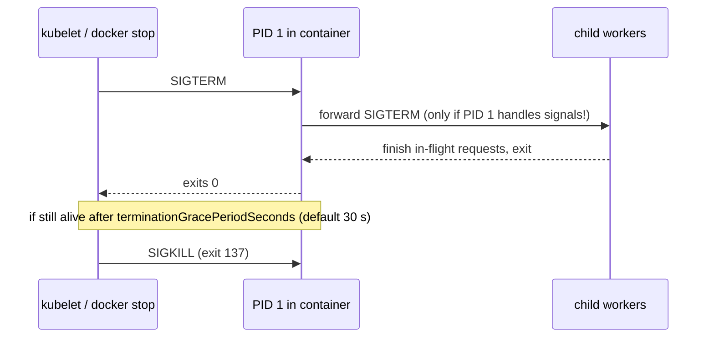
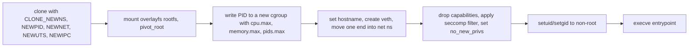
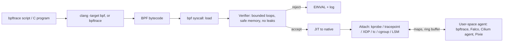

# Linux: Core Concepts

| | |
|---|---|
| **Cluster** | 00 Foundations |
| **Role** | Prerequisite |
| **Prerequisites** | [01-installation-and-setup.md](01-installation-and-setup.md) complete |
| **Target version** | Linux kernel 6.x, systemd 255+, cgroups v2 |
| **Capstone phase** | Phase 1 (Months 1-4) |

> This file explains how Linux works underneath the commands: where files live and why, what a process is and how it is born, dies and is signalled, how systemd supervises everything, how permissions and capabilities constrain root, and how namespaces and cgroups combine into what Docker calls a container. It finishes with the kernel knobs (`sysctl`) and eBPF, which is how the modern observability and security tools in clusters 08 and 09 see inside the kernel.

## 1. The Filesystem Hierarchy

Linux has one tree rooted at `/`. Disks, network shares and virtual kernel filesystems are *mounted* onto directories of that tree. The Filesystem Hierarchy Standard (FHS 3.0) says what goes where; distributions mostly follow it.

| Path | Purpose | Platform-engineer notes |
|---|---|---|
| `/bin`, `/sbin`, `/lib`, `/lib64` | Symlinks to `/usr/...` on merged-`/usr` distros (Ubuntu, Fedora) | `ls -l /bin` shows `-> usr/bin`. Distroless images contain almost nothing here. |
| `/usr` | Read-only OS payload: `/usr/bin`, `/usr/lib`, `/usr/share` | Can be mounted read-only; immutable node images (Bottlerocket, Flatcar) do exactly this. |
| `/usr/local` | Locally installed software, outside the package manager | Where you put `yq`, `kubectl` binaries. |
| `/opt` | Vendor add-on packages | `/opt/aws/`, `/opt/cni/bin` on EKS nodes. |
| `/etc` | Host-specific configuration, text files | Everything you would check into Git. systemd units, sshd config, sysctl drops. |
| `/var` | Variable data: logs, caches, spools, databases | `/var/lib/containerd` holds image layers; `/var/log/journal` the journal; `/var/lib/kubelet` Pod volumes. Disk pressure here evicts Pods. |
| `/home`, `/root` | User home directories | Avoid running services from `/home`. |
| `/tmp`, `/var/tmp` | Temporary files; `/tmp` often tmpfs (RAM), cleared on boot | tmpfs usage counts against memory cgroup limits; a 2 GB file in `/tmp` can OOM a container. |
| `/run` | Runtime state since boot (tmpfs): PID files, sockets | `/run/containerd/containerd.sock`, `/run/systemd/`. |
| `/dev` | Device nodes (devtmpfs) | `/dev/null`, `/dev/urandom`, `/dev/nvme0n1`, `/dev/nvidia0` for GPUs. |
| `/proc` | procfs: process and kernel state as files | `/proc/<pid>/`, `/proc/sys/` (sysctl), `/proc/meminfo`, `/proc/cpuinfo`. |
| `/sys` | sysfs: devices, drivers, kernel objects; `/sys/fs/cgroup` | Where cgroup limits are read and written. |
| `/boot` | Kernel and bootloader | `vmlinuz-*`, `initrd.img-*`. |
| `/srv`, `/mnt`, `/media` | Served data; temporary and removable mounts | Rarely used on cloud nodes. |

### Mounts and filesystems

```bash
findmnt --real            # tree of real (non-virtual) mounts
findmnt /sys/fs/cgroup    # one mount
df -hT                    # usage per mount with fs type
lsblk -f                  # block devices with filesystems and UUIDs
```

Expected (abridged) output of `df -hT` on a cloud VM:

```text
Filesystem     Type   Size  Used Avail Use% Mounted on
/dev/nvme0n1p1 ext4    29G  2.1G   27G   8% /
tmpfs          tmpfs  1.9G     0  1.9G   0% /dev/shm
tmpfs          tmpfs  391M  1.1M  390M   1% /run
/dev/nvme0n1p15 vfat  105M  6.1M   99M   6% /boot/efi
```

Filesystems you will meet:

| Filesystem | Where | Why it matters |
|---|---|---|
| ext4 | Default root on Ubuntu | Journaled; `tune2fs -l` for reserved blocks (5% by default, wasted on data disks). |
| xfs | Default on RHEL, Amazon Linux, many EBS data volumes | Cannot shrink; `xfs_growfs` to grow; project quotas used by containerd for ephemeral-storage limits. |
| overlayfs | Container root filesystems | Stacks read-only *lower* layers (image) with a writable *upper* layer; copy-on-write on first modification of a file. |
| tmpfs | `/run`, `/tmp`, `emptyDir medium: Memory` | RAM-backed; counts against the memory cgroup. |
| procfs, sysfs, cgroup2 | `/proc`, `/sys`, `/sys/fs/cgroup` | Kernel data structures exposed as files. |
| btrfs / zfs | Snapshot-capable; some distros and NAS | Copy-on-write; not typical on cloud nodes. |

Mount options to recognise: `ro` (read-only), `noexec` (no execution, used on `/tmp` and secrets mounts), `nosuid`, `nodev`, `relatime`, `defaults`. Kubernetes `Secret` and `ConfigMap` volumes are tmpfs mounted `ro,noexec,nosuid,nodev`.

### Inodes, links and the "file" abstraction

A *file* is an inode (metadata: owner, mode, timestamps, block pointers) plus zero or more directory entries (names) pointing at it. `ls -i` shows inode numbers. A hard link is a second name for the same inode; a symbolic link is a tiny file containing a path. You can run out of inodes with free space remaining (`df -i`), classically from millions of small files in `/var/lib/docker` or a mail spool.

Deleting a file that a process still has open does not free space; the inode lives until the last file descriptor closes. `lsof +L1` (or `find /proc/*/fd -lname '*(deleted)'`) finds them. This is the number one cause of "disk full but `du` says otherwise".

## 2. Processes

### What a process is

A process is a running program with: a PID, a parent PID, a user and group identity (real, effective, saved, filesystem), a current working directory and root directory, open file descriptors, environment, signal dispositions, resource limits, a set of namespaces, a cgroup, a security context (capabilities, seccomp filter, LSM label), and one or more threads sharing its address space.

Everything above is visible under `/proc/<pid>/`:

```bash
PID=$$              # the current shell
ls /proc/$PID/
cat /proc/$PID/status | head -20
ls -l /proc/$PID/fd
cat /proc/$PID/cgroup
ls -l /proc/$PID/ns
tr '\0' '\n' < /proc/$PID/environ | head
readlink /proc/$PID/exe /proc/$PID/cwd
```

Expected output of `ls -l /proc/$PID/fd` for an interactive shell:

```text
lrwx------ 1 lab lab 64 Oct 27 10:00 0 -> /dev/pts/0
lrwx------ 1 lab lab 64 Oct 27 10:00 1 -> /dev/pts/0
lrwx------ 1 lab lab 64 Oct 27 10:00 2 -> /dev/pts/0
lrwx------ 1 lab lab 64 Oct 27 10:00 255 -> /dev/pts/0
```

FDs 0, 1 and 2 are stdin, stdout, stderr. Redirection (`2>&1`, `> file`) is just the shell rearranging this table before `execve()`.

### Lifecycle: fork, exec, wait, exit

```mermaid
sequenceDiagram
    participant Shell as bash (PID 1000)
    participant K as kernel
    participant Child as child (PID 1001)
    Shell->>K: clone()/fork()
    K-->>Child: identical copy, returns 0
    K-->>Shell: returns 1001
    Child->>K: execve("/usr/bin/ls", argv, envp)
    K-->>Child: address space replaced by ls, same PID, fds preserved
    Shell->>K: waitpid(1001)
    Child->>K: exit(0)
    K-->>Shell: waitpid returns status 0; zombie reaped
```

Key consequences:

- `exec` without fork replaces the current process. In a container entrypoint, `exec "$@"` makes the application PID 1 so it receives signals directly. See [../bash-scripting/](../bash-scripting/README.md).
- A child that exits before its parent calls `wait()` is a **zombie** (`Z` state): a PID and exit status waiting to be collected. Zombies hold no memory but consume PIDs. If the parent dies, the child is re-parented to PID 1 (or the nearest subreaper), which must reap it. Application processes running as PID 1 in a container often do not reap, hence `tini` and `--init`.
- An **orphan** is a living child whose parent died. Harmless.

### Process states

| State (`ps` STAT) | Meaning | Typical cause |
|---|---|---|
| `R` | Running or runnable | On CPU or waiting in run queue |
| `S` | Interruptible sleep | Waiting on I/O, socket, timer; normal for idle servers |
| `D` | Uninterruptible sleep | Waiting on disk/NFS/driver; cannot be killed until the I/O returns; high `D` count means storage trouble |
| `T` / `t` | Stopped (job control) / traced | `SIGSTOP`, `Ctrl-Z`, debugger attached |
| `Z` | Zombie | Parent has not called `wait()` |
| `I` | Idle kernel thread | Ignore |

Load average counts `R` **and** `D` tasks. A load of 30 on a 4-core box with 0% CPU utilisation means processes are stuck in `D` on storage.

### Threads

Linux threads are tasks that share an address space (`clone()` with `CLONE_VM | CLONE_FILES | ...`). Each has its own TID; the process's PID equals the first thread's TID (the thread group leader). `ps -eLf`, `top -H` and `/proc/<pid>/task/` show them. A Java service with 400 platform threads is 400 schedulable tasks; JDK 21 virtual threads are user-space and do not appear here, which is why they scale.

### Priorities and scheduling

- `nice` (-20 high priority to 19 low) adjusts CFS/EEVDF weight. `nice -n 10 cmd`, `renice -n 5 -p <pid>`.
- Real-time classes (`SCHED_FIFO`, `SCHED_RR`) via `chrt`; dangerous, can starve the system.
- cgroup `cpu.weight` (1-10000, default 100) is the container-era equivalent of nice. Kubernetes `requests.cpu` becomes `cpu.weight`; `limits.cpu` becomes `cpu.max` (quota/period). Throttling shows in `cpu.stat` as `nr_throttled`.

## 3. Signals

A signal is an asynchronous notification delivered by the kernel to a process. The process can have a default action, ignore it, or run a handler, except for `SIGKILL` and `SIGSTOP`, which cannot be caught or ignored.

| Signal | Number | Default action | Meaning and typical sender |
|---|---|---|---|
| `SIGHUP` | 1 | Terminate | Terminal closed; many daemons reinterpret as "reload config" (`nginx -s reload` sends it) |
| `SIGINT` | 2 | Terminate | `Ctrl-C` from the terminal |
| `SIGQUIT` | 3 | Core dump | `Ctrl-\`; JVM prints a thread dump instead of dying |
| `SIGKILL` | 9 | Terminate (uncatchable) | `kill -9`; the OOM killer; kubelet after the grace period |
| `SIGSEGV` | 11 | Core dump | Invalid memory access |
| `SIGPIPE` | 13 | Terminate | Writing to a pipe with no reader; `set -o pipefail` and `yes | head` interactions |
| `SIGALRM` | 14 | Terminate | Timer expired (`alarm()`), used by `timeout` |
| `SIGTERM` | 15 | Terminate | Polite "please stop"; `kill` default; `docker stop`; kubelet's first step |
| `SIGCHLD` | 17 | Ignore | Child stopped or exited; parents use it to call `wait()` |
| `SIGSTOP` / `SIGCONT` | 19 / 18 | Stop / continue (uncatchable stop) | Job control, freezing processes |
| `SIGUSR1` / `SIGUSR2` | 10 / 12 | Terminate | Application defined; uvicorn/gunicorn use them for graceful reload |
| `SIGWINCH` | 28 | Ignore | Terminal resized |

Exit codes encode signals: a process killed by signal N exits with `128 + N`. Exit code **137** = 128 + 9 = killed by SIGKILL (almost always the OOM killer or an expired grace period in Kubernetes). **143** = SIGTERM. **139** = SIGSEGV.

```bash
sleep 300 &
kill -TERM %1; wait %1; echo "exit=$?"
```

Expected output:

```text
[1]+  Terminated              sleep 300
exit=143
```

The graceful shutdown contract that Docker and Kubernetes implement:



If PID 1 is a shell script that runs the app without `exec`, the shell receives SIGTERM, ignores it by default (shells ignore SIGTERM when interactive and do not forward it when running a foreground child), and 30 seconds later everything is SIGKILLed. That is the most common cause of slow Pod termination.

## 4. systemd

systemd is PID 1 on every mainstream distribution. It starts the system, supervises services, manages logging (journald), login sessions (logind), time, DNS resolution (resolved), and places every process in a cgroup. kubelet, containerd, sshd, and the cloud agents on every Kubernetes node are systemd services.

### Units

A unit is a text file describing something systemd manages. Types: `.service`, `.socket`, `.timer`, `.mount`, `.target`, `.path`, `.slice`, `.scope`.

| Location | Who writes it | Precedence |
|---|---|---|
| `/usr/lib/systemd/system/` | Package manager | Lowest |
| `/run/systemd/system/` | Runtime generated | Middle |
| `/etc/systemd/system/` | Administrator | Highest |
| `/etc/systemd/system/<unit>.d/*.conf` | Administrator drop-ins | Override individual keys without copying the whole file |

A production-grade service unit for a FastAPI app:

```ini
# /etc/systemd/system/api.service
[Unit]
Description=FastAPI inventory API
Documentation=https://example.com/runbooks/api
After=network-online.target
Wants=network-online.target
StartLimitIntervalSec=60
StartLimitBurst=5

[Service]
Type=notify                       # app calls sd_notify(READY=1); use 'simple' if it does not
User=api
Group=api
DynamicUser=no
WorkingDirectory=/opt/api
EnvironmentFile=-/etc/api/env    # '-' means optional
ExecStart=/opt/api/.venv/bin/uvicorn app.main:app --host 127.0.0.1 --port 8000 --workers 2
ExecReload=/bin/kill -HUP $MAINPID
Restart=on-failure
RestartSec=2s
TimeoutStopSec=20s
KillSignal=SIGTERM
KillMode=mixed                    # SIGTERM to main, SIGKILL to the rest at timeout

# Resource control (cgroup v2)
MemoryMax=512M
MemoryHigh=448M
CPUQuota=150%
TasksMax=256

# Sandboxing
NoNewPrivileges=yes
ProtectSystem=strict
ProtectHome=yes
PrivateTmp=yes
PrivateDevices=yes
ProtectKernelTunables=yes
ProtectKernelModules=yes
ProtectControlGroups=yes
RestrictAddressFamilies=AF_INET AF_INET6 AF_UNIX
RestrictNamespaces=yes
LockPersonality=yes
MemoryDenyWriteExecute=yes
SystemCallFilter=@system-service
SystemCallErrorNumber=EPERM
CapabilityBoundingSet=
AmbientCapabilities=
ReadWritePaths=/var/lib/api
UMask=0077

[Install]
WantedBy=multi-user.target
```

Every sandboxing line maps to a kernel primitive you will meet below: `User=` (uid), `CapabilityBoundingSet=` (capabilities), `SystemCallFilter=` (seccomp), `PrivateTmp=`/`ProtectSystem=` (mount namespace), `MemoryMax=` (cgroup). `systemd-analyze security api.service` scores the unit from 0 (safe) to 10 (exposed).

### Dependency and ordering

`After=`/`Before=` order units; `Wants=`/`Requires=` pull them in. A common mistake is `After=network.target` expecting the network to be usable; use `network-online.target` with `Wants=`.

### Targets and boot

Targets replace runlevels: `multi-user.target` (text, services), `graphical.target`, `rescue.target`. `systemctl get-default`, `systemd-analyze blame` and `systemd-analyze critical-chain` show boot time.

### journald

All stdout/stderr from services and kernel messages go to the journal, indexed by unit, PID, priority, boot. `journalctl -u api -f`, `journalctl -p err -b`, `journalctl --since "1 hour ago" _COMM=sshd`. Output is structured; `-o json` yields fields you can pipe to `jq`. Retention is governed by `/etc/systemd/journald.conf` (`SystemMaxUse=`). Cluster 09 ships these to Loki via Promtail/Alloy reading the journal.

### Timers

Replace cron with units you can inspect and log:

```ini
# /etc/systemd/system/backup.timer
[Unit]
Description=Nightly backup
[Timer]
OnCalendar=*-*-* 02:00:00
RandomizedDelaySec=15m
Persistent=true
[Install]
WantedBy=timers.target
```

`systemctl list-timers --all` shows next/last run.

## 5. Users, Groups and Permissions

### Identity

Every process runs with a uid and gid plus supplementary groups. `/etc/passwd`, `/etc/group`, `/etc/shadow` (hashed passwords, root-readable only). `id`, `getent passwd api`. System accounts use uids below 1000 and `nologin` shells. In a container, the uid is just a number: `runAsUser: 10001` needs no `/etc/passwd` entry unless the app looks up its home directory (Java and some Python libraries do; add a passwd line or set `HOME`).

### Mode bits

```text
-rwxr-x--- 1 api api 4096 Oct 27 10:00 run.sh
 ^^^ ^^^ ^^^
 owner group other
```

| Bit | File | Directory |
|---|---|---|
| r (4) | Read contents | List entries |
| w (2) | Modify contents | Create/delete/rename entries (needs x too) |
| x (1) | Execute | Traverse (enter, access entries by name) |
| setuid (4000) | Run with owner's euid (`/usr/bin/passwd`, `sudo`) | Ignored |
| setgid (2000) | Run with owner group's egid | New files inherit the directory's group |
| sticky (1000) | Ignored | Only owner may delete their files (`/tmp`) |

`chmod 0750 run.sh`, `chmod u+s`, `chmod g+s dir`, `chown api:api -R /opt/api`. The `umask` (default 022) removes bits from newly created files; services should use 027 or 077. `find / -perm -4000 -type f 2>/dev/null` lists setuid binaries; minimal images should have none (Trivy and Kyverno can flag them).

### ACLs and extended attributes

POSIX ACLs give per-user grants beyond owner/group/other: `setfacl -m u:deploy:rx /opt/api`, `getfacl`. Extended attributes (`getfattr -d`) store SELinux labels and file capabilities.

### sudo

`/etc/sudoers.d/` drop-ins, edited with `visudo -f`. Grant specific commands, not `ALL`:

```text
deploy ALL=(root) NOPASSWD: /usr/bin/systemctl restart api.service, /usr/bin/journalctl -u api.service *
```

`sudo -l` shows what you may run. Logs land in the journal (`journalctl _COMM=sudo`).

## 6. Capabilities

Traditionally root (uid 0) could do everything. Capabilities split root's power into about 41 independent bits (`man 7 capabilities`) so a process can bind port 80 without being able to load kernel modules.

| Capability | Lets you | Who legitimately needs it |
|---|---|---|
| `CAP_NET_BIND_SERVICE` | Bind ports below 1024 | Web servers (or just listen on 8080 and let the LB map) |
| `CAP_NET_ADMIN` | Configure interfaces, routes, iptables | CNI plugins, kube-proxy, VPN agents |
| `CAP_NET_RAW` | Raw sockets (ping, tcpdump) | Diagnostics; dropped by default in modern Kubernetes |
| `CAP_SYS_ADMIN` | Mount, many namespace ops, "the new root" | Container runtimes, almost nothing else |
| `CAP_SYS_PTRACE` | `ptrace` other processes (`strace`, debuggers) | Debug sidecars |
| `CAP_CHOWN`, `CAP_DAC_OVERRIDE`, `CAP_FOWNER` | Change owners, bypass file permissions | Package managers, init containers fixing volume ownership |
| `CAP_SETUID`, `CAP_SETGID` | Change uid/gid | `su`, `sudo`, entrypoints that drop privileges (gosu) |
| `CAP_KILL` | Signal any process | Process supervisors |
| `CAP_SYS_TIME` | Set the clock | chrony/NTP only |
| `CAP_BPF`, `CAP_PERFMON` | Load BPF programs, perf | Falco, Cilium, profilers (replaces needing `CAP_SYS_ADMIN`) |

Each thread has five sets: **Permitted**, **Effective**, **Inheritable**, **Bounding** (upper limit), **Ambient** (preserved across `execve` for non-root). Files can carry capabilities too (`setcap cap_net_bind_service=+ep /usr/bin/myserver`; `getcap -r / 2>/dev/null`).

```bash
grep Cap /proc/$$/status
capsh --decode=000001ffffffffff
```

Expected output for a root shell: `CapEff: 000001ffffffffff` decoding to the full list. A Docker container's default set is 14 capabilities; a Pod with `capabilities.drop: [ALL]` has zero. `NoNewPrivileges` / `allowPrivilegeEscalation: false` sets the `no_new_privs` bit so `execve` of a setuid or file-capability binary cannot regain anything.

### seccomp

seccomp-BPF filters system calls per process. Docker's default profile blocks about 44 of roughly 350 syscalls (`mount`, `reboot`, `kexec_load`, `ptrace` in older profiles...). Kubernetes `seccompProfile: {type: RuntimeDefault}` applies the runtime's default. `grep Seccomp /proc/<pid>/status` shows mode 0 (off), 1 (strict), 2 (filter). systemd's `SystemCallFilter=@system-service` is the same mechanism with named groups.

### LSMs: AppArmor and SELinux

Linux Security Modules add mandatory access control on top of discretionary permissions. Ubuntu/Debian/SUSE use **AppArmor** (path-based profiles, `aa-status`, `/etc/apparmor.d/`); Fedora/RHEL/Amazon Linux use **SELinux** (label-based, `getenforce`, `ls -Z`, `ausearch -m AVC`, `setsebool`, `semanage fcontext`). Containers get `container_t` labels on SELinux hosts; a volume mount that fails with "Permission denied" despite correct mode bits is usually a label problem (`:z`/`:Z` mount flags in Docker, `seLinuxOptions` in Kubernetes).

## 7. Namespaces

A namespace wraps a global resource so that processes inside see their own instance. There are eight:

| Namespace | `clone()` flag | Isolates | Docker / Kubernetes behaviour |
|---|---|---|---|
| Mount (`mnt`) | `CLONE_NEWNS` | Mount table | Container rootfs via overlayfs + `pivot_root` |
| PID | `CLONE_NEWPID` | Process IDs; first process is PID 1 | Each container has its own PID 1; `shareProcessNamespace: true` shares it across a Pod |
| Network (`net`) | `CLONE_NEWNET` | Interfaces, routes, iptables, sockets, ports | One per Pod, shared by its containers; `hostNetwork: true` opts out |
| UTS | `CLONE_NEWUTS` | Hostname, domain name | Container hostname = Pod name |
| IPC | `CLONE_NEWIPC` | SysV IPC, POSIX message queues | Per Pod |
| User | `CLONE_NEWUSER` | uid/gid mappings; capabilities scoped to the ns | Rootless Docker/Podman; Kubernetes `hostUsers: false` (user namespaces, beta in 1.30+) |
| cgroup | `CLONE_NEWCGROUP` | View of the cgroup hierarchy root | Container sees `/` as its own cgroup |
| Time | `CLONE_NEWTIME` | `CLOCK_MONOTONIC`/`BOOTTIME` offsets | Used by CRIU checkpoint/restore |

Namespaces are visible as symlinks in `/proc/<pid>/ns/`; two processes are in the same namespace if the inode numbers match.

```bash
sudo ls -l /proc/1/ns/ /proc/$$/ns/ | awk '{print $9, $10, $11}'
lsns -t net
```

Expected output of `lsns -t net` on a host running one container:

```text
        NS TYPE NPROCS   PID USER COMMAND
4026531840 net     180     1 root /sbin/init
4026532285 net       3  4121 root nginx: master process nginx
```

Tools: `unshare` (create), `nsenter --target <pid> --net --mount` (join), `ip netns` (named network namespaces in `/run/netns`). `kubectl debug` and `docker exec` are `nsenter` with policy. See Lab 6 and Lab 8 in [04-hands-on-labs.md](04-hands-on-labs.md).

### User namespaces and rootless containers

A user namespace maps uid 0 inside to an unprivileged uid outside (`/proc/<pid>/uid_map`, `/etc/subuid`). Root inside has capabilities only over resources owned by that namespace. This is how Podman and rootless Docker run without a privileged daemon, and why `unshare --user --map-root-user` worked in the setup verification without `sudo`.

## 8. cgroups v2

Control groups organise processes into a hierarchy and attach **controllers** that account for and limit resources. cgroups v2 (unified hierarchy, default since Ubuntu 21.10, Fedora 31, RHEL 9, EKS AL2023) has a single tree at `/sys/fs/cgroup`.

```text
/sys/fs/cgroup/
├── cgroup.controllers          # controllers available here: cpuset cpu io memory hugetlb pids rdma misc
├── cgroup.subtree_control      # which are enabled for children
├── system.slice/               # systemd services
│   ├── containerd.service/
│   └── ssh.service/
├── user.slice/                 # login sessions
└── kubepods.slice/             # kubelet (systemd cgroup driver)
    ├── kubepods-burstable.slice/
    │   └── kubepods-burstable-pod<UID>.slice/
    │       └── cri-containerd-<ID>.scope/
    │           ├── cpu.max            # "50000 100000" = 0.5 CPU
    │           ├── cpu.stat           # nr_throttled, throttled_usec
    │           ├── memory.max         # bytes or "max"
    │           ├── memory.current
    │           ├── memory.events      # low high max oom oom_kill
    │           └── pids.max
    └── kubepods-besteffort.slice/
```

Key files per controller:

| Controller | File | Meaning |
|---|---|---|
| cpu | `cpu.max` | `$QUOTA $PERIOD` in microseconds; `max 100000` = unlimited. 0.5 CPU = `50000 100000` |
| cpu | `cpu.weight` | Proportional share 1-10000 when contended (Kubernetes `requests.cpu`) |
| cpu | `cpu.stat` | `nr_throttled`, `throttled_usec`: the signal that a limit is hurting latency |
| memory | `memory.max` | Hard limit; exceeding triggers reclaim then OOM kill |
| memory | `memory.high` | Soft throttle threshold; process slowed, not killed |
| memory | `memory.current`, `memory.stat` | Usage incl. page cache (`file`), anonymous (`anon`), kernel |
| memory | `memory.events` | `oom_kill` counter; `memory.oom.group` kills the whole group |
| memory | `memory.swap.max` | Swap allowance (Kubernetes disables swap by default; 1.30+ allows limited) |
| pids | `pids.max`, `pids.current` | Fork-bomb protection |
| io | `io.max`, `io.stat` | Per-device bandwidth/IOPS limits |
| cpuset | `cpuset.cpus`, `cpuset.mems` | Pin to CPUs/NUMA nodes (Kubernetes static CPU manager policy) |

Processes are moved by writing a PID to `cgroup.procs`. Only leaf cgroups hold processes ("no internal process" rule), which is why systemd creates `.slice` containers and `.scope`/`.service` leaves.

The memory limit includes page cache. A container that reads a 2 GB file will show `memory.current` near its limit even though its heap is small; the kernel reclaims cache before OOM-killing, so this is usually fine, but it confuses dashboards that graph `container_memory_usage_bytes`. Graph `container_memory_working_set_bytes` (usage minus inactive file cache), which is what the OOM decision is based on.

The OOM killer picks the process with the highest `oom_score` within the cgroup (`/proc/<pid>/oom_score`, adjustable with `oom_score_adj` -1000 to 1000). Kubernetes sets `oom_score_adj` by QoS class: Guaranteed -997, BestEffort 1000, Burstable in between.

### cgroups v1 vs v2

| Aspect | v1 | v2 |
|---|---|---|
| Hierarchy | One tree per controller (`/sys/fs/cgroup/memory/...`) | Single unified tree |
| CPU limit | `cpu.cfs_quota_us`, `cpu.cfs_period_us` | `cpu.max` |
| Memory | `memory.limit_in_bytes`, counts differ | `memory.max`, `memory.high`, PSI |
| Pressure stall info | No | `cpu.pressure`, `memory.pressure`, `io.pressure` |
| Rootless / delegation | Awkward | Designed in |
| Kubernetes | Supported, being phased out (1.31 deprecates v1) | Required for swap, PSI metrics |

## 9. A Container Is Just This



runc executes exactly this sequence from the OCI runtime spec `config.json`. Lab 8 does it by hand with `unshare`, `mount`, `pivot_root`, `cgroup.procs`, `capsh` and `ip link`. Once you have done that, every `docker run` flag and every Pod `securityContext` field is just a parameter to one of those steps.

## 10. Package Managers

| | apt (Debian/Ubuntu) | dnf (Fedora/RHEL/AL2023) | apk (Alpine) |
|---|---|---|---|
| Package format | `.deb`, database in `/var/lib/dpkg` | `.rpm`, database in `/var/lib/rpm` | `.apk` (tar.gz + signature), database `/lib/apk/db` |
| Refresh metadata | `apt-get update` | `dnf makecache` (automatic) | `apk update` |
| Install | `apt-get install -y pkg` | `dnf install -y pkg` | `apk add pkg` |
| Install without cache (images) | `apt-get install -y --no-install-recommends pkg && rm -rf /var/lib/apt/lists/*` | `dnf install -y pkg && dnf clean all` | `apk add --no-cache pkg` |
| Remove | `apt-get purge pkg && apt-get autoremove` | `dnf remove pkg` | `apk del pkg` |
| Search | `apt-cache search`, `apt search` | `dnf search` | `apk search` |
| Which package owns a file | `dpkg -S /path` | `rpm -qf /path` | `apk info --who-owns /path` |
| List files in package | `dpkg -L pkg` | `rpm -ql pkg` | `apk info -L pkg` |
| List installed | `dpkg -l`, `apt list --installed` | `rpm -qa`, `dnf list installed` | `apk info` |
| Security updates only | `unattended-upgrades` | `dnf --security upgrade` | `apk upgrade` (Alpine tracks branches) |
| Pin version | `apt-get install pkg=1.2.3-1`; `/etc/apt/preferences.d/` | `dnf install pkg-1.2.3`; `versionlock` plugin | `apk add pkg=1.2.3-r0` |
| Verify integrity | `debsums` | `rpm -V pkg` | `apk verify` |
| Repo config | `/etc/apt/sources.list.d/*.sources`, keys in `/etc/apt/keyrings/` | `/etc/yum.repos.d/*.repo`, GPG keys | `/etc/apk/repositories` |

Why platform engineers care: Trivy, Grype and Syft read these databases to build the SBOM and match CVEs. `rm -rf /var/lib/apt/lists/*` after install shrinks the image; deleting `/var/lib/dpkg` would break scanning. Distroless images have no package manager at all, which removes an attack surface and is why they appear in cluster 04.

Adding a third-party apt repo securely (signed-by, not the deprecated `apt-key`):

```bash
sudo install -m 0755 -d /etc/apt/keyrings
curl -fsSL https://download.docker.com/linux/ubuntu/gpg | sudo gpg --dearmor -o /etc/apt/keyrings/docker.gpg
echo "deb [arch=$(dpkg --print-architecture) signed-by=/etc/apt/keyrings/docker.gpg] https://download.docker.com/linux/ubuntu $(. /etc/os-release && echo "$VERSION_CODENAME") stable" | sudo tee /etc/apt/sources.list.d/docker.list > /dev/null
```

## 11. Text Processing

The Unix philosophy: small tools, text streams, pipes. Cluster 06 pipelines and cluster 00 Bash scripts are mostly these five tools.

| Tool | Model | Use it for |
|---|---|---|
| `grep` | Filter lines by regex | Finding things; `-E` extended, `-P` PCRE, `-o` matched part, `-r` recursive, `-c` count, `-v` invert, `-n` line numbers |
| `sed` | Stream editor: per-line program | Substitution `s/a/b/g`, deletion `/pat/d`, in-place `-i`, print ranges `-n '10,20p'` |
| `awk` | Per-record program with fields `$1..$NF`, `BEGIN`/`END`, associative arrays | Column extraction, sums, group-by, report formatting |
| `jq` | Functional query language over JSON | Every cloud and Kubernetes CLI emits JSON |
| `yq` (mikefarah) | jq-like over YAML (and JSON, XML, TOML) | Kubernetes manifests, Helm values, GitHub workflows |

Companions: `cut`, `sort`, `uniq -c`, `tr`, `wc`, `head`/`tail -f`, `xargs`, `paste`, `column -t`, `comm`, `diff`, `tee`.

Representative idioms:

```bash
# Top 10 IPs in an nginx log
awk '{print $1}' access.log | sort | uniq -c | sort -rn | head -10

# Sum RSS (KB) of all java processes
ps -eo rss,comm | awk '$2=="java"{s+=$1} END{print s/1024 " MB"}'

# Replace an image tag in all manifests
sed -i -E 's#(ghcr.io/example/api):[0-9a-z.-]+#\1:v1.4.2#g' deploy/*.yaml

# Pods not Running, as TSV
kubectl get pods -A -o json | jq -r '.items[] | select(.status.phase!="Running") | [.metadata.namespace,.metadata.name,.status.phase] | @tsv'

# Set a value in YAML in place
yq -i '.spec.template.spec.containers[0].resources.limits.memory = "512Mi"' deploy/api.yaml
```

Note `-E` for extended regex in `sed`/`grep` and `#` as the `s` delimiter when the pattern contains `/`. GNU vs BSD differences (macOS) bite on `sed -i` (BSD needs `-i ''`).

## 12. Performance Tools and the USE Method

Brendan Gregg's **USE method**: for every resource (CPU, memory, disk, network), check **U**tilisation, **S**aturation, **E**rrors.

| Resource | Utilisation | Saturation | Errors | Tools |
|---|---|---|---|---|
| CPU | `%usr+%sys` (`mpstat -P ALL 1`) | Run queue `r` in `vmstat 1`, `cpu.pressure` | `perf stat` | `top`, `htop`, `mpstat`, `pidstat 1`, `perf top` |
| Memory | `free -m`, `memory.current` | Swapping `si/so`, reclaim, `memory.pressure` | OOM kills in `dmesg -T`, `memory.events` | `vmstat 1`, `free`, `smem`, `pmap` |
| Disk | `%util` in `iostat -xz 1` | `aqu-sz`, `await` ms, `io.pressure` | `dmesg`, SMART | `iostat`, `iotop`, `biolatency` (bcc) |
| Network | Throughput vs NIC speed (`sar -n DEV 1`) | Retransmits, drops (`ss -s`, `nstat`, `ethtool -S`) | `ip -s link` errors | `ss`, `sar`, `nstat`, `tcpretrans` (bcc) |
| File descriptors | `ls /proc/<pid>/fd \| wc -l` vs `ulimit -n` | | `EMFILE` in logs | `lsof -p` |

Tool roles:

- `top`/`htop`: live overview; in `top` press `1` for per-CPU, `M`/`P` to sort, `c` for full command, `H` for threads. `htop` shows cgroup with F2 setup.
- `vmstat 1`: the first line is since boot; watch `r` (runnable), `b` (blocked in D), `si/so` (swap), `us/sy/id/wa/st` (`st` steal = hypervisor took CPU, common on burstable cloud instances out of credits).
- `iostat -xz 1`: per-device `r/s w/s rkB/s wkB/s await aqu-sz %util`.
- `pidstat -d 1`, `pidstat -w 1` (context switches), `pidstat -t -p <pid> 1` (threads).
- `ss -tulpn` (listening), `ss -tan state established '( dport = :5432 )'`, `ss -ti` (TCP internals: rtt, cwnd, retrans).
- `strace -f -tt -T -e trace=network,file -p <pid>`: see every syscall with timestamps and durations. Overhead is heavy (10-100x slowdown); never leave it on in production. `strace -c` summarises.
- `ltrace`: library calls. `ldd <binary>`: shared library resolution.
- `perf top -g`, `perf record -F 99 -g -p <pid> -- sleep 30 && perf report`, then flame graphs (`perf script | stackcollapse-perf.pl | flamegraph.pl > out.svg`). `perf trace` is a low-overhead strace.
- `/proc/pressure/{cpu,memory,io}` (PSI): `some avg10=2.31` means in the last 10 s, some tasks were stalled 2.31% of the time. The single best saturation metric; node_exporter exposes it.

## 13. Kernel Tuning with sysctl

`sysctl` reads and writes `/proc/sys`. Persistent settings live in `/etc/sysctl.d/*.conf`, applied at boot and by `sysctl --system`.

```bash
sysctl net.ipv4.ip_local_port_range
sudo sysctl -w net.core.somaxconn=4096
cat /proc/sys/net/core/somaxconn
```

Parameters that matter for the services in this roadmap:

| Parameter | Default | Typical production | Why |
|---|---|---|---|
| `net.core.somaxconn` | 4096 | 4096-65535 | Max accept-queue backlog; uvicorn/nginx `backlog` cannot exceed it |
| `net.ipv4.tcp_max_syn_backlog` | 1024-4096 | 8192+ | SYN queue under connection bursts |
| `net.ipv4.ip_local_port_range` | `32768 60999` | `1024 65535` | More ephemeral ports for proxies and clients making many outbound connections |
| `net.ipv4.tcp_tw_reuse` | 2 | 1 | Reuse TIME_WAIT sockets for outbound (safe with timestamps); never use `tcp_tw_recycle` (removed) |
| `net.ipv4.tcp_fin_timeout` | 60 | 15-30 | Faster FIN_WAIT2 cleanup |
| `net.ipv4.tcp_keepalive_time` | 7200 | 300-600 | Detect dead peers behind NAT/LBs (AWS NLB idle timeout 350 s) |
| `net.ipv4.ip_forward` | 0 | 1 on nodes | Required for container networking |
| `net.bridge.bridge-nf-call-iptables` | 1 | 1 on nodes | Bridge traffic traverses iptables (kube-proxy depends on it) |
| `net.netfilter.nf_conntrack_max` | 65536 (scales with RAM) | 262144-1048576 | "nf_conntrack: table full, dropping packet" on busy nodes |
| `fs.file-max` | ~9 million | leave | System-wide fd limit; per-process `ulimit -n` matters more |
| `fs.inotify.max_user_watches` / `max_user_instances` | 65536 / 128 | 524288 / 8192 | IDEs, Argo CD, kubelet, log shippers each hold inotify watches; `too many open files` from inotify exhaustion is common on nodes |
| `vm.max_map_count` | 65530 | 262144 | Required by Elasticsearch/OpenSearch; helps JVMs with many threads |
| `vm.swappiness` | 60 | 0-10 on nodes (swap off) | Prefer reclaiming cache over swapping anonymous memory |
| `vm.overcommit_memory` | 0 | 0 (1 for Redis) | Heuristic overcommit |
| `kernel.pid_max` | 4194304 (64-bit) | leave | PID exhaustion is rare on v2 with `pids.max` |
| `kernel.panic`, `kernel.panic_on_oops` | 0 | 10 / 1 on nodes | Auto-reboot a wedged node so the ASG replaces it |
| `kernel.perf_event_paranoid` | 4 (Ubuntu) / 2 | 2 | Who may use perf; -1 only on labs |

A drop-in for a Kubernetes node:

```ini
# /etc/sysctl.d/90-kubernetes-node.conf
net.ipv4.ip_forward = 1
net.bridge.bridge-nf-call-iptables = 1
net.bridge.bridge-nf-call-ip6tables = 1
net.ipv4.ip_local_port_range = 1024 65535
net.core.somaxconn = 16384
net.ipv4.tcp_max_syn_backlog = 8192
net.netfilter.nf_conntrack_max = 524288
fs.inotify.max_user_watches = 524288
fs.inotify.max_user_instances = 8192
vm.max_map_count = 262144
vm.swappiness = 0
kernel.panic = 10
kernel.panic_on_oops = 1
```

In Kubernetes, *safe* sysctls (namespaced: `kernel.shm*`, `kernel.msg*`, `kernel.sem`, `fs.mqueue.*`, `net.*`) can be set per Pod in `securityContext.sysctls`; unsafe ones need kubelet `--allowed-unsafe-sysctls`. Node-level ones go in the launch template user data or a DaemonSet with a privileged init container (the latter is an **insecure shortcut**; prefer the image).

Resource limits per process (`ulimit`, `/etc/security/limits.d/`, systemd `LimitNOFILE=`): `nofile` (open files, default soft 1024 on older distros, 1048576 on containerd-managed containers), `nproc`, `core`, `memlock` (needed by eBPF tools and some databases).

## 14. eBPF Introduction

eBPF lets you load small, verified programs into the kernel and attach them to hooks (kprobes, tracepoints, uprobes, XDP, tc, cgroup sockets, LSM hooks) without modules or reboots. The **verifier** proves termination and memory safety before loading; a JIT compiles to native code. Programs communicate with user space through **maps** (hash, array, ring buffer, LRU).



Why it matters in this roadmap:

| Cluster | Tool | What eBPF does there |
|---|---|---|
| 04 Containers | Cilium | Replaces kube-proxy iptables with eBPF maps; NetworkPolicy at L3-L7; Hubble flow visibility |
| 08 DevSecOps | Falco (modern eBPF probe) | Traces syscalls (`execve`, `openat`, `connect`) and matches rules such as "shell spawned in container" |
| 09 Observability | Pixie, Grafana Beyla, Parca | Auto-instrument HTTP/gRPC latency and CPU profiles without SDK changes |
| 10 AI infra | DCGM is not eBPF, but `bpftrace` finds GPU-driver stalls on the host | |

First tools:

```bash
# Which processes are opening files right now?
sudo bpftrace -e 'tracepoint:syscalls:sys_enter_openat { printf("%-16s %s\n", comm, str(args->filename)); }'

# Histogram of read() sizes by process
sudo bpftrace -e 'tracepoint:syscalls:sys_exit_read /args->ret > 0/ { @bytes[comm] = hist(args->ret); }'

# bcc tools (Ubuntu names end with -bpfcc)
sudo execsnoop-bpfcc            # every new process
sudo opensnoop-bpfcc -p <pid>   # files a process opens
sudo tcpconnect-bpfcc           # outbound TCP connects
sudo biolatency-bpfcc 5 1       # block I/O latency histogram
sudo runqlat-bpfcc 5 1          # scheduler run-queue latency: CPU saturation proof
```

Expected output of `execsnoop-bpfcc` while someone runs `ls` in another shell:

```text
PCOMM            PID     PPID    RET ARGS
ls               12873   12001     0 /usr/bin/ls --color=auto
```

Requirements: kernel 5.8+ for `CAP_BPF`/`CAP_PERFMON` (otherwise `CAP_SYS_ADMIN`), BTF enabled (`/sys/kernel/btf/vmlinux` exists on Ubuntu/Fedora; this is what makes CO-RE "compile once, run everywhere" possible), `memlock` ulimit raised on older kernels.

## 15. SSH

SSH is how you reach nodes, how Git authenticates and (in this wiki) how commits are signed. The protocol: TCP 22, key exchange (curve25519-sha256), host authentication (server key, pinned in `~/.ssh/known_hosts`), user authentication (public key, certificate, password, or hardware key), then an encrypted channel multiplexing shells, port forwards and agent forwarding.

Concepts to internalise now; hardening is in [05-production-patterns.md](05-production-patterns.md):

- **Keys:** `ed25519` by default; RSA only for legacy systems (4096 bits). Private keys never leave the workstation; use the agent (`ssh-add`) and `ForwardAgent` sparingly (a compromised bastion can use your forwarded agent). Prefer `ProxyJump` over agent forwarding.
- **Host keys:** first connection trust-on-first-use; in fleets use SSH **certificates** (an SSH CA signs host and user keys; `TrustedUserCAKeys`, `HostCertificate`) or AWS SSM Session Manager and no inbound 22 at all.
- **Config:** `~/.ssh/config` per-host settings; `sshd_config` on servers with `Include /etc/ssh/sshd_config.d/*.conf`.
- **Tunnels:** `-L 5432:db.internal:5432` (local forward, reach a private DB), `-R` (reverse), `-D 1080` (SOCKS). `-J bastion` jumps through a host.
- **Signing:** `ssh-keygen -Y sign` is what Git uses for SSH-signed commits in [../git/](../git/README.md).

## Summary: Primitive to Cloud Mapping

| Kernel primitive | Appears in Docker as | Appears in Kubernetes as | Appears in AWS as |
|---|---|---|---|
| Namespaces | container | Pod sandbox | Fargate task (microVM + namespaces) |
| cgroups | `--cpus/--memory` | `resources` | ECS task size, EC2 instance size |
| Capabilities / seccomp / LSM | `--cap-drop`, `--security-opt` | `securityContext` | Lambda sandbox (Firecracker + seccomp) |
| overlayfs | image layers | image layers via containerd | ECR stores the layers |
| systemd | n/a (`tini` as PID 1) | kubelet + containerd are systemd units | EC2 user-data configures them |
| sysctl | `--sysctl` | `securityContext.sysctls`, node image | Launch template |
| eBPF | n/a | Cilium, Falco, Beyla | Not exposed on Fargate/Lambda |

Next: [03-commands-and-cheatsheet.md](03-commands-and-cheatsheet.md), then prove it all in [04-hands-on-labs.md](04-hands-on-labs.md).
