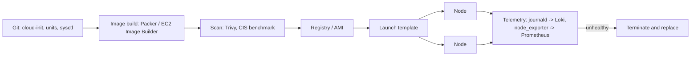

# Linux: Production Patterns

| | |
|---|---|
| **Cluster** | 00 Foundations |
| **Role** | Prerequisite |
| **Prerequisites** | [04-hands-on-labs.md](04-hands-on-labs.md) Labs 3-8 |
| **Target version** | Ubuntu 24.04 LTS / Amazon Linux 2023 / Bottlerocket 1.2x; OpenSSH 9.6+; systemd 255+ |
| **Capstone phase** | Phase 1 (Months 1-4), reused in Phases 2-5 |

> How Linux is run in production: hardened SSH, immutable or minimal node images, systemd service baselines, kernel tuning, patching, logging, time, and the anti-patterns that cause outages. Every pattern names the kernel primitive behind it and the later cluster where it is automated.

## 1. The Principle: Nodes Are Cattle, Configuration Is Code

Production Linux hosts are not logged into and edited. They are built from an image (AMI, VM template, container base image), configured on first boot by cloud-init or user data, observed through telemetry, and replaced rather than repaired. The three implications:

1. Every change is in Git: cloud-init, sysctl drop-ins, systemd units, sshd config. Cluster 05 (Terraform launch templates) and cluster 06 (image build pipelines with Packer or EC2 Image Builder) automate the delivery.
2. Access is the exception. Session Manager, `kubectl debug node/`, or a break-glass bastion with short-lived certificates; never shared SSH keys.
3. Drift is a defect. If a node differs from its image, terminate it. Autoscaling groups and Karpenter make this cheap.



## 2. Choosing a Base: Node Images and Container Bases

| Option | What it is | Pros | Cons | Use for |
|---|---|---|---|---|
| Ubuntu 24.04 LTS (minimal) | General-purpose, apt | Familiar, huge package set, 5-10 year support with Pro | Larger surface; needs hardening | Bastions, build agents, dev VMs |
| Amazon Linux 2023 | AWS-tuned, dnf, SELinux enforcing by default | EKS-optimised AMIs, fast kernel updates, cgroups v2 | AWS-only | EKS managed node groups |
| Bottlerocket | Purpose-built container OS: read-only root, API-driven, no shell or package manager by default, automatic atomic updates | Minimal attack surface, immutable, SELinux enforcing | Debugging through admin/control containers only | EKS nodes in production |
| Flatcar Container Linux | Immutable, auto-updating, Ignition-configured | Cloud-agnostic Bottlerocket alternative | Smaller ecosystem | Multi-cloud Kubernetes nodes |
| Distroless (`gcr.io/distroless/*`) | Container base with only runtime libs; no shell, no package manager | Tiny CVE count; attacker gets no tools | Harder debugging (use ephemeral debug containers) | FastAPI and Spring Boot runtime stages |
| Alpine | musl + BusyBox; 5 MB | Small; `apk` | musl DNS and performance quirks; glibc-only wheels break Python | Build stages, tooling images |
| Chainguard / Wolfi | Distroless-style, apk-based, daily rebuilt, SBOM included | Near-zero CVEs; signed | Paid for versioned tags | Enterprise runtime bases |

The capstone: distroless runtime for both services (`gcr.io/distroless/python3-debian12:nonroot`, `gcr.io/distroless/java21-debian12:nonroot`), Bottlerocket for EKS nodes. Record the decision in `docs/adrs/0001-base-image-and-runtime-user.md`.

## 3. SSH Hardening

### Server (`/etc/ssh/sshd_config.d/10-hardening.conf`)

```text
# Protocol and keys
HostKey /etc/ssh/ssh_host_ed25519_key
KexAlgorithms sntrup761x25519-sha512@openssh.com,curve25519-sha256,curve25519-sha256@libssh.org
Ciphers chacha20-poly1305@openssh.com,aes256-gcm@openssh.com,aes128-gcm@openssh.com
MACs hmac-sha2-512-etm@openssh.com,hmac-sha2-256-etm@openssh.com
HostKeyAlgorithms ssh-ed25519,ssh-ed25519-cert-v01@openssh.com
PubkeyAcceptedAlgorithms ssh-ed25519,ssh-ed25519-cert-v01@openssh.com,rsa-sha2-512,rsa-sha2-256

# Authentication
PermitRootLogin no
PasswordAuthentication no
KbdInteractiveAuthentication no
ChallengeResponseAuthentication no
PubkeyAuthentication yes
AuthenticationMethods publickey
PermitEmptyPasswords no
MaxAuthTries 3
LoginGraceTime 20
MaxSessions 4
MaxStartups 10:30:60
AllowGroups ssh-users

# Session
ClientAliveInterval 300
ClientAliveCountMax 2
X11Forwarding no
AllowAgentForwarding no
AllowTcpForwarding local
PermitTunnel no
PermitUserEnvironment no
UseDNS no
Banner /etc/issue.net
LogLevel VERBOSE

# Optional: SSH certificate authority for users (replaces authorized_keys sprawl)
# TrustedUserCAKeys /etc/ssh/user_ca.pub
# AuthorizedPrincipalsFile /etc/ssh/principals/%u
```

Apply safely so you do not lock yourself out:

```bash
sudo groupadd -f ssh-users && sudo usermod -aG ssh-users "$USER"
sudo sshd -t && sudo systemctl reload ssh          # test, then reload (existing sessions survive)
# in a SECOND terminal, confirm you can still log in before closing the first
sudo sshd -T | grep -iE '^(permitrootlogin|passwordauthentication|allowgroups|kexalgorithms)'
```

`LogLevel VERBOSE` logs the key fingerprint used for each login, which is what lets you attribute actions when a shared account exists (`journalctl _COMM=sshd | grep Accepted`).

Remove weak host keys and regenerate with ed25519 only:

```bash
sudo rm -f /etc/ssh/ssh_host_{rsa,ecdsa,dsa}_key*
sudo ssh-keygen -t ed25519 -N '' -f /etc/ssh/ssh_host_ed25519_key
sudo systemctl restart ssh
```

Check with `ssh-audit <HOST>` (pip-installable) for a graded report.

### Client (`~/.ssh/config`)

```text
Host *
    IdentitiesOnly yes
    AddKeysToAgent yes
    HashKnownHosts yes
    StrictHostKeyChecking ask
    UpdateHostKeys yes
    ServerAliveInterval 60
    ForwardAgent no
    ControlMaster auto
    ControlPath ~/.ssh/cm-%r@%h:%p
    ControlPersist 10m

Host bastion
    HostName bastion.example.com
    User ops
    IdentityFile ~/.ssh/id_ed25519_ops
    ForwardAgent no

Host 10.0.*.*
    ProxyJump bastion
    User ops
    IdentityFile ~/.ssh/id_ed25519_ops
```

`ProxyJump` keeps your private key on your workstation; agent forwarding exposes it to the bastion. `ControlMaster` multiplexes connections so Ansible and repeated `ssh` are fast.

### SSH certificates (fleet scale)

Instead of distributing `authorized_keys`, run an SSH CA (step-ca, Vault SSH secrets engine from cluster 08, or Teleport). Users obtain a certificate valid for 8 hours bound to principals; hosts present a host certificate so there is no trust-on-first-use.

```bash
# CA (one-time, kept offline or in Vault)
ssh-keygen -t ed25519 -f user_ca -C "user CA"
# Sign a user key for 8 hours with principals ops and deploy
ssh-keygen -s user_ca -I jane@example.com -n ops,deploy -V +8h ~/.ssh/id_ed25519_ops.pub
ssh-keygen -L -f ~/.ssh/id_ed25519_ops-cert.pub       # inspect
```

### Or no SSH at all

AWS Systems Manager Session Manager, GCP OS Login/IAP, Azure Bastion: identity from the cloud IAM, sessions logged to S3/CloudWatch, no inbound port 22 in the security group. On EKS, `kubectl debug node/<node> -it --image=busybox` gives a shell in the node's namespaces through the Kubernetes API with RBAC and audit logging. Prefer these in cluster 01 and 12; keep SSH for break-glass with a certificate CA.

### Brute-force protection

If port 22 must be exposed: `fail2ban` with the `sshd` jail (`bantime = 1h`, `maxretry = 3`), or nftables rate limiting (see [../networking/05-production-patterns.md](../networking/05-production-patterns.md)). Better: restrict the source CIDR at the security group.

## 4. Host Hardening Baseline (CIS-Aligned)

| Control | Implementation | Primitive |
|---|---|---|
| Minimal packages | Minimal/cloud image; `apt-get install --no-install-recommends`; remove compilers on runtime nodes | Package manager |
| Automatic security updates | `unattended-upgrades` (Ubuntu), `dnf-automatic --security` (RHEL), Bottlerocket updater | Package manager, systemd timers |
| Separate partitions / mount options | `/tmp` as tmpfs `nodev,nosuid,noexec`; `/var/log` and `/var/lib/containerd` on their own volumes with `nodev,nosuid` | VFS mount options |
| Disable unused kernel modules | `/etc/modprobe.d/blacklist.conf`: `install usb-storage /bin/false`, `cramfs`, `freevxfs`, `jffs2`, `hfs`, `udf`, `dccp`, `sctp` (unless needed) | Kernel modules |
| Kernel hardening sysctls | see section 6 | sysctl |
| Mandatory access control | AppArmor enforce (Ubuntu) / SELinux enforcing (AL2023, Bottlerocket). Never `setenforce 0` in production | LSM |
| Audit | `auditd` with rules for `execve`, `/etc/passwd`, `/etc/sudoers`, `/etc/ssh`; ship to SIEM (Wazuh in cluster 08) | audit subsystem |
| File integrity | AIDE or Wazuh FIM on `/etc`, `/usr/bin`, `/boot` | Hashing |
| No root login, sudo with logging | `PermitRootLogin no`; `/etc/sudoers.d/` granular rules; `Defaults log_output` or journald | PAM, sudo |
| Password policy (if passwords exist) | `pam_faillock`, `pam_pwquality`; prefer no passwords at all | PAM |
| Core dumps off for services | `ProcessSizeMax=0` in `coredump.conf` or `LimitCORE=0` per unit (dumps can contain secrets) | ulimit |
| Time sync | chrony against the cloud NTP (`169.254.169.123` on AWS); `timedatectl set-timezone UTC` | NTP |
| Firewall | nftables default-deny inbound; security groups in cloud | netfilter |
| Secrets not on disk | IMDSv2 roles, Vault Agent, SSM Parameter Store; never in `/etc/environment` or unit `Environment=` lines readable by all | IAM / Vault |
| Logging shipped off-host | journald -> Alloy/Promtail -> Loki; `Storage=persistent`, `SystemMaxUse=` | journald |

### auditd starter rules (`/etc/audit/rules.d/50-baseline.rules`)

```text
-D
-b 8192
-f 1
# identity files
-w /etc/passwd -p wa -k identity
-w /etc/shadow -p wa -k identity
-w /etc/group -p wa -k identity
-w /etc/sudoers -p wa -k sudoers
-w /etc/sudoers.d/ -p wa -k sudoers
# ssh config
-w /etc/ssh/sshd_config -p wa -k sshd
-w /etc/ssh/sshd_config.d/ -p wa -k sshd
# privileged command execution
-a always,exit -F arch=b64 -S execve -F euid=0 -F auid>=1000 -F auid!=unset -k rootcmd
# kernel module loading
-a always,exit -F arch=b64 -S init_module,finit_module,delete_module -k modules
# time changes
-a always,exit -F arch=b64 -S adjtimex,settimeofday,clock_settime -k time
-e 2
```

`-e 2` makes the rules immutable until reboot. Query with `ausearch -k rootcmd -ts today` and `aureport --summary`.

## 5. systemd Service Baseline

Every long-running process you own gets a unit with these properties. Copy the Lab 3 unit as the template. The non-negotiables:

| Key | Value | Why |
|---|---|---|
| `User=`/`Group=` | Dedicated system account, or `DynamicUser=yes` for stateless services | Never root |
| `Restart=` | `on-failure` (or `always` for daemons that must never be down) with `RestartSec=` and `StartLimitBurst=` | Self-healing with backoff, no crash loops burning CPU |
| `TimeoutStopSec=` | Match the app's graceful shutdown (10-30 s) | Same contract as `terminationGracePeriodSeconds` |
| `KillMode=mixed` | SIGTERM to main, SIGKILL to the rest at timeout | Workers get cleaned up |
| `MemoryMax=`, `MemoryHigh=`, `CPUQuota=` or `CPUWeight=`, `TasksMax=` | Sized from load tests, `MemoryHigh` at about 85% of `MemoryMax` | Blast radius |
| `LimitNOFILE=65536` | Explicit | Java and proxies exhaust 1024 |
| `NoNewPrivileges=yes` | Always | Blocks setuid escalation |
| `ProtectSystem=strict`, `ProtectHome=yes`, `PrivateTmp=yes`, `PrivateDevices=yes`, `ReadWritePaths=` | Explicit writable paths only | Read-only root like `readOnlyRootFilesystem` |
| `CapabilityBoundingSet=` (empty) plus `AmbientCapabilities=CAP_NET_BIND_SERVICE` only if binding < 1024 | Least privilege | |
| `SystemCallFilter=@system-service`, `SystemCallArchitectures=native` | seccomp | |
| `RestrictAddressFamilies=AF_INET AF_INET6 AF_UNIX` | No raw/netlink sockets | |
| `EnvironmentFile=` with `0600` perms owned by root, or `LoadCredential=` | Secrets via systemd credentials (`systemd-creds encrypt`) rather than world-readable env | |
| `StandardOutput=journal`, `SyslogIdentifier=` | Structured logs | |

Health and readiness: `Type=notify` with `sd_notify(READY=1)` (Python: `sdnotify` package; Java: `systemd-notify` or Spring Boot's `spring.main.application-type` hooks) plus `WatchdogSec=30s` so systemd restarts a hung-but-alive process. This is the liveness probe idea, pre-Kubernetes.

Templated units for multiple instances: `api@.service` with `%i` (`ExecStart=/opt/api/bin/api --port=%i`), started as `api@8001.service`, `api@8002.service`.

## 6. Kernel Tuning Baseline

### Kubernetes / container node (`/etc/sysctl.d/90-node.conf`)

```ini
# forwarding and bridge visibility to iptables
net.ipv4.ip_forward = 1
net.bridge.bridge-nf-call-iptables = 1
net.bridge.bridge-nf-call-ip6tables = 1
# connection capacity
net.core.somaxconn = 32768
net.ipv4.tcp_max_syn_backlog = 16384
net.ipv4.ip_local_port_range = 1024 65535
net.ipv4.tcp_tw_reuse = 1
net.ipv4.tcp_fin_timeout = 30
net.ipv4.tcp_keepalive_time = 600
net.ipv4.tcp_keepalive_intvl = 30
net.ipv4.tcp_keepalive_probes = 5
net.netfilter.nf_conntrack_max = 1048576
net.netfilter.nf_conntrack_tcp_timeout_established = 86400
net.core.netdev_max_backlog = 16384
net.core.rmem_max = 16777216
net.core.wmem_max = 16777216
net.ipv4.tcp_rmem = 4096 87380 16777216
net.ipv4.tcp_wmem = 4096 65536 16777216
net.ipv4.tcp_congestion_control = bbr
net.core.default_qdisc = fq
# inotify for kubelet, log shippers, IDEs, Argo CD
fs.inotify.max_user_watches = 1048576
fs.inotify.max_user_instances = 8192
fs.file-max = 2097152
fs.aio-max-nr = 1048576
# memory
vm.max_map_count = 262144
vm.swappiness = 0
vm.overcommit_memory = 1
vm.panic_on_oom = 0
# reboot a wedged node so the ASG replaces it
kernel.panic = 10
kernel.panic_on_oops = 1
# hardening
kernel.kptr_restrict = 2
kernel.dmesg_restrict = 1
kernel.perf_event_paranoid = 2
kernel.unprivileged_bpf_disabled = 1
kernel.yama.ptrace_scope = 1
kernel.sysrq = 0
net.ipv4.conf.all.rp_filter = 1
net.ipv4.conf.all.accept_redirects = 0
net.ipv4.conf.all.send_redirects = 0
net.ipv4.conf.all.accept_source_route = 0
net.ipv4.conf.all.log_martians = 1
net.ipv6.conf.all.accept_redirects = 0
```

Load `br_netfilter` and `overlay` at boot (`/etc/modules-load.d/k8s.conf`). Note `vm.overcommit_memory = 1` is appropriate for nodes running Redis or many JVMs that reserve more than they touch; `0` for general servers. `rp_filter = 1` can break asymmetric routing with some CNIs (Cilium documents setting it to 0 for its interfaces); check the CNI docs.

### Per-process limits (`/etc/security/limits.d/90-services.conf` and systemd `DefaultLimitNOFILE=`)

```text
*    soft nofile 65536
*    hard nofile 1048576
*    soft nproc  65536
*    hard nproc  65536
root soft nofile 65536
root hard nofile 1048576
```

systemd services ignore PAM limits; set `DefaultLimitNOFILE=65536:1048576` in `/etc/systemd/system.conf` or `LimitNOFILE=` per unit.

### Verifying a running node

```bash
sysctl -a 2>/dev/null | grep -E 'somaxconn|ip_forward|nf_conntrack_max|max_user_watches|swappiness'
cat /proc/sys/net/netfilter/nf_conntrack_count
nstat -az TcpExtListenOverflows TcpExtListenDrops         # non-zero = backlog too small
```

## 7. Patching and Lifecycle

| Approach | How | Trade-off |
|---|---|---|
| In-place automatic updates | `unattended-upgrades` with `Unattended-Upgrade::Automatic-Reboot "true"` and a reboot window; `dnf-automatic` | Simple; reboots must be coordinated (one node at a time, drain first) |
| Immutable rolling replacement | Build a new AMI weekly in CI, update the launch template, let the ASG/Karpenter cycle nodes (`kubectl drain` via node termination handler) | No drift, auditable; needs image pipeline (cluster 06) |
| Bottlerocket/Flatcar auto-update | OS updates as atomic image swaps with rollback; `brupop` operator coordinates draining | Hands-off; limited customisation |
| Live patching | Canonical Livepatch / `kpatch` for kernel CVEs without reboot | Buys time; still reboot eventually |

Track what is installed with `dpkg -l > /var/lib/node-inventory.txt` at boot, or better, let Trivy scan the node image in CI and Wazuh inventory it at runtime. `needrestart -b` (Ubuntu) tells you which services need restart after library updates; `dnf needs-restarting -r` on RHEL.

## 8. Logging, Metrics and Time

- **journald**: `Storage=persistent`, `SystemMaxUse=2G`, `MaxRetentionSec=14day`, `ForwardToSyslog=no`, `Compress=yes`, `RateLimitIntervalSec=30s RateLimitBurst=10000`. Ship with Grafana Alloy or Promtail's `journal` scrape (cluster 09).
- **Application logs**: stdout/stderr as JSON, one line per event, with `trace_id` where available. Never log to files in the container; journald/kubelet collects stdout. Rotate host files with `logrotate` (`/etc/logrotate.d/`, `copytruncate` only if the app cannot reopen on SIGHUP).
- **Metrics**: `node_exporter` as a systemd unit (or DaemonSet) exposing `/proc` and `/sys`; include `--collector.systemd`, `--collector.pressure`, `--collector.processes`. `MemoryPressure`, `DiskPressure`, `PIDPressure` node conditions in Kubernetes come from the same data.
- **Time**: chrony with `makestep 1.0 3`; UTC everywhere; `hwclock` irrelevant on cloud. TLS and JWT validation fail with clock skew; Kerberos tolerates 5 minutes.

## 9. Storage Patterns

- Separate volumes for `/var/lib/containerd` (image layers, ephemeral storage) and `/var/log`; a runaway log cannot evict Pods, a runaway image pull cannot drop logs.
- xfs with `prjquota` on the container volume so kubelet can enforce `ephemeral-storage` limits.
- `nofail` and `x-systemd.device-timeout=10s` in `/etc/fstab` for data volumes; a missing EBS volume must not hang boot.
- Grow online: `growpart` + `xfs_growfs` / `resize2fs` after resizing the cloud volume; cloud-init's `growpart` module does this automatically for the root disk.
- Swap off on Kubernetes nodes (or kubelet `failSwapOn: false` with `memorySwap.swapBehavior: LimitedSwap` on 1.30+, deliberately).
- Never store state on a node you are willing to terminate. State belongs in managed databases, object storage or PersistentVolumes (cluster 01, 04).

## 10. Debugging Access in Production Without SSH

| Need | Tool | Notes |
|---|---|---|
| Shell on a node | `kubectl debug node/<node> -it --image=ubuntu --profile=sysadmin` | Runs a privileged Pod with host namespaces; audited by the API server |
| Shell in a distroless container | `kubectl debug -it <pod> --image=busybox --target=<container>` | Ephemeral container sharing the PID namespace; `ls /proc/1/root/` reaches the target's filesystem |
| Syscall trace of a Pod | ephemeral container with `strace -p 1` needs `CAP_SYS_PTRACE` | Prefer eBPF: `kubectl trace` or Inspektor Gadget (`kubectl gadget trace exec`) |
| Node metrics | `node_exporter`, `kubectl top node`, PSI | No login needed |
| EC2 without Kubernetes | `aws ssm start-session --target <INSTANCE_ID>` | IAM-authenticated, logged |

Immutable images without shells are only debuggable if you have planned for the above; add the plan to the runbook before the first incident.

## 11. Anti-Patterns

| Anti-pattern | Why it hurts | Instead |
|---|---|---|
| Running services as root "temporarily" | Any RCE is full host compromise; blocks later Kyverno policies | Dedicated uid, capabilities only if needed |
| `chmod 777` to fix a permission error | Grants write to every process; often masks a SELinux/AppArmor or ownership issue | `chown` the right owner, `setfacl`, fix labels |
| `setenforce 0` / `aa-complain` left on | Disables mandatory access control fleet-wide | Read the denial, write the correct rule |
| Editing files in `/usr/lib/systemd/system` | Overwritten on package upgrade | Drop-in under `/etc/systemd/system/<unit>.d/` |
| `kill -9` first | Skips graceful shutdown; corrupts state; hides the real reason the process ignored SIGTERM | SIGTERM, wait, then investigate why it hangs (`cat /proc/<pid>/stack`) |
| `rm` on a full disk without checking open files | Space does not come back | `lsof +L1`, truncate via `/proc/<pid>/fd` |
| Shell script as PID 1 without `exec` | SIGTERM never reaches the app; 30 s SIGKILL every deploy | `exec "$@"` or `tini` |
| Static SSH keys in `authorized_keys` on 500 hosts | Unrevocable; unknown owners | SSH CA certificates or SSM; short validity |
| `curl ... | sudo bash` in cloud-init | Unverified remote code as root at boot | Pin version, verify checksum/signature, bake into image |
| Limits set only via `ulimit` in `.bashrc` | systemd services do not read it | `LimitNOFILE=` in the unit |
| Swap on Kubernetes nodes "for safety" | Hides memory pressure, breaks QoS assumptions, latency spikes | Right-size limits, let OOM kill fast, alert on `memory.events` |
| Disabling the OOM killer (`vm.overcommit_memory=2` everywhere) | Allocation failures surface as random `ENOMEM` crashes | Use limits per cgroup |
| `nohup script &` as a service | No restart, no logs, lost on reboot | systemd unit or transient `systemd-run` |
| Tuning sysctls on a live node by hand | Drift; lost at replacement | `/etc/sysctl.d/` in the image |
| Hard-coding CPU counts in app config | Containers see host `nproc` unless cgroup-aware | Java 17+ and Go read cgroup limits; Python: read `cpu.max` or set workers explicitly |

## 12. Decision Checklist

Before a Linux host or container baseline is approved:

- [ ] Runs as a non-root uid; `no_new_privs` set; capabilities enumerated and minimal.
- [ ] Root filesystem read-only or `ProtectSystem=strict`; writable paths listed.
- [ ] seccomp profile applied (`RuntimeDefault` or `SystemCallFilter=`).
- [ ] CPU and memory limits set from measurement; `memory.events` and `cpu.stat` throttling alerted on.
- [ ] Handles SIGTERM and exits within the grace period; `TimeoutStopSec`/`terminationGracePeriodSeconds` match.
- [ ] Logs to stdout/journald as structured lines; no secrets in logs or environment dumps.
- [ ] Image or AMI built in CI, scanned (Trivy), signed (Cosign), pinned by digest.
- [ ] SSH: key-only, no root, `AllowGroups`, ed25519 host keys, or no SSH at all.
- [ ] sysctl and limits in `/etc/sysctl.d/` and the unit, checked into Git.
- [ ] Time synced to the cloud NTP; timezone UTC.
- [ ] Separate volumes for container storage and logs; swap off on nodes.
- [ ] Automatic security patching strategy chosen and tested with a reboot drill.
- [ ] A documented way to get a shell for debugging without SSH.
- [ ] ADR written for base image and runtime user.

Next: [06-troubleshooting.md](06-troubleshooting.md).
