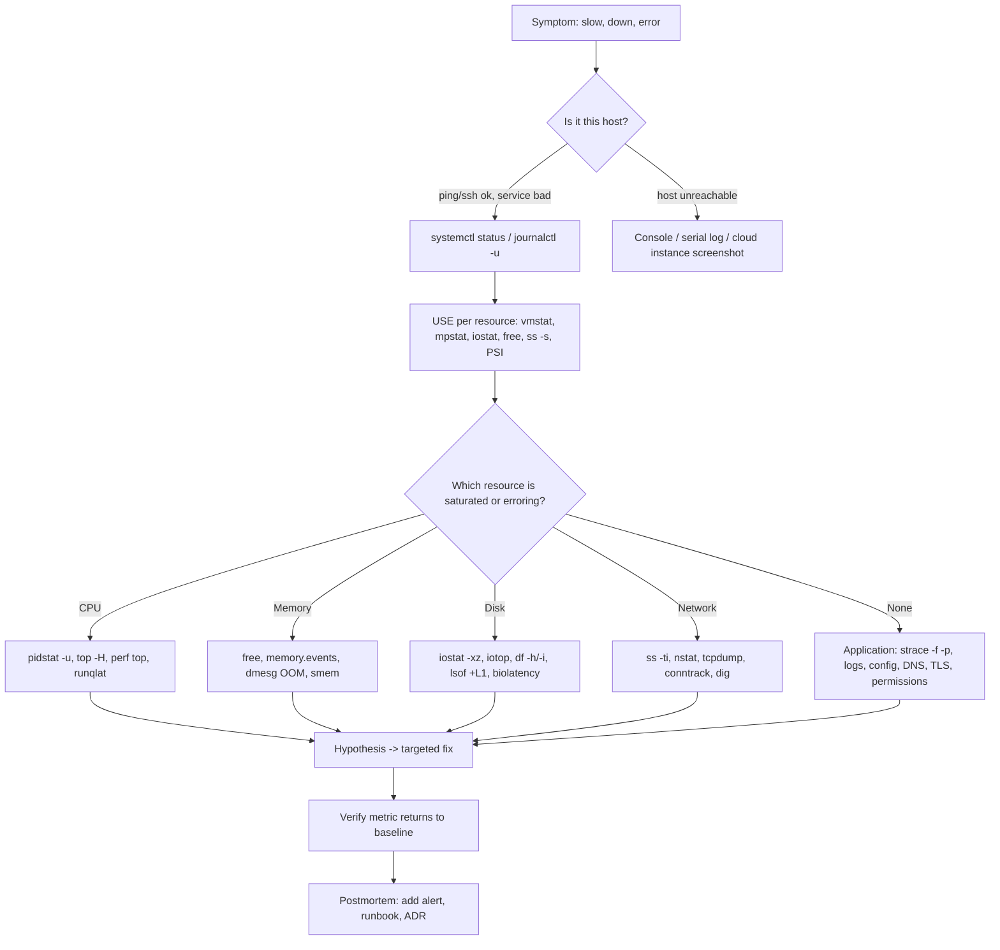

# Linux: Troubleshooting

| | |
|---|---|
| **Cluster** | 00 Foundations |
| **Role** | Prerequisite |
| **Prerequisites** | [03-commands-and-cheatsheet.md](03-commands-and-cheatsheet.md), Lab 7 in [04-hands-on-labs.md](04-hands-on-labs.md) |
| **Target version** | Linux kernel 6.x, systemd 255+ |
| **Capstone phase** | Phase 1 (Months 1-4); the runbooks in `docs/runbooks/` reuse these tables |

> A debugging workflow, then symptom-to-cause-to-fix tables grouped by resource, then the error messages you will see verbatim and what they mean. Work top-down: confirm the symptom, find the saturated resource with USE, identify the process, read its syscalls, fix, verify.

## 1. The Workflow



The 60-second checklist (Brendan Gregg's, adapted):

```bash
uptime                                  # load vs cores; rising or falling?
sudo dmesg -T | tail -30                # kernel errors, OOM kills, I/O errors
vmstat 1 5                              # r, b, si/so, us/sy/id/wa/st
mpstat -P ALL 1 3                       # one hot CPU = single-threaded bottleneck or IRQ
pidstat 1 3                             # which process
iostat -xz 1 3                          # await, %util per device
free -m                                 # available, swap
sar -n DEV 1 3                          # NIC throughput vs capacity
sar -n TCP,ETCP 1 3                     # active/passive opens, retransmits
cat /proc/pressure/{cpu,memory,io}      # saturation as a percentage
top -b -n1 | head -20                   # overview
```

## 2. Boot and systemd

| Symptom | Likely cause | Diagnose | Fix |
|---|---|---|---|
| System boots to emergency mode | Missing volume in `/etc/fstab` without `nofail`, or fsck failure | Console: `journalctl -xb`, `systemctl --failed`, `findmnt --verify` | Add `nofail,x-systemd.device-timeout=10s`; fix UUID (`blkid`); `fsck` the device |
| Boot takes minutes | Unit waiting for network or a device | `systemd-analyze blame`, `systemd-analyze critical-chain` | Use `network-online.target` only where needed; `nofail`; fix DHCP |
| `systemctl start` returns immediately, service dead | Wrong `Type=` (forking daemon with `Type=simple`), missing binary, bad `User=` | `systemctl status -l`, `journalctl -u <unit> -b`, `systemd-analyze verify <unit>` | Set correct `Type=`; check `ExecStart` path and permissions |
| `Start request repeated too quickly` | Crash loop hit `StartLimitBurst` | `journalctl -u <unit> -n 100` for the real error | Fix the crash; `systemctl reset-failed <unit>` to retry |
| Unit `active (exited)` | One-shot ran and finished, or daemon forked and systemd tracked the wrong PID | `systemctl show -p Type -p MainPID` | `Type=forking` with `PIDFile=` or run in foreground |
| Service cannot write files despite correct chmod | `ProtectSystem=strict`, `ProtectHome`, `PrivateTmp`, or SELinux/AppArmor | `journalctl -u <unit>` shows `Read-only file system`; `ausearch -m AVC` | Add `ReadWritePaths=`; `StateDirectory=`; fix labels |
| Service cannot bind to port < 1024 as non-root | No capability | `journalctl -u` shows `Permission denied` on bind | `AmbientCapabilities=CAP_NET_BIND_SERVICE` or listen on a high port |
| Service killed at stop after exactly 90 s (or `TimeoutStopSec`) | App ignores SIGTERM | `systemctl stop` hangs; `journalctl` shows `State 'stop-sigterm' timed out`; `cat /proc/<pid>/stack` | Handle SIGTERM in the app; use `exec` in wrapper scripts; lower `TimeoutStopSec` only once the app behaves |
| Changes to a unit file ignored | Forgot `daemon-reload`, or editing a file overridden by a drop-in | `systemctl cat <unit>` shows effective config | `sudo systemctl daemon-reload`; edit the drop-in |
| Timer never fires | Timer not enabled or `OnCalendar` syntax wrong | `systemctl list-timers --all`, `systemd-analyze calendar "<expr>"` | `systemctl enable --now <timer>`; fix expression |
| `journalctl` shows nothing from the service | Service logs to a file or `/dev/null`; `StandardOutput=null` | `systemctl show -p StandardOutput -p StandardError` | Log to stdout/stderr; `StandardOutput=journal` |

## 3. CPU

| Symptom | Likely cause | Diagnose | Fix |
|---|---|---|---|
| High load average, CPU idle | Processes in `D` state (storage/NFS) | `vmstat` `b` column; `ps -eo stat,wchan:30,comm \| grep '^D'`; `cat /proc/<pid>/stack` | Fix storage; check NFS server; `iostat -xz` |
| 100% on one CPU, others idle | Single-threaded process, or softirq/IRQ pinned to one CPU | `mpstat -P ALL 1`; `top` press `1`; `cat /proc/interrupts`; `cat /proc/softirqs` | Scale out workers; enable RSS/RPS (`ethtool -L`, `/sys/class/net/eth0/queues/rx-*/rps_cpus`); `irqbalance` |
| High `%sy` (system) | Syscall storm, context switching, spinlocks, memory reclaim | `pidstat -w 1`, `perf top`, `strace -c -p` | Batch I/O, connection pooling, fix the hot syscall |
| High `%st` (steal) | Noisy neighbour or burstable instance out of CPU credits | `vmstat` `st`; cloud CPU credit metric | Larger/unlimited instance; move to non-burstable |
| High `%wa` (iowait) | Disk saturated | `iostat -xz 1` `%util`, `await` | See Disk section |
| Service slow, CPU not high | cgroup CPU throttling | `cat /sys/fs/cgroup/.../cpu.stat` `nr_throttled`, `throttled_usec`; `cpu.pressure` | Raise `cpu.max`/`limits.cpu`, or remove the limit and rely on `cpu.weight`/requests |
| Latency spikes every 100 ms | CFS quota period: burst then throttle | `cpu.stat` increments per period | Larger quota; kernel 5.14+ `cpu.max.burst` |
| Scheduler latency high | Too many runnable threads | `runqlat-bpfcc`, `perf sched latency` | Fewer threads/workers; CPU pinning for critical services (`cpuset`) |
| Process uses more CPU than `nproc` inside container suggests | App counted host CPUs | `cat /sys/fs/cgroup/cpu.max` inside | Configure workers from the cgroup value; JVM `-XX:ActiveProcessorCount` |

## 4. Memory

| Symptom | Likely cause | Diagnose | Fix |
|---|---|---|---|
| Process disappears, exit code 137 | OOM killed (cgroup or system) | `sudo dmesg -T \| grep -i oom`; `journalctl -k`; `cat .../memory.events`; `systemctl status` shows `oom-kill` | Fix leak; raise `memory.max`; set `MemoryHigh` to throttle before kill; JVM `-XX:MaxRAMPercentage=75` |
| `free` shows little free memory but no problem | Page cache (normal) | `free -m` column `available`; `/proc/meminfo` `MemAvailable` | None; cache is reclaimable |
| Container "memory usage" at limit but app heap small | Page cache counted in `memory.current` | `cat memory.stat \| grep -E '^(anon|file) '` | Graph working set; ignore `file` unless OOM occurs |
| Swapping (`si`/`so` > 0) | Memory pressure, `swappiness` high | `vmstat 1`, `smem -rs swap` | Add memory; lower `vm.swappiness`; find the hog |
| `Cannot allocate memory` / `ENOMEM` without OOM kill | `vm.overcommit_memory=2`, `ulimit -v`, `vm.max_map_count` hit (JVM, Elasticsearch), `pids.max` (fork fails with EAGAIN) | `sysctl vm.overcommit_memory vm.max_map_count`; `cat /proc/<pid>/limits`; `pids.events` | Adjust sysctl/limits |
| Slow memory growth over days (leak) | Application leak or glibc arena fragmentation | `pidstat -r 60`; `smem`; `pmap -x` deltas; `MALLOC_ARENA_MAX=2` test | Fix code; restart on `MemoryHigh` via `OOMPolicy=`; `jemalloc` |
| Kernel memory high (`Slab`, `SUnreclaim`) | dentry/inode cache explosion, conntrack, cgroup leaks (zombie cgroups) | `slabtop -o`; `cat /proc/meminfo`; `ls /sys/fs/cgroup/*/*/ \| wc -l` | `echo 2 > /proc/sys/vm/drop_caches` (temporary, insecure shortcut for diagnosis); fix container churn; newer kernel |
| THP causing latency | Transparent Huge Pages compaction stalls | `cat /sys/kernel/mm/transparent_hugepage/enabled`; `grep thp /proc/vmstat` | `madvise` instead of `always` (databases recommend this) |

Reading an OOM kill message:

```text
[Mon Oct 27 10:51:02 2025] python3 invoked oom-killer: gfp_mask=0xcc0(GFP_KERNEL), order=0, oom_score_adj=0
[Mon Oct 27 10:51:02 2025] memory: usage 204800kB, limit 204800kB, failcnt 2317
[Mon Oct 27 10:51:02 2025] Memory cgroup out of memory: Killed process 6120 (python3) total-vm:352088kB, anon-rss:198440kB, file-rss:4096kB, shmem-rss:0kB, UID:998 pgtables:456kB oom_score_adj:0
```

`Memory cgroup out of memory` means a cgroup limit, not the whole host (`Out of memory: Killed process` without "cgroup" is host-wide). `anon-rss` is the heap; `failcnt` how many times the limit was hit before the kill.

## 5. Disk and Filesystem

| Symptom | Likely cause | Diagnose | Fix |
|---|---|---|---|
| `No space left on device`, `df` shows free space | Inodes exhausted | `df -i`; `find /path -xdev -printf '%h\n' \| sort \| uniq -c \| sort -rn \| head` | Delete the many small files; recreate fs with more inodes |
| `df` full, `du` small | Deleted files held open | `sudo lsof +L1`; `find /proc/*/fd -lname '*(deleted)'` | Truncate via `/proc/<pid>/fd/N` or restart the holder |
| `df` full, `du` small, no open files | Files hidden under a mount point | `mount --bind / /mnt/root && du -sh /mnt/root/var` | Move the files, remount |
| Disk full suddenly | Log flood, core dumps, container image pulls | `du -xh --max-depth=2 /var \| sort -h \| tail`; `journalctl --disk-usage`; `ls /var/lib/systemd/coredump` | Rotate/limit logs, `crictl rmi --prune`, `ProcessSizeMax=0` |
| High `await` (> 10 ms SSD, > 20 ms EBS gp3) | Saturated IOPS/throughput, small random writes, `fsync` storms | `iostat -xz 1`; `biolatency-bpfcc`; `iotop`; cloud volume metrics (burst balance) | Larger volume/IOPS; batch writes; separate volumes |
| `D` state processes, `hung_task` warnings in dmesg | Storage not responding (EBS, NFS) | `dmesg -T \| grep -i 'blocked for more than'`; `cat /proc/<pid>/stack` | Fix storage; NFS `soft,timeo` options; wait for I/O or reboot |
| `Read-only file system` on root | Kernel remounted ro after errors | `dmesg -T \| grep -iE 'ext4|xfs|I/O error'`; `mount \| grep ' / '` | Replace the node; `fsck` from rescue; check cloud volume health |
| `Permission denied` with correct mode bits | SELinux/AppArmor, `noexec` mount, ACL, immutable attribute | `ls -Z`; `ausearch -m AVC`; `findmnt -o OPTIONS /path`; `getfacl`; `lsattr` | Fix labels (`restorecon`), remove `noexec`, `setfacl`, `chattr -i` |
| `Text file busy` | Writing an executable that is running | `fuser -v /path` | Stop the process or write to a new name and `mv` (atomic) |
| Filesystem grows only after reboot | Partition not grown | `lsblk`; compare partition vs disk size | `growpart /dev/nvme0n1 1 && resize2fs` or `xfs_growfs` |
| `Too many open files` | fd limit per process or system | `ls /proc/<pid>/fd \| wc -l` vs `cat /proc/<pid>/limits`; `cat /proc/sys/fs/file-nr` | `LimitNOFILE=`; fix fd leak (`lsof -p` shows what); inotify limits if the error comes from a watcher |

## 6. Processes and Signals

| Symptom | Likely cause | Diagnose | Fix |
|---|---|---|---|
| Zombie processes accumulate | Parent does not `wait()`; PID 1 in container is the app | `ps -eo stat,ppid,comm \| grep '^Z'` | Fix parent; use `tini`/`--init`; `shareProcessNamespace` with a pause container reaps |
| Process will not die with `kill -9` | `D` state in kernel | `cat /proc/<pid>/stack`, `wchan` | Resolve the I/O it waits on; reboot |
| `kill` works but process restarts | Supervised by systemd/containerd/kubelet | `systemctl status`; `cat /proc/<pid>/cgroup` | Stop the supervisor's unit instead |
| Exit code 137 but no OOM in dmesg | SIGKILL from kubelet (grace period) or `docker stop` timeout | `kubectl describe pod` events; container `State.Reason` | Handle SIGTERM; `exec` in entrypoint; increase grace period |
| Exit code 139 | SIGSEGV | `coredumpctl list`; `coredumpctl gdb` | Library mismatch, native bug; check `ldd` |
| Exit code 126 / 127 | Not executable / command not found (often wrong interpreter line, CRLF endings, missing shared lib in distroless) | `file script.sh` shows `CRLF`; `ldd binary` shows `not found`; `head -1 script.sh` | `dos2unix`; add library; fix shebang |
| Exit code 1 from `exec format error` | Wrong CPU architecture (ARM image on x86 or vice versa) | `file binary`; `uname -m` | Multi-arch image; correct platform |
| Ctrl-C does not stop a foreground process | Process ignores SIGINT or is in `D` | `grep SigIgn /proc/<pid>/status` | SIGTERM/SIGKILL from another terminal |
| High context-switch rate | Too many threads, lock contention, busy polling | `pidstat -w 1`; `perf sched`; `offcputime-bpfcc` | Reduce thread count; fix locking |

Decoding `SigIgn`/`SigCgt` masks: `SigCgt: 0000000180004002` is a bitmask where bit N-1 corresponds to signal N; bit 1 (0x2) = SIGINT caught, bit 14 (0x4000) = SIGTERM caught. If SIGTERM (0x4000) is in neither `SigCgt` nor `SigIgn`, the default action (terminate) applies.

## 7. Permissions, Users, Capabilities

| Symptom | Likely cause | Diagnose | Fix |
|---|---|---|---|
| `Operation not permitted` as root in a container | Missing capability or seccomp block | `grep CapEff /proc/self/status \| capsh --decode`; `strace -f cmd` shows `EPERM` on which syscall | Add the single capability; adjust seccomp profile; usually redesign instead |
| `sudo: unable to resolve host` | Hostname not in `/etc/hosts` | `hostname`; `cat /etc/hosts` | Add `127.0.1.1 <hostname>` |
| User added to group but still denied | Group membership applies at next login | `id` vs `id <user>` | Log out/in, or `newgrp docker` |
| `ssh` key refused, `Permission denied (publickey)` | Wrong permissions on `~/.ssh` (700) / `authorized_keys` (600) / home dir writable by group; wrong user; key not offered | `ssh -vvv` ("Offering public key"); server `journalctl -u ssh` ("Authentication refused: bad ownership or modes") | `chmod 700 ~/.ssh; chmod 600 ~/.ssh/authorized_keys; chmod go-w ~`; `IdentityFile` |
| `ssh` hangs after auth | `UseDNS yes` with broken reverse DNS; MOTD scripts slow; shell rc blocking | `ssh -vvv`; server `journalctl -u ssh` | `UseDNS no`; fix rc files |
| Cron/systemd job works manually, fails scheduled | Different `PATH`, env, cwd, no TTY | `journalctl -u job`; add `env > /tmp/env.txt` to job | Absolute paths; `Environment=`; `WorkingDirectory=` |
| Service file-not-found for an existing file | `ProtectHome`, `PrivateTmp`, chroot, different mount namespace | `systemctl show -p ProtectHome`; `nsenter -t <pid> -m ls <path>` | `BindReadOnlyPaths=`; move the file |
| `setuid` binary does not escalate | `nosuid` mount, `no_new_privs`, user namespace | `findmnt -o OPTIONS`; `grep NoNewPrivs /proc/<pid>/status` | Expected in hardened environments; use capabilities |
| SELinux denies despite `chmod 777` | Label mismatch | `ausearch -m AVC -ts recent`; `ls -Z` | `restorecon -Rv`; `semanage fcontext -a`; `setsebool` |

## 8. Network (host level; protocol-level detail in `../networking/06-troubleshooting.md`)

| Symptom | Likely cause | Diagnose | Fix |
|---|---|---|---|
| `Connection refused` | Nothing listening on that IP:port, or listening on 127.0.0.1 only | `ss -tlnp`; from inside a container `nsenter -t <pid> -n ss -tlnp` | Bind `0.0.0.0`; correct port |
| `Connection timed out` | Firewall/security group drop, wrong route, service hung | `nc -zv -w3 host port`; `mtr`; `sudo nft list ruleset`; `tcpdump -ni any port <port>` | Open security group/nftables; check `ip route get <ip>` |
| `nf_conntrack: table full, dropping packet` in dmesg | Conntrack table exhausted | `cat /proc/sys/net/netfilter/nf_conntrack_count` vs `_max` | Raise `nf_conntrack_max`; shorter timeouts; fewer short connections |
| `Cannot assign requested address` on outbound | Ephemeral ports exhausted (TIME_WAIT) | `ss -s`; `ss -tan state time-wait \| wc -l`; `sysctl net.ipv4.ip_local_port_range` | Widen port range; `tcp_tw_reuse=1`; connection pooling/keep-alive |
| Intermittent connection failures under load | Accept queue overflow | `nstat -az TcpExtListenOverflows TcpExtListenDrops`; `ss -ltn` shows `Recv-Q` at `Send-Q` (backlog) | Raise `somaxconn` and app backlog; more workers |
| DNS slow or failing | resolv.conf, `ndots`, systemd-resolved stub down | `resolvectl status`; `dig @127.0.0.53 example.com`; `cat /etc/resolv.conf` | Fix resolver; see networking folder |
| Packet drops | Ring buffer full, softirq saturation | `ip -s link`; `ethtool -S eth0 \| grep -i drop`; `cat /proc/net/softnet_stat` | `ethtool -G eth0 rx 4096`; `netdev_max_backlog`; RPS |
| Cannot reach container from host | Bridge/veth down, `ip_forward=0`, missing NAT rule | `ip -brief link`; `sysctl net.ipv4.ip_forward`; `sudo iptables -t nat -S` | Enable forwarding; add MASQUERADE |

## 9. Package Management

| Symptom | Likely cause | Diagnose | Fix |
|---|---|---|---|
| `Could not get lock /var/lib/dpkg/lock-frontend` | Another apt (unattended-upgrades) running | `sudo fuser -v /var/lib/dpkg/lock-frontend`; `systemctl status apt-daily-upgrade` | Wait; never delete the lock while a process holds it |
| `dpkg was interrupted` | Previous install killed | | `sudo dpkg --configure -a` |
| `Unmet dependencies` / `held broken packages` | Mixed repos, pinned versions | `apt-cache policy pkg` | `apt-get install -f`; fix pins; remove foreign repo |
| `NO_PUBKEY` / `The following signatures couldn't be verified` | Repo key missing or expired | `apt-get update` output names the key | Re-add via `signed-by` keyring (never `apt-key add` globally) |
| `Hash Sum mismatch` | Stale mirror or proxy cache | | `rm -rf /var/lib/apt/lists/* && apt-get update`; pick another mirror |
| `dnf` slow or `Failed to download metadata` | Mirror issue, no network, SSL | `dnf clean all; dnf makecache -v` | Fix proxy/`sslverify`; set `baseurl` |
| `rpm -V` reports changed files | Local edits or tampering | `rpm -V pkg` codes (S size, 5 md5, M mode) | Restore from package; investigate |
| Alpine `apk add` fails with `UNTRUSTED signature` | Keys missing (`/etc/apk/keys`) or wrong repo branch | `cat /etc/apk/repositories`; `ls /etc/apk/keys` | Use matching branch; `apk add alpine-keys` |
| Python wheel fails on Alpine | musl incompatibility | Error mentions `manylinux` or builds from source | Use Debian-slim/distroless base, or `python:3.12-alpine` with build deps |

## 10. Error Messages Verbatim

| Message | Meaning | First command |
|---|---|---|
| `bash: fork: retry: Resource temporarily unavailable` | `pids.max` or `ulimit -u` hit | `cat /sys/fs/cgroup/.../pids.current`; `ulimit -u` |
| `-bash: /usr/bin/ls: Argument list too long` | `ARG_MAX` exceeded by a glob | `find ... -exec` or `xargs` |
| `Killed` (shell prints after a command) | SIGKILL, usually OOM | `dmesg -T \| tail` |
| `Segmentation fault (core dumped)` | SIGSEGV | `coredumpctl list` |
| `Terminated` | SIGTERM received | Who sent it: `journalctl`, auditd |
| `/bin/sh: 1: exec: ./app: Exec format error` | Wrong architecture or bad shebang | `file ./app` |
| `standard_init_linux.go:228: exec user process caused: no such file or directory` | Interpreter from shebang missing (e.g. bash on Alpine), CRLF, or missing dynamic linker (glibc binary on musl) | `ldd app`; `head -c 50 script \| xxd` |
| `error while loading shared libraries: libxyz.so.1: cannot open shared object file` | Missing library | `ldd binary`; install package via `dpkg -S`/`dnf provides` |
| `Failed to start ... Unit ... has a bad unit file setting` | Unit syntax | `systemd-analyze verify` |
| `Job for api.service failed because the control process exited with error code` | ExecStart failed | `journalctl -xeu api.service` |
| `Failed to connect to bus: No such file or directory` | No systemd (container, WSL without systemd) | `ps -p 1 -o comm`; enable systemd or do not use `systemctl` |
| `System has not been booted with systemd as init system (PID 1). Can't operate.` | Same as above | |
| `sudo: a terminal is required to read the password` | No TTY, password needed | `ssh -t`; NOPASSWD rule for the specific command |
| `mount: /mnt: must be superuser to use mount.` | Non-root mount | Needs `CAP_SYS_ADMIN`; fstab `user` option for allowed mounts |
| `unshare: unshare failed: Operation not permitted` | `kernel.unprivileged_userns_clone=0` or seccomp | `sysctl kernel.unprivileged_userns_clone`; AppArmor `userns` restriction on Ubuntu 24.04 (`sysctl kernel.apparmor_restrict_unprivileged_userns`) |
| `Read-only file system` | ro mount, `ProtectSystem`, `readOnlyRootFilesystem` | `findmnt -o TARGET,OPTIONS`; unit settings |
| `Device or resource busy` on `umount` | Open files or cwd inside | `fuser -vm /mnt`; `umount -l` as last resort |
| `Too many levels of symbolic links` | Symlink loop | `readlink -f` |
| `Stale file handle` | NFS server-side change | Remount |
| `Input/output error` | Hardware/volume failure | `dmesg -T`; cloud volume status; replace node |
| `clock skew detected` / `certificate is not yet valid` | Time wrong | `timedatectl`; `chronyc tracking` |
| `inotify_add_watch: No space left on device` | `fs.inotify.max_user_watches` exhausted (not disk) | `sysctl fs.inotify.max_user_watches`; `find /proc/*/fd -lname anon_inode:inotify \| wc -l` |
| `Address already in use` | Port bound by another process or TIME_WAIT without `SO_REUSEADDR` | `ss -tlnp 'sport = :8080'` |
| `Name or service not known` / `Temporary failure in name resolution` | DNS failure | `resolvectl status`; `dig example.com` |

## 11. Reading Core Diagnostics Quickly

### `vmstat 1`

```text
procs -----------memory---------- ---swap-- -----io---- -system-- ------cpu-----
 r  b   swpd   free   buff  cache   si   so    bi    bo   in   cs us sy id wa st
 6  2      0 112340  20120 902344    0  512   40  3800 3100 9000 70 20  0 10  0
```

`r=6` on 2 CPUs: CPU saturated. `b=2`, `wa=10`: disk wait. `so=512`: swapping out, memory pressure. `cs=9000`: high context switching.

### `iostat -xz 1`

```text
Device   r/s   w/s  rkB/s  wkB/s  rrqm/s wrqm/s  r_await w_await aqu-sz rareq-sz wareq-sz svctm %util
nvme1n1 10.0 950.0  400.0 3800.0    0.0    0.0    0.80   12.40   11.8     40.0      4.0  1.00  98.0
```

`%util 98`, `aqu-sz 11.8`, `w_await 12.4 ms`, `wareq-sz 4 KB`: saturated by small writes (fsync storm or random I/O).

### `ss -ti`

```text
ESTAB 0 0 10.0.1.5:44120 10.0.2.9:5432
	 cubic wscale:7,7 rto:204 rtt:1.2/0.4 ato:40 mss:1448 cwnd:10 bytes_sent:... retrans:0/12 ...
```

`retrans:0/12`: 12 retransmits over the connection's life, none outstanding. `rtt:1.2/0.4` ms. `cwnd:10` small window suggests recent loss.

### `/proc/pressure/memory`

```text
some avg10=0.00 avg60=0.00 avg300=0.00 total=12345
full avg10=0.00 avg60=0.00 avg300=0.00 total=0
```

Anything above a few percent on `some` means reclaim is actively stalling tasks; `full` means everyone is stalled.

## 12. When to Stop Debugging and Replace

On immutable infrastructure the fastest fix for a sick node is often to cordon, drain and terminate it, then study the replacement's siblings or the captured diagnostics (`sosreport`/`sos report` on RHEL, `apport-cli` on Ubuntu, or your own bundle script collecting `dmesg`, `journalctl -b`, `ss -s`, `df`, `ps`, PSI). Capture first, replace second, root-cause third. Record the root cause in a postmortem (cluster 11) and encode the detection as an alert so the next occurrence pages with the diagnosis attached.

Next: [07-interview-questions.md](07-interview-questions.md).
