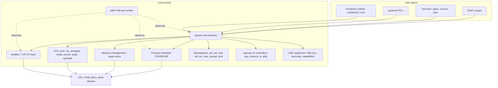
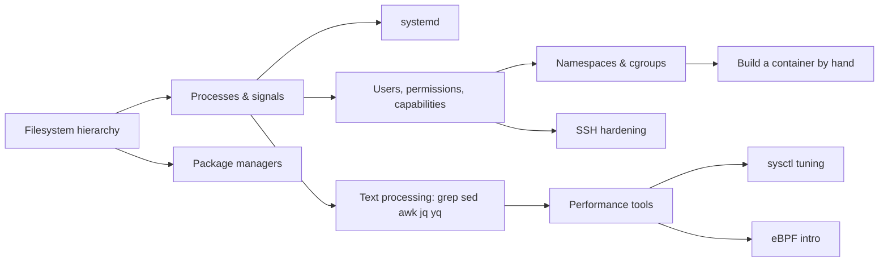

# Linux Fundamentals for Platform Engineers

| | |
|---|---|
| **Cluster** | 00 Foundations |
| **Role** | Prerequisite (anchor for the whole stack) |
| **Category** | Operating system internals and administration |
| **Prerequisites** | Comfort with a terminal; no prior sysadmin experience required |
| **Target version** | Linux kernel 6.x, systemd 255+, Ubuntu 24.04 LTS / Fedora 40+ / Alpine 3.20+ |
| **Capstone phase** | Phase 1 (Months 1-4) |
| **Official docs** | https://www.kernel.org/doc/html/latest/ , https://man7.org/linux/man-pages/ |

> Every tool in this wiki runs on Linux: the EKS worker node is Linux, the container is a Linux process with extra isolation, the GitHub Actions runner is Linux, the GPU node serving vLLM is Linux. After this folder you will be able to reason about any process on any Linux box: where its files are, how it was started, what it is allowed to do, what resources it is consuming, which kernel primitives isolate it, and how to inspect all of that from a shell when things go wrong at 03:00.

## Why This Tool Exists

Before Linux became the substrate of cloud computing, each vendor's Unix (Solaris, AIX, HP-UX) had its own kernel, its own packaging and its own administration tools. The insight that made Linux win the data centre was not technical brilliance alone; it was that one open kernel with a stable system-call ABI let an entire ecosystem (distributions, package managers, init systems, container runtimes) be built on top without asking permission. Docker in 2013 did not invent anything in the kernel. It packaged three existing kernel features (namespaces, cgroups, union filesystems) behind a friendly CLI. Kubernetes then scheduled those processes across many kernels. When you understand the kernel primitives, Docker and Kubernetes stop being magic and become configuration.

## Architecture

- **System call interface.** The only door between user space and the kernel. Every `open()`, `read()`, `clone()`, `execve()`, `connect()` crosses it. `strace` sits at this door.
- **Process scheduler.** Decides which runnable task gets a CPU. cgroups `cpu.max` throttles here; Kubernetes CPU limits are cgroup quotas.
- **Memory management.** Virtual memory, page cache, OOM killer. Kubernetes memory limits are `memory.max`; exceed it and the OOM killer sends SIGKILL to a process in the cgroup.
- **VFS.** A uniform file API over many filesystems. `/proc` and `/sys` are kernel data structures pretending to be files; overlayfs is how image layers are stacked.
- **Namespaces.** Give a process its own view of PIDs, network interfaces, mounts, hostname, users. A container is a process in several new namespaces.
- **cgroups v2.** Account for and limit resources per group of processes. Every systemd service and every Pod is a cgroup.
- **LSM, seccomp, capabilities.** Restrict what root (and non-root) may do. Non-root containers and dropped capabilities live here.
- **eBPF.** Sandboxed programs attached to kernel hooks for observability (Falco, Pixie), networking (Cilium) and security without kernel modules.

## The Core Mental Model

Three ideas make everything in Linux predictable:

1. **Everything is a file descriptor.** Regular files, directories, pipes, sockets, devices, timers, even processes (`pidfd`) are accessed through small integers. If you can `ls -l /proc/<pid>/fd`, you can see every open resource of any process. `lsof` and `ss` are just prettier views of the same data.
2. **A process is a tree node with a view and a budget.** Every process has a parent (back to PID 1), a set of namespaces (its *view* of the system) and a cgroup (its *budget*). `fork()`/`clone()` copies the parent, `execve()` replaces the program. A container is this exact thing with `clone()` flags that request new namespaces and a cgroup with limits. Nothing more.
3. **Policy lives in text under `/etc`, state lives in text under `/proc` and `/sys`.** Configuration you write goes in `/etc`; what the kernel is doing right now is readable (and often writable) under `/proc/sys` and `/sys/fs/cgroup`. `sysctl` is a thin wrapper over `/proc/sys`. There is almost no hidden state.

## Anchor-and-Bridge Mapping

Linux is the anchor; the bridges are the layers built on it that you will meet in later clusters.

| Linux primitive | Docker (cluster 04) | Kubernetes (cluster 04) | systemd equivalent |
|---|---|---|---|
| Process with `clone()` namespaces | Container | Pod (shares `net`, `ipc`, `uts` ns between containers) | Unit with `PrivateNetwork=`, `PrivateTmp=` |
| cgroup `cpu.max`, `memory.max` | `--cpus`, `--memory` | `resources.limits` | `CPUQuota=`, `MemoryMax=` |
| cgroup `pids.max` | `--pids-limit` | PodPidsLimit (kubelet) | `TasksMax=` |
| Capabilities | `--cap-drop ALL --cap-add NET_BIND_SERVICE` | `securityContext.capabilities` | `CapabilityBoundingSet=`, `AmbientCapabilities=` |
| seccomp filter | `--security-opt seccomp=profile.json` | `securityContext.seccompProfile` | `SystemCallFilter=` |
| `uid` / `gid` | `USER` in Dockerfile, `--user` | `runAsUser`, `runAsNonRoot`, `fsGroup` | `User=`, `DynamicUser=` |
| overlayfs mount | Image layers + writable layer | Same via containerd | n/a |
| bind mount / tmpfs | `-v`, `--tmpfs` | `hostPath`, `emptyDir` (`medium: Memory`) | `BindPaths=`, `PrivateTmp=` |
| `SIGTERM` then `SIGKILL` after grace | `docker stop -t 10` | `terminationGracePeriodSeconds` | `TimeoutStopSec=`, `KillSignal=` |
| Signals and exit codes | `docker inspect .State.ExitCode` | `lastState.terminated.exitCode` (137 = SIGKILL/OOM) | `systemctl status` Result field |
| journald / stdout | `docker logs` (json-file driver) | `kubectl logs` (kubelet reads containerd log files) | `journalctl -u` |
| `/etc/resolv.conf` in net ns | Embedded DNS 127.0.0.11 | CoreDNS, `dnsPolicy` | `systemd-resolved` |

| Linux concept | AWS EC2 / EKS (cluster 01) | Where it bites you |
|---|---|---|
| `sysctl net.core.somaxconn`, `fs.inotify.max_user_*` | Launch template `user-data` or kubelet `allowedUnsafeSysctls` | Node tuning for high-connection services |
| `/dev/nvme*` block devices, `xfs` | EBS volumes, `aws ebs` CSI driver | `df -h` shows the real mount, PV is a wrapper |
| `cloud-init` first boot | EC2 user data | Bootstrapping nodes without Ansible |
| `ssm-agent` process | AWS Systems Manager Session Manager | Replaces SSH on hardened nodes |
| `ulimit -n`, `fs.file-max` | Instance defaults differ per AMI | "Too many open files" in Java services |

## Learning Path

| Step | File | Time |
|---|---|---|
| 1 | [01-installation-and-setup.md](01-installation-and-setup.md) — lab VM on WSL2 / Multipass / Lima, essential tooling | 2 h |
| 2 | [02-core-concepts.md](02-core-concepts.md) — filesystem, processes, signals, systemd, permissions, capabilities, namespaces, cgroups, eBPF | 8 h |
| 3 | [03-commands-and-cheatsheet.md](03-commands-and-cheatsheet.md) — the command reference by task | 3 h (reference) |
| 4 | [04-hands-on-labs.md](04-hands-on-labs.md) — 8 labs ending with a container built from `unshare` and cgroups by hand | 10 h |
| 5 | [05-production-patterns.md](05-production-patterns.md) — hardening, SSH, sysctl, systemd service patterns, node images | 4 h |
| 6 | [06-troubleshooting.md](06-troubleshooting.md) — the USE method, strace/perf workflow, symptom tables | 3 h |
| 7 | [07-interview-questions.md](07-interview-questions.md) — 30 questions junior to principal | 2 h |

Total: roughly 32 hours, about three weeks at the roadmap's 12-15 h/week pace. Do the labs on a disposable VM; several of them deliberately break things.

### Suggested order of topics inside this folder

## How This Maps to Later Clusters

| You learn here | You use it in |
|---|---|
| Namespaces, cgroups, overlayfs, capabilities | 04 Docker and Kubernetes: `securityContext`, resource limits, image layers, Pod sandbox |
| systemd units, journald | 01 Cloud: EC2 user data, kubelet and containerd run as systemd units on every node |
| `/proc`, `/sys`, `strace`, `perf` | 09 Observability and 11 SRE: node_exporter reads `/proc`; debugging latency on a node |
| eBPF intro | 08 DevSecOps: Falco runtime security; 04: Cilium CNI; 09: Pixie / Beyla auto-instrumentation |
| sysctl, ulimits | 07 Backend: tuning for FastAPI (uvicorn workers) and Spring Boot (virtual threads, file descriptors) |
| Package managers (apt/dnf/apk) | 04 Docker: minimal images, `apk add --no-cache`, Trivy findings keyed on dpkg/rpm/apk databases |
| grep/sed/awk/jq/yq | 00 Bash, 06 CI/CD: every pipeline step parses JSON from `aws`, `kubectl`, `gh` |
| SSH hardening | 01 Cloud bastions, 00 Git (SSH signing), 12 Enterprise Ops zero-trust access |

## Role in the Capstone

The capstone deploys a FastAPI service and a Spring Boot service as non-root containers on Kubernetes. Linux knowledge is wired in at four points:

1. **Dockerfiles.** Both images use multi-stage builds onto distroless or Alpine bases, run as a numeric non-root UID, drop all capabilities, and set `STOPSIGNAL` and signal-forwarding entrypoints. Every one of those lines is a Linux decision from this folder.
2. **Pod security.** `securityContext` in `deploy/` manifests (`runAsNonRoot`, `readOnlyRootFilesystem`, `seccompProfile: RuntimeDefault`, `capabilities.drop: [ALL]`) is Kyverno-enforced in Phase 5. You need to know what each field does in the kernel to debug a Pod that will not start under those rules.
3. **Node tuning.** The Terraform EKS node group in `infra/terraform` sets kernel parameters through a launch template (`fs.inotify.max_user_instances`, `net.ipv4.ip_local_port_range`, `vm.max_map_count` for the JVM and OpenSearch).
4. **Incident runbooks.** `docs/runbooks/node-pressure.md` and `docs/runbooks/oomkilled.md` are written using `kubectl debug node/<node>` followed by the exact `ss`, `vmstat`, `cat /sys/fs/cgroup/.../memory.events` commands from `06-troubleshooting.md`. The Phase 6 AI agent executes those same commands through an MCP server.

Artefact produced in Phase 1: a `docs/adrs/0001-base-image-and-runtime-user.md` ADR explaining why the services run as UID 10001 on distroless with all capabilities dropped.

## Further Reading

- *The Linux Programming Interface*, Michael Kerrisk — the definitive reference on syscalls, processes, signals and namespaces.
- *Systems Performance*, 2nd ed., Brendan Gregg — the USE method, `perf`, eBPF tooling.
- *BPF Performance Tools*, Brendan Gregg — `bcc` and `bpftrace` one-liners.
- Kernel docs: `Documentation/admin-guide/cgroup-v2.rst`, `man 7 namespaces`, `man 7 cgroups`, `man 7 capabilities`, `man 7 signal`.
- systemd documentation: `man systemd.unit`, `man systemd.service`, `man systemd.exec`, `man systemd.resource-control`.
- Filesystem Hierarchy Standard 3.0: https://refspecs.linuxfoundation.org/fhs.shtml
- Julia Evans' zines on `strace`, containers and `perf` for a fast visual refresher.
- Liz Rice, *Container Security* (O'Reilly) and her talk "Containers from scratch".
