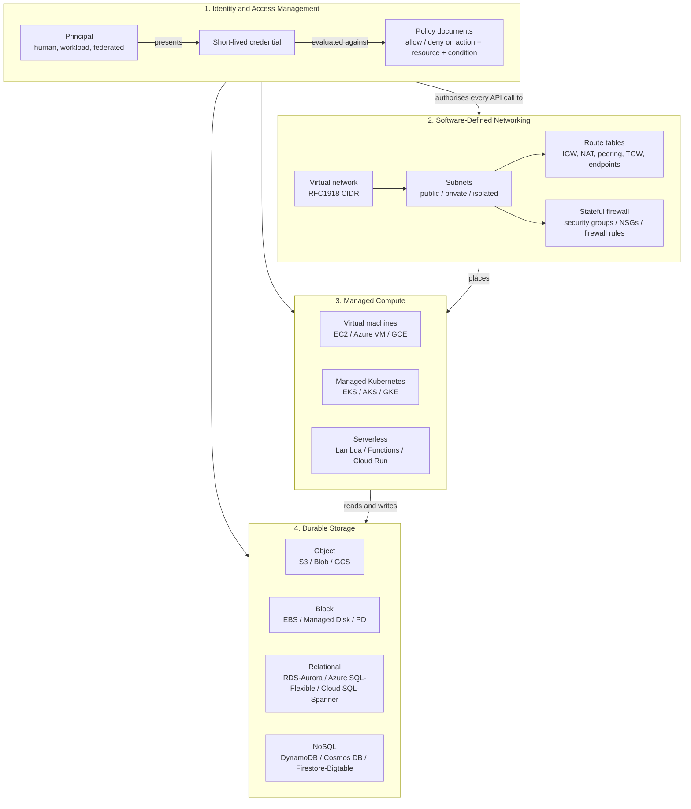

# Cluster 01: Hyperscale Cloud (AWS, Azure, GCP)

| | |
|---|---|
| **Cluster** | 01 Hyperscale Cloud |
| **Anchor** | [AWS](aws/README.md) |
| **Bridges** | [Azure](azure/README.md), [GCP](gcp/README.md) |
| **Core unifying pattern** | IAM, VPC software-defined networking, object storage, managed compute |
| **Capstone phase** | Phase 2 (Months 5-8, 160 hrs, shared with Terraform) |
| **Prerequisites** | [00-foundations](../00-foundations/) (Linux, TCP/IP, DNS, TLS, Git, Bash) |

> Every hyperscaler sells the same four things under different names: an identity system that evaluates policy documents, a software-defined network you carve into subnets, compute you rent by the second, and durable storage you rent by the gigabyte. This cluster teaches those four primitives deeply once, on AWS, and then shows the vocabulary translation to Azure and GCP so that the second and third clouds take days rather than months.

---

## 1. Why This Cluster Exists

Before the hyperscalers, an engineering team that needed a database server filed a ticket, waited six weeks for a rack to arrive, and then babysat it for five years. Identity was an LDAP directory bolted onto the network perimeter; "the network" was a physical switch; "storage" was a SAN with a maintenance contract.

The cloud insight was not "someone else's computer". It was that every one of those concerns can be expressed as an API call that is **authorised by a policy document**, **placed into a virtual network you define**, and **billed by consumption**. Once infrastructure is an API, it can be versioned (Terraform, Cluster 05), tested in CI (GitHub Actions, Cluster 06), and scanned for misconfiguration (Checkov, Cluster 08). Every later cluster in this wiki assumes you can reason about cloud identity, networking, compute, and storage without looking things up.

The roadmap names AWS the anchor because it has the largest service surface, the most explicit IAM model, and the most third-party tooling. Azure and GCP are bridges: once you can read an AWS IAM policy and draw a three-tier VPC on a whiteboard, you can read an Azure RBAC role assignment and a GCP IAM binding, and you can draw a VNet or a Global VPC.

---

## 2. The Four Universal Primitives



### 2.1 Identity and Access Management

The primitive is a **policy evaluation engine**. A request arrives carrying a principal (who), an action (what API call), a resource (on what), and a context (from where, when, with MFA or not). The engine collects every policy that applies, looks for an explicit deny first, then for an allow, and defaults to deny. All three clouds implement exactly this. The differences are in *where policies attach*:

| | AWS | Azure | GCP |
|---|---|---|---|
| Policy attaches to | Principal (identity policy) **and** resource (resource policy) | Scope in the resource hierarchy (role assignment at MG / subscription / RG / resource) | Resource in the hierarchy (IAM binding on org / folder / project / resource) |
| Deny mechanism | Explicit `Deny` statement, SCPs, permission boundaries | Azure Deny Assignments (limited), Azure Policy | IAM Deny policies, Organization Policy constraints |
| Workload identity | IAM Role (assumed via STS), IRSA, EKS Pod Identity | Managed Identity (system / user assigned) | Service Account, GKE Workload Identity |
| External CI federation | IAM OIDC provider + `sts:AssumeRoleWithWebIdentity` | Entra ID federated credential on an app registration / UAMI | Workload Identity Federation pool + provider |

The one rule that transfers everywhere: **never create long-lived keys for a workload**. Use the platform's role / managed identity / service account with federation.

### 2.2 Software-Defined Networking

The primitive is a **routing table attached to a subnet**. A subnet is "public" only because its route table sends `0.0.0.0/0` to an internet gateway; it is "private" because that route goes to a NAT device instead; it is "isolated" because there is no default route at all. Firewalls are stateful and attached to the workload (security group / NSG / firewall rule with target tags). Private connectivity to managed services goes over an endpoint that injects a private IP into your subnet (VPC endpoint / Private Endpoint / Private Service Connect).

The notable architectural divergence: AWS and Azure VPCs/VNets are **regional**; a GCP VPC is **global** with regional subnets, so two GCE instances in different regions talk over RFC1918 without peering.

### 2.3 Managed Compute

Three tiers everywhere: VMs (you manage the OS), managed Kubernetes (the cloud runs the control plane, you run or outsource the nodes), serverless (you upload code or a container and never see a host). The decision is always the same: how much of the operating system and scheduling do you want to own?

### 2.4 Durable Storage

Object storage is the universal substrate (Terraform state, logs, backups, data lakes, static sites, model weights). Block storage is attached to a single VM. Relational storage is a managed Postgres/MySQL with a Multi-AZ failover story. NoSQL is a partitioned key-value store that scales horizontally and forces you to design access patterns up front.

---

## 3. Service-Mapping Matrix

Use this as a translation dictionary. Row by row, the service in each column solves the same problem.

| Architectural layer | AWS (anchor) | Microsoft Azure | Google Cloud |
|---|---|---|---|
| **Resource hierarchy** | Organization -> Root -> OU -> Account (regional VPCs inside) | Tenant -> Management Group -> Subscription -> Resource Group -> Resource | Organization -> Folder -> Project -> Resource |
| **Governance guardrails** | Service Control Policies, Control Tower, AWS Config rules | Azure Policy, Management Group inheritance, Blueprints (deprecated) / Deployment Stacks | Organization Policy Service constraints |
| **Identity (human)** | IAM Identity Center (SSO) + IAM users as legacy | Microsoft Entra ID users and groups | Cloud Identity / Google Workspace users and groups |
| **Identity (workload)** | IAM Role, instance profile, IRSA, EKS Pod Identity | Managed Identity (system-assigned, user-assigned) | Service Account, GKE Workload Identity |
| **External federation (CI/CD)** | IAM OIDC identity provider + role trust policy | Entra workload identity federation (federated credentials) | Workload Identity Federation (pool + OIDC provider) |
| **Policy language** | IAM JSON policy (Effect / Action / Resource / Condition) | RBAC role definition JSON (Actions / NotActions / DataActions) + Azure Policy JSON | IAM role (permissions list) + binding + IAM Conditions (CEL) |
| **Virtual network** | VPC (regional) | VNet (regional) | VPC (global, subnets regional) |
| **Subnet egress** | Internet Gateway, NAT Gateway | Default outbound (retiring), NAT Gateway | Cloud NAT |
| **Workload firewall** | Security Group (stateful) + NACL (stateless) | Network Security Group (stateful, subnet or NIC) | VPC firewall rules (stateful, network-wide with target tags / service accounts) |
| **Private access to PaaS** | VPC endpoints (gateway and interface / PrivateLink) | Private Endpoint (Private Link), Service Endpoints | Private Google Access, Private Service Connect |
| **Hub-and-spoke** | Transit Gateway, VPC peering | Virtual WAN, VNet peering | Network Connectivity Center, VPC peering, Shared VPC |
| **DNS** | Route 53 (public + private hosted zones) | Azure DNS + Private DNS zones | Cloud DNS (public + private zones) |
| **L7 load balancer** | Application Load Balancer | Application Gateway, Front Door (global) | Global External Application LB (Cloud Load Balancing) |
| **L4 load balancer** | Network Load Balancer | Azure Load Balancer | Network LB (passthrough / proxy) |
| **Virtual machines** | EC2 (Graviton = ARM64) | Azure Virtual Machines (Cobalt / Ampere = ARM64) | Compute Engine (Tau T2A / Axion = ARM64) |
| **Autoscaling group** | EC2 Auto Scaling Group | Virtual Machine Scale Set | Managed Instance Group |
| **Managed Kubernetes** | EKS (managed node groups, Fargate, Karpenter, EKS Auto Mode) | AKS (node pools, Virtual Nodes, Karpenter via NAP) | GKE (Standard, Autopilot) |
| **Serverless functions** | Lambda | Azure Functions | Cloud Run functions (formerly Cloud Functions) |
| **Serverless containers** | Fargate (ECS / EKS), App Runner | Container Apps, App Service | Cloud Run |
| **Container registry** | ECR | Azure Container Registry | Artifact Registry |
| **Object storage** | S3 | Blob Storage (Storage Account) | Cloud Storage |
| **Block storage** | EBS | Managed Disks | Persistent Disk, Hyperdisk |
| **File storage** | EFS, FSx | Azure Files, Azure NetApp Files | Filestore |
| **Relational (managed OSS)** | RDS (Postgres, MySQL, MariaDB), Aurora | Azure Database for PostgreSQL / MySQL Flexible Server | Cloud SQL, AlloyDB |
| **Relational (global / distributed)** | Aurora Global Database, Aurora DSQL | Cosmos DB for PostgreSQL, Azure SQL Hyperscale | Cloud Spanner |
| **NoSQL key-value / document** | DynamoDB | Cosmos DB (NoSQL API) | Firestore, Bigtable |
| **Caching** | ElastiCache (Redis OSS / Valkey, Memcached) | Azure Cache for Redis / Azure Managed Redis | Memorystore |
| **Data warehouse** | Redshift | Synapse Analytics, Fabric | BigQuery |
| **Key management** | KMS (CMK, multi-region keys) | Key Vault keys, Managed HSM | Cloud KMS, Cloud HSM |
| **Secrets** | Secrets Manager, SSM Parameter Store (SecureString) | Key Vault secrets | Secret Manager |
| **Certificates** | ACM, Private CA | Key Vault certificates, App Service certs | Certificate Manager, CAS |
| **Metrics / logs** | CloudWatch Metrics, Logs, Alarms | Azure Monitor Metrics, Log Analytics (KQL) | Cloud Monitoring, Cloud Logging |
| **API audit trail** | CloudTrail | Activity Log, Entra sign-in / audit logs | Cloud Audit Logs |
| **Config / compliance** | AWS Config, Security Hub | Azure Policy compliance, Defender for Cloud | Security Command Center |
| **Threat detection** | GuardDuty | Microsoft Defender for Cloud | Security Command Center (Event Threat Detection) |
| **Distributed tracing** | X-Ray (OTel via ADOT) | Application Insights | Cloud Trace |
| **IaC-native tool** | CloudFormation, CDK | ARM templates, Bicep | Deployment Manager (deprecated), Infrastructure Manager (Terraform) |
| **Cost tooling** | Cost Explorer, Budgets, Cost and Usage Report, Savings Plans | Cost Management + Billing, Reservations, Savings Plans | Billing reports, Budgets, Committed Use Discounts |
| **Managed AI platform** | Amazon Bedrock (Converse API, Knowledge Bases, Guardrails, AgentCore) | Azure OpenAI in Microsoft Foundry (PTUs, AI Search) | Vertex AI (Gemini, Model Garden, RAG Engine, ADK) |
| **CLI** | `aws` (CLI v2) | `az` | `gcloud` / `gsutil` (`gcloud storage`) |

---

## 4. Anchor-and-Bridge Delta Mapping

Learn the AWS concept, then apply the delta. The third column is the trap to avoid when carrying the AWS mental model across.

| AWS concept (anchor) | Azure delta | GCP delta |
|---|---|---|
| **Account** is the hard isolation and billing boundary | **Subscription** is the billing boundary; **Resource Group** is a lifecycle container with no AWS equivalent. Deleting an RG deletes everything in it. | **Project** is the isolation boundary and also the API-enablement boundary. Every API must be enabled per project. |
| **IAM policy attached to a principal** grants permissions | Permissions are **role assignments at a scope** and inherit downward. There is no equivalent of an inline policy on a user. | Permissions are **bindings on a resource** (`member -> role`) and inherit downward. Custom roles exist but predefined roles are preferred. |
| **Resource policy** (S3 bucket policy, KMS key policy) | Rare. Storage uses RBAC data-plane roles (`Storage Blob Data Reader`) or SAS tokens. | IAM bindings on the bucket itself (`gsutil iam ch` / `gcloud storage buckets add-iam-policy-binding`). Uniform bucket-level access is the default. |
| **IAM Role assumed via STS** | **Managed Identity** issues tokens from the Instance Metadata Service; no explicit assume step. | **Service Account** attached to the resource; tokens from metadata server. Impersonation via `--impersonate-service-account`. |
| **Permission boundary** | No direct equivalent; approximate with Azure Policy and custom roles with `NotActions`. | **IAM Deny policies** (newer) and Organization Policy constraints. |
| **SCP** | **Azure Policy** at Management Group scope with `Deny` effect. | **Organization Policy constraints** (for example `constraints/compute.vmExternalIpAccess`). |
| **VPC is regional** | VNet is regional. Same model. | **VPC is global**. Subnets are regional. Cross-region traffic is internal by default. |
| **Security group** attaches to ENI, stateful, allow-only | **NSG** attaches to subnet or NIC, stateful, allow **and** deny rules with priorities. | **Firewall rules** are network-wide, targeted by tag or service account, allow and deny with priorities. |
| **NACL** stateless subnet filter | No equivalent; NSG on subnet covers it. | No equivalent. |
| **NAT Gateway** per AZ | NAT Gateway per subnet association, zonal or zone-redundant. | **Cloud NAT** is regional and attaches to a Cloud Router. |
| **Interface VPC endpoint / PrivateLink** | **Private Endpoint** plus a Private DNS zone that you must link to the VNet. | **Private Service Connect** endpoint, or **Private Google Access** (subnet flag) for Google APIs. |
| **EKS** control plane is a managed black box, nodes in your account | **AKS** control plane is free (Free tier) or paid (Standard SLA); node resource group is auto-created (`MC_*`). | **GKE Autopilot** manages nodes entirely; **Standard** gives you node pools. Per-cluster management fee. |
| **Lambda** functions with layers, 15-minute max | **Azure Functions** with hosting plans (Consumption, Flex Consumption, Premium) and triggers/bindings. | **Cloud Run** (container or source, request-driven, up to 60 min) is the default; Cloud Run functions are a thin wrapper. |
| **S3 bucket** is a global namespace, regional data | **Storage Account** (global namespace) contains **containers**. Redundancy is a property of the account (LRS, ZRS, GRS). | **Bucket** in a global namespace, location can be regional, dual-region, or multi-region. |
| **S3 lifecycle + storage classes** | Blob access tiers (Hot, Cool, Cold, Archive) + lifecycle management policy. | Storage classes (Standard, Nearline, Coldline, Archive) + Object Lifecycle Management. |
| **KMS CMK** with key policy | **Key Vault** is a container; keys inside. RBAC on the vault. Soft delete and purge protection are mandatory for CMK use. | **Key ring** -> **CryptoKey** -> **CryptoKeyVersion**. Location-bound. |
| **CloudTrail** records every API call | **Activity Log** (control plane) + resource logs (data plane, must be enabled). | **Cloud Audit Logs**: Admin Activity (always on), Data Access (must enable), System Event. |
| **CloudWatch Logs Insights** | **Log Analytics** with **KQL**. Far more powerful query language. | **Logs Explorer** with the Logging query language. |
| **CloudFormation** | **Bicep** (preferred) compiles to ARM JSON. Deployment is to a scope (RG, subscription, MG, tenant). | **Infrastructure Manager** runs Terraform for you. Deployment Manager is deprecated. |
| **`aws configure sso`** | `az login` (device code, browser, managed identity, service principal) | `gcloud auth login` and **Application Default Credentials** (`gcloud auth application-default login`) are separate. |

---

## 5. Learning Order and Time Budget

Phase 2 of the roadmap allots 160 hours to AWS plus Terraform. Spend roughly 100 hours in this cluster and 60 in [05-infrastructure-as-code/terraform](../05-infrastructure-as-code/terraform/). Do not study the bridges until the AWS capstone slice is destroyed and rebuilt from Terraform twice.

| Week | Focus | Folder | Hours | Milestone |
|---|---|---|---|---|
| 1 | Account hygiene, Organizations, IAM Identity Center, CLI v2 with SSO, budgets | [aws/01](aws/01-installation-and-setup.md), [aws/02](aws/02-core-concepts.md) | 10 | Zero IAM users with access keys. `aws sts get-caller-identity` via SSO. Budget alarm at $10. |
| 2 | IAM deep dive: policy evaluation, roles, trust policies, permission boundaries, OIDC for GitHub Actions | [aws/02](aws/02-core-concepts.md), [aws/04 Lab 1-2](aws/04-hands-on-labs.md) | 12 | GitHub Actions workflow assumes a role with no static keys. |
| 3 | VPC: three-tier multi-AZ, NAT, endpoints, flow logs | [aws/04 Lab 3](aws/04-hands-on-labs.md) | 12 | Private subnet instance reaches S3 via gateway endpoint, no NAT. |
| 4 | S3 + KMS, DynamoDB, Secrets Manager | [aws/04 Lab 4-5](aws/04-hands-on-labs.md) | 10 | Versioned, KMS-encrypted, public-access-blocked bucket for Terraform state. |
| 5 | EC2, Auto Scaling, Graviton, ALB | [aws/02](aws/02-core-concepts.md), [aws/03](aws/03-commands-and-cheatsheet.md) | 8 | ASG behind ALB with health-check replacement. |
| 6-7 | EKS: control plane, managed node groups, access entries, IRSA / Pod Identity, Karpenter | [aws/04 Lab 6](aws/04-hands-on-labs.md) | 20 | Pod reads from S3 via Pod Identity, no node role permissions. |
| 8 | RDS Postgres Multi-AZ, IAM auth, Proxy; CloudWatch, CloudTrail, GuardDuty, Config | [aws/04 Lab 7](aws/04-hands-on-labs.md), [aws/05](aws/05-production-patterns.md) | 12 | Capstone slice: VPC + EKS + RDS + S3/KMS + OIDC role, torn down nightly. |
| 9 | Well-Architected review, cost, troubleshooting, interview prep | [aws/05](aws/05-production-patterns.md), [aws/06](aws/06-troubleshooting.md), [aws/07](aws/07-interview-questions.md) | 8 | Written ADR: "Why EKS over ECS for the capstone". |
| 10 | Azure bridge | [azure/](azure/README.md) | 12 | Rebuild VPC + AKS + Postgres Flexible Server from the AWS mental model. |
| 11 | GCP bridge | [gcp/](gcp/README.md) | 12 | Rebuild on GKE Autopilot + Cloud SQL. Note every delta in a personal cheat sheet. |

Golden rule from the roadmap: **never learn two sibling clouds in the same month**.

---

## 6. Cost-Control Rules for the Lab (Target: under $15 per month)

The capstone is built and destroyed repeatedly. A forgotten NAT Gateway costs about $32 per month; a forgotten EKS control plane about $73; a `db.t4g.medium` Multi-AZ RDS about $100. These rules keep the bill under the roadmap's $15 ceiling.

1. **Budget alarm before anything else.** Create an AWS Budget at $10 with alerts at 50%, 80%, and 100% forecast. Do this in Lab 0 before creating a single resource.

   ```bash
   aws budgets create-budget \
     --account-id 123456789012 \
     --budget '{"BudgetName":"lab-monthly","BudgetLimit":{"Amount":"10","Unit":"USD"},"TimeUnit":"MONTHLY","BudgetType":"COST"}' \
     --notifications-with-subscribers '[{"Notification":{"NotificationType":"FORECASTED","ComparisonOperator":"GREATER_THAN","Threshold":80,"ThresholdType":"PERCENTAGE"},"Subscribers":[{"SubscriptionType":"EMAIL","Address":"you@example.com"}]}]'
   ```

2. **Nightly destroy via GitHub Actions cron.** Every cloud lab lives in Terraform. A scheduled workflow (`cron: '0 2 * * *'`) runs `terraform destroy -auto-approve` against the lab workspace. See [06-cicd/github-actions](../06-cicd/github-actions/) for the workflow and [05-infrastructure-as-code/terraform](../05-infrastructure-as-code/terraform/) for the state layout.

3. **Local Kubernetes for 85% of the work.** kind or k3d on your laptop. Only touch EKS for the labs that specifically test EKS behaviour (access entries, Pod Identity, Karpenter, ALB controller).

4. **Single NAT Gateway in the lab, three in production.** The lab VPC uses one NAT Gateway (or none; prefer VPC endpoints for S3, ECR, STS, CloudWatch Logs). Document the deviation in the Terraform variable description.

5. **Right-size and go ARM.** `t4g.small` / `t4g.micro` (Graviton) for EC2, `db.t4g.micro` Single-AZ for RDS in the lab, EKS managed node group of one `t4g.medium` spot instance. Promote to Multi-AZ only during the specific HA lab, then destroy.

6. **Free-tier awareness.** Lambda (1M requests), DynamoDB (25 GB, 25 RCU/WCU on-demand equivalents), S3 (5 GB first 12 months), CloudWatch (10 custom metrics), KMS (20,000 requests; each CMK costs $1 per month so delete lab keys with a 7-day pending window). The EKS control plane and NAT Gateway are **never** free.

7. **Mandatory tags, enforced in CI.** Every resource carries `Project=capstone`, `Environment=lab`, `Owner=<github-handle>`, `TTL=24h`. Checkov (Cluster 08) fails the plan if a tag is missing. Cost Explorer grouped by `Project` tag is your daily check.

8. **Daily one-liner.** Run this every morning the lab exists:

   ```bash
   aws ce get-cost-and-usage \
     --time-period Start=$(date -d "-7 days" +%F),End=$(date +%F) \
     --granularity DAILY --metrics UnblendedCost \
     --query 'ResultsByTime[].{date:TimePeriod.Start,cost:Total.UnblendedCost.Amount}' \
     --output table
   ```

9. **Orphan sweep.** Unattached EBS volumes, idle Elastic IPs ($3.60 per month each when not attached), old snapshots, stale ECR images, and CloudWatch log groups with no retention are the usual leftovers. The sweep script lives in [aws/03-commands-and-cheatsheet.md](aws/03-commands-and-cheatsheet.md#cost-and-cleanup).

10. **Delete the account's default VPC in every unused region** so nothing can be accidentally launched outside `us-east-1`, and set an SCP in the lab OU denying all regions except `us-east-1` and `us-east-2`.

---

## 7. Tool Folders

| Folder | Role | What you will build |
|---|---|---|
| [aws/](aws/README.md) | **Anchor** | Multi-AZ VPC, EKS cluster with Pod Identity, RDS Postgres, S3 + KMS state bucket, GitHub Actions OIDC role, GuardDuty + Config baseline, nightly teardown |
| [azure/](azure/README.md) | Bridge | Equivalent VNet + AKS + PostgreSQL Flexible Server with Managed Identity and Entra workload identity federation |
| [gcp/](gcp/README.md) | Bridge | Equivalent Global VPC + GKE Autopilot + Cloud SQL with Workload Identity Federation |

---

## 8. Role in the Capstone

Cluster 01 produces the **landing zone** that every other cluster deploys into:

- **Cluster 05 (Terraform)** codifies everything built by hand here into modules (`vpc`, `eks`, `rds`, `s3-kms`, `github-oidc`), with remote state in the S3 + DynamoDB (or S3 native locking) backend created in Lab 4.
- **Cluster 06 (GitHub Actions)** assumes the OIDC role from Lab 2 to run `terraform plan` / `apply` and to push images to ECR with no stored credentials.
- **Cluster 04 (Kubernetes, Argo CD, Backstage)** runs on the EKS cluster from Lab 6; Pod Identity from that lab is how External Secrets Operator reads Secrets Manager.
- **Cluster 07 (FastAPI, Spring Boot)** connects to the RDS Postgres from Lab 7 through RDS Proxy with IAM authentication.
- **Cluster 08 (DevSecOps)** feeds Checkov and Trivy findings into Security Hub; GuardDuty and CloudTrail from Lab 8 are the runtime detection layer.
- **Cluster 09 (Observability)** ships OTel telemetry to the LGTM stack on EKS; CloudWatch remains the control-plane signal source (EKS control plane logs, RDS metrics).
- **Cluster 02 (Bedrock)** and **Cluster 10 (RAG)** call Bedrock through an interface VPC endpoint from the private subnets built here.
- **Cluster 12 (DR, FinOps)** runs the multi-AZ failover drill against the RDS instance and uses the tagging + budget baseline from this cluster.

---

## 9. Further Reading

- AWS Well-Architected Framework: https://docs.aws.amazon.com/wellarchitected/latest/framework/
- AWS IAM policy evaluation logic: https://docs.aws.amazon.com/IAM/latest/UserGuide/reference_policies_evaluation-logic.html
- Azure Cloud Adoption Framework landing zones: https://learn.microsoft.com/azure/cloud-adoption-framework/ready/landing-zone/
- Google Cloud Architecture Framework: https://cloud.google.com/architecture/framework
- "AWS Security" by Dylan Shields (Manning), for the IAM and VPC chapters
- re:Invent talk SEC405 "Become an IAM policy master in 60 minutes or less" (any year; the evaluation logic is stable)
