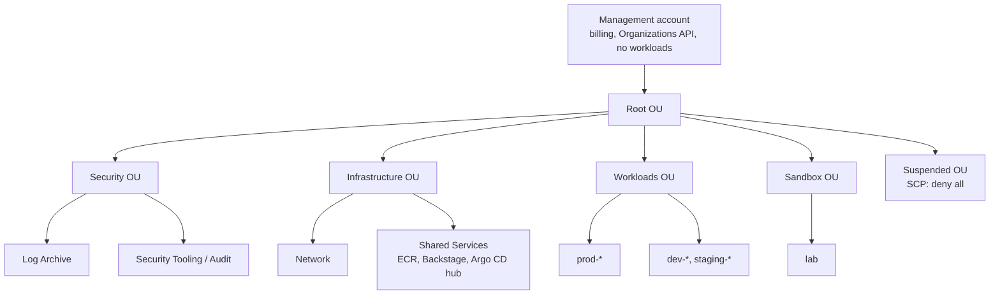
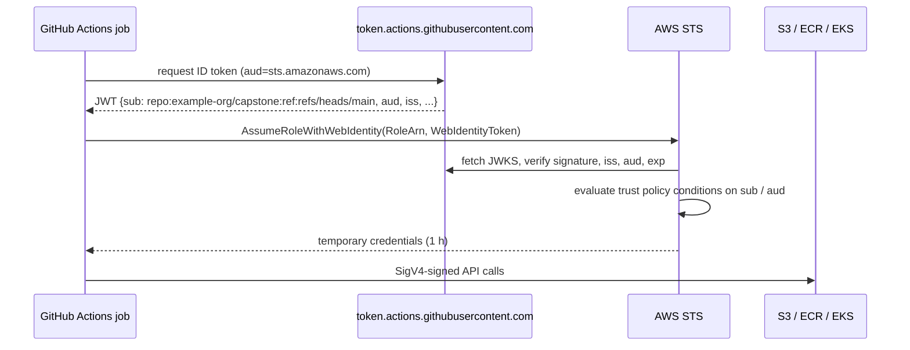
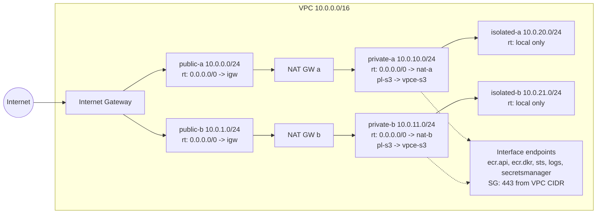
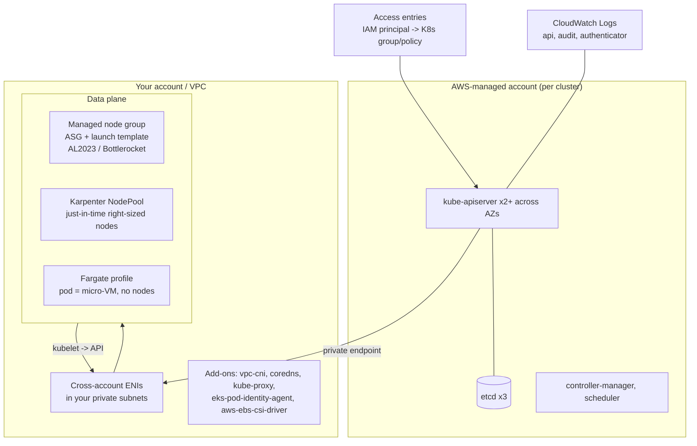
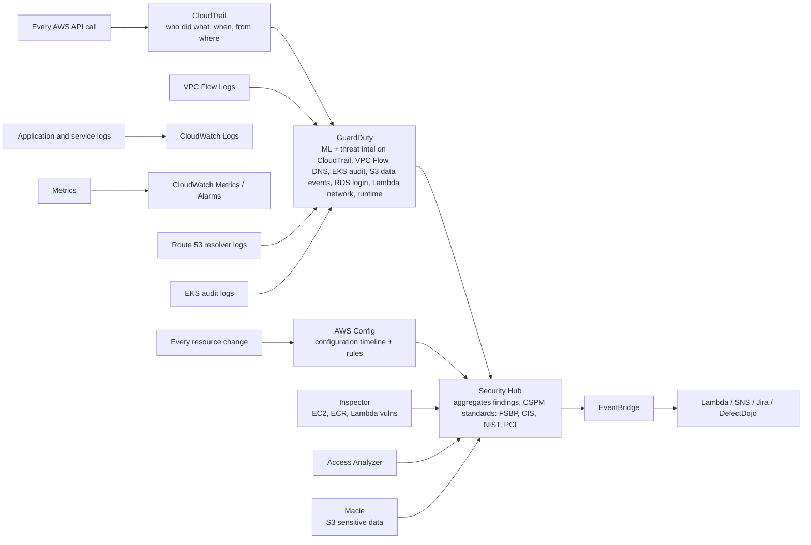

# AWS: Core Concepts

| | |
|---|---|
| **Cluster** | 01 Hyperscale Cloud |
| **Role** | Anchor |
| **Prerequisites** | [01-installation-and-setup.md](01-installation-and-setup.md); CIDR arithmetic; JSON |
| **Target version** | AWS CLI v2.15+, EKS 1.31+, Aurora PostgreSQL 16, Lambda Python 3.12 |
| **Capstone phase** | Phase 2 (Months 5-8) |

> This file explains how AWS works underneath the console: how the global infrastructure is partitioned, how Organizations and SCPs bound an account, exactly how an IAM request is evaluated, how a VPC routes a packet, how EC2, EKS and Lambda schedule compute, how S3, DynamoDB and RDS/Aurora store data durably, how KMS envelope encryption and Secrets Manager rotation work, what CloudTrail, Config, GuardDuty and Security Hub each observe, and how the Well-Architected pillars and cost tooling tie it together. Commands are kept to the minimum needed to make a concept concrete; the exhaustive reference is [03-commands-and-cheatsheet.md](03-commands-and-cheatsheet.md).

---

## 1. Global Infrastructure

| Construct | What it is | Failure isolation | Example |
|---|---|---|---|
| **Partition** | A fully separate set of regions, IAM, and endpoints | Total | `aws` (commercial), `aws-cn`, `aws-us-gov`. ARNs start with the partition: `arn:aws:...` |
| **Region** | A geographic area with 3+ AZs, its own control planes and endpoints | Regional services fail independently of other regions | `us-east-1` (N. Virginia), `eu-west-1` |
| **Availability Zone** | One or more datacentres with independent power, cooling, network, within ~100 km and <2 ms of the other AZs in the region | Designed so a single AZ failure does not take the region down | `us-east-1a`. The letter is randomised per account; use the **AZ ID** (`use1-az1`) when coordinating across accounts |
| **Local Zone** | An extension of a region placing compute/storage near a metro for single-digit ms latency | Attached to the parent region's control plane | `us-east-1-bos-1a` (Boston) |
| **Wavelength Zone** | Compute inside a 5G carrier network | Parent region | `us-east-1-wl1-bos-wlz-1` |
| **Outposts** | AWS racks in your datacentre, managed as part of a region | Parent region | |
| **Edge location** | CloudFront, Route 53, Global Accelerator points of presence (600+) | Independent | |

Service scope matters for design:

- **Global**: IAM, Organizations, Route 53, CloudFront, WAF (for CloudFront), S3 bucket namespace (data is regional).
- **Regional**: VPC, EC2 API, EKS, Lambda, RDS, DynamoDB tables, KMS keys (unless multi-region), CloudWatch, Secrets Manager.
- **Zonal**: a specific EC2 instance, EBS volume, subnet, NAT Gateway, RDS instance (Multi-AZ spans two).

Rule of thumb for the capstone: **every tier spans at least two AZs; the control plane for anything we build spans three.** AWS runs regional services (S3, DynamoDB, Lambda, EKS control plane) across three AZs for you; your own EC2/EKS nodes/RDS only span AZs if you place them there.

---

## 2. AWS Organizations, SCPs, and Control Tower

### 2.1 Why accounts are the boundary

Within an account, a misconfigured IAM policy, a leaked credential, or a runaway Lambda can reach every resource. Across accounts, nothing is reachable unless *both* sides allow it (resource policy on one side, identity policy on the other). Accounts are therefore the unit of blast radius, billing, and service quotas. The modern baseline is one account per environment per workload family, plus dedicated Security and Infrastructure accounts.



### 2.2 Service Control Policies

An SCP is an IAM-syntax policy attached to the root, an OU, or an account. It **never grants permissions**; it defines the maximum that identity policies in the account can grant. Effective permissions are the intersection of SCPs on every ancestor and the principal's own policies. SCPs do not apply to the management account, and they do not affect service-linked roles.

The three SCPs every lab OU should carry:

```json
{
  "Version": "2012-10-17",
  "Statement": [
    {
      "Sid": "DenyOutsideAllowedRegions",
      "Effect": "Deny",
      "NotAction": [
        "iam:*", "organizations:*", "sts:*", "budgets:*", "ce:*", "account:*",
        "support:*", "route53:*", "cloudfront:*", "health:*", "s3:GetBucketLocation", "s3:ListAllMyBuckets"
      ],
      "Resource": "*",
      "Condition": {"StringNotEquals": {"aws:RequestedRegion": ["us-east-1", "us-east-2"]}}
    },
    {
      "Sid": "DenyLeavingOrg",
      "Effect": "Deny",
      "Action": "organizations:LeaveOrganization",
      "Resource": "*"
    },
    {
      "Sid": "DenyDisablingSecurityServices",
      "Effect": "Deny",
      "Action": [
        "cloudtrail:StopLogging", "cloudtrail:DeleteTrail",
        "config:StopConfigurationRecorder", "config:DeleteConfigurationRecorder",
        "guardduty:DeleteDetector", "guardduty:DisassociateFromAdministratorAccount",
        "securityhub:DisableSecurityHub"
      ],
      "Resource": "*"
    },
    {
      "Sid": "DenyExpensiveInstanceFamilies",
      "Effect": "Deny",
      "Action": ["ec2:RunInstances"],
      "Resource": "arn:aws:ec2:*:*:instance/*",
      "Condition": {"StringLike": {"ec2:InstanceType": ["p*", "g*", "x*", "u-*", "*.metal", "*.8xlarge", "*.12xlarge", "*.16xlarge", "*.24xlarge"]}}
    }
  ]
}
```

The `NotAction` list in the region guard excludes global services that are always served from `us-east-1` so that IAM and billing keep working.

**Resource Control Policies (RCPs)**, added in 2024, are the resource-side twin: they set the maximum permissions on resources (S3 buckets, KMS keys, roles) in the org, for example "no S3 bucket in this org may be read by a principal outside the org":

```json
{
  "Version": "2012-10-17",
  "Statement": [{
    "Sid": "EnforceOrgIdentities",
    "Effect": "Deny",
    "Principal": "*",
    "Action": ["s3:*", "sqs:*", "kms:*", "secretsmanager:*", "sts:AssumeRole"],
    "Resource": "*",
    "Condition": {
      "StringNotEqualsIfExists": {"aws:PrincipalOrgID": "o-exampleorgid"},
      "BoolIfExists": {"aws:PrincipalIsAWSService": "false"}
    }
  }]
}
```

### 2.3 Control Tower

Control Tower is the opinionated installer for the structure above: it creates the Security OU with Log Archive and Audit accounts, enables an organization CloudTrail trail and Config aggregator, applies a set of preventive (SCP) and detective (Config rule) **controls**, and provides Account Factory (a Service Catalog product) for vending new accounts with a baseline. Use it when you have more than ~5 accounts; for the two-account capstone, hand-rolled Organizations + SCPs + an org trail are sufficient and cheaper (Control Tower's Config recording across accounts is the main cost).

---

## 3. IAM Deep Dive

### 3.1 Vocabulary

| Term | Meaning |
|---|---|
| **Principal** | An entity that can make a request: IAM user, IAM role (session), AWS service, federated identity, anonymous (`*`) |
| **Identity-based policy** | Attached to a user, group, or role. Managed (standalone, reusable, versioned, 6,144 chars) or inline |
| **Resource-based policy** | Attached to a resource: S3 bucket policy, KMS key policy, SQS queue policy, Secrets Manager secret policy, Lambda function policy, IAM role trust policy. Has a `Principal` element |
| **Trust policy** | The resource-based policy of a role. Says who may `sts:AssumeRole` (or `AssumeRoleWithWebIdentity` / `AssumeRoleWithSAML`) it |
| **Permission boundary** | A managed policy attached to a user or role that caps what its identity policies can grant. Delegation tool |
| **Session policy** | A policy passed at `AssumeRole` time that further restricts the session |
| **SCP / RCP** | Organization-level caps (see 2.2) |
| **ARN** | `arn:partition:service:region:account-id:resource-type/resource-id`. Global services omit region; IAM omits region; S3 omits region and account |
| **Condition key** | Context tested in a `Condition`: global (`aws:SourceIp`, `aws:PrincipalTag/team`, `aws:ResourceAccount`) or service-specific (`s3:prefix`, `ec2:InstanceType`) |

### 3.2 Policy evaluation logic, precisely

For a request within a single account:

1. Collect all applicable policies: SCPs (if member account), RCPs, resource policy, identity policies of the principal, permission boundary, session policy.
2. **If any policy contains an explicit `Deny` matching the request, the result is Deny.** Stop.
3. If the account is in an organization and the SCPs do not allow the action, Deny.
4. If the RCPs do not allow, Deny.
5. If the **resource policy** allows the principal **by its exact ARN** (or the role ARN for a role session), Allow. (This is why a bucket policy alone can grant a role in the same account access without any identity policy.)
6. Otherwise, the identity policy must allow.
7. If a permission boundary exists, it must also allow.
8. If a session policy exists, it must also allow.
9. Allow.

For a **cross-account** request, both sides must allow: the resource policy in the target account must allow the calling principal (or its account, in which case the caller also needs an identity policy allowing the action), and the caller's own account policies must allow it.

Consequences worth memorising:

- `"Principal": {"AWS": "arn:aws:iam::123456789012:root"}` in a resource policy means "any principal in account 123456789012 *that also has an identity policy allowing this*". It does not mean the root user.
- A resource policy that names a role by ARN grants same-account access even when the role's identity policy is empty. A resource policy that names the account does not.
- `NotPrincipal` with `Deny` is the only safe way to say "nobody except X"; `NotPrincipal` with `Allow` is almost always wrong.
- Wildcards in `Principal` with no `Condition` make a resource public. Access Analyzer flags exactly this.

### 3.3 Anatomy of a policy

```json
{
  "Version": "2012-10-17",
  "Statement": [
    {
      "Sid": "ReadOnlyOnCapstoneArtefacts",
      "Effect": "Allow",
      "Action": ["s3:GetObject", "s3:GetObjectVersion"],
      "Resource": "arn:aws:s3:::capstone-artefacts-123456789012/*",
      "Condition": {
        "StringEquals": {"s3:ExistingObjectTag/Project": "capstone"},
        "Bool": {"aws:SecureTransport": "true"}
      }
    },
    {
      "Sid": "ListBucketScopedToPrefix",
      "Effect": "Allow",
      "Action": "s3:ListBucket",
      "Resource": "arn:aws:s3:::capstone-artefacts-123456789012",
      "Condition": {"StringLike": {"s3:prefix": ["releases/*", "releases"]}}
    },
    {
      "Sid": "DenyUnencryptedUploads",
      "Effect": "Deny",
      "Action": "s3:PutObject",
      "Resource": "arn:aws:s3:::capstone-artefacts-123456789012/*",
      "Condition": {"StringNotEquals": {"s3:x-amz-server-side-encryption": "aws:kms"}}
    }
  ]
}
```

Notes: `s3:ListBucket` is a bucket-level action and must target the bucket ARN without `/*`; `s3:GetObject` is object-level and must target `/*`. Getting this wrong is the single most common S3 `AccessDenied`. `Version` must be `2012-10-17` for policy variables (`${aws:username}`) to work.

### 3.4 Roles and trust policies

A role is an identity with permissions but no credentials of its own. Assuming it returns temporary credentials (15 minutes to 12 hours). The trust policy decides who can assume it.

```json
{
  "Version": "2012-10-17",
  "Statement": [
    {
      "Sid": "AllowOpsTeamWithMFA",
      "Effect": "Allow",
      "Principal": {"AWS": "arn:aws:iam::123456789012:role/AWSReservedSSO_CapstoneDeveloper_abcdef0123456789"},
      "Action": ["sts:AssumeRole", "sts:TagSession"],
      "Condition": {
        "Bool": {"aws:MultiFactorAuthPresent": "true"},
        "StringEquals": {"sts:ExternalId": "capstone-breakglass"}
      }
    }
  ]
}
```

`sts:ExternalId` prevents the confused-deputy problem when a third party assumes your role. `sts:TagSession` allows the caller to attach session tags, which then become `aws:PrincipalTag/*` condition keys for attribute-based access control (ABAC).

Service roles use a service principal: `"Principal": {"Service": "ec2.amazonaws.com"}` for instance profiles, `"lambda.amazonaws.com"`, `"eks.amazonaws.com"`, `"pods.eks.amazonaws.com"` (Pod Identity). Always add `aws:SourceAccount` / `aws:SourceArn` conditions on service trust policies to prevent cross-account confused deputies.

**Role chaining** (assuming a role from a role session) caps the new session at one hour and is not permitted from SSO sessions to roles with longer durations; design so humans assume one role, and workloads use their native identity.

### 3.5 Permission boundaries

A boundary lets you delegate IAM administration safely. The classic pattern: developers may create roles for their Lambda functions, but every role they create must carry the boundary, and the boundary caps the role at "things in this account, no IAM, no Organizations".

Developer policy (attached to the developer's role):

```json
{
  "Version": "2012-10-17",
  "Statement": [
    {
      "Sid": "CreateRolesOnlyWithBoundary",
      "Effect": "Allow",
      "Action": ["iam:CreateRole", "iam:PutRolePolicy", "iam:AttachRolePolicy"],
      "Resource": "arn:aws:iam::123456789012:role/app/*",
      "Condition": {"StringEquals": {"iam:PermissionsBoundary": "arn:aws:iam::123456789012:policy/CapstoneWorkloadBoundary"}}
    },
    {
      "Sid": "DenyBoundaryTampering",
      "Effect": "Deny",
      "Action": ["iam:DeleteRolePermissionsBoundary", "iam:CreatePolicyVersion", "iam:DeletePolicy", "iam:SetDefaultPolicyVersion"],
      "Resource": "arn:aws:iam::123456789012:policy/CapstoneWorkloadBoundary"
    }
  ]
}
```

The boundary itself is an ordinary managed policy whose `Allow` statements define the ceiling. Effective permission = identity policy AND boundary (AND SCPs).

### 3.6 OIDC federation for GitHub Actions

GitHub Actions can mint a JWT per job (`id-token: write`). AWS trusts GitHub's OIDC issuer once per account (IAM identity provider), and each role's trust policy filters on the token claims.



Trust policy with the correct conditions:

```json
{
  "Version": "2012-10-17",
  "Statement": [{
    "Effect": "Allow",
    "Principal": {"Federated": "arn:aws:iam::123456789012:oidc-provider/token.actions.githubusercontent.com"},
    "Action": "sts:AssumeRoleWithWebIdentity",
    "Condition": {
      "StringEquals": {"token.actions.githubusercontent.com:aud": "sts.amazonaws.com"},
      "StringLike": {"token.actions.githubusercontent.com:sub": [
        "repo:example-org/capstone:ref:refs/heads/main",
        "repo:example-org/capstone:environment:production",
        "repo:example-org/capstone:pull_request"
      ]}
    }
  }]
}
```

Without the `sub` condition, **any GitHub repository in the world** could assume the role. Access Analyzer and Checkov both flag that. Prefer `environment:` subjects for deploy roles because GitHub environments can require reviewers.

### 3.7 IRSA and EKS Pod Identity

Both give a Kubernetes pod an IAM role without node-level credentials.

| | IRSA (IAM Roles for Service Accounts) | EKS Pod Identity (2023+) |
|---|---|---|
| Mechanism | Cluster OIDC issuer; projected ServiceAccount token; SDK calls `AssumeRoleWithWebIdentity` | `eks-pod-identity-agent` DaemonSet on each node; SDK calls the container credential endpoint (`169.254.170.23`) |
| Trust policy | Per cluster OIDC provider ARN with `sub: system:serviceaccount:<ns>:<sa>` condition | Single trust on `pods.eks.amazonaws.com`; mapping is an EKS API object (`create-pod-identity-association`) |
| Cross-cluster reuse of one role | Trust policy must list every cluster's OIDC provider | Same role, one association per cluster |
| Session tags | Manual | Automatic (`eks-cluster-arn`, `kubernetes-namespace`, `kubernetes-service-account`, ...) enabling ABAC |
| Works on Fargate / self-managed nodes / outside EKS | Yes | Managed node groups and Karpenter nodes with the add-on; not Fargate |
| Terraform friendliness | OIDC provider thumbprint handling per cluster | `aws_eks_pod_identity_association` resource, no per-cluster trust changes |

Capstone decision (ADR 0003): **Pod Identity by default**, IRSA where Fargate or a non-EKS cluster requires it.

### 3.8 IAM Access Analyzer

Three capabilities, all used in Lab 8:

- **External access findings**: continuously analyses resource policies (S3, KMS, IAM roles, SQS, Secrets Manager, Lambda, ECR, EFS, RDS snapshots, SNS) and reports anything reachable from outside the zone of trust (your account or organization).
- **Unused access findings** (paid): roles, keys, and permissions unused for N days, the basis for least-privilege pruning.
- **Policy validation and generation**: `aws accessanalyzer validate-policy` lints a policy for errors and security warnings; `start-policy-generation` builds a policy from CloudTrail activity for a role.

```bash
aws accessanalyzer validate-policy --policy-type IDENTITY_POLICY \
  --policy-document file://policy.json \
  --query 'findings[].{type:findingType,issue:issueCode,detail:findingDetails}' --output table
```

---

## 4. VPC: Software-Defined Networking

### 4.1 Building blocks

| Component | Scope | Purpose |
|---|---|---|
| VPC | Regional | An isolated IPv4 (and optionally IPv6) address space. Primary CIDR /16 to /28; up to 5 CIDRs (quota adjustable). Cannot be resized, only extended |
| Subnet | Zonal | A CIDR slice of the VPC in one AZ. AWS reserves 5 addresses per subnet (network, router, DNS, future, broadcast) |
| Route table | VPC | Rules `destination -> target`. Each subnet is associated with exactly one; the main route table is the default. Local route for the VPC CIDR is implicit and cannot be removed |
| Internet Gateway | VPC | Horizontally scaled, 1:1 NAT between public IPs and instance private IPs. Target for `0.0.0.0/0` in public subnets |
| NAT Gateway | Zonal | Outbound-only NAT for private subnets; managed, 5-100 Gbps; charged per hour plus per GB processed. One per AZ to avoid cross-AZ data charges and single-AZ dependency |
| Egress-only IGW | VPC | IPv6 outbound-only |
| Elastic Network Interface | Zonal | A virtual NIC with private IPs, optional public/Elastic IP, security groups. Everything that gets an IP in your VPC (instance, RDS, Lambda in VPC, EKS control plane, interface endpoint, NLB) is an ENI |
| Security Group | VPC | **Stateful** allow-list attached to ENIs. Rules reference CIDRs, prefix lists, or other security groups. No deny rules. Return traffic is automatically allowed |
| Network ACL | Subnet | **Stateless** ordered allow/deny list evaluated at the subnet boundary. Must allow ephemeral return ports (1024-65535) explicitly. Default NACL allows all; use NACLs sparingly, for coarse deny rules |
| VPC endpoint (gateway) | VPC | Route-table entry for S3 and DynamoDB; free; same-region only |
| VPC endpoint (interface) / PrivateLink | Zonal ENI | Private IP in your subnet fronting an AWS service or a third-party / your own NLB-backed service; hourly plus per GB; supports endpoint policies and private DNS |
| VPC peering | Two VPCs | Non-transitive 1:1 L3 connection, any account or region. Overlapping CIDRs forbidden |
| Transit Gateway | Regional hub | Transitive router connecting thousands of VPCs and VPNs/Direct Connect; route tables per attachment allow segmentation (prod cannot reach dev). Hourly plus per GB |
| Flow Logs | VPC / subnet / ENI | 5-tuple + action records to CloudWatch Logs or S3; default 10-minute aggregation, 1-minute available. Not packet capture (use Traffic Mirroring) |

### 4.2 The three-tier, multi-AZ reference



Security group chaining replaces IP-based rules: `sg-alb` allows 443 from `0.0.0.0/0`; `sg-app` allows 8080 **from `sg-alb`**; `sg-db` allows 5432 **from `sg-app`**. Moving instances or changing IPs never breaks the rules.

### 4.3 How a packet leaves a private instance for S3

1. Instance resolves `capstone-bucket.s3.us-east-1.amazonaws.com` via the VPC resolver (`10.0.0.2`, the `.2` address of the VPC).
2. With a gateway endpoint, the route table has an entry for the S3 managed prefix list `pl-63a5400a` pointing to `vpce-...`; the packet never touches the NAT.
3. Security group egress must allow 443 to the prefix list (or `0.0.0.0/0`).
4. The endpoint policy (resource policy on the endpoint) can restrict which buckets are reachable: `"Condition": {"StringEquals": {"aws:ResourceAccount": "123456789012"}}` stops exfiltration to an attacker's bucket.
5. The bucket policy can in turn require `aws:SourceVpce` to be your endpoint, so the bucket is unreachable from the internet even with valid credentials.

### 4.4 DNS in a VPC

`enableDnsSupport` and `enableDnsHostnames` must both be true for interface endpoints' private DNS and for EKS. Route 53 **private hosted zones** associate with VPCs and resolve only inside them; **Route 53 Resolver endpoints** (inbound/outbound) bridge to on-premises DNS. Private DNS on an interface endpoint overrides the public name (`sts.us-east-1.amazonaws.com`) with the endpoint's private IPs inside the VPC, so SDKs need no configuration.

---

## 5. Compute

### 5.1 EC2 and Auto Scaling

| Concept | Detail |
|---|---|
| **Instance family naming** | `m7g.large`: `m` = general purpose, `7` = generation, `g` = Graviton (ARM64), `large` = size. Other suffixes: `a` AMD, `i` Intel, `n` network-optimised, `d` local NVMe, `flex`. Families: `t` burstable (CPU credits), `c` compute, `m` general, `r` memory, `x`/`u` high memory, `i`/`d` storage, `p`/`g`/`trn`/`inf` accelerators |
| **Graviton** | AWS's ARM64 CPUs (Graviton2/3/4). 20-40% better price-performance for most Linux workloads; requires `arm64` container images (multi-arch manifests, Cluster 04). Default for the capstone |
| **AMI** | Region-specific image. Resolve the latest Amazon Linux 2023 ARM64 AMI via SSM: `/aws/service/ami-amazon-linux-latest/al2023-ami-kernel-default-arm64` |
| **Purchase options** | On-Demand; Spot (up to 90% off, 2-minute interruption notice, ideal for stateless EKS nodes and CI runners); Savings Plans (commit $/h for 1-3 years, compute or EC2-instance flavour); Reserved Instances (legacy, still useful for RDS/ElastiCache); Dedicated Hosts |
| **IMDSv2** | Session-oriented metadata (`PUT /latest/api/token` then `GET` with the token). Blocks SSRF credential theft. Enforce with `--metadata-options HttpTokens=required` and the account default from setup |
| **Instance profile** | The container that attaches one IAM role to an instance. Credentials served by IMDS, rotated automatically |
| **EBS** | Network block storage; `gp3` (baseline 3,000 IOPS / 125 MB/s, tune independently of size) is the default; `io2 Block Express` for databases needing >16k IOPS; snapshots are incremental to S3 |
| **Launch template** | Versioned definition (AMI, type, user data, SGs, IMDS options, tags) used by ASGs, EKS node groups, and Spot Fleet |
| **Auto Scaling Group** | Maintains desired capacity across subnets/AZs; replaces unhealthy instances (EC2 or ELB health checks); scaling policies: target tracking (keep CPU at 50%), step, scheduled, predictive; mixed instances policy with Spot and On-Demand; instance refresh for rolling AMI updates; lifecycle hooks for drain-before-terminate; warm pools |
| **Placement groups** | Cluster (low latency, same rack), spread (max 7 per AZ, distinct hardware), partition (Kafka/HDFS style) |
| **Systems Manager** | Session Manager (shell without SSH/ports/bastion, audited to CloudTrail/S3), Patch Manager, Run Command, State Manager. The SSM Agent is preinstalled on AL2023 and needs the `AmazonSSMManagedInstanceCore` policy on the instance role |

### 5.2 EKS



Key concepts:

- **Control plane**: AWS runs and patches it in an AWS-owned account; you pay $0.10 per hour (standard support) regardless of size. Kubernetes versions are supported for 14 months standard, then extended support at higher cost for 12 more. Upgrade one minor at a time.
- **Endpoint access**: public, private, or both. Production: private only (or public with CIDR allow-list) and operate from a VPN or CI runner inside the VPC.
- **VPC CNI**: pods get real VPC IPs from the subnet; plan subnet sizes accordingly (`/24` runs out fast; use prefix delegation or a secondary CIDR `100.64.0.0/16` for pods). Network policy is enforced by the VPC CNI (since 1.14) or Cilium.
- **Managed node groups**: AWS creates the ASG and launch template; handles draining on update; supports Spot capacity types and Graviton; AL2023 or Bottlerocket AMIs. Node IAM role needs `AmazonEKSWorkerNodePolicy`, `AmazonEC2ContainerRegistryPullOnly`, `AmazonEKS_CNI_Policy` (or move CNI to Pod Identity).
- **Fargate**: serverless pods matched by namespace/label selectors in a Fargate profile; no DaemonSets, no privileged pods, no GPUs; good for Argo CD or CoreDNS isolation, poor for the LGTM stack.
- **Karpenter**: an open-source node autoscaler (now CNCF) that watches unschedulable pods and launches exactly the right instance types/sizes from a `NodePool` + `EC2NodeClass`, consolidates under-utilised nodes, and handles Spot interruptions. Replaces Cluster Autoscaler in the capstone. Needs an SQS queue for interruption events and a controller IAM role (Pod Identity).
- **EKS Auto Mode** (2024): AWS manages Karpenter, the CNI, CoreDNS, EBS CSI, and the ALB controller as part of the control plane. Simplest path for teams that do not need to customise; the capstone uses explicit add-ons so you learn what Auto Mode hides.
- **Add-ons**: AWS-curated operators (`vpc-cni`, `coredns`, `kube-proxy`, `aws-ebs-csi-driver`, `eks-pod-identity-agent`, `amazon-cloudwatch-observability`, `aws-guardduty-agent`) installed and upgraded through the EKS API, with per-add-on IAM roles via Pod Identity.
- **Access entries** (replaces the `aws-auth` ConfigMap): `aws eks create-access-entry --principal-arn <role>` plus `associate-access-policy --policy-arn arn:aws:eks::aws:cluster-access-policy/AmazonEKSClusterAdminPolicy --access-scope type=cluster` or `type=namespace,namespaces=[team-a]`. Auditable through CloudTrail; no more editing a ConfigMap that can lock you out.
- **Authentication flow**: `kubectl` runs `aws eks get-token`, which produces a pre-signed `sts:GetCallerIdentity` URL as a bearer token; the API server's authenticator calls it and maps the IAM ARN through access entries to Kubernetes RBAC.

### 5.3 Lambda

| Concept | Detail |
|---|---|
| **Execution model** | Request arrives (sync via API Gateway/ALB/Function URL/SDK, async via S3/SNS/EventBridge with retries and DLQ, or poll-based via SQS/Kinesis/DynamoDB Streams with event source mappings). Firecracker micro-VM is created (cold start) or reused (warm). Handler runs; environment freezes until next invocation |
| **Packaging** | Zip (50 MB zipped, 250 MB unzipped, including layers) or container image (10 GB, from ECR, must implement the Runtime Interface). Container images are the capstone default so the same Dockerfile serves EKS and Lambda |
| **Layers** | Zip archives mounted at `/opt`, up to 5 per function, for shared libraries and extensions (OTel ADOT layer, Secrets Manager/Parameter Store caching extension) |
| **Runtimes** | Python 3.12/3.13, Node.js 20/22, Java 21 (with SnapStart for cold-start reduction), .NET 8, Ruby 3.3, provided.al2023 for Go/Rust. ARM64 (Graviton) is ~20% cheaper |
| **Memory and CPU** | 128 MB to 10,240 MB; CPU scales linearly with memory (1,769 MB = 1 vCPU). Tune with AWS Lambda Power Tuning |
| **Concurrency** | Account default 1,000 concurrent executions per region (raise via quota). **Reserved concurrency** caps a function and guarantees capacity; **provisioned concurrency** pre-warms N environments to remove cold starts (billed per hour) |
| **Timeout** | Up to 15 minutes. Longer work goes to Step Functions, ECS, or Batch |
| **Networking** | Outside a VPC by default (internet access, no access to RDS in private subnets). Attaching to a VPC creates Hyperplane ENIs per subnet/SG combination; needs NAT or endpoints for AWS APIs |
| **Permissions** | Execution role (what the function may call) vs resource-based policy (who may invoke the function: `lambda:InvokeFunction` with `aws:SourceArn`) |
| **Versions and aliases** | `$LATEST` is mutable; publish immutable versions; aliases (`prod`) point at versions and support weighted traffic shifting for canaries |
| **Observability** | Structured JSON logs to CloudWatch Logs (set `--logging-config LogFormat=JSON`), X-Ray or ADOT layer for traces, `Duration`, `Errors`, `Throttles`, `ConcurrentExecutions` metrics |

### 5.4 ECR

Private registry per account per region. Repositories hold images and OCI artefacts (Helm charts, SBOMs, Cosign signatures). Features used in the capstone: **scan on push** (basic = Clair-style OS CVEs; enhanced = Amazon Inspector with language packages and continuous rescans), **immutable tags** (prevents overwriting `v1.2.3`), **lifecycle policies** (expire untagged after 7 days, keep last 30 release tags), **cross-region / cross-account replication**, **pull-through cache** for Docker Hub / `public.ecr.aws` / GHCR to avoid rate limits, and **registry policies** for cross-account pull. Authentication is a 12-hour token from `aws ecr get-login-password`.

---

## 6. Storage and Data

### 6.1 S3

- **Model**: bucket (globally unique name, regional data) containing objects (key, up to 5 TB, metadata, tags). Flat namespace; `/` is a convention. Strong read-after-write consistency for all operations since 2020.
- **Durability and availability**: 11 nines durability (objects replicated across 3+ AZs); 99.99% availability for Standard. **S3 Express One Zone** trades single-AZ durability for single-digit ms latency.
- **Storage classes and lifecycle**: Standard -> Standard-IA (30 days min) -> Glacier Instant Retrieval -> Glacier Flexible -> Deep Archive. **Intelligent-Tiering** moves objects automatically for a small monitoring fee. Lifecycle rules transition by age or expire objects/noncurrent versions/incomplete multipart uploads (always add the last one).
- **Versioning**: once enabled, cannot be disabled, only suspended. Deletes create a delete marker; the data remains as a noncurrent version. Required for Object Lock and replication, and the Terraform state bucket.
- **Object Lock**: WORM. **Governance** mode (users with `s3:BypassGovernanceRetention` can delete) vs **Compliance** mode (nobody, including root, until the retention expires). Legal holds are indefinite. Must be enabled at bucket creation. The log archive bucket uses Compliance mode.
- **Encryption**: SSE-S3 (AES-256, AWS-owned keys, default since 2023), SSE-KMS (customer-managed key, CloudTrail audit of every decrypt, key policy as an extra access gate, **bucket keys** reduce KMS calls 99%), SSE-C (you send the key), DSSE-KMS (two layers). Enforce with a bucket policy denying `PutObject` without `s3:x-amz-server-side-encryption: aws:kms` or via default encryption.
- **Access control**: bucket policies (resource-based) and IAM (identity-based); **ACLs are disabled by default** (`BucketOwnerEnforced`) and should stay disabled; **Block Public Access** at account and bucket level; **Access Points** give per-application endpoints with their own policies; presigned URLs delegate time-limited access using the signer's permissions.
- **Replication**: same-region (SRR) or cross-region (CRR), requires versioning, optional replication time control (15-minute SLA), replica modification sync, delete marker replication. The DR lab replicates the artefact bucket to `us-east-2`.
- **Event notifications**: to EventBridge (preferred, all events, filtering), SNS, SQS, Lambda.
- **Performance**: 3,500 PUT / 5,500 GET per second per prefix, scaling automatically; multipart upload above 100 MB; byte-range GETs; Transfer Acceleration via edge locations.

### 6.2 DynamoDB

- **Model**: table with a mandatory **partition key** (hash) and optional **sort key** (range). Items up to 400 KB. Schemaless beyond the keys. Data is spread across partitions by hash of the partition key; each partition serves 3,000 RCU / 1,000 WCU and 10 GB.
- **Capacity**: **On-demand** (pay per request, instant scaling, default for the lab and for spiky workloads) or **provisioned** with auto scaling (cheaper at steady high throughput). One RCU = one strongly consistent 4 KB read per second (two eventually consistent); one WCU = one 1 KB write per second.
- **Single-table design**: model all entities in one table using generic key names (`PK`, `SK`) and overloaded values (`USER#123`, `ORDER#2024-01-01#456`) so that every access pattern is one `Query` on a key prefix, avoiding joins. Design access patterns first, then keys. Trade-off: hard to evolve, analytics need export to S3/Athena.
- **Secondary indexes**: **GSI** (different partition and sort key, own capacity, eventually consistent, up to 20 per table, can be added later; sparse indexes by only writing the GSI key on some items) and **LSI** (same partition key, different sort key, must be created with the table, shares capacity, strongly consistent reads).
- **Streams**: ordered change log per partition key, 24-hour retention, triggers Lambda (`event source mapping`) for CDC, fan-out, aggregation. **Kinesis Data Streams** integration for longer retention and more consumers.
- **Consistency and transactions**: eventually consistent reads by default; `ConsistentRead=true` for strong; `TransactWriteItems` / `TransactGetItems` for ACID across up to 100 items.
- **Other features**: TTL (free deletes by epoch attribute), Global Tables (multi-region active-active, last-writer-wins), point-in-time recovery (35 days), on-demand backups, DAX (in-memory cache), PartiQL, export to S3, conditional writes (`attribute_not_exists(PK)` for idempotency), Terraform state locking (legacy; S3 native lockfile is now preferred).

### 6.3 RDS and Aurora

| | RDS (PostgreSQL, MySQL, MariaDB, SQL Server, Oracle, Db2) | Aurora (PostgreSQL-compatible, MySQL-compatible) |
|---|---|---|
| Storage | EBS volume attached to the instance; you choose size and IOPS (`gp3`, `io2`) | Distributed, log-structured storage layer; 6 copies across 3 AZs; auto-grows to 128 TiB; quorum writes (4/6) |
| HA | **Multi-AZ instance**: synchronous standby in another AZ, failover 60-120 s, standby not readable. **Multi-AZ DB cluster**: one writer + two readable standbys, failover ~35 s | Up to 15 **reader** instances share the same storage; failover to a reader in ~30 s; readers also serve reads via the reader endpoint |
| Read replicas | Asynchronous, up to 15 (MySQL/Postgres), cross-region possible | Readers are the replicas (ms lag); **Global Database** replicates storage to up to 10 secondary regions with <1 s lag and managed failover / switchover (RPO ~1 s, RTO ~1 min) |
| Scaling | Vertical (instance class), storage autoscaling | Vertical, horizontal readers, **Serverless v2** (ACU-based, scales in 0.5 ACU steps, scale to zero since 2024), **Aurora Limitless** (sharded) |
| Backups | Automated snapshots + transaction logs for PITR (1-35 days), manual snapshots, cross-region copy | Continuous backup to S3, PITR, **Backtrack** (MySQL), fast clone (copy-on-write) |
| Cost | Cheaper at small scale (`db.t4g.micro` ~ $12/month) | Higher floor; cheaper at scale and for read-heavy workloads; I/O-Optimized tier removes per-I/O charges |

Concepts common to both:

- **DB subnet group**: the isolated subnets across AZs the instance may live in. **Publicly accessible = false** always.
- **Parameter group** (engine config such as `shared_preload_libraries`, `log_min_duration_statement`, `rds.force_ssl=1`) and **option group**.
- **IAM database authentication**: the application calls `rds:generate-db-auth-token` (a 15-minute SigV4 token) instead of using a password; grant the DB user `rds_iam`. Limits: 200 connections/second via IAM; use with RDS Proxy.
- **RDS Proxy**: managed connection pooler (pgbouncer-like) that holds the DB credentials in Secrets Manager, multiplexes thousands of Lambda/pod connections onto a few DB connections, and makes failover transparent to clients. Supports IAM auth to the proxy.
- **Encryption**: KMS at rest (must be set at creation; encrypt later via snapshot copy), TLS in transit (`rds.force_ssl`), download the RDS CA bundle (`global-bundle.pem`) for verification.
- **Secrets Manager integration**: `--manage-master-user-password` creates and rotates the master password automatically.
- **Extensions for the capstone**: `pgvector` (RAG, Cluster 10), `pg_stat_statements`, `pgaudit`.
- **Blue/Green deployments**: create a synced green environment, test, switch over in under a minute for major version upgrades.

---

## 7. Keys, Secrets, and Configuration

### 7.1 KMS

- **Key types**: AWS-owned (invisible, free), AWS-managed (`aws/s3`, free, auto-rotated yearly, cannot change key policy), **customer-managed (CMK)** ($1/month + $0.03 per 10k requests, full policy control, optional yearly rotation, deletion with 7-30 day waiting period, multi-region replicas).
- **Envelope encryption**: KMS never encrypts your data directly beyond 4 KB. The service calls `GenerateDataKey`, gets a plaintext data key and the same key encrypted under the CMK, encrypts your data locally with the plaintext key, stores the encrypted data key alongside the ciphertext, and discards the plaintext. Decryption calls `Decrypt` on the encrypted data key. Every call is in CloudTrail with the `EncryptionContext`.
- **Key policy is mandatory**: unlike other resources, a CMK's resource policy is the primary access control. The default policy grants the account root full access (which then lets IAM policies work). If you write a key policy without that statement and without your own principal, the key becomes unmanageable (AWS Support can help; it is slow).
- **Grants**: programmatic, temporary permissions used by AWS services (EBS, RDS) to use a key on your behalf.
- **Aliases**: `alias/capstone-state`; use aliases in application configuration so key rotation or replacement does not require redeploys.
- **Multi-region keys**: same key material and key ID suffix in several regions (`mrk-...`), enabling decrypt-anywhere for DR without re-encrypting.

A minimal safe key policy:

```json
{
  "Version": "2012-10-17",
  "Statement": [
    {
      "Sid": "EnableIAMPolicies",
      "Effect": "Allow",
      "Principal": {"AWS": "arn:aws:iam::123456789012:root"},
      "Action": "kms:*",
      "Resource": "*"
    },
    {
      "Sid": "AllowDeployRoleUse",
      "Effect": "Allow",
      "Principal": {"AWS": "arn:aws:iam::123456789012:role/gha-capstone-deploy"},
      "Action": ["kms:Encrypt", "kms:Decrypt", "kms:GenerateDataKey*", "kms:DescribeKey"],
      "Resource": "*"
    },
    {
      "Sid": "AllowS3ViaService",
      "Effect": "Allow",
      "Principal": {"AWS": "arn:aws:iam::123456789012:role/gha-capstone-deploy"},
      "Action": ["kms:CreateGrant"],
      "Resource": "*",
      "Condition": {"Bool": {"kms:GrantIsForAWSResource": "true"}}
    }
  ]
}
```

### 7.2 Secrets Manager vs SSM Parameter Store

| | Secrets Manager | Parameter Store |
|---|---|---|
| Purpose | Credentials with rotation | Configuration (plain `String`, `StringList`, `SecureString` via KMS) |
| Price | $0.40 per secret per month + $0.05 per 10k calls | Standard tier free (10k params, 4 KB); Advanced $0.05 per param per month (8 KB, policies) |
| Rotation | Built-in Lambda rotation for RDS/Aurora/Redshift/DocumentDB; custom Lambda for anything else; managed rotation for RDS master | None (write your own) |
| Cross-account | Resource policy on the secret | No |
| Versioning | Staging labels `AWSCURRENT`, `AWSPREVIOUS`, `AWSPENDING` | Numeric versions and labels |
| Hierarchy | Flat names (use `/` by convention) | Native paths: `/capstone/prod/api/db_host`, `GetParametersByPath` |
| Kubernetes integration | External Secrets Operator, Secrets Store CSI Driver | Same |

Rule: **secrets** (DB passwords, API keys) in Secrets Manager; **configuration** (feature flags, endpoints, AMI IDs) in Parameter Store. Applications fetch at startup via the role, cache with the Lambda extension or ESO, and never bake values into images or environment variables in Git.

---

## 8. Observability, Audit, and Detection



| Service | What it records | Retention / cost notes | Capstone use |
|---|---|---|---|
| **CloudWatch Metrics** | Service metrics (1-minute standard, 1-second high-res), custom metrics, embedded metric format from logs | 15 months, free tier 10 custom metrics | EKS control plane and RDS dashboards; alarms on `FreeStorageSpace`, `CPUUtilization`, NAT `ErrorPortAllocation` |
| **CloudWatch Logs** | Log groups/streams; Logs Insights query language; metric filters; subscription filters to Kinesis/Lambda/OpenSearch; anomaly detection | Set retention explicitly (default is never-expire and costs forever); $0.50/GB ingest | EKS control plane logs, Lambda logs, VPC Flow Logs, RDS Postgres logs |
| **CloudWatch Alarms** | Threshold, anomaly, composite alarms -> SNS / Auto Scaling / EC2 actions / Systems Manager OpsItems | $0.10 per alarm | Budget-adjacent alarms and ASG scaling |
| **CloudTrail** | Management events (free, 90 days in Event history; trails to S3 for longer), data events (S3 object-level, Lambda invoke, DynamoDB item-level; paid), Insights (anomalous API volume), **CloudTrail Lake** (SQL over events) | Org trail in Log Archive account with Object Lock | Forensics, Access Analyzer policy generation, GuardDuty input |
| **AWS Config** | Configuration items for every supported resource change, relationship graph, timeline; **rules** (managed, custom Lambda or Guard) evaluate compliance; **conformance packs** bundle rules; **remediation** via SSM Automation | $0.003 per item recorded, $0.001 per rule evaluation; use recording exclusions for noisy types | `encrypted-volumes`, `s3-bucket-public-read-prohibited`, `eks-endpoint-no-public-access`, `rds-storage-encrypted`, `required-tags` |
| **GuardDuty** | Findings such as `UnauthorizedAccess:IAMUser/InstanceCredentialExfiltration.OutsideAWS`, `CryptoCurrency:EC2/BitcoinTool.B!DNS`, `Kubernetes/PrivilegeEscalation`, `Execution:Runtime/NewBinaryExecuted` | 30-day free trial; then per GB of logs analysed | EKS Protection (audit + runtime agent), S3 Protection, Malware Protection |
| **Security Hub** | Normalises findings to ASFF; enables **standards** (AWS Foundational Security Best Practices, CIS 1.4/3.0, NIST 800-53, PCI DSS) backed by Config rules; security score; cross-account aggregation; automation rules | Per check per account per month | ASPM feed into DefectDojo (Cluster 08) |
| **Inspector** | CVE scanning of EC2 (via SSM agent), ECR images (continuous), Lambda functions and layers | Per instance / image | ECR enhanced scanning |
| **X-Ray / ADOT** | Distributed traces; ADOT is AWS's OpenTelemetry distribution | | Replaced by the OTel Collector + Tempo in Cluster 09, kept for Lambda |

---

## 9. Edge, DNS, and Load Balancing

### 9.1 Route 53

Authoritative DNS (public and private hosted zones), domain registration, health checks, and **routing policies**: simple, weighted (canary), latency-based, failover (active-passive with health checks, the DR primitive), geolocation, geoproximity, multivalue answer, IP-based. **Alias records** point at AWS resources (ALB, CloudFront, S3 website, another record in the zone) at the zone apex and are free to query. **Route 53 Resolver** is the VPC DNS; **Resolver DNS Firewall** blocks malicious domains and feeds GuardDuty. **Application Recovery Controller** provides routing controls for regional failover without depending on health-check propagation.

### 9.2 Elastic Load Balancing

| | Application Load Balancer | Network Load Balancer | Gateway Load Balancer |
|---|---|---|---|
| Layer | 7 (HTTP/1.1, HTTP/2, gRPC, WebSocket) | 4 (TCP, UDP, TLS) | 3 (GENEVE) for firewalls / IDS appliances |
| Routing | Host, path, header, query, method, source IP rules; weighted target groups (canary); fixed responses; redirects | Flow hash to target; static IP / Elastic IP per AZ; preserves source IP | Transparent bump-in-the-wire |
| Targets | Instances, IPs (including on-prem), Lambda, ALB behind NLB | Instances, IPs, ALB | Appliances |
| TLS | Termination with ACM certs, SNI multi-cert, TLS 1.3 policies, mTLS (passthrough or verify with trust store) | Termination or passthrough | Passthrough |
| Security | Security groups; WAF integration; authentication via Cognito/OIDC at the listener | Security groups (since 2023); no WAF | |
| Health checks | HTTP path per target group | TCP / HTTP / HTTPS | |
| Kubernetes | AWS Load Balancer Controller creates ALBs from `Ingress` / Gateway API `HTTPRoute`; IP target mode routes directly to pod IPs | Controller creates NLBs from `Service type=LoadBalancer` with `service.beta.kubernetes.io/aws-load-balancer-type: external` | |
| Cost | Hourly + LCU (new connections, active connections, bandwidth, rule evaluations) | Hourly + NLCU | Hourly + GLCU |

Cross-zone load balancing is on by default for ALB (free) and off by default for NLB (cross-AZ data charges apply when on). Access logs to S3 are the request-level audit trail and are off by default; turn them on.

---

## 10. Well-Architected Framework

Six pillars, each a set of design principles and review questions. Use the Well-Architected Tool (free) to run a review against the capstone before Phase 3.

| Pillar | Core question | How the capstone answers it |
|---|---|---|
| **Operational Excellence** | Can you run, observe, and evolve the workload with small reversible changes? | Everything in Terraform and GitOps; runbooks in TechDocs; CloudWatch + OTel; nightly destroy proves rebuildability |
| **Security** | Is identity strong, is the perimeter and data protected, can you detect and respond? | SSO + OIDC, no static keys; SCPs; private subnets + endpoints; KMS everywhere; CloudTrail/Config/GuardDuty/Security Hub; Checkov in CI |
| **Reliability** | Does it recover from failure and scale to demand? | Multi-AZ VPC, RDS Multi-AZ (HA lab), EKS across AZs, Karpenter, health-check replacement, PITR, DR replication of the artefact bucket |
| **Performance Efficiency** | Are you using the right resource types and sizes, measured not guessed? | Graviton, gp3, Aurora Serverless v2 evaluation, Compute Optimizer recommendations, load tests in Cluster 11 |
| **Cost Optimization** | Do you know what you spend, and is every dollar producing value? | Budgets, tags, Cost Explorer by `Project`, Spot for nodes, right-sizing, Savings Plans analysis after 30 days of steady state |
| **Sustainability** | Are you minimising the environmental impact per unit of work? | ARM64, scale-to-zero, nightly destroy, lifecycle policies to cold storage |

The **Security Reference Architecture (SRA)** is the prescriptive companion: which security service lives in which account (GuardDuty and Security Hub delegated admin in Security Tooling; CloudTrail and Config in Log Archive; Network Firewall and Transit Gateway in Network).

---

## 11. Cost Management

| Tool | What it does | When to use |
|---|---|---|
| **Billing console / Bills** | Monthly invoice by service | Monthly reconciliation |
| **Cost Explorer** | Interactive analysis, 13 months history, group by service / tag / account / usage type, forecast; API (`aws ce get-cost-and-usage`) | Daily lab check, finding the forgotten NAT Gateway |
| **AWS Budgets** | Cost, usage, RI/SP coverage and utilisation budgets with alerts and **budget actions** (apply an SCP or stop instances when exceeded) | Before any lab resource exists |
| **Cost Anomaly Detection** | ML-based alerts on unexpected spend per service/account/tag | Always on, free |
| **Cost and Usage Report (CUR) / Data Exports** | Hourly line-item data to S3 (Parquet); query with Athena; feed into Kubecost/OpenCost | Showback in Cluster 12 |
| **Cost allocation tags** | Activate user-defined tags so they appear in CE/CUR; 24 hours to propagate | After tags exist on resources |
| **Savings Plans** | Commit to $/hour of compute (EC2, Fargate, Lambda) for 1 or 3 years, 66-72% savings; **Compute SP** is instance-family-agnostic; **EC2 Instance SP** is deeper but family-locked | Only after 30+ days of stable usage; never for the lab |
| **Reserved Instances** | Legacy EC2 commitment; still the mechanism for RDS, ElastiCache, OpenSearch, Redshift | Production databases |
| **Compute Optimizer** | Right-sizing recommendations for EC2, ASG, EBS, Lambda, ECS Fargate | Monthly |
| **Trusted Advisor** | Checks for idle resources, underutilised volumes, unassociated EIPs (full set needs Business support) | Weekly |
| **Free Tier usage alerts** | Emails at 85% of a free-tier limit | Enabled by default; keep on |

The five lab cost traps, ranked by frequency: NAT Gateway left running ($32/month), EKS control plane left running ($73/month), Multi-AZ RDS left running ($25-100/month), unassociated Elastic IPs ($3.60/month each), CloudWatch log groups without retention (grows forever). The nightly destroy and the orphan sweep in [03-commands-and-cheatsheet.md](03-commands-and-cheatsheet.md#cost-and-cleanup) target exactly these.

Next: [03-commands-and-cheatsheet.md](03-commands-and-cheatsheet.md).
