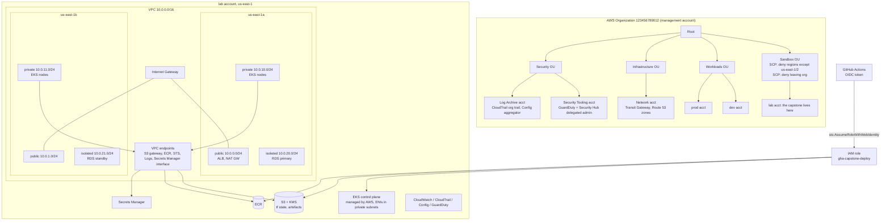
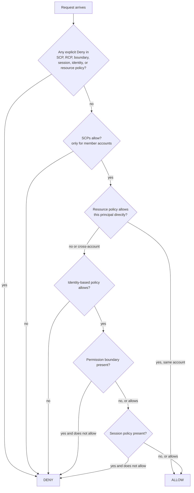

# Amazon Web Services (AWS)

| | |
|---|---|
| **Cluster** | 01 Hyperscale Cloud |
| **Role** | Anchor |
| **Category** | Hyperscale public cloud: identity, networking, compute, storage, managed services |
| **Prerequisites** | [00-foundations](../../00-foundations/): Linux shell, TCP/IP and CIDR arithmetic, DNS, TLS, Git, Bash, JSON |
| **Target version** | AWS CLI v2.x (2.15+), EKS Kubernetes 1.31+, Aurora PostgreSQL 16, Lambda Python 3.12 / Java 21 runtimes |
| **Capstone phase** | Phase 2 (Months 5-8) |
| **Official docs** | https://docs.aws.amazon.com/ |

> AWS is the anchor for the whole cloud cluster. After this folder you will be able to design a multi-account landing zone with Organizations and SCPs, read and write IAM policies and predict how they evaluate, draw and build a multi-AZ three-tier VPC with private connectivity to managed services, run containers on EKS with workload identity instead of node credentials, operate RDS/Aurora, S3, DynamoDB, KMS and Secrets Manager securely, instrument an account with CloudTrail / Config / GuardDuty / Security Hub, drive everything from AWS CLI v2 with SSO and JMESPath, and keep the lab under $15 per month by destroying it every night.

---

## Why This Tool Exists

In 2006 Amazon exposed the internal primitives it had built to run its retail business (S3 for objects, SQS for queues, EC2 for VMs) as metered HTTP APIs. The insight that mattered was not elasticity, it was **everything is an API call authorised by a policy**. A developer with a credit card could provision a server in 90 seconds, and the server, the network it sat in, and the permissions it held were all expressed as data that could be versioned and automated.

Two decades later AWS has 240+ services, but a working engineer needs deep knowledge of about twenty and recognition-level knowledge of another thirty. This folder covers the twenty: Organizations, IAM, STS, VPC, EC2, Auto Scaling, EKS, Lambda, ECR, S3, EBS, DynamoDB, RDS/Aurora, KMS, Secrets Manager, SSM Parameter Store, CloudWatch, CloudTrail, Config, GuardDuty, Security Hub, Route 53, ELB (ALB/NLB), and the Cost Management family.

Where AWS is weak, say so: the console is inconsistent across services, IAM is powerful but verbose and easy to get wrong, service quotas are opaque until you hit them, egress bandwidth is expensive, and the sheer number of overlapping services (ECS vs EKS vs App Runner vs Lambda; Aurora vs RDS vs DSQL) makes architecture decisions harder than on smaller clouds.

---

## Architecture

Component by component:

- **Organization and OUs.** Accounts are the only hard blast-radius boundary in AWS. Organizations groups them; Service Control Policies set the maximum permissions any principal in an account can ever have. Control Tower automates creating the Security and Infrastructure OUs with the Log Archive and Audit accounts.
- **IAM role for GitHub Actions.** GitHub's OIDC provider issues a short-lived JWT to each workflow run; the role's trust policy accepts that token only from a specific repo and branch. No access keys exist anywhere.
- **VPC.** Three subnet tiers per AZ across at least two AZs. Public tier holds only the load balancer and NAT; private tier holds compute; isolated tier holds data stores with no route to the internet.
- **VPC endpoints.** Keep AWS API traffic (S3, ECR, STS, CloudWatch Logs, Secrets Manager) inside the AWS network, avoid NAT data-processing charges, and let you write endpoint policies that restrict which buckets or secrets are reachable.
- **EKS.** AWS runs the Kubernetes control plane in its own account and projects ENIs into your private subnets. Worker nodes are yours (managed node groups, Karpenter) or AWS's (Fargate). Pod Identity maps a Kubernetes ServiceAccount to an IAM role.
- **S3 + KMS.** The universal durable store. Versioned, encrypted with a customer-managed key, public access blocked at the account level.
- **Observability and detection.** CloudTrail records every API call; Config records every resource change and evaluates rules; GuardDuty analyses CloudTrail, VPC Flow Logs, DNS logs, and EKS audit logs for threats; Security Hub aggregates findings.

---

## The Core Mental Model

Three ideas make the rest of AWS predictable.

### 1. Every API call is evaluated by the same policy engine

Whether you click in the console, run `aws s3 ls`, or a Lambda function calls DynamoDB, the request becomes a signed HTTPS call (SigV4) carrying a principal, an action (`s3:ListBucket`), a resource ARN, and context keys (`aws:SourceIp`, `aws:MultiFactorAuthPresent`, `aws:PrincipalOrgID`). IAM then runs this algorithm:

The default is deny. An explicit deny anywhere wins. Everything in the IAM deep dive ([02-core-concepts.md](02-core-concepts.md#3-iam-deep-dive)) is a consequence of that diagram.

### 2. Identity is a chain of short-lived credentials

Nobody should hold a permanent key. A human authenticates to IAM Identity Center and receives a one-hour session for a permission set (which is an IAM role). A workload on EC2 gets credentials from the instance metadata service for its instance profile role. A pod on EKS gets them from the Pod Identity agent. GitHub Actions presents an OIDC token and receives credentials from STS. Every one of these is `sts:AssumeRole*` under the hood, and every one can be traced in CloudTrail by the role session name.

### 3. A subnet is defined by its route table

"Public" and "private" are not subnet attributes; they are consequences of what `0.0.0.0/0` points at in the associated route table (Internet Gateway, NAT Gateway, or nothing). Security groups are stateful allow-lists attached to network interfaces, not to subnets. Once you internalise this, every VPC diagram, including Transit Gateway hub-and-spoke designs, becomes a routing exercise.

---

## Anchor-and-Bridge Mapping

The full matrix is in the [cluster README](../README.md#3-service-mapping-matrix). The short version for the services covered in this folder:

| AWS concept | Azure equivalent | GCP equivalent |
|---|---|---|
| Account / OU / Organization | Subscription / Management Group / Tenant | Project / Folder / Organization |
| Service Control Policy | Azure Policy (Deny effect at MG scope) | Organization Policy constraint |
| IAM role + trust policy | Managed Identity / Entra app registration with federated credential | Service Account + Workload Identity Federation |
| IRSA / EKS Pod Identity | AKS Workload Identity | GKE Workload Identity |
| IAM Identity Center | Entra ID + PIM | Cloud Identity + IAM |
| VPC (regional) + subnets | VNet (regional) + subnets | VPC (global) + regional subnets |
| Security group | Network Security Group | VPC firewall rule |
| NAT Gateway | NAT Gateway | Cloud NAT |
| Interface endpoint / PrivateLink | Private Endpoint | Private Service Connect |
| Transit Gateway | Virtual WAN hub / VNet peering | Network Connectivity Center / Shared VPC |
| EC2 + Auto Scaling Group | VM + Virtual Machine Scale Set | Compute Engine + Managed Instance Group |
| EKS + managed node group / Karpenter | AKS + node pool / Node Autoprovisioning | GKE Standard node pool / Autopilot |
| Lambda | Azure Functions | Cloud Run functions |
| ECR | Azure Container Registry | Artifact Registry |
| S3 | Blob Storage | Cloud Storage |
| EBS | Managed Disk | Persistent Disk / Hyperdisk |
| DynamoDB | Cosmos DB (NoSQL API) | Firestore / Bigtable |
| RDS / Aurora | Azure Database for PostgreSQL Flexible Server / Cosmos DB for PostgreSQL | Cloud SQL / AlloyDB / Spanner |
| KMS | Key Vault keys | Cloud KMS |
| Secrets Manager / Parameter Store | Key Vault secrets / App Configuration | Secret Manager |
| CloudWatch | Azure Monitor + Log Analytics | Cloud Monitoring + Cloud Logging |
| CloudTrail | Activity Log | Cloud Audit Logs |
| Config + Security Hub | Azure Policy + Defender for Cloud | Security Command Center |
| GuardDuty | Defender for Cloud | Event Threat Detection |
| Route 53 | Azure DNS | Cloud DNS |
| ALB / NLB | Application Gateway / Load Balancer | Application LB / Network LB |
| CloudFormation | Bicep / ARM | Infrastructure Manager |
| Cost Explorer / Budgets / Savings Plans | Cost Management / Budgets / Reservations | Billing reports / Budgets / CUDs |

---

## Learning Path

| Step | File | Time | Outcome |
|---|---|---|---|
| 1 | [01-installation-and-setup.md](01-installation-and-setup.md) | 4 h | CLI v2 installed, SSO profile working, budget alarm set, account hardened (no root keys, MFA, block public access, default EBS encryption) |
| 2 | [02-core-concepts.md](02-core-concepts.md) | 20 h | Can explain global infrastructure, Organizations, IAM evaluation, VPC routing, EC2/EKS/Lambda compute, S3/DynamoDB/RDS storage, KMS, observability, Well-Architected |
| 3 | [03-commands-and-cheatsheet.md](03-commands-and-cheatsheet.md) | 6 h | Fluent in `aws` CLI with `--query`, `--filters`, profiles, SSO, and per-service task recipes |
| 4 | [04-hands-on-labs.md](04-hands-on-labs.md) | 40 h | Eight labs culminating in the capstone slice: multi-AZ VPC, EKS, RDS Postgres, S3 + KMS, OIDC role; full teardown |
| 5 | [05-production-patterns.md](05-production-patterns.md) | 10 h | Landing zone, least-privilege patterns, HA/DR, cost controls, CI/CD integration, anti-patterns, decision checklist |
| 6 | [06-troubleshooting.md](06-troubleshooting.md) | 6 h | Diagnose `AccessDenied`, EKS node join failures, unreachable RDS, NAT bills, and SSO expiry without guessing |
| 7 | [07-interview-questions.md](07-interview-questions.md) | 6 h | 30 questions from junior to principal with model answers |

Total: about 90-100 hours. Combined with Terraform (Cluster 05) this fills Phase 2.

---

## Role in the Capstone

AWS provides the **landing zone and runtime substrate** for the entire unified capstone repository:

| Capstone component | AWS service | Created in | Consumed by |
|---|---|---|---|
| Deploy identity for CI | IAM OIDC provider + `gha-capstone-deploy` role | Lab 2 | GitHub Actions (Cluster 06), Terraform (Cluster 05) |
| Terraform remote state | S3 bucket with versioning + KMS CMK + native lockfile | Lab 4 | Every Terraform module |
| Network | VPC `10.0.0.0/16`, 2-3 AZs, 3 tiers, S3/ECR/STS/Logs endpoints, flow logs | Lab 3 | EKS, RDS, Lambda, Bedrock endpoint |
| Cluster | EKS 1.31+, managed node group (Graviton spot) + Karpenter, access entries, Pod Identity | Lab 6 | Argo CD, Backstage, FastAPI, Spring Boot, OTel Collector, LGTM stack, vLLM (Cluster 04, 07, 09, 10) |
| Database | RDS PostgreSQL 16 (lab: Single-AZ `db.t4g.micro`; HA lab: Multi-AZ), IAM auth, RDS Proxy, pgvector | Lab 7 | FastAPI and Spring Boot services, LangGraph checkpointer (Cluster 03), pgvector RAG (Cluster 10) |
| Secrets | Secrets Manager with rotation; SSM Parameter Store for config | Lab 5 | External Secrets Operator on EKS |
| Images | ECR with scan-on-push and lifecycle policy | Lab 6 | GitHub Actions push, EKS pull via endpoint, Trivy/Cosign (Cluster 08) |
| Detection | CloudTrail org trail, Config recorder + conformance pack, GuardDuty (EKS protection), Security Hub | Lab 8 | DefectDojo ASPM import (Cluster 08), SRE runbooks (Cluster 11) |
| Teardown | `terraform destroy` on nightly cron + orphan sweep script | Lab 8 | FinOps (Cluster 12) |

The artefacts produced are the `infra/aws/` Terraform root modules, the `.github/workflows/infra-*.yml` workflows, and the ADRs `0001-aws-as-anchor-cloud.md`, `0002-eks-over-ecs.md`, and `0003-pod-identity-over-irsa.md` under `capstone/adrs/`.

---

## Further Reading

- AWS documentation: https://docs.aws.amazon.com/
- IAM policy evaluation logic: https://docs.aws.amazon.com/IAM/latest/UserGuide/reference_policies_evaluation-logic.html
- IAM JSON policy element reference: https://docs.aws.amazon.com/IAM/latest/UserGuide/reference_policies_elements.html
- VPC User Guide, "How Amazon VPC works": https://docs.aws.amazon.com/vpc/latest/userguide/how-it-works.html
- EKS Best Practices Guide: https://docs.aws.amazon.com/eks/latest/best-practices/
- Well-Architected Framework and the Security Reference Architecture: https://docs.aws.amazon.com/prescriptive-guidance/latest/security-reference-architecture/
- AWS CLI v2 User Guide: https://docs.aws.amazon.com/cli/latest/userguide/
- JMESPath specification and tutorial: https://jmespath.org/tutorial.html
- "The DynamoDB Book" by Alex DeBrie, for single-table design
- Werner Vogels, "Eventually Consistent" (CACM 2009) and the Dynamo paper (SOSP 2007) for the storage mental model
