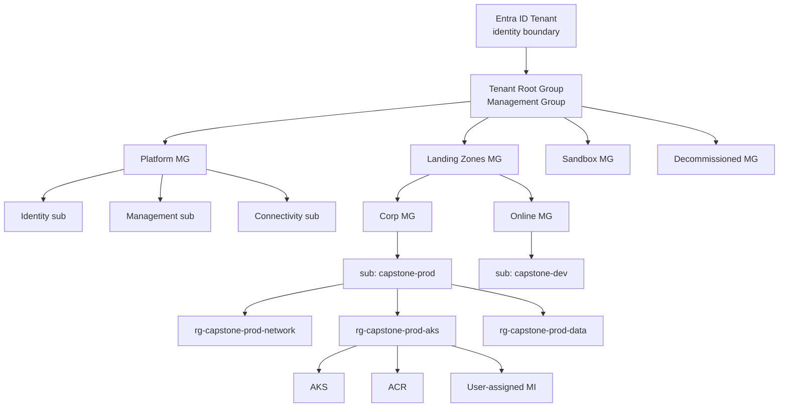
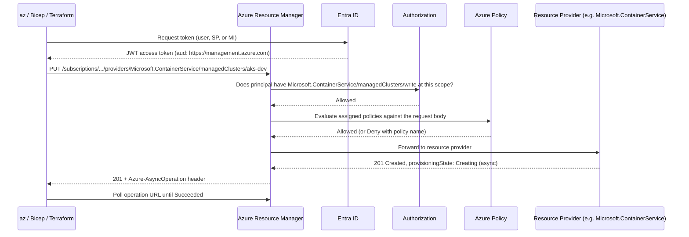
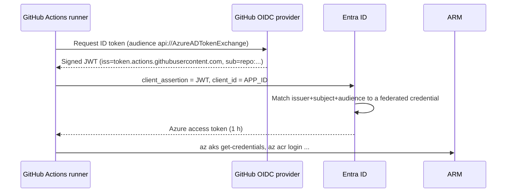
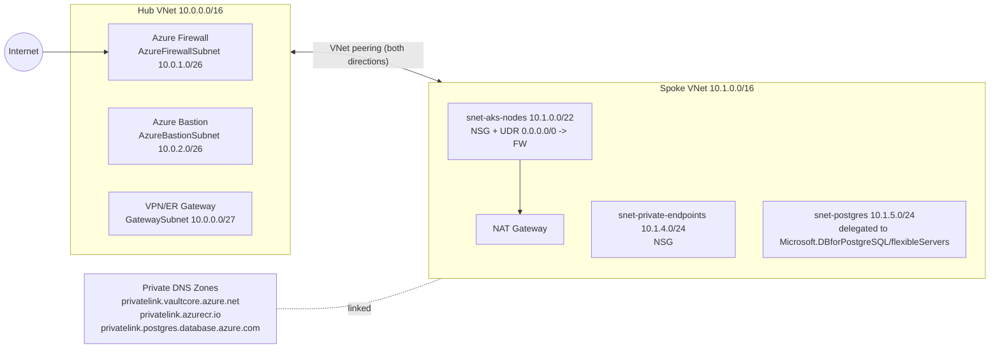
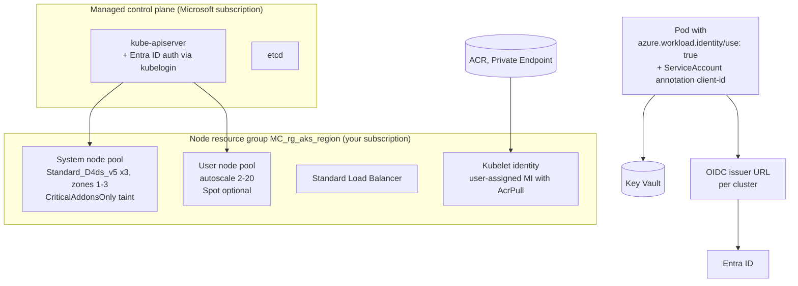
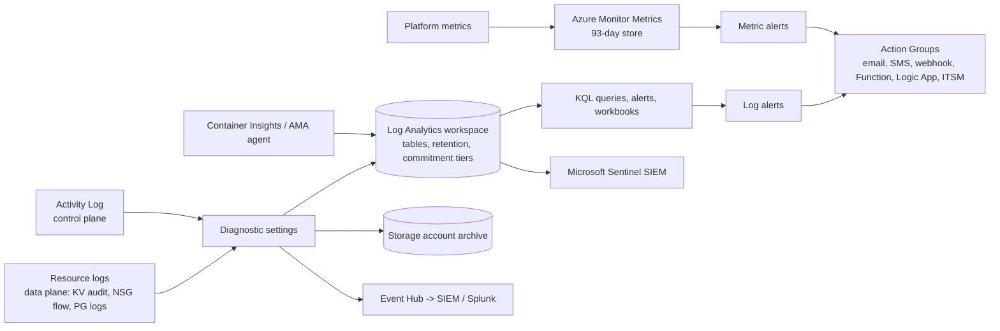
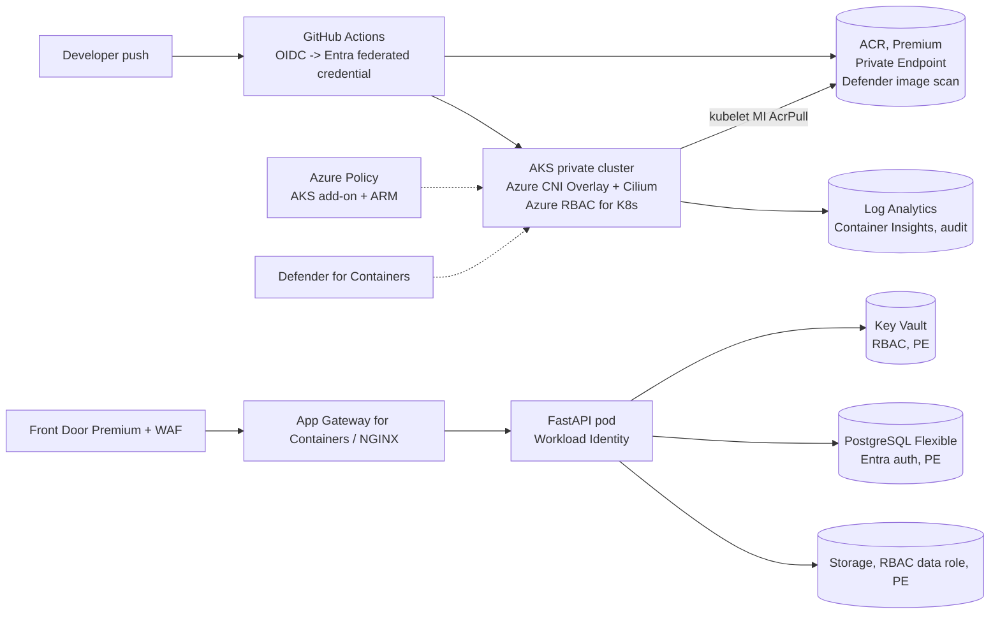

# Azure: Core Concepts

| | |
|---|---|
| **Cluster** | 01 Hyperscale Cloud |
| **Role** | Bridge (anchor is AWS) |
| **Prerequisites** | [01-installation-and-setup.md](01-installation-and-setup.md); AWS IAM, VPC, EKS, S3, KMS concepts |
| **Target version** | Azure CLI 2.60+, AKS Kubernetes 1.30+, PostgreSQL Flexible Server 16 |
| **Capstone phase** | Phase 2 (Months 5-8) |

> This file explains how Azure works underneath the portal: how ARM processes a request, how an RBAC decision is made, how a Managed Identity gets a token, how an NSG rule is evaluated, how AKS wires pods to Entra ID, how a blob tier transition is triggered, and how a KQL query runs. Each section opens with the AWS equivalent so you can translate rather than memorise.

## 1. Resource Hierarchy

**Coming from AWS.** AWS Organizations root, OUs, and accounts map to the Entra tenant, Management Groups, and Subscriptions. Azure adds one more level below the account: the Resource Group.



| Level | Purpose | Limits and rules |
|---|---|---|
| Tenant | Identity directory; owns subscriptions | One tenant per organisation normally; subscriptions can be transferred between tenants |
| Management Group | Inheritance point for Policy and RBAC | Up to 6 levels deep (excluding root and subscription); 10,000 MGs per tenant; a subscription belongs to exactly one MG |
| Subscription | Billing, quotas, resource provider registration, Policy and RBAC scope | Quotas are per subscription per region (for example vCPUs per family); limits like 980 RGs per subscription |
| Resource Group | Lifecycle, RBAC and Policy scope, deployment target | Resources in an RG can be in different regions; the RG's own location only stores its metadata; cannot nest |
| Resource | The thing | Every resource has an ID that is also its RBAC scope |

The tree above is the Cloud Adoption Framework (CAF) enterprise-scale layout. The Platform MG holds shared services (identity, logging, hub networking); Landing Zones hold workloads; Sandbox has relaxed policy for experimentation; Decommissioned has a deny-all policy so moving a subscription there effectively freezes it.

Resource Group design rules that save pain later:

1. Group by shared lifecycle: resources you create and destroy together.
2. Separate long-lived state (databases, storage, Key Vault) from replaceable compute (AKS, VMSS) so cluster rebuilds do not threaten data.
3. Use resource locks (`CanNotDelete`) on stateful RGs: `az lock create --name no-delete --lock-type CanNotDelete --resource-group rg-capstone-prod-data`.
4. Name consistently: `rg-<workload>-<env>-<purpose>`. See the CAF naming abbreviations.

## 2. Azure Resource Manager (ARM)

**Coming from AWS.** There is no single AWS equivalent. ARM is the one API gateway in front of all services, so it is CloudFormation's deployment engine plus the authorisation layer of every service API combined.

Every request flows through the same pipeline:



Key properties:

- **Idempotent `PUT`.** Resource creation and update are the same verb. `az aks create` on an existing cluster errors (the CLI checks), but Bicep and Terraform converge.
- **Long-running operations** return `201/202` with a polling URL. `az ... --no-wait` returns immediately; `az ... wait --created/--updated/--deleted` polls.
- **Deployments** (`Microsoft.Resources/deployments`) are first-class resources at RG, subscription, MG, or tenant scope. Bicep compiles to an ARM JSON template, which is submitted as a deployment. `az deployment group what-if` shows a plan, the ARM equivalent of `terraform plan`.
- **Resource providers** must be registered per subscription. `az provider operation show --namespace Microsoft.Storage` lists every operation string, which is what RBAC role definitions reference.
- **Tags** are key-value metadata (50 per resource) used for cost allocation and Policy. Tags do not inherit from RG to resource unless a `Modify` policy copies them.
- **Resource locks** (`ReadOnly`, `CanNotDelete`) apply to all principals, including Owners, until removed.

Minimal Bicep showing the template model (what `az` ultimately sends):

```bicep
targetScope = 'resourceGroup'

@description('Globally unique storage account name, 3-24 lowercase alphanumerics')
param storageName string
param location string = resourceGroup().location

resource sa 'Microsoft.Storage/storageAccounts@2023-05-01' = {
  name: storageName
  location: location
  sku: { name: 'Standard_ZRS' }
  kind: 'StorageV2'
  properties: {
    allowBlobPublicAccess: false
    allowSharedKeyAccess: false
    minimumTlsVersion: 'TLS1_2'
    supportsHttpsTrafficOnly: true
    publicNetworkAccess: 'Disabled'
  }
}

output blobEndpoint string = sa.properties.primaryEndpoints.blob
```

Deploy with `az deployment group create --resource-group rg-capstone-dev --template-file main.bicep --parameters storageName=stcapstonedev001`. Bicep awareness, not mastery, is the goal here; Terraform remains the anchor IaC.

## 3. Microsoft Entra ID

**Coming from AWS.** Entra ID is IAM's principal store plus IAM Identity Center plus the OIDC provider, lifted above the account. IAM roles for workloads become Managed Identities. IAM users become Entra users (humans) or service principals (apps). The trust policy becomes a federated credential.

### 3.1 Object types

| Entra object | What it is | AWS analogue |
|---|---|---|
| User | Human identity (member or guest/B2B) | IAM Identity Center user |
| Group | Collection of users or SPs; security groups can be RBAC assignees | IAM group / Identity Center group |
| App registration (Application object) | Global definition of an app: client ID, redirect URIs, API permissions, federated credentials | OIDC identity provider config + role trust policy |
| Service principal (Enterprise application) | Local instance of an application in a tenant; the thing that gets RBAC roles | IAM role (when used by apps) |
| Managed identity | A service principal whose credential lifecycle Azure manages; exposed to the resource via IMDS | IAM role with instance profile / IRSA |

An app registration has exactly one service principal in its home tenant (created automatically by `az ad sp create-for-rbac` or `az ad sp create --id <APP_ID>`), and can have one in each tenant that consents to it (multi-tenant apps).

### 3.2 Managed Identities: system-assigned versus user-assigned

| | System-assigned | User-assigned |
|---|---|---|
| Lifecycle | Created and deleted with the resource | Standalone resource (`Microsoft.ManagedIdentity/userAssignedIdentities`) |
| Sharing | One resource only | Attach to many resources (VMSS instances, AKS pods, Container Apps, Functions) |
| Pre-provisioning | Cannot grant roles before the resource exists | Grant roles first, then attach; no chicken-and-egg in IaC |
| AWS analogue | Nothing exact; closest is an auto-generated instance profile | IAM role attached to several instance profiles |
| Recommendation | Simple single-resource cases | Default for anything deployed by IaC or shared across replicas |

How a token is acquired (the same for both kinds):

```bash
# From inside an Azure VM or Container App: IMDS, link-local address, no credentials involved
curl -s -H "Metadata: true" \
  "http://169.254.169.254/metadata/identity/oauth2/token?api-version=2018-02-01&resource=https://vault.azure.net" \
  | jq -r .access_token | cut -c1-20
```

The SDKs (`DefaultAzureCredential` in Python/Java/.NET) try environment variables, workload identity, managed identity, and finally `az login` cache in that order, so the same code runs locally and in Azure with no code change. That chain is the direct equivalent of the AWS SDK default credential provider chain.

### 3.3 Workload identity federation (OIDC for GitHub Actions)

The trust relationship is a **federated credential** on an app registration or on a user-assigned managed identity. It names an issuer, a subject, and an audience, which is exactly the AWS IAM OIDC trust policy's `Condition` block.

```bash
APP_ID=$(az ad app create --display-name gh-capstone-deploy --query appId --output tsv)
az ad sp create --id "$APP_ID" --query id --output tsv

az ad app federated-credential create --id "$APP_ID" --parameters '{
  "name": "github-main-branch",
  "issuer": "https://token.actions.githubusercontent.com",
  "subject": "repo:example-org/capstone:ref:refs/heads/main",
  "audiences": ["api://AzureADTokenExchange"],
  "description": "GitHub Actions on main"
}'
```

Subject patterns: `repo:<org>/<repo>:ref:refs/heads/<branch>`, `repo:<org>/<repo>:environment:<env>`, `repo:<org>/<repo>:pull_request`. Twenty federated credentials per app. The flow at runtime:



### 3.4 Azure RBAC roles versus Entra roles

Two separate role systems. Confusing them is the number one Azure identity mistake.

| | Azure RBAC | Entra ID roles |
|---|---|---|
| Controls | Azure resources (subscriptions, RGs, VMs, storage data) | The directory itself (users, groups, app registrations, Conditional Access) |
| Examples | Owner, Contributor, Reader, Key Vault Secrets User, AcrPull | Global Administrator, Application Administrator, User Administrator |
| Scope model | Hierarchical (MG, sub, RG, resource) | Directory-wide (or Administrative Units) |
| Bridge | Global Admin can *elevate* to User Access Administrator at root MG (`az rest --method post --url "/providers/Microsoft.Authorization/elevateAccess?api-version=2016-07-01"`) | none |
| AWS analogue | IAM policies | Identity Center administration / IAM account root |

An Azure RBAC role definition:

```json
{
  "Name": "Capstone AKS Deployer",
  "IsCustom": true,
  "Description": "Deploy to AKS and pull from ACR, nothing else",
  "Actions": [
    "Microsoft.ContainerService/managedClusters/read",
    "Microsoft.ContainerService/managedClusters/listClusterUserCredential/action",
    "Microsoft.ContainerRegistry/registries/read"
  ],
  "NotActions": [],
  "DataActions": [
    "Microsoft.ContainerRegistry/registries/pull/read",
    "Microsoft.ContainerService/managedClusters/apps/deployments/write",
    "Microsoft.ContainerService/managedClusters/apps/deployments/read"
  ],
  "NotDataActions": [],
  "AssignableScopes": ["/subscriptions/<SUBSCRIPTION_ID>"]
}
```

`Actions` are control plane (ARM) operations; `DataActions` are data plane (reading a blob, pulling an image, reading a Kubernetes object through AKS RBAC). `NotActions` subtracts from `Actions` within the same role; it is not a deny. Evaluation:

1. Collect every role assignment for the principal and its groups at the scope and all parent scopes.
2. Union the `Actions` minus `NotActions` (and `DataActions` minus `NotDataActions`).
3. Apply any **deny assignments** (created only by Blueprints / Deployment Stacks / managed applications, not by users).
4. If the operation is in the resulting set, allow.

There is no explicit user-authored deny in Azure RBAC. Use Azure Policy for preventive controls and ABAC conditions on role assignments for fine-grained data access (for example, restrict a blob role to containers with a given tag).

Role assignment limits: 4,000 per subscription. Assign to groups, not users.

### 3.5 Privileged Identity Management (PIM)

PIM (Entra ID P2) makes role assignments *eligible* rather than *active*. An engineer activates `Contributor` on the production subscription for a bounded window (for example 4 hours) with justification, optional approval, and MFA. Both Azure RBAC and Entra roles support PIM; group membership can be PIM-managed too. The AWS equivalent is a combination of Identity Center session duration plus a custom approval workflow; Azure has it built in. Production rule: no standing `Owner` or `Global Administrator`; everything is PIM-eligible, break-glass accounts excepted.

### 3.6 Conditional Access

Tenant-wide policies: require MFA, compliant device, or specific locations when a principal signs in to a given app (including "Microsoft Azure Management", which covers the portal and `az`). This has no AWS counterpart beyond IAM `aws:MultiFactorAuthPresent` conditions and is why `az login` sometimes demands MFA.

## 4. Azure Policy

**Coming from AWS.** SCPs can only deny. Azure Policy can `Deny`, `Audit`, `AuditIfNotExists`, `DeployIfNotExists`, `Modify`, `Append`, `DenyAction`, and `Manual`. Policy also replaces much of AWS Config rules.

A **definition** is a JSON `if/then` over the resource request. An **initiative** (policy set) groups definitions (for example the built-in "CIS Microsoft Azure Foundations Benchmark v2.0.0" or "Microsoft cloud security benchmark"). An **assignment** binds a definition or initiative to a scope with parameters, optional exclusions, and a managed identity for remediation.

```json
{
  "mode": "Indexed",
  "parameters": {
    "allowedLocations": {
      "type": "Array",
      "defaultValue": ["eastus2", "centralus"]
    }
  },
  "policyRule": {
    "if": {
      "allOf": [
        { "field": "location", "notIn": "[parameters('allowedLocations')]" },
        { "field": "location", "notEquals": "global" },
        { "field": "type", "notEquals": "Microsoft.Resources/resourceGroups" }
      ]
    },
    "then": { "effect": "deny" }
  }
}
```

Effects worth knowing:

| Effect | Behaviour | Needs identity | Use |
|---|---|---|---|
| `Deny` | Reject the ARM request | No | Guardrails: no public IPs, approved SKUs, required tags |
| `Audit` | Allow, mark non-compliant | No | Discovery before enforcing |
| `AuditIfNotExists` | Check a related resource exists (for example diagnostic setting) | No | Logging coverage |
| `DeployIfNotExists` | Deploy the related resource if missing | Yes (MI with Contributor-ish role) | Auto-enable diagnostics, Defender agents |
| `Modify` | Add/replace properties or tags on the request | Yes | Tag inheritance from RG, force `minimumTlsVersion` |
| `DenyAction` | Block `DELETE` | No | Protect Log Analytics workspaces |

Evaluation triggers: on every ARM write (immediate), on assignment change (within 30 minutes), and a full compliance scan every 24 hours. Remediation tasks (`az policy remediation create`) fix existing resources. `mode: Indexed` skips resources without tags and location (RGs, role assignments); `mode: All` evaluates everything. AKS has a separate Policy mode (`Microsoft.Kubernetes.Data`) enforced in-cluster by Gatekeeper via the Azure Policy add-on.

## 5. Virtual Network

**Coming from AWS.** VPC to VNet is nearly 1:1 in scope and behaviour. The deltas: subnets span zones; NSGs have priorities and explicit deny; service tags replace prefix lists; Private DNS zones are how Private Endpoints resolve; Virtual WAN is a managed hub.



### 5.1 Subnets, NSGs, ASGs

- A **subnet** reserves 5 addresses (network, broadcast, and 3 for Azure) like AWS. Some services need **delegated** subnets (PostgreSQL Flexible Server VNet integration, Container Apps, App Service VNet integration). Special-name subnets: `AzureFirewallSubnet` (/26 minimum), `AzureBastionSubnet` (/26), `GatewaySubnet` (/27).
- An **NSG** is a stateful rule list with priorities 100-4096 (lower wins), attached to subnets and/or NICs. Default rules allow VNet-to-VNet, allow Azure Load Balancer probes, deny all other inbound, allow all outbound. Both layers are evaluated when a subnet NSG and a NIC NSG exist (inbound: subnet then NIC; outbound: NIC then subnet).
- **Service tags** (`Internet`, `VirtualNetwork`, `AzureLoadBalancer`, `Storage.EastUS2`, `AzureKeyVault`, `AzureContainerRegistry`) are Microsoft-maintained prefix lists usable in NSG and Firewall rules.
- An **ASG** is a label for NICs so NSG rules can say "allow `asg-web` to `asg-db` on 5432" without IP ranges, the equivalent of referencing a security group ID as a source in AWS.

```bash
az network nsg rule create --resource-group rg-net --nsg-name nsg-app \
  --name allow-web-to-db --priority 200 --direction Inbound --access Allow --protocol Tcp \
  --source-asgs asg-web --destination-asgs asg-db --destination-port-ranges 5432
```

### 5.2 Routing: system routes and UDRs

Every subnet has system routes: VNet address space to `VirtualNetwork`, `0.0.0.0/0` to `Internet`, RFC1918 ranges to `None`. Peering adds routes to the peered VNet. A **route table** with **User-Defined Routes** overrides them; the classic pattern is `0.0.0.0/0 -> VirtualAppliance (Azure Firewall private IP)` on every spoke subnet to force egress inspection. Propagation of BGP routes from gateways can be disabled per route table. AKS with Azure CNI Overlay supports UDR egress (`--outbound-type userDefinedRouting`).

### 5.3 NAT Gateway

Zonal, attached to one or more subnets, provides deterministic outbound SNAT with 64,000 ports per public IP (up to 16 IPs). Preferred over Load Balancer outbound rules and over default AKS outbound (which uses a Standard LB). Works identically to AWS NAT Gateway conceptually, but it is a subnet property rather than a route target.

### 5.4 Private Endpoints and Private Link

A Private Endpoint is a NIC in your subnet with a private IP that maps to one PaaS resource (a storage account's blob sub-resource, a Key Vault, an ACR, a PostgreSQL server, or your own service behind a Standard LB via a Private Link Service). Traffic never leaves the Microsoft backbone. Name resolution: the public FQDN (`kv-capstone.vault.azure.net`) gets a CNAME to `kv-capstone.privatelink.vaultcore.azure.net`, which your linked Private DNS zone resolves to the private IP. Without the DNS zone the endpoint exists but clients still resolve the public IP, which is the most common Private Endpoint failure.

Service Endpoints are the older alternative: the subnet is allowed through the service's firewall and traffic routes privately, but the service keeps its public IP. Use Private Endpoints for new work.

### 5.5 Azure Firewall, peering, Virtual WAN

- **Azure Firewall** (Standard, Premium, Basic) is a managed, zone-redundant stateful firewall with network rules (L3/L4), application rules (FQDN and FQDN tags like `AzureKubernetesService`), DNAT rules, threat intelligence, and in Premium TLS inspection and IDPS. Rules live in a Firewall Policy, which can be hierarchical (parent policy at platform level, child per spoke).
- **VNet peering** is non-transitive, must be created in both directions, and supports cross-region (global) peering. `--allow-gateway-transit` on the hub and `--use-remote-gateways` on spokes let spokes use the hub's VPN/ExpressRoute gateway.
- **Virtual WAN** is a managed hub: Microsoft runs the hub VNet, routing, VPN, ExpressRoute, and optionally Azure Firewall (Secured Virtual Hub). It is the Transit Gateway analogue, with transitive routing across spokes and branches. Hub-spoke with peering is cheaper and sufficient for one region and tens of spokes; Virtual WAN wins at many regions and many branches.

## 6. Compute

### 6.1 Virtual Machines and Scale Sets

**Coming from AWS.** EC2 to VM, ASG to VMSS, instance profile to Managed Identity, AMI to image (Marketplace or Azure Compute Gallery), user data to `--custom-data` (cloud-init), EBS to Managed Disk.

Sizes are named `Standard_<Family><vCPUs><features>_v<gen>`: `Standard_D4s_v5` (general purpose, 4 vCPU, premium storage capable, v5), `Standard_E8ds_v5` (memory-optimised), `Standard_B2ms` (burstable), `Standard_NC24ads_A100_v4` (GPU). Availability options: zonal (`--zone 1`), availability set (fault/update domains within a datacenter), or zone-redundant VMSS. Disk types: Standard HDD, Standard SSD, Premium SSD, Premium SSD v2, Ultra. Encryption at rest with platform keys is default; customer-managed keys use a Disk Encryption Set backed by Key Vault.

VMSS **Flexible orchestration** (modern default) treats instances as regular VMs you can mix sizes and Spot across; **Uniform** is the legacy identical-instance mode. Autoscale is an Azure Monitor autoscale setting (metric-based or schedule-based). Spot VMs have an eviction policy and max price; AKS exposes them as Spot node pools.

### 6.2 Azure Kubernetes Service (AKS)

**Coming from AWS.** EKS to AKS; managed node groups to node pools; IRSA/Pod Identity to Workload Identity; VPC CNI to Azure CNI (Overlay or pod-subnet); ASCP to Key Vault Secrets Store CSI add-on; EKS add-ons to AKS add-ons and extensions; `aws eks update-kubeconfig` to `az aks get-credentials`.



Node pools:

- A **system pool** (at least one; recommended 3 nodes across zones, tainted `CriticalAddonsOnly=true:NoSchedule`) runs CoreDNS, metrics-server, and add-ons. **User pools** run workloads. Pools have their own VM size, OS (Azure Linux or Ubuntu; Windows), disk, zones, autoscaler bounds, taints, labels, and can be Spot.
- Upgrades are per pool with surge (`--max-surge 33%`); the control plane upgrades independently. Auto-upgrade channels (`patch`, `stable`, `rapid`, `node-image`) and planned maintenance windows exist.

Networking choices:

| Plugin | Pod IPs | Scale | When |
|---|---|---|---|
| **Azure CNI Overlay** (default recommendation) | Private overlay CIDR, NAT at node; node IPs from VNet | Up to 5,000 nodes, 250 pods/node | Default for new clusters; conserves VNet space |
| Azure CNI (pod subnet / dynamic allocation) | VNet IPs from a dedicated pod subnet | Pod IPs routable from VNet | Need direct pod addressability (NSG on pods, no SNAT) |
| Azure CNI (node subnet, legacy) | VNet IPs pre-allocated per node | Burns IPs fast | Avoid |
| kubenet (legacy) | Private CIDR, UDRs per node | 400 nodes limit (route table) | Being retired; migrate to Overlay |

Add **Azure CNI Powered by Cilium** (`--network-dataplane cilium`) on Overlay or pod-subnet for eBPF dataplane, Cilium network policy, and better observability. Network policy engines: Azure, Calico, Cilium. Outbound: Load Balancer (default), NAT Gateway, or UDR to Azure Firewall. **Private cluster** puts the API server behind a Private Endpoint; **API Server VNet Integration** projects the API server into a delegated subnet instead.

Identity:

- **Cluster identity** (managed identity) creates Azure resources (LB, disks, public IPs).
- **Kubelet identity** pulls images; grant it `AcrPull` with `az aks update --attach-acr`.
- **Workload Identity**: the cluster publishes an OIDC issuer URL. A Kubernetes ServiceAccount annotated with `azure.workload.identity/client-id: <MI_CLIENT_ID>` and a pod label `azure.workload.identity/use: "true"` cause a mutating webhook to project a service account token and inject `AZURE_CLIENT_ID`, `AZURE_TENANT_ID`, `AZURE_FEDERATED_TOKEN_FILE`, `AZURE_AUTHORITY_HOST`. The managed identity has a federated credential whose issuer is the cluster OIDC URL and whose subject is `system:serviceaccount:<namespace>:<sa>`. `DefaultAzureCredential` picks it up. This is IRSA, one-for-one.
- **Entra ID integration with Azure RBAC for Kubernetes** (`--enable-aad --enable-azure-rbac`) means `kubectl` authenticates via `kubelogin` and authorisation uses Azure roles such as `Azure Kubernetes Service RBAC Reader/Writer/Admin/Cluster Admin` scoped to the cluster or a namespace. Disable local accounts (`--disable-local-accounts`) so there is no static admin kubeconfig.

Add-ons that matter for the capstone: `azure-keyvault-secrets-provider` (Key Vault CSI; mounts secrets as files, optional sync to Kubernetes Secrets, auto-rotation), `azure-policy` (Gatekeeper with Azure-managed constraint templates; assign the "Kubernetes cluster pod security baseline standards" initiative), `monitoring` (Container Insights to Log Analytics), managed Prometheus and Grafana, KEDA, Vertical Pod Autoscaler, Application Routing (managed NGINX ingress), Istio-based service mesh, Image Cleaner, and Node Auto Provisioning (Karpenter-based).

### 6.3 App Service

Managed PaaS for web apps and APIs (Linux or Windows, code or container). An **App Service Plan** is the compute (the Basic/Standard/PremiumV3 SKUs, instance count, zone redundancy); **Web Apps** run on it. Features: deployment slots with swap (blue/green), built-in Entra auth ("Easy Auth"), VNet integration for outbound, Private Endpoints for inbound, managed certificates, autoscale. AWS has no central equivalent (Beanstalk is closest). For the capstone it hosts the Spring Boot API in one lab as a contrast to AKS.

### 6.4 Container Apps

Serverless containers on a Microsoft-managed Kubernetes environment with KEDA (scale to zero, event scalers), Dapr sidecars, revisions and traffic splitting, built-in ingress with TLS, managed identity, and Jobs. An **Environment** is the isolation boundary (one VNet, one Log Analytics workspace); apps inside share it. Workload profiles (Consumption, Dedicated D/E series) choose the compute. Think App Runner plus Fargate plus KEDA with less to operate than AKS. Choose Container Apps over AKS when you do not need the Kubernetes API, CRDs, DaemonSets, or specific CNI behaviour.

### 6.5 Azure Functions

Event-driven FaaS. Triggers and bindings (HTTP, Timer, Blob, Queue, Service Bus, Event Hub, Cosmos DB change feed) are declarative. Hosting plans:

| Plan | Scale | Cold start | VNet | Max duration |
|---|---|---|---|---|
| Consumption (classic) | Per-event, to zero | Yes | No inbound Private Endpoint | 10 min |
| **Flex Consumption** | Per-event, to zero, always-ready instances | Reduced | Yes | Unbounded for some triggers |
| Premium (EP) | Pre-warmed, to min instances | None | Yes | Unbounded |
| Dedicated (App Service plan) | Manual/autoscale | None | Yes | Unbounded |
| Container Apps hosting | KEDA | Reduced | Yes | Unbounded |

Durable Functions add orchestrations (fan-out/fan-in, human interaction) similar to Step Functions but in code.

## 7. Storage Accounts

**Coming from AWS.** An S3 bucket maps to a Blob *container*, but the *Storage Account* is the top-level resource with the globally unique DNS name, the firewall, the replication choice, and the authorisation settings. One account can hold Blob, Files (SMB/NFS), Queues, Tables, and (with hierarchical namespace) Data Lake Gen2.

| Property | Options | Notes |
|---|---|---|
| Kind | `StorageV2` (use this), `BlockBlobStorage` (premium), `FileStorage` | Legacy kinds exist |
| Performance | Standard (HDD-backed), Premium (SSD) | Premium has no tiering |
| Redundancy | LRS (3 copies, 1 DC), ZRS (3 zones), GRS/RA-GRS (paired region, async), GZRS/RA-GZRS | ZRS is the production minimum; GRS adds cross-region. AWS S3 is effectively ZRS always |
| Blob type | Block (objects), Append (logs), Page (disks) | Block blobs for everything S3-like |
| Access tier | Hot, Cool (30-day minimum), Cold (90-day minimum), Archive (180-day minimum, offline) | Early deletion fees; Archive needs rehydration (Standard: up to 15 h; High: under 1 h for small blobs) |
| Data protection | Soft delete (blobs, containers), versioning, change feed, point-in-time restore | Turn on soft delete + versioning everywhere |
| Immutability | Time-based retention (locked/unlocked), legal hold; container-level or version-level WORM | S3 Object Lock equivalent; locked policies cannot be shortened |

Lifecycle management rule (the S3 lifecycle equivalent):

```json
{
  "rules": [
    {
      "name": "backups-tiering",
      "enabled": true,
      "type": "Lifecycle",
      "definition": {
        "filters": { "blobTypes": ["blockBlob"], "prefixMatch": ["backups/"] },
        "actions": {
          "baseBlob": {
            "tierToCool": { "daysAfterModificationGreaterThan": 30 },
            "tierToArchive": { "daysAfterModificationGreaterThan": 180 },
            "delete": { "daysAfterModificationGreaterThan": 2555 }
          },
          "version": { "delete": { "daysAfterCreationGreaterThan": 90 } }
        }
      }
    }
  ]
}
```

Authorisation, in order of preference:

1. **Entra ID + RBAC data roles** (`Storage Blob Data Reader/Contributor/Owner`). Fine-grained, auditable, no secret. Set `--allow-shared-key-access false` to make it the only option.
2. **User delegation SAS**: a SAS signed with an Entra-issued user delegation key (`az storage blob generate-sas --as-user`), scoped and time-bounded, revocable by revoking the key. Use when a client cannot do Entra auth (browser upload).
3. **Service/account SAS** signed by the account key: revocation requires rotating the key. Avoid.
4. **Account key**: full control, no identity. Never in applications.

Network: `--default-action Deny` on the account firewall, allow specific VNets (service endpoint) or, better, a Private Endpoint per sub-resource (`blob`, `file`, `dfs`). Encryption at rest is always on; CMK via Key Vault with a user-assigned identity; infrastructure (double) encryption optional.

## 8. Databases

| Need | AWS | Azure | Notes |
|---|---|---|---|
| Managed PostgreSQL | RDS for PostgreSQL / Aurora PostgreSQL | **Azure Database for PostgreSQL Flexible Server** | Zone-redundant HA (sync standby in another zone), read replicas, PITR up to 35 days, Entra authentication (`--active-directory-auth Enabled`, `--password-auth Disabled`), server parameters, extensions allow-list (pgvector included), VNet-injected (delegated subnet) or Private Endpoint, burstable B-series for dev |
| Managed SQL Server | RDS for SQL Server | **Azure SQL Database** (single DB, elastic pool), **SQL Managed Instance** | vCore or DTU model, serverless tier auto-pauses, Hyperscale for 100 TB, Entra-only auth, TDE default, Ledger tables |
| Key-value / document | DynamoDB | **Cosmos DB for NoSQL** (also MongoDB, Cassandra, Gremlin, Table, PostgreSQL APIs) | Throughput in RU/s (provisioned, autoscale, or serverless); partition key choice is the whole design problem; 5 consistency levels (Strong, Bounded Staleness, Session default, Consistent Prefix, Eventual); multi-region writes; change feed |
| Cache | ElastiCache | Azure Cache for Redis / Azure Managed Redis | Private Endpoint, Entra auth on Enterprise/Managed tiers |

Flexible Server facts that trip up RDS users: compute tiers are Burstable, General Purpose, Memory Optimized; storage auto-grow is a flag; HA doubles cost; the server name is a global DNS label `<name>.postgres.database.azure.com`; connecting with Entra auth means your password is an access token for the scope `https://ossrdbms-aad.database.windows.net/.default` and the database role must be created via `pgaadauth_create_principal`.

## 9. Key Vault

**Coming from AWS.** KMS plus Secrets Manager plus ACM private certificate storage in one resource. Managed HSM is the dedicated-HSM, single-tenant option (CloudHSM analogue).

- Objects: **keys** (RSA, EC, with HSM-backed Premium SKU; used for CMK, signing, wrapping), **secrets** (strings up to 25 KB, versioned), **certificates** (with auto-renewal via integrated CAs).
- Authorisation: **Azure RBAC** (`Key Vault Administrator`, `Key Vault Secrets User`, `Key Vault Crypto User`, `Key Vault Certificates Officer`) is the modern model; **access policies** are the legacy per-vault list. New vaults should use `--enable-rbac-authorization true`.
- Protection: soft delete (7-90 days, cannot be disabled) and **purge protection** (prevents permanent deletion during retention; required for CMK scenarios and irreversible once enabled).
- Network: firewall with `--default-action Deny`, `--bypass AzureServices` for trusted Microsoft services, Private Endpoint for everything else.
- Limits: roughly 4,000 transactions per 10 seconds per vault for secrets; design for caching. One vault per application per environment is the common partitioning.
- Consumption patterns: Key Vault references in App Service/Functions app settings (`@Microsoft.KeyVault(SecretUri=...)`), Key Vault CSI in AKS, `DefaultAzureCredential` plus `SecretClient` in code, Key Vault-backed CMK for Storage, Disks, PostgreSQL, Cosmos DB, ACR.

## 10. Azure Monitor, Log Analytics, KQL

**Coming from AWS.** CloudWatch Logs plus Metrics plus X-Ray plus CloudTrail querying, with KQL instead of Logs Insights syntax.



- **Diagnostic settings** are per resource and must be created explicitly (Policy `DeployIfNotExists` does this at scale). Each sends chosen log categories and metrics to up to one workspace, one storage account, one Event Hub, and one partner solution.
- **Log Analytics workspace**: tables (`AzureActivity`, `AzureDiagnostics`, resource-specific tables like `AKSAudit`, `ContainerLogV2`, `KeyVaultAuditLogs`... when using resource-specific mode), interactive retention (30 days free, up to 2 years), archive tier up to 12 years, Basic and Auxiliary table plans for cheap verbose logs, daily cap, commitment tiers from 100 GB/day.
- **Application Insights** is APM (distributed tracing, dependencies, live metrics) stored in the workspace; OpenTelemetry exporters are the modern ingestion path.

KQL basics:

```kql
// Failed Key Vault access in the last day, by caller and operation
AzureDiagnostics
| where TimeGenerated > ago(1d)
| where ResourceProvider == "MICROSOFT.KEYVAULT"
| where ResultSignature == "Forbidden" or httpStatusCode_d == 403
| summarize attempts = count() by identity_claim_appid_g, OperationName, Resource
| order by attempts desc
```

```kql
// AKS pods restarting more than 3 times in an hour
KubePodInventory
| where TimeGenerated > ago(1h)
| summarize restarts = max(PodRestartCount) by Namespace, Name
| where restarts > 3
```

```kql
// Who deleted what (Activity Log)
AzureActivity
| where OperationNameValue endswith "/DELETE"
| where ActivityStatusValue == "Success"
| project TimeGenerated, Caller, ResourceGroup, _ResourceId
| order by TimeGenerated desc
```

KQL is pipe-based: each `|` stage transforms a table. `where`, `summarize ... by`, `project`, `extend`, `join`, `parse`, `render`. Time filters first for performance.

## 11. Microsoft Defender for Cloud

**Coming from AWS.** Security Hub (CSPM, compliance standards) plus GuardDuty (threat detection) plus Inspector (vulnerability assessment) in one product with per-plan pricing.

- **Foundational CSPM** is free: Secure Score, recommendations, the Microsoft cloud security benchmark assignment.
- **Defender CSPM** (paid) adds attack path analysis, agentless scanning, governance rules, regulatory compliance standards (CIS, NIST SP 800-53, PCI DSS, ISO 27001).
- **Workload plans**: Defender for Servers, Containers (registry image scanning in ACR, runtime threat detection on AKS via the Defender sensor DaemonSet, Kubernetes audit log analysis), Storage (malware scanning, sensitive data threat detection), Key Vault, Databases, App Service, APIs, Resource Manager, DNS.
- Alerts flow to the Defender portal, Sentinel, or any SIEM via continuous export. Multi-cloud connectors onboard AWS and GCP accounts, which makes it the natural single pane for the capstone's three clouds.

## 12. Azure Container Registry

**Coming from AWS.** ECR to ACR. Deltas: ACR is one registry with many repositories (not one "repository" per image); tiers Basic/Standard/Premium; Premium required for Private Endpoint, geo-replication, customer-managed keys, and zone redundancy; ACR Tasks build images in Azure (`az acr build`), the equivalent of a mini CodeBuild; content trust and now Notation/ORAS artefact signing; `az acr import` pulls public images in for a private mirror; retention policy for untagged manifests; **Artifact Cache** pulls through from Docker Hub/MCR/GHCR with credentials stored in Key Vault. Authentication: Entra ID (user via `az acr login`, MI via `AcrPull` role), scoped tokens (repository-level permissions, no Entra identity), admin user (disabled in production).

## 13. Load Balancing and Edge

| Layer | Azure product | Scope | AWS analogue | Notes |
|---|---|---|---|---|
| Global L7 | **Azure Front Door** (Standard/Premium) | Global anycast edge, CDN, WAF, Private Link origins (Premium) | CloudFront + WAF + Global Accelerator | Routes, origin groups with health probes, rules engine, managed TLS |
| Regional L7 | **Application Gateway v2** | Regional, zonal or zone-redundant, WAF v2 | ALB | Listeners, backend pools, HTTP settings, path-based routing, autoscale; AKS ingress via AGIC or Application Gateway for Containers |
| Regional/global L4 | **Azure Load Balancer Standard** | Regional (or cross-region tier) | NLB | Zone-redundant frontends, HA ports, outbound rules; Basic SKU retired |
| DNS-based | **Traffic Manager** | Global DNS routing (priority, weighted, performance, geographic) | Route 53 routing policies | DNS only, no proxying |

Web Application Firewall policies (OWASP CRS 3.2, bot protection, custom rules) attach to Front Door or Application Gateway.

## 14. Cost Management

Pricing concepts: pay-as-you-go, **Reservations** (1 or 3 years, VM/SQL/Cosmos/Storage; like RIs), **Savings Plans for compute** (hourly commitment across VM families and regions; like Compute Savings Plans), **Azure Hybrid Benefit** (bring Windows Server/SQL licences), Spot, Dev/Test subscription pricing. Tooling: Cost Management + Billing (cost analysis by RG/tag/service, budgets with Action Groups, scheduled exports to a storage account for FinOps pipelines, Advisor cost recommendations). Tags on RGs do not inherit to resources by default, so a `Modify` policy that copies `costCenter` is the first FinOps policy to assign. Cost data lags 8-24 hours; budgets are not hard caps. AKS cost analysis add-on breaks down cost per namespace (the OpenCost pattern) directly in Cost Management.

## 15. Putting It Together: Request Path for the Capstone



Everything a pod needs is reached by identity (Workload Identity to Key Vault, PostgreSQL, Storage), over private IPs (Private Endpoints with Private DNS zones), and leaves an audit trail in one workspace. That is the same architecture you built on AWS with IRSA, Interface Endpoints, and CloudWatch; only the names changed.

## Next

[03-commands-and-cheatsheet.md](03-commands-and-cheatsheet.md) turns every concept above into `az` commands organised by task.
