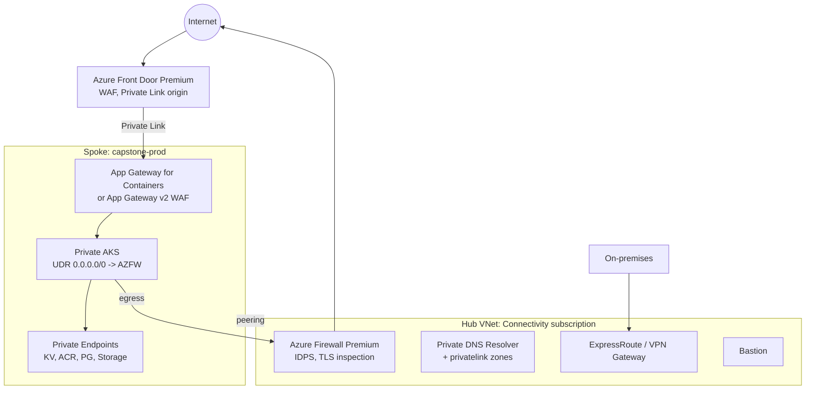

# Azure: Production Patterns

| | |
|---|---|
| **Cluster** | 01 Hyperscale Cloud |
| **Role** | Bridge (anchor is AWS) |
| **Prerequisites** | [02-core-concepts.md](02-core-concepts.md), [04-hands-on-labs.md](04-hands-on-labs.md) |
| **Target version** | Azure CLI 2.60+, AKS 1.30+, Bicep 0.28+, Terraform azurerm provider 4.x |
| **Capstone phase** | Phase 2 (Months 5-8) |

> How the lab environment becomes something you would defend in a production design review: landing zone structure, identity hardening, network topology, AKS baseline, data protection, observability, CI/CD without secrets, cost controls, multi-tenancy, anti-patterns, and a decision checklist. Each pattern names the AWS equivalent you already know so you can reuse the reasoning.

## 1. Landing Zone Structure

**AWS equivalent.** Control Tower / Landing Zone Accelerator with OUs, SCPs, and a log archive account.

The Cloud Adoption Framework enterprise-scale layout (deployable via the Azure Landing Zones Bicep or Terraform modules):

| Management Group | Subscriptions | Policy posture |
|---|---|---|
| Platform / Identity | Domain controllers, Entra Domain Services if needed | Deny public IPs, require backups |
| Platform / Management | Log Analytics workspace(s), Automation, Defender settings | `DenyAction` delete on workspaces |
| Platform / Connectivity | Hub VNets, Azure Firewall, VPN/ExpressRoute, Private DNS zones, DDoS plan | Deny creation of Private DNS zones outside this sub (centralised DNS) |
| Landing Zones / Corp | Internal-facing workloads, hybrid connectivity | Deny public endpoints on PaaS; require Private Endpoints |
| Landing Zones / Online | Internet-facing workloads | WAF required in front of App Gateway / Front Door |
| Sandbox | Personal/team experimentation, budget-capped | Deny peering to hub, deny ExpressRoute |
| Decommissioned | Subscriptions awaiting deletion | Deny all writes |

Rules:

1. One Log Analytics workspace per region per tenant for platform logs (query across workspaces with `workspace("name").Table`). Workload teams may have their own for application telemetry.
2. Private DNS zones for `privatelink.*` live in the Connectivity subscription and are linked to every spoke. A Policy `DeployIfNotExists` adds the DNS zone group to every new Private Endpoint automatically.
3. Subscriptions are vending-machine products: a pipeline creates the subscription (`az account alias create`), moves it into the right MG, assigns the budget, and peers the spoke. No hand-made subscriptions.
4. Break-glass: two cloud-only Global Administrator accounts excluded from Conditional Access, credentials in a physical safe, sign-in alerting via Sentinel.

## 2. Identity Hardening

**AWS equivalent.** No IAM users, roles everywhere, OIDC for CI, permission boundaries, Identity Center with MFA.

| Control | Implementation |
|---|---|
| No standing privileged access | PIM-eligible assignments for Owner, User Access Administrator, Global Administrator; max 8 h activation, MFA, justification, approval for production |
| No client secrets | Federated credentials for CI; managed identities for workloads; `az ad app credential list` must return `[]`; Policy audits app registrations with secrets via Entra workbook |
| Group-based RBAC | Assign roles to groups; groups are dynamic or PIM-managed; stay under the 4,000 assignments/subscription limit |
| Conditional Access | Require MFA and compliant device for "Microsoft Azure Management"; block legacy authentication; sign-in risk policies (P2) |
| Least privilege data access | `Storage Blob Data Reader` not `Contributor`; `Key Vault Secrets User` not `Administrator`; ABAC conditions for container-level scoping |
| Disable legacy auth planes | Storage `--allow-shared-key-access false`; Key Vault `--enable-rbac-authorization true`; Cosmos `--disable-key-based-metadata-write-access`; SQL/PostgreSQL Entra-only |
| Guest access | Restrict B2B guest invitations; review guests quarterly with Access Reviews |
| Workload identity scoping | One user-assigned MI per workload per environment; never share an MI between unrelated services |

GitHub Actions with workload identity federation, production variant with environments:

```bash
# One federated credential per GitHub environment, so prod deploys require the environment's protection rules
az ad app federated-credential create --id "$GH_APP_ID" --parameters '{
  "name": "github-env-production",
  "issuer": "https://token.actions.githubusercontent.com",
  "subject": "repo:example-org/capstone:environment:production",
  "audiences": ["api://AzureADTokenExchange"]
}'
```

Terraform (anchor IaC) for the same object, so the landing zone pipeline owns it:

```hcl
resource "azuread_application_federated_identity_credential" "github_prod" {
  application_id = azuread_application.gh_deploy.id
  display_name   = "github-env-production"
  audiences      = ["api://AzureADTokenExchange"]
  issuer         = "https://token.actions.githubusercontent.com"
  subject        = "repo:example-org/capstone:environment:production"
}
```

## 3. Network Topology

**AWS equivalent.** Hub VPC with Network Firewall, Transit Gateway, centralised egress, Interface Endpoints in a shared services VPC.



Decisions:

| Decision | Recommendation | Why |
|---|---|---|
| Hub-spoke vs Virtual WAN | Hub-spoke for 1-2 regions and under ~50 spokes; Virtual WAN beyond, or with many branches | vWAN adds transitive routing and managed scale but costs more and is less flexible for custom NVAs |
| Egress | Azure Firewall with UDR on every spoke subnet; NAT Gateway only for simple spokes without inspection needs | FQDN-based egress allow-lists are the Azure equivalent of Network Firewall domain rules; AKS needs the `AzureKubernetesService` FQDN tag |
| PaaS access | Private Endpoints everywhere; Policy denies `publicNetworkAccess: Enabled` | Service Endpoints are acceptable only for Storage from legacy workloads |
| Ingress | Front Door Premium with Private Link to an internal App Gateway (or App Gateway for Containers) | Keeps origin private; WAF at edge; one global entry point |
| Address plan | /16 per spoke, /22 for AKS nodes (Overlay keeps pods off the VNet), /24 for Private Endpoints | Overlay avoids the pod-IP exhaustion that forced /20 node subnets with legacy Azure CNI |
| DDoS | DDoS Network Protection on the hub VNet (covers public IPs across peered VNets) | Pricey (per plan); IP Protection SKU for a few public IPs |
| DNS | Private DNS Resolver in the hub with forwarding rulesets for on-prem; all spokes use the hub resolver | Solves on-prem resolution of `privatelink.*` names |

NSG hygiene: deny-by-default outbound on data subnets (default allows all outbound); allow only Azure Firewall private IP and `AzureMonitor` / `AzureActiveDirectory` service tags where needed; NSG flow logs with Traffic Analytics on every NSG.

## 4. AKS Production Baseline

**AWS equivalent.** EKS best practices guide: private endpoint, IRSA/Pod Identity, managed node groups across AZs, Karpenter, Bottlerocket, audit logging, Secrets Store CSI.

```bash
az aks create --name aks-prod --resource-group rg-capstone-prod-aks --location eastus2 \
  --tier standard --kubernetes-version 1.30 \
  --nodepool-name system --node-count 3 --node-vm-size Standard_D4ds_v5 --zones 1 2 3 --os-sku AzureLinux --node-osdisk-type Ephemeral \
  --vnet-subnet-id "$SNET_AKS_ID" --network-plugin azure --network-plugin-mode overlay --network-dataplane cilium --network-policy cilium \
  --outbound-type userDefinedRouting \
  --enable-private-cluster --private-dns-zone "$AKS_DNS_ZONE_ID" --disable-public-fqdn \
  --enable-oidc-issuer --enable-workload-identity \
  --enable-aad --enable-azure-rbac --disable-local-accounts --aad-admin-group-object-ids "$ADMIN_GROUP_ID" \
  --assign-identity "$AKS_MI_ID" --assign-kubelet-identity "$KUBELET_MI_ID" \
  --enable-addons azure-keyvault-secrets-provider,azure-policy,monitoring --enable-secret-rotation \
  --enable-azure-monitor-metrics --enable-defender --enable-image-cleaner --enable-cost-analysis \
  --workspace-resource-id "$LAW_ID" \
  --auto-upgrade-channel stable --node-os-upgrade-channel NodeImage \
  --enable-encryption-at-host --enable-vpa \
  --api-server-authorized-ip-ranges "" \
  --tags environment=prod
az aks nodepool update --cluster-name aks-prod --resource-group rg-capstone-prod-aks --name system --node-taints CriticalAddonsOnly=true:NoSchedule
az aks nodepool add --cluster-name aks-prod --resource-group rg-capstone-prod-aks --name app --mode User --node-vm-size Standard_D8ds_v5 --zones 1 2 3 \
  --enable-cluster-autoscaler --min-count 3 --max-count 30 --max-surge 33% --os-sku AzureLinux --enable-encryption-at-host --labels tier=app
```

Checklist beyond the create command:

- **Upgrades.** `stable` channel for control plane, `NodeImage` weekly for nodes, planned maintenance windows (`az aks maintenanceconfiguration add`), PodDisruptionBudgets on every deployment, `max-surge 33%`.
- **Autoscaling.** Cluster autoscaler per pool or Node Auto Provisioning (Karpenter) for mixed sizes; KEDA add-on for event-driven; VPA in recommendation mode first.
- **Policy.** Azure Policy for Kubernetes initiative "pod security restricted standards" in `Deny`; custom constraint templates via Azure Policy custom definitions; image allow-list restricted to your ACR.
- **Supply chain.** Defender for Containers scans ACR images (and runtime); Image Integrity (Ratify) verifies Notation signatures at admission; Image Cleaner removes unused images from nodes.
- **Ingress.** App Gateway for Containers (ALB Controller) or managed NGINX (Application Routing add-on) with internal LB; TLS from Key Vault via the add-on's Key Vault integration.
- **Observability.** Managed Prometheus + Managed Grafana (`--enable-azure-monitor-metrics`); Container Insights with `ContainerLogV2` on the Basic table plan; diagnostic categories `kube-audit-admin`, `kube-apiserver`, `guard`, `cluster-autoscaler` to resource-specific tables.
- **Backup.** AKS Backup extension (Velero-based) to a Storage Account vault for PVs and manifests.
- **Egress.** With UDR egress, the Firewall must allow the AKS FQDN tag, `mcr.microsoft.com`, your ACR's private endpoint (no firewall needed), Entra endpoints, and Ubuntu/Azure Linux package mirrors.
- **Node resource group lock.** `--node-resource-group-lock-down` (NRG lockdown) prevents manual edits in `MC_*`.

## 5. Data Protection

| Service | Production settings |
|---|---|
| Storage | ZRS or GZRS; versioning + soft delete (blob and container) + change feed; point-in-time restore; immutable version-level WORM for audit/backup containers; CMK with user-assigned MI and Key Vault key auto-rotation; Private Endpoints for `blob` and `dfs`; Defender for Storage malware scanning on upload buckets; `publicNetworkAccess: Disabled` |
| PostgreSQL Flexible Server | General Purpose or Memory Optimized; `--high-availability ZoneRedundant`; `--backup-retention 35 --geo-redundant-backup Enabled`; Entra-only auth; `require_secure_transport on`; `log_connections`, `pgaudit` to Log Analytics; read replica in the paired region for DR; maintenance window in off-hours; storage auto-grow; Premium SSD v2 for IOPS independence |
| Azure SQL | Zone-redundant Business Critical or Hyperscale; auto-failover group to paired region; TDE with CMK; Entra-only; Ledger for tamper evidence; long-term retention 10 years for regulated data |
| Cosmos DB | Autoscale RU/s; `--enable-multiple-write-locations` only when needed; zone-redundant; continuous backup (7 or 30 days) for PITR; data-plane RBAC only; Private Endpoint; CMK |
| Key Vault | One vault per app per environment; RBAC; purge protection; Private Endpoint; diagnostic `audit` category; key rotation policy; Managed HSM for FIPS 140-3 Level 3 requirements |
| Disks | Encryption at host; CMK via Disk Encryption Set; ZRS disks for stateful workloads needing zone resilience |

Backups are a subscription-level service (**Azure Backup** vaults: Recovery Services vault for VMs/SQL/Files, Backup vault for Blobs/Disks/PostgreSQL/AKS) with soft delete and immutability on the vault itself, plus **Azure Site Recovery** for VM replication to the paired region. DR tiers map directly to the roadmap's Cluster 12: backup/restore (Backup vault + GRS), pilot light (geo-replicated ACR, Flexible Server read replica), warm standby (second AKS cluster scaled down, Front Door priority routing), active-active (Cosmos multi-region writes, Front Door latency routing).

## 6. Observability and Audit

- Diagnostic settings everywhere via Policy (`DeployIfNotExists`), never by hand.
- Activity Log exported at subscription scope to the platform workspace and to an immutable Storage Account for 7-year retention.
- Entra sign-in and audit logs exported via Entra diagnostic settings to the same workspace (requires P1).
- Alert on identity events: role assignment changes (`Microsoft.Authorization/roleAssignments/write`), PIM activations, new federated credentials, Key Vault access policy changes, NSG rule changes, Policy exemptions. Each goes to an Action Group that pages via webhook.
- Workspace cost: Basic plan for `ContainerLogV2` and `AzureDiagnostics`-style verbose tables; commitment tier once above 100 GB/day; daily cap only on non-production.
- Sentinel on the platform workspace for SIEM; Defender for Cloud continuous export feeds alerts into it.

KQL alert examples:

```kql
// New role assignment at subscription or MG scope
AzureActivity
| where OperationNameValue =~ "Microsoft.Authorization/roleAssignments/write"
| where ActivityStatusValue == "Success"
| where _ResourceId !contains "/resourceGroups/"
| project TimeGenerated, Caller, _ResourceId, Properties
```

```kql
// Key Vault secret reads by an identity that has never read it in the past 30 days
let known = KeyVaultAuditLogs | where TimeGenerated between (ago(30d) .. ago(1d)) | where OperationName == "SecretGet" | distinct CallerIdentity = tostring(identity_claim_appid_g), _ResourceId;
KeyVaultAuditLogs
| where TimeGenerated > ago(1d) and OperationName == "SecretGet"
| extend CallerIdentity = tostring(identity_claim_appid_g)
| join kind=leftanti known on CallerIdentity, _ResourceId
| project TimeGenerated, CallerIdentity, _ResourceId, ResultType
```

## 7. CI/CD and GitOps

**AWS equivalent.** GitHub Actions with `aws-actions/configure-aws-credentials` OIDC, ECR, EKS, Argo CD.

- **Authentication**: `azure/login@v2` with federated credentials per GitHub environment (section 2). Production deploys require GitHub environment approvals; the federated credential subject for `environment:production` cannot be satisfied from a branch push.
- **Build**: `az acr build` (cloud build) or `docker buildx` on the runner with `az acr login`. Sign with Notation + Key Vault key (`notation sign --plugin azure-kv`) or Cosign keyless; attach SBOM (Syft) as an OCI referrer.
- **Scan**: Trivy in CI; Defender for Containers registry scan post-push; block deploy if critical CVEs with fixes exist (Cluster 8 gates).
- **Deploy**: prefer GitOps. The AKS **Flux extension** (`az k8s-extension create --extension-type microsoft.flux`) or self-managed Argo CD pulls from the environment repo; CI only updates the image tag in Git. For imperative deploys to a private cluster, use `az aks command invoke` or a self-hosted runner in the VNet.
- **Infrastructure**: Terraform with azurerm 4.x and azuread providers, state in a Storage Account with versioning and a Private Endpoint, OIDC auth via `ARM_USE_OIDC=true` and `ARM_CLIENT_ID`; `terraform plan` on PR with Checkov; `what-if` for the Bicep module.
- **Policy as Code**: Azure Policy definitions in Git as JSON, deployed via the Enterprise Policy as Code (EPAC) PowerShell module or Terraform `azurerm_policy_definition`; compliance scan results exported to the SIEM.

Flux bootstrap on AKS:

```bash
az k8s-extension create --cluster-name aks-prod --resource-group rg-capstone-prod-aks --cluster-type managedClusters --name flux --extension-type microsoft.flux
az k8s-configuration flux create --cluster-name aks-prod --resource-group rg-capstone-prod-aks --cluster-type managedClusters \
  --name capstone-gitops --namespace flux-system --scope cluster \
  --url https://github.com/example-org/capstone-gitops --branch main \
  --kustomization name=infra path=./clusters/prod/infra prune=true \
  --kustomization name=apps path=./clusters/prod/apps prune=true dependsOn=["infra"]
```

## 8. Cost Management

**AWS equivalent.** Cost Explorer, Budgets, Savings Plans, tagging policy, OpenCost on EKS.

| Lever | Azure implementation |
|---|---|
| Visibility | Cost Management exports (daily, FOCUS format) to a Storage Account; Power BI or BigQuery/Athena-style analysis; AKS cost analysis add-on for namespace showback |
| Allocation | Tag inheritance `Modify` policy; required-tag `Deny` policy on RGs (`costCenter`, `owner`, `environment`); Cost allocation rules to split shared hub costs |
| Budgets | Per subscription and per RG; Action Group to Teams/Slack webhook and to a Function that scales down dev AKS at 80% |
| Commitments | Compute Savings Plan for baseline VM/AKS spend; Reservations for PostgreSQL, Cosmos, Storage reserved capacity; Azure Hybrid Benefit for Windows/SQL |
| Right-sizing | Advisor recommendations; VPA recommendations; Spot node pools for batch; Dev/Test pricing on non-production subscriptions |
| Scheduling | `az aks stop` and Flexible Server stop on nightly cron for dev; Automation runbook or GitHub Actions schedule |
| Egress | Keep traffic in-region; Private Endpoints avoid internet egress charges; Front Door caching |
| Logs | Basic table plan; retention tiers; daily cap on dev; filter noisy categories (`kube-audit` vs `kube-audit-admin`) |

Budget with notifications in Bicep (the CLI cannot express notifications fully):

```bicep
targetScope = 'subscription'
param actionGroupId string
resource budget 'Microsoft.Consumption/budgets@2023-11-01' = {
  name: 'capstone-prod-monthly'
  properties: {
    category: 'Cost'
    amount: 2000
    timeGrain: 'Monthly'
    timePeriod: { startDate: '2026-11-01' }
    notifications: {
      actual80: { enabled: true, operator: 'GreaterThan', threshold: 80, thresholdType: 'Actual', contactGroups: [actionGroupId] }
      forecast100: { enabled: true, operator: 'GreaterThan', threshold: 100, thresholdType: 'Forecasted', contactGroups: [actionGroupId] }
    }
  }
}
```

## 9. Multi-Tenancy Models

| Model | Isolation | Azure mechanism | When |
|---|---|---|---|
| Subscription per tenant | Strongest: quotas, billing, RBAC | Subscription vending; MG per customer tier | Regulated customers, chargeback |
| RG per tenant in shared subscription | RBAC and Policy scope | RG-scoped roles; RG-level budgets | Internal teams |
| Namespace per tenant on shared AKS | Kubernetes RBAC via Azure roles at namespace scope; NetworkPolicy; ResourceQuota | `Azure Kubernetes Service RBAC Writer` scoped to `<AKS_ID>/namespaces/<ns>`; Cilium policies; Azure Policy per-namespace exclusions | Many small internal services |
| Dedicated node pool per tenant | Compute isolation | Taints/tolerations, `--node-taints tenant=a:NoSchedule` | Noisy neighbours, compliance |
| Cosmos partition / PostgreSQL schema per tenant | Data isolation at app layer | Partition key `/tenantId`; row-level security | SaaS with thousands of tenants |

Avoid Entra multi-tenant apps for internal workloads; use B2B guests or separate tenants only for true external parties.

## 10. Anti-Patterns

| Anti-pattern | Why it hurts | Do instead |
|---|---|---|
| Owner role assigned to users at subscription scope | Standing privilege, no PIM, blast radius is the subscription | PIM-eligible, group-based, RG-scoped Contributor |
| Service principal client secrets in GitHub secrets | Secret sprawl, rotation burden, same risk as IAM access keys | Federated credentials |
| One giant RG for everything | Cannot scope RBAC or Policy; accidental delete takes the data | Split by lifecycle: network, data, compute |
| Storage with shared key enabled and SAS tokens in config | Non-revocable bearer tokens | RBAC data roles, user delegation SAS for edge cases |
| Key Vault access policies | Per-vault lists, no ABAC, not visible in RBAC tooling | `--enable-rbac-authorization true` |
| Public AKS API server with authorised IP ranges | Still internet-exposed; IP lists rot | Private cluster or API Server VNet Integration |
| kubenet or legacy Azure CNI for new clusters | Route table limits, IP exhaustion | Azure CNI Overlay with Cilium |
| Local accounts enabled on AKS | Static admin kubeconfig that never expires | `--disable-local-accounts` + Azure RBAC |
| Private Endpoint without DNS zone group | Clients resolve public IP; traffic fails or leaks | Policy `DeployIfNotExists` for DNS zone groups |
| Diagnostic settings created manually | Coverage gaps as resources are added | Policy-driven |
| Tags only on RGs | Cost reports by resource show untagged | Tag inheritance policy |
| Basic SKUs in production (Basic LB, Basic public IP, Basic ACR) | Retired or missing zone redundancy and security features | Standard/Premium |
| Service Endpoints as the main PaaS access path | Service keeps public IP; coarse-grained | Private Endpoints |
| `az login` with a user account in CI | MFA breaks it; audit trail blames a human | Workload identity federation |
| Deleting a Key Vault to recreate it with the same name | Soft delete + purge protection block the name for 90 days | Design names with a suffix; never rely on recreate |

## 11. Decision Checklist

Before sign-off on an Azure workload design, every item has an answer:

1. Which Management Group and subscription does it land in, and which Policy initiatives apply there?
2. Which Resource Groups exist, and does each contain only resources with the same lifecycle? Are stateful RGs locked?
3. What identities exist (user-assigned MIs per workload, GitHub app with federated credentials), and does `az ad app credential list` return empty for all of them?
4. Which roles are assigned, at which scope, to which groups? Any `Owner` or `User Access Administrator` outside PIM?
5. Is every PaaS resource `publicNetworkAccess: Disabled` with a Private Endpoint and a DNS zone group? Is there a Policy denying public access?
6. What is the egress path (NAT Gateway vs Azure Firewall UDR) and is the AKS FQDN allow-list documented?
7. AKS: private, Overlay+Cilium, Workload Identity, Azure RBAC, no local accounts, Policy add-on in Deny, Defender, zone-spread system pool, PDBs, maintenance windows?
8. Data: ZRS or better, soft delete and versioning, immutability where required, CMK where required, Entra-only authentication, backups tested with a restore?
9. Observability: diagnostic settings by Policy to one workspace, alert rules for identity and network changes, Managed Prometheus, dashboards?
10. CI/CD: OIDC only, image signing and scanning, GitOps pull for deploys, Terraform state in a private, versioned Storage Account?
11. Cost: budget with action group, tags enforced and inherited, commitments considered, dev resources on a stop schedule?
12. DR: paired region identified, RPO/RTO written down, Front Door or Traffic Manager failover tested, Flexible Server replica or geo-backup in place?
13. ADR written in `capstone/adrs/` explaining why Azure-specific choices (hub-spoke vs vWAN, AKS vs Container Apps, Overlay vs pod subnet) were made.

## Next

[06-troubleshooting.md](06-troubleshooting.md) for when these patterns misbehave.
