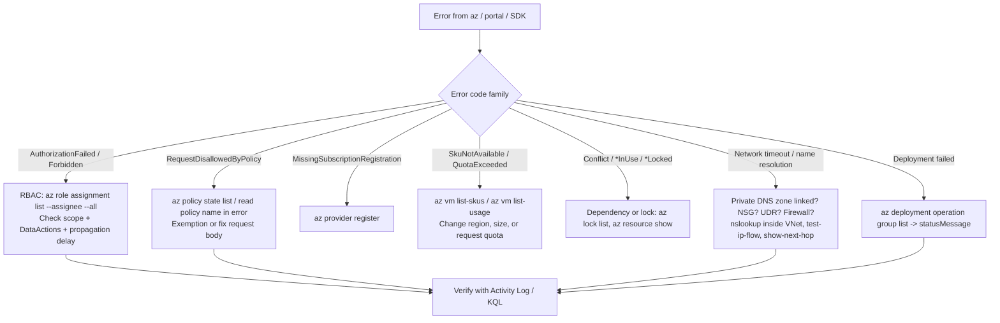

# Azure: Troubleshooting

| | |
|---|---|
| **Cluster** | 01 Hyperscale Cloud |
| **Role** | Bridge (anchor is AWS) |
| **Prerequisites** | [02-core-concepts.md](02-core-concepts.md), [03-commands-and-cheatsheet.md](03-commands-and-cheatsheet.md) |
| **Target version** | Azure CLI 2.60+, AKS 1.30+ |
| **Capstone phase** | Phase 2 (Months 5-8) |

> Symptom-to-cause-to-fix tables for the failures you will actually hit on Azure, the verbatim error strings to search for, the diagnostic commands and KQL that find root cause fastest, and a general debugging workflow. The AWS reflex ("check the IAM policy simulator, check the route table, check the security group") still applies; this file tells you where each of those lives on Azure.

## 1. Debugging Workflow



Always start with `--debug` on the failing `az` command to see the raw ARM request and response; the response body contains the specific error code and often the policy or role that caused it.

```bash
az <command> --debug 2>&1 | grep -A5 '"error"'
```

## 2. Authentication and Authorisation

| Symptom | Likely cause | Diagnose | Fix |
|---|---|---|---|
| `AuthorizationFailed: The client '<id>' with object id '<id>' does not have authorization to perform action 'Microsoft.X/y/write' over scope '/subscriptions/...'` | No role assignment covering that action at that scope | `az role assignment list --assignee <id> --all --output table`; `az role definition list --name "<role>" --query "[0].permissions"` | Assign the right role at the right scope; remember `Actions` (ARM) vs `DataActions` (data) |
| Role assigned but still `Forbidden` for a few minutes | RBAC propagation (up to ~10 min for data plane, usually under 2) | Retry with backoff; check `az role assignment list` shows it | Wait; in scripts add a retry loop around the first data-plane call |
| `az storage blob list ... --auth-mode login` fails with `AuthorizationPermissionMismatch` | You have Owner/Contributor (control plane) but no `Storage Blob Data *` role | `az role assignment list --scope <SA_ID> --assignee <you>` | Assign `Storage Blob Data Reader/Contributor` |
| `Caller is not authorized to perform action on resource. ... Key Vault ... ForbiddenByRbac` | Vault uses RBAC but you only have Contributor | Check `properties.enableRbacAuthorization` | Assign `Key Vault Secrets User/Officer` or `Key Vault Administrator` |
| `ForbiddenByPolicy` on Key Vault | Vault uses access policies and you are not in them | `az keyvault show --query properties.accessPolicies` | Add access policy or migrate vault to RBAC |
| `AADSTS700016: Application with identifier '<id>' was not found in the directory` | Wrong tenant, or SP not created for the app | `az ad sp show --id <APP_ID>` | `az login --tenant <TENANT_ID>`; `az ad sp create --id <APP_ID>` |
| `AADSTS70021: No matching federated identity record found for presented assertion` | Federated credential issuer/subject/audience mismatch | Compare the GitHub token claims (`sub`, `aud`) with `az ad app federated-credential list` | Fix subject (branch vs environment vs PR), audience `api://AzureADTokenExchange` |
| `AADSTS7000215: Invalid client secret provided` | Secret expired or wrong | `az ad app credential list --id <APP_ID>` | Rotate, or better, replace with federated credential |
| `AADSTS50076` / `AADSTS50079` interactive required | Conditional Access requires MFA; CI using a user account | Sign-in logs in Entra | Use MI or federated SP for automation |
| `az login --identity` fails with `ManagedIdentityCredential authentication unavailable` | Resource has no MI, or wrong client ID for user-assigned | `az vm identity show`; IMDS curl | Assign identity; pass `--username <CLIENT_ID>` for user-assigned |
| Workload Identity pod gets `AADSTS70021` | Federated credential subject does not match `system:serviceaccount:<ns>:<sa>` or issuer mismatch | `az identity federated-credential list --identity-name <mi>`; `az aks show --query oidcIssuerProfile.issuerUrl` | Correct subject/issuer; ensure pod label `azure.workload.identity/use: "true"` and SA annotation |
| Workload Identity pod has no `AZURE_FEDERATED_TOKEN_FILE` env | Mutating webhook did not run: label missing or webhook not enabled | `kubectl get mutatingwebhookconfiguration azure-wi-webhook-mutating-webhook-configuration`; pod labels | Add label; `az aks update --enable-workload-identity` |
| `kubectl` returns `error: You must be logged in to the server (Unauthorized)` | kubeconfig not converted for kubelogin, or no Azure RBAC role | `kubelogin convert-kubeconfig --login azurecli`; `az role assignment list --scope <AKS_ID>` | Convert kubeconfig; assign `Azure Kubernetes Service RBAC *` role |
| `az aks get-credentials --admin` fails with `Getting static credential is not allowed because this cluster is set to disable local accounts` | Intended behaviour | none | Use Entra + Azure RBAC |
| `InsufficientPrivileges` on `az ad ...` commands | Need Entra role (Application Administrator, Groups Administrator), not Azure RBAC | Entra portal, Roles and administrators | Request Entra role via PIM |

## 3. Governance

| Symptom | Likely cause | Diagnose | Fix |
|---|---|---|---|
| `RequestDisallowedByPolicy: Resource '<name>' was disallowed by policy. Policy identifiers: '[{"policyAssignment":{"name":"..."}, "policyDefinition":{"name":"..."}}]'` | A `Deny` policy matched | Read the assignment name in the error; `az policy assignment show --name <name> --scope <scope>` | Change the request to comply, or request an exemption (`az policy exemption create`) |
| `ScopeLocked: The scope '...' cannot perform delete operation because following scope(s) are locked` | Resource lock on RG or resource or parent | `az lock list --resource-group <rg>` | `az lock delete` (requires Owner/User Access Administrator) |
| `MissingSubscriptionRegistration: The subscription is not registered to use namespace 'Microsoft.X'` | Provider not registered | `az provider show --namespace Microsoft.X` | `az provider register --namespace Microsoft.X` and wait for `Registered` |
| Policy shows compliant but resource clearly violates | Compliance scan delay (up to 24 h) or `mode: Indexed` skipping the resource type | `az policy state trigger-scan --resource-group <rg>` | Trigger scan; use `mode: All` for resources without location/tags |
| `DeployIfNotExists` never remediates | Assignment has no managed identity or identity lacks the role | `az policy assignment show --query identity`; role assignments for that MI | Recreate assignment with `--mi-system-assigned --role ... --identity-scope ...`; run `az policy remediation create` |
| `InvalidTemplateDeployment ... Deployment template validation failed` | Bicep/ARM schema or parameter error | `az deployment group validate ...`; `az bicep build` | Fix template; read the `details[]` array |
| Deployment succeeded but a nested resource failed | Deployment is a tree | `az deployment operation group list --name <dep> --resource-group <rg> --query "[?properties.provisioningState=='Failed'].properties.statusMessage"` | Read the inner error |
| `ResourceGroupBeingDeleted` | Previous delete still in progress | `az group show --query properties.provisioningState` | Wait: `az group wait --deleted` |
| Cannot delete RG: `ResourceGroupDeletionBlocked` or resources remain | Resources with dependencies in other RGs (NICs, Private Endpoints, Private DNS links) or soft-deleted items | `az resource list --resource-group <rg>`; `az group delete --debug` | Delete dependents first; detach disks; remove Private Endpoint connections |
| `SkuNotAvailable: The requested VM size for resource 'Following SKUs have failed for Capacity Restrictions: Standard_D4s_v5' is currently not available in location 'eastus2'` | Regional capacity | `az vm list-skus --location eastus2 --size Standard_D4s_v5 --query "[].restrictions"` | Different size/zone/region; create a capacity reservation |
| `QuotaExceeded: Operation could not be completed as it results in exceeding approved standardDSv5Family Cores quota` | Subscription quota | `az vm list-usage --location eastus2 --output table` | `az quota create ...` or portal quota request |
| `StorageAccountAlreadyTaken` / `The vault name 'kv-x' is already in use` | Global DNS name taken (possibly by a soft-deleted vault of yours) | `az keyvault list-deleted`; `az storage account check-name --name <name>` | Pick another name; recover soft-deleted vault |
| `VaultAlreadyExists` after deleting a vault | Soft delete + purge protection | `az keyvault list-deleted` | `az keyvault recover --name <kv>`; cannot purge if purge protection on |

## 4. Networking

| Symptom | Likely cause | Diagnose | Fix |
|---|---|---|---|
| Private Endpoint created but app connects to public IP / `403 Forbidden` from Storage with `AuthorizationFailure` (IP not allowed) | Missing Private DNS zone group or zone not linked to VNet | From a VM in the VNet: `nslookup <account>.blob.core.windows.net` should return `10.x.x.x`; `az network private-endpoint dns-zone-group list`; `az network private-dns link vnet list --zone-name <zone>` | Create zone group; link zone to VNet; flush DNS |
| Private DNS resolves correctly from VNet but not from on-premises | On-prem DNS cannot resolve `privatelink.*` | Query hub resolver | Deploy Private DNS Resolver inbound endpoint; forward `privatelink.*` zones from on-prem DNS |
| VM has no internet | NSG outbound deny, UDR to firewall with no allow rule, no NAT/LB/public IP (default outbound access retired for new VNets) | `az network nic show-effective-route-table`; `az network nic list-effective-nsg`; `az network watcher show-next-hop` | Add NAT Gateway; fix firewall rules; fix UDR |
| Inbound connection times out | NSG on subnet *or* NIC denies (both are evaluated) | `az network watcher test-ip-flow --direction Inbound ...` returns `Deny` with rule name | Add allow rule with lower priority number than the deny |
| Peering shows `Initiated` not `Connected` | Only one direction created | `az network vnet peering list --vnet-name <vnet>` | Create the reverse peering |
| Spoke-to-spoke traffic fails | Peering is non-transitive | Effective routes on NIC | Route via hub firewall (UDR) or use Virtual WAN |
| `SubnetIsFull` / `PrivateIPAddressNotInSubnet` | Subnet too small (Azure reserves 5 IPs) or AKS legacy CNI exhausted it | `az network vnet subnet show --query "ipConfigurations | length(@)"` | Larger subnet; Azure CNI Overlay |
| `SubnetMissingRequiredDelegation` | Service needs delegated subnet (PostgreSQL Flexible, Container Apps, App Service) | `az network vnet subnet show --query delegations` | `az network vnet subnet update --delegations Microsoft.DBforPostgreSQL/flexibleServers` |
| `PrivateEndpointNetworkPoliciesCannotBeEnabledOnPrivateEndpointSubnet` (older API) / NSG not applied to PE | PE network policies setting | `az network vnet subnet show --query privateEndpointNetworkPolicies` | Set `--private-endpoint-network-policies Enabled` to apply NSG/UDR to PEs (modern default) |
| Azure Firewall drops AKS traffic; nodes `NotReady` | Missing required FQDNs for AKS egress | Firewall logs: `AZFWApplicationRule | where Action == "Deny"` | Add application rule with FQDN tag `AzureKubernetesService` and network rules for NTP/DNS |
| App Gateway backend `Unhealthy` | Health probe path/port/host wrong, NSG on backend, cert CN mismatch | `az network application-gateway show-backend-health --name agw --resource-group rg` | Fix probe; allow `GatewayManager` service tag inbound 65200-65535 on AGW subnet NSG |
| Standard LB backend unreachable from internet | Standard SKU denies inbound until NSG allows | NSG rules | Add NSG allow on target port |

Network diagnostics bundle:

```bash
NIC_ID=$(az vm show --name vm-x --resource-group rg-x --query "networkProfile.networkInterfaces[0].id" --output tsv)
az network nic show-effective-route-table --ids "$NIC_ID" --output table
az network nic list-effective-nsg --ids "$NIC_ID" --query "value[].effectiveSecurityRules[?access=='Deny'].{name:name, dir:direction, prio:priority}" --output table
az network watcher test-ip-flow --vm vm-x --resource-group rg-x --direction Outbound --protocol TCP --local 10.1.0.4:49152 --remote 1.1.1.1:443
az network watcher test-connectivity --source-resource vm-x --resource-group rg-x --dest-address pg-x.postgres.database.azure.com --dest-port 5432
```

KQL for NSG flow logs (Traffic Analytics):

```kql
NTANetAnalytics
| where TimeGenerated > ago(1h)
| where FlowStatus == "D"           // denied
| summarize count() by SrcIp, DestIp, DestPort, NsgRule = AclRule
| order by count_ desc
```

## 5. AKS

| Symptom | Likely cause | Diagnose | Fix |
|---|---|---|---|
| `ImagePullBackOff` with `401 Unauthorized` from `*.azurecr.io` | Kubelet identity lacks `AcrPull`, or ACR Private Endpoint DNS not resolvable from nodes | `kubectl describe pod`; `az aks check-acr --name aks --resource-group rg --acr acr.azurecr.io` | `az aks update --attach-acr <acr>`; fix `privatelink.azurecr.io` zone link |
| `ImagePullBackOff` with `dial tcp: lookup ... no such host` or `i/o timeout` | Firewall blocks MCR/ACR, or ACR public access disabled without PE | `az aks check-acr`; firewall deny logs | Add FQDN rules; create PE |
| Nodes `NotReady` after enabling UDR egress | Required egress blocked | `kubectl describe node`; firewall logs | Allow AKS FQDN tag, `*.hcp.<region>.azmk8s.io`, `mcr.microsoft.com`, `*.data.mcr.microsoft.com`, `management.azure.com`, `login.microsoftonline.com`, NTP 123 |
| Pod stuck `ContainerCreating` with `secrets-store.csi.k8s.io ... failed to get secret` | Workload Identity not configured on SecretProviderClass, MI lacks `Key Vault Secrets User`, Key Vault firewall blocks | `kubectl describe pod`; `kubectl logs -n kube-system -l app=secrets-store-provider-azure` | Set `clientID` in SPC, assign role, add PE or allow VNet |
| Gatekeeper denies deployment: `admission webhook "validation.gatekeeper.sh" denied the request: [azurepolicy-k8sazurev2blockhostnamespace-...]` | Azure Policy for Kubernetes constraint | `kubectl get constraints -A`; `az policy state list --resource <AKS_ID>` | Fix manifest; or exclude namespace via assignment parameter `excludedNamespaces` |
| `az aks create` fails `InsufficientSubnetSize` | Subnet cannot fit nodes * (1 + max pods) with legacy CNI | Calculate | Use Overlay or bigger subnet |
| Cluster autoscaler not scaling | Pod unschedulable for reasons autoscaler cannot fix (taints, zone affinity, PVC zone) | `kubectl get events -A | grep -i scale`; `kubectl -n kube-system get cm cluster-autoscaler-status -o yaml` | Fix constraints; check `--max-count` |
| Private cluster: `kubectl` from laptop hangs | API server only reachable from VNet | none needed | `az aks command invoke`, Bastion + jump VM, VPN, or API Server VNet Integration |
| `az aks command invoke` fails `Command execution pod cannot be scheduled` | System pool full or tainted and no toleration | `kubectl get nodes`; capacity | Add capacity; retry |
| Upgrade stuck `PodDrainFailure` | PDB prevents eviction | `kubectl get pdb -A` | Fix PDB (`maxUnavailable` 0 with 1 replica is a classic) |
| Service type LoadBalancer `<pending>` | Cluster identity lacks `Network Contributor` on subnet/RG, or internal LB annotation missing subnet | `kubectl describe svc`; cloud-controller logs | Assign role; add `service.beta.kubernetes.io/azure-load-balancer-internal: "true"` |
| Pods cannot reach PostgreSQL | NSG on PG delegated subnet, Private DNS zone for `postgres.database.azure.com` not linked, or Cilium network policy | `kubectl run -it --rm dbg --image=busybox -- nslookup pg.postgres.database.azure.com`; `nc -zv` | Fix DNS link; NSG allow 5432 from pod CIDR (Overlay pods SNAT to node IP); check `CiliumNetworkPolicy` |
| Metrics / logs missing in Container Insights | AMA agent not running, DCR missing, workspace daily cap hit | `kubectl get pods -n kube-system -l dsName=ama-logs`; `az monitor log-analytics workspace show --query workspaceCapping` | Re-enable monitoring add-on; raise cap |

AKS diagnostic commands:

```bash
az aks show --name aks-dev --resource-group rg --query "{state:provisioningState, power:powerState.code, k8s:kubernetesVersion, net:networkProfile.networkPluginMode, egress:networkProfile.outboundType}"
az aks check-acr --name aks-dev --resource-group rg --acr acrcapstone.azurecr.io
az aks nodepool list --cluster-name aks-dev --resource-group rg --query "[].{name:name, state:provisioningState, count:count, version:currentOrchestratorVersion}" --output table
az aks get-upgrades --name aks-dev --resource-group rg --output table
az aks operation-abort --name aks-dev --resource-group rg       # abort a stuck long-running operation
kubectl get events -A --sort-by=.lastTimestamp | tail -n 30
kubectl -n kube-system logs -l component=cloud-node-manager --tail=100
kubectl -n kube-system logs -l app=azure-wi-webhook-controller-manager --tail=50
```

KQL for AKS:

```kql
// Audit: who deleted what in the cluster (requires kube-audit-admin diagnostics, resource-specific mode)
AKSAuditAdmin
| where TimeGenerated > ago(1d)
| where Verb == "delete"
| project TimeGenerated, User = tostring(User.username), ObjectRef = tostring(ObjectRef.resource), Name = tostring(ObjectRef.name), Namespace = tostring(ObjectRef.namespace)
```

```kql
// OOMKilled containers
KubePodInventory
| where TimeGenerated > ago(6h)
| where ContainerLastStatus has "OOMKilled"
| summarize count() by Namespace, ControllerName
```

## 6. Storage, Key Vault, Databases

| Symptom | Likely cause | Diagnose | Fix |
|---|---|---|---|
| `KeyBasedAuthenticationNotPermitted` | `allowSharedKeyAccess=false` and client is using a key or account SAS | Client config | Use Entra (`--auth-mode login`, `DefaultAzureCredential`) or user delegation SAS |
| `AuthorizationFailure: This request is not authorized to perform this operation` on Storage | Firewall `default-action Deny` and caller IP/VNet not allowed | `az storage account show --query networkRuleSet` | Private Endpoint; or `az storage account network-rule add` (lab only) |
| `This request is not authorized to perform this operation using this permission` (403) | Entra identity lacks data role | RBAC check | Assign `Storage Blob Data *` |
| Blob in Archive returns `BlobArchived` / 409 on read | Needs rehydration | `az storage blob show --query properties.archiveStatus` | `az storage blob set-tier --tier Hot --rehydrate-priority High`; wait |
| `BlobImmutableDueToPolicy` on delete | Immutability policy / legal hold | `az storage container immutability-policy show` | Intended; wait for retention or clear legal hold (if not locked) |
| Key Vault `Public network access is disabled and request is not from a trusted service nor via an approved private link` | Firewall + no PE from client network | `az keyvault show --query properties.networkAcls` | Private Endpoint and DNS; `--bypass AzureServices` for trusted services |
| Key Vault throttling `429 Too Many Requests` | Over ~4,000 secret ops per 10 s per vault | Diagnostics `KeyVaultAuditLogs | where ResultSignature == "Throttled"` | Cache secrets in app; split vaults |
| `SecretNotFound` though it exists | Wrong vault, disabled version, or soft-deleted | `az keyvault secret list-deleted` | Recover; enable version |
| PostgreSQL: `FATAL: password authentication failed` with Entra token | Token audience wrong, principal not created in DB, user name mismatch | Token must be for `https://ossrdbms-aad.database.windows.net`; `select * from pg_roles` | Correct scope; `pgaadauth_create_principal`; use exact display name |
| PostgreSQL: `FATAL: no pg_hba.conf entry ... no encryption` | SSL off | Connection string | `sslmode=require` |
| PostgreSQL: connection timeout from AKS | VNet-injected server needs DNS zone linked to spoke; NSG on delegated subnet | `nslookup <server>.postgres.database.azure.com` from pod; NSG | Link zone; NSG allow 5432 |
| PostgreSQL: `remaining connection slots are reserved` | `max_connections` hit (small SKUs are low) | `az postgres flexible-server parameter show --name max_connections` | PgBouncer built-in (`pgbouncer.enabled on`, port 6432); bigger SKU |
| Cosmos DB `429 Request rate is large` | RU/s exhausted or hot partition | Metrics `TotalRequestUnits` by partition key range | Autoscale; better partition key; retry with `x-ms-retry-after-ms` |
| Cosmos DB `Forbidden` with data-plane RBAC | Role assignment at ARM scope only | `az cosmosdb sql role assignment list` | Create data-plane role assignment (`Cosmos DB Built-in Data Contributor`) |

## 7. Monitoring and Logging Gaps

| Symptom | Likely cause | Fix |
|---|---|---|
| Resource logs not appearing in Log Analytics | No diagnostic setting; 5-15 minute ingestion latency; category disabled | `az monitor diagnostic-settings list --resource <id>`; wait; enable category |
| `AzureDiagnostics` table missing columns / 500-column limit hit | Legacy collection mode | Use resource-specific mode (`--export-to-resource-specific true`) |
| Activity Log only shows 90 days | Default retention | Subscription diagnostic setting to workspace |
| Query returns nothing from `ContainerLogV2` | Table on Basic plan: no alerts and limited KQL (no `join` to other tables in some cases); or log collection disabled for namespace | Check `ama-logs` ConfigMap `container-azm-ms-agentconfig`; use Analytics plan for alerting tables |
| Metric alert never fires | Wrong aggregation or metric namespace; dimension filter | `az monitor metrics list-definitions --resource <id>` for exact names |
| Workspace daily cap reached | `workspaceCapping.quotaGb` | Raise or remove cap; Basic plan for noisy tables |

## 8. Cost Surprises

| Symptom | Cause | Fix |
|---|---|---|
| Bill shows `MC_*` resource group costs | AKS node resources live in the node RG | Expected; tag inheritance; AKS cost analysis add-on |
| Deallocated VM still costs | Disks, public IPs (Standard SKU), reserved IPs | Delete disks/IPs or use Ephemeral OS disks |
| Log Analytics is the biggest line item | Verbose `kube-audit`, `ContainerLogV2`, flow logs | Use `kube-audit-admin`; Basic plan; filter stdout for noisy namespaces |
| Private Endpoint hourly + per-GB charges | Each PE bills hourly plus data processing | Consolidate; avoid PEs for high-volume intra-region storage traffic where Service Endpoints suffice |
| NAT Gateway data processing | Per-GB charge | Keep traffic private via PEs |
| Azure Firewall at ~USD 900/month idle | Fixed deployment cost | Use Basic SKU for small environments; stop in dev (`az network firewall ip-config delete` deallocates) |
| Stopped Flexible Server restarted itself | 7-day limit on stop | Delete and PITR-restore when needed, or accept |

## 9. When All Else Fails

1. `az <cmd> --debug` and read the ARM response body.
2. Activity Log for the resource: `az monitor activity-log list --resource-id <id> --offset 2h --query "[].{op:operationName.value, status:status.value, sub:subStatus.value, msg:properties.statusMessage}"`.
3. Resource Health: `az rest --method get --url "https://management.azure.com<RESOURCE_ID>/providers/Microsoft.ResourceHealth/availabilityStatuses/current?api-version=2022-10-01"`.
4. Service Health: `az rest --method get --url "https://management.azure.com/subscriptions/<SUBSCRIPTION_ID>/providers/Microsoft.ResourceHealth/events?api-version=2022-10-01&\$filter=eventType eq 'ServiceIssue'"`.
5. Resource Graph for inventory-level questions.
6. `az support tickets create` (Standard plan or higher) with the correlation ID from the `--debug` output (`x-ms-correlation-request-id`).

## Next

[07-interview-questions.md](07-interview-questions.md).
