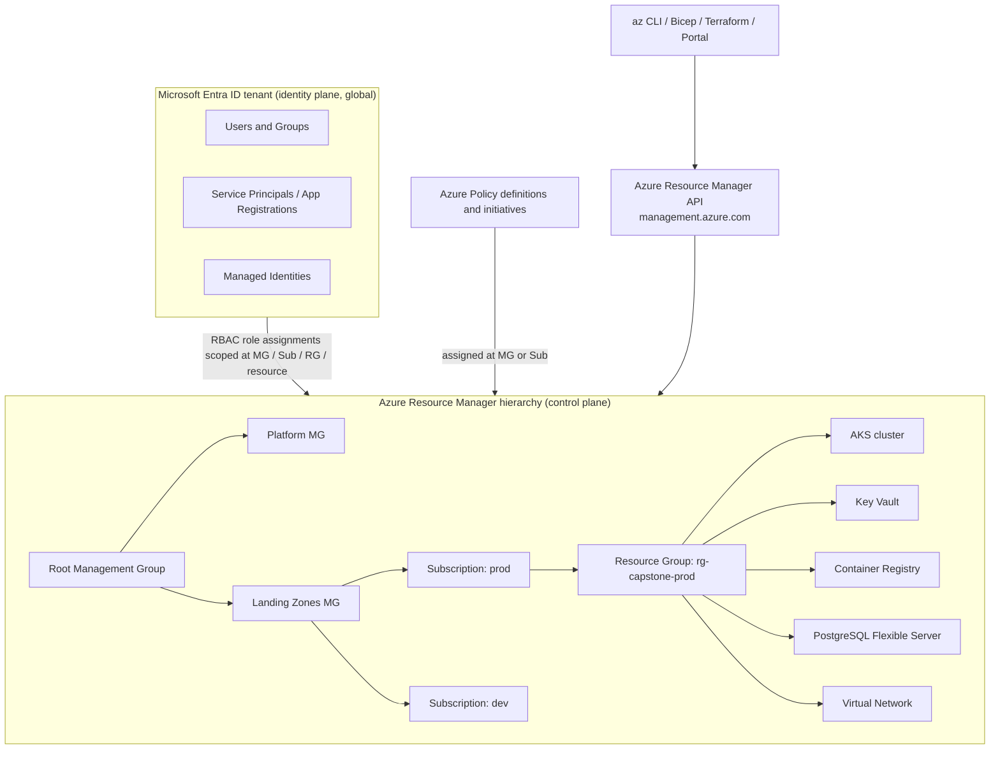

# Microsoft Azure

| | |
|---|---|
| **Cluster** | 01 Hyperscale Cloud |
| **Role** | Bridge (anchor is [AWS](../aws/README.md)) |
| **Category** | Public cloud: identity, SDN, managed compute, durable storage |
| **Prerequisites** | AWS folder complete (IAM, VPC, EKS, S3, KMS); Linux networking; Terraform basics helpful |
| **Target version** | Azure CLI 2.60+, Bicep 0.28+, AKS with Kubernetes 1.30+ |
| **Capstone phase** | Phase 2 (Months 5-8) |
| **Official docs** | https://learn.microsoft.com/azure/ |

> Azure is the second hyperscaler you learn, and you learn it by translation rather than from scratch. Everything you internalised on AWS (an IAM policy evaluation, a private subnet behind a NAT, a Kubernetes cluster pulling images from a private registry with a workload identity) exists on Azure under a different name and with a few genuinely different architectural choices. After working through this folder you will be able to provision a hardened landing zone with `az` and Bicep, run the capstone FastAPI and Spring Boot services on AKS with Workload Identity and no static secrets, and explain to a hiring panel exactly where Azure differs from AWS and why.

## Why This Tool Exists

Azure grew out of Microsoft's enterprise estate: Active Directory, Windows Server, SQL Server, Office. Its design choices follow from that heritage. Identity is the control plane (Microsoft Entra ID sits above every subscription, not inside it), governance is hierarchical and policy-driven (Management Groups and Azure Policy mirror Group Policy Objects), and every resource lives in an explicit lifecycle container (the Resource Group) so that an entire application can be deleted, tagged, or access-controlled in a single operation.

The practical insight that makes Azure click: **a Resource Group is a `terraform destroy` boundary that the platform enforces for you.** On AWS you discover the blast radius of an application by reading tags and Terraform state. On Azure the platform makes you decide the boundary up front.

The second insight: **Managed Identities make static credentials unnecessary for anything running inside Azure.** Where AWS gives you IAM roles attached to EC2 instance profiles or EKS Pod Identity, Azure attaches an Entra ID service principal to the resource itself, and the Azure SDKs pick it up through the Instance Metadata Service (IMDS) with zero configuration.

## Architecture

- **Microsoft Entra ID** (formerly Azure AD) is the identity provider. It is *not* an Azure resource; it is a tenant that owns subscriptions. One tenant, many subscriptions.
- **Azure Resource Manager (ARM)** is the single deployment and management API. Every tool (`az`, Bicep, Terraform, the portal, SDKs) calls ARM. ARM authenticates callers against Entra ID, authorises against RBAC, evaluates Azure Policy, then dispatches to the resource provider (for example `Microsoft.ContainerService` for AKS).
- **Management Groups** are the organisational tree above subscriptions. Policy and RBAC assigned here inherit downward.
- **Subscriptions** are billing and quota boundaries, roughly equivalent to AWS accounts but cheaper to create and with a shared identity plane.
- **Resource Groups** are the mandatory lifecycle container. Every resource is in exactly one.
- **Resource providers** are the namespaced service APIs (`Microsoft.Compute`, `Microsoft.Network`, `Microsoft.Storage`, `Microsoft.KeyVault`). They must be registered per subscription.

## The Core Mental Model

1. **Identity is above the subscription, not inside it.** Entra ID is a tenant-wide directory that owns subscriptions. A service principal or user can be granted roles in any number of subscriptions. On AWS, IAM principals belong to one account and cross-account access is an explicit trust policy. On Azure, cross-subscription access within the same tenant is just another role assignment.

2. **Everything is `scope + role + principal`.** An Azure RBAC assignment is a triple: *who* (principal), *what* (role definition, a list of allowed `Actions` and `DataActions`), *where* (scope: a Management Group, Subscription, Resource Group, or single resource). Permissions inherit down the hierarchy and are additive. There is no inline policy document attached to a principal; the role definition is the policy and the assignment binds it to a scope.

3. **ARM is declarative and idempotent at the resource level.** Submitting the same ARM/Bicep template twice converges to the same state. The `az` CLI largely wraps ARM `PUT` calls, so `az <resource> create` on an existing resource usually updates rather than fails.

4. **Azure Policy is the guardrail, Defender is the detective.** Policy prevents or audits non-compliant configurations at deploy time (deny public IPs, require encryption, enforce tags). Defender for Cloud continuously assesses posture and threats after deployment.

5. **Networking is per-VNet and regional, like AWS.** A VNet lives in one region. Peering connects VNets. Network Security Groups are stateful filters on subnets or NICs. Private Endpoints bring PaaS services into your VNet with a private IP, exactly like AWS Interface VPC Endpoints.

## Coming from AWS: Vocabulary Translation

This is the single most important table in this folder. Learn it before touching the CLI.

| Concept | AWS | Azure | Delta worth remembering |
|---|---|---|---|
| Organisation root | AWS Organizations root | Microsoft Entra ID tenant + root Management Group | Entra is identity, the root MG is governance; they are separate things that happen to be 1:1 |
| Organisational unit | OU | Management Group | MGs nest up to 6 levels; SCPs become Azure Policy + RBAC |
| Account | AWS Account | Subscription | Many subscriptions share one Entra tenant; no cross-account trust policy needed |
| Lifecycle container | none (tags, CloudFormation stacks) | Resource Group | Mandatory; delete the RG and everything inside goes |
| Deployment API | CloudFormation / per-service APIs | Azure Resource Manager (ARM) | Single unified API; Bicep is the native DSL (compiles to ARM JSON) |
| Preventive guardrail | SCP | Azure Policy (`Deny` effect) | Policy can also `Audit`, `Modify`, `DeployIfNotExists`; SCPs cannot remediate |
| IAM policy | IAM policy document (JSON) | RBAC role definition | No resource-based policies for most services; Key Vault access policies are the legacy exception |
| IAM role (for workloads) | IAM role + instance profile / IRSA / Pod Identity | Managed Identity (system or user-assigned) | Managed Identity is itself a service principal in Entra ID |
| IAM user / access keys | IAM user + access key | Entra user / service principal + client secret or certificate | Treat client secrets like access keys: avoid; use federated credentials |
| OIDC federation for CI | IAM OIDC provider + role trust policy | Workload identity federation on an app registration or user-assigned MI | Same pattern: issuer, subject, audience |
| Just-in-time admin | none native (IAM Identity Center permission sets) | Privileged Identity Management (PIM) | PIM requires Entra ID P2 |
| VPC | VPC | Virtual Network (VNet) | Same regional scope; address space can be extended in place |
| Subnet | Subnet (AZ-bound) | Subnet (spans all AZs in the region) | Azure subnets are not zonal; zone placement is a property of the resource |
| Security group | Security Group (on ENI) | Network Security Group (on subnet or NIC) + Application Security Group | NSG rules have explicit priorities and both allow and deny |
| Network ACL | NACL | NSG on subnet | No separate stateless layer |
| Route table | Route table | Route table with User-Defined Routes (UDR) | System routes exist implicitly; UDRs override |
| NAT | NAT Gateway | NAT Gateway (associated to subnets) | Same purpose, same shape |
| Interface endpoint | Interface VPC Endpoint (PrivateLink) | Private Endpoint (Private Link) | Same; Azure uses Private DNS Zones for name resolution |
| Gateway endpoint | S3/DynamoDB Gateway Endpoint | Service Endpoint | Service Endpoints keep the public IP but route privately; Private Endpoints are preferred |
| Managed firewall | AWS Network Firewall | Azure Firewall | Azure Firewall has FQDN-based rules and a Premium tier with TLS inspection |
| Transit hub | Transit Gateway | Virtual WAN hub (or hub-spoke VNet peering) | Hub-spoke with peering is the common DIY pattern |
| Virtual machine | EC2 | Virtual Machine | Sizes use a letter family: `Standard_D4s_v5` |
| Auto Scaling group | ASG | Virtual Machine Scale Set (VMSS) | Flexible orchestration mode is the modern default |
| Managed Kubernetes | EKS | AKS | AKS control plane is free (Standard tier adds SLA); node pools map to EKS managed node groups |
| Pod identity | IRSA / EKS Pod Identity | AKS Workload Identity | Same OIDC federation pattern |
| Secrets in pods | Secrets Store CSI Driver + ASCP | Key Vault Secrets Store CSI Driver add-on | Same CSI driver upstream |
| Serverless containers | App Runner / Fargate | Container Apps | Container Apps runs on managed Kubernetes with KEDA and Dapr built in |
| PaaS web hosting | Elastic Beanstalk | App Service | App Service is far more central to Azure than Beanstalk is to AWS |
| FaaS | Lambda | Azure Functions | Hosting plans matter: Consumption, Flex Consumption, Premium, Dedicated |
| Object storage | S3 bucket | Storage Account + Blob container | The Storage Account is the namespace and also hosts Files, Queues, Tables |
| Storage class | S3 Standard / IA / Glacier | Blob access tier: Hot / Cool / Cold / Archive | Archive requires rehydration, like Glacier |
| Object Lock | S3 Object Lock | Immutable blob storage (time-based retention / legal hold) | Version-level WORM available |
| Presigned URL | Presigned URL | Shared Access Signature (SAS) | Prefer user delegation SAS (signed by Entra, not the account key) |
| Relational DB | RDS / Aurora | Azure SQL Database, Azure Database for PostgreSQL Flexible Server | Flexible Server is the PostgreSQL option; Single Server is retired |
| NoSQL | DynamoDB | Cosmos DB (NoSQL API) | Multi-model; request units (RU/s) are the throughput currency |
| KMS | KMS | Key Vault (keys) and Managed HSM | Key Vault also stores secrets and certificates |
| Secrets Manager | Secrets Manager | Key Vault (secrets) | Same vault for keys, secrets, certs |
| Container registry | ECR | Azure Container Registry (ACR) | Premium tier for private endpoints, geo-replication, content trust |
| Logs | CloudWatch Logs | Azure Monitor Logs (Log Analytics workspace) | Query with KQL, which is far richer than CloudWatch Logs Insights |
| Metrics | CloudWatch Metrics | Azure Monitor Metrics | Platform metrics free for 93 days |
| Audit trail | CloudTrail | Activity Log (control plane) + resource diagnostic settings (data plane) | Activity Log is 90 days by default; export to Log Analytics |
| CSPM / threat detection | Security Hub + GuardDuty | Microsoft Defender for Cloud | One product covers CSPM, CWPP, and regulatory compliance |
| CDN + WAF edge | CloudFront + WAF | Azure Front Door (with WAF) | Front Door is global L7 with anycast |
| Regional L7 LB | ALB | Application Gateway (v2, with WAF) | Zonal or zone-redundant; also an AKS ingress option (AGIC / App Gateway for Containers) |
| L4 LB | NLB | Azure Load Balancer (Standard SKU) | Standard SKU is zone-redundant and secure by default (no inbound until NSG allows) |
| DNS | Route 53 | Azure DNS (public) and Private DNS Zones | Private DNS zones link to VNets for Private Endpoint resolution |
| CLI | `aws` | `az` | `az` output is JSON by default; `--query` uses JMESPath exactly like `aws --query` |
| IaC native | CloudFormation | Bicep (compiles to ARM JSON) | Bicep is readable and what-if capable; still learn Terraform first |
| Cost tool | Cost Explorer + Budgets | Cost Management + Billing (budgets, exports, Advisor) | Budgets can trigger Action Groups (webhooks, Functions) |

## Learning Path

| Step | File | Time |
|---|---|---|
| 1 | [01-installation-and-setup.md](01-installation-and-setup.md): install `az`, sign in, set subscription, register providers, create the first RG | 2 h |
| 2 | [02-core-concepts.md](02-core-concepts.md): hierarchy, ARM, Entra ID, RBAC, Policy, VNet, compute, storage, data, Key Vault, Monitor, Defender | 10 h |
| 3 | [03-commands-and-cheatsheet.md](03-commands-and-cheatsheet.md): `az` by task, JMESPath queries, Bicep basics | 4 h |
| 4 | [04-hands-on-labs.md](04-hands-on-labs.md): seven labs from first RG to AKS Workload Identity with Key Vault CSI | 14 h |
| 5 | [05-production-patterns.md](05-production-patterns.md): landing zones, hub-spoke, private AKS, Policy as Code, cost, GitHub Actions OIDC | 5 h |
| 6 | [06-troubleshooting.md](06-troubleshooting.md): symptom tables, diagnostic KQL, verbatim errors | 2 h |
| 7 | [07-interview-questions.md](07-interview-questions.md): 30 questions from junior to principal | 3 h |

Total: roughly 40 hours, which is one quarter of the Phase 2 budget. Spend the other three quarters on AWS and Terraform. Do not study Azure and GCP in the same week (Golden Rule 1 of the roadmap).

## Where Azure Is Genuinely Different (Not Just Renamed)

Honest trade-offs, because the vocabulary table hides some real architectural deltas:

- **Resource Groups are a double-edged sword.** They make teardown trivial and RBAC scoping natural, but choosing the wrong boundary early (one RG per environment versus per service) is painful to fix because moving resources between RGs has per-service restrictions.
- **Entra ID is shared across all subscriptions.** This is simpler than AWS cross-account roles but means a compromised global administrator is a tenant-wide incident, not an account-wide one. PIM and Conditional Access are mandatory, not optional.
- **Two authorisation planes exist for data.** Storage and Key Vault support both RBAC (`DataActions`) and legacy per-resource models (SAS tokens, Key Vault access policies). Production guidance: RBAC only, disable shared key access.
- **Azure Policy is more powerful than SCPs** because it can audit and remediate (`DeployIfNotExists`), but the effect ordering and evaluation delay (up to 30 minutes for compliance scans) confuse newcomers.
- **Regional capacity and quotas bite more often than on AWS.** Expect `SkuNotAvailable` and `QuotaExceeded` in popular regions and plan multi-region from the start.
- **Naming is global for many PaaS resources.** Storage Account, Key Vault, ACR, App Service, and Cosmos DB names must be globally unique DNS labels with strict character rules (Storage Accounts: 3-24 lowercase alphanumerics, no hyphens).
- **The CLI is slower.** `az` is Python and makes ARM calls that often poll long-running operations. Use `--no-wait` and `az <resource> wait` in scripts.

## Role in the Capstone

In Phase 2 the capstone's unified repository gains an `infra/azure/` tree alongside `infra/aws/`. It provisions, via Terraform (anchor) with a Bicep equivalent for one module to prove cross-IaC fluency:

- A hub-spoke VNet pair with an Azure Firewall in the hub, a NAT Gateway, and Private Endpoints for ACR, Key Vault, and PostgreSQL.
- A private AKS cluster (Azure CNI Overlay, Workload Identity, Key Vault Secrets Store CSI add-on, Azure Policy add-on) with a system node pool and a user node pool using Spot VMs for non-production.
- Azure Database for PostgreSQL Flexible Server with Entra authentication, no password login, and a Private Endpoint.
- A Storage Account with hierarchical namespace disabled, versioning and soft delete on, shared key access disabled, and a lifecycle policy that moves backups to Cool at 30 days and Archive at 180 days.
- A GitHub Actions workflow that authenticates with workload identity federation (no client secret), builds the FastAPI and Spring Boot images, pushes to ACR, and deploys to AKS.
- Diagnostic settings on every resource routing to one Log Analytics workspace, with a KQL workbook for AKS and PostgreSQL.
- Defender for Cloud enabled on Containers, Key Vault, and Storage plans, with the regulatory compliance dashboard mapped to CIS Azure Foundations.

The artefacts produced: `infra/azure/*.tf`, `infra/azure/bicep/*.bicep`, `.github/workflows/deploy-azure.yml`, and an ADR at `capstone/adrs/0007-azure-landing-zone.md` explaining hub-spoke versus Virtual WAN and Azure CNI Overlay versus kubenet.

## Further Reading

- Azure Architecture Center, Cloud Adoption Framework (landing zones): https://learn.microsoft.com/azure/cloud-adoption-framework/
- Azure Well-Architected Framework: https://learn.microsoft.com/azure/well-architected/
- Microsoft Entra ID documentation (managed identities, workload identity federation): https://learn.microsoft.com/entra/
- AKS baseline reference architecture: https://learn.microsoft.com/azure/architecture/reference-architectures/containers/aks/baseline-aks
- Azure Policy built-in definitions (searchable): https://learn.microsoft.com/azure/governance/policy/samples/built-in-policies
- Kusto Query Language reference: https://learn.microsoft.com/kusto/query/
- Bicep documentation: https://learn.microsoft.com/azure/azure-resource-manager/bicep/
- CIS Microsoft Azure Foundations Benchmark (via Defender regulatory compliance)
- Book: *Azure for Architects* (Ritesh Modi) for hierarchy and governance; *Microsoft Azure Security Technologies (AZ-500)* study material for the identity plane
