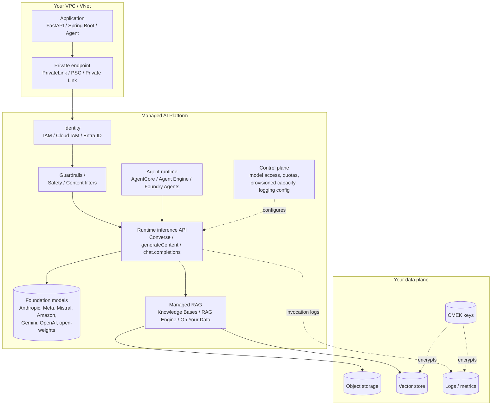

# Cluster 02: Managed Cloud AI Platforms

| | |
|---|---|
| **Cluster** | 02 Managed AI Platforms |
| **Anchor** | Amazon Bedrock |
| **Bridges** | Google Cloud Vertex AI, Azure OpenAI in Microsoft Foundry |
| **Prerequisites** | Cluster 01 (IAM, VPC/VNet, object storage, KMS), Python 3.12+, HTTP/JSON fluency |
| **Capstone phase** | Phase 6 (Months 21-24) |
| **Roadmap line** | Line 2: "Amazon Bedrock, Vertex AI, Azure OpenAI" |

> This cluster teaches you to consume foundation models (FMs) the way regulated enterprises actually do: through a cloud provider's serverless inference API, inside private networking, under the provider's IAM, with customer-managed encryption keys, with policy guardrails in front of the model, and with reserved throughput when latency matters. You will master Amazon Bedrock deeply, then translate that mental model onto Vertex AI and Azure OpenAI in days rather than months.

---

## 1. Why This Cluster Exists

An engineer can call a public LLM endpoint with an API key in five minutes. A bank, hospital network, or government contractor cannot, for four reasons that have nothing to do with model quality:

| Enterprise requirement | What the public endpoint lacks | What the managed platform guarantees |
|---|---|---|
| **No training on prompts or completions** | Contractual terms vary, data may leave your jurisdiction | Provider contractually does not use your inputs/outputs to train; data stays in the region you chose |
| **Private network ingress** | Traffic egresses to the public internet via NAT | VPC endpoints (AWS PrivateLink), Private Service Connect (GCP), Private Link (Azure); the API is reachable only from your private subnets |
| **Customer-managed encryption keys (CMEK)** | Provider-managed keys only | Logs, knowledge-base indexes, agent memory, and fine-tuning artefacts encrypted with KMS / Cloud KMS / Key Vault keys you control and can revoke |
| **Deterministic throughput** | Shared rate limits, 429s under load | Provisioned Throughput (Bedrock), Provisioned Throughput (Vertex), PTUs (Azure): reserved capacity with predictable p99 latency |
| **Identity-based auth** | Static API keys in env vars | IAM roles / service accounts / Entra ID managed identities; short-lived credentials, no secrets to rotate |
| **Audit trail** | Vendor dashboard | CloudTrail + model invocation logs, Cloud Audit Logs, Azure Diagnostic Settings; SIEM-ready |
| **Policy enforcement at the API** | Prompt-engineering only | Guardrails / Safety settings / Content filters applied server-side, independent of the model and the application code |

The **core unifying pattern** from the roadmap is: *serverless FM APIs + guardrails + provisioned throughput + private RAG*. Every platform in this cluster implements all four; they differ in vocabulary, IAM shape, and how much of the RAG stack is managed for you.

---

## 2. The Shared Architecture

Every managed AI platform decomposes into the same five planes. Learn them once.

| Plane | Responsibility | Bedrock | Vertex AI | Azure OpenAI |
|---|---|---|---|---|
| Control plane | Enable models, set quotas, buy capacity, configure logging | `aws bedrock` | `gcloud ai` / Model Garden | `az cognitiveservices account deployment` |
| Identity | Who may call which model | IAM policies on model ARNs | Cloud IAM roles on project/endpoint | Entra ID RBAC on resource |
| Policy | Server-side input/output filtering | Guardrails | Safety settings + Model Armor | Content filters + Prompt Shields |
| Runtime | Stateless inference | `bedrock-runtime` Converse / InvokeModel | `generateContent` (google-genai SDK) | Chat Completions / Responses API |
| Retrieval | Managed RAG | Knowledge Bases | RAG Engine, Vertex AI Search | Azure AI Search ("on your data") |
| Agents | Hosted agent runtime | Bedrock Agents, AgentCore | ADK + Agent Engine | Foundry Agent Service |

---

## 3. Three-Way Comparison Matrix

Use this to translate requirements into platform features. "Managed" means the provider runs it; "BYO" means you provision and wire it yourself.

| Capability | Amazon Bedrock | Google Vertex AI | Azure OpenAI (Microsoft Foundry) |
|---|---|---|---|
| **Model catalog** | Anthropic Claude, Amazon Nova/Titan, Meta Llama, Mistral, Cohere, AI21, Stability, DeepSeek, custom imports | Gemini (first-party), Claude, Llama, Mistral, Gemma, 200+ Model Garden entries, custom-trained | OpenAI GPT-4o/4.1/5 family, o-series reasoning, embeddings, DALL-E, Whisper; Foundry adds Claude, Llama, Mistral, Phi, DeepSeek |
| **Unified API across vendors** | Yes: Converse API normalises messages, system, tools, images, documents across all chat models | Partial: `generateContent` for Gemini and Gemma; partner models (Claude) use their native schema via `rawPredict` or Anthropic SDK | Partial: OpenAI models via `openai` SDK; Foundry "Models as a Service" models use the Azure AI Inference API |
| **Streaming** | `ConverseStream`, `InvokeModelWithResponseStream` (event stream) | `generate_content_stream` (SSE) | `stream=True` on Chat Completions / Responses (SSE) |
| **Tool / function calling** | `toolConfig` with JSON Schema; `toolUse` / `toolResult` blocks; `toolChoice` auto/any/tool | `tools=[FunctionDeclaration]`, `function_call` parts, `tool_config` mode AUTO/ANY/NONE; also built-in Google Search and code execution tools | `tools=[{type:"function"}]`, `tool_calls`, `tool_choice` auto/required/named; parallel calls |
| **Structured output** | Model-dependent; enforce via tool schema or prompt; Nova supports JSON mode | `response_mime_type="application/json"` + `response_schema` (Pydantic or JSON Schema) | `response_format={"type":"json_schema","strict":true}` (Structured Outputs), SDK `.parse()` with Pydantic |
| **Embeddings** | Titan Text Embeddings V2, Cohere Embed (multilingual, multimodal) | `gemini-embedding-001`, `text-embedding-005`, `text-multilingual-embedding-002`, multimodal embeddings | `text-embedding-3-small`, `text-embedding-3-large` (Matryoshka `dimensions` parameter) |
| **Managed RAG** | Knowledge Bases: S3/Confluence/SharePoint/Salesforce/web connectors, managed chunking, OpenSearch Serverless / Aurora pgvector / Pinecone / Redis / Neptune Analytics (GraphRAG), `RetrieveAndGenerate` | RAG Engine (managed corpus + Vector Search / Spanner / Pinecone / Weaviate), Vertex AI Search (enterprise search + grounding), Grounding with Google Search | "On your data" via Azure AI Search (hybrid vector + BM25 + semantic ranker), Foundry file search; indexing pipeline via AI Search integrated vectorisation |
| **Vector store options** | OpenSearch Serverless (default), Aurora PostgreSQL pgvector, Pinecone, Redis Enterprise, MongoDB Atlas, Neptune Analytics | Vertex AI Vector Search (ScaNN), AlloyDB/Cloud SQL pgvector, Spanner, Elasticsearch | Azure AI Search, Cosmos DB (DiskANN), PostgreSQL pgvector, Elasticsearch |
| **Guardrails / content safety** | Bedrock Guardrails: denied topics, content filters (hate/insults/sexual/violence/misconduct/prompt attack), word filters, PII detection & redaction, contextual grounding & relevance checks, automated reasoning policies; applied via `guardrailConfig` or `ApplyGuardrail` to any model | Safety settings per harm category (`HARM_CATEGORY_*`, block thresholds), system instructions, Model Armor (prompt injection, jailbreak, sensitive data, URL filtering) as a separate service | Content filters (hate, sexual, violence, self-harm; severity levels), Prompt Shields (jailbreak + indirect injection), protected material detection, groundedness detection; custom blocklists; configurable per deployment |
| **Provisioned throughput** | Provisioned Throughput (model units, 1- or 6-month commitment, or no-commit hourly); on-demand; batch inference (50% discount); cross-region inference profiles | Provisioned Throughput (generative AI scale units, GSU, weekly/monthly commitments); dynamic shared quota (DSQ) for pay-as-you-go | PTUs (Provisioned-Managed, Global Provisioned, Data Zone Provisioned; hourly or monthly/yearly reservations); Standard, Global Standard, Data Zone Standard; Batch (50% discount) |
| **Private networking** | VPC interface endpoints (PrivateLink) for `bedrock`, `bedrock-runtime`, `bedrock-agent`, `bedrock-agent-runtime`; endpoint policies | Private Service Connect endpoints, VPC Service Controls perimeters, Private Google Access | Private Link private endpoints, disable public network access, VNet integration for AI Search, network ACLs |
| **Identity** | IAM principals, roles, resource policies on model/inference-profile ARNs, condition keys (`bedrock:InferenceProfileArn`), SCPs | Cloud IAM roles (`roles/aiplatform.user`), service accounts, Workload Identity Federation, org policies | Entra ID RBAC (`Cognitive Services OpenAI User`), managed identities, `DefaultAzureCredential`; API keys optional and disableable |
| **Observability / logging** | CloudTrail (control + data plane), model invocation logging to CloudWatch Logs and/or S3 (prompts, completions, token counts), CloudWatch metrics (`Invocations`, `InputTokenCount`, `InvocationLatency`, `InvocationThrottles`) | Cloud Audit Logs, request-response logging to BigQuery, Cloud Monitoring metrics, Vertex AI Evaluation | Diagnostic Settings to Log Analytics / Storage / Event Hub (`RequestResponse`, `Audit`), Azure Monitor metrics (`TokenTransaction`, `ProcessedPromptTokens`, PTU utilisation) |
| **Pricing dimensions** | Input/output tokens per model; cache read/write tokens; provisioned model-unit hours; batch at discount; Knowledge Base ingestion + vector store cost separate; Guardrails per text unit; AgentCore per compute-second | Input/output tokens (tiered by context length for some Gemini models); cached tokens + cache storage per hour; GSU hours; grounding queries; Vector Search node hours; RAG Engine storage | Input/output tokens per model; cached input discount; PTU hours (reservations cheaper); Batch at discount; AI Search tier + semantic ranker; content filter free for Standard, charged for some add-ons |
| **Agent runtimes** | Bedrock Agents (managed orchestration, action groups, Lambda executors, memory), AgentCore (Runtime, Gateway, Memory, Identity, Observability, Code Interpreter, Browser) for any framework | Agent Development Kit (open-source), Agent Engine (managed runtime, sessions, memory bank), Agent Garden, Agentspace | Foundry Agent Service (threads, runs, tools, Bing grounding, Azure Functions, OpenAPI tools), Semantic Kernel, AutoGen |
| **Model customisation** | Fine-tuning (Nova, Llama, Titan, Claude Haiku), continued pre-training, distillation, custom model import | Supervised fine-tuning for Gemini, RLHF tuning, distillation, custom training on Vertex Training | Fine-tuning for GPT-4o/4.1-mini, o4-mini RFT, distillation via stored completions |
| **Evaluation** | Model evaluation jobs (automatic + human), RAG evaluation, LLM-as-judge | Gen AI Evaluation Service (pointwise/pairwise, rubric metrics), AutoSxS | Foundry evaluations (groundedness, relevance, coherence, safety evaluators), red-teaming agent |
| **Weak points (honest)** | Converse API lags newest model features by weeks; Knowledge Base chunking options are coarse; Guardrails add latency and cost per call; quota increases are manual | Two overlapping SDKs (`vertexai` legacy vs `google-genai`) confuse newcomers; partner models lack `generateContent` parity; regional model availability uneven | Deployment-name indirection surprises people; regional capacity shortages for new models; PTU minimums are expensive for small teams; many Foundry surfaces renamed repeatedly |

---

## 4. Anchor-and-Bridge Delta Mapping

Learn the left column on Bedrock. When you open Vertex or Azure, translate rather than relearn.

| Bedrock concept (anchor) | Vertex AI equivalent | Azure OpenAI equivalent | Notes on the delta |
|---|---|---|---|
| Model access (enable per account/region) | Model Garden enable / partner model EULA acceptance | Model deployment (you must create a *deployment* of a model version) | Azure adds a named-deployment indirection; Vertex Gemini is enabled by default once API is on |
| Foundation model ID `anthropic.claude-...` | Publisher model `publishers/google/models/gemini-2.5-pro` | Deployment name you choose (`gpt-4o-prod`) mapped to model + version | On Azure, code references *your* deployment name, not the model ID |
| Inference profile `us.anthropic.claude-...` (cross-region) | `global` location endpoint, or regional | Global Standard / Data Zone Standard deployment types | All three let you trade residency for capacity |
| `bedrock-runtime` Converse API | `client.models.generate_content()` | `client.chat.completions.create()` / `client.responses.create()` | Message/role structure is near-identical; tool schemas are JSON Schema everywhere |
| `system` content blocks | `system_instruction` in `GenerateContentConfig` | `{"role":"system"}` or `"developer"` message | Same semantics |
| `toolConfig` + `toolUse` / `toolResult` | `tools=[Tool(function_declarations=[...])]` + `function_call` / `function_response` | `tools=[{type:"function"}]` + `tool_calls` / `{"role":"tool"}` | Loop shape is identical: model emits call, you execute, you append result |
| `ConverseStream` | `generate_content_stream` | `stream=True` | All server-sent; Bedrock uses EventStream binary framing via SDK |
| `inferenceConfig` (maxTokens, temperature, topP, stopSequences) | `GenerateContentConfig` (max_output_tokens, temperature, top_p, stop_sequences) | `max_completion_tokens`, `temperature`, `top_p`, `stop` | Reasoning models on Azure ignore temperature |
| Prompt caching (`cachePoint` block) | Context caching (`caches.create`, TTL, min token count) | Prompt caching (automatic for repeated prefixes >= 1024 tokens) | Bedrock/Vertex explicit; Azure implicit |
| On-demand throughput | Pay-as-you-go with Dynamic Shared Quota | Standard / Global Standard | |
| Provisioned Throughput (model units) | Provisioned Throughput (GSUs) | PTUs | All require capacity planning and commitment |
| Batch inference (S3 in/out JSONL) | Batch prediction (GCS or BigQuery) | Global Batch (file upload, JSONL) | 50% discount pattern is universal |
| Knowledge Bases | RAG Engine / Vertex AI Search datastore | Azure AI Search index + "on your data" | Bedrock and Vertex manage chunking; Azure uses AI Search indexers/skillsets |
| `RetrieveAndGenerate` | `generate_content` with `Tool(retrieval=VertexRagStore)` | `extra_body={"data_sources":[{type:"azure_search"}]}` | Same: retrieval plugged into the generation call |
| `Retrieve` (chunks only) | `rag.retrieval_query()` | `SearchClient.search()` with vector + semantic | For custom RAG pipelines |
| OpenSearch Serverless / Aurora pgvector | Vector Search / AlloyDB pgvector | AI Search / Cosmos DB DiskANN | |
| Guardrails (`guardrailConfig`) | Safety settings + Model Armor templates | Content filter configuration on deployment + Prompt Shields | Bedrock Guardrails are model-agnostic and most configurable; Azure filters are on by default |
| PII redaction in Guardrails | Model Armor sensitive data protection (DLP) | PII detection via Azure AI Language or custom blocklist | Azure has no native output PII masking in the OpenAI filter |
| Contextual grounding check | Grounding metadata + Gen AI Eval groundedness | Groundedness detection (content safety API) | |
| Bedrock Agents / AgentCore | ADK + Agent Engine | Foundry Agent Service | AgentCore is framework-agnostic; Agent Engine favours ADK; Foundry Agents favours OpenAI Assistants-style threads |
| Action group (OpenAPI schema + Lambda) | ADK `FunctionTool` / OpenAPI toolset | Agent tool: Azure Function / OpenAPI tool | |
| Model invocation logging | Request-response logging to BigQuery | Diagnostic Settings `RequestResponse` category | |
| VPC endpoint (PrivateLink) `com.amazonaws.<region>.bedrock-runtime` | Private Service Connect endpoint for `aiplatform.googleapis.com` | Private endpoint, sub-resource `account` | |
| KMS CMK on KB, logs, agents | CMEK on RAG corpus, Vector Search, logs | Customer-managed keys in Key Vault on the Azure OpenAI resource | |
| IAM `bedrock:InvokeModel` on model ARN | `aiplatform.endpoints.predict` via `roles/aiplatform.user` | `Microsoft.CognitiveServices/accounts/OpenAI/deployments/*/action` via `Cognitive Services OpenAI User` | |
| `ThrottlingException` + exponential backoff | HTTP 429 `RESOURCE_EXHAUSTED` | HTTP 429 with `Retry-After` header | SDK retry strategies differ; all need jitter |
| `aws bedrock list-foundation-models` | `gcloud ai models list --region=... --publisher=google` or Model Garden UI | `az cognitiveservices account list-models` | |

---

## 5. Learning Order and Time Budget

Phase 6 allocates roughly 200 hours across Bedrock, agentic frameworks, RAG/vector DBs, MCP, and evals. Budget about **45 hours** for this cluster.

| Week | Focus | Files | Hours |
|---|---|---|---|
| 1 | Bedrock setup, IAM, Converse API, streaming, tool loop | `amazon-bedrock/01`, `02`, `03` | 10 |
| 2 | Bedrock Knowledge Bases, Guardrails, Agents/AgentCore labs | `amazon-bedrock/04` | 10 |
| 3 | Bedrock production: PrivateLink, KMS, logging, provisioned throughput, cost, troubleshooting, interviews | `amazon-bedrock/05`, `06`, `07` | 8 |
| 4 | Vertex AI bridge: `google-genai` SDK, grounding, RAG Engine, ADK | `vertex-ai/*` | 9 |
| 5 | Azure OpenAI bridge: deployments, Entra ID auth, PTUs, AI Search RAG, content filters | `azure-openai/*` | 8 |

Rules from the roadmap that apply here:

1. **Never learn two sibling platforms in the same week.** Finish Bedrock labs before opening the Vertex folder.
2. **Teardown is part of every lab.** Knowledge Base vector stores (OpenSearch Serverless collections, AI Search indexes, Vector Search endpoints) bill hourly. Every lab in this cluster ends with a cleanup section; run it.
3. **Write an ADR** for `capstone/adrs/` titled "Why Bedrock Knowledge Bases vs self-hosted Qdrant for runbook RAG" once you finish Lab 4 in the Bedrock folder. Cluster 10 revisits this decision.

---

## 6. Tool Folders

| Folder | Role | Start here |
|---|---|---|
| [amazon-bedrock/](amazon-bedrock/README.md) | Anchor | Converse API, Knowledge Bases, Guardrails, AgentCore, PrivateLink, provisioned throughput |
| [vertex-ai/](vertex-ai/README.md) | Bridge | `google-genai` SDK, Gemini, grounding, RAG Engine, ADK + Agent Engine |
| [azure-openai/](azure-openai/README.md) | Bridge | Foundry resource + deployments, Entra ID auth, PTUs, Azure AI Search RAG, content filters |

---

## 7. Role in the Capstone

In Phase 6 the capstone's FastAPI service becomes an Incident & Platform AI Agent. This cluster supplies the model layer:

- **Bedrock Converse API** is the default model provider behind the Strands Agents / LangGraph agent (Cluster 03), reached through a `bedrock-runtime` VPC endpoint from the EKS cluster provisioned in Phase 2.
- **Bedrock Guardrails** wrap every agent invocation with PII redaction (runbooks contain hostnames and on-call names) and prompt-attack filtering, enforced before any MCP tool call executes.
- **Knowledge Bases** is evaluated against self-hosted Qdrant (Cluster 10) for runbook RAG; the ADR records the decision.
- **Model invocation logs** flow to CloudWatch and are forwarded to the Loki/Grafana stack (Cluster 09) so token spend and latency appear next to service SLOs (Cluster 11).
- **Vertex AI and Azure OpenAI** appear as alternate providers behind a LangChain model abstraction, proving that the agent is provider-portable; the GitHub Actions matrix (Cluster 06) runs DeepEval regression suites (Cluster 10) against all three.

---

## 8. Further Reading

- Amazon Bedrock User Guide: https://docs.aws.amazon.com/bedrock/latest/userguide/
- Vertex AI Generative AI docs: https://cloud.google.com/vertex-ai/generative-ai/docs
- Azure OpenAI in Microsoft Foundry docs: https://learn.microsoft.com/azure/ai-foundry/openai/
- OWASP Top 10 for LLM Applications (prompt injection, excessive agency, data exfiltration): https://owasp.org/www-project-top-10-for-large-language-model-applications/
- NIST AI Risk Management Framework: https://www.nist.gov/itl/ai-risk-management-framework
