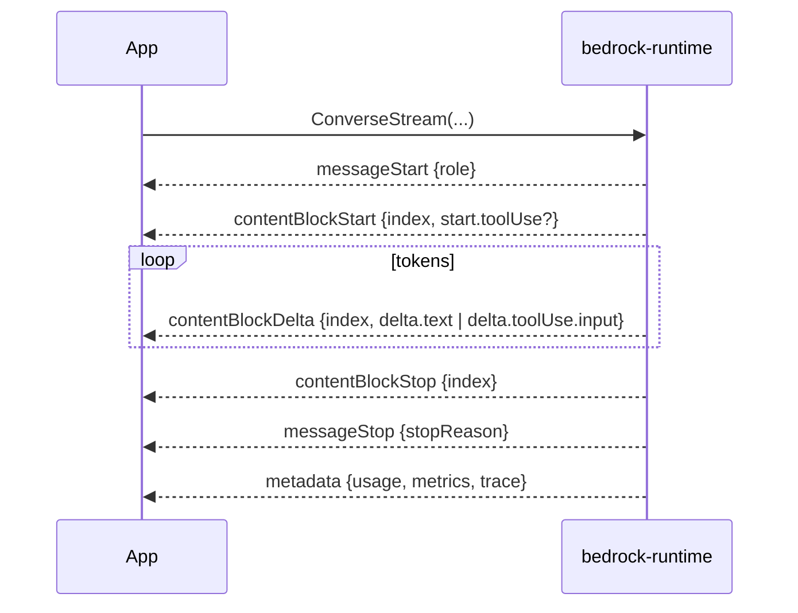
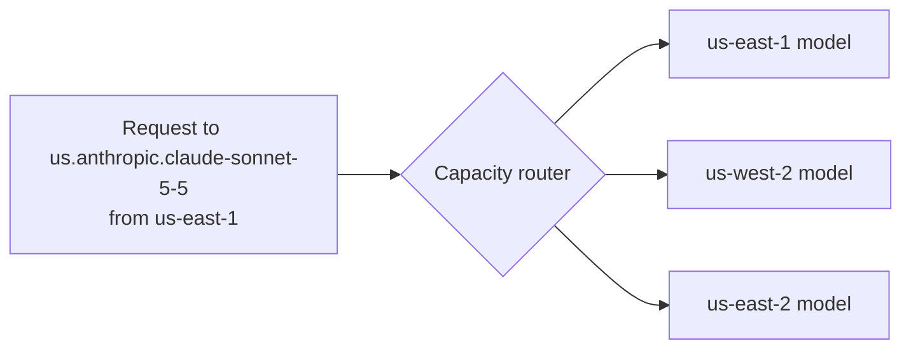
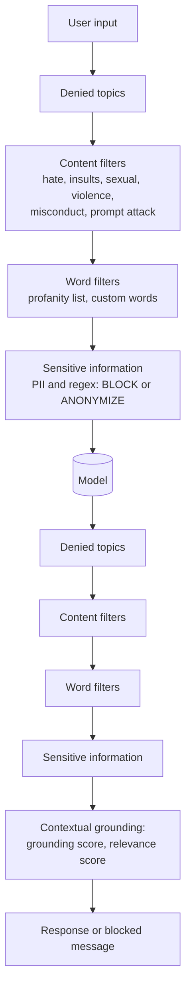
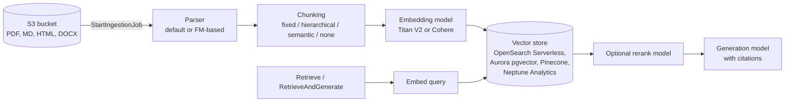
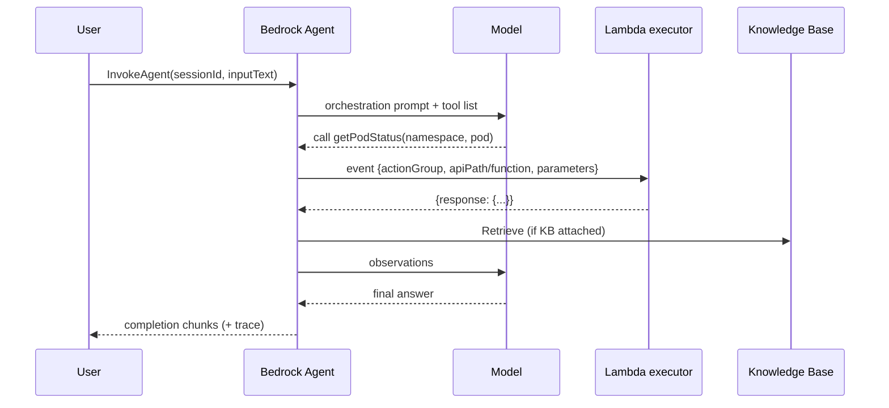

# Amazon Bedrock: Core Concepts

| | |
|---|---|
| **Cluster** | 02 Managed AI Platforms |
| **Role** | Anchor |
| **Prerequisites** | [01-installation-and-setup.md](01-installation-and-setup.md) complete; comfortable reading JSON and Python |
| **Target version** | Converse API, Knowledge Bases, Guardrails, Agents, AgentCore GA; boto3 1.35+ |
| **Capstone phase** | Phase 6 (Months 21-24) |

> This file explains how Bedrock works underneath the API: the two inference APIs and why Converse won, how streaming events are framed, how the tool-use loop is shaped, what an inference profile actually routes, the three throughput modes and their billing, how Knowledge Bases chunk and index documents, how Guardrails evaluate policies, the difference between Bedrock Agents and AgentCore, and the control-plane features (logging, evaluation, prompt management, PrivateLink, KMS, quotas) that make it production-grade.

---

## 1. Service Topology: Five Endpoints

| Endpoint (boto3 client name) | DNS | Purpose | Called by |
|---|---|---|---|
| `bedrock` | `bedrock.<REGION>.amazonaws.com` | Control plane: models, access, provisioned throughput, logging config, guardrail CRUD, evaluation jobs, custom models | Terraform, operators |
| `bedrock-runtime` | `bedrock-runtime.<REGION>.amazonaws.com` | Inference: `Converse`, `ConverseStream`, `InvokeModel`, `InvokeModelWithResponseStream`, `ApplyGuardrail`, `CountTokens` | Applications |
| `bedrock-agent` | `bedrock-agent.<REGION>.amazonaws.com` | Build-time: Knowledge Bases, data sources, ingestion jobs, Agents, action groups, prompts, flows | Terraform, operators |
| `bedrock-agent-runtime` | `bedrock-agent-runtime.<REGION>.amazonaws.com` | Run-time: `Retrieve`, `RetrieveAndGenerate`, `InvokeAgent`, `InvokeFlow`, `Rerank` | Applications |
| `bedrock-agentcore` / `bedrock-agentcore-control` | `bedrock-agentcore.<REGION>.amazonaws.com` | AgentCore Runtime, Gateway, Memory, Identity, Code Interpreter, Browser | Agent frameworks, operators |

Each endpoint has its own VPC endpoint service name, its own IAM action prefix (`bedrock:` for all of the first four, `bedrock-agentcore:` for the last), and its own service quotas. Knowing which plane a call belongs to is the first debugging step.

---

## 2. InvokeModel vs Converse

Bedrock has two inference APIs. Both are live and both are used in production; understand why there are two.

| | `InvokeModel` / `InvokeModelWithResponseStream` | `Converse` / `ConverseStream` |
|---|---|---|
| Request body | Raw JSON **in the model provider's native schema** (Anthropic Messages API, Llama prompt format, Nova schema) | One **Bedrock-defined schema** for all chat models |
| Switching models | Rewrite request and response parsing | Change `modelId` |
| Newest provider features | Available the day the model lands (e.g. Anthropic-specific betas via `anthropic_beta`) | Available after Bedrock maps them; typically weeks later, some never |
| Tool use | Provider-native (`tools` / `tool_use` for Anthropic) | `toolConfig`, `toolUse`, `toolResult` blocks |
| Images, documents | Provider-native | `image` and `document` content blocks, same for all models |
| Guardrails | Via `guardrailIdentifier` header parameters | `guardrailConfig` parameter |
| Token counts | In provider response (`usage`) | Normalised `usage` + `metrics.latencyMs` |
| Best for | Embeddings, image generation, provider-specific features, raw passthrough | Everything conversational |

Rule: **use Converse unless the feature you need is not in Converse yet.** Embedding models (Titan, Cohere Embed) and image models only exist behind `InvokeModel`.

### 2.1 The same request two ways

Anthropic native schema via `InvokeModel`:

```python
import json, boto3
rt = boto3.client("bedrock-runtime", region_name="us-east-1")

body = {
    "anthropic_version": "bedrock-2023-05-31",
    "max_tokens": 200,
    "system": "You are a terse SRE assistant.",
    "messages": [{"role": "user", "content": [{"type": "text", "text": "Define RPO."}]}],
}
resp = rt.invoke_model(
    modelId="us.anthropic.claude-sonnet-5-5",
    contentType="application/json",
    accept="application/json",
    body=json.dumps(body),
)
payload = json.loads(resp["body"].read())
print(payload["content"][0]["text"], payload["usage"])
```

Same thing via `Converse`:

```python
resp = rt.converse(
    modelId="us.anthropic.claude-sonnet-5-5",
    system=[{"text": "You are a terse SRE assistant."}],
    messages=[{"role": "user", "content": [{"text": "Define RPO."}]}],
    inferenceConfig={"maxTokens": 200},
)
print(resp["output"]["message"]["content"][0]["text"], resp["usage"])
```

Swap `modelId` to `amazon.nova-lite-v1:0` and the Converse version works unchanged; the InvokeModel version needs a different body.

> **Anthropic SDK on Bedrock.** Anthropic's own SDK ships Bedrock clients (`pip install "anthropic[bedrock]"`). `AnthropicBedrockMantle(aws_region=...)` targets Bedrock's Messages-API-compatible endpoint with first-party request shapes and `anthropic.`-prefixed IDs; the older `AnthropicBedrock` class wraps `InvokeModel`. Use it when you need Anthropic-specific features before Converse exposes them. This folder uses boto3 Converse because it is vendor-neutral and what Strands, LangChain, and the AWS CLI speak.

---

## 3. Converse Request Anatomy

```python
response = rt.converse(
    modelId="us.anthropic.claude-sonnet-5-5",          # model ID, inference profile ID, or ARN
    system=[                                           # optional, list of text blocks (+ cachePoint)
        {"text": "You are an incident assistant for the platform team."},
    ],
    messages=[                                         # alternating user/assistant turns
        {"role": "user", "content": [{"text": "Summarise this alert."}]},
    ],
    inferenceConfig={                                  # provider-neutral knobs
        "maxTokens": 1024,
        "temperature": 0.2,
        "topP": 0.9,
        "stopSequences": ["</done>"],
    },
    additionalModelRequestFields={                     # provider-specific passthrough
        # Anthropic example: {"thinking": {"type": "adaptive"}}
    },
    toolConfig={...},                                  # see section 6
    guardrailConfig={...},                             # see section 9
    performanceConfig={"latency": "optimized"},        # latency-optimised inference where supported
    requestMetadata={"tenant": "platform", "env": "dev"},  # appears in invocation logs, filterable
)
```

Response shape:

```json
{
  "output": { "message": { "role": "assistant", "content": [ { "text": "..." } ] } },
  "stopReason": "end_turn",
  "usage": { "inputTokens": 120, "outputTokens": 88, "totalTokens": 208,
             "cacheReadInputTokens": 0, "cacheWriteInputTokens": 0 },
  "metrics": { "latencyMs": 1410 },
  "trace": { "guardrail": { ... } }
}
```

`stopReason` values and what to do:

| `stopReason` | Meaning | Action |
|---|---|---|
| `end_turn` | Model finished | Return text |
| `tool_use` | Model wants you to run one or more tools | Execute, append `toolResult`, call again |
| `max_tokens` | Hit `maxTokens` | Raise limit or continue; never execute a truncated tool call |
| `stop_sequence` | Hit a `stopSequences` entry | Return text |
| `guardrail_intervened` | Guardrail blocked or masked | Inspect `trace.guardrail`; return the guardrail's canned message |
| `content_filtered` | Provider-side filter | Log; do not retry blindly |

### 3.1 Content block types

A `content` list can mix these blocks in one message:

| Block | Example | Notes |
|---|---|---|
| `text` | `{"text": "..."}` | |
| `image` | `{"image": {"format": "png", "source": {"bytes": b"..."}}}` | PNG, JPEG, GIF, WebP; up to 20 images per request; S3 source supported on some models |
| `document` | `{"document": {"format": "pdf", "name": "runbook", "source": {"bytes": b"..."}}}` | PDF, CSV, DOC(X), XLS(X), HTML, TXT, MD; up to 5 documents, 4.5 MB each; `name` must be alphanumeric with spaces/hyphens, no dots |
| `video` | `{"video": {"format": "mp4", "source": {"s3Location": {...}}}}` | Nova models |
| `toolUse` | model output requesting a tool | |
| `toolResult` | your reply to a `toolUse` | Must reference `toolUseId` |
| `cachePoint` | `{"cachePoint": {"type": "default"}}` | Prompt caching marker (section 11) |
| `reasoningContent` | model's reasoning when extended thinking is enabled | Return unchanged in later turns |
| `guardContent` | wraps text that the guardrail should evaluate | Section 9 |

Document and image example:

```python
with open("alert.png", "rb") as img, open("runbook.pdf", "rb") as pdf:
    resp = rt.converse(
        modelId="us.anthropic.claude-sonnet-5-5",
        messages=[{
            "role": "user",
            "content": [
                {"image": {"format": "png", "source": {"bytes": img.read()}}},
                {"document": {"format": "pdf", "name": "payments-runbook",
                              "source": {"bytes": pdf.read()}}},
                {"text": "Using the runbook, what is the first remediation step for the alert in the screenshot?"},
            ],
        }],
        inferenceConfig={"maxTokens": 600},
    )
```

The SDK base64-encodes `bytes` for you; do not pre-encode.

---

## 4. Multi-Turn Conversations

Bedrock is stateless. You send the whole history every turn; cost scales with history length, which is why prompt caching matters.

```python
history = []

def ask(text: str) -> str:
    history.append({"role": "user", "content": [{"text": text}]})
    resp = rt.converse(modelId=MODEL_ID, system=SYSTEM, messages=history,
                       inferenceConfig={"maxTokens": 512})
    msg = resp["output"]["message"]
    history.append(msg)          # append the assistant message verbatim, including any non-text blocks
    return "".join(b.get("text", "") for b in msg["content"])
```

Rules enforced by the API: roles must alternate starting with `user`; the final message must be `user`; every `toolUse` in an assistant turn must be answered by a `toolResult` in the next user turn.

---

## 5. Streaming with ConverseStream

`ConverseStream` returns an HTTP/1.1 chunked response in **AWS EventStream** binary framing (the same framing S3 Select uses). boto3 decodes it into a Python iterator of single-key dicts.



```python
def stream_text(messages, system=None):
    kwargs = dict(modelId=MODEL_ID, messages=messages, inferenceConfig={"maxTokens": 1024})
    if system:
        kwargs["system"] = system
    resp = rt.converse_stream(**kwargs)
    for event in resp["stream"]:
        if "contentBlockDelta" in event:
            delta = event["contentBlockDelta"]["delta"]
            if "text" in delta:
                yield delta["text"]
        elif "messageStop" in event:
            stop = event["messageStop"]["stopReason"]
        elif "metadata" in event:
            usage = event["metadata"]["usage"]
            print(f"\n[stop={stop} in={usage['inputTokens']} out={usage['outputTokens']}]")

for chunk in stream_text([{"role": "user", "content": [{"text": "Explain burn-rate alerting in 3 bullets."}]}]):
    print(chunk, end="", flush=True)
```

Tool-use arguments stream as JSON fragments in `delta.toolUse.input`; concatenate them per `contentBlockIndex` and `json.loads` after `contentBlockStop`. Errors mid-stream arrive as exception events (`throttlingException`, `modelStreamErrorException`, `validationException`) raised by the iterator; wrap the loop in `try/except botocore.exceptions.EventStreamError`.

Time-to-first-token (TTFT) is the SLI you measure on streaming endpoints (Cluster 11). Record the wall-clock between request start and the first `contentBlockDelta`.

---

## 6. Tool Use (Function Calling)

Tool use is a protocol, not a capability: the model emits a structured request, your code executes it, you return the result, the model continues. Bedrock normalises this across providers.

### 6.1 Defining tools

```python
TOOLS = {
    "tools": [
        {
            "toolSpec": {
                "name": "get_pod_status",
                "description": "Return phase, restart count and last event for a Kubernetes pod.",
                "inputSchema": {
                    "json": {
                        "type": "object",
                        "properties": {
                            "namespace": {"type": "string"},
                            "pod": {"type": "string", "description": "Exact pod name"},
                        },
                        "required": ["namespace", "pod"],
                    }
                },
            }
        },
        {
            "toolSpec": {
                "name": "query_prometheus",
                "description": "Run an instant PromQL query and return the result vector.",
                "inputSchema": {"json": {"type": "object",
                                         "properties": {"query": {"type": "string"}},
                                         "required": ["query"]}},
            }
        },
    ],
    "toolChoice": {"auto": {}},   # or {"any": {}} or {"tool": {"name": "get_pod_status"}}
}
```

`toolChoice`: `auto` lets the model decide; `any` forces at least one tool call; `tool` forces a specific tool. Not every provider supports `any`/`tool`; Converse returns `ValidationException` if the model does not. Some current Anthropic models reject forced tool choice entirely; prefer `auto` plus an explicit instruction in the system prompt.

### 6.2 The loop

```python
import json

def run_tool(name: str, args: dict) -> dict:
    if name == "get_pod_status":
        return {"phase": "CrashLoopBackOff", "restarts": 14,
                "lastEvent": "Back-off restarting failed container"}
    if name == "query_prometheus":
        return {"resultType": "vector", "result": [{"metric": {}, "value": [1730000000, "0.21"]}]}
    raise ValueError(f"unknown tool {name}")

def agent_turn(user_text: str, max_iterations: int = 8) -> str:
    messages = [{"role": "user", "content": [{"text": user_text}]}]
    for _ in range(max_iterations):
        resp = rt.converse(
            modelId=MODEL_ID,
            system=[{"text": "You are an SRE assistant. Use tools to gather facts before answering."}],
            messages=messages,
            toolConfig=TOOLS,
            inferenceConfig={"maxTokens": 1024},
        )
        msg = resp["output"]["message"]
        messages.append(msg)

        if resp["stopReason"] != "tool_use":
            return "".join(b.get("text", "") for b in msg["content"])

        # Execute every toolUse block, return all results in ONE user message.
        results = []
        for block in msg["content"]:
            if "toolUse" not in block:
                continue
            tu = block["toolUse"]
            try:
                out = run_tool(tu["name"], tu["input"])
                results.append({"toolResult": {"toolUseId": tu["toolUseId"],
                                               "content": [{"json": out}],
                                               "status": "success"}})
            except Exception as exc:  # report, do not hide, tool failures
                results.append({"toolResult": {"toolUseId": tu["toolUseId"],
                                               "content": [{"text": str(exc)}],
                                               "status": "error"}})
        messages.append({"role": "user", "content": results})
    raise RuntimeError("tool loop exceeded max_iterations")

print(agent_turn("Pod payments-api-7c9d in namespace payments is unhealthy. What is wrong?"))
```

Expected output:

```text
payments-api-7c9d is in CrashLoopBackOff with 14 restarts; the last event is "Back-off restarting failed container". The container is exiting repeatedly after start. Check `kubectl logs --previous` for the crash reason; a recent 21% error rate on the service suggests a bad config or dependency failure since the last deploy.
```

Design rules that matter in production:

- **Return all `toolResult` blocks for one assistant turn in a single user message.** Splitting them teaches the model to stop issuing parallel calls.
- **Cap iterations and tokens.** An agent loop without a ceiling is an unbounded bill (OWASP LLM08 Excessive Agency).
- **Treat tool inputs as untrusted.** Validate against the schema before executing; the model can emit anything. Never pass `tu["input"]` straight into a shell.
- **`toolResult.content` supports `json`, `text`, `image`, and `document`** so tools can return screenshots or files.

---

## 7. Inference Profiles and Cross-Region Inference

An inference profile is a routing object, not a model. Two kinds:

| Kind | ID shape | Purpose |
|---|---|---|
| **System-defined (cross-region)** | `us.anthropic.claude-sonnet-5-5`, `eu.amazon.nova-pro-v1:0`, `global.anthropic.claude-sonnet-5-5` | Bedrock routes each request to one of several regions in the geography based on capacity; higher effective quota and burst tolerance. Data stays within the geography (US, EU, APAC) except `global.`, which may route anywhere |
| **Application** | `arn:aws:bedrock:us-east-1:123456789012:application-inference-profile/abc123` | You create it (`aws bedrock create-inference-profile`) wrapping a model or system profile; lets you **tag** and therefore allocate cost per team/application, and scope IAM to it |



Implications:

- IAM must allow the profile ARN **and** the `foundation-model` ARN in every destination region (see setup file).
- CloudTrail and invocation logs are written in the **source** region.
- Latency can vary by a few tens of milliseconds between destination regions.
- Many newer models support *only* `INFERENCE_PROFILE`; the bare model ID returns `ValidationException: Invocation of model ID ... with on-demand throughput isn't supported`.

Application inference profile for cost allocation:

```bash
aws bedrock create-inference-profile \
  --inference-profile-name payments-team-sonnet \
  --model-source copyFrom=arn:aws:bedrock:us-east-1:123456789012:inference-profile/us.anthropic.claude-sonnet-5-5 \
  --tags key=CostCenter,value=payments key=Env,value=prod
```

Invoke with the returned ARN as `modelId`; Cost Explorer can now group Bedrock spend by `CostCenter`.

---

## 8. Throughput Modes: On-Demand, Provisioned, Batch

| Mode | How you pay | Latency | Quota | When |
|---|---|---|---|---|
| **On-demand** | Per input/output token (and cache tokens) | Shared pool; p99 varies with regional load | Account-level TPM/RPM per model, raised via Service Quotas | Default; dev, bursty or low-volume prod |
| **Provisioned Throughput** | Per **model unit (MU)** per hour; 1-month or 6-month commitment discounts, or no-commitment hourly for some models | Reserved capacity, predictable p99 | Your MUs define the ceiling; requests beyond are throttled | Steady high-volume prod, strict latency SLOs, custom (fine-tuned/imported) models which *require* it |
| **Batch inference** | Per token at roughly 50% of on-demand | Hours (asynchronous); results to S3 | Separate batch quotas | Evaluation runs, backfills, embedding corpora, nightly summarisation |

A **model unit** is a vendor-specific bundle of input and output tokens per minute. Sizing: measure peak tokens/minute on on-demand with invocation logs, divide by the per-MU throughput in the model's provisioned throughput page, add 20-30% headroom.

```bash
# Buy one no-commitment MU (billed hourly until deleted; tear down after labs)
aws bedrock create-provisioned-model-throughput \
  --provisioned-model-name nova-lite-pt \
  --model-id amazon.nova-lite-v1:0 \
  --model-units 1

aws bedrock list-provisioned-model-throughputs \
  --query 'provisionedModelSummaries[].{name:provisionedModelName,status:status,arn:provisionedModelArn}'
```

You then pass the `provisionedModelArn` as `modelId`. Batch:

```bash
aws bedrock create-model-invocation-job \
  --job-name nightly-summaries-$(date +%Y%m%d) \
  --model-id us.anthropic.claude-haiku-5-5 \
  --role-arn arn:aws:iam::123456789012:role/BedrockBatchRole \
  --input-data-config '{"s3InputDataConfig":{"s3Uri":"s3://<BUCKET_NAME>/batch/in/"}}' \
  --output-data-config '{"s3OutputDataConfig":{"s3Uri":"s3://<BUCKET_NAME>/batch/out/"}}'
```

Input is JSONL with one `{"recordId": "...", "modelInput": {<Converse-style or native body>}}` per line; minimum 100 records.

---

## 9. Guardrails

A Guardrail is a versioned policy bundle evaluated by Bedrock **outside the model**. It works on any Bedrock model and, through `ApplyGuardrail`, on text from anywhere (your own vLLM endpoint, a human reviewer, another cloud).



| Policy | Applies to | Mechanism | Typical config |
|---|---|---|---|
| **Denied topics** | input, output | Classifier trained from your natural-language topic definition and sample phrases | "Investment advice", "Competitor pricing" |
| **Content filters** | input, output | Fixed categories with `NONE` / `LOW` / `MEDIUM` / `HIGH` strength; `PROMPT_ATTACK` detects jailbreaks and injection on input | `HIGH` on all, `PROMPT_ATTACK` on input |
| **Word filters** | input, output | Exact/variant match on managed profanity list and up to 10,000 custom words | Internal project codenames |
| **Sensitive information** | input, output | ~30 built-in PII entity types (`EMAIL`, `PHONE`, `NAME`, `US_SOCIAL_SECURITY_NUMBER`, `CREDIT_DEBIT_CARD_NUMBER`, `AWS_ACCESS_KEY`, ...) plus custom regex; action `BLOCK` or `ANONYMIZE` | `ANONYMIZE` on output so completions read `{EMAIL}` |
| **Contextual grounding** | output | Scores the response against the `grounding_source` you supply and the user `query`; blocks if `grounding < threshold` or `relevance < threshold` | 0.75 / 0.75 for RAG answers |
| **Automated reasoning** | output | Formal-logic policy checks against rules you encode | Regulated eligibility decisions |

Applying a guardrail in Converse:

```python
resp = rt.converse(
    modelId=MODEL_ID,
    messages=[{"role": "user", "content": [
        {"guardContent": {"text": {"text": user_text, "qualifiers": ["query"]}}},
        {"guardContent": {"text": {"text": retrieved_chunks, "qualifiers": ["grounding_source"]}}},
    ]}],
    guardrailConfig={
        "guardrailIdentifier": "<GUARDRAIL_ID>",   # ID or ARN
        "guardrailVersion": "1",                   # or "DRAFT"
        "trace": "enabled",                        # returns assessment detail in response["trace"]
        "streamProcessingMode": "async",           # for ConverseStream: async (lower latency) or sync
    },
    inferenceConfig={"maxTokens": 800},
)
if resp["stopReason"] == "guardrail_intervened":
    print(resp["trace"]["guardrail"]["outputAssessments"])
```

`guardContent` qualifiers tell the guardrail which text is the user query versus the grounding source; without them the entire message is treated as input to filter, and grounding checks cannot run.

Standalone evaluation of any text:

```python
rt.apply_guardrail(
    guardrailIdentifier="<GUARDRAIL_ID>", guardrailVersion="1", source="OUTPUT",
    content=[{"text": {"text": "Contact the on-call at oncall-lead@example.com or +1-555-0100."}}],
)
# -> action: GUARDRAIL_INTERVENED, outputs[0].text:
#    "Contact the on-call at {EMAIL} or {PHONE}."
```

Guardrails are **versioned**: edit `DRAFT`, test, then `create-guardrail-version`; applications pin a numbered version so a policy edit cannot silently change production behaviour. Guardrails are billed per 1,000 text units (1 text unit = 1,000 characters) per policy type evaluated, so attach only the policies you need.

---

## 10. Knowledge Bases (Managed RAG)

A Knowledge Base (KB) is a managed ingestion + retrieval pipeline. You own the documents and the vector store; Bedrock owns the glue.



### 10.1 Data sources

S3 (most common), web crawler, Confluence, SharePoint, Salesforce, and custom (you push chunks via `IngestKnowledgeBaseDocuments`). Each data source has its own chunking configuration and metadata. Sidecar files `<doc>.metadata.json` next to each object add filterable attributes:

```json
{ "metadataAttributes": { "service": "payments", "tier": "1", "owner_team": "platform" } }
```

### 10.2 Chunking strategies

| Strategy | Config | Use when |
|---|---|---|
| `FIXED_SIZE` | `maxTokens` (default 300), `overlapPercentage` (default 20) | Homogeneous prose; simplest |
| `HIERARCHICAL` | parent `maxTokens` 1500, child 300, `overlapTokens` 60; retrieves child, returns parent | Long structured docs where context around the hit matters (runbooks) |
| `SEMANTIC` | `maxTokens`, `bufferSize`, `breakpointPercentileThreshold` 95 | Topic shifts mid-document; costs an embedding pass at ingest |
| `NONE` | one chunk per file | Pre-chunked data, short FAQs |
| Custom (Lambda transformation) | Lambda receives chunks, returns modified chunks | Table extraction, code-aware splitting |

### 10.3 Vector stores

| Store | Pros | Cons |
|---|---|---|
| **OpenSearch Serverless** (vector collection) | Default, quick-create from console, hybrid (BM25 + vector) search, metadata filtering | Minimum 2 OCUs (~hundreds of dollars/month) unless you use the newer lower-minimum setting; **the teardown item people forget** |
| **Aurora PostgreSQL pgvector** | Transactional joins with business tables, familiar ops, cheap at small scale, Aurora Serverless v2 scales to 0.5 ACU | You create the table/index and the Secrets Manager secret yourself; no BM25 hybrid via KB |
| **Pinecone / Redis Enterprise / MongoDB Atlas** | Existing investment | Third-party billing, API key in Secrets Manager |
| **Neptune Analytics** | GraphRAG: KB builds an entity graph and traverses it at query time | Newer, more expensive ingestion |
| **S3 Vectors** | Cheapest, object-store-backed vector index | Higher query latency; good for cold or very large corpora |

### 10.4 Retrieve vs RetrieveAndGenerate

```python
agent_rt = boto3.client("bedrock-agent-runtime", region_name="us-east-1")

# Retrieve: chunks only; you own prompting and generation (bring your own agent)
r = agent_rt.retrieve(
    knowledgeBaseId="<KB_ID>",
    retrievalQuery={"text": "How do I roll back a failed payments deploy?"},
    retrievalConfiguration={"vectorSearchConfiguration": {
        "numberOfResults": 5,
        "overrideSearchType": "HYBRID",
        "filter": {"equals": {"key": "service", "value": "payments"}},
        "rerankingConfiguration": {"type": "BEDROCK_RERANKING_MODEL",
            "bedrockRerankingConfiguration": {"modelConfiguration": {
                "modelArn": "arn:aws:bedrock:us-east-1::foundation-model/amazon.rerank-v1:0"}}},
    }},
)
for res in r["retrievalResults"]:
    print(round(res["score"], 3), res["location"]["s3Location"]["uri"], res["content"]["text"][:80])

# RetrieveAndGenerate: retrieval + generation + citations in one call, optional session memory
rag = agent_rt.retrieve_and_generate(
    input={"text": "How do I roll back a failed payments deploy?"},
    retrieveAndGenerateConfiguration={
        "type": "KNOWLEDGE_BASE",
        "knowledgeBaseConfiguration": {
            "knowledgeBaseId": "<KB_ID>",
            "modelArn": "arn:aws:bedrock:us-east-1:123456789012:inference-profile/us.anthropic.claude-sonnet-5-5",
            "generationConfiguration": {
                "guardrailConfiguration": {"guardrailId": "<GUARDRAIL_ID>", "guardrailVersion": "1"},
                "inferenceConfig": {"textInferenceConfig": {"maxTokens": 600, "temperature": 0}},
            },
            "retrievalConfiguration": {"vectorSearchConfiguration": {"numberOfResults": 5}},
        },
    },
)
print(rag["output"]["text"])
for c in rag["citations"]:
    for ref in c["retrievedReferences"]:
        print("source:", ref["location"]["s3Location"]["uri"])
```

Use `Retrieve` when a Strands/LangGraph agent owns the loop (Cluster 03); use `RetrieveAndGenerate` for simple Q&A endpoints and when you want Bedrock to manage `sessionId` conversation memory.

---

## 11. Prompt Caching

Converse supports explicit cache checkpoints for models that implement caching (Anthropic Claude, Amazon Nova). A `cachePoint` block tells Bedrock to cache everything before it; later requests with an identical prefix pay the discounted cache-read rate and skip re-processing.

```python
resp = rt.converse(
    modelId=MODEL_ID,
    system=[
        {"text": LONG_STABLE_SYSTEM_PROMPT},          # thousands of tokens of policy and runbook index
        {"cachePoint": {"type": "default"}},
    ],
    messages=[{"role": "user", "content": [{"text": "Question that changes every call"}]}],
    inferenceConfig={"maxTokens": 400},
)
print(resp["usage"]["cacheReadInputTokens"], resp["usage"]["cacheWriteInputTokens"])
```

Rules: the prefix must be byte-identical (no timestamps before the checkpoint), the cached prefix must exceed the model's minimum (about 1,024 tokens for Sonnet-class, higher for Haiku-class), caches live roughly five minutes and are refreshed on hit, up to four checkpoints per request. Tool definitions (`toolConfig`) are part of the prefix and cacheable. If `cacheReadInputTokens` stays zero on repeated calls, something before the checkpoint is changing.

---

## 12. Bedrock Agents vs AgentCore

| | **Bedrock Agents** | **Amazon Bedrock AgentCore** |
|---|---|---|
| What it is | Fully managed, opinionated agent: you give it a model, instructions, action groups, knowledge bases; Bedrock runs the ReAct loop | Framework-agnostic building blocks for running *your* agent code (Strands, LangGraph, CrewAI, custom) at scale |
| Orchestration | Bedrock's prompt templates (pre-processing, orchestration, KB response generation, post-processing); you can override templates | Your code |
| Tools | **Action groups**: OpenAPI 3 schema or function-detail schema + **Lambda executor** (or `RETURN_CONTROL` to your app) | **Gateway** turns Lambda, OpenAPI, Smithy APIs into MCP tools with auth; agent code calls them |
| Memory | Session memory (`memoryId`, summaries across sessions) | **Memory**: short-term events + long-term extracted strategies (semantic, summary, user preference) |
| Runtime | Serverless, invoked via `InvokeAgent` | **Runtime**: serverless microVM per session, 8-hour max, HTTP or MCP protocol contracts, container image you build |
| Identity | Agent IAM role | **Identity**: workload identities, OAuth2 token vault for outbound calls (GitHub, Slack), inbound JWT/Cognito auth |
| Observability | Trace in `InvokeAgent` response | **Observability**: OpenTelemetry spans to CloudWatch GenAI Observability |
| Extras | Prompt flows integration, multi-agent collaboration (supervisor + collaborators) | **Code Interpreter**, **Browser** sandboxes as tools |
| Choose when | You want zero agent code and accept Bedrock's orchestration | You already have (or want) a framework-based agent and need enterprise hosting |

### 12.1 Bedrock Agents action group anatomy



The Lambda receives:

```json
{
  "messageVersion": "1.0",
  "agent": {"name": "sre-agent", "id": "ABC123", "alias": "TSTALIASID", "version": "DRAFT"},
  "actionGroup": "k8s-tools",
  "function": "getPodStatus",
  "parameters": [{"name": "namespace", "type": "string", "value": "payments"},
                 {"name": "pod", "type": "string", "value": "payments-api-7c9d"}],
  "sessionAttributes": {}, "promptSessionAttributes": {}
}
```

and must return:

```json
{
  "messageVersion": "1.0",
  "response": {
    "actionGroup": "k8s-tools",
    "function": "getPodStatus",
    "functionResponse": {"responseBody": {"TEXT": {"body": "{\"phase\":\"CrashLoopBackOff\",\"restarts\":14}"}}}
  }
}
```

The Lambda's resource policy must allow `bedrock.amazonaws.com` to invoke it with `aws:SourceArn` = the agent ARN. The agent's IAM role needs `bedrock:InvokeModel` on the model, `bedrock:Retrieve` on the KB, and `lambda:InvokeFunction` is **not** needed on the agent role (Bedrock uses the Lambda resource policy).

### 12.2 AgentCore Runtime contract

Your container exposes `POST /invocations` (JSON in, JSON or SSE out) and `GET /ping` on port 8080, built for `linux/arm64`. The starter toolkit (`agentcore configure`, `agentcore launch`) generates the Dockerfile, pushes to ECR, and creates the runtime. Each session gets an isolated microVM keyed by `runtimeSessionId`; memory is attached via the Memory service, tools via Gateway. Lab 7 builds one.

---

## 13. Model Evaluation, Prompt Management, Flows

- **Model evaluation jobs** (`aws bedrock create-evaluation-job`): automatic evaluation (accuracy, robustness, toxicity on built-in or your JSONL datasets), LLM-as-a-judge with a judge model and metrics (correctness, completeness, faithfulness, harmfulness), human evaluation with a work team, and **RAG evaluation** of a Knowledge Base (context relevance, context coverage, correctness, faithfulness). Output lands in S3 as JSONL plus a summary. Wire into CI alongside DeepEval (Cluster 10) for release gates.
- **Prompt management** (`bedrock-agent create-prompt`, `create-prompt-version`): store prompt templates with variables, model, and inference config as versioned resources with ARNs; invoke a prompt ARN directly via `Converse(modelId=<prompt ARN>)` so prompt changes deploy like code, with rollbacks.
- **Flows** (`create-flow`): a visual/JSON DAG of nodes (prompt, KB, Lambda, condition, iterator, collector, agent) invoked via `InvokeFlow`. Useful for deterministic multi-step pipelines without an agent loop; LangGraph (Cluster 03) is the code-first alternative.

---

## 14. Logging, Audit, and Observability

| Signal | Where | Contains |
|---|---|---|
| **CloudTrail management events** | CloudTrail | Every control-plane call (`CreateGuardrail`, `PutModelInvocationLoggingConfiguration`) |
| **CloudTrail data events** | CloudTrail (opt-in, cost) | `InvokeModel`/`Converse` *calls* with identity, model, time; **not** prompts |
| **Model invocation logging** | CloudWatch Logs and/or S3 (you choose), optional KMS | Full request and response bodies (text; images/embeddings optional to S3), token counts, `requestMetadata`, caller ARN, inference profile and resolved region |
| **CloudWatch metrics** (`AWS/Bedrock`) | CloudWatch | `Invocations`, `InvocationLatency`, `InvocationClientErrors`, `InvocationServerErrors`, `InvocationThrottles`, `InputTokenCount`, `OutputTokenCount`, `LegacyModelInvocations`, dimensions `ModelId` and for provisioned `ProvisionedModelArn`; Guardrails namespace with `InvocationsIntervened` |
| **AgentCore Observability** | CloudWatch GenAI Observability, X-Ray | OTel spans per agent step, tool call, model call |

Invocation logs contain prompts and completions, which is **sensitive data**. Encrypt the log group or bucket with a CMK, restrict read access, set retention, and consider logging to S3 with Object Lock for regulated audit. `requestMetadata` is your hook for tenant/user/trace IDs; keep PII out of it.

---

## 15. Private Networking and Encryption

**PrivateLink.** Interface VPC endpoints exist for `com.amazonaws.<REGION>.bedrock`, `.bedrock-runtime`, `.bedrock-agent`, `.bedrock-agent-runtime`, and `.bedrock-agentcore`. With private DNS enabled, `bedrock-runtime.<REGION>.amazonaws.com` resolves to ENI private IPs inside your VPC, so unchanged SDK code becomes private. An **endpoint policy** restricts which principals and which model ARNs may traverse the endpoint; combined with `aws:SourceVpce` conditions in IAM you get "this role may only call Bedrock from inside this VPC".

Cross-region inference profiles work through a PrivateLink endpoint in the source region; the hop to the destination region is on the AWS backbone, not the internet.

**KMS.** Customer-managed keys can encrypt: invocation logs (CloudWatch log group / S3 bucket), Knowledge Base vector stores (OpenSearch Serverless encryption policy, Aurora cluster), Knowledge Base transient data, agent configuration and session memory, guardrail definitions, custom model artefacts, batch job inputs/outputs, and AgentCore Memory. In-flight data is TLS 1.2+ always; Bedrock does not persist prompts or completions after the request unless you turned on logging or are using a stateful feature (agent memory, RAG sessions).

**Data use.** Bedrock does not use your prompts or completions to train base models and does not share them with model providers. Fine-tuning produces a private copy of the model in your account's control.

---

## 16. Quotas, Throttling, and Cost Model

Service Quotas for Bedrock are per account, per region, per model: *on-demand requests per minute*, *on-demand tokens per minute*, plus per-API quotas (`Converse` RPM, KB `Retrieve` RPS, Agents `InvokeAgent` RPS). Many are adjustable via Service Quotas; some are not. Cross-region profiles roughly multiply your effective burst capacity by the number of destination regions.

Throttling surfaces as `ThrottlingException` (HTTP 429) with messages such as `Too many requests, please wait before trying again` or `Too many tokens per minute`. The remedy is exponential backoff with jitter (botocore `standard` or `adaptive` retry modes do this), a client-side token bucket, a work queue, cross-region profiles, or provisioned throughput. `ServiceUnavailableException` (503) and `ModelNotReadyException` are also retryable; `ValidationException` and `AccessDeniedException` are not.

Cost dimensions you will see on the bill:

| Line item | Driver | Lever |
|---|---|---|
| On-demand input tokens | Prompt length x calls | Prompt caching, shorter system prompts, retrieval filtering, cheaper model for routing |
| On-demand output tokens (3-5x input price) | Completion length | `maxTokens`, terse instructions, structured output |
| Cache write / cache read tokens | Caching usage | Stable prefixes; reads are ~10% of input price |
| Provisioned model units | Hours x MUs | Right-size, commit, delete idle |
| Batch tokens | ~50% of on-demand | Move offline work to batch |
| Guardrails text units | Characters x policies | Attach only needed policies; grounding checks are priced separately |
| Knowledge Base | Embedding tokens at ingest + vector store (OCU hours / ACU hours) + rerank calls | Incremental sync, S3 Vectors or Aurora Serverless for small corpora |
| Agents / AgentCore | Model tokens + AgentCore Runtime CPU/memory seconds, Memory events, Gateway calls | Session limits, memory TTL |
| Model evaluation | Judge model tokens | Sample, do not evaluate every record |

Model routing (Haiku-class for classification and extraction, Sonnet-class for reasoning, Opus-class only when measurably better) and caching are the two levers that routinely cut 40-70% of spend, as the roadmap's FinOps section states. Bedrock pricing for Anthropic models is set by AWS and differs from Anthropic's first-party rates; check the Bedrock pricing page rather than Anthropic's.

---

## 17. Concept Summary

| Term | One-line definition |
|---|---|
| Foundation model (FM) | A pretrained model exposed by Bedrock with an ARN `arn:aws:bedrock:<REGION>::foundation-model/<ID>` |
| Inference profile | Routing object (cross-region system-defined, or application-defined for tagging) used in place of a model ID |
| Converse API | Vendor-neutral chat API: `system`, `messages`, `toolConfig`, `inferenceConfig`, `guardrailConfig` |
| InvokeModel | Raw passthrough to the provider's native request schema |
| Model unit | Reserved throughput capacity unit for Provisioned Throughput |
| Knowledge Base | Managed RAG: data sources, chunking, embeddings, vector store, `Retrieve`/`RetrieveAndGenerate` |
| Guardrail | Versioned, model-agnostic policy bundle: topics, content, words, PII, grounding, automated reasoning |
| Action group | A Bedrock Agent's tool set: OpenAPI/function schema + Lambda executor or return-control |
| AgentCore | Runtime, Gateway, Memory, Identity, Observability, Code Interpreter, Browser for framework-agnostic agents |
| Invocation logging | Opt-in capture of full prompts/completions to CloudWatch Logs/S3 |
| `requestMetadata` | Free-form key/value tags on a Converse call that land in invocation logs |
| `cachePoint` | Prompt-caching checkpoint content block |

Next: [03-commands-and-cheatsheet.md](03-commands-and-cheatsheet.md).
