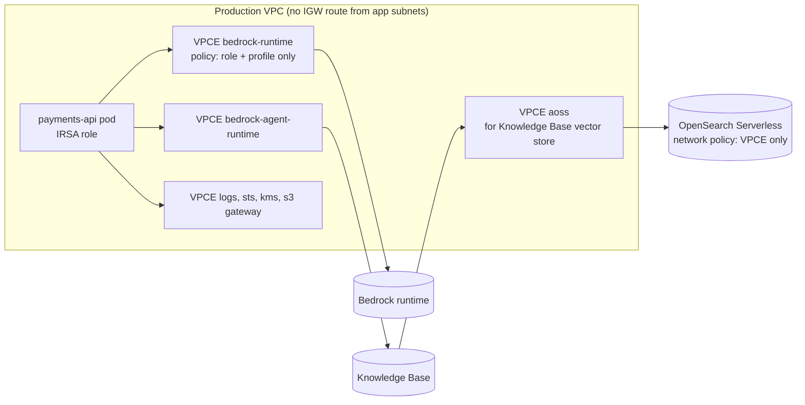
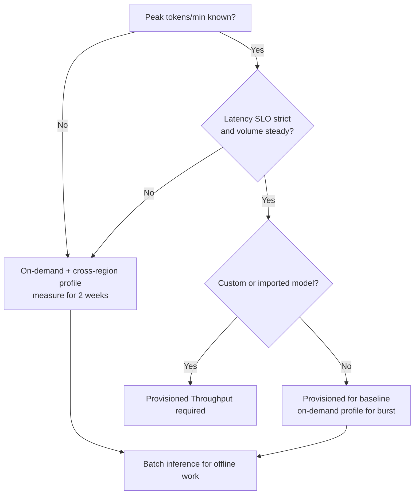
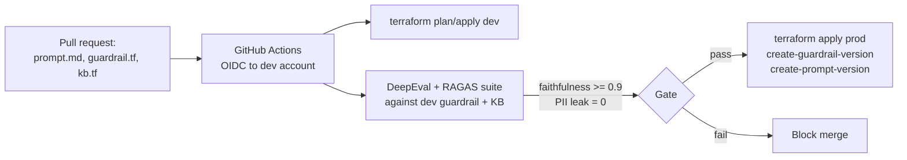

# Amazon Bedrock: Production Patterns

| | |
|---|---|
| **Cluster** | 02 Managed AI Platforms |
| **Role** | Anchor |
| **Prerequisites** | Labs 1-8 in [04-hands-on-labs.md](04-hands-on-labs.md); Terraform fundamentals (Cluster 05); GitHub Actions OIDC (Cluster 06) |
| **Target version** | Terraform 1.9+ with `hashicorp/aws` 5.x, boto3 1.35+ |
| **Capstone phase** | Phase 6 (Months 21-24) |

> This file is the checklist a principal engineer applies before a Bedrock-backed service takes production traffic: identity and network hardening, encryption, logging and audit, throughput planning, resilience to throttling and regional failure, cost controls, CI/CD and GitOps for prompts and guardrails, multi-tenant isolation, and the anti-patterns that cause incidents.

---

## 1. Identity: Least Privilege, No Keys

### 1.1 Principals

| Workload | Identity | Notes |
|---|---|---|
| EKS pod | IRSA or EKS Pod Identity role | One role per service; never a node role with Bedrock permissions |
| Lambda | Execution role | Scope to the exact profile ARN |
| GitHub Actions (evals, deploys) | OIDC federated role with `repo:` and `ref:` subject conditions | Separate roles for `plan` (read) and `apply` |
| Developers | IAM Identity Center permission set | Deny `bedrock:Invoke*` in prod accounts; use dev accounts |
| Bedrock service roles (KB, Agents, logging, batch) | Service role with `aws:SourceAccount` + `aws:SourceArn` conditions | Prevents confused-deputy |

### 1.2 Application policy template

```json
{
  "Version": "2012-10-17",
  "Statement": [
    {
      "Sid": "InvokeOnlyApprovedProfile",
      "Effect": "Allow",
      "Action": ["bedrock:InvokeModel", "bedrock:InvokeModelWithResponseStream"],
      "Resource": [
        "arn:aws:bedrock:us-east-1:123456789012:application-inference-profile/<PROFILE_ID>",
        "arn:aws:bedrock:us-east-1:123456789012:inference-profile/us.anthropic.claude-sonnet-5-5",
        "arn:aws:bedrock:us-*::foundation-model/anthropic.claude-sonnet-5-5"
      ],
      "Condition": {
        "StringEquals": { "aws:SourceVpce": "<VPCE_ID>" }
      }
    },
    {
      "Sid": "GuardrailMustBeApplied",
      "Effect": "Deny",
      "Action": ["bedrock:InvokeModel", "bedrock:InvokeModelWithResponseStream"],
      "Resource": "*",
      "Condition": {
        "StringNotEquals": { "bedrock:GuardrailIdentifier": "arn:aws:bedrock:us-east-1:123456789012:guardrail/<GUARDRAIL_ID>" }
      }
    },
    {
      "Sid": "ApplyGuardrail",
      "Effect": "Allow",
      "Action": "bedrock:ApplyGuardrail",
      "Resource": "arn:aws:bedrock:us-east-1:123456789012:guardrail/<GUARDRAIL_ID>"
    },
    {
      "Sid": "RetrieveFromOwnKB",
      "Effect": "Allow",
      "Action": ["bedrock:Retrieve", "bedrock:RetrieveAndGenerate"],
      "Resource": "arn:aws:bedrock:us-east-1:123456789012:knowledge-base/<KB_ID>"
    }
  ]
}
```

The `bedrock:GuardrailIdentifier` condition key is the enforcement mechanism for "every call goes through the guardrail": a developer who omits `guardrailConfig` gets `AccessDeniedException`, not a silent bypass. The deny must name the guardrail ARN (not ID) and you can list several with `ForAnyValue:StringNotEquals`... use `StringNotEquals` with an array to allow any of several approved guardrails.

### 1.3 Organisation guardrails (SCPs)

```json
{
  "Version": "2012-10-17",
  "Statement": [
    {
      "Sid": "DenyUnapprovedModelProviders",
      "Effect": "Deny",
      "Action": "bedrock:InvokeModel*",
      "Resource": "arn:aws:bedrock:*::foundation-model/*",
      "Condition": { "ForAnyValue:StringNotLike": { "bedrock:ModelProvider": ["Anthropic", "Amazon"] } }
    },
    {
      "Sid": "DenyDisablingInvocationLogging",
      "Effect": "Deny",
      "Action": "bedrock:DeleteModelInvocationLoggingConfiguration",
      "Resource": "*",
      "Condition": { "ArnNotLike": { "aws:PrincipalArn": "arn:aws:iam::*:role/PlatformBreakGlass" } }
    },
    {
      "Sid": "DenyNonApprovedRegions",
      "Effect": "Deny",
      "Action": "bedrock:*",
      "Resource": "*",
      "Condition": { "StringNotEquals": { "aws:RequestedRegion": ["us-east-1", "us-west-2"] } }
    }
  ]
}
```

Note that a `us.` cross-region profile may route to `us-east-2`; the region SCP evaluates the *request* region, so the profile still works, but add every destination region to the `foundation-model` resource list in identity policies.

---

## 2. Network: Private by Default



Checklist:

- Interface endpoints for `bedrock-runtime` and `bedrock-agent-runtime` in every AZ the app runs in, private DNS on, security group allowing 443 from app subnets only.
- Endpoint policy restricting principals and resources (Lab 8). Endpoint policies and IAM policies are evaluated together; both must allow.
- `aws:SourceVpce` (or `aws:SourceVpc`) condition on application roles so credentials exfiltrated from a pod are useless off-VPC.
- OpenSearch Serverless network policy set to the `aoss` VPC endpoint, not `AllowFromPublic`. Aurora in private subnets; Bedrock reaches it via the RDS Data API.
- Knowledge Base S3 bucket policy with `aws:SourceVpce` for app reads and the KB role for Bedrock reads; block public access.
- No NAT route needed for Bedrock when endpoints exist; remove it from app subnets to make egress to public LLM endpoints impossible by construction.

Terraform for the runtime endpoint:

```hcl
resource "aws_vpc_endpoint" "bedrock_runtime" {
  vpc_id              = module.vpc.vpc_id
  service_name        = "com.amazonaws.${var.region}.bedrock-runtime"
  vpc_endpoint_type   = "Interface"
  subnet_ids          = module.vpc.private_subnets
  security_group_ids  = [aws_security_group.bedrock_vpce.id]
  private_dns_enabled = true
  policy              = data.aws_iam_policy_document.bedrock_vpce.json
  tags                = { Name = "bedrock-runtime", CostCenter = var.cost_center }
}
```

---

## 3. Encryption and Data Handling

| Data | At rest | Key | Retention |
|---|---|---|---|
| Prompts/completions in flight | TLS 1.2+ | AWS | Not stored by Bedrock |
| Invocation logs (CloudWatch) | CMK via `associate-kms-key` | Your key | 30-90 days; longer to S3 with Object Lock |
| Invocation logs (S3) | SSE-KMS bucket default | Your key | Lifecycle to Glacier after 90 days |
| KB vector store | OpenSearch Serverless encryption policy with `KmsARN` / Aurora storage encryption | Your key | Life of corpus |
| KB transient/intermediate | `--storage-configuration` plus KB `kmsKeyArn` | Your key | Ingestion only |
| Agent config + session memory | `customerEncryptionKeyArn` on agent | Your key | `idleSessionTTL`, memory retention days |
| Guardrails definition | `kmsKeyId` on create-guardrail | Your key | |
| Batch I/O | SSE-KMS buckets | Your key | Delete after processing |
| AgentCore Memory | KMS on memory resource | Your key | `eventExpiryDuration` |

Data-minimisation rules:

1. Redact PII **before** it reaches the model when you can (guardrail on `INPUT` with `ANONYMIZE`), not only on output.
2. Keep `requestMetadata` free of PII; it is indexed in logs.
3. Disable `imageDataDeliveryEnabled` in invocation logging unless you need it; images can contain faces and documents.
4. For regulated workloads route through a **geo-scoped** profile (`us.`/`eu.`), never `global.`.

---

## 4. Throughput Planning and Resilience

### 4.1 Decision model



### 4.2 Client resilience

- botocore `retries={"mode": "adaptive", "max_attempts": 8}` gives exponential backoff with jitter and a client-side rate limiter.
- Set `read_timeout` to the longest plausible generation (streaming: 300 s; non-streaming: tune to `maxTokens`).
- Add an **application-level token bucket** sized to your TPM quota so a traffic spike queues instead of 429-storming.
- Use **streaming** for anything user-facing; it protects against gateway idle timeouts and gives TTFT metrics.
- On `ThrottlingException` persisting past N seconds, **fail over to a second profile or model** (e.g. Haiku-class) with a circuit breaker; log the downgrade.
- Set `maxTokens` deliberately; a runaway generation is the most common source of both latency and cost outliers.

```python
from botocore.config import Config
import boto3

PRIMARY = "us.anthropic.claude-sonnet-5-5"
FALLBACK = "us.anthropic.claude-haiku-5-5"
rt = boto3.client("bedrock-runtime", config=Config(retries={"mode": "adaptive", "max_attempts": 6}, read_timeout=300))

def converse_resilient(**kwargs):
    for model in (PRIMARY, FALLBACK):
        try:
            return rt.converse(modelId=model, **kwargs)
        except rt.exceptions.ThrottlingException:
            metrics.increment("bedrock.throttled", tags={"model": model})
            continue
        except rt.exceptions.ServiceUnavailableException:
            metrics.increment("bedrock.unavailable", tags={"model": model})
            continue
    raise RuntimeError("all models throttled")
```

### 4.3 Multi-region

Bedrock itself is regional; `us.` profiles already span regions for the *model* call. For a full regional failure of your source region, run the application in two regions with their own endpoints, logs, and guardrail copies (guardrails are regional resources; create them from the same Terraform in both regions). Knowledge Bases are regional: replicate S3 with CRR and run a second KB, or accept degraded (no-RAG) mode in DR.

---

## 5. Observability and SLOs

| SLI | Source | Example SLO |
|---|---|---|
| Availability (non-5xx, non-throttled) | App metrics + `InvocationServerErrors`, `InvocationThrottles` | 99.9% |
| TTFT p95 (streaming) | App timer at first `contentBlockDelta` | < 800 ms |
| End-to-end latency p99 | `InvocationLatency` or app | < 8 s for 1k-token answers |
| Guardrail intervention rate | `AWS/Bedrock/Guardrails InvocationsIntervened` | Alert on step change (attack or regression) |
| Grounded answer rate | Guardrail grounding scores from `trace`, DeepEval faithfulness | > 95% |
| Cost per request | Invocation logs: tokens x price | Budget alarm |

Ship invocation logs from CloudWatch to Loki via a subscription filter and Lambda or Firehose (Cluster 09), and emit OpenTelemetry spans around each Converse call with attributes `gen_ai.system=aws.bedrock`, `gen_ai.request.model`, `gen_ai.usage.input_tokens`, `gen_ai.usage.output_tokens` following the OTel GenAI semantic conventions. Strands and AgentCore emit these natively.

Alert examples (PromQL on exported metrics):

```promql
# Throttle ratio above 2% for 10 minutes
sum(rate(bedrock_invocation_throttles_total[10m])) / sum(rate(bedrock_invocations_total[10m])) > 0.02

# Guardrail interventions doubled vs last week
sum(rate(bedrock_guardrail_interventions_total[1h])) > 2 * sum(rate(bedrock_guardrail_interventions_total[1h] offset 7d))
```

---

## 6. Cost Controls

1. **Application inference profiles per team**, tagged `CostCenter`; activate the cost allocation tag; monthly AWS Budgets alarm per tag.
2. **Model routing**: a Haiku-class call classifies intent/complexity, then routes to Sonnet-class only when needed. Measured savings are typically 40-70%.
3. **Prompt caching** on every stable system prompt and tool schema; verify `cacheReadInputTokens > 0` in logs.
4. **`maxTokens` caps** per endpoint; structured outputs instead of prose where a machine consumes the result.
5. **Batch inference** for anything not interactive (nightly summaries, embeddings backfills, evaluation).
6. **Retrieval hygiene**: fewer, better chunks (`numberOfResults` 3-5 with reranking) beats stuffing 20 chunks.
7. **Provisioned throughput right-sizing**: compare `InvocationThrottles` against MU utilisation monthly; delete idle MUs.
8. **Knowledge Base store selection**: Aurora Serverless v2 or S3 Vectors for small corpora; OpenSearch Serverless minimum OCUs are the single largest fixed cost in most small deployments.
9. **Guardrail scoping**: attach only the policy types you need; grounding checks cost extra per text unit.
10. **Session TTLs** on agents and AgentCore memory expiry to stop paying for forgotten state.

Logs Insights query for daily cost estimation (prices as variables):

```text
fields modelId, input.inputTokenCount as in_tok, output.outputTokenCount as out_tok, input.cacheReadInputTokenCount as cache_tok
| filter modelId like /claude-sonnet/
| stats sum(in_tok) as in_total, sum(out_tok) as out_total, sum(cache_tok) as cache_total by bin(1d)
```

---

## 7. CI/CD and GitOps for Prompts, Guardrails, and Agents

Treat prompts, guardrails, knowledge-base configs, and agent definitions as **code**:



Terraform resources you will use: `aws_bedrock_guardrail`, `aws_bedrock_guardrail_version`, `aws_bedrockagent_knowledge_base`, `aws_bedrockagent_data_source`, `aws_bedrockagent_agent`, `aws_bedrockagent_agent_action_group`, `aws_bedrockagent_agent_alias`, `aws_bedrock_inference_profile`, `aws_bedrock_model_invocation_logging_configuration`, `aws_bedrock_provisioned_model_throughput`, `aws_opensearchserverless_collection`, `aws_vpc_endpoint`.

```hcl
resource "aws_bedrock_guardrail" "sre" {
  name                      = "sre-assistant"
  blocked_input_messaging   = "I can't help with that request."
  blocked_outputs_messaging = "The response was withheld by policy."
  kms_key_arn               = aws_kms_key.bedrock.arn

  content_policy_config {
    filters_config { type = "PROMPT_ATTACK" input_strength = "HIGH" output_strength = "NONE" }
    filters_config { type = "HATE"          input_strength = "HIGH" output_strength = "HIGH" }
  }
  sensitive_information_policy_config {
    pii_entities_config { type = "EMAIL" action = "ANONYMIZE" }
    pii_entities_config { type = "PHONE" action = "ANONYMIZE" }
    pii_entities_config { type = "AWS_ACCESS_KEY" action = "BLOCK" }
  }
  contextual_grounding_policy_config {
    filters_config { type = "GROUNDING" threshold = 0.75 }
    filters_config { type = "RELEVANCE" threshold = 0.75 }
  }
}

resource "aws_bedrock_guardrail_version" "sre" {
  guardrail_arn = aws_bedrock_guardrail.sre.guardrail_arn
  description   = "release ${var.git_sha}"
}
```

Release rules:

- Applications read the guardrail version and prompt version from configuration (SSM Parameter Store), not from code, so rollback is a parameter change.
- Every PR that changes a prompt, guardrail, or chunking config runs the eval suite; faithfulness, answer relevancy, and a PII-leak probe set (synthetic emails/phones) gate the merge.
- Knowledge Base ingestion runs on a schedule (EventBridge -> Lambda -> `StartIngestionJob`) and on S3 `ObjectCreated` events, with a CloudWatch alarm on `numberOfDocumentsFailed > 0`.
- Agents: `prepare-agent` and alias update happen in the pipeline; aliases are the deployable unit; keep a `previous` alias for instant rollback.

---

## 8. Multi-Tenant Isolation

| Concern | Pattern |
|---|---|
| Cost attribution | One application inference profile per tenant or team |
| Data isolation in RAG | Metadata attribute `tenant_id` on every chunk and a mandatory filter in `Retrieve`; for hard isolation, one KB per tenant |
| Prompt-injection blast radius | Tool execution with tenant-scoped credentials fetched per request (AgentCore Identity or STS session tags), never a shared god-role |
| Quotas | Client-side per-tenant token buckets; Bedrock quotas are per account, so one noisy tenant can starve others unless you shape traffic |
| Logging | `requestMetadata.tenant_id` on every call; Logs Insights per-tenant dashboards |
| Separate accounts | For regulated tenants, separate AWS accounts with their own quotas, keys, and logs is simpler than in-account isolation |

---

## 9. Anti-Patterns

| Anti-pattern | Why it hurts | Do instead |
|---|---|---|
| Hard-coding a dated model ID from a blog | IDs rotate; `ValidationException` or silent old model | Config parameter + `list-foundation-models` in CI |
| Calling bare model ID when only `INFERENCE_PROFILE` is supported | `ValidationException` | Use `us.`/`eu.` profile |
| IAM allows profile ARN only | Intermittent `AccessDeniedException` when routed to another region | Also allow `foundation-model` ARNs in all destination regions |
| Guardrail optional in code | One forgotten parameter leaks PII | IAM deny with `bedrock:GuardrailIdentifier` |
| Timestamps/UUIDs before `cachePoint` | Zero cache hits, full price | Volatile content after the checkpoint |
| Unbounded agent loops | Runaway cost, excessive agency | Iteration and token caps, tool allow-lists |
| Executing tool input without validation | Injection to shell/SQL | Schema validation, parameterised execution |
| OpenSearch Serverless with `AllowFromPublic` | Vector store exposed | VPC endpoint network policy |
| Logging disabled "for privacy" | No audit trail; incidents unreproducible | Log with CMK, retention, and restricted read access |
| Retrying `ValidationException` | Wastes quota, never succeeds | Retry only throttling/5xx |
| Non-streaming for chat UIs | Gateway timeouts, poor UX | `ConverseStream` |
| Everything on the largest model | 5-10x cost for no measured gain | Route by task; evaluate |
| Forgetting provisioned MUs / OCUs after a lab | Hundreds of dollars/month | Nightly teardown workflow (roadmap rule 4) |

---

## 10. Pre-Production Decision Checklist

- [ ] Model IDs resolved from configuration; `list-inference-profiles` run in CI to validate
- [ ] IAM: application role allows exactly the approved profile(s) + destination `foundation-model` ARNs; `aws:SourceVpce` condition; guardrail-required deny
- [ ] SCPs restrict providers and regions; logging configuration deletion denied
- [ ] VPC endpoints for `bedrock-runtime` (+ `bedrock-agent-runtime`, `aoss`) with endpoint policies; no NAT route from app subnets
- [ ] Invocation logging to CloudWatch (CMK) and S3 (SSE-KMS, lifecycle); `requestMetadata` carries tenant/trace IDs
- [ ] Guardrail versioned; version pinned via SSM parameter; eval suite gates changes
- [ ] Knowledge Base: encryption with CMK, private vector store, metadata filters for tenancy, ingestion alarms
- [ ] Throughput: quota measured; cross-region profile or provisioned capacity sized; fallback model + circuit breaker; client token bucket
- [ ] Streaming for interactive paths; `maxTokens` caps everywhere
- [ ] Metrics: TTFT, latency p99, throttle ratio, guardrail intervention rate, tokens per request; SLO and burn-rate alerts (Cluster 11)
- [ ] Cost: application inference profiles tagged; Budgets alarm; caching verified; routing in place
- [ ] Teardown automation for non-prod resources; ADR written

Next: [06-troubleshooting.md](06-troubleshooting.md).
