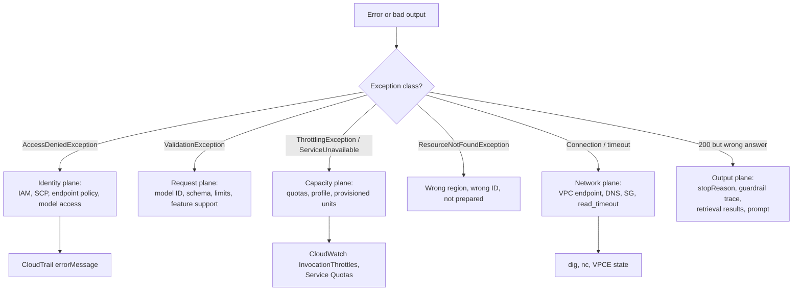

# Amazon Bedrock: Troubleshooting

| | |
|---|---|
| **Cluster** | 02 Managed AI Platforms |
| **Role** | Anchor |
| **Prerequisites** | [02-core-concepts.md](02-core-concepts.md); access to CloudTrail and CloudWatch Logs for the account |
| **Target version** | boto3 1.35+, AWS CLI v2.17+ |
| **Capstone phase** | Phase 6 (Months 21-24) |

> Symptom-to-cause-to-fix tables for the errors you will actually see, the exact messages as the API returns them, the diagnostic commands to localise the fault to a plane (identity, network, quota, model, data), and a debugging workflow to follow under incident pressure.

---

## 1. Debugging Workflow



First three commands in any Bedrock incident:

```bash
aws sts get-caller-identity                                  # who am I, which account
aws cloudtrail lookup-events --lookup-attributes AttributeKey=EventSource,AttributeValue=bedrock.amazonaws.com \
  --max-results 10 --query 'Events[].{t:EventTime,name:EventName,err:CloudTrailEvent}' --output text | grep -o '"errorMessage":"[^"]*"' | head
aws cloudwatch get-metric-statistics --namespace AWS/Bedrock --metric-name InvocationThrottles \
  --dimensions Name=ModelId,Value=$MODEL_ID --start-time $(date -u -d '-15 min' +%FT%TZ) --end-time $(date -u +%FT%TZ) --period 300 --statistics Sum
```

---

## 2. Access and Identity

| Symptom | Likely cause | Diagnose | Fix |
|---|---|---|---|
| `AccessDeniedException: You don't have access to the model with the specified model ID.` | Model access not enabled in this account/region, or agreement pending | `aws bedrock get-foundation-model-availability --model-id <ID>` | Request access in console; check SCP for `aws-marketplace:Subscribe` deny |
| `AccessDeniedException: User ... is not authorized to perform: bedrock:InvokeModel on resource: arn:aws:bedrock:us-west-2::foundation-model/...` **intermittently** | Cross-region profile routed to a region whose `foundation-model` ARN is missing from the policy | Note the region in the resource ARN of the error | Add `arn:aws:bedrock:us-*::foundation-model/<MODEL>` to the policy |
| `AccessDeniedException ... with an explicit deny in a service control policy` | SCP blocks provider, region, or action | `aws organizations list-policies-for-target` (from management account) | Request SCP exception or use approved region/provider |
| `AccessDeniedException ... with an explicit deny in a VPC endpoint policy` | Endpoint policy does not list the principal or resource | `aws ec2 describe-vpc-endpoints --vpc-endpoint-ids <ID> --query 'VpcEndpoints[0].PolicyDocument'` | Add role and ARN to endpoint policy |
| `AccessDeniedException` only from laptop, works from VPC | `aws:SourceVpce` condition working as designed | Check identity policy conditions | Use the VPC path, or a dev role without the condition in non-prod |
| `AccessDeniedException` on `Converse` with `guardrailConfig` omitted | Guardrail-required deny (`bedrock:GuardrailIdentifier`) | Read the policy | Add `guardrailConfig` with the approved guardrail ARN |
| KB `CREATE_FAILED` / `The knowledge base storage configuration provided is invalid... User: ... is not authorized to perform: aoss:APIAccessAll` | KB role missing OpenSearch Serverless permissions or data-access policy | `aws bedrock-agent get-knowledge-base --knowledge-base-id <KB_ID> --query knowledgeBase.failureReasons` | Add `aoss:APIAccessAll` to role and the role ARN to the collection data-access policy; wait 60 s |
| Agent returns `Access denied when calling Bedrock. Check your request permissions and retry` | Agent role lacks `bedrock:InvokeModel` on the model/profile | CloudTrail `InvokeModel` events with the agent role as principal | Add profile + foundation-model ARNs to agent role |
| Lambda action group: `The server encountered an error processing the Lambda response` or `Lambda function not authorized` | Missing Lambda resource policy for `bedrock.amazonaws.com`, or wrong response shape | `aws lambda get-policy --function-name <FN>`; Lambda logs | `aws lambda add-permission ... --principal bedrock.amazonaws.com --source-arn <AGENT_ARN>`; return `messageVersion` + `response` |
| `An error occurred (UnrecognizedClientException) ... The security token included in the request is invalid` | Expired SSO/assumed-role credentials | `aws sts get-caller-identity` fails | `aws sso login`; refresh role |

---

## 3. Validation and Request Errors

| Symptom | Likely cause | Diagnose | Fix |
|---|---|---|---|
| `ValidationException: Invocation of model ID anthropic.claude-... with on-demand throughput isn't supported. Retry your request with the ID or ARN of an inference profile that contains this model.` | Model requires an inference profile | `aws bedrock get-foundation-model --model-identifier <ID> --query modelDetails.inferenceTypesSupported` | Use `us.<ID>` / `eu.<ID>` / `global.<ID>` |
| `ValidationException: The provided model identifier is invalid.` | Typo, retired model, or model not in this region | `aws bedrock list-foundation-models --query 'modelSummaries[].modelId' \| grep <fragment>` | Pick an ID from the list; check region |
| `ValidationException: messages: roles must alternate between "user" and "assistant"` | Two consecutive same-role messages, often after appending both text and tool results separately | Print the `messages` list roles | Merge consecutive same-role content into one message |
| `ValidationException: messages.1.content: tool_use ids were found without tool_result blocks immediately after` | A `toolUse` not answered by a `toolResult` in the next user message | Compare `toolUseId`s | Return a `toolResult` for every `toolUse`, all in one user message |
| `ValidationException: This model doesn't support tool use in streaming mode.` / `... doesn't support the toolChoice.any field.` | Provider lacks the feature in Converse | Check model docs, Converse feature matrix | Use a different model, `auto` choice, or non-streaming |
| `ValidationException: Input is too long for requested model.` | Context window exceeded (documents, long history) | `count-tokens`; log `inputTokens` | Trim history, summarise, fewer/smaller documents, retrieval instead of stuffing |
| `ValidationException: The value at 'document.name' failed to satisfy constraint` | Document name contains dots or other disallowed characters | Inspect block | Alphanumeric, spaces, hyphens only; no file extension |
| `ValidationException: Malformed input request: #: required key [messages] not found` on `InvokeModel` | Native body shape wrong for the provider (e.g. Anthropic body sent to Nova) | Compare body to provider schema | Use Converse, or the right native schema |
| `ValidationException: The system prompt is not supported for this model` | Model lacks system role | Model docs | Prepend instructions to the first user message |
| `ValidationException: cachePoint ... minimum token count` or caching silently ignored (`cacheWriteInputTokens` = 0) | Prefix shorter than the model's minimum cacheable size | Count tokens before the checkpoint | Move the checkpoint later / add stable content; ensure model supports caching |
| `ValidationException: guardrailIdentifier ... version DRAFT cannot be used with ...` | Some features require a numbered version | Read message | `create-guardrail-version` and pin it |
| `ValidationException: additionalModelRequestFields: ... is not a valid field` | Passthrough field unsupported by model or by this Bedrock integration | Provider docs | Remove field or use native `InvokeModel` |
| `ModelErrorException: The model returned the following errors: ... prefill` | Assistant prefill unsupported on newer Anthropic models | Last message role is `assistant` | End with a user message; use structured output or instructions |

---

## 4. Throttling, Quotas, and Availability

| Symptom | Likely cause | Diagnose | Fix |
|---|---|---|---|
| `ThrottlingException: Too many requests, please wait before trying again.` | RPM quota exceeded | `InvocationThrottles` metric; Service Quotas for the model | Exponential backoff with jitter; client token bucket; cross-region profile; quota increase |
| `ThrottlingException: Too many tokens per minute...` | TPM quota exceeded (often from large documents or histories) | Logs Insights sum of `inputTokenCount` per minute | Reduce prompt size, caching, batch for offline, provisioned throughput |
| `ThrottlingException` on `Retrieve` / `RetrieveAndGenerate` | Agent-runtime RPS quota | Service Quotas `bedrock` KB entries | Backoff; request increase |
| `ServiceUnavailableException: Bedrock is unable to process your request.` | Transient capacity | Retry metrics | Retry (botocore does); fail over model/profile |
| `ModelNotReadyException` | Provisioned model still `Creating`, or custom model warming | `get-provisioned-model-throughput --query provisionedModelStatus` | Wait for `InService` |
| `ModelTimeoutException` | Generation exceeded service timeout (very large `maxTokens`, slow model) | `metrics.latencyMs` near limit | Stream; reduce `maxTokens`; split task |
| Provisioned throughput requests throttled while on-demand works | MUs saturated | `InvocationThrottles` with `ProvisionedModelArn` dimension | Add MUs or spill over to on-demand profile |
| `ServiceQuotaExceededException` on create (KB, guardrail, agent) | Resource count quota | `aws service-quotas list-service-quotas --service-code bedrock` | Delete unused or request increase |
| Batch job `Failed` with `Input data ... fewer than the minimum number of records` | Fewer than 100 records | `get-model-invocation-job --query message` | Pad to 100+ records or use on-demand |

Backoff reference implementation is in [03-commands-and-cheatsheet.md](03-commands-and-cheatsheet.md#3-inference-boto3-patterns).

---

## 5. Network and Connectivity

| Symptom | Likely cause | Diagnose | Fix |
|---|---|---|---|
| `EndpointConnectionError: Could not connect to the endpoint URL: "https://bedrock-runtime.us-east-1.amazonaws.com/..."` from a private subnet | No VPC endpoint and no NAT | `dig +short bedrock-runtime.us-east-1.amazonaws.com` returns public IPs; `nc -zv ... 443` times out | Create interface endpoint with private DNS |
| Same error, endpoint exists | Security group on endpoint blocks 443 from pod subnet, or endpoint not in that AZ | `aws ec2 describe-vpc-endpoints --query 'VpcEndpoints[0].{sg:Groups,subnets:SubnetIds}'` | Allow 443 from app CIDR; add subnet in each AZ |
| DNS resolves to public IPs despite endpoint | `private_dns_enabled=false` or VPC DNS hostnames/support disabled | `aws ec2 describe-vpc-attribute --vpc-id <VPC> --attribute enableDnsHostnames` | Enable both VPC attributes and private DNS on endpoint |
| `ReadTimeoutError: Read timeout on endpoint URL` | `read_timeout` shorter than generation; default 60 s | Compare to `latencyMs` on successful calls | `Config(read_timeout=300)`; use streaming |
| `SSLError` / certificate errors | Corporate TLS inspection proxy | `openssl s_client -connect bedrock-runtime.us-east-1.amazonaws.com:443` shows wrong issuer | Bypass proxy for `*.amazonaws.com` or trust the corporate CA (`AWS_CA_BUNDLE`) |
| KB ingestion `FAILED: Unable to connect to the OpenSearch Serverless collection` | Network policy restricts to a VPC endpoint Bedrock cannot reach, or collection not `ACTIVE` | `aws opensearchserverless batch-get-collection --names <COLL>` | Bedrock reaches aoss via service network; ensure network policy allows Bedrock's path (public or `aoss` VPCE with Bedrock access) |
| Streaming stalls after N seconds behind ALB/API Gateway | Idle timeout on the proxy | Compare stall time to idle timeout (ALB default 60 s) | Raise idle timeout; send keep-alive events; use streaming end to end |

---

## 6. Knowledge Bases and RAG Quality

| Symptom | Likely cause | Diagnose | Fix |
|---|---|---|---|
| Ingestion `COMPLETE` but `numberOfDocumentsFailed > 0` | Unsupported format, file > 50 MB, corrupt PDF, bad metadata JSON | `list-knowledge-base-documents ... --query 'documentDetails[?status==`FAILED`]'` | Fix files; validate `*.metadata.json` syntax |
| `Retrieve` returns nothing | Metadata filter key not present on chunks; wrong KB; query embedding mismatch after changing embedding model | Query without filter; check sidecar attributes | Re-ingest after metadata changes; never change embedding model without a new index |
| `The vector index ... does not exist` / `mapping mismatch` on KB create | Index not created, wrong field names, wrong dimension | Compare `fieldMapping` to index mapping | Create index with matching `knn_vector` dimension (1024 for Titan V2 default) and field names |
| Answers cite the right doc but are wrong | Chunk too small, losing context | Inspect `retrievalResults[].content.text` | Hierarchical chunking; larger parent; reranker |
| Answers mix tenants' data | Missing mandatory filter | Log the filter used | Enforce filter in code; separate KBs for hard isolation |
| `RetrieveAndGenerate` says "Sorry, I am unable to assist you with this request" | Generation model saw no relevant chunks, or guardrail intervened | `citations` empty? `guardrailAction` in response? | Lower similarity cut-off via more results; check guardrail trace |
| Slow `Retrieve` (> 1 s) | Hybrid search + rerank over large collection; cold OCUs | Time with/without `overrideSearchType` and reranking | Tune `numberOfResults`; add OCUs; cache frequent queries |
| Ingestion stuck `IN_PROGRESS` for hours | Very large corpus, FM-based parsing, Lambda transformation timeouts | `get-ingestion-job --query ingestionJob.statistics` | Split data sources; use default parser; increase Lambda timeout |

---

## 7. Guardrails

| Symptom | Likely cause | Diagnose | Fix |
|---|---|---|---|
| Guardrail never intervenes | Applied without `guardContent` qualifiers and using `trace: disabled`; or version pinned to an old config | `trace: enabled`; `get-guardrail --guardrail-version <N>` | Qualify `query`/`grounding_source`; create and pin new version |
| Legitimate requests blocked as `PROMPT_ATTACK` | Strength `HIGH` plus system-prompt-like phrasing in user text (e.g. "ignore case") | Inspect `inputAssessment.contentPolicy.filters` | Lower to `MEDIUM`; put instructions in `system`, not user turn |
| Grounding check blocks everything | No `grounding_source` qualifier, so grounding score is 0 | Trace shows `GROUNDING` score ~0 | Wrap retrieved context in `guardContent` with `grounding_source` |
| PII not redacted in output | Entity type not in policy; `BLOCK` vs `ANONYMIZE` confusion; streaming async mode returned text before evaluation | Check `piiEntitiesConfig`; `streamProcessingMode` | Add entity types; use `sync` mode when redaction must precede display |
| Guardrail latency too high | Many policy types + grounding + long outputs | Compare `latencyMs` with/without guardrail | Remove unused policies; async stream mode where acceptable |
| `ResourceNotFoundException: Guardrail ... not found` | Wrong region or ID vs ARN confusion | `aws bedrock list-guardrails` in the right region | Use ARN; guardrails are regional |

---

## 8. Agents and AgentCore

| Symptom | Likely cause | Diagnose | Fix |
|---|---|---|---|
| `ResourceNotFoundException` on `invoke-agent` | Alias ID wrong, agent not prepared, or alias still `CREATING` | `get-agent-alias --query agentAlias.agentAliasStatus` | Wait for `PREPARED`; use alias ID not name |
| Agent answers without calling tools | Instruction too vague; function descriptions poor; model choice | `enableTrace` and read `rationale` | Sharpen instruction ("always call getPodStatus before diagnosing"); better descriptions |
| Agent loops or times out | Tool returns ambiguous data; no termination guidance | Trace shows repeated `invocationInput` | Return structured, conclusive tool results; add session attributes; reduce tools |
| `DependencyFailedException: ... Lambda ... Task timed out` | Lambda timeout < tool duration | Lambda logs | Increase timeout; make tool async with return-control |
| AgentCore `agentcore launch` fails with `exec format error` | Image built for amd64 | Build logs | Build `linux/arm64` (CodeBuild path does this) |
| AgentCore runtime `/ping` unhealthy | App not listening on 8080 or slow start | Runtime logs in `/aws/bedrock-agentcore/runtimes/...` | Bind `0.0.0.0:8080`; lazy-load heavy clients |
| AgentCore `AccessDeniedException` calling Bedrock from the runtime | Runtime execution role lacks model permissions | Role policy | Add profile + foundation-model ARNs to the runtime role |
| Memory recall returns nothing | Namespace mismatch (`/users/{actorId}` vs what you query); extraction not yet run (asynchronous) | `retrieve-memory-records` with the exact namespace; wait a minute | Match namespaces; allow extraction delay |

---

## 9. Output Quality and Cost Surprises

| Symptom | Likely cause | Diagnose | Fix |
|---|---|---|---|
| `stopReason: max_tokens` with truncated JSON/tool call | `maxTokens` too low | Response ends mid-structure | Raise `maxTokens`; never execute truncated tool input |
| Model output includes a tool call as plain text instead of `toolUse` | Thinking disabled on a model that expects it, or weak tool descriptions | Inspect content blocks | Enable adaptive thinking via `additionalModelRequestFields`; improve descriptions |
| Sudden cost spike | Caching broke (prefix changed), history growth, document stuffing, retry storm | Logs Insights `cacheReadInputTokenCount`, `inputTokenCount` by day | Fix prefix; summarise history; cap documents; check retry metrics |
| Different answers between dev and prod | Different guardrail version, prompt version, or model (profile routed to different model version) | Compare SSM parameters; invocation log `modelId` | Pin versions; same Terraform in both |
| Non-deterministic output at `temperature: 0` | Expected; sampling is not fully deterministic across infrastructure | | Design for variance; evaluate statistically |
| Bill shows OpenSearch Serverless after labs | Collection not deleted | `aws opensearchserverless list-collections` | Delete; add to nightly teardown |

---

## 10. Reading an Invocation Log Entry

```json
{
  "schemaType": "ModelInvocationLog",
  "timestamp": "2026-10-27T10:15:02Z",
  "accountId": "123456789012",
  "identity": {"arn": "arn:aws:sts::123456789012:assumed-role/payments-api-irsa/pod"},
  "region": "us-east-1",
  "requestId": "6b1c...",
  "operation": "Converse",
  "modelId": "arn:aws:bedrock:us-east-1:123456789012:inference-profile/us.anthropic.claude-sonnet-5-5",
  "input": {"inputContentType": "application/json", "inputBodyJson": {"messages": [...], "system": [...]},
            "inputTokenCount": 1843, "cacheReadInputTokenCount": 1700, "cacheWriteInputTokenCount": 0},
  "output": {"outputContentType": "application/json", "outputBodyJson": {"output": {...}, "stopReason": "end_turn"},
             "outputTokenCount": 212},
  "requestMetadata": {"tenant": "payments", "trace_id": "4bf92f3577b34da6a3ce929d0e0e4736"},
  "inferenceRegion": "us-west-2"
}
```

Fields to read first: `identity.arn` (who), `modelId` (what), `inferenceRegion` (where it actually ran), `cacheReadInputTokenCount` (is caching working), `output.outputBodyJson.stopReason` (why it ended), and `requestMetadata.trace_id` to jump to the distributed trace in Tempo (Cluster 09).

Next: [07-interview-questions.md](07-interview-questions.md).
