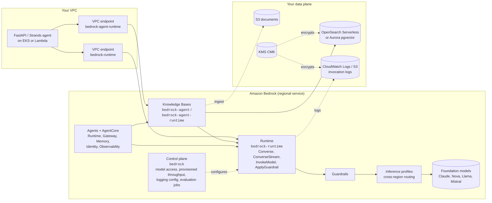
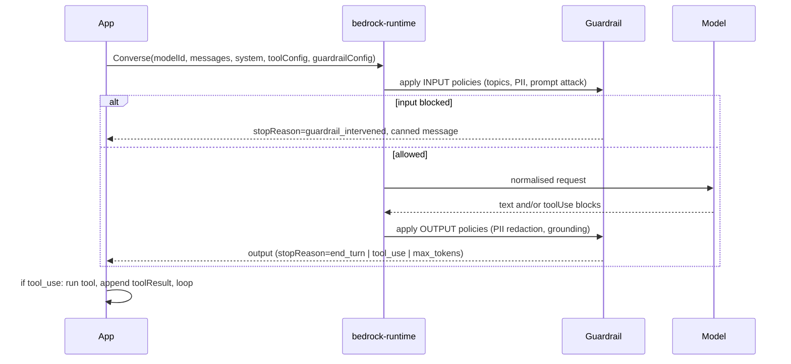

# Amazon Bedrock

| | |
|---|---|
| **Cluster** | 02 Managed AI Platforms |
| **Role** | Anchor |
| **Category** | Serverless foundation-model platform (inference, RAG, guardrails, agents) |
| **Prerequisites** | AWS IAM roles and policies, VPC subnets and endpoints, S3, KMS (Cluster 01); Python 3.12+ and boto3 |
| **Target version** | Bedrock GA APIs (Converse API, Knowledge Bases, Guardrails, Agents, AgentCore), AWS CLI v2, boto3 1.35+ |
| **Capstone phase** | Phase 6 (Months 21-24) |
| **Official docs** | https://docs.aws.amazon.com/bedrock/latest/userguide/ |

> Amazon Bedrock exposes foundation models from Anthropic, Amazon, Meta, Mistral, Cohere and others behind one serverless, IAM-authenticated, VPC-reachable API. After this folder you will be able to call any chat model through the Converse API with streaming and tool use, build a private RAG pipeline with Knowledge Bases, enforce PII redaction and topic denial with Guardrails, run hosted agents on AgentCore, lock the whole thing inside a VPC with PrivateLink and KMS, buy provisioned throughput when latency matters, and debug throttling and quota problems in production.

## Why This Tool Exists

Before Bedrock, an AWS customer who wanted an LLM had two options: self-host open-weights models on GPU instances (SageMaker or EC2, with all the driver, scaling, and patching toil that implies) or call a vendor's public endpoint over the internet with a static API key, which most security teams reject because prompts leave the account boundary, traffic is not auditable in CloudTrail, and there is no IAM story.

Bedrock's insight was to make a *model* look like any other AWS resource: it has an ARN, IAM controls who can invoke it, CloudTrail records every call, KMS encrypts what it stores, a VPC endpoint keeps traffic private, and you pay per token (or reserve capacity) with no servers. The second insight, delivered later with the **Converse API**, was that the message/tool/image schema should be the same regardless of which vendor's model is behind it, so switching from Claude to Nova to Llama is a one-line change.

The platform then grew the three things every production LLM application needs around the model: **Knowledge Bases** (managed RAG), **Guardrails** (model-agnostic policy enforcement), and **Agents / AgentCore** (hosted tool-calling runtimes with memory, identity, and observability).

## Architecture

- **Control plane (`bedrock`)**: account- and region-scoped configuration. Enabling model access, listing models, creating provisioned throughput, enabling invocation logging, creating guardrails, running evaluation jobs. Low call volume, called by Terraform and operators.
- **Runtime (`bedrock-runtime`)**: the hot path. `Converse`, `ConverseStream`, `InvokeModel`, `InvokeModelWithResponseStream`, `ApplyGuardrail`. Called by applications thousands of times per minute. This is the endpoint you put behind PrivateLink.
- **Inference profiles**: a model ID prefixed with `us.`, `eu.`, `apac.` or `global.` that lets Bedrock route a request to whichever region in the geography has capacity. Required for many newer models; the way you get higher throughput without provisioned capacity.
- **Guardrails**: a separately versioned policy object (denied topics, content filters, PII, word filters, grounding checks) applied to inputs and outputs of any model, including models you do not call through Bedrock, via `ApplyGuardrail`.
- **Knowledge Bases (`bedrock-agent`, `bedrock-agent-runtime`)**: managed ingestion (S3 and SaaS connectors), chunking, embedding, vector storage, and retrieval; `RetrieveAndGenerate` glues retrieval to a model call.
- **Agents and AgentCore**: Bedrock Agents is the fully managed, opinionated orchestrator (action groups + Lambda). AgentCore is the framework-agnostic set of primitives (Runtime, Gateway, Memory, Identity, Observability, Code Interpreter, Browser) for running Strands, LangGraph, or CrewAI agents at scale.

## The Core Mental Model

Two ideas make Bedrock make sense:

1. **A model is an AWS resource with an ARN, and a request is a signed API call.** Everything you know about IAM, CloudTrail, VPC endpoints, KMS, and service quotas applies unchanged. `bedrock:InvokeModel` on `arn:aws:bedrock:<REGION>::foundation-model/<MODEL_ID>` is no different from `s3:GetObject` on a bucket ARN. There is no API key.

2. **The Converse API is a vendor-neutral messages protocol; everything else is a layer that plugs into it.** Guardrails intercept the message stream, Knowledge Bases inject retrieved chunks into it, Agents loop over it, inference profiles route it, provisioned throughput reserves capacity for it, and invocation logging records it. Learn the message/tool/stream shape once and every feature is "the same call plus one more parameter".

## Anchor-and-Bridge Mapping

| Concept in Bedrock | Equivalent in Vertex AI | Equivalent in Azure OpenAI |
|---|---|---|
| Model access enablement | Model Garden enable / EULA | Create a model deployment |
| Model ID `anthropic.claude-...` / profile `us.anthropic.claude-...` | `gemini-2.5-pro`, `global` location | Deployment name -> model + version |
| `Converse` / `ConverseStream` | `generate_content` / `generate_content_stream` | `chat.completions.create` / `responses.create`, `stream=True` |
| `system` blocks | `system_instruction` | `system` / `developer` message |
| `toolConfig`, `toolUse`, `toolResult` | `FunctionDeclaration`, `function_call`, `function_response` | `tools`, `tool_calls`, role `tool` |
| `inferenceConfig` | `GenerateContentConfig` | `max_completion_tokens`, `temperature` |
| `cachePoint` prompt caching | Context caching (`caches.create`) | Automatic prompt caching |
| Provisioned Throughput (model units) | Provisioned Throughput (GSUs) | PTUs |
| Batch inference | Batch prediction | Global Batch |
| Knowledge Bases | RAG Engine / Vertex AI Search | Azure AI Search "on your data" |
| `RetrieveAndGenerate` / `Retrieve` | `Tool(retrieval=VertexRagStore)` / `rag.retrieval_query` | `data_sources` extra body / `SearchClient.search` |
| Guardrails | Safety settings + Model Armor | Content filters + Prompt Shields |
| Bedrock Agents / AgentCore | ADK + Agent Engine | Foundry Agent Service |
| Model invocation logging | Request-response logging to BigQuery | Diagnostic Settings `RequestResponse` |
| VPC endpoint (PrivateLink) | Private Service Connect | Private Link |
| KMS CMK | CMEK | Customer-managed keys (Key Vault) |
| IAM policy on model ARN | `roles/aiplatform.user` | `Cognitive Services OpenAI User` |
| `ThrottlingException` | `429 RESOURCE_EXHAUSTED` | `429` + `Retry-After` |

The full cluster-level table is in [../README.md](../README.md#4-anchor-and-bridge-delta-mapping).

## Learning Path

| Step | File | Time |
|---|---|---|
| 1 | [01-installation-and-setup.md](01-installation-and-setup.md): CLI, boto3, model access, IAM, first Converse call | 2 h |
| 2 | [02-core-concepts.md](02-core-concepts.md): Converse vs InvokeModel, inference profiles, throughput modes, Knowledge Bases, Guardrails, Agents/AgentCore internals | 5 h |
| 3 | [03-commands-and-cheatsheet.md](03-commands-and-cheatsheet.md): every `aws bedrock*` command and boto3 call you will use | 2 h |
| 4 | [04-hands-on-labs.md](04-hands-on-labs.md): eight labs from first call to private agent with guardrails | 12 h |
| 5 | [05-production-patterns.md](05-production-patterns.md): PrivateLink, KMS, logging, provisioned throughput, cost, CI/CD, anti-patterns | 4 h |
| 6 | [06-troubleshooting.md](06-troubleshooting.md): access denied, throttling, validation errors, KB sync failures | 2 h |
| 7 | [07-interview-questions.md](07-interview-questions.md): 30 questions junior to principal | 2 h |

## Role in the Capstone

Bedrock is the model provider for the Phase 6 Incident & Platform AI Agent:

- The FastAPI service (Phase 1) running on EKS (Phase 3) calls `bedrock-runtime` through a **VPC interface endpoint** created by the Terraform VPC module from Phase 2; the pod's IRSA role carries `bedrock:InvokeModel` and `bedrock:InvokeModelWithResponseStream` scoped to one inference profile ARN.
- The Strands Agents / LangGraph agent (Cluster 03) uses the **Converse API** via the framework's Bedrock model provider; MCP tool calls to Prometheus and Kubernetes (Cluster 10) are the tools in the loop.
- A **Guardrail** with PII anonymisation and prompt-attack filtering is attached to every call. Runbooks mention hostnames and on-call engineers; the guardrail redacts names, emails, and phone numbers before completions reach Slack.
- **Knowledge Bases** over the runbook S3 bucket is compared against self-hosted Qdrant; the result is recorded as an ADR in `capstone/adrs/`.
- **Model invocation logs** go to CloudWatch Logs and are shipped to Loki (Cluster 09); token counts become a Grafana panel next to the 99.9% SLO burn rate (Cluster 11). A FinOps budget alarm (Cluster 12) fires on `InputTokenCount` anomalies.
- GitHub Actions (Cluster 06) authenticates to AWS with OIDC and runs DeepEval regression suites against the Bedrock model on every PR.

## Further Reading

- Amazon Bedrock User Guide: https://docs.aws.amazon.com/bedrock/latest/userguide/
- Converse API reference: https://docs.aws.amazon.com/bedrock/latest/APIReference/API_runtime_Converse.html
- Bedrock Knowledge Bases: https://docs.aws.amazon.com/bedrock/latest/userguide/knowledge-base.html
- Bedrock Guardrails: https://docs.aws.amazon.com/bedrock/latest/userguide/guardrails.html
- Amazon Bedrock AgentCore developer guide: https://docs.aws.amazon.com/bedrock-agentcore/latest/devguide/
- Anthropic docs, Claude on Amazon Bedrock: https://docs.claude.com/en/api/claude-on-amazon-bedrock
- AWS Well-Architected Generative AI Lens: https://docs.aws.amazon.com/wellarchitected/latest/generative-ai-lens/
- OWASP Top 10 for LLM Applications: https://owasp.org/www-project-top-10-for-large-language-model-applications/
