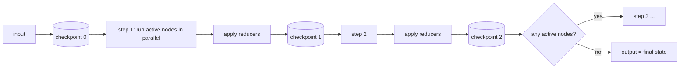
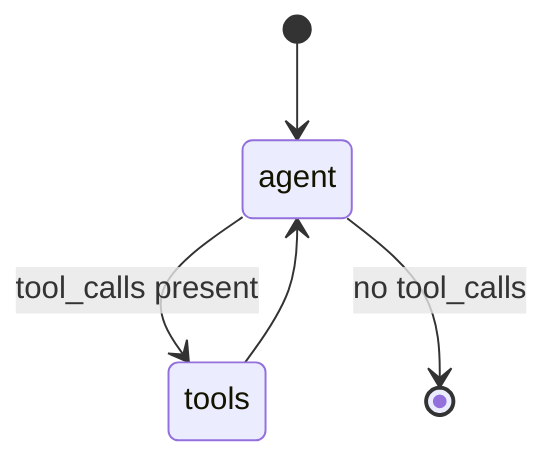
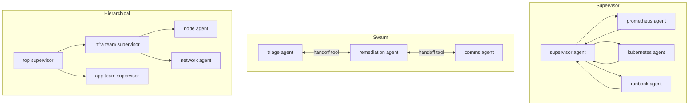

# LangGraph: Core Concepts

| | |
|---|---|
| **Cluster** | 03 Agentic Frameworks |
| **Role** | Anchor |
| **Prerequisites** | [01-installation-and-setup.md](01-installation-and-setup.md), LangChain messages and tools |
| **Target version** | LangGraph 1.x (stable since 0.2 unless noted) |
| **Capstone phase** | Phase 6 (Months 21-24) |

> This file explains how LangGraph works underneath: the Pregel super-step executor, state schemas and reducers, the edge types, the checkpoint model that makes threads, time travel and human-in-the-loop possible, streaming, memory, subgraphs, the `Send` API, multi-agent topologies and durable execution. Read it before the labs; every lab assumes this vocabulary.

---

## 1. Execution Model: Pregel Super-Steps

LangGraph does not call your nodes in a Python `for` loop. It runs a **Pregel**-style bulk-synchronous executor:

1. Determine the set of nodes that are *active* (they have an incoming edge from a node that just finished, or they were targeted by `Send`/`Command`).
2. Run all active nodes **in parallel** for this super-step. Each returns a *partial* state update.
3. Apply all updates to the state through the **reducers**.
4. Write a **checkpoint** (if a checkpointer is configured).
5. Emit streaming events.
6. If any node is active for the next step and `recursion_limit` is not hit, go to 1; otherwise return.



Consequences you must internalise:

- Two nodes that run in the same super-step both see the **same** input state; neither sees the other's update until the next step.
- A node that returns `{}` or `None` changes nothing. A node that returns a key without a reducer **overwrites** it.
- `recursion_limit` (default 25) counts super-steps, not model calls. A ReAct loop with 10 tool rounds uses ~21 steps. Raise it deliberately with `graph.invoke(..., config={"recursion_limit": 60})`.

---

## 2. State Schemas and Reducers

The state is a schema. Three ways to declare it:

```python
from typing import Annotated, TypedDict
from langgraph.graph.message import add_messages
from langchain_core.messages import AnyMessage
from pydantic import BaseModel, Field
import operator


# 1. TypedDict (most common; fastest; no validation)
class TriageState(TypedDict):
    messages: Annotated[list[AnyMessage], add_messages]   # reducer: append / upsert by id
    alert: dict                                           # no reducer: overwrite
    evidence: Annotated[list[str], operator.add]          # reducer: list concatenation
    proposed_action: dict | None
    approved: bool


# 2. Pydantic (validated on input and node output; slower)
class TriageStateModel(BaseModel):
    messages: Annotated[list[AnyMessage], add_messages] = Field(default_factory=list)
    alert: dict = Field(default_factory=dict)


# 3. Prebuilt MessagesState: just {"messages": Annotated[list, add_messages]}
from langgraph.graph import MessagesState

class ChatState(MessagesState):
    user_id: str
```

### Reducers

A reducer is `(current_value, update) -> new_value`. Without one, the last writer wins. With `operator.add`, lists concatenate. `add_messages` is special:

- Appends messages.
- If an incoming message has the same `id` as an existing one, it **replaces** it (this is how you edit history).
- A `RemoveMessage(id=...)` deletes.
- Coerces dicts/tuples to message objects.

```python
from langchain_core.messages import RemoveMessage

def trim(state: TriageState) -> dict:
    """Keep the system prompt and the last 20 messages."""
    msgs = state["messages"]
    if len(msgs) <= 21:
        return {}
    return {"messages": [RemoveMessage(id=m.id) for m in msgs[1:-20]]}
```

### Input, output and private schemas

```python
class InputState(TypedDict):
    alert: dict

class OutputState(TypedDict):
    report: str

builder = StateGraph(TriageState, input_schema=InputState, output_schema=OutputState)
```

Older releases name these `input=` and `output=`. Private state for a chain of nodes can use a separate `TypedDict` passed as the node's annotation; the runtime merges keys by name.

---

## 3. Nodes

A node is any callable `(state) -> update` or `(state, config) -> update`. It may be sync or async, and it may be a compiled subgraph.

```python
from langchain_core.runnables import RunnableConfig
from langgraph.config import get_stream_writer, get_store

async def gather(state: TriageState, config: RunnableConfig) -> dict:
    writer = get_stream_writer()                 # custom stream events
    writer({"status": "querying prometheus"})
    thread_id = config["configurable"]["thread_id"]
    ...
    return {"evidence": ["error_rate=0.12"]}
```

Rules:

- Return a **dict** of the keys you changed. Never mutate `state` in place and return it (works by accident, breaks reducers).
- Node names are strings; `START` and `END` are reserved.
- Add retries per node: `builder.add_node("gather", gather, retry_policy=RetryPolicy(max_attempts=3, backoff_factor=2.0))` (older: `retry=`).
- Cache expensive nodes: `builder.add_node("embed", embed, cache_policy=CachePolicy(ttl=600))` with `compile(cache=InMemoryCache())` (0.6+).

---

## 4. Edges

| Edge type | API | Use |
|---|---|---|
| Fixed | `add_edge("a", "b")` | Always go to `b` after `a` |
| Fan-in | `add_edge(["a", "b"], "c")` | Run `c` once after **both** `a` and `b` finish |
| Conditional | `add_conditional_edges("a", router, {"x": "b", "y": END})` | Router returns a key; mapping is optional if router returns node names |
| Dynamic fan-out | router returns `[Send("b", {...}), Send("b", {...})]` | Map-reduce; each `Send` gets its own input |
| From inside a node | `return Command(goto="b", update={...})` | Node decides routing and state update together |
| Entry | `add_edge(START, "a")` or `set_entry_point("a")` | Where to start |

`Command` with a type hint lets the graph renderer know possible targets:

```python
from typing import Literal
from langgraph.types import Command

def approval_router(state: TriageState) -> Command[Literal["remediate", "report"]]:
    if state["approved"]:
        return Command(goto="remediate", update={"evidence": ["approved by operator"]})
    return Command(goto="report")
```

`Command(graph=Command.PARENT, goto="other_agent")` routes from a subgraph to a node in the parent; this is how handoffs between agents are implemented.

---

## 5. Compile

```python
graph = builder.compile(
    checkpointer=saver,            # persistence (required for interrupt, threads, time travel)
    store=store,                   # cross-thread memory
    interrupt_before=["remediate"],# static breakpoints
    interrupt_after=[],
    debug=False,
)
graph.get_graph().draw_mermaid()   # or .draw_mermaid_png()
```

`compile()` validates that every node is reachable, every conditional target exists, and the state schema is consistent. A compiled graph is a `Runnable`: `invoke`, `ainvoke`, `stream`, `astream`, `batch`, plus LangGraph-specific `get_state`, `get_state_history`, `update_state`, `bulk_update_state`.

---

## 6. The Prebuilt ReAct Agent and `ToolNode`

```python
from langgraph.prebuilt import create_react_agent, ToolNode, tools_condition

agent = create_react_agent(
    model=model,                 # chat model or model id string
    tools=[query_prometheus, kubectl_get_pods],
    prompt="You are an SRE triage assistant.",   # str, SystemMessage or callable
    checkpointer=MemorySaver(),
    interrupt_before=["tools"],  # pause before every tool call
)
```

Under the hood this is exactly:



Hand-rolled equivalent (the version you will extend in the labs):

```python
tool_node = ToolNode([query_prometheus, kubectl_get_pods], handle_tool_errors=True)

def call_model(state: MessagesState) -> dict:
    response = model_with_tools.invoke(state["messages"])
    return {"messages": [response]}

builder = StateGraph(MessagesState)
builder.add_node("agent", call_model)
builder.add_node("tools", tool_node)
builder.add_edge(START, "agent")
builder.add_conditional_edges("agent", tools_condition)   # "tools" or END
builder.add_edge("tools", "agent")
```

`ToolNode` reads the last `AIMessage.tool_calls`, executes each tool (in parallel), and returns one `ToolMessage` per call. `handle_tool_errors=True` converts exceptions to error `ToolMessage`s so the model can recover instead of crashing the graph. `tools_condition` returns `"tools"` if the last message has tool calls, else `END`.

Version note: LangChain 1.x introduces `langchain.agents.create_agent(model, tools, system_prompt=..., middleware=[...])` as the recommended high-level agent; it is built on LangGraph and exposes middleware for human-in-the-loop, summarisation and PII redaction. `create_react_agent` remains importable from `langgraph.prebuilt`. This wiki uses the explicit `StateGraph` form because the capstone needs custom nodes.

---

## 7. Persistence: Checkpointers, Threads, Time Travel

### Checkpoints

A checkpoint is a snapshot `{values, next, config, metadata, created_at, parent_config, tasks}` saved after every super-step, keyed by `thread_id` and `checkpoint_id` (and an optional `checkpoint_ns` for subgraphs).

| Checkpointer | Package | Use |
|---|---|---|
| `MemorySaver` / `InMemorySaver` | `langgraph` | Tests, notebooks |
| `SqliteSaver` / `AsyncSqliteSaver` | `langgraph-checkpoint-sqlite` | Single-node dev |
| `PostgresSaver` / `AsyncPostgresSaver` | `langgraph-checkpoint-postgres` | Production default |
| `RedisSaver` / `AsyncRedisSaver` | `langgraph-checkpoint-redis` | Low latency, TTL |

```python
from langgraph.checkpoint.postgres import PostgresSaver

with PostgresSaver.from_conn_string(PG_URI) as saver:
    saver.setup()                       # idempotent migrations
    graph = builder.compile(checkpointer=saver)
    config = {"configurable": {"thread_id": "inc-2024-001"}}
    graph.invoke({"alert": alert}, config)
```

### Threads

A `thread_id` is a conversation / incident / workflow instance. Everything in `config["configurable"]` is available to nodes; `thread_id` is the only required key when a checkpointer is set.

### Time travel

```python
history = list(graph.get_state_history(config))        # newest first
for snap in history:
    print(snap.config["configurable"]["checkpoint_id"], snap.next, snap.metadata["step"])

# Replay from an earlier checkpoint (no re-execution of completed steps)
past = history[3].config
graph.invoke(None, past)

# Fork: edit state at a checkpoint, then continue -> new branch of history
new_cfg = graph.update_state(past, {"alert": {**alert, "severity": "warning"}}, as_node="triage")
graph.invoke(None, new_cfg)
```

`update_state(config, values, as_node=...)` applies `values` through the reducers *as if* node `as_node` had returned them, writes a new checkpoint whose parent is `config`, and returns the config pointing at it. Passing `None` as input resumes from the checkpoint's `next` nodes.

---

## 8. Human-in-the-Loop

### Dynamic interrupt (preferred, 0.2.x+)

```python
from langgraph.types import interrupt, Command

def approval(state: TriageState) -> dict:
    decision = interrupt({
        "question": "Approve remediation?",
        "action": state["proposed_action"],
    })
    return {"approved": bool(decision.get("approved"))}
```

Semantics:

1. The first time `approval` runs, `interrupt()` raises internally, the super-step ends, the checkpoint records the pending interrupt, and `invoke/stream` returns with `__interrupt__` in the result.
2. The caller inspects `graph.get_state(config).tasks[0].interrupts[0].value`.
3. The caller calls `graph.invoke(Command(resume={"approved": True}), config)`.
4. The node **re-runs from its start**; this time `interrupt()` returns the resume value.

Because of step 4, code before `interrupt()` inside the node runs twice. Keep it idempotent and side-effect free, or put side effects in a separate node.

### Static breakpoints

`compile(interrupt_before=["remediate"])` pauses before the node every time. Resume with `graph.invoke(None, config)`. Simpler but cannot pass a value back; use for debugging or coarse gates.

### Multiple interrupts

A node may call `interrupt()` several times; resume values are matched by call order (so again: deterministic code before the calls). `Command(resume={interrupt_id: value})` addresses specific interrupts in 1.x.

---

## 9. Streaming

| `stream_mode` | Emits | Typical consumer |
|---|---|---|
| `values` | Full state after each step | Debug, simple UIs |
| `updates` | `{node_name: partial_update}` per step | Progress indicators |
| `messages` | `(message_chunk, metadata)` tuples token by token from any LLM call inside nodes | Chat UIs, SSE |
| `custom` | Whatever nodes send via `get_stream_writer()` | Status lines, tool progress |
| `debug` | Task start/end, checkpoints | Deep debugging |

```python
async for mode, chunk in graph.astream(inputs, config, stream_mode=["updates", "messages", "custom"]):
    if mode == "messages":
        token, meta = chunk
        if meta["langgraph_node"] == "triage" and token.content:
            yield f"data: {token.content}\n\n"
    elif mode == "custom":
        yield f"event: status\ndata: {chunk}\n\n"
```

`subgraphs=True` includes events from nested graphs with a namespace tuple.

---

## 10. Memory: Short-Term vs Long-Term

| | Short-term | Long-term |
|---|---|---|
| Scope | One thread | Across threads (per user, per team, global) |
| Mechanism | Checkpointer: `messages` in state | `BaseStore`: namespaced key-value with optional vector search |
| Classes | `MemorySaver`, `PostgresSaver` | `InMemoryStore`, `PostgresStore`, `RedisStore` |
| Access in node | `state["messages"]` | `store = get_store(); store.get(ns, key); store.search(ns, query=...)` |
| Typical content | Conversation, tool results, pending interrupt | "payments-api owner is team-checkout", past remediations, user preferences |

```python
from langgraph.store.memory import InMemoryStore
from langchain_core.embeddings import Embeddings

store = InMemoryStore(index={"embed": embeddings, "dims": 1024})   # enables semantic search
store.put(("incidents", "payments-api"), "2024-06-01", {"root_cause": "connection pool exhaustion", "fix": "rollout restart"})
hits = store.search(("incidents", "payments-api"), query="pool exhausted", limit=3)
```

Nodes access the store through `get_store()` (0.4+) or the `store` keyword argument. The store is injected at `compile(store=...)`.

---

## 11. Subgraphs

A compiled graph is a node. Two integration styles:

1. **Shared keys**: the subgraph's state overlaps with the parent's; add it directly: `builder.add_node("rag", rag_graph)`. Only overlapping keys flow in and out.
2. **Different schema**: wrap it in a function that maps state in and out:

```python
def run_rag(state: TriageState) -> dict:
    out = rag_graph.invoke({"question": state["alert"]["alertname"]})
    return {"evidence": [out["answer"]]}
```

Subgraphs get their own `checkpoint_ns`; `graph.get_state(config, subgraphs=True)` reveals them. Interrupts inside subgraphs propagate to the parent.

---

## 12. The `Send` API (Map-Reduce)

```python
from langgraph.types import Send

class State(TypedDict):
    pods: list[str]
    diagnoses: Annotated[list[str], operator.add]

def fan_out(state: State):
    return [Send("diagnose_pod", {"pod": p}) for p in state["pods"]]

def diagnose_pod(state: dict) -> dict:     # receives the Send payload, not the parent state
    return {"diagnoses": [f"{state['pod']}: OOMKilled"]}

builder.add_conditional_edges("list_pods", fan_out, ["diagnose_pod"])
builder.add_edge("diagnose_pod", "summarise")   # summarise runs once after all Sends finish
```

Each `Send` creates one task in the next super-step with its own input. Results merge through the reducer (`operator.add`) in the parent state.

---

## 13. Multi-Agent Topologies



| Pattern | How | Library | Choose when |
|---|---|---|---|
| Supervisor | One agent routes to workers wrapped as tools or nodes; workers return to supervisor | `langgraph-supervisor` `create_supervisor(agents, model, prompt)` | Clear decomposition; need central control and audit |
| Swarm / handoffs | Agents hand control to each other via `create_handoff_tool`; last active agent answers | `langgraph-swarm` `create_swarm(agents, default_active_agent)` | Conversational, specialist-to-specialist |
| Hierarchical | Supervisors of supervisors, each a subgraph | Compose the above | Large organisations of agents |
| Custom | Nodes return `Command(goto=..., graph=Command.PARENT)` | Core | Anything else |

Handoff implementation in core:

```python
from langchain_core.tools import tool, InjectedToolCallId
from typing import Annotated

@tool
def transfer_to_remediation(tool_call_id: Annotated[str, InjectedToolCallId]) -> Command:
    """Hand the incident to the remediation agent."""
    return Command(
        goto="remediation_agent",
        graph=Command.PARENT,
        update={"messages": [ToolMessage("transferred", tool_call_id=tool_call_id)]},
    )
```

---

## 14. Durable Execution and Retries

- **Durability modes** (0.6+): `graph.invoke(..., durability="sync" | "async" | "exit")`. `sync` writes the checkpoint before continuing (safest); `async` writes in the background (default); `exit` only writes at the end or at interrupts (fastest, least durable).
- **Node retries**: `RetryPolicy(max_attempts, initial_interval, backoff_factor, jitter, retry_on=Exception)`. Retries re-run the node only; previous steps are not repeated.
- **Resumption after crash**: re-invoke with the same `thread_id` and `None` input; the executor continues from `next`.
- **Idempotency**: side effects (restarting a deployment, posting to Slack) must tolerate at-least-once execution. Put them in their own node, record a completion marker in state, and check it before acting.
- **Functional API** (0.3+): `@entrypoint(checkpointer=...)` and `@task` give the same durability to imperative code; each `@task` result is checkpointed, so on resume completed tasks return cached results.

```python
from langgraph.func import entrypoint, task

@task
def restart(deployment: str, namespace: str) -> str:
    ...  # runs at most once per thread because its result is checkpointed

@entrypoint(checkpointer=saver)
def remediate(inputs: dict) -> str:
    approved = interrupt({"action": inputs})
    if not approved:
        return "rejected"
    return restart(inputs["deployment"], inputs["namespace"]).result()
```

---

## 15. Configuration and Context

`config["configurable"]` carries per-run values: `thread_id`, `checkpoint_id`, `checkpoint_ns`, plus your own (`user_id`, `environment`). 0.6+ adds a typed `context_schema` on `StateGraph` and `graph.invoke(inputs, context={...})` with `Runtime[Context]` injected into nodes, replacing ad-hoc `configurable` keys. Both work in 1.x; the labs use `configurable` because it also works with LangGraph Server and the SDK unchanged.

---

## 16. Security Primitives Inside the Graph

- **Tool allow-lists per environment**: build the `ToolNode` from a list filtered by environment (`READ_ONLY_TOOLS` in prod unless an approval node has run).
- **Approval gates**: `interrupt()` node between "propose" and "execute"; the executor node checks `state["approved"]` again (defence in depth, in case someone resumes with a forged value through a bug).
- **Input validation**: Pydantic state or a validation node; reject namespaces not in an allow-list before any tool runs.
- **Output handling**: never pass `AIMessage.content` to a shell; pass structured, validated fields to narrowly typed tools.
- **Secrets**: nodes read credentials from the environment injected by IRSA/Vault; never from state (state is checkpointed to Postgres and traced).
- **Trace redaction**: register a callback or OTel processor that drops `ToolMessage` content matching secret patterns.

Next: [03-commands-and-cheatsheet.md](03-commands-and-cheatsheet.md).
