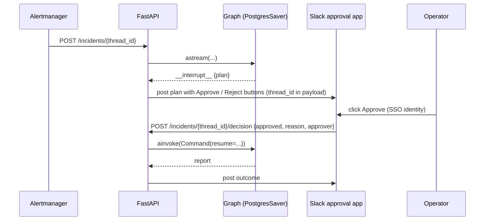

# LangGraph: Production Patterns

| | |
|---|---|
| **Cluster** | 03 Agentic Frameworks |
| **Role** | Anchor |
| **Prerequisites** | [04-hands-on-labs.md](04-hands-on-labs.md) Lab 6; Kubernetes (Cluster 04); OpenTelemetry (Cluster 09) |
| **Target version** | LangGraph 1.x; Kubernetes 1.31+; Postgres 16 |
| **Capstone phase** | Phase 6 (Months 21-24) |

> How to run the incident agent as a real service: identity without static keys, least-privilege tools, durable Postgres checkpoints, horizontal scaling, streaming behind an ingress, OpenTelemetry and LangSmith tracing, cost controls, CI evaluation gates, the LangGraph Server alternative, and the anti-patterns that cause most agent incidents.

---

## 1. Deployment Topologies

| Topology | How | Choose when |
|---|---|---|
| **Library in FastAPI on EKS** (capstone default) | Compile the graph at startup with `AsyncPostgresSaver`; expose start/decision/state routes; HPA on CPU + custom `inflight_runs` metric | You already own a service mesh, ingress, OTel and RBAC; you want full control of auth and routing |
| **LangGraph Server (self-hosted)** | `langgraph.json` + `langgraph build`; image runs the server with Postgres + Redis; you call the Threads/Runs API | You want threads, runs, cron, Studio and SDK contracts without writing routes; licence limits apply beyond the free tier |
| **LangGraph Platform (managed)** | Push the same `langgraph.json`; vendor runs it | You accept the vendor dependency and want zero infra |
| **Batch / CronJob** | Kubernetes `CronJob` runs `graph.invoke` per queued alert, resumes interrupted threads from a queue | Non-interactive remediation reviews |

### Reference Kubernetes manifests (FastAPI topology)

```yaml
apiVersion: apps/v1
kind: Deployment
metadata:
  name: incident-agent
  namespace: platform-ai
spec:
  replicas: 2
  selector: { matchLabels: { app: incident-agent } }
  template:
    metadata:
      labels: { app: incident-agent }
      annotations:
        prometheus.io/scrape: "true"
        prometheus.io/port: "8080"
    spec:
      serviceAccountName: incident-agent          # IRSA / Pod Identity -> Bedrock; RBAC -> read-only K8s
      securityContext:
        runAsNonRoot: true
        runAsUser: 65532
        seccompProfile: { type: RuntimeDefault }
      containers:
        - name: api
          image: ghcr.io/example/incident-agent@sha256:<DIGEST>
          ports: [{ containerPort: 8080 }]
          env:
            - { name: AWS_REGION, value: "<REGION>" }
            - { name: BEDROCK_MODEL_ID, value: "us.anthropic.claude-sonnet-4-20250514-v1:0" }
            - { name: PROM_URL, value: "http://prometheus.monitoring.svc:9090" }
            - { name: OTEL_EXPORTER_OTLP_ENDPOINT, value: "http://otel-collector.observability.svc:4317" }
            - { name: OTEL_SERVICE_NAME, value: "incident-agent" }
            - name: LANGGRAPH_PG_URI
              valueFrom: { secretKeyRef: { name: incident-agent-db, key: uri } }   # from External Secrets / Vault
          resources:
            requests: { cpu: 250m, memory: 512Mi }
            limits: { memory: 1Gi }
          readinessProbe: { httpGet: { path: /healthz, port: 8080 }, periodSeconds: 5 }
          livenessProbe: { httpGet: { path: /healthz, port: 8080 }, periodSeconds: 15 }
          securityContext:
            allowPrivilegeEscalation: false
            readOnlyRootFilesystem: true
            capabilities: { drop: ["ALL"] }
---
apiVersion: rbac.authorization.k8s.io/v1
kind: ClusterRole
metadata: { name: incident-agent-readonly }
rules:
  - apiGroups: [""]
    resources: ["pods", "events", "services", "endpoints"]
    verbs: ["get", "list", "watch"]
  - apiGroups: ["apps"]
    resources: ["deployments", "replicasets"]
    verbs: ["get", "list", "watch"]
---
# Mutations are granted per namespace, never cluster-wide, and only to the remediation ServiceAccount
apiVersion: rbac.authorization.k8s.io/v1
kind: Role
metadata: { name: incident-agent-remediate, namespace: payments }
rules:
  - apiGroups: ["apps"]
    resources: ["deployments"]
    verbs: ["patch"]
```

Pattern: the triage container uses `incident-agent` (read-only). The `remediate` node calls a **separate** internal endpoint or Job running under `incident-agent-remediator`, so a prompt-injected model in the read-only process physically cannot patch anything. Even if you keep one process, split the ServiceAccounts in staging first to validate the boundary.

---

## 2. Identity and Secrets

- **Bedrock**: IRSA or EKS Pod Identity on the ServiceAccount; the policy grants `bedrock:InvokeModel*` on explicit inference-profile ARNs only.
- **Postgres**: IAM database authentication (RDS) or Vault dynamic credentials with a 1-hour TTL via Vault Agent sidecar / CSI driver. Never bake a DSN with a password into the image.
- **LangSmith**: API key from External Secrets Operator; use a per-environment project.
- **MCP servers**: each in its own Deployment with its own identity; the agent reaches them over the mesh with mTLS, not over `stdio` in the same container.
- **Checkpoints contain prompts and tool output**: enable Postgres encryption at rest (KMS), set `LANGGRAPH_AES_KEY` if using LangGraph Server, and apply a retention job (`DELETE FROM checkpoints WHERE thread_id IN (...closed incidents older than 30d)`).

---

## 3. Durable State at Scale

| Concern | Pattern |
|---|---|
| Connection storms | One `AsyncConnectionPool(max_size=~2x workers)` per process; `prepare_threshold=0` for pgbouncer compatibility |
| Multiple replicas | Safe: checkpoints are per-thread and writes are transactional. Two replicas resuming the same thread concurrently is a client bug; serialise approvals per `thread_id` with a Redis lock or a `SELECT ... FOR UPDATE` on your own `incidents` table |
| Checkpoint growth | Every super-step writes blobs. Trim messages with `RemoveMessage`, keep tool output short (truncate at 4 KB), archive closed threads |
| Query by business key | The checkpoint tables are opaque. Keep your own `incidents(thread_id, alert, status, created_at)` table and update it from nodes |
| Durability mode | `durability="sync"` for anything that passes an approval gate; `"async"` elsewhere |
| Redis vs Postgres | Redis for sub-10 ms hot paths and TTL-based expiry; Postgres for audit and joins. Many teams use Redis for the checkpointer and Postgres for the `BaseStore` |
| Backups | Checkpoints are part of your incident audit trail; include the database in the RPO/RTO plan (Cluster 12) |

---

## 4. Human-in-the-Loop in Production



Rules:

1. The approver identity comes from the approval channel's authentication (Slack SSO, OIDC on the UI), never from the model.
2. Record `approver`, `reason` and `timestamp` in state and in your `incidents` table: they are the audit evidence.
3. Enforce separation of duties where required: the alert's on-call cannot approve their own destructive action in regulated environments.
4. Time out interrupts: a CronJob marks threads waiting more than N hours as expired and runs `Command(resume={"approved": False, "reason": "timeout"})`.
5. Re-validate inside the executing node (`approved` and the allow-list) because `update_state` can alter anything.

---

## 5. Tool Security

| Control | Implementation |
|---|---|
| Read-only by default | The model is bound only to `READ_ONLY_TOOLS`; the mutating tool is invoked by code in `remediate` |
| Narrow parameters | `namespace: Literal[...]`, `deployment: str` validated against a regex and an allow-list from the service catalog (Backstage) |
| Output size limits | Truncate tool results; large outputs balloon context and cost and are an exfiltration channel |
| Error strings not exceptions | `handle_tool_errors=True` plus explicit `"error: ..."` returns keep the loop alive |
| Secret scrubbing | Never return `Secret` objects or env dumps; strip `Authorization` headers; regex-scrub tool output before it enters state |
| Prompt injection from tool output | System prompt states tool output is data; wrap results in `<tool_result>` delimiters; run Promptfoo injection suites against the graph in CI |
| MCP servers | Pin server image digests; run as non-root; expose only the tools the agent needs; authenticate with mTLS or OAuth per MCP spec |
| Rate limits | `InMemoryRateLimiter` on the model; per-thread tool call budget enforced by a node that counts `ToolMessage`s |

---

## 6. Observability

### OpenTelemetry (capstone standard)

```bash
pip install opentelemetry-distro opentelemetry-exporter-otlp opentelemetry-instrumentation-fastapi \
            opentelemetry-instrumentation-httpx openinference-instrumentation-langchain
opentelemetry-bootstrap -a install
```

```python
# src/telemetry.py - called once at startup
from opentelemetry import trace
from opentelemetry.sdk.resources import Resource
from opentelemetry.sdk.trace import TracerProvider
from opentelemetry.sdk.trace.export import BatchSpanProcessor
from opentelemetry.exporter.otlp.proto.grpc.trace_exporter import OTLPSpanExporter
from openinference.instrumentation.langchain import LangChainInstrumentor

provider = TracerProvider(resource=Resource.create({"service.name": "incident-agent"}))
provider.add_span_processor(BatchSpanProcessor(OTLPSpanExporter()))   # endpoint from OTEL_EXPORTER_OTLP_ENDPOINT
trace.set_tracer_provider(provider)
LangChainInstrumentor().instrument()   # spans for every runnable, node, model and tool call
```

Spans you will see in Tempo: `incident-agent POST /incidents` -> `LangGraph` -> `triage` -> `ChatBedrockConverse` -> `query_prometheus`. Add `thread_id` as a span attribute via `config["metadata"]`; the OTel Collector `attributes` processor can redact `input.value` on model spans in regulated environments.

### Metrics worth exporting (Prometheus client)

| Metric | Type | Use |
|---|---|---|
| `agent_runs_total{outcome}` | counter | Approved / rejected / refused / error |
| `agent_run_duration_seconds` | histogram | SLO on time to proposed plan |
| `agent_tokens_total{direction}` | counter | Cost; from `AIMessage.usage_metadata` |
| `agent_tool_calls_total{tool, status}` | counter | Tool reliability |
| `agent_interrupts_waiting` | gauge | Approval backlog |
| `agent_recursion_limit_hits_total` | counter | Runaway loops |

### LangSmith

Use it in staging for trajectory review and dataset curation; in production either sample (`LANGSMITH_TRACING_SAMPLING_RATE=0.1`) or self-host. Decide explicitly whether prompts and tool output may leave your VPC.

---

## 7. Cost and Performance

- **Model routing**: a cheap model (Haiku-class) for `validate`/classification nodes, a frontier model only in `triage` and `propose`. Encode it as two `init_chat_model` handles, not prompt tricks.
- **Prompt caching**: keep the system prompt and tool schemas stable so Bedrock prompt caching hits; put volatile content last.
- **Trim context**: `RemoveMessage` after N turns; summarise tool output in the tool itself.
- **Parallel tools**: `ToolNode` already parallelises; avoid serial tool rounds by asking for all evidence at once in the prompt.
- **Recursion limit**: set `recursion_limit` to ~2x the expected rounds; catch `GraphRecursionError` and finish with a "needs human" report.
- **Caching nodes**: `CachePolicy` on deterministic nodes (runbook retrieval by alert name).
- **Batching**: `graph.batch()` for nightly bulk reviews.
- **Cold starts**: load the model client and compile the graph at startup; keep replicas warm; distroless image under 300 MB.

---

## 8. CI/CD and Evaluation Gates

```yaml
# .github/workflows/agent-ci.yml (excerpt)
jobs:
  test:
    runs-on: ubuntu-latest
    permissions: { id-token: write, contents: read }
    services:
      postgres:
        image: postgres:16-alpine
        env: { POSTGRES_USER: langgraph, POSTGRES_PASSWORD: ci, POSTGRES_DB: langgraph }
        ports: ["5432:5432"]
    steps:
      - uses: actions/checkout@v4
      - uses: actions/setup-python@v5
        with: { python-version: "3.12" }
      - run: pip install -r requirements.txt -r requirements-dev.txt
      - run: OFFLINE=1 pytest -q                                     # trajectory tests, no credentials
      - run: semgrep --config p/python --config .semgrep/agent-tools.yml src/   # no shell=True in tools, etc.
      - run: promptfoo eval -c evals/injection.yaml --no-cache       # red-team prompts through the graph (fake tools)
      - uses: aws-actions/configure-aws-credentials@v4             # OIDC, no static keys
        with: { role-to-assume: arn:aws:iam::<ACCOUNT_ID>:role/gha-agent-evals, aws-region: <REGION> }
      - run: deepeval test run evals/test_trajectories.py          # live model, golden incidents, blocks merge on regression
```

Evaluation layers (see Cluster 10):

1. **Unit / trajectory** (offline): the graph pauses before mutation, honours allow-lists, handles tool errors.
2. **Tool-calling correctness** (DeepEval): did the agent call `query_prometheus` with a PromQL that references the alert's service?
3. **Groundedness** (RAGAS faithfulness on `plan.summary` vs tool output).
4. **Red team** (Promptfoo): tool output containing injections must not change the plan.
5. **Online**: sample production traces to LangSmith datasets; weekly review.

---

## 9. Multi-Tenancy

- `thread_id` carries no tenant meaning; namespace it (`{tenant}:{incident}`) and store tenant in `configurable` and in your `incidents` table.
- Separate `BaseStore` namespaces per tenant: `("tenant-a", "incidents")`.
- Per-tenant tool sets: build the `ToolNode` from a tenant-specific allow-list at request time (compile per tenant and cache the compiled graph).
- Per-tenant model quotas and Bedrock inference profiles with cost allocation tags.

---

## 10. GitOps and Versioning

- Graph code, prompts and tool schemas live in the capstone monorepo; prompts are Python constants or versioned files, reviewed in PRs.
- Image is built once, signed with Cosign, deployed by Argo CD; `langgraph.json` (if used) is part of the image.
- Schema changes to `State` are backwards-compatible or you drain in-flight threads first: old checkpoints with missing keys resume with `None`, which your nodes must tolerate.
- Record an ADR per major design choice (`capstone/adrs/00NN-langgraph-vs-strands.md`).

---

## 11. Anti-Patterns

| Anti-pattern | Why it hurts | Instead |
|---|---|---|
| Binding mutating tools to the model | One injected log line away from an outage | Code-invoked mutations behind `interrupt()` |
| `shell`/`kubectl` passthrough tool with a `command: str` | Unbounded agency | Narrow, typed tools per action |
| Side effects before `interrupt()` in the same node | Executed twice on resume | Separate node or `@task` |
| No `recursion_limit` handling | Runaway loop, runaway bill | Catch `GraphRecursionError`, alert, finish safely |
| Mutating `state` in place | Reducers bypassed, subtle bugs | Return partial dicts |
| `MemorySaver` in production | Approvals lost on restart | `PostgresSaver` / `RedisSaver` |
| Compiling the graph per request | Slow, leaks connections | Compile once at startup |
| Secrets in state | Persisted and traced | Environment / Vault only |
| Trusting `AIMessage.content` as a command | Output handling vuln | Structured output, validated |
| One giant node | No checkpoints between steps; untestable | Small nodes, explicit edges |

---

## 12. When to Choose LangGraph vs Strands

| Pick LangGraph when | Pick Strands when |
|---|---|
| You must guarantee step order (validate -> gather -> propose -> approve -> act) | The model can safely decide the order |
| Durable interrupts and time travel are requirements | Sessions are enough; approvals handled by hooks |
| You deploy on EKS with your own Postgres and OTel | You deploy on Lambda or Bedrock AgentCore |
| Multi-provider now or later | AWS-first is fine |
| You need subgraphs, `Send` and custom reducers | A single agent or a small graph/swarm suffices |

---

## 13. Decision Checklist

- [ ] State schema reviewed: no secrets, bounded message history, business keys indexed in a side table
- [ ] Mutating tools not bound to the model; approval node precedes every side effect; executor re-validates
- [ ] ServiceAccount split: read-only vs remediator RBAC; Bedrock policy scoped to model ARNs
- [ ] `PostgresSaver`/`RedisSaver` with pooled async connections; `durability="sync"` on gated paths
- [ ] Interrupt timeout job; approver identity and reason recorded
- [ ] `recursion_limit` and `GraphRecursionError` handled; per-thread tool budget
- [ ] OTel spans and Prometheus metrics exported; trace redaction configured
- [ ] Offline trajectory tests, Semgrep tool rules, Promptfoo injection suite, DeepEval gate in CI
- [ ] Image distroless, non-root, signed, scanned; digest-pinned in manifests
- [ ] ADR written comparing with the Strands implementation

Next: [06-troubleshooting.md](06-troubleshooting.md).
