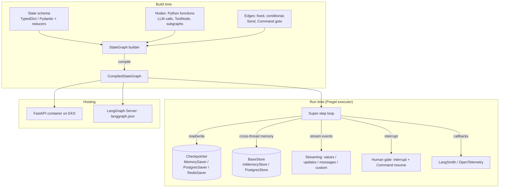

# LangGraph

| | |
|---|---|
| **Cluster** | 03 Agentic Frameworks |
| **Role** | Anchor |
| **Category** | Stateful agent orchestration (graph runtime with checkpointing) |
| **Prerequisites** | Python 3.12+, async basics, [LangChain](../langchain/README.md) tools and chat models, Postgres basics, Kubernetes fundamentals |
| **Target version** | LangGraph 1.x (APIs shown have been stable since 0.2; differences are called out) |
| **Capstone phase** | Phase 6 (Months 21-24) |
| **Official docs** | https://langchain-ai.github.io/langgraph/ |

> LangGraph models an agent as an explicit state machine: a typed state schema, nodes that are plain Python functions, and edges (fixed or conditional) that decide what runs next. Every step is checkpointed, so a run can be paused for a human, resumed after a crash, replayed, or forked from any earlier point. After this folder you will be able to design the state for a non-trivial agent, build the incident-triage graph with a durable human approval gate, persist it to Postgres, stream it to a UI, deploy it on Kubernetes behind FastAPI, trace it with OpenTelemetry/LangSmith and test it without a live model.

## Why This Tool Exists

LangChain's chains (LCEL) are DAGs. The moment an LLM application needs to *loop* (call the model again after running a tool), *branch* on what the model said, *pause* for a human, or *survive* a process restart, a DAG is the wrong shape. Early "AgentExecutor" implementations hid a `while` loop inside a class, which made the loop impossible to customise, persist or observe.

LangGraph's insight is borrowed from Google's Pregel and from Apache Beam: express the computation as a graph of **nodes** that read and write a shared **state**, execute it in **super-steps**, and write the state to a **checkpointer** after every super-step. Once the state is durable, everything else falls out: threads, human-in-the-loop, time travel, fault tolerance, and streaming are all just views over the checkpoint log.

## Architecture

- **State schema**: the single source of truth passed between nodes. Each key may have a *reducer* that defines how updates merge (append vs overwrite).
- **Nodes**: functions `(state, config) -> partial state update`. An LLM call, a tool executor, a Pydantic validation step, or an entire subgraph.
- **Edges**: fixed (`add_edge`), conditional (`add_conditional_edges` with a router function), dynamic fan-out (`Send`), or returned from a node (`Command(goto=...)`).
- **Pregel executor**: runs all nodes that are ready in a super-step, applies reducers, checkpoints, repeats until no node is scheduled or `END` is reached.
- **Checkpointer**: stores a snapshot per super-step per `thread_id`. `MemorySaver` for tests, `PostgresSaver`/`RedisSaver` for production.
- **Store**: key-value memory shared *across* threads (user preferences, learned facts); separate from the per-thread checkpoint.
- **Streaming**: the executor emits events you can forward to a UI as SSE.
- **Interrupt**: a node calls `interrupt(payload)`; the executor checkpoints and returns; later `Command(resume=value)` continues from exactly that node.

## The Core Mental Model

1. **A graph is a reducer over a typed state, executed in checkpointed super-steps.** Nodes do not call each other. They return partial updates; the runtime merges them with reducers and decides what to run next from the edges. If you can draw the state machine, you can write the graph.
2. **Persistence turns time into data.** Because every super-step is a checkpoint keyed by `thread_id`, "pause for a human", "resume after a crash", "replay from step 3 with a different input" and "stream what happened" are all the same operation: read or write a checkpoint.
3. **The ReAct agent is just one graph.** `create_react_agent` is a two-node cycle (`agent` -> `tools` -> `agent`). Once you see that, you can add approval nodes, structured-output nodes, subgraphs and routers without leaving the model.

## Anchor-and-Bridge Mapping

| Concept in LangGraph | Equivalent in Strands Agents | Equivalent in LangChain |
|---|---|---|
| `StateGraph` + nodes + edges | Model-driven event loop inside `Agent`; `GraphBuilder` for explicit DAGs | LCEL `|` chain (static DAG) |
| State `TypedDict` with `add_messages` | `agent.messages` + conversation manager | `RunnableWithMessageHistory` |
| Checkpointer + `thread_id` | `FileSessionManager` / `S3SessionManager` + `session_id` | None |
| `interrupt()` / `Command(resume=)` | Before-tool-call hook, tool consent, in-tool approval | Manual |
| `create_react_agent` | `Agent(model, system_prompt, tools)` | Manual tool-calling loop |
| `ToolNode` | Built into the event loop | Execute `AIMessage.tool_calls` yourself |
| `Send` map-reduce | `GraphBuilder` fan-out / `workflow` tool | `RunnableParallel` |
| Supervisor / swarm | Agents-as-tools / `Swarm` | Composition |
| `BaseStore` | `memory` tool, custom store | Vector store retriever |
| `stream_mode="messages"` | `stream_async` / `callback_handler` | `astream_events` |
| LangSmith tracing | OpenTelemetry built in | LangSmith callbacks |
| LangGraph Server / Platform | AgentCore Runtime / Lambda / EKS | Your own service |

## Learning Path

| Step | File | Time |
|---|---|---|
| 1 | [01-installation-and-setup.md](01-installation-and-setup.md) | 1 h |
| 2 | [02-core-concepts.md](02-core-concepts.md) | 5 h |
| 3 | [03-commands-and-cheatsheet.md](03-commands-and-cheatsheet.md) | 2 h (reference) |
| 4 | [04-hands-on-labs.md](04-hands-on-labs.md) | 14 h |
| 5 | [05-production-patterns.md](05-production-patterns.md) | 5 h |
| 6 | [06-troubleshooting.md](06-troubleshooting.md) | 2 h |
| 7 | [07-interview-questions.md](07-interview-questions.md) | 3 h |

## Where LangGraph Is Weak

- **Boilerplate.** You design the state, reducers and edges yourself. A Strands agent that does the same thing is a third of the code.
- **Learning curve.** Reducers, super-steps, `Command`, `Send`, subgraph state mapping and streaming modes are a lot of concepts before the first useful agent.
- **Ecosystem churn.** LangGraph sits on `langchain-core`, which has reorganised imports twice (0.1 -> 0.3 -> 1.0). `create_react_agent` is itself being superseded by `langchain.agents.create_agent` in 1.x.
- **Checkpoint format lock-in.** Checkpoints are LangGraph-specific blobs; you cannot query "all open incidents" from the checkpoint table without a sidecar index.
- **Platform is commercial.** LangGraph Server is open source for self-hosting with limits; the managed Platform and some features (cron, assistants UI) are paid.

## Role in the Capstone

LangGraph is the runtime of record for the Incident & Platform AI Agent. The FastAPI service exposes `POST /incidents` (Alertmanager webhook) which starts a graph run on a new `thread_id`; `POST /incidents/{thread_id}/approve` resumes the interrupted graph with `Command(resume=...)`. Nodes call LangChain tools wrapping the Prometheus and Kubernetes MCP servers, and a Qdrant hybrid retriever over runbooks. `PostgresSaver` writes checkpoints to the Aurora/RDS instance provisioned in Phase 2. Traces flow to the OTel Collector from Phase 4; DeepEval trajectory tests run in GitHub Actions from Phase 5. The artefact is the `agent/` package in the capstone monorepo plus the ADR comparing it with the Strands implementation.

## Further Reading

- LangGraph docs: Concepts (Persistence, Human-in-the-loop, Streaming, Multi-agent), How-to guides
- Malewicz et al., "Pregel: A System for Large-Scale Graph Processing" (2010) - the execution model LangGraph borrows
- Anthropic, "Building effective agents" (2024) - when to use workflows versus agents
- OWASP Top 10 for LLM Applications 2025 - excessive agency and prompt injection controls
- `langgraph-supervisor` and `langgraph-swarm` repositories for multi-agent reference implementations
