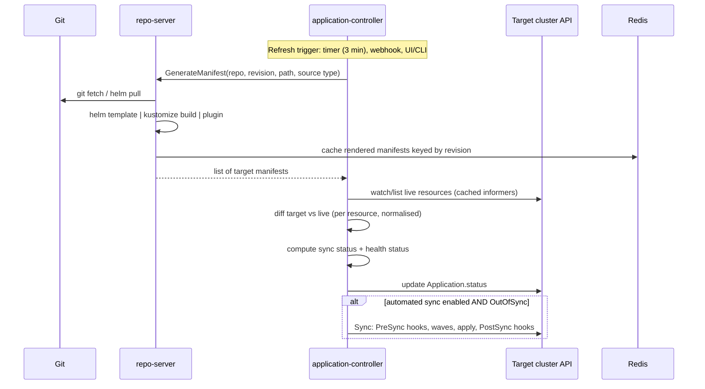
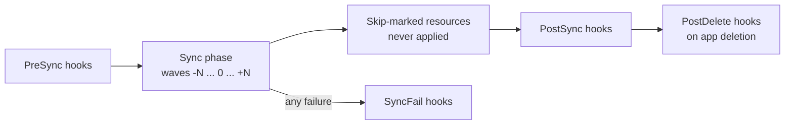
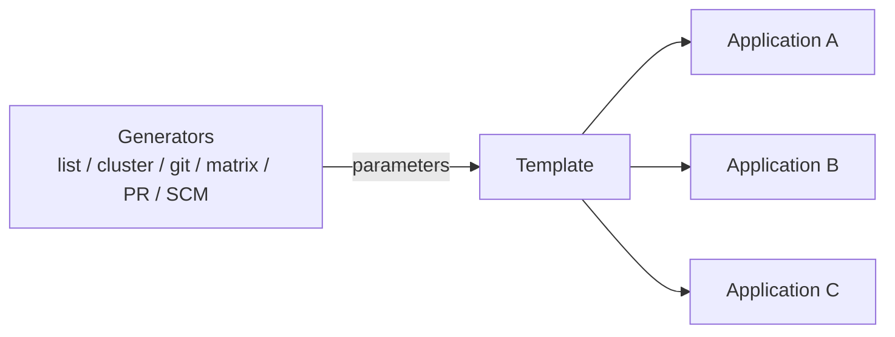
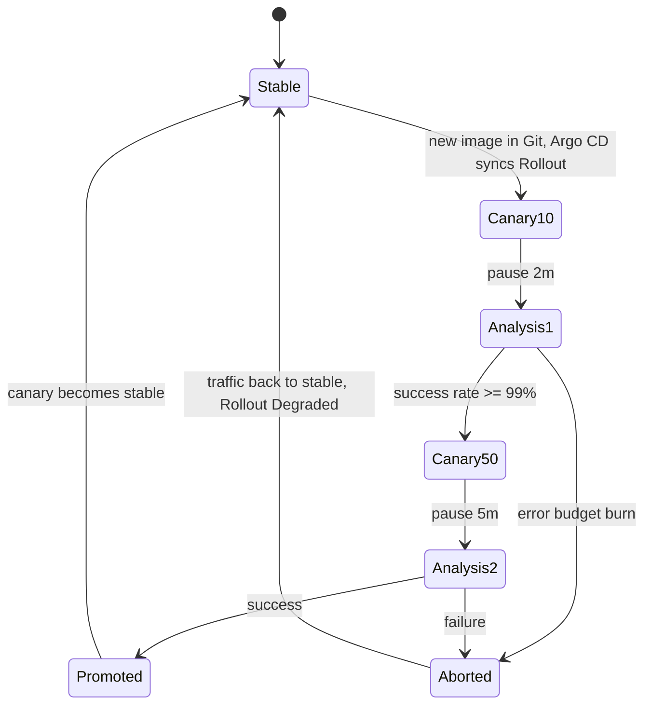

# Argo CD: Core Concepts

| | |
|---|---|
| **Cluster** | 04 Containers & IDP |
| **Role** | Bridge |
| **Prerequisites** | [01-installation-and-setup.md](01-installation-and-setup.md); Kubernetes controllers, Helm templating, Kustomize overlays |
| **Target version** | Argo CD 2.12+, Argo Rollouts 1.7+ |
| **Capstone phase** | Phase 3 (Months 9-12) |

> This file explains how Argo CD works internally: the GitOps principles it implements, the refresh/compare/sync pipeline, every meaningful field of the `Application` CRD, how health is computed, how ApplicationSets generate Applications, how AppProjects fence tenants, and how Argo Rollouts extends the model to progressive delivery. Read it before the labs; refer back to it when the troubleshooting file says "see concepts".

---

## 1. GitOps Principles

The CNCF OpenGitOps working group defines four principles. Argo CD is one implementation; Flux is another.

| # | Principle | What it means in practice | How Argo CD implements it |
|---|---|---|---|
| 1 | **Declarative** | The whole system is described as data, not as scripts that mutate it | Applications point to manifests/charts; no imperative deploy steps |
| 2 | **Versioned and immutable** | Desired state is stored in a system with history and immutability (Git, OCI) | `targetRevision` is a branch, tag or SHA; history is `git log` |
| 3 | **Pulled automatically** | Agents pull desired state; nothing pushes into the runtime | The controller runs in-cluster and fetches Git; CI has no kubeconfig |
| 4 | **Continuously reconciled** | Agents keep observing actual state and act on divergence | Refresh loop every 3 min (or webhook), `selfHeal` reverts drift |

A corollary: **if it is not in Git, it does not exist**. Hand edits are drift to be reverted, not configuration.

---

## 2. The Reconciliation Pipeline



### 2.1 Refresh vs hard refresh vs sync

| Operation | What happens | Trigger |
|---|---|---|
| **Refresh** | Re-fetch Git, re-render (using Redis cache if revision unchanged), re-diff | Every `timeout.reconciliation` (default 180 s), webhook, `argocd app get --refresh` |
| **Hard refresh** | Same, but ignores the manifest cache | `argocd app get --hard-refresh`, needed after changing plugin or Helm value files outside the repo |
| **Sync** | Apply target manifests to the cluster, running hooks and waves | Manual, or automatic when OutOfSync and `syncPolicy.automated` set |

### 2.2 Sync status

| Status | Meaning |
|---|---|
| `Synced` | Every tracked live resource matches its target manifest after normalisation |
| `OutOfSync` | At least one resource differs, is missing, or exists in cluster but not in Git (extra resource, prune candidate) |
| `Unknown` | Comparison failed: repo unreachable, render error, cluster unreachable |

### 2.3 Health status

Health is computed per resource and rolled up to the Application (worst wins).

| Health | Example |
|---|---|
| `Healthy` | Deployment: `availableReplicas == replicas` and generation observed |
| `Progressing` | Rollout in flight; Job running |
| `Degraded` | Deployment exceeded `progressDeadlineSeconds`; Pod CrashLoopBackOff |
| `Suspended` | Rollout paused; CronJob suspended |
| `Missing` | Target resource not found live |
| `Unknown` | No health check for this kind (most CRDs by default) |

Built-in checks exist for Deployment, StatefulSet, DaemonSet, ReplicaSet, Pod, Job, Service (LoadBalancer waits for ingress IP), Ingress, PVC, HPA, and many CRDs contributed by the community (cert-manager Certificate, Argo Rollouts Rollout, ESO ExternalSecret). Anything else needs a Lua script (section 9).

---

## 3. Resource Tracking

Argo CD must know which live resources belong to which Application. Two methods:

| Method | Mechanism | Trade-off |
|---|---|---|
| `label` (legacy default) | `app.kubernetes.io/instance: <app-name>` label | Collides with Helm's use of the same label; app names limited to 63 chars |
| `annotation` (recommended) | `argocd.argoproj.io/tracking-id: <app>:<group>/<kind>:<ns>/<name>` | No collision, supports apps-in-any-namespace; set `application.resourceTrackingMethod: annotation` |
| `annotation+label` | Both | Transitional |

Resources without the tracking marker that exist in the destination namespace are ignored; resources *with* the marker that are not in Git are "extra" and become prune candidates.

---

## 4. The Application CRD in Full

```yaml
apiVersion: argoproj.io/v1alpha1
kind: Application
metadata:
  name: fastapi-service-dev
  namespace: argocd                       # or any namespace when "apps in any namespace" is enabled
  labels:
    env: dev
    team: payments
  annotations:
    # Only refresh when these paths change (monorepo optimisation, needs webhook)
    argocd.argoproj.io/manifest-generate-paths: .;../../charts/fastapi-service
    notifications.argoproj.io/subscribe.on-sync-failed.slack: payments-deploys
  finalizers:
    - resources-finalizer.argocd.argoproj.io      # cascade delete workloads on app deletion
spec:
  project: payments                               # AppProject, fences allowed sources/destinations

  # ---- SOURCE (single) ----
  source:
    repoURL: https://github.com/<GITHUB_ORG>/capstone.git
    targetRevision: main                          # branch | tag | SHA | semver range for Helm repos
    path: gitops/workloads/dev/fastapi-service
    # Source-type specific blocks (only one applies):
    helm:
      releaseName: fastapi-service                # defaults to app name
      valueFiles:
        - values.yaml
        - values-dev.yaml
      values: |                                   # inline overrides (highest precedence after parameters)
        replicaCount: 2
      parameters:
        - name: image.tag
          value: 1.4.2
      valuesObject:                               # structured alternative to values string
        ingress:
          host: api-dev.example.com
      skipCrds: false
      passCredentials: false
      ignoreMissingValueFiles: true
    # kustomize:
    #   namePrefix: dev-
    #   images: ["ghcr.io/example/fastapi-service:1.4.2"]
    #   commonLabels: {env: dev}
    #   patches: [...]
    # directory:
    #   recurse: true
    #   include: "*.yaml"
    #   exclude: "secrets/*"
    #   jsonnet: {...}
    # plugin:
    #   name: sops-v1.0
    #   env: [{name: ENV, value: dev}]

  # ---- SOURCES (multiple; mutually exclusive with .spec.source) ----
  # sources:
  #   - repoURL: https://charts.example.com      # chart from a Helm repo
  #     chart: fastapi-service
  #     targetRevision: 1.4.x
  #     helm:
  #       valueFiles:
  #         - $values/gitops/workloads/dev/fastapi-service/values-dev.yaml
  #   - repoURL: https://github.com/<GITHUB_ORG>/capstone.git   # values from Git
  #     targetRevision: main
  #     ref: values                                             # referenced as $values above

  # ---- DESTINATION ----
  destination:
    server: https://kubernetes.default.svc        # or name: workload-dev (one of server|name)
    namespace: payments-dev

  # ---- SYNC POLICY ----
  syncPolicy:
    automated:
      prune: true          # delete live resources removed from Git (default false)
      selfHeal: true       # revert manual drift (default false)
      allowEmpty: false    # refuse to sync if rendering yields zero resources (protects against mass-prune)
    syncOptions:
      - CreateNamespace=true
      - PruneLast=true                 # prune after all waves succeed
      - ApplyOutOfSyncOnly=true        # apply only resources that differ (big apps)
      - ServerSideApply=true           # kubectl apply --server-side; needed for huge CRDs and field ownership
      - RespectIgnoreDifferences=true  # do not re-apply fields listed in ignoreDifferences
      - PrunePropagationPolicy=foreground
      - Replace=false                  # Replace=true uses kubectl replace; avoid except for immutable fields
      - FailOnSharedResource=true      # error if another app already tracks a resource
    retry:
      limit: 5
      backoff:
        duration: 5s
        factor: 2
        maxDuration: 3m
    managedNamespaceMetadata:          # labels/annotations for the namespace created by CreateNamespace
      labels:
        pod-security.kubernetes.io/enforce: restricted

  # ---- DIFF NORMALISATION ----
  ignoreDifferences:
    - group: apps
      kind: Deployment
      jsonPointers:
        - /spec/replicas                # HPA owns replicas
    - group: ""
      kind: Secret
      name: fastapi-service-tls
      jqPathExpressions:
        - .data["tls.crt"]              # cert-manager rotates it
    - group: admissionregistration.k8s.io
      kind: MutatingWebhookConfiguration
      jqPathExpressions:
        - .webhooks[].clientConfig.caBundle
    - group: "*"
      kind: "*"
      managedFieldsManagers:
        - kube-controller-manager       # ignore anything that controller wrote (SSA field managers)

  # ---- HISTORY ----
  revisionHistoryLimit: 10

  # ---- INFO LINKS (UI) ----
  info:
    - name: Runbook
      value: https://backstage.example.com/docs/default/component/fastapi-service
```

### 4.1 Key decisions encoded in syncPolicy

- **`automated` without `prune`** means deletions in Git are *shown* but not executed. Safe default for the first week of a new app.
- **`selfHeal: true`** turns every `kubectl edit` into a 5-second experiment. Pair with Argo CD RBAC so people cannot `kubectl` prod anyway.
- **`allowEmpty: false`** guards against the classic accident: a bad Kustomize path renders nothing, and Argo CD prunes everything. Keep it false.
- **`ServerSideApply=true`** is increasingly the right default: it avoids the 262 KB `last-applied-configuration` annotation limit (large CRDs fail without it) and records field ownership so multiple controllers can coexist. Side effect: diffs become owner-aware, which is why `managedFieldsManagers` exists.

---

## 5. Sync Phases, Waves and Hooks

Every sync executes in phases. Within a phase, resources are grouped by **wave** (annotation, default 0) and applied in ascending order. Argo CD waits for all resources in a wave to be healthy (or 2 seconds for kinds with no health check) before moving on.



| Annotation | Values | Purpose |
|---|---|---|
| `argocd.argoproj.io/sync-wave` | integer string, e.g. `"-1"`, `"5"` | Ordering within a phase. CRDs and Namespaces at -5, databases at -1, app at 0, smoke tests at +5 |
| `argocd.argoproj.io/hook` | `PreSync`, `Sync`, `PostSync`, `SyncFail`, `PostDelete`, `Skip` | Marks a resource as a hook that runs in that phase instead of being tracked |
| `argocd.argoproj.io/hook-delete-policy` | `HookSucceeded`, `HookFailed`, `BeforeHookCreation` (default) | When to delete the hook resource |
| `argocd.argoproj.io/sync-options` | `Prune=false`, `Delete=false`, `Validate=false`, `SkipDryRunOnMissingResource=true`, `Replace=true`, `ServerSideApply=true`, `Force=true` | Per-resource overrides |
| `argocd.argoproj.io/compare-options` | `IgnoreExtraneous` | Do not report this live resource as extra |

A canonical PreSync migration Job:

```yaml
apiVersion: batch/v1
kind: Job
metadata:
  name: fastapi-db-migrate
  annotations:
    argocd.argoproj.io/hook: PreSync
    argocd.argoproj.io/hook-delete-policy: BeforeHookCreation,HookSucceeded
    argocd.argoproj.io/sync-wave: "-1"
spec:
  backoffLimit: 2
  template:
    spec:
      restartPolicy: Never
      securityContext:
        runAsNonRoot: true
        seccompProfile: { type: RuntimeDefault }
      containers:
        - name: migrate
          image: ghcr.io/<GITHUB_ORG>/fastapi-service:1.4.2
          command: ["alembic", "upgrade", "head"]
          envFrom:
            - secretRef: { name: fastapi-service-db }
          securityContext:
            allowPrivilegeEscalation: false
            capabilities: { drop: ["ALL"] }
            readOnlyRootFilesystem: true
```

Helm hook annotations (`helm.sh/hook: pre-install`) are translated: `pre-install`/`pre-upgrade` to PreSync, `post-install`/`post-upgrade` to PostSync, `pre-delete`/`post-delete` to PostDelete (2.10+), `test` is skipped (Argo CD does not run `helm test`). `crd-install` becomes a wave -1 Sync resource.

---

## 6. App-of-Apps

A root Application whose source directory contains *other* Application manifests. Syncing the root creates the children; the children sync their own workloads. This is how a cluster bootstraps from one `kubectl apply`.

```yaml
# gitops/bootstrap/root-app.yaml
apiVersion: argoproj.io/v1alpha1
kind: Application
metadata:
  name: root
  namespace: argocd
spec:
  project: platform
  source:
    repoURL: https://github.com/<GITHUB_ORG>/capstone.git
    targetRevision: main
    path: gitops/platform
    directory:
      recurse: true
  destination:
    server: https://kubernetes.default.svc
    namespace: argocd
  syncPolicy:
    automated: { prune: true, selfHeal: true }
```

Children in `gitops/platform/` use sync waves so CRD-providing operators (cert-manager, ESO, Prometheus Operator, Argo Rollouts) land before anything that emits their CRs. ApplicationSets have largely superseded App-of-Apps for *fan-out*; App-of-Apps remains the idiomatic *bootstrap*.

---

## 7. ApplicationSets

An `ApplicationSet` is a template plus one or more **generators** that produce parameter sets; each parameter set renders one `Application`. The controller owns the children and updates or deletes them when generator output changes.



### 7.1 List generator

```yaml
apiVersion: argoproj.io/v1alpha1
kind: ApplicationSet
metadata:
  name: fastapi-service-envs
  namespace: argocd
spec:
  goTemplate: true
  goTemplateOptions: ["missingkey=error"]
  generators:
    - list:
        elements:
          - env: dev
            cluster: workload-dev
            replicas: "1"
          - env: stage
            cluster: workload-stage
            replicas: "2"
          - env: prod
            cluster: workload-prod
            replicas: "3"
  template:
    metadata:
      name: 'fastapi-service-{{ .env }}'
    spec:
      project: payments
      source:
        repoURL: https://github.com/<GITHUB_ORG>/capstone.git
        targetRevision: main
        path: 'gitops/workloads/{{ .env }}/fastapi-service'
      destination:
        name: '{{ .cluster }}'
        namespace: payments
      syncPolicy:
        automated:
          prune: true
          selfHeal: '{{ ne .env "prod" }}'     # prod syncs manually
```

### 7.2 Cluster generator

Produces one Application per registered cluster, optionally filtered by cluster Secret labels.

```yaml
  generators:
    - clusters:
        selector:
          matchLabels:
            argocd.argoproj.io/secret-type: cluster
            tier: workload
        values:
          chartVersion: 1.2.3
  template:
    metadata:
      name: 'kube-prometheus-{{ .name }}'
    spec:
      source:
        repoURL: https://prometheus-community.github.io/helm-charts
        chart: kube-prometheus-stack
        targetRevision: '{{ .values.chartVersion }}'
      destination:
        server: '{{ .server }}'
        namespace: monitoring
```

Available parameters: `name`, `server`, `metadata.labels.*`, `metadata.annotations.*`, plus `values.*`.

### 7.3 Git generators

**Directory**: one Application per subdirectory matching a glob.

```yaml
  generators:
    - git:
        repoURL: https://github.com/<GITHUB_ORG>/capstone.git
        revision: main
        directories:
          - path: gitops/workloads/dev/*
          - path: gitops/workloads/dev/_templates
            exclude: true
  template:
    metadata:
      name: '{{ .path.basename }}-dev'
    spec:
      source:
        path: '{{ .path.path }}'
```

**File**: one Application per matching file; the file's YAML/JSON content becomes parameters.

```yaml
  generators:
    - git:
        repoURL: https://github.com/<GITHUB_ORG>/capstone.git
        revision: main
        files:
          - path: "gitops/clusters/**/config.yaml"
```

```yaml
# gitops/clusters/eu-west-1/prod-a/config.yaml
cluster:
  name: prod-a
  server: https://prod-a.example.com
  region: eu-west-1
addons:
  certManager: true
```

Parameters: `{{ .cluster.name }}`, `{{ .addons.certManager }}`, `{{ .path.path }}`.

### 7.4 Matrix and merge generators

Matrix produces the Cartesian product of two generators: *every service* on *every cluster*.

```yaml
  generators:
    - matrix:
        generators:
          - clusters:
              selector: { matchLabels: { tier: workload } }
          - git:
              repoURL: https://github.com/<GITHUB_ORG>/capstone.git
              revision: main
              directories:
                - path: gitops/addons/*
  template:
    metadata:
      name: '{{ .path.basename }}-{{ .name }}'
    spec:
      source:
        repoURL: https://github.com/<GITHUB_ORG>/capstone.git
        targetRevision: main
        path: '{{ .path.path }}'
      destination:
        server: '{{ .server }}'
        namespace: '{{ .path.basename }}'
```

Merge overlays parameters from later generators onto earlier ones by a `mergeKeys` field (per-cluster overrides of a base list).

### 7.5 Pull request generator (preview environments)

```yaml
  generators:
    - pullRequest:
        github:
          owner: <GITHUB_ORG>
          repo: fastapi-service
          labels: [preview]
          tokenRef: { secretName: github-token, key: token }
        requeueAfterSeconds: 60
  template:
    metadata:
      name: 'fastapi-pr-{{ .number }}'
    spec:
      project: previews
      source:
        repoURL: https://github.com/<GITHUB_ORG>/fastapi-service.git
        targetRevision: '{{ .head_sha }}'
        path: charts/fastapi-service
        helm:
          parameters:
            - name: image.tag
              value: 'pr-{{ .number }}-{{ .head_short_sha }}'
            - name: ingress.host
              value: 'pr-{{ .number }}.preview.example.com'
      destination:
        server: https://kubernetes.default.svc
        namespace: 'preview-pr-{{ .number }}'
      syncPolicy:
        automated: { prune: true, selfHeal: true }
        syncOptions: [CreateNamespace=true]
```

When the PR closes, the generator stops emitting it, the Application is deleted, and the finalizer removes the namespace contents.

### 7.6 ApplicationSet safety

```yaml
spec:
  syncPolicy:
    preserveResourcesOnDeletion: true    # deleting the ApplicationSet leaves Applications
    applicationsSync: create-update      # never delete generated Applications; or create-only
  strategy:
    type: RollingSync                    # progressive sync across generated apps
    rollingSync:
      steps:
        - matchExpressions: [{ key: env, operator: In, values: [dev] }]
        - matchExpressions: [{ key: env, operator: In, values: [stage] }]
        - matchExpressions: [{ key: env, operator: In, values: [prod] }]
          maxUpdate: 1
```

Progressive syncs require the controller flag `--enable-progressive-syncs` (alpha).

---

## 8. AppProjects and RBAC

An `AppProject` is Argo CD's tenancy boundary: *which repos* an Application may pull from, *which clusters/namespaces* it may deploy to, *which resource kinds* it may create, and *who* can act on it.

```yaml
apiVersion: argoproj.io/v1alpha1
kind: AppProject
metadata:
  name: payments
  namespace: argocd
spec:
  description: Payments team workloads
  sourceRepos:
    - https://github.com/<GITHUB_ORG>/capstone.git
    - https://github.com/<GITHUB_ORG>/payments-*          # glob
  sourceNamespaces:                                        # apps-in-any-namespace
    - payments-argocd
  destinations:
    - name: workload-dev
      namespace: payments-*
    - name: workload-prod
      namespace: payments
  clusterResourceWhitelist: []                             # no cluster-scoped resources at all
  namespaceResourceBlacklist:
    - group: ""
      kind: ResourceQuota
    - group: ""
      kind: LimitRange
    - group: networking.k8s.io
      kind: NetworkPolicy                                  # platform team owns network policy
  orphanedResources:
    warn: true                                             # flag resources in the namespace not managed by any app
  syncWindows:
    - kind: deny
      schedule: "0 22 * * 5"                               # Friday 22:00
      duration: 58h                                        # until Monday 08:00
      applications: ["*-prod"]
      manualSync: true                                     # humans can still force
    - kind: allow
      schedule: "0 9 * * 1-5"
      duration: 9h
      applications: ["*-prod"]
      timeZone: Europe/London
  roles:
    - name: developer
      description: Sync and view payments apps
      policies:
        - p, proj:payments:developer, applications, get,  payments/*, allow
        - p, proj:payments:developer, applications, sync, payments/*, allow
        - p, proj:payments:developer, logs, get, payments/*, allow
      groups:
        - payments-developers                              # OIDC group claim
    - name: ci
      description: Token used by GitHub Actions to trigger sync
      policies:
        - p, proj:payments:ci, applications, sync, payments/*, allow
      jwtTokens: []                                        # created with: argocd proj role create-token
```

Global RBAC lives in the `argocd-rbac-cm` ConfigMap using Casbin syntax:

```text
p, <subject>, <resource>, <action>, <object>, <effect>
g, <subject>, <role>
```

```yaml
# argocd-rbac-cm (data.policy.csv)
policy.default: ""                 # deny everything not granted
policy.csv: |
  # Platform team: full admin
  g, platform-engineers, role:admin
  # Everyone authenticated: read-only on everything
  g, authenticated-users, role:readonly
  # SRE: sync + rollback anywhere, no project edits
  p, role:sre, applications, sync,     */*, allow
  p, role:sre, applications, action/*, */*, allow
  p, role:sre, applications, override, */*, deny
  g, sre-oncall, role:sre
scopes: "[groups, email]"
```

Resources: `applications`, `applicationsets`, `clusters`, `projects`, `repositories`, `accounts`, `certificates`, `gpgkeys`, `logs`, `exec`, `extensions`. Actions: `get`, `create`, `update`, `delete`, `sync`, `override`, `action/<group>/<kind>/<action>`. Objects are `<project>/<application>`.

Test policies before committing:

```bash
argocd admin settings rbac can payments-developers sync applications 'payments/fastapi-service-dev' --policy-file policy.csv
```

---

## 9. Health Checks and Custom Lua

For CRDs without built-in checks, add Lua to `argocd-cm`:

```yaml
# argocd-cm
resource.customizations.health.external-secrets.io_ExternalSecret: |
  hs = {}
  if obj.status ~= nil and obj.status.conditions ~= nil then
    for _, c in ipairs(obj.status.conditions) do
      if c.type == "Ready" then
        if c.status == "True" then
          hs.status = "Healthy"
          hs.message = c.message
          return hs
        end
        hs.status = "Degraded"
        hs.message = c.reason .. ": " .. (c.message or "")
        return hs
      end
    end
  end
  hs.status = "Progressing"
  hs.message = "Waiting for ExternalSecret to be Ready"
  return hs
```

Lua **resource actions** add buttons to the UI (restart a Deployment, resume a Rollout):

```yaml
resource.customizations.actions.apps_Deployment: |
  discovery.lua: |
    actions = {}
    actions["restart"] = {}
    return actions
  definitions:
    - name: restart
      action.lua: |
        local os = require("os")
        if obj.spec.template.metadata == nil then obj.spec.template.metadata = {} end
        if obj.spec.template.metadata.annotations == nil then obj.spec.template.metadata.annotations = {} end
        obj.spec.template.metadata.annotations["kubectl.kubernetes.io/restartedAt"] = os.date("!%Y-%m-%dT%XZ")
        return obj
```

Ignore an entire kind for health rollup (an Application's health should not go Degraded because a monitoring CR is unhappy):

```yaml
resource.customizations.health.monitoring.coreos.com_ServiceMonitor: |
  hs = { status = "Healthy", message = "ServiceMonitor is passive" }
  return hs
```

---

## 10. Source Types

| Source | Detected by | Render command | Notes |
|---|---|---|---|
| Plain directory | `*.yaml`/`*.json` without Chart.yaml or kustomization.yaml | none | `directory.recurse`, `include`/`exclude` globs |
| Helm (Git) | `Chart.yaml` present | `helm template` | Dependencies pulled via `helm dependency build`; `lookup` returns empty |
| Helm (repo/OCI) | `spec.source.chart` set | `helm pull` + `helm template` | `repoURL: oci://ghcr.io/org/charts`, `targetRevision` supports semver ranges |
| Kustomize | `kustomization.yaml` present | `kustomize build` | `--enable-helm` via `kustomize.buildOptions`; `images`, `namePrefix`, `patches` overridable |
| Jsonnet | `.jsonnet` files + `directory.jsonnet` | `jsonnet` | Legacy; prefer Helm/Kustomize |
| Config Management Plugin (CMP) | `spec.source.plugin.name` or plugin `discover` rule | sidecar `generate` command | Sidecar on repo-server; used for SOPS/helmfile/cdk8s |

### 10.1 Config Management Plugin (sidecar)

```yaml
# plugin.yaml mounted into the sidecar at /home/argocd/cmp-server/config/plugin.yaml
apiVersion: argoproj.io/v1alpha1
kind: ConfigManagementPlugin
metadata:
  name: helmfile
spec:
  version: v1.0
  discover:
    fileName: "helmfile.yaml"
  generate:
    command: [sh, -c]
    args:
      - helmfile --environment "$ARGOCD_ENV_ENV" template --quiet
  parameters:
    static:
      - name: ENV
        string: dev
```

The sidecar is added to the repo-server Deployment with the plugin config and a shared `/tmp` volume; it runs as the same non-root UID (999) and must not need network access beyond Git/Helm repos.

---

## 11. Multi-Source Applications

Separating chart from values is the dominant use: a chart from an OCI registry plus environment values from the GitOps repo.

```yaml
spec:
  sources:
    - repoURL: oci://ghcr.io/<GITHUB_ORG>/charts
      chart: fastapi-service
      targetRevision: 1.4.x
      helm:
        valueFiles:
          - $values/gitops/workloads/prod/fastapi-service/values.yaml
    - repoURL: https://github.com/<GITHUB_ORG>/capstone.git
      targetRevision: main
      ref: values
```

Caveat: Image Updater's Git write-back does not yet support multi-source apps cleanly; use `parameters` or a single-source chart-in-Git layout if you rely on it.

---

## 12. Notifications

The notifications controller matches **triggers** (conditions over Application state) to **templates** and sends them through **services**; Applications subscribe via annotation or a default subscription.

```yaml
# argocd-notifications-cm
service.slack: |
  token: $slack-token                     # key in argocd-notifications-secret
service.github: |
  appID: <APP_ID>
  installationID: <INSTALLATION_ID>
  privateKey: $github-privateKey

template.app-deployed: |
  message: |
    Application {{.app.metadata.name}} is now running revision {{.app.status.sync.revision | trunc 7}}.
  slack:
    attachments: |
      [{"title": "{{ .app.metadata.name}}", "title_link": "{{.context.argocdUrl}}/applications/{{.app.metadata.name}}",
        "color": "#18be52", "fields": [
        {"title": "Sync Status", "value": "{{.app.status.sync.status}}", "short": true},
        {"title": "Repository", "value": "{{.app.spec.source.repoURL}}", "short": true}]}]
  github:
    status:
      state: success
      label: "continuous-delivery/{{.app.metadata.name}}"
      targetURL: "{{.context.argocdUrl}}/applications/{{.app.metadata.name}}?operation=true"

trigger.on-deployed: |
  - description: Application is synced and healthy
    send: [app-deployed]
    when: app.status.operationState.phase in ['Succeeded'] and app.status.health.status == 'Healthy'
    oncePer: app.status.operationState.syncResult.revision

trigger.on-health-degraded: |
  - when: app.status.health.status == 'Degraded'
    send: [app-health-degraded]

subscriptions: |
  - recipients: [slack:platform-deploys]
    triggers: [on-deployed, on-health-degraded, on-sync-failed]
```

Per-Application: `notifications.argoproj.io/subscribe.on-deployed.slack: payments-deploys`. The GitHub service posts commit statuses, which is how a PR shows "deployed to dev".

---

## 13. Argo Rollouts: Progressive Delivery

Argo Rollouts replaces `Deployment` with a `Rollout` CRD that supports canary and blue-green strategies, traffic shaping via ingress/mesh, and automated promotion or rollback based on **AnalysisTemplates** that query Prometheus, Datadog, a web endpoint or a Job.



```yaml
apiVersion: argoproj.io/v1alpha1
kind: Rollout
metadata:
  name: fastapi-service
spec:
  replicas: 6
  revisionHistoryLimit: 3
  selector:
    matchLabels: { app: fastapi-service }
  template:
    metadata:
      labels: { app: fastapi-service }
    spec:
      containers:
        - name: api
          image: ghcr.io/<GITHUB_ORG>/fastapi-service:1.4.2
          ports: [{ containerPort: 8000 }]
  strategy:
    canary:
      canaryService: fastapi-service-canary
      stableService: fastapi-service-stable
      trafficRouting:
        nginx:
          stableIngress: fastapi-service
      analysis:
        templates:
          - templateName: success-rate
        startingStep: 1
        args:
          - name: service
            value: fastapi-service-canary
      steps:
        - setWeight: 10
        - pause: { duration: 2m }
        - setWeight: 50
        - pause: { duration: 5m }
        - setWeight: 100
---
apiVersion: argoproj.io/v1alpha1
kind: AnalysisTemplate
metadata:
  name: success-rate
spec:
  args:
    - name: service
  metrics:
    - name: success-rate
      interval: 30s
      count: 10
      successCondition: result[0] >= 0.99
      failureLimit: 2
      provider:
        prometheus:
          address: http://kube-prometheus-stack-prometheus.monitoring.svc:9090
          query: |
            sum(rate(http_requests_total{service="{{args.service}}",status!~"5.."}[2m]))
            /
            sum(rate(http_requests_total{service="{{args.service}}"}[2m]))
```

Blue-green swaps the `activeService` selector to the new ReplicaSet after `prePromotionAnalysis` passes; `autoPromotionEnabled: false` requires `kubectl argo rollouts promote`. From Argo CD's perspective a Rollout is one resource with health `Progressing` during steps, `Suspended` when paused, `Degraded` when aborted; the UI shows each step.

---

## 14. Argo CD vs Flux

| Dimension | Argo CD | Flux v2 |
|---|---|---|
| Primary CRDs | Application, ApplicationSet, AppProject | GitRepository, Kustomization, HelmRelease, OCIRepository, ImagePolicy |
| UI | Rich built-in web UI with diff, tree, logs, terminal | None built in; Weave GitOps UI (archived) or Headlamp plugin |
| Helm handling | `helm template` then apply; no release secrets | Real `helm install/upgrade` via helm-controller; `helm list` works; `lookup` works |
| Multi-cluster | Hub-and-spoke from one control plane; clusters registered as Secrets | One Flux per cluster (or hub with kubeconfig refs); more agent-like |
| Multi-tenancy | AppProjects, RBAC, SSO built in | Kubernetes RBAC + impersonation (`serviceAccountName`) |
| Image automation | Separate Image Updater project | Built-in image-reflector/image-automation controllers |
| Progressive delivery | Argo Rollouts (own CRD) | Flagger (wraps existing Deployment) |
| Notifications | Built-in controller | notification-controller |
| Templates / fan-out | ApplicationSets | Kustomize overlays, no generator concept |
| Diff visibility | Always computed and displayed | Must run `flux diff kustomization` |
| Scale ceiling | Thousands of apps per instance with sharding; repo-server is the bottleneck | Lightweight per-cluster; scales with cluster count naturally |
| Choose when | You want a UI, SSO/RBAC out of the box, hub control, preview envs via PR generator | You want Kubernetes-native composability, true Helm releases, minimal control plane |

Both are CNCF graduated. The capstone chooses Argo CD for the UI, the Backstage plugin ecosystem, and ApplicationSets; the ADR records that Flux's Helm fidelity is the trade-off given up.

---

## 15. Vocabulary Recap

| Term | One-line definition |
|---|---|
| Application | Desired state (source) mapped to a destination with a sync policy |
| Refresh | Re-render and re-compare without applying |
| Sync | Apply desired state, honouring phases, waves and hooks |
| Prune | Delete live resources that are tracked but absent from Git |
| Self-heal | Automatically sync when live drifts from the last synced revision |
| Wave | Integer ordering of resources within a sync phase |
| Hook | Resource run in PreSync/Sync/PostSync/SyncFail/PostDelete instead of being tracked |
| AppProject | Tenancy fence: allowed repos, destinations, resource kinds, roles, sync windows |
| ApplicationSet | Generator plus template producing many Applications |
| App-of-Apps | Application whose manifests are other Applications |
| Tracking method | How live resources are attributed to an Application (label vs annotation) |
| CMP | Config Management Plugin, a repo-server sidecar that renders custom sources |
| Rollout | Argo Rollouts replacement for Deployment with canary/blue-green |
| AnalysisTemplate | Metric query plus success condition used to gate a Rollout step |

Next: [03-commands-and-cheatsheet.md](03-commands-and-cheatsheet.md).
