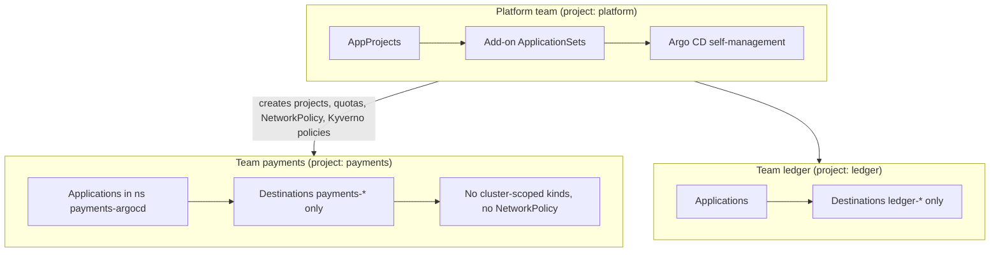

# Argo CD: Production Patterns

| | |
|---|---|
| **Cluster** | 04 Containers & IDP |
| **Role** | Bridge |
| **Prerequisites** | Labs 1-8 in [04-hands-on-labs.md](04-hands-on-labs.md); familiarity with External Secrets Operator, Kyverno and Prometheus from clusters 08 and 09 |
| **Target version** | Argo CD 2.12+ |
| **Capstone phase** | Phase 3 (Months 9-12) |

> How to run Argo CD as the deployment control plane for an organisation: repository layout, promotion, secrets, security hardening, high availability, scaling, observability, disaster recovery, CI integration, multi-tenancy, and the anti-patterns that cause most incidents. Ends with a decision checklist you can paste into an ADR.

---

## 1. Repository Structure

### 1.1 Separate application code from deployment config

Keep source code and the GitOps repo apart. Reasons: different reviewers, different merge cadence, a CI build should not trigger a re-render of every environment, and the GitOps repo's history *is* the deployment audit log.

```text
capstone-gitops/
├── bootstrap/
│   └── root.yaml                      # applied once by Terraform (helm_release + kubectl_manifest)
├── platform/                          # App-of-Apps content, owned by platform team
│   ├── projects/                      # AppProjects, wave -10
│   ├── addons/                        # cert-manager, ESO, ingress, kube-prometheus-stack, kyverno, argo-rollouts
│   │   └── *.appset.yaml              # cluster generator: every cluster gets the add-on
│   └── apps/
│       └── *.appset.yaml              # git directory generators for workloads
├── workloads/
│   ├── dev/<service>/values.yaml
│   ├── stage/<service>/values.yaml
│   └── prod/<service>/values.yaml
├── clusters/
│   └── <region>/<cluster>/config.yaml # consumed by git file generator (cluster metadata)
└── charts/                            # optional: charts kept in-repo; prefer OCI registry for shared charts
```

### 1.2 Branch-per-environment vs directory-per-environment

| | Directory per environment (recommended) | Branch per environment |
|---|---|---|
| Promotion | Copy a value (`image.tag`) between directories in one commit | Merge/cherry-pick across branches |
| Diff between envs | `diff -r workloads/stage workloads/prod` | `git diff stage..prod` (noisy, includes everything) |
| Drift between envs | Visible in a single tree | Branches diverge silently |
| Hotfix to prod only | Edit `prod/` only | Commit to prod branch, must back-merge |
| Fits ApplicationSets | Yes (git directory generator) | Poorly |

Branch-per-environment comes from pre-GitOps habits and causes long-lived divergence. Use directories.

### 1.3 Monorepo performance

For repositories with hundreds of Applications, each refresh clones and renders. Mitigations in order of impact:

1. Webhooks instead of 3-minute polling (`timeout.reconciliation: 0` disables polling entirely if webhooks are reliable).
2. `argocd.argoproj.io/manifest-generate-paths` on every Application so a push touching `workloads/dev/a` does not re-render `workloads/prod/b`.
3. Scale `repo-server` horizontally and set `reposerver.parallelism.limit`.
4. Shallow clones are not supported; keep the repo small (no binaries, no vendored charts).
5. Move shared charts to an OCI registry so chart updates are a version bump, not a repo change.

---

## 2. Promotion Strategies

Argo CD does not promote; Git does. Patterns, from simplest to most capable:

| Strategy | Mechanism | Pros | Cons |
|---|---|---|---|
| **Manual PR** | Human edits `prod/values.yaml` | Full review, audit trail | Slow; copy-paste errors |
| **CI-authored PR** | GitHub Actions job (`peter-evans/create-pull-request`) updates `dev` tag after image push; a second workflow opens stage/prod PRs on schedule or on approval | Review preserved, automated toil removed | Workflow code to maintain |
| **Argo CD Image Updater** | Controller polls registry, writes back to Git (commit or `.argocd-source-<app>.yaml`) | No CI changes; semver/digest strategies | Bypasses PR review unless targeting a branch; multi-source limits; tag-polling load on registry |
| **Kargo** | Dedicated promotion controller: Warehouses watch images/charts, Stages represent environments, Promotions are Git commits with verification steps | Purpose-built, UI, approvals, soak times, analysis integration | Another control plane to run; younger project |

### 2.1 CI-authored promotion workflow (capstone default)

```yaml
# .github/workflows/promote.yml (in the GitOps repo)
name: promote
on:
  repository_dispatch:
    types: [image-published]        # sent by the service repo's build workflow
permissions:
  contents: write
  pull-requests: write
jobs:
  bump-dev:
    runs-on: ubuntu-latest
    steps:
      - uses: actions/checkout@v4
      - name: Update dev tag
        run: |
          yq -i '.image.tag = "${{ github.event.client_payload.tag }}"' \
            workloads/dev/${{ github.event.client_payload.service }}/values.yaml
      - uses: peter-evans/create-pull-request@v7
        with:
          branch: promote/dev-${{ github.event.client_payload.service }}-${{ github.event.client_payload.tag }}
          title: "dev: ${{ github.event.client_payload.service }} ${{ github.event.client_payload.tag }}"
          body: |
            Image: `${{ github.event.client_payload.image }}@${{ github.event.client_payload.digest }}`
            Cosign verification: passed in build workflow.
          labels: promotion,dev
```

Auto-merge is enabled for `dev` PRs with passing checks; `stage` and `prod` PRs require CODEOWNERS review. Pin by **digest** in prod values (`image.digest: sha256:...`) so a tag cannot be silently re-pushed.

### 2.2 Image Updater configuration (when chosen)

```yaml
metadata:
  annotations:
    argocd-image-updater.argoproj.io/image-list: api=ghcr.io/<GITHUB_ORG>/fastapi-service
    argocd-image-updater.argoproj.io/api.update-strategy: semver
    argocd-image-updater.argoproj.io/api.allow-tags: regexp:^v?[0-9]+\.[0-9]+\.[0-9]+$
    argocd-image-updater.argoproj.io/api.pull-secret: pullsecret:argocd/ghcr-pull
    argocd-image-updater.argoproj.io/write-back-method: git:secret:argocd/git-writeback
    argocd-image-updater.argoproj.io/git-branch: main:image-updater/{{ .AppName }}   # push to a branch, open PR via CI
    argocd-image-updater.argoproj.io/write-back-target: helmvalues:values.yaml
    argocd-image-updater.argoproj.io/api.helm.image-name: image.repository
    argocd-image-updater.argoproj.io/api.helm.image-tag: image.tag
```

Use `git-branch` so a PR is still opened; direct commits to `main` remove review for prod.

---

## 3. Secrets Management

### 3.1 Why not Secrets in Git

A Kubernetes `Secret` manifest is base64, not encryption. Committing it means every clone, every CI runner cache, every fork, and every Argo CD repo-server cache holds the plaintext. Rotation becomes a Git history rewrite. Do not do it, even in a private repo.

### 3.2 Options

| Approach | How it works with Argo CD | Rotation | Trade-offs |
|---|---|---|---|
| **External Secrets Operator (recommended)** | Git holds `ExternalSecret` referencing a path in Vault/AWS Secrets Manager/Azure Key Vault/GCP Secret Manager; ESO creates the `Secret` in-cluster | Change in the backend; ESO refreshes on `refreshInterval` | One more operator; needs workload identity to the backend |
| **Sealed Secrets** | `kubeseal` encrypts with the controller's public key; `SealedSecret` is committed; controller decrypts in-cluster | Re-seal and commit | Key is per-cluster; DR requires backing up the sealing key |
| **SOPS + CMP plugin (or KSOPS for Kustomize)** | Encrypted YAML in Git (age/KMS keys); repo-server sidecar decrypts during render | Re-encrypt and commit | Decrypted material passes through repo-server memory and Redis cache; sidecar needs KMS access |
| **Vault Agent / CSI driver** | Pods fetch secrets at runtime; Argo CD never sees them | Automatic via leases | App or sidecar changes required |

Capstone pattern: ESO with a `ClusterSecretStore` per cluster authenticating via IRSA/Workload Identity, plus a custom Lua health check so `ExternalSecret` readiness gates the wave.

```yaml
apiVersion: external-secrets.io/v1beta1
kind: ExternalSecret
metadata:
  name: fastapi-service-db
  annotations:
    argocd.argoproj.io/sync-wave: "-1"
spec:
  refreshInterval: 1h
  secretStoreRef: { kind: ClusterSecretStore, name: aws-secrets-manager }
  target:
    name: fastapi-service-db
    creationPolicy: Owner
  data:
    - secretKey: DATABASE_URL
      remoteRef:
        key: /capstone/prod/fastapi-service/database-url
```

Argo CD's own credentials (repo keys, OIDC client secret, notification tokens) follow the same rule: `argocd-secret` and repository Secrets are populated by ESO, never by `kubectl create secret` from a laptop.

### 3.3 Diffing on Secrets

Argo CD hides Secret values in the UI and diff (`+++++++++`), but `argocd app manifests` returns rendered content to anyone with `applications, get`. Grant that permission deliberately.

---

## 4. Security Hardening

### 4.1 Identity and access

- **Disable `admin`** (`admin.enabled: "false"`) once SSO works. Keep a break-glass local account with a strong password stored in the secret manager and `policy.csv` granting it `role:admin`; alert on its use.
- **SSO**: direct OIDC to your IdP when possible; Dex only when you need to federate GitHub teams, LDAP or SAML. Request the `groups` scope and map groups, not users, in RBAC.
- **`policy.default: ""`** (deny). `role:readonly` as a default leaks every manifest to every authenticated user.
- **Project roles with JWT tokens** for CI rather than account tokens; scope them to `sync` on one project; set expiry; rotate via ESO.
- **`exec` RBAC**: the web terminal (`exec.enabled: "true"`) is `kubectl exec` with Argo CD's cluster credentials. Leave it disabled or restrict to a tiny group.
- **Apps-in-any-namespace** (`application.namespaces`) plus `sourceNamespaces` on AppProjects lets teams create Applications in their own namespaces with ordinary Kubernetes RBAC, instead of everyone writing to `argocd`.

### 4.2 Cluster credentials

- The default `argocd cluster add` grants **cluster-admin** via a long-lived token. In production use **workload identity**: IRSA/EKS Pod Identity with `awsAuthConfig`, GKE Workload Identity with `execProviderConfig`, or Entra Workload Identity on AKS. Scope the IAM role to the target clusters only.
- For namespace-scoped tenancy, register with `--namespace` flags so Argo CD gets a `Role`, not a `ClusterRole`.
- Rotate tokens (`argocd cluster rotate-auth`) on a schedule if you must use them.

### 4.3 Repository and manifest integrity

- GitHub App credentials over PATs; deploy keys over user keys.
- **Signed commits**: add maintainers' GPG keys and set `spec.signatureKeys` on the AppProject; Argo CD refuses to sync unsigned revisions.
- **Image signatures** are enforced by Kyverno/Gatekeeper at admission (see [../../08-devsecops/](../../08-devsecops/README.md)); Argo CD then shows the sync failure with the policy message.
- Pin Helm charts by exact version in prod, OCI charts by digest where the registry supports it.
- `resource.exclusions` to stop Argo CD watching noisy or sensitive kinds (Events, Leases, `*.cilium.io/CiliumEndpoint`).

### 4.4 Network and runtime

- NetworkPolicy: repo-server egress to Git/registry endpoints only; application-controller egress to the API servers; api-server ingress from the ingress controller only. The Helm chart ships `networkPolicy.create: true`.
- Terminate TLS at the ingress with cert-manager *and* keep `server.insecure: false`, re-encrypting to argocd-server. The UI must never be plain HTTP beyond a lab.
- All components run non-root (UID 999) with a read-only root filesystem by default; do not loosen it for plugins; give CMP sidecars an emptyDir for `/tmp`.
- Enable audit: argocd-server logs every API call with the user; ship to Loki; alert on `admin` logins and on `applications, override`.

### 4.5 Blast-radius controls

- `allowEmpty: false` everywhere.
- `prune: false` on platform add-ons that own CRDs (cert-manager, Prometheus Operator); use `Prune=false` annotation on CRDs themselves.
- `FailOnSharedResource=true` so two Applications cannot fight over one resource.
- Sync windows for prod freezes.
- `revisionHistoryLimit` and `controller.app.state.cache.expiration` tuned so rollback targets are retained.

---

## 5. High Availability and Scaling

| Component | HA setting | Scaling lever |
|---|---|---|
| argocd-server | 2-3 replicas, PDB, anti-affinity | HPA on CPU; stateless |
| argocd-repo-server | 2-3 replicas, PDB | HPA; `reposerver.parallelism.limit`; emptyDir sized for the largest repo; CPU requests >= 1 |
| argocd-application-controller | StatefulSet with N replicas, each a shard | `controller.sharding.algorithm: round-robin` or `consistent-hashing` (2.12+ dynamic); `controller.status.processors: 50`, `controller.operation.processors: 25`; memory grows with watched resources (plan 2-4 GB per 1,000 Applications across ~50k resources) |
| redis | `redis-ha` with HAProxy (3 replicas) | Memory only; cache is rebuildable |
| applicationset-controller | 1 replica (leader election optional) | Fine for thousands of Applications |
| notifications-controller | 1 replica | Fine |
| dex | 2 replicas if used | Stateless |

Capacity rules of thumb, from Argo CD's own scaling docs and operator experience: one application-controller shard comfortably handles ~1,000 Applications or ~100 clusters; past that, shard. The repo-server is the usual first bottleneck; measure `argocd_git_request_duration_seconds` and `argocd_repo_pending_request_total`.

### 5.1 Hub topology choices

| Topology | Description | Use when |
|---|---|---|
| **Single hub** | One Argo CD manages all clusters | < ~50 clusters, one platform team |
| **Hub per environment class** | One Argo CD for non-prod, one for prod | Regulatory separation, prod change-freeze independence |
| **Hub per region** | Avoids cross-region API traffic | Latency- or data-residency-bound |
| **Argo CD per cluster** | Each cluster self-manages (Flux-like) | Edge, air-gapped, hundreds of clusters |
| **Agent-based** (Argo CD Agent, Akuity) | Lightweight agents pull from a central control plane | Large fleets wanting central UI without inbound API access |

---

## 6. Observability of Argo CD

Scrape with a `ServiceMonitor` (chart: `controller.metrics.serviceMonitor.enabled: true`, same for server and repoServer) and import the community Grafana dashboard (ID 14584).

Key metrics and alerts:

```yaml
# PrometheusRule excerpt
groups:
  - name: argocd
    rules:
      - alert: ArgoAppOutOfSyncTooLong
        expr: argocd_app_info{sync_status="OutOfSync", autosync_enabled="true"} == 1
        for: 30m
        labels: { severity: warning }
        annotations:
          summary: "{{ $labels.name }} has been OutOfSync for 30m with auto-sync enabled"
      - alert: ArgoAppDegraded
        expr: argocd_app_info{health_status="Degraded"} == 1
        for: 10m
        labels: { severity: critical }
      - alert: ArgoSyncFailures
        expr: increase(argocd_app_sync_total{phase=~"Error|Failed"}[15m]) > 3
        labels: { severity: warning }
      - alert: ArgoRepoServerSlow
        expr: histogram_quantile(0.95, sum by (le) (rate(argocd_git_request_duration_seconds_bucket[5m]))) > 30
        labels: { severity: warning }
      - alert: ArgoControllerReconcileBacklog
        expr: workqueue_depth{name="app_reconciliation_queue"} > 50
        for: 15m
        labels: { severity: warning }
      - alert: ArgoClusterUnreachable
        expr: argocd_cluster_connection_status == 0
        for: 5m
        labels: { severity: critical }
```

Also ship notifications for `on-sync-failed` and `on-health-degraded` to the owning team's channel, with `on-deployed` to a low-noise feed. Deployment events to GitHub commit statuses give developers the signal where they already are.

---

## 7. Disaster Recovery of Argo CD Itself

Argo CD is almost stateless: everything it knows is in Git plus a handful of Kubernetes objects in the `argocd` namespace. Recovery is therefore fast *if* those objects are in Git too.

### 7.1 What must be backed up

| Object | In Git already? | Notes |
|---|---|---|
| Applications, ApplicationSets, AppProjects | Yes, via App-of-Apps | Only `bootstrap/root.yaml` is applied by hand/Terraform |
| `argocd-cm`, `argocd-rbac-cm`, `argocd-cmd-params-cm`, notifications CM | Yes, via Helm values in Terraform | |
| Repository and cluster Secrets | Templates in Git; material via ESO | Cluster Secrets with workload identity contain no long-lived material |
| `argocd-secret` (`server.secretkey`) | **No** | Signing key for session JWTs; losing it logs everyone out (harmless). Back up if you want sessions to survive. |
| Redis contents | No | Cache; rebuilds automatically |
| Application history/status | No | Lives in Application `.status`; lost on recreate, acceptable |

### 7.2 Export/import

```bash
# Nightly CronJob in the argocd namespace, writing to an encrypted, versioned bucket
argocd admin export --namespace argocd > argocd-$(date +%F).yaml
# Restore into a fresh install of the same minor version
argocd admin import --namespace argocd - < argocd-2026-10-27.yaml
```

The export includes Secrets (repo creds, cluster creds, `argocd-secret`), so the bucket needs KMS encryption and tight IAM. Prefer the Git-first recovery below and treat export as belt-and-braces.

### 7.3 Git-first recovery runbook (RTO target: 30 minutes)

1. `terraform apply` recreates the cluster and the Argo CD Helm release (values in Git).
2. ESO comes up (also from Terraform) and populates repo/OIDC/notification secrets.
3. `kubectl apply -f bootstrap/root.yaml`.
4. Root syncs projects (wave -10), add-ons (wave -5), then workloads.
5. Verify: `argocd app list` shows everything Synced/Healthy; compare against the last known-good `argocd app list -o json` snapshot.

Run this drill quarterly on a scratch cluster; record the measured RTO in the capstone's DR runbook ([../../12-enterprise-ops/](../../12-enterprise-ops/README.md)).

### 7.4 Upgrades

- Read the upgrade notes for every minor (`https://argo-cd.readthedocs.io/en/stable/operator-manual/upgrading/`); 2.x minors occasionally change defaults (tracking method, Helm version, Kustomize version).
- Upgrade non-prod hub first; soak for a week.
- Bump the Helm chart version in Terraform; never `kubectl apply` upstream manifests over a chart install.
- CRD upgrades: the chart includes CRDs under `crds/`; with `ServerSideApply=true` on the Argo CD Application (if Argo CD manages itself) they update cleanly.

---

## 8. CI/CD Integration

Division of labour:

| Concern | Owner | Artefact |
|---|---|---|
| Build, test, scan, SBOM, sign | GitHub Actions (service repo) | OCI image + attestations |
| Chart lint/test, policy test | GitHub Actions (GitOps repo PR checks) | `helm lint`, `ct lint`, `kubeconform`, `conftest`/Kyverno CLI, `argocd app diff --local` |
| Promotion | GitHub Actions PRs or Kargo | Git commit |
| Deploy | Argo CD | Synced Application |
| Verify | Argo Rollouts analysis; `argocd app wait` in post-merge workflow | Health status, commit status |

PR check that renders the diff Argo CD *would* apply, as a comment:

```yaml
- name: Argo CD diff
  env:
    ARGOCD_SERVER: argocd.example.com
    ARGOCD_AUTH_TOKEN: ${{ secrets.ARGOCD_CI_TOKEN }}     # project-role JWT, sync+get on payments only
  run: |
    argocd app diff fastapi-service-dev --local workloads/dev/fastapi-service --local-repo-root . --grpc-web > diff.txt || true
    gh pr comment ${{ github.event.pull_request.number }} --body-file <(printf '```diff\n%s\n```' "$(cat diff.txt)")
```

Optionally gate merge on `argocd app wait --sync --health` for dev after auto-merge, so a broken dev blocks the stage PR from being opened.

---

## 9. Multi-Tenancy Model



Rules:

1. Platform owns AppProjects; teams cannot edit theirs (RBAC: `projects, update` denied).
2. Teams get `applications, *` within their project, `logs, get`, no `exec`, no `clusters`.
3. Namespaces are created by platform (with labels, quotas, NetworkPolicy, PSA) or by `CreateNamespace=true` plus `managedNamespaceMetadata` enforcing PSA labels.
4. `orphanedResources.warn: true` so hand-created objects in team namespaces are visible.
5. Kyverno enforces non-root, signed images, resource limits regardless of what Argo CD applies.

---

## 10. Anti-Patterns

| Anti-pattern | Why it hurts | Do instead |
|---|---|---|
| CI runs `argocd app sync` immediately after pushing | Races the webhook; couples CI to Argo CD availability; hides that Git is the trigger | Let auto-sync work; CI only *waits* if it needs verification |
| `argocd app set --helm-set image.tag=...` from CI | Drift between Application spec and Git; App-of-Apps/ApplicationSet will revert it | Commit to Git |
| Branch per environment | Divergence, painful promotion | Directory per environment |
| `role:readonly` as `policy.default` | Every employee can read every rendered Secret and manifest | Deny by default, grant by group |
| Secrets in Git (even "private") | Plaintext everywhere, rotation = history rewrite | ESO / Sealed Secrets / SOPS |
| Cluster-admin tokens for every cluster | One Argo CD compromise = whole fleet | Workload identity, scoped roles, namespace-scoped registration |
| Giant Application with 2,000 resources | Slow diff, every change touches everything, prune accidents | Split by component; `ApplyOutOfSyncOnly` |
| `prune: true` on the Application owning CRDs | Removing an operator deletes its CRDs and therefore every CR in the cluster | `Prune=false` on CRDs, `prune: false` on operator apps |
| Ignoring `OutOfSync` for weeks | Normalises drift; real changes get lost in noise | `ignoreDifferences` for legitimate controller-owned fields; alert on long OutOfSync |
| Running `helm test`/smoke tests as PostSync hooks that hit prod databases | Hooks run with deployment privileges; failures leave half-synced state | Use Rollouts analysis or external verification jobs |
| Self-managing Argo CD with `selfHeal` and no `ignoreDifferences` for the admin password/secret key | Argo CD fights its own generated secrets | Exclude `argocd-secret` or manage it via ESO |
| Treating Argo CD UI as the audit log | Status is ephemeral; history is capped | Git log + notifications to an immutable store |

---

## 11. Cost Notes

Argo CD itself is cheap (a few vCPU and 4-8 GB RAM for a mid-size hub). Hidden costs: registry egress from Image Updater polling (use webhooks or longer intervals), repo-server CPU on large monorepos, and the cluster-admin blast radius if credentials leak. Preview environments from PR generators are the biggest spend driver; put them on a dedicated node pool with Karpenter consolidation and a TTL ApplicationSet filter (`requeueAfterSeconds` plus label-based cleanup).

---

## 12. Decision Checklist

Use this when writing the capstone ADR `capstone/adrs/0007-argocd-over-flux.md`.

- [ ] Do we need a UI and built-in SSO/RBAC? (Argo CD) Or Kubernetes-native composability and true Helm releases? (Flux)
- [ ] Hub topology: single hub, per-env hubs, or per-cluster?
- [ ] Repository layout agreed: directory-per-environment, App-of-Apps bootstrap, ApplicationSets for fan-out.
- [ ] Promotion mechanism chosen: CI PRs, Image Updater, or Kargo. Digest pinning in prod.
- [ ] Secrets: ESO with workload identity; no Secret manifests in Git; Argo CD's own creds via ESO.
- [ ] Identity: OIDC direct or Dex; `admin` disabled; break-glass documented; `policy.default: ""`.
- [ ] Cluster credentials: workload identity, not tokens; scoped roles.
- [ ] Guardrails: `allowEmpty: false`, `Prune=false` on CRDs, `FailOnSharedResource`, sync windows for prod.
- [ ] Policy engine (Kyverno/Gatekeeper) enforcing signatures and PSS independently of Argo CD.
- [ ] HA: redis-ha, 3 repo-servers, sharded controller, PDBs, anti-affinity.
- [ ] Observability: ServiceMonitors, dashboard 14584, the six alerts above, notifications to teams.
- [ ] DR: nightly `argocd admin export` to encrypted bucket; Git-first recovery drill scheduled; RTO recorded.
- [ ] Upgrade cadence: track minors within one quarter; non-prod first.
- [ ] Progressive delivery: Argo Rollouts for customer-facing services; AnalysisTemplates reference SLO queries from cluster 11.
- [ ] Backstage Argo CD plugin configured with a read-only project token.

Next: [06-troubleshooting.md](06-troubleshooting.md).
