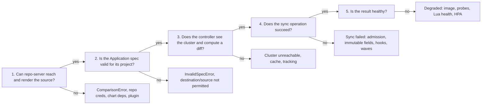

# Argo CD: Troubleshooting

| | |
|---|---|
| **Cluster** | 04 Containers & IDP |
| **Role** | Bridge |
| **Prerequisites** | [02-core-concepts.md](02-core-concepts.md) (refresh/sync pipeline, health, tracking) |
| **Target version** | Argo CD 2.12+ |
| **Capstone phase** | Phase 3 (Months 9-12) |

> Symptom-to-fix tables for the failures you will actually meet, the verbatim error messages to search for, the diagnostic commands per component, and a debugging workflow that walks the reconciliation pipeline from Git to cluster. Keep this open during the labs.

---

## 1. Debugging Workflow

Argo CD failures sit at one of five stages. Find the stage first, then the cause.



Commands for each stage:

```bash
# Stage 1-2: conditions on the Application
kubectl get application <APP> -n argocd -o jsonpath='{range .status.conditions[*]}{.type}: {.message}{"\n"}{end}'
argocd app get <APP> --refresh

# Stage 3: controller view
kubectl logs statefulset/argocd-application-controller -n argocd --since=10m | grep -i "<APP>"
argocd admin cluster stats

# Stage 4: operation result
argocd app get <APP> --show-operation
kubectl get application <APP> -n argocd -o jsonpath='{.status.operationState.message}{"\n"}'

# Stage 5: resource health
argocd app resources <APP>
kubectl describe <KIND> <NAME> -n <NS>
```

Raise log verbosity temporarily when logs are silent:

```bash
kubectl set env statefulset/argocd-application-controller -n argocd ARGOCD_LOG_LEVEL=debug
kubectl set env deployment/argocd-repo-server -n argocd ARGOCD_LOG_LEVEL=debug
# revert afterwards
kubectl set env statefulset/argocd-application-controller -n argocd ARGOCD_LOG_LEVEL-
```

---

## 2. Source and Rendering Problems

| Symptom | Likely cause | Diagnose | Fix |
|---|---|---|---|
| `ComparisonError: rpc error: code = Unknown desc = authentication required` | Repo credentials missing or wrong; repo not registered | `argocd repo list` shows `Failed`; `argocd repo get <URL> --refresh` | Register repo or `repocreds` for the URL prefix; check deploy key is on the right repo |
| `Unable to resolve 'main' to a commit SHA` | Branch does not exist (default branch is `master`), or typo in `targetRevision` | `git ls-remote <URL>` | Correct `targetRevision` |
| `app path does not exist` | `path` wrong, or the directory only exists on another branch | `git ls-tree -r <REV> --name-only \| grep <PATH>` | Fix `path`; remember paths are case-sensitive |
| `Error: found in Chart.yaml, but missing in charts/ directory: postgresql` | Chart dependency not vendored and no repo configured | `helm dependency list <chart>` | Commit `Chart.lock` and make the dependency repo reachable from repo-server, or vendor `charts/*.tgz` |
| `error converting YAML to JSON: yaml: line 12: did not find expected key` | Template emits invalid YAML (indentation from `toYaml` without `nindent`) | `helm template . --debug` locally | Fix template; `helm lint` in PR checks |
| `Manifest generation error (cached)` | A previous failure is cached for the revision | | Fix the root cause, then `argocd app get <APP> --hard-refresh` |
| Kustomize `accumulating resources: ... not found` | `kustomization.yaml` references a path or remote base that moved | `kustomize build <path>` | Fix references; pin remote bases to tags |
| `helm template` works locally but Argo CD renders differently | Different Helm version, or `lookup` used, or `.Release.Namespace` assumed | `argocd version` shows bundled Helm version; search chart for `lookup` | Avoid `lookup`; set `helm.releaseName`; match Helm versions |
| Plugin source renders nothing / `plugin not found` | CMP sidecar not running, `discover` rule mismatch, or `spec.source.plugin.name` not `<name>-<version>` | `kubectl logs deploy/argocd-repo-server -c <PLUGIN_SIDECAR>` | Fix `plugin.yaml` name/version; ensure sidecar shares `/var/run/argocd` and `/home/argocd/cmp-server/plugins` |
| `too many open files` / repo-server OOMKilled | Monorepo too large, parallel renders | `kubectl top pod -n argocd`; `argocd_repo_pending_request_total` | Raise limits, add replicas, `manifest-generate-paths`, shrink repo |
| `x509: certificate signed by unknown authority` | Self-hosted Git/Helm repo with private CA | `argocd cert list` | `argocd cert add-tls <HOST> --from ca.pem` |
| `ssh: handshake failed: knownhosts: key is unknown` | SSH host key not trusted | `argocd cert list --cert-type ssh` | `argocd cert add-ssh --batch < known_hosts` |

---

## 3. Spec and Project Problems

| Symptom | Likely cause | Diagnose | Fix |
|---|---|---|---|
| `InvalidSpecError: application repo <URL> is not permitted in project '<P>'` | `sourceRepos` does not include the URL (watch for `.git` suffix and `https` vs `ssh` mismatches) | `argocd proj get <P>` | Add the exact URL or a glob to `sourceRepos` |
| `InvalidSpecError: application destination server '<S>' and namespace '<NS>' do not match any of the allowed destinations` | Destination not whitelisted, or used `name` where project lists `server` | `argocd proj get <P>`; `argocd cluster list` | Add destination; be consistent about `server` vs `name` |
| `InvalidSpecError: Application referencing project <P> which does not exist` | Project not yet created (App-of-Apps ordering) | `kubectl get appproject -n argocd` | Give AppProjects a lower sync wave (`-10`) |
| `resource <G/K> is not permitted in project <P>` | Cluster-scoped kind blocked by empty `clusterResourceWhitelist`, or kind blacklisted | Read the message for the kind | Whitelist the kind or move it to the platform project |
| Application exists but is `Unknown` with `SharedResourceWarning` | Two Applications track the same object | `argocd app get <APP>` conditions | Pick one owner; add `FailOnSharedResource=true` to catch it earlier |
| Application created in a team namespace is ignored | Apps-in-any-namespace not enabled, or namespace not in `sourceNamespaces` | `kubectl get cm argocd-cmd-params-cm -n argocd -o yaml \| grep application.namespaces` | Add namespace to `application.namespaces` and to the project's `sourceNamespaces` |
| `Unable to generate manifests ... multiple sources ... $values` | `ref` name mismatch between sources | Read spec | `ref: values` must match `$values/...` |

---

## 4. Cluster and Controller Problems

| Symptom | Likely cause | Diagnose | Fix |
|---|---|---|---|
| `ClusterNotFound` / cluster `Unknown` in `argocd cluster list` | No Applications target it (normal) or Secret mislabelled | `kubectl get secret -n argocd -l argocd.argoproj.io/secret-type=cluster` | Create an Application, or fix the label |
| `failed to sync cluster ... dial tcp 127.0.0.1:XXXX: connect: connection refused` | kind/local kubeconfig address not reachable from inside the cluster | Inspect `server` in the cluster Secret | Use the Docker-network address (`https://<name>-control-plane:6443`) |
| `Unauthorized` for a remote cluster | Token expired/rotated, SA deleted, IAM role trust missing | `argocd cluster get <SERVER>` | `argocd cluster rotate-auth`; fix IAM trust/`aws-auth`/access entries |
| Controller never reconciles an app; `Refresh` spinner forever | Controller shard not assigned (replica count vs `ARGOCD_CONTROLLER_REPLICAS` mismatch) or controller OOM | `argocd admin cluster shards`; `kubectl get pod -n argocd` restarts | Match `controller.replicas` with env var (chart does this); raise memory |
| Very slow UI, `context deadline exceeded` | Redis down or unauthenticated after 2.8 upgrade; controller overloaded | `kubectl logs deploy/argocd-redis -n argocd`; `argocd admin redis-initial-password` | Restart components so they pick up the Redis password Secret; scale controller |
| `the server could not find the requested resource` for a CRD type | CRD not yet installed (ordering) | `kubectl get crd <NAME>` | Put the operator at a lower wave; add `SkipDryRunOnMissingResource=true` to the CR |
| Apps flip between Synced/OutOfSync every few minutes | A mutating webhook or controller rewrites fields (defaults, injected sidecars, `caBundle`) | `argocd app diff <APP>` shows the field | `ignoreDifferences` with `jsonPointers`/`jqPathExpressions`/`managedFieldsManagers`; add `RespectIgnoreDifferences=true` |
| `OutOfSync` on `spec.replicas` only | HPA manages replicas | Diff | `ignoreDifferences: /spec/replicas` (and remove `replicas` from the manifest) |
| Application shows resources from the *wrong* namespace as managed | Label tracking (`app.kubernetes.io/instance`) collided with Helm's label on another release | Check tracking method | Switch to `application.resourceTrackingMethod: annotation` |
| Webhook pushes do not refresh | Secret mismatch, wrong URL, or `manifest-generate-paths` excluded the change | `kubectl logs deploy/argocd-server -n argocd \| grep -i webhook` | Fix `webhook.github.secret`; deliver to `/api/webhook`; check path annotations |

---

## 5. Sync Operation Problems

| Symptom | Likely cause | Diagnose | Fix |
|---|---|---|---|
| `one or more objects failed to apply ... field is immutable` | Changed a selector, StatefulSet `volumeClaimTemplates`, Job `template`, Service `clusterIP` | Operation message names the field | Use `argocd.argoproj.io/sync-options: Replace=true` on that resource, or `Force=true` (deletes/recreates); for Jobs use hooks with `BeforeHookCreation` |
| `metadata.annotations: Too long: must have at most 262144 bytes` | Large CRD with client-side apply | Resource kind is a CRD | `ServerSideApply=true` (per resource or app) |
| `admission webhook "validate.kyverno.svc" denied the request: ... image not signed` | Policy engine rejected the manifest | Read the message | Fix the image/policy; this is working as designed |
| `Namespace "x" not found` | `CreateNamespace=true` missing | | Add the sync option, or manage the Namespace at wave -5 |
| Sync hangs at a wave | A resource in the wave never becomes Healthy (CRD with no health check is treated as Healthy after 2 s, but a Deployment with failing pods waits forever) | `argocd app get --show-operation` | Fix the resource or `argocd app terminate-op`; set `controller.sync.timeout.seconds` |
| PreSync hook Job fails with `BackoffLimitExceeded` and sync stops | Migration error | `kubectl logs job/<HOOK>` | Fix the migration; hook Job is retained on failure for inspection |
| `hook ... already exists` on re-sync | Hook without `BeforeHookCreation` delete policy and immutable Job spec | | Add `argocd.argoproj.io/hook-delete-policy: BeforeHookCreation` |
| Prune deleted something unexpected | Resource had tracking label but was removed from Git; or `allowEmpty` missing and render produced zero objects | `argocd app history`; operation details | `Prune=false` on critical resources; `allowEmpty: false`; restore from Git |
| `Sync operation ... blocked by sync window` | Deny window active | `argocd proj windows list <P>` | Wait, or `manualSync: true` and sync manually with justification |
| `ComparisonError: ... exceeds maximum allowed size` for a ConfigMap | ConfigMap > 1 MiB | | Split the data; use a Secret store or object storage |
| Rollback button greyed / `rollback not permitted` | Auto-sync enabled | | `argocd app set --sync-policy none` then rollback, or revert in Git (preferred) |
| `Application is stuck in Deleting` | Finalizer waiting on a resource that cannot be deleted (namespace stuck, finalizer on CR) | `kubectl get application <APP> -o yaml \| grep -A3 deletionTimestamp`; find the stuck child | Resolve the child; last resort remove the finalizer with `kubectl patch ... --type json -p '[{"op":"remove","path":"/metadata/finalizers"}]'` |

---

## 6. Health Problems

| Symptom | Likely cause | Diagnose | Fix |
|---|---|---|---|
| Synced but `Degraded`: Deployment `ProgressDeadlineExceeded` | Image pull, crash loop, failing readiness probe, unschedulable | `kubectl describe pod`, `kubectl logs --previous` | Fix the workload; this is a Kubernetes problem surfaced by Argo CD |
| `Progressing` forever | Deployment with `paused: true`; Rollout waiting for manual promotion; LoadBalancer Service without an external IP (kind) | `argocd app resources` to find the resource | Promote/unpause; for kind, set the Service to ClusterIP or install MetalLB/cloud-provider-kind |
| CRD-based resource always `Healthy` even when broken | No health check for the kind | | Add Lua health in `argocd-cm` (see concepts section 9) |
| Custom Lua check throws `attempt to index a nil value` | `obj.status` absent on new objects | `argocd admin settings resource-overrides health <file> --argocd-cm-path cm.yaml` | Guard with `if obj.status ~= nil` |
| Application `Missing` after a successful sync | Tracking method changed (label to annotation) so existing resources are no longer attributed | Compare annotations on live objects | Sync once with `ApplyOutOfSyncOnly=false`; resources pick up the tracking annotation |
| Rollout `Degraded` immediately after sync | AnalysisRun failed; Prometheus query returned no data (NaN compares false) | `kubectl argo rollouts get analysisrun` | Fix the query; use `clamp_min` on denominators; add `inconclusiveLimit` |

---

## 7. Authentication and Access Problems

| Symptom | Likely cause | Diagnose | Fix |
|---|---|---|---|
| `rpc error: code = Unauthenticated desc = invalid session: token is expired` | CLI session expired | | `argocd login` again; for CI use a project role token with explicit expiry |
| `PermissionDenied: permission denied: applications, sync, payments/fastapi-dev` | RBAC missing | `argocd account can-i sync applications payments/fastapi-dev`; `argocd admin settings rbac can <GROUP> ...` | Add a policy line; confirm group claim is in the token (`argocd account get-user-info`) |
| SSO login loops back to the login page | `url` in `argocd-cm` does not match the browser URL; cookie domain mismatch | Browser dev tools, `argocd-server` logs | Set `configs.cm.url` to the exact external URL |
| `failed to query provider ... connection refused` | Dex not running or OIDC issuer unreachable from the cluster | `kubectl logs deploy/argocd-dex-server -n argocd` | Fix egress/NetworkPolicy; check issuer URL |
| Groups missing from token (`groups: []`) | IdP not emitting groups claim, or scope not requested | `argocd account get-user-info` | Request `groups` scope; configure group claims in the IdP app registration |
| `argocd login` fails with `Unknown desc = unexpected HTTP status code 404` | Ingress not passing gRPC; need `--grpc-web` | | Add `--grpc-web` or configure gRPC passthrough on the ingress |
| Admin login fails after upgrade | Password hash format or `admin.enabled: "false"` | `kubectl get cm argocd-cm -n argocd -o yaml \| grep admin` | Re-enable temporarily or use break-glass account |

---

## 8. ApplicationSet Problems

| Symptom | Likely cause | Diagnose | Fix |
|---|---|---|---|
| No Applications generated, no error | Generator produced zero parameters (bad glob, wrong branch) | `argocd appset generate <file>`; `kubectl get appset <N> -o jsonpath='{.status.conditions}'` | Fix `directories.path`/`files.path`/`revision` |
| `ErrorOccurred: template: ... map has no entry for key` | `missingkey=error` with a typo in a template field | Condition message | Fix the key; check `.path.segments` indices |
| Applications regenerated with different names and old ones deleted | Changed the template `name` | | Expected: rename causes delete+create; use `preserveResourcesOnDeletion` and `applicationsSync: create-update` for safety |
| Git generator ignores new directory for minutes | Default `requeueAfterSeconds` is 180 s; no webhook | | Configure GitHub webhook to Argo CD (handled by applicationset-controller too) |
| PR generator: `rate limit exceeded` | Polling GitHub API every 30 s across many ApplicationSets | GitHub API rate headers in logs | Increase `requeueAfterSeconds`; use a GitHub App (higher limits); webhooks |
| Cluster generator skips a cluster | Missing/incorrect labels on the cluster Secret | `kubectl get secret -n argocd -l argocd.argoproj.io/secret-type=cluster --show-labels` | `argocd cluster set <NAME> --label ...` |

---

## 9. Verbatim Messages Worth Recognising

```text
ComparisonError: Failed to load target state: failed to generate manifest for source 1 of 1
  -> stage 1: fix repo/render; then --hard-refresh

InvalidSpecError: Unable to generate manifests in gitops/x: rpc error: code = Unknown desc = gitops/x: app path does not exist
  -> wrong path or branch

OrphanedResourceWarning: Application has 3 orphaned resources
  -> informational; someone kubectl-applied into the namespace

SharedResourceWarning: Deployment/api is part of applications argocd/a and argocd/b
  -> two Applications own one resource

OperationError: one or more synchronization tasks are not valid
  -> usually a hook annotation combination that is invalid, or a resource kind not permitted by project

Sync operation to abcd123 failed: one or more objects failed to apply, reason: error when patching "...": ... (retried 5 times)
  -> read the inner reason: immutable field, admission denial, CRD missing

level=error msg="Failed to cache app resources" error="dial tcp: lookup argocd-redis ... no such host"
  -> Redis Service missing/renamed after chart upgrade (redis vs redis-ha)
```

---

## 10. Performance Diagnostics

```bash
# Reconciliation duration per app (controller metrics)
kubectl port-forward -n argocd statefulset/argocd-application-controller 8082:8082 &
curl -s localhost:8082/metrics | grep -E '^argocd_app_reconcile_bucket' | sort -t'"' -k2 | tail

# Pending git requests and durations (repo-server)
kubectl port-forward -n argocd deploy/argocd-repo-server 8084:8084 &
curl -s localhost:8084/metrics | grep -E 'argocd_repo_pending_request_total|argocd_git_request_duration_seconds_count'

# Which apps are slowest to reconcile
argocd admin app get-reconcile-results --namespace argocd -o json | jq -r '.[] | "\(.name)\t\(.reconcileDuration)"' | sort -k2 -n | tail

# Cluster cache size per cluster
argocd admin cluster stats
```

Typical remedies: `resource.exclusions` for high-churn kinds, webhook-driven refresh, more repo-server replicas, `controller.status.processors` and `controller.operation.processors` increases with matching CPU, controller sharding.

---

## 11. Recovery Snippets

```bash
# Force re-attribution of resources after switching tracking method
argocd app sync <APP> --apply-out-of-sync-only=false

# Freeze everything during an incident (note which apps you touched)
argocd app list -o name | xargs -I{} argocd app set {} --sync-policy none

# Rebuild Redis cache (safe; momentary UI slowness)
kubectl rollout restart deployment argocd-redis -n argocd   # or statefulset/argocd-redis-ha-server

# Re-run a failed PreSync hook without changing Git
argocd app sync <APP> --strategy hook --force=false

# Reset a stuck operation
argocd app terminate-op <APP>
kubectl patch application <APP> -n argocd --type json -p '[{"op":"remove","path":"/operation"}]'
```

Next: [07-interview-questions.md](07-interview-questions.md).
