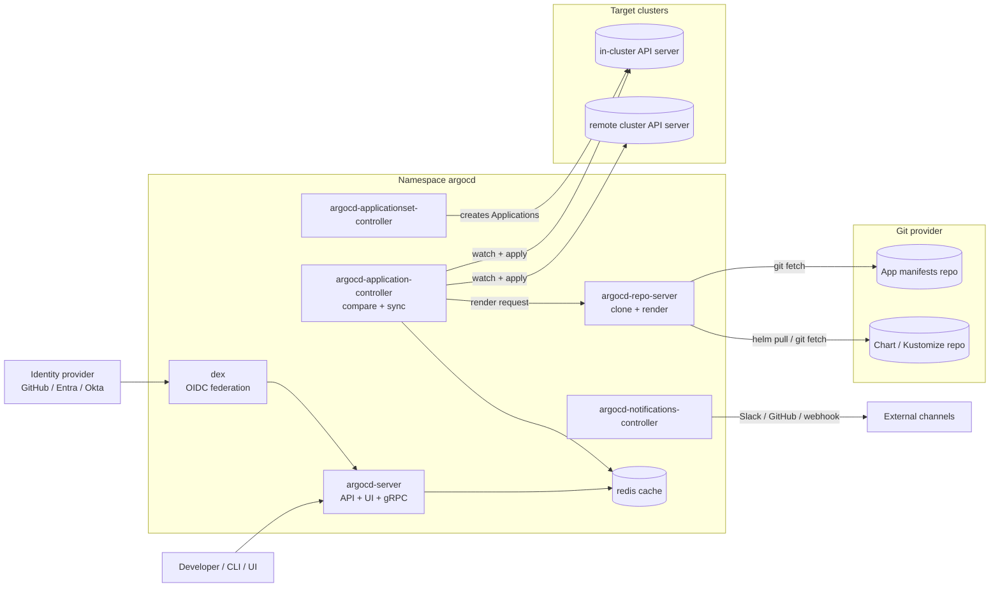

# Argo CD

| | |
|---|---|
| **Cluster** | 04 Containers & IDP |
| **Role** | Bridge (from Kubernetes) |
| **Category** | GitOps continuous delivery for Kubernetes |
| **Prerequisites** | [Kubernetes](../kubernetes/README.md) workloads, Services and RBAC; [Helm](../helm/README.md) charts; Git branching basics |
| **Target version** | Argo CD 2.12+ on Kubernetes 1.31+ |
| **Capstone phase** | Phase 3 (Months 9-12) |
| **Official docs** | https://argo-cd.readthedocs.io |

> Argo CD is a Kubernetes controller that continuously compares the manifests in a Git repository (the *desired* state) with what is actually running in a cluster (the *live* state) and, when told to, makes the cluster match Git. After this folder you will be able to install Argo CD on kind, model environments with Applications, ApplicationSets and App-of-Apps, wire Helm charts and Kustomize overlays as sources, enforce multi-tenant boundaries with AppProjects and SSO, run canary releases with Argo Rollouts, and recover a broken Argo CD installation from backup.

## Why This Tool Exists

Before GitOps, deployment pipelines *pushed* to clusters: a CI job held a cluster-admin kubeconfig, ran `kubectl apply` or `helm upgrade`, and hoped nothing else had changed in the meantime. Three problems followed:

1. **Credential sprawl.** Every CI system that deploys needs write access to every cluster. A compromised CI runner is a compromised fleet.
2. **Drift.** Nothing watches the cluster after the pipeline finishes. A `kubectl edit` at 2 a.m. survives until the next release, and nobody knows which clusters diverge from Git.
3. **No single source of truth.** "What is running in prod?" requires logging into prod. Audit trails live in CI logs that expire.

Argo CD's insight was to reuse the Kubernetes pattern itself: desired state lives in Git, a controller inside the cluster *pulls* that state and reconciles it, and the diff between Git and cluster is a first-class, always-visible object. CI's job shrinks to "build, test, sign, push an image, and open a pull request that bumps a tag". Argo CD does the rest, with no cluster credentials leaving the cluster.

## Architecture



| Component | Responsibility | Scaling note |
|---|---|---|
| `argocd-server` | Serves the UI, REST and gRPC API, handles auth (local, SSO via Dex, or direct OIDC), enforces RBAC. Stateless. | Horizontal replicas behind a Service. |
| `argocd-repo-server` | Clones repositories, renders Helm/Kustomize/Jsonnet/plugin sources into plain manifests, caches results in Redis. | CPU and disk bound; scale horizontally, give it an emptyDir with enough space. |
| `argocd-application-controller` | The reconciliation loop: watches target clusters, compares live vs desired, computes health, performs sync. | StatefulSet; shard by cluster (`--shard`, `controller.sharding.algorithm`). |
| `argocd-applicationset-controller` | Expands ApplicationSet generators into Application objects. | Single replica is normal. |
| `argocd-notifications-controller` | Sends events (sync succeeded, health degraded) to Slack, Teams, GitHub, webhooks. | Single replica. |
| `argocd-redis` | Cache for rendered manifests and cluster state. Losing it is safe; it rebuilds. | Use HA mode (`redis-ha` with HAProxy) in production. |
| `argocd-dex-server` | Optional OIDC proxy that federates GitHub, LDAP, SAML into one OIDC issuer. | Skip it if your IdP speaks OIDC natively. |

## The Core Mental Model

- **Argo CD is just another Kubernetes controller.** Its custom resource is `Application`; its desired state is "the rendered manifests at Git revision X should exist in cluster Y, namespace Z"; its reconciliation loop is *refresh* (re-render and compare) followed by *sync* (apply). Everything you learned about Deployments reconciling ReplicaSets transfers.
- **Three states, two gaps.** Git (desired), the Application's last-synced revision (what Argo CD applied), and the live cluster (reality). `OutOfSync` means Git differs from live. *Drift* is the live cluster changing underneath a synced revision; `selfHeal` closes that gap automatically.
- **Sync status and health are orthogonal.** A Deployment can be `Synced` (manifests match) yet `Degraded` (pods crash-looping). Sync answers "did we apply what Git says?"; health answers "is what we applied working?".
- **Rendering is separate from applying.** The repo-server turns any source (Helm, Kustomize, raw YAML, plugin) into plain manifests first. Argo CD never runs `helm install`; it runs `helm template` and then applies the result, which is why Helm hooks become Argo CD hooks and Helm release history does not exist.

## Coming from Kubernetes: Anchor-and-Bridge Mapping

| Concept in Kubernetes | Equivalent in Argo CD | Delta to remember |
|---|---|---|
| Deployment spec in etcd | Manifests at a Git revision | Source of truth moves out of the cluster into Git |
| kube-controller-manager reconcile loop | application-controller refresh + sync | Refresh every 3 min by default, or on webhook; sync may be manual |
| `kubectl apply` | Sync operation | Supports waves, hooks, prune, server-side apply, dry-run |
| `kubectl diff` | `argocd app diff` and the UI diff view | Diff is always computed and surfaced as `OutOfSync` |
| Namespace + RBAC Role | AppProject + Argo CD RBAC `policy.csv` | Project restricts allowed sources, destinations and resource kinds |
| Pod readiness/liveness | Resource health (Healthy, Progressing, Degraded, Suspended, Missing) | Built-in checks for core kinds; Lua for CRDs |
| Helm release (`helm list`) | Application history (`argocd app history`) | No Tiller/secret-based release; revisions are Git SHAs |
| Admission webhook rejects bad manifests | Sync fails with error, Application stays `OutOfSync` | Argo CD does not validate policy; pair with Kyverno/Gatekeeper |
| Rolling update strategy | Argo Rollouts canary/blue-green with AnalysisTemplates | Separate controller, drop-in replacement for Deployment |
| `kubectl apply -f dir/` across clusters | ApplicationSet with cluster generator | One template, N clusters |

## Learning Path

| Step | File | Time |
|---|---|---|
| 1 | [01-installation-and-setup.md](01-installation-and-setup.md) | 1.5 h |
| 2 | [02-core-concepts.md](02-core-concepts.md) | 4 h |
| 3 | [03-commands-and-cheatsheet.md](03-commands-and-cheatsheet.md) | 2 h (reference) |
| 4 | [04-hands-on-labs.md](04-hands-on-labs.md) | 8 h |
| 5 | [05-production-patterns.md](05-production-patterns.md) | 3 h |
| 6 | [06-troubleshooting.md](06-troubleshooting.md) | 1.5 h |
| 7 | [07-interview-questions.md](07-interview-questions.md) | 2 h |

Suggested order inside the cluster: finish [Kubernetes](../kubernetes/README.md) labs through Deployments and RBAC, then [Helm](../helm/README.md) chart authoring, then this folder, then [Backstage](../backstage/README.md), which surfaces Argo CD state in the portal.

## Where Argo CD Is Weak

- **It is not a CI system.** It cannot build images or run tests. Teams that try to do CI in PreSync hooks end up with unreadable manifests.
- **Secrets.** Argo CD has no opinion on secrets. You must bring External Secrets Operator, Sealed Secrets, or SOPS.
- **Promotion is DIY.** Moving a tag from dev to prod is a Git operation you script yourself (or adopt Kargo). Argo CD only reconciles what is in Git.
- **Helm semantic gaps.** Because it renders with `helm template`, `lookup` returns nothing, and `helm test` does not exist; chart hooks map to Argo hooks with slightly different semantics.
- **Large monorepos.** Rendering a 2 GB monorepo on every refresh hurts; you need webhook-driven refresh, `argocd.argoproj.io/manifest-generate-paths`, and repo-server scaling.

## Role in the Capstone

Argo CD is the deployment engine for the entire capstone. The layout is:

```text
capstone/
├── apps/
│   ├── fastapi-service/          # source code + Dockerfile + chart (see ../helm)
│   └── springboot-service/
├── gitops/
│   ├── bootstrap/root-app.yaml   # App-of-Apps root, applied once by Terraform
│   ├── projects/                 # AppProject per team
│   ├── platform/                 # ingress-nginx, cert-manager, ESO, kube-prometheus-stack, Backstage
│   └── workloads/
│       ├── dev/                  # values-dev.yaml + Application per service
│       ├── stage/
│       └── prod/
```

- **Terraform** (cluster 05) installs Argo CD via the Helm chart and applies `root-app.yaml`; nothing else is ever `kubectl apply`'d by hand.
- **GitHub Actions** (cluster 06) builds and signs images, then opens a PR bumping `image.tag` in `gitops/workloads/dev`. Argo CD Image Updater is the alternative covered in production patterns.
- **Kyverno** (cluster 08) verifies Cosign signatures at admission, so an Argo CD sync of an unsigned image fails visibly.
- **Argo Rollouts** promotes canaries using Prometheus SLIs from cluster 09.
- **Backstage** (this cluster) shows per-component sync and health via the Argo CD plugin.

Artefacts produced: `Application` and `ApplicationSet` manifests, `AppProject` definitions, `AnalysisTemplate`s, notification templates, and the ADR `capstone/adrs/0007-argocd-over-flux.md`.

## Further Reading

- Argo CD documentation: https://argo-cd.readthedocs.io/en/stable/
- OpenGitOps principles v1.0 (CNCF): https://opengitops.dev/
- Argo Rollouts: https://argoproj.github.io/argo-rollouts/
- Argo CD Image Updater: https://argocd-image-updater.readthedocs.io/
- Kargo (promotion): https://kargo.io/
- "GitOps and Kubernetes" (Yuen, Matyushentsev, Ekenstam, Suen; Manning) -- written by Argo CD's creators
- Argo CD security hardening guide: https://argo-cd.readthedocs.io/en/stable/operator-manual/security/
- CNCF Argo project: https://argoproj.github.io/
