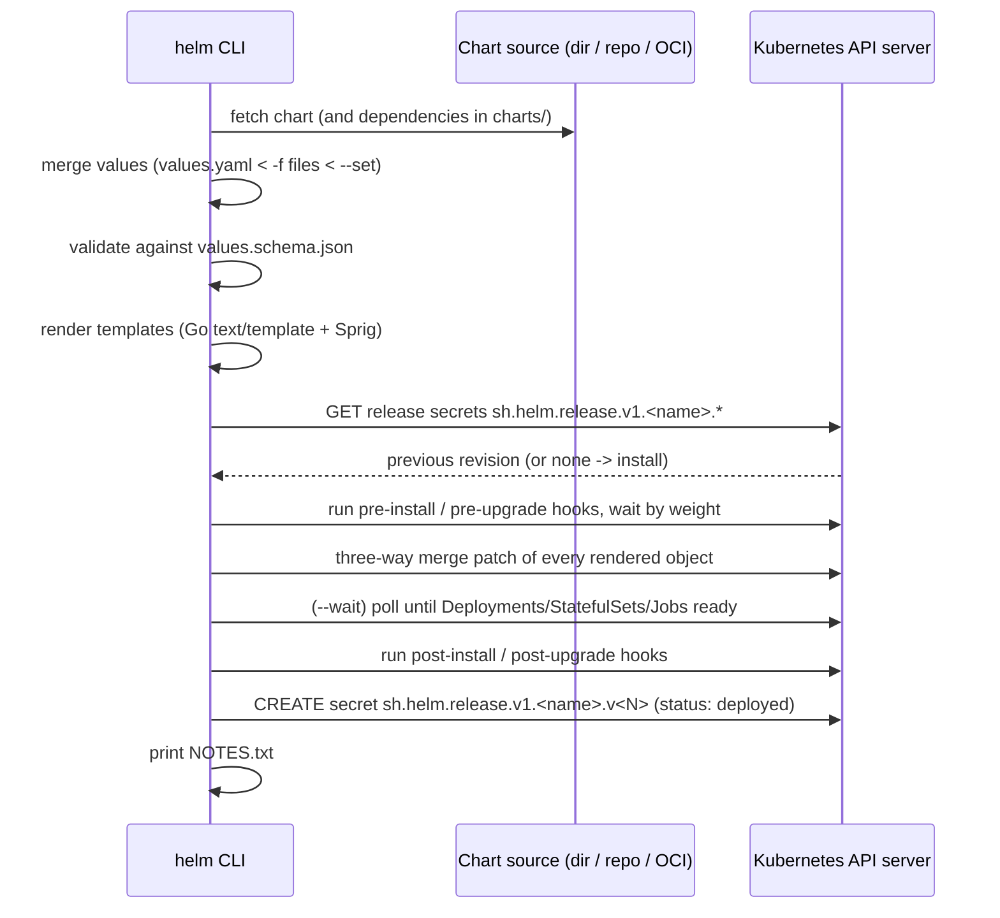
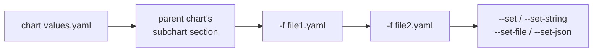

# Helm: Core Concepts

| | |
|---|---|
| **Cluster** | 04 Containers & IDP |
| **Role** | Bridge (from Kubernetes) |
| **Prerequisites** | [01-installation-and-setup.md](01-installation-and-setup.md); Kubernetes workload and config objects |
| **Target version** | Helm 3.16+, Kubernetes 1.31+ |
| **Capstone phase** | Phase 3 (Months 9-12) |

> This file explains how Helm works underneath: the chart layout, the Go template engine and its Helm-specific functions, how values are merged, what a release physically is, how upgrades compute a three-way merge, how hooks and tests are ordered, how dependencies and library charts compose, and how charts are distributed over HTTP repositories and OCI registries. After reading it you should be able to predict what any `helm` command will do before you run it.

## 1. Helm 3 architecture

Helm 3 is a client-only program. The sequence for `helm upgrade --install`:



Key properties that follow from this:

- Helm authenticates as *you* (kubeconfig). RBAC is your RBAC. There is no privileged in-cluster agent.
- Helm is **not** a controller. If someone edits a Deployment with `kubectl`, Helm does not notice until the next `upgrade`.
- Everything Helm knows about a release lives in Secrets in the release namespace. Back up those Secrets and you have backed up Helm's state.

## 2. Anatomy of a chart

```text
api/
├── Chart.yaml            # metadata: name, version, appVersion, dependencies
├── Chart.lock            # resolved dependency versions (generated)
├── values.yaml           # default values; the chart's public API
├── values.schema.json    # optional JSON Schema validating values
├── README.md             # usually generated by helm-docs
├── .helmignore           # files excluded from the package
├── charts/               # vendored dependency .tgz files (generated)
├── crds/                 # plain CRD YAML, installed first, never templated, never upgraded
└── templates/
    ├── NOTES.txt         # templated text printed after install/upgrade
    ├── _helpers.tpl      # named templates (no output of its own; leading underscore)
    ├── deployment.yaml
    ├── service.yaml
    ├── serviceaccount.yaml
    ├── hpa.yaml
    ├── pdb.yaml
    ├── networkpolicy.yaml
    ├── servicemonitor.yaml
    └── tests/
        └── test-connection.yaml   # helm test hook
```

### Chart.yaml

```yaml
apiVersion: v2                 # v2 = Helm 3 chart. v1 = Helm 2 (still installable, avoid for new charts)
name: api
description: FastAPI service for the capstone platform
type: application              # or "library"
version: 1.4.2                 # chart version, SemVer 2, bumped on every chart change
appVersion: "1.4.2"            # version of the software inside; informational, used as default image tag
kubeVersion: ">=1.29.0-0"      # constraint; install fails if cluster is older
home: https://github.com/example/platform
sources:
  - https://github.com/example/platform/tree/main/services/api
maintainers:
  - name: Platform Team
    email: platform@example.com
keywords: [fastapi, python, api]
annotations:
  artifacthub.io/license: Apache-2.0
dependencies:
  - name: redis
    version: "20.2.1"
    repository: oci://registry-1.docker.io/bitnamicharts
    condition: redis.enabled
    tags: [cache]
```

`version` and `appVersion` are different on purpose. A chart-only fix (new label, new toggle) bumps `version`; a new release of the application bumps both. Argo CD and `ct` compare `version`; humans read `appVersion`.

### values.yaml is the chart's public API

Treat `values.yaml` like a function signature. Every key is documented with a comment (helm-docs turns `# -- description` comments into a README table). Defaults must produce a secure, working release with no overrides.

```yaml
# -- Number of replicas when autoscaling is disabled
replicaCount: 2

image:
  # -- Image repository
  repository: ghcr.io/example/api
  # -- Overrides the image tag; defaults to .Chart.AppVersion
  tag: ""
  # -- Pin by digest to make deployments immutable (takes precedence over tag)
  digest: ""
  pullPolicy: IfNotPresent

podSecurityContext:
  runAsNonRoot: true
  runAsUser: 65532
  runAsGroup: 65532
  fsGroup: 65532
  seccompProfile:
    type: RuntimeDefault

securityContext:
  allowPrivilegeEscalation: false
  readOnlyRootFilesystem: true
  capabilities:
    drop: [ALL]
```

## 3. The Go template engine

Templates are Go `text/template` files. Helm adds ~60 Sprig functions, a handful of its own, and the `.` root object.

### 3.1 Built-in objects

| Object | Contents |
|---|---|
| `.Values` | Merged values |
| `.Chart` | `Chart.yaml` fields: `.Chart.Name`, `.Chart.Version`, `.Chart.AppVersion` |
| `.Release` | `.Release.Name`, `.Release.Namespace`, `.Release.Revision`, `.Release.IsInstall`, `.Release.IsUpgrade`, `.Release.Service` (always `Helm`) |
| `.Capabilities` | `.Capabilities.KubeVersion.Version`, `.Capabilities.APIVersions.Has "monitoring.coreos.com/v1"`, `.Capabilities.HelmVersion` |
| `.Template` | `.Template.Name`, `.Template.BasePath` |
| `.Files` | Access to non-template files: `.Files.Get "config/app.toml"`, `.Files.Glob "dashboards/*.json"`, `.Files.AsConfig`, `.Files.AsSecrets` |
| `.Subcharts` | Rendered values of subcharts (rarely needed) |

### 3.2 Actions, pipelines and whitespace

```yaml
# Action: {{ expression }}
replicas: {{ .Values.replicaCount }}

# Pipeline: pass the left value as the last argument of the right function
name: {{ .Values.name | default .Chart.Name | trunc 63 | trimSuffix "-" }}

# Quote strings that might look like numbers or booleans to YAML
tag: {{ .Values.image.tag | default .Chart.AppVersion | quote }}

# Whitespace control: {{- eats whitespace to the left, -}} to the right
{{- if .Values.serviceAccount.create }}
automountServiceAccountToken: false
{{- end }}
```

The whitespace rules are the number one source of invalid YAML. Habit: open every control statement with `{{-` and never use `-}}` unless you have checked the rendered output.

### 3.3 Control structures

```yaml
# if / else if / else. Falsy: false, 0, "", nil, empty list/map
{{- if .Values.ingress.enabled }}
...
{{- else if .Values.gateway.enabled }}
...
{{- else }}
...
{{- end }}

# with: rescopes . to the value, skips the block if empty
{{- with .Values.nodeSelector }}
nodeSelector:
  {{- toYaml . | nindent 8 }}
{{- end }}

# range over a list
{{- range .Values.extraHosts }}
- host: {{ .host | quote }}
{{- end }}

# range over a map, sorted by key
{{- range $key, $value := .Values.env }}
- name: {{ $key }}
  value: {{ $value | quote }}
{{- end }}
```

Inside `with` and `range`, `.` is rebound. To reach the root use `$`: `{{ $.Release.Name }}`. This is the second most common template bug.

### 3.4 Variables

```yaml
{{- $fullName := include "api.fullname" . }}
{{- $svcPort := .Values.service.port }}
{{- range .Values.ingress.hosts }}
  - host: {{ .host | quote }}
    http:
      paths:
        - path: /
          pathType: Prefix
          backend:
            service:
              name: {{ $fullName }}
              port:
                number: {{ $svcPort }}
{{- end }}
```

### 3.5 Named templates: `define`, `template`, `include`

`_helpers.tpl` holds named templates. Names are global across the chart *and all subcharts*, so prefix them with the chart name.

```yaml
{{/*
Expand the name of the chart.
*/}}
{{- define "api.name" -}}
{{- default .Chart.Name .Values.nameOverride | trunc 63 | trimSuffix "-" }}
{{- end }}

{{/*
Fully qualified app name, 63-char DNS limit respected.
*/}}
{{- define "api.fullname" -}}
{{- if .Values.fullnameOverride }}
{{- .Values.fullnameOverride | trunc 63 | trimSuffix "-" }}
{{- else }}
{{- $name := default .Chart.Name .Values.nameOverride }}
{{- if contains $name .Release.Name }}
{{- .Release.Name | trunc 63 | trimSuffix "-" }}
{{- else }}
{{- printf "%s-%s" .Release.Name $name | trunc 63 | trimSuffix "-" }}
{{- end }}
{{- end }}
{{- end }}

{{- define "api.labels" -}}
helm.sh/chart: {{ printf "%s-%s" .Chart.Name .Chart.Version | replace "+" "_" | trunc 63 | trimSuffix "-" }}
{{ include "api.selectorLabels" . }}
app.kubernetes.io/version: {{ .Values.image.tag | default .Chart.AppVersion | quote }}
app.kubernetes.io/managed-by: {{ .Release.Service }}
{{- end }}

{{- define "api.selectorLabels" -}}
app.kubernetes.io/name: {{ include "api.name" . }}
app.kubernetes.io/instance: {{ .Release.Name }}
{{- end }}
```

Always use `include`, not `template`. `template` is a statement that writes directly to output and cannot be piped, so `{{ template "api.labels" . | nindent 4 }}` is a syntax error. `include` is a function that returns a string: `{{ include "api.labels" . | nindent 4 }}` works.

### 3.6 The Helm-specific functions you must know

| Function | What it does | Example |
|---|---|---|
| `include "name" ctx` | Render a named template to a string | `{{ include "api.fullname" . }}` |
| `tpl string ctx` | Render a *string from values* as a template | `{{ tpl .Values.configTemplate . }}` lets users put `{{ .Release.Name }}` in values |
| `required "msg" value` | Fail rendering if value is empty | `{{ required "image.repository is required" .Values.image.repository }}` |
| `toYaml obj` | Serialise a map/list to YAML | `{{ toYaml .Values.resources \| nindent 12 }}` |
| `fromYaml`, `toJson`, `fromJson`, `toToml` | Format conversions | `{{ (.Files.Get "cfg.yaml" \| fromYaml).key }}` |
| `nindent n` / `indent n` | Indent every line (`nindent` adds leading newline) | Use `nindent` after `toYaml` almost always |
| `lookup apiVersion kind ns name` | Read a live object at render time (empty under `helm template`) | `{{ (lookup "v1" "Secret" .Release.Namespace "api-tls").data }}` |
| `default d v` | Fallback | `{{ .Values.image.tag \| default .Chart.AppVersion }}` |
| `quote`, `squote` | Wrap in quotes | `{{ .Values.env.LOG_LEVEL \| quote }}` |
| `semverCompare ">=1.29-0" ver` | Version gating | `{{ if semverCompare ">=1.29-0" .Capabilities.KubeVersion.Version }}` |
| `sha256sum` | Hash, used for config-change rollouts | `checksum/config: {{ include (print $.Template.BasePath "/configmap.yaml") . \| sha256sum }}` |
| `randAlphaNum n` | Random string (regenerates every upgrade; avoid for secrets) | Prefer `lookup` to keep existing value |
| `b64enc`, `b64dec` | Base64 | Secret `data:` fields |
| `dict`, `list`, `merge`, `mergeOverwrite`, `deepCopy` | Build structures | Pass multiple args to `include`: `{{ include "api.env" (dict "root" $ "extra" .Values.extraEnv) }}` |
| `fail "msg"` | Abort rendering | Validation in `_helpers.tpl` |
| `ternary a b cond` | Inline conditional | `{{ ternary "Recreate" "RollingUpdate" .Values.persistence.enabled }}` |

Sprig also provides string functions (`trim`, `upper`, `replace`, `regexMatch`, `splitList`, `join`), math (`add`, `mul`, `max`), lists (`first`, `has`, `uniq`, `append`), maps (`hasKey`, `keys`, `pick`, `omit`), encoding (`sha1sum`, `htpasswd`), dates (`now`, `date`) and type checks (`kindIs`, `typeOf`, `empty`).

### 3.7 The checksum pattern

A ConfigMap change does not restart Pods on its own. Hash the rendered ConfigMap into a Pod annotation so the Deployment spec changes and a rollout happens:

```yaml
spec:
  template:
    metadata:
      annotations:
        checksum/config: {{ include (print $.Template.BasePath "/configmap.yaml") . | sha256sum }}
```

## 4. Values precedence

Values are merged in this order; later wins.



1. The chart's own `values.yaml`.
2. For a subchart, the parent's `<subchart-name>:` block and `global:`.
3. `--values` / `-f` files, left to right. Later files override earlier.
4. `--set`, `--set-string`, `--set-file`, `--set-json` in command-line order.

Merging is a **deep merge of maps**; **lists are replaced whole**, never appended. If `values.yaml` has `tolerations: [a, b]` and you `--set tolerations[0].key=x`, you get a one-element list.

`--set` syntax:

```bash
--set replicaCount=3                             # int
--set image.tag=1.4.2                            # parsed as float 1.4 -> wrong! use --set-string
--set-string image.tag=1.4.2                     # string "1.4.2"
--set 'ingress.hosts[0].host=api.example.com'    # list index
--set 'env.JAVA_OPTS=-Xmx512m\,-XX:+UseZGC'      # escaped comma
--set 'nodeSelector.kubernetes\.io/os=linux'     # escaped dot in a key
--set-file tls.crt=./server.crt                  # file contents as string
--set-json 'resources={"limits":{"cpu":"500m"}}' # JSON literal
--set key=null                                   # delete a key from defaults
```

Debug what the merge produced:

```bash
helm get values api --namespace api                 # user-supplied only
helm get values api --namespace api --all           # merged with defaults
helm template api ./api -f values-prod.yaml --debug 2>&1 | sed -n '/COMPUTED VALUES/,/HOOKS/p'
```

### `--reuse-values` and `--reset-values`

`helm upgrade` by default (`--reset-values` semantics unless `--reuse-values` is given, and *neither* if you pass `-f`) starts from the chart defaults and applies what you pass on the command line. `--reuse-values` starts from the previous revision's user-supplied values. Mixing `--reuse-values` with new `-f` files leads to surprising merges; the capstone always passes the full values file set on every upgrade and never uses `--reuse-values`. Helm 3.14+ adds `--reset-then-reuse-values` as a middle ground.

## 5. Releases, revisions and the storage backend

A release named `api` in namespace `api` after two upgrades:

```bash
kubectl get secrets --namespace api -l owner=helm,name=api
```

```text
NAME                           TYPE                 DATA   AGE
sh.helm.release.v1.api.v1      helm.sh/release.v1   1      2d
sh.helm.release.v1.api.v2      helm.sh/release.v1   1      1d
sh.helm.release.v1.api.v3      helm.sh/release.v1   1      2h
```

Each Secret's `data.release` is base64(gzip(base64(JSON))) containing the chart, the user values, the fully rendered manifest, hooks and status. Decode one:

```bash
kubectl get secret sh.helm.release.v1.api.v3 --namespace api -o jsonpath='{.data.release}' \
  | base64 -d | base64 -d | gunzip | jq '{name, version, info: .info.status, chart: .chart.metadata.version}'
```

Release statuses: `pending-install`, `pending-upgrade`, `pending-rollback`, `deployed`, `superseded`, `failed`, `uninstalling`, `uninstalled` (only with `--keep-history`). A release stuck in `pending-*` means a previous Helm process died; see [06-troubleshooting.md](06-troubleshooting.md).

`--history-max` (default 10) caps how many revision Secrets are kept. Secrets have a 1 MiB size limit; charts with huge CRDs or many files can hit it. `HELM_DRIVER=sql` (PostgreSQL) avoids the limit and is used by some platform teams.

### The three-way merge

On upgrade, for each object Helm compares three documents:

1. the manifest from the **previous revision**,
2. the **newly rendered** manifest,
3. the **live object** from the API server.

Fields the chart used to set and no longer sets are removed. Fields added live by other actors (an HPA changing `replicas`, a mutating webhook injecting a sidecar) are preserved as long as the new chart does not set them. This is why a chart with an HPA toggle must *omit* `spec.replicas` when autoscaling is on:

```yaml
spec:
  {{- if not .Values.autoscaling.enabled }}
  replicas: {{ .Values.replicaCount }}
  {{- end }}
```

Helm does not do server-side apply by default. Argo CD can, which changes conflict semantics; see [../argocd/02-core-concepts.md](../argocd/02-core-concepts.md).

### Rollback

`helm rollback api 2` renders nothing. It takes the stored manifest of revision 2, three-way merges it against the live state, applies it, and records the result as a *new* revision 4 (status `deployed`), marking 3 `superseded`. History is append-only.

## 6. Hooks

Hooks are ordinary manifests with the annotation `helm.sh/hook`. Helm pulls them out of the normal install set and runs them at the named point in the lifecycle. They are not tracked as part of the release (they are not deleted on `uninstall` unless a deletion policy says so).

| Hook | When |
|---|---|
| `pre-install`, `post-install` | Around first install |
| `pre-upgrade`, `post-upgrade` | Around upgrades |
| `pre-rollback`, `post-rollback` | Around rollbacks |
| `pre-delete`, `post-delete` | Around uninstall |
| `test` | On `helm test` |

```yaml
apiVersion: batch/v1
kind: Job
metadata:
  name: {{ include "api.fullname" . }}-migrate
  annotations:
    "helm.sh/hook": pre-install,pre-upgrade
    "helm.sh/hook-weight": "-5"                           # lower runs first; string, can be negative
    "helm.sh/hook-delete-policy": before-hook-creation,hook-succeeded
spec:
  backoffLimit: 2
  template:
    spec:
      restartPolicy: Never
      serviceAccountName: {{ include "api.serviceAccountName" . }}
      securityContext: {{- toYaml .Values.podSecurityContext | nindent 8 }}
      containers:
        - name: migrate
          image: "{{ .Values.image.repository }}:{{ .Values.image.tag | default .Chart.AppVersion }}"
          command: ["alembic", "upgrade", "head"]
          securityContext: {{- toYaml .Values.securityContext | nindent 12 }}
```

Deletion policies: `before-hook-creation` (default; delete the previous hook object before creating the new one), `hook-succeeded`, `hook-failed`. Combine `before-hook-creation,hook-succeeded` so failed Jobs stay for debugging but never block the next run.

For Jobs and Pods Helm waits for completion before continuing; a failed hook fails the release. Hooks of the same weight run in Kind-sorted order.

### Test hooks

```yaml
# templates/tests/test-connection.yaml
apiVersion: v1
kind: Pod
metadata:
  name: "{{ include "api.fullname" . }}-test-connection"
  annotations:
    "helm.sh/hook": test
    "helm.sh/hook-delete-policy": before-hook-creation,hook-succeeded
spec:
  restartPolicy: Never
  securityContext:
    runAsNonRoot: true
    runAsUser: 65532
    seccompProfile: { type: RuntimeDefault }
  containers:
    - name: curl
      image: curlimages/curl:8.10.1
      command: ['curl', '--fail', '--silent', '{{ include "api.fullname" . }}:{{ .Values.service.port }}/healthz']
      securityContext:
        allowPrivilegeEscalation: false
        readOnlyRootFilesystem: true
        capabilities: { drop: [ALL] }
```

`helm test api --namespace api --logs` runs it and streams output. In CI, `ct install` runs `helm test` automatically.

## 7. Dependencies and subcharts

Declared in `Chart.yaml`, resolved into `Chart.lock` and vendored to `charts/` by `helm dependency update`. The lock file pins exact versions and the digest of the index; commit it.

```bash
helm dependency update ./api     # resolve + download
helm dependency build ./api      # download exactly what Chart.lock says (use in CI)
helm dependency list ./api
```

Values flow **down** only: the parent's `redis:` block becomes the subchart's `.Values`. `global:` is visible to every chart. A subchart cannot read the parent's values. `condition: redis.enabled` and `tags:` toggle whole subcharts.

```yaml
# parent values.yaml
global:
  imageRegistry: ghcr.io/example
redis:
  enabled: true
  architecture: standalone
  auth:
    existingSecret: redis-auth
```

Exporting values upward is possible with `import-values` but rarely used. Named templates are shared across parent and subcharts, so `define "fullname"` in two charts collides silently (last loaded wins). Prefix everything.

Trade-off: vendoring a third-party database chart as a subchart is convenient for dev and dangerous for prod because you upgrade the database with the app. The capstone uses the Bitnami Redis subchart only in `dev` (`redis.enabled: true`) and points at ElastiCache in `prod`.

## 8. Library charts

`type: library` in `Chart.yaml`. A library chart ships only `_*.tpl` files and cannot be installed. Application charts depend on it and `include` its templates. This is how a platform team gives fifty services the same Deployment skeleton.

```yaml
# charts/platform-lib/templates/_deployment.tpl
{{- define "platform-lib.deployment" -}}
apiVersion: apps/v1
kind: Deployment
metadata:
  name: {{ include "platform-lib.fullname" . }}
  labels: {{- include "platform-lib.labels" . | nindent 4 }}
spec:
  ...
{{- end }}

{{- define "platform-lib.util.merge" -}}
{{- $top := first . -}}
{{- $overrides := fromYaml (include (index . 1) $top) | default (dict) -}}
{{- $tpl := fromYaml (include (index . 2) $top) | default (dict) -}}
{{- toYaml (merge $overrides $tpl) -}}
{{- end -}}
```

```yaml
# application chart templates/deployment.yaml
{{- include "platform-lib.util.merge" (list . "api.deployment" "platform-lib.deployment") -}}
```

The Bitnami `common` chart is the best-known public library chart.

## 9. CRDs

Files in `crds/` are applied verbatim before templates, only on install, and are **never upgraded or deleted** by Helm. This is deliberate: CRD changes can destroy data across the cluster, so Helm leaves them to a human. Operators and Argo CD handle CRD upgrades differently; the Helm answer is "apply CRDs out of band" (`kubectl apply --server-side -f crds/`), or ship them as templates guarded by `.Values.crds.install` with `helm.sh/resource-policy: keep`.

## 10. Repositories versus OCI registries

| Aspect | HTTP chart repository | OCI registry |
|---|---|---|
| Storage | `index.yaml` + `.tgz` on any web server / S3 / GitHub Pages | OCI artifact (`application/vnd.cncf.helm.chart.content.v1.tar+gzip`) in Docker Hub, GHCR, ECR, ACR, Artifact Registry, Harbor |
| Discovery | `helm repo add`, `helm search repo` | None; you must know the reference. `helm show chart oci://...` |
| Versioning | Many versions in one index | One tag per chart version; `latest` is forbidden |
| Auth | Basic auth / TLS client certs | Registry token, same as `docker login` |
| Signing | `.prov` file (PGP) | Cosign signature as a referrer, same as images |
| Immutability | Index can be rewritten | Digest-addressed; many registries support tag immutability |
| Status | Legacy, still ubiquitous (ingress-nginx, prometheus-community) | Default since Helm 3.8 (2022); Bitnami moved to OCI |

```bash
helm package ./api                                       # api-1.4.2.tgz
helm push api-1.4.2.tgz oci://ghcr.io/<ORG>/charts        # becomes ghcr.io/<ORG>/charts/api:1.4.2
helm pull oci://ghcr.io/<ORG>/charts/api --version 1.4.2
helm install api oci://ghcr.io/<ORG>/charts/api --version 1.4.2 --namespace api
helm show values oci://ghcr.io/<ORG>/charts/api --version 1.4.2
```

Note the OCI reference omits the chart name in `push` and includes it in `pull`; Helm appends `/<chart-name>:<version>` itself. The chart version becomes the tag, so `+build` metadata is rewritten to `_`.

## 11. Rendering locally: `helm template` versus `--dry-run`

| | `helm template` | `helm install --dry-run=server` |
|---|---|---|
| Needs a cluster | No | Yes |
| `.Capabilities.APIVersions` | Defaults; use `--api-versions monitoring.coreos.com/v1` | Real |
| `lookup` | Returns empty | Works (3.13+) |
| Hooks | Rendered inline (`--no-hooks` to exclude) | Rendered |
| Validation | `--validate` checks schema against a cluster | Server validates |

Argo CD uses `helm template` with `--api-versions` and `--kube-version` populated from the target cluster, so `lookup` returns empty under Argo CD. Never depend on `lookup` for correctness; use it only to preserve generated passwords with a fallback.

## 12. Schema validation

`values.schema.json` is a JSON Schema (draft 7) applied to the merged values before rendering by `install`, `upgrade`, `template` and `lint`. It turns "why is my Deployment broken" into "replicaCount must be an integer".

```json
{
  "$schema": "https://json-schema.org/draft-07/schema#",
  "type": "object",
  "required": ["image"],
  "properties": {
    "replicaCount": { "type": "integer", "minimum": 0 },
    "image": {
      "type": "object",
      "required": ["repository"],
      "properties": {
        "repository": { "type": "string", "pattern": "^[a-z0-9.-]+(/[a-z0-9._-]+)+$" },
        "tag": { "type": "string" },
        "pullPolicy": { "enum": ["Always", "IfNotPresent", "Never"] }
      }
    },
    "autoscaling": {
      "type": "object",
      "properties": {
        "enabled": { "type": "boolean" },
        "minReplicas": { "type": "integer", "minimum": 1 },
        "maxReplicas": { "type": "integer", "minimum": 1 }
      }
    }
  }
}
```

Keep `additionalProperties` permissive at the top level unless you are sure; Argo CD and tooling sometimes inject keys.

## 13. Helm versus Kustomize

| Dimension | Helm | Kustomize |
|---|---|---|
| Model | Templates + values (generate) | Base + overlays (patch) |
| Logic | Conditionals, loops, functions | None by design; patches only |
| Packaging/distribution | Charts in repos / OCI | Git refs; no package format |
| Release tracking | Yes (revisions, rollback) | No (`kubectl apply --prune` at best) |
| Readability of source | Templates can be unreadable | Always valid YAML |
| Third-party software | Massive ecosystem | Consume Helm charts via `helmCharts:` field |
| Validation | `values.schema.json`, `lint` | `kubectl kustomize \| kubeconform` |
| Multi-env | Values files per env | Overlay directory per env |
| Built into kubectl | No | Yes (`kubectl apply -k`) |
| Good at | Reusable, parameterised, distributable packages | Small per-env patches on top of fixed manifests |
| Weak at | Patching things the chart author did not expose | Anything needing a loop or default |

They compose: Argo CD and `kustomize build --enable-helm` can render a Helm chart and then apply Kustomize patches on top. The capstone uses Helm for the service charts (the platform team owns them, many consumers) and plain Kustomize for a few cluster-level manifests that have no variation.

## 14. Helmfile in one paragraph

Helmfile is a declarative wrapper: a `helmfile.yaml` lists releases (chart, version, namespace, values files), and `helmfile apply` diffs and converges all of them. It solves "I have 30 Helm releases per cluster and a shell script to install them". If you already run Argo CD, an App-of-Apps does the same job with continuous reconciliation, so the capstone uses Argo CD rather than Helmfile; Helmfile remains a good fit for CI-driven, push-based teams.

## Summary

- A chart is `render(templates, values)`; a release is the stored history of renders.
- Values merge deep for maps, replace for lists, `--set` last.
- Whitespace control and `$` versus `.` cause most template bugs; `include` over `template`; `nindent` after `toYaml`.
- Upgrades are three-way merges; omit fields that other controllers own.
- Hooks are weighted, ordered, untracked manifests; tests are hooks.
- CRDs in `crds/` install once and never change.
- OCI registries are the modern distribution path; sign charts like images.

Continue to [03-commands-and-cheatsheet.md](03-commands-and-cheatsheet.md).
