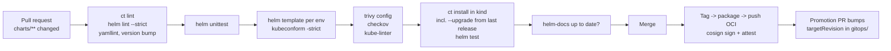

# Helm: Production Patterns

| | |
|---|---|
| **Cluster** | 04 Containers & IDP |
| **Role** | Bridge (from Kubernetes) |
| **Prerequisites** | [04-hands-on-labs.md](04-hands-on-labs.md) through Lab 6 |
| **Target version** | Helm 3.16+, Kubernetes 1.31+, Argo CD 2.12+ |
| **Capstone phase** | Phase 3 (Months 9-12) |

> How to run Helm charts as a platform team: chart design rules, security hardening, supply-chain integrity (signing, provenance, pinning), secrets management, CI gates, GitOps hand-off to Argo CD, multi-tenant conventions, upgrade and CRD strategies, cost controls, anti-patterns and a decision checklist.

## 1. Chart design rules

1. **One chart per deployable service, one library chart per platform.** `charts/api`, `charts/web` depend on `charts/platform-lib` for shared Deployment/Service skeletons. Shared changes land once.
2. **`values.yaml` is an API; version it like one.** Renaming a key is a breaking change: bump the chart major version and keep a deprecation shim for one minor (`{{ if hasKey .Values "oldKey" }}{{ fail "oldKey was renamed to newKey in 2.0" }}{{ end }}`).
3. **Secure defaults, opt-out not opt-in.** Non-root, read-only root FS, dropped capabilities, `RuntimeDefault` seccomp, `automountServiceAccountToken: false`, NetworkPolicy and PDB enabled by default. A user must explicitly loosen.
4. **Toggle on capability, not just on value.** `{{ if and .Values.serviceMonitor.enabled (.Capabilities.APIVersions.Has "monitoring.coreos.com/v1") }}` so the chart installs on clusters without Prometheus Operator. Document that under `helm template` you must pass `--api-versions`.
5. **Never set what another controller owns.** `spec.replicas` with HPA, `spec.template.spec.containers[].resources` with VPA in `Auto` mode, injected sidecars.
6. **Generate docs and schema from values.** `helm-docs` for README, `values.schema.json` hand-maintained or generated with `helm schema-gen`. CI fails if README is stale.
7. **Pin by digest in prod.** `image.digest` beats `image.tag`. CI writes the digest into `envs/prod/values.yaml` after the image is built and signed.
8. **No `latest`, no floating chart versions.** Argo CD `targetRevision` and `Chart.yaml` dependencies pin exact versions. Renovate opens the bump PRs.
9. **Hooks are for migrations, not for ordering.** If you need resource A before B in the same chart, that is a sign A belongs in a different chart or you need an operator. Hooks make `helm template` output diverge from install behaviour and Argo CD maps them to its own hook model.
10. **Keep `helm template` deterministic.** No `randAlphaNum`, no `now`, no `lookup` that changes output. GitOps diffs rely on it.

## 2. Security hardening

### 2.1 Who runs Helm and with what rights

Helm has the permissions of the kubeconfig that runs it. In the capstone, no human runs `helm upgrade` against prod. Argo CD's application-controller renders and applies; its ServiceAccount is scoped per destination namespace via Argo CD Projects. CI runners only lint, template, test in ephemeral kind clusters, and push the chart artifact.

If you must run Helm from CI against a cluster (push model), use a short-lived OIDC-federated identity (`aws eks get-token` after `aws-actions/configure-aws-credentials` with a role trusted for the repo's `sub`), a namespace-scoped Role, and never a long-lived kubeconfig secret.

### 2.2 Release Secrets contain your values

`sh.helm.release.v1.*` Secrets contain the complete rendered manifest and all values, including anything you passed with `--set`. Treat `get secrets` in a release namespace as equivalent to reading every value. Mitigations:

- Encrypt etcd at rest (EKS does by default with KMS envelope encryption when configured).
- Keep secrets out of values entirely (section 4).
- RBAC: application developers get `get` on Deployments, not on Secrets, in prod namespaces.

### 2.3 Pod security in every chart

The lab chart's `podSecurityContext` and `securityContext` satisfy the Pod Security Standards `restricted` profile. Enforce it at the namespace level so a loosened values file is rejected:

```yaml
apiVersion: v1
kind: Namespace
metadata:
  name: api
  labels:
    pod-security.kubernetes.io/enforce: restricted
    pod-security.kubernetes.io/enforce-version: v1.31
```

Add a Kyverno `verifyImages` policy requiring a Cosign signature on `ghcr.io/example/*` so a chart pointing at an unsigned image cannot start a Pod. See [../../08-devsecops/README.md](../../08-devsecops/README.md).

### 2.4 Scan rendered output, not just templates

Scanners cannot read Go templates. Render first:

```bash
helm template api charts/api -f envs/prod/values.yaml --api-versions monitoring.coreos.com/v1 --output-dir rendered/
trivy config rendered/ --severity HIGH,CRITICAL --exit-code 1
checkov --directory rendered/ --framework kubernetes --quiet
kube-linter lint rendered/
```

`checkov --framework helm` and `trivy config charts/api` also work directly on charts (they shell out to `helm template` with default values), but default values are not what prod runs. Scan every environment's render.

## 3. Supply-chain integrity

### 3.1 Sign charts in CI with keyless Cosign

```yaml
# .github/workflows/chart-release.yaml (excerpt)
permissions:
  contents: read
  packages: write
  id-token: write          # OIDC token for keyless signing
steps:
  - uses: actions/checkout@v4
  - uses: azure/setup-helm@v4
    with: { version: v3.16.3 }
  - uses: sigstore/cosign-installer@v3
  - name: Login to GHCR
    run: echo "${{ secrets.GITHUB_TOKEN }}" | helm registry login ghcr.io --username "${{ github.actor }}" --password-stdin
  - name: Package and push
    id: push
    run: |
      VERSION=$(yq '.version' charts/api/Chart.yaml)
      helm package charts/api --destination dist
      helm push "dist/api-${VERSION}.tgz" "oci://ghcr.io/${{ github.repository_owner }}/charts" 2>&1 | tee push.log
      echo "digest=$(grep -oE 'sha256:[a-f0-9]{64}' push.log)" >> "$GITHUB_OUTPUT"
      echo "version=${VERSION}" >> "$GITHUB_OUTPUT"
  - name: Sign (keyless, identity = this workflow)
    run: cosign sign --yes "ghcr.io/${{ github.repository_owner }}/charts/api@${{ steps.push.outputs.digest }}"
  - name: Attest SBOM of the chart
    run: |
      syft "dist/api-${{ steps.push.outputs.version }}.tgz" -o spdx-json > chart-sbom.spdx.json
      cosign attest --yes --predicate chart-sbom.spdx.json --type spdxjson \
        "ghcr.io/${{ github.repository_owner }}/charts/api@${{ steps.push.outputs.digest }}"
```

Verify anywhere:

```bash
cosign verify \
  --certificate-identity-regexp '^https://github.com/<ORG>/platform/\.github/workflows/chart-release\.yaml@refs/tags/' \
  --certificate-oidc-issuer https://token.actions.githubusercontent.com \
  ghcr.io/<ORG>/charts/api:1.4.2
```

Argo CD does not verify Cosign signatures on Helm OCI charts natively (as of 2.12). Options: a Kyverno/Gatekeeper policy on `Application` objects that calls out to a verifier, a pre-sync hook, or verifying at CI time before updating the Application's `targetRevision`. The capstone verifies in the promotion PR workflow.

### 3.2 PGP provenance (legacy HTTP repos)

`helm package --sign` produces `api-1.4.2.tgz.prov`; `helm install --verify` checks it. Only works for HTTP repos and needs GPG keyrings in the legacy format. Use Cosign for OCI; keep `.prov` only if you publish to a public HTTP repo where users expect it.

### 3.3 Pin everything

| What | How |
|---|---|
| Chart version in Argo CD | `targetRevision: 1.4.2`, never `*` or `1.x` in prod |
| Dependencies | exact `version:` in `Chart.yaml`; `Chart.lock` committed; `helm dependency build` in CI |
| Images | `image.digest` in prod values; tag in dev |
| Helm binary in CI | `version: v3.16.3` in `setup-helm`; digest-pinned image for self-hosted runners |
| Plugins | `--version vX.Y.Z` on `helm plugin install` |
| Third-party charts | Mirror to your own OCI registry (`helm pull` + `helm push`); Argo CD points at the mirror |

Renovate configuration to keep the pins moving:

```json
{
  "extends": ["config:recommended", "helpers:pinGitHubActionDigests"],
  "helm-values": { "enabled": true },
  "helmv3": { "enabled": true },
  "argocd": { "fileMatch": ["^gitops/.*\\.ya?ml$"] },
  "packageRules": [
    { "matchDatasources": ["helm", "docker"], "matchUpdateTypes": ["major"], "dependencyDashboardApproval": true }
  ]
}
```

## 4. Secrets management

| Approach | Where the secret lives | Who decrypts | Suits | Caveat |
|---|---|---|---|---|
| Plain values file | Git, release Secret | Nobody; it is plaintext | Never | Leaks via history, logs, release Secret |
| helm-secrets + SOPS (age/KMS) | Encrypted in Git; plaintext in release Secret and Pod | helm CLI / Argo CD plugin with the KMS key | Low-sensitivity config, bootstrap secrets | Argo CD needs a sidecar plugin and KMS access; rotation = re-encrypt + redeploy |
| External Secrets Operator | AWS Secrets Manager / Vault / Azure KV / GCP SM; synced into a K8s Secret | ESO controller via IRSA / Workload Identity | Application credentials | A K8s Secret still exists; needs etcd encryption and RBAC |
| Secrets Store CSI Driver | Same backends; mounted as files, optionally synced to a Secret | CSI driver per node | Files/certs, no Secret object needed | Pod restart to rotate unless app watches files |
| Vault Agent injector / Vault Secrets Operator | Vault | Sidecar or operator | Dynamic DB creds, PKI | Operational weight of Vault |
| Sealed Secrets | Encrypted `SealedSecret` CR in Git | In-cluster controller with its private key | Simple GitOps shops | Key per cluster; re-seal to move envs |

Capstone decision: ESO for application secrets (chart renders `ExternalSecret`, values hold only the remote key path), SOPS with KMS for the handful of platform bootstrap secrets (Argo CD repo credentials, ESO's own store config). ADR: `capstone/adrs/0007-secrets-management.md`.

Pattern for charts that need a generated password without regenerating it on every upgrade:

```yaml
{{- $secretName := printf "%s-admin" (include "api.fullname" .) }}
{{- $existing := (lookup "v1" "Secret" .Release.Namespace $secretName) }}
{{- $password := "" }}
{{- if $existing }}
{{- $password = index $existing.data "password" | b64dec }}
{{- else }}
{{- $password = randAlphaNum 32 }}
{{- end }}
```

This breaks under `helm template` and Argo CD (`lookup` returns empty, so the password changes every sync). Prefer `existingSecret:` values that point at an ESO-managed Secret and fail with `required` if absent in prod.

## 5. CI gates for charts



The `--upgrade` flag on `ct install` installs the previous released chart version first, then upgrades to the PR version. It catches immutable-field changes (`spec.selector` on a Deployment, `volumeClaimTemplates` on a StatefulSet) that would fail in prod with `field is immutable`.

A gate for `helm diff` in the promotion PR so reviewers see exactly what prod will change:

```yaml
- name: Diff against prod
  run: |
    helm diff upgrade api oci://ghcr.io/${ORG}/charts/api --version "${NEW_VERSION}" \
      --namespace api -f envs/prod/values.yaml --kube-context prod-readonly \
      --no-color --context 3 --detailed-exitcode > diff.txt || true
    gh pr comment "${PR_NUMBER}" --body-file <(printf '```diff\n%s\n```' "$(cat diff.txt)")
```

The `prod-readonly` context is a read-only identity; `helm diff` needs only `get` on the release Secrets and the objects.

## 6. GitOps hand-off to Argo CD

Helm renders; Argo CD reconciles. The Application points at the OCI chart and a values file in the gitops repo:

```yaml
apiVersion: argoproj.io/v1alpha1
kind: Application
metadata:
  name: api-prod
  namespace: argocd
  annotations:
    argocd-image-updater.argoproj.io/image-list: api=ghcr.io/example/api
spec:
  project: capstone-prod
  sources:
    - repoURL: ghcr.io/example/charts
      chart: api
      targetRevision: 1.4.2
      helm:
        releaseName: api
        valueFiles:
          - $values/envs/prod/values.yaml
        skipCrds: false
    - repoURL: https://github.com/example/platform-gitops.git
      targetRevision: main
      ref: values
  destination:
    server: https://kubernetes.default.svc
    namespace: api
  syncPolicy:
    automated:
      prune: true
      selfHeal: true
    syncOptions:
      - CreateNamespace=true
      - ServerSideApply=true
      - PruneLast=true
```

What changes when Argo CD runs your chart:

| Helm behaviour | Under Argo CD |
|---|---|
| Release Secret stored | Not created; Argo CD tracks state itself. `helm list` shows nothing. |
| `helm.sh/hook` | Mapped to Argo CD hooks (`pre-install`/`pre-upgrade` -> `PreSync`, `post-*` -> `PostSync`, `test` -> ignored unless `helm.sh/hook: test` mapped via annotation). `hook-weight` -> `argocd.argoproj.io/sync-wave`. |
| `--wait` | Health assessment per resource kind |
| `lookup` | Returns empty |
| `.Capabilities.APIVersions` | Populated from the destination cluster |
| `crds/` | Installed and *upgraded* (unlike Helm) unless `skipCrds: true` |
| `helm rollback` | `argocd app rollback` or Git revert |
| `--set` | `spec.source.helm.parameters` (avoid; put everything in values files) |

Rule: if `helm template` with the right `--api-versions` and `--kube-version` produces correct output, the chart works under Argo CD. See [../argocd/05-production-patterns.md](../argocd/05-production-patterns.md).

## 7. Multi-environment layout

```text
platform/                       # application monorepo
  services/api/                 # source + Dockerfile
  charts/api/                   # chart lives next to the code it packages
  charts/platform-lib/
platform-gitops/                # separate repo; Argo CD watches this
  envs/
    dev/values.yaml             # image.tag, replicaCount 1, debug logging
    stage/values.yaml           # prod-like, lower HPA max
    prod/values.yaml            # image.digest, HPA 3-20, PDB minAvailable 2
  apps/
    dev/api.yaml                # Argo CD Application, targetRevision = chart version
    stage/api.yaml
    prod/api.yaml
```

Promotion is a PR that copies `image.digest` and `targetRevision` from `stage` to `prod`. No Helm command runs; Argo CD notices the Git change and reconciles. Environment differences should be *values*, never *templates*: if prod needs a template branch dev does not, add a toggle, do not fork the chart.

## 8. Upgrades, CRDs and immutable fields

- **Chart major bumps**: write `UPGRADING.md` in the chart. Use `.Release.IsUpgrade` with a `fail` to block upgrades across incompatible majors unless a `--set upgradeConfirm=true` is passed.
- **CRDs**: Helm installs `crds/` once and never touches them again. Strategies: (a) a separate `<name>-crds` chart installed first with `helm.sh/resource-policy: keep`, (b) templates guarded by `.Values.crds.install` (then Helm *will* upgrade them, and will delete them on uninstall unless `keep`), (c) let Argo CD manage them (it upgrades CRDs). The capstone uses (a) for operators it installs (cert-manager, ESO, Prometheus Operator) and Argo CD sync waves to order them.
- **Immutable fields**: `spec.selector` on Deployment/StatefulSet, `volumeClaimTemplates`, Service `clusterIP`, Job `spec.template`. Changing them needs delete-and-recreate. Never change `selectorLabels` in a released chart. For Jobs, use `helm.sh/hook-delete-policy: before-hook-creation` or a name with a revision suffix (`{{ .Release.Revision }}`).
- **`--force`**: deletes and recreates on conflict and causes downtime. Not a fix; a last resort in dev.
- **StatefulSets**: Helm does not do rolling restarts of StatefulSets beyond what the API server does; set `updateStrategy` deliberately and test with `ct install --upgrade`.

## 9. Multi-tenant conventions

- One release per `(service, environment)`; release name equals service name; namespace equals service name or team name. Document it in the platform-lib README.
- Standard labels from `_helpers.tpl` on every object: `app.kubernetes.io/{name,instance,version,component,part-of,managed-by}` plus `team` and `cost-center` from `global.labels`. Kubecost/OpenCost and Kyverno rely on them.
- Platform-owned charts expose `global.*` for registry mirror, image pull secret, cluster domain, Prometheus labels; tenants never hardcode them.
- Argo CD Project per team restricts destination namespaces and source repos; the chart itself cannot escape the namespace because Helm renders `.Release.Namespace`, and ClusterRole/ClusterRoleBinding templates are forbidden by a `ct` custom check (`yq 'select(.kind | test("^Cluster"))'` must be empty).

## 10. Cost and performance

- Default `resources.requests` honestly (measured p95 plus headroom), `limits.memory` set, `limits.cpu` usually unset to avoid throttling; expose both in values. A chart without requests is unschedulable on clusters with ResourceQuota.
- Autoscaling defaults: HPA on CPU 70%; add `behavior.scaleDown.stabilizationWindowSeconds: 300` to stop flapping. Karpenter consolidation benefits from accurate requests and PDBs that allow movement (`minAvailable` less than replicas).
- `--history-max 5` in CI-driven installs; under Argo CD it is moot. Large charts with `.Files.Glob` of dashboards can exceed the 1 MiB Secret limit; split dashboards into their own chart or ConfigMap generator.
- Mirror third-party charts and images to your registry: faster pulls, no rate limits, and a controlled upgrade cadence.

## 11. Anti-patterns

| Anti-pattern | Why it hurts | Do instead |
|---|---|---|
| One chart per environment (`api-dev`, `api-prod`) | Drift, triple maintenance | One chart, one values file per env |
| `--set` from shell scripts in prod | Unrecorded, unreviewable, lands in history | Values files in Git; Argo CD |
| `--reuse-values` in CI | Hidden state; upgrade result depends on history | Pass full values every time |
| `lookup` / `randAlphaNum` for secrets | Non-deterministic renders, Argo CD flaps | `existingSecret` + ESO |
| `latest` image tag with `pullPolicy: Always` | Unreproducible, rollback impossible | Digest in prod |
| Templating entire manifests with `tpl` from values | Chart becomes a YAML passthrough; no validation | Expose typed toggles |
| Giant umbrella chart for the whole platform | One failed resource blocks everything; 1 MiB limit | App-of-Apps in Argo CD, small charts |
| `kubectl edit` on Helm-managed objects | Three-way merge surprises next upgrade | Change values, upgrade |
| CRDs in `templates/` without `keep` | `helm uninstall` deletes every CR in the cluster | Separate CRD chart or `resource-policy: keep` |
| Ignoring `helm lint` warnings | Icons and maintainers are noise, but `apiVersion` and schema warnings are real | `--strict` in CI, allowlist specific warnings |
| Hooks that take minutes | `--wait` timeouts, Argo CD sync stuck | Move long migrations to a Job managed by the app or a sync wave with `argocd.argoproj.io/hook-delete-policy` |

## 12. Disaster recovery of releases

Helm's state is release Secrets. If a cluster is lost and rebuilt:

- With Argo CD, nothing to restore: Applications re-sync from Git and OCI. Helm release Secrets never existed.
- With push-based Helm, re-run `helm upgrade --install` from the same values files; the release history is gone but the objects are identical. Velero can back up the Secrets if history matters.
- To adopt existing objects into a new release: label and annotate them (`app.kubernetes.io/managed-by=Helm`, `meta.helm.sh/release-name`, `meta.helm.sh/release-namespace`) then `helm upgrade --install`; Helm 3.17+ offers `--take-ownership`.

## 13. Decision checklist

Before a chart is marked production-ready:

- [ ] `helm lint --strict`, `helm unittest`, `ct install --upgrade` pass in CI.
- [ ] Rendered output for every env passes `kubeconform -strict`, `trivy config`, `checkov`.
- [ ] Defaults meet PSS `restricted`; NetworkPolicy and PDB default on.
- [ ] `values.schema.json` present; `helm-docs` README current.
- [ ] No secret literals in values; `ExternalSecret` or `existingSecret` pattern used.
- [ ] `spec.replicas` omitted when HPA enabled; no fields owned by other controllers.
- [ ] Checksum annotations for ConfigMaps/Secrets the Pod consumes.
- [ ] Probes: startup, liveness, readiness all configurable.
- [ ] `topologySpreadConstraints` default across zones.
- [ ] Chart pushed to OCI, signed with Cosign, digest recorded.
- [ ] Argo CD Application pins `targetRevision`; prod values pin `image.digest`.
- [ ] `UPGRADING.md` exists for any major bump; immutable fields unchanged since 1.0.
- [ ] Works under `helm template --api-versions ... --kube-version ...` identically to install.

Continue to [06-troubleshooting.md](06-troubleshooting.md).
