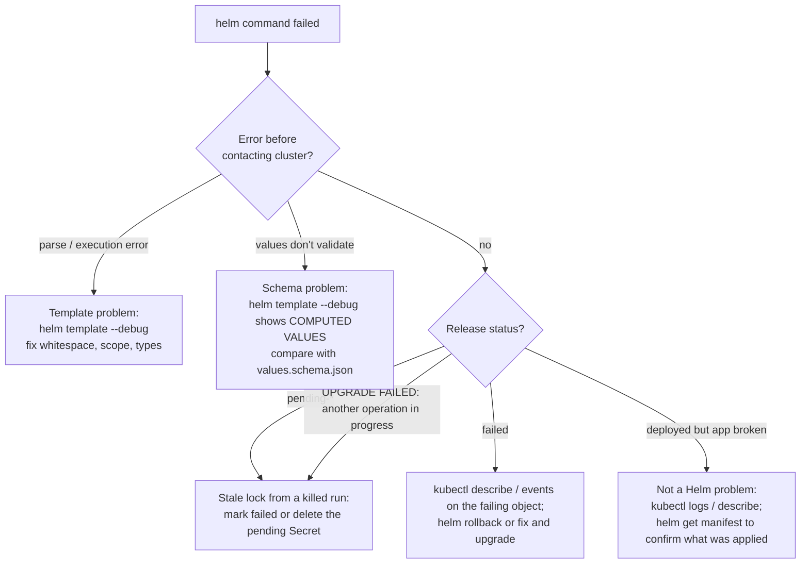

# Helm: Troubleshooting

| | |
|---|---|
| **Cluster** | 04 Containers & IDP |
| **Role** | Bridge (from Kubernetes) |
| **Prerequisites** | [02-core-concepts.md](02-core-concepts.md), [03-commands-and-cheatsheet.md](03-commands-and-cheatsheet.md) |
| **Target version** | Helm 3.16+, Kubernetes 1.31+ |
| **Capstone phase** | Phase 3 (Months 9-12) |

> Symptom-to-fix tables for template errors, values problems, install/upgrade failures, stuck releases, repository and OCI issues, and Argo CD interactions, followed by a diagnostic workflow and the error messages you will see verbatim.

## Diagnostic workflow



First three commands, always:

```bash
helm list --namespace <ns> --all                      # status column
helm history <release> --namespace <ns>               # which revision failed and its description
helm template <release> <chart> -f <values> --debug   # does it even render?
```

## 1. Template rendering errors

| Symptom (verbatim) | Likely cause | Diagnose | Fix |
|---|---|---|---|
| `Error: parse error at (api/templates/deployment.yaml:42): unexpected "}" in operand` | Unbalanced `{{ }}` or a stray `}` inside an action | Open the file at that line; count braces | Fix the action; use an editor with Helm syntax highlighting |
| `Error: template: api/templates/deployment.yaml:18:22: executing "api/templates/deployment.yaml" at <.Values.image.tag>: nil pointer evaluating interface {}.tag` | Parent key missing (`.Values.image` is nil) so `.tag` cannot be read | `helm template --debug` and check COMPUTED VALUES for `image:` | Add defaults in `values.yaml`; guard with `{{ with .Values.image }}`; use `dig "image" "tag" "" .Values.AsMap` |
| `Error: YAML parse error on api/templates/deployment.yaml: error converting YAML to JSON: yaml: line 31: did not find expected key` | Rendered YAML is mis-indented, almost always `toYaml` without `nindent`, or a `{{-` that ate a required newline | `helm template --debug 2>&1 \| sed -n '20,40p'`; the error line number refers to *rendered* output | Use `{{- toYaml . \| nindent N }}`; remove the trailing `-}}` |
| `Error: YAML parse error ... mapping values are not allowed in this context` | Unquoted string containing `:` (URLs, `JAVA_OPTS`) | Look for `value: http://...` | `{{ .Values.x \| quote }}` |
| `executing "api.labels" at <.Release.Name>: can't evaluate field Release in type interface {}` | Called `include` with the wrong context (inside `range`/`with`, `.` is rebound) | Find the `include` inside a loop | Pass `$` instead of `.`: `{{ include "api.labels" $ }}` |
| `wrong type for value; expected string; got float64` | Values key was parsed as a number (`tag: 1.4` or `--set image.tag=1.4.2`) | `helm get values --all` shows `1.4` | Quote in values file; `--set-string` on CLI; `values.schema.json` with `type: string` |
| `error calling include: template: no template "api.fullnmae" associated with template "gotpl"` | Typo in named template, or `_helpers.tpl` missing from the chart | `grep define templates/_helpers.tpl` | Fix name; ensure helper file starts with `_` and is under `templates/` |
| `template "common.labels" ... redefined` or wrong output silently | Two charts (parent and subchart) `define` the same name | `grep -r 'define "' charts/ templates/` | Prefix every named template with the chart name |
| `Error: execution error at (api/templates/deployment.yaml:1:4): autoscaling.minReplicas must be <= ...` | A deliberate `fail`/`required` in the chart | Read the message; it is yours | Fix the values |
| `error calling required: image.repository is required` | Missing required value | - | Supply it; in `ct`, add to `ci/*-values.yaml` |
| `<.Values.x>: invalid value; expected string` on `--set` with commas | Unescaped `,` in `--set` | - | `--set 'a=x\,y'` or use a values file |
| Output contains `<no value>` | Referencing an undefined key without `default` | `grep '<no value>' rendered.yaml` | Add `default`; set `.Values` key |
| `Error: chart requires kubeVersion: >=1.29.0-0 which is incompatible with Kubernetes v1.28.9` | `kubeVersion` constraint | `kubectl version` | Upgrade the cluster or pass `--kube-version` to `template` (not to install) |

## 2. Values and schema problems

| Symptom | Likely cause | Diagnose | Fix |
|---|---|---|---|
| `Error: values don't meet the specifications of the schema(s) in the following chart(s): api: - replicaCount: Invalid type. Expected: integer, given: string` | Schema violation | Message names the key | Fix type; `--set-string` vs `--set`; check YAML quoting |
| `- (root): Additional property replicas is not allowed` | `additionalProperties: false` and a typo (`replicas` vs `replicaCount`) | Compare with `values.yaml` keys | Fix the key; the schema did its job |
| A value in `values-prod.yaml` is ignored | Later `-f` or `--set` overrides it; or key nested at the wrong level | `helm get values --all`; `helm template --debug` COMPUTED VALUES | Reorder `-f`; fix nesting |
| List partially replaced, element missing | Lists are replaced wholesale, not merged | Compare default list with override | Supply the complete list in the override |
| Subchart ignores values | Values placed at top level instead of under `<subchart-name>:` | Check `Chart.yaml` dependency `name` (and `alias`) | Nest under the dependency name/alias |
| `global.*` not reaching subchart | Typo or subchart does not use `global` | `helm show values <subchart>` | Check the subchart's actual keys |
| `--reuse-values` produced an unexpected mix | Reused old user values plus new `-f` | `helm get values --revision N` for each revision | Stop using `--reuse-values`; pass all values each time |
| `Error: failed to parse values-prod.yaml: error converting YAML to JSON: yaml: line 7: found character that cannot start any token` | Tabs in YAML | `cat -A values-prod.yaml \| grep '\^I'` | Spaces only |

## 3. Install and upgrade failures

| Symptom (verbatim) | Likely cause | Diagnose | Fix |
|---|---|---|---|
| `Error: INSTALLATION FAILED: cannot re-use a name that is still in use` | Release exists (maybe `failed` or in another namespace) | `helm list -A --all --filter '^api$'` | `helm upgrade --install`; or `helm uninstall` the stale one |
| `Error: UPGRADE FAILED: "api" has no deployed releases` | First install failed, leaving status `failed`; `upgrade` refuses | `helm history` | `helm uninstall api` then install; or `helm upgrade --install` with `--force` only in dev; or delete the failed release Secret |
| `Error: UPGRADE FAILED: another operation (install/upgrade/rollback) is in progress` | Previous Helm process was killed; release stuck in `pending-upgrade` | `helm list --pending` | See section 4 |
| `Error: INSTALLATION FAILED: Kubernetes cluster unreachable: Get "https://...": dial tcp: lookup ... no such host` | Wrong kubeconfig/context | `kubectl config current-context` | `--kube-context`; `KUBECONFIG` |
| `Error: INSTALLATION FAILED: rendered manifests contain a resource that already exists. Unable to continue with install: Deployment "api" in namespace "api" exists and cannot be imported into the current release: invalid ownership metadata; label validation error: missing key "app.kubernetes.io/managed-by": must be set to "Helm"; annotation validation error: missing key "meta.helm.sh/release-name"` | Object created outside Helm (kubectl, another release, Argo CD) | `kubectl get deployment api -o yaml \| grep -A3 annotations` | Adopt: `kubectl label deployment api app.kubernetes.io/managed-by=Helm; kubectl annotate deployment api meta.helm.sh/release-name=api meta.helm.sh/release-namespace=api`; or `--take-ownership` (3.17+); or delete and reinstall |
| `Error: UPGRADE FAILED: cannot patch "api" with kind Deployment: Deployment.apps "api" is invalid: spec.selector: Invalid value: ...: field is immutable` | Selector labels changed between chart versions | `helm diff upgrade` shows `spec.selector` change | Revert selector change; or delete Deployment then upgrade (downtime); never change `selectorLabels` in a released chart |
| `Error: UPGRADE FAILED: cannot patch "api-migrate" with kind Job: Job.batch "api-migrate" is invalid: spec.template: Invalid value: ...: field is immutable` | Hook Job reused without `before-hook-creation` policy | `helm get hooks` | Add `"helm.sh/hook-delete-policy": before-hook-creation`; or name with `{{ .Release.Revision }}` |
| `Error: INSTALLATION FAILED: unable to build kubernetes objects from release manifest: resource mapping not found for name: "api" namespace: "" from "": no matches for kind "ServiceMonitor" in version "monitoring.coreos.com/v1"` | CRD not installed on the cluster | `kubectl api-resources \| grep -i servicemonitor` | Install Prometheus Operator first; guard with `.Capabilities.APIVersions.Has` |
| `Error: INSTALLATION FAILED: unable to build kubernetes objects from release manifest: error validating "": error validating data: ValidationError(Deployment.spec.template.spec.containers[0]): unknown field "resource" in io.k8s.api.core.v1.Container` | Typo in a field name | Message names the field | Fix template; run `kubeconform -strict` in CI |
| `Error: INSTALLATION FAILED: failed pre-install: 1 error occurred: * job api-migrate failed: BackoffLimitExceeded` | Hook Job failed | `kubectl logs job/api-migrate -n api` (keep it with `hook-failed` not in delete policy) | Fix the migration; rerun |
| `Error: INSTALLATION FAILED: context deadline exceeded` or `timed out waiting for the condition` | `--wait` and Pods never became Ready | `kubectl get pods -n api; kubectl describe pod ...` | Fix the app (`ImagePullBackOff`, `CrashLoopBackOff`, failing probes); raise `--timeout` only if startup is legitimately slow |
| `Error: UPGRADE FAILED: release api failed, and has been rolled back due to atomic being set` | Same as above with `--atomic` | `helm history` shows the failed revision | Inspect the failed revision's events; fix |
| `Error: INSTALLATION FAILED: admission webhook "validate.kyverno.svc-fail" denied the request: ... validation error: Running as root is not allowed` | Admission policy rejected a rendered object | Read the webhook message | Fix `securityContext` in values/templates |
| `Error: INSTALLATION FAILED: namespaces "api" not found` | Namespace missing | - | `--create-namespace` or create it in GitOps |
| `Error: UPGRADE FAILED: failed to create resource: Secret "sh.helm.release.v1.api.v12" is invalid: data: Too long: must have at most 1048576 bytes` | Release too large for a Secret | `helm get manifest \| wc -c` | Split the chart; move large `.Files` out; `HELM_DRIVER=sql` |
| `Error: forbidden: User "system:serviceaccount:ci:deployer" cannot create resource "clusterroles"` | RBAC of the Helm caller | `kubectl auth can-i create clusterroles --as system:serviceaccount:ci:deployer` | Grant the right or remove cluster-scoped objects from the chart |

## 4. Stuck releases (`pending-install`, `pending-upgrade`, `pending-rollback`)

Cause: a Helm process was killed (CI job cancelled, laptop closed) after writing the new revision Secret with a `pending-*` status and before finishing. Nothing in the cluster will ever clear it.

```bash
helm list -n api --pending
helm history api -n api
```

Fix options, least to most invasive:

1. If the pending revision is the latest and a prior `deployed` revision exists: roll back to the previous good revision.

   ```bash
   helm rollback api <previous-deployed-revision> -n api
   ```

2. Mark the stuck revision as failed by deleting its Secret, then retry the upgrade. Helm will treat the last `deployed` revision as current.

   ```bash
   kubectl get secret -n api -l owner=helm,name=api,status=pending-upgrade
   kubectl delete secret -n api sh.helm.release.v1.api.v12
   helm upgrade --install api ... 
   ```

3. If it is a first install stuck in `pending-install`, uninstall and reinstall.

   ```bash
   helm uninstall api -n api
   ```

Prevent it: use `--atomic` or `--cleanup-on-fail`, set `timeout-minutes` on CI jobs greater than `--timeout`, and prefer Argo CD, which has no release lock.

## 5. Repository and OCI errors

| Symptom (verbatim) | Likely cause | Fix |
|---|---|---|
| `Error: looks like "https://charts.example.com" is not a valid chart repository or cannot be reached: failed to fetch https://charts.example.com/index.yaml : 404 Not Found` | Wrong URL or repo moved | Check the project's install docs; many moved to OCI |
| `Error: chart "api" matching 1.4.2 not found in bitnami index. (try 'helm repo update'): no chart version found for api-1.4.2` | Stale local index or version does not exist | `helm repo update`; `helm search repo api --versions` |
| `Error: no cached repo found. (try 'helm repo update')` | Fresh machine / CI runner | `helm repo update` or use OCI |
| `Error: failed to authorize: failed to fetch anonymous token: unexpected status from GET request to https://ghcr.io/token?...: 401 Unauthorized` | Not logged in or package is private | `helm registry login ghcr.io` with a token from an env var |
| `Error: failed to do request: Head "https://ghcr.io/v2/<org>/charts/api/manifests/1.4.2": denied` | Token lacks `read:packages` or wrong org | Fix token scopes; for GitHub Actions use `GITHUB_TOKEN` with `packages: read/write` |
| `Error: unable to locate any tags in provided repository: oci://ghcr.io/org/charts/api` | `helm install` without `--version` on an OCI ref where Helm cannot resolve a latest SemVer tag, or wrong path | Always pass `--version`; check path with `helm show chart` |
| `Error: pushing chart to remote: unexpected status: 400 Bad Request` on `helm push` | Pushing with a chart name in the URL (`oci://.../charts/api` instead of `oci://.../charts`), or version has `+build` metadata | Push to the *parent* path; Helm appends `/api:version` |
| `Error: pushing chart to remote: unexpected status: 403 Forbidden` on ECR | Repository does not exist (ECR does not auto-create) | `aws ecr create-repository --repository-name charts/api` |
| `Error: http: server gave HTTP response to HTTPS client` | Plain-HTTP local registry | `--plain-http` (3.13+) or `--insecure-skip-tls-verify` for self-signed TLS |
| `Error: could not download oci://...: failed to pull: ...: blob unknown` | Registry garbage-collected or partial push | Re-push |
| `Error: open ~/.config/helm/registry/config.json: permission denied` | Running as a different user than the one who logged in | Fix `HELM_REGISTRY_CONFIG` or file ownership |
| `Error: can't get a valid version for repositories redis. Try changing the version constraint in Chart.yaml` | Dependency constraint matches nothing | `helm search repo bitnami/redis --versions`; fix constraint |
| `Error: the lock file (Chart.lock) is out of sync with the dependencies file (Chart.yaml). Please update the dependencies` | `Chart.yaml` edited, lock not regenerated | `helm dependency update`; commit `Chart.lock` |
| `Error: found in Chart.yaml, but missing in charts/ directory: redis` | Dependencies not vendored | `helm dependency build` |

## 6. Plugins

| Symptom | Likely cause | Fix |
|---|---|---|
| `Error: unknown command "diff" for "helm"` | Plugin not installed in this `HELM_PLUGINS` (common in CI) | `helm plugin install ...` in the job; check `helm env` |
| `Error: plugin "diff" exited with error` with no detail | Plugin binary missing (downloader hook failed) | `helm plugin uninstall diff && helm plugin install ... --version vX` |
| `helm secrets`: `Error: [helm-secrets] Decrypt error: ... no identity matched any of the recipients` | age key not available | `SOPS_AGE_KEY_FILE`; or KMS credentials for KMS-encrypted files |
| `helm secrets`: values appear encrypted in the cluster (`ENC[AES256_GCM,...]`) | Ran `helm` instead of `helm secrets`, or `-f` not prefixed when required | Use `helm secrets upgrade ...` and `secrets://` prefix |
| `helm unittest`: `Error: template "api/templates/foo.yaml" not found` | `templates:` list in test file does not match | Match file names exactly |
| `ct lint`: `Chart version not ok. Needs a version bump!` | `check-version-increment: true` and `version` unchanged | Bump `version` in `Chart.yaml` |
| `ct lint`: `Error validating maintainers: ... is not a GitHub user` | `validate-maintainers` default true | Set `validate-maintainers: false` or use real GitHub handles |
| `ct install`: `Error: timed out waiting for the condition` | Chart needs an image the kind cluster cannot pull | `kind load docker-image`; add `ci/*-values.yaml` with a pullable tag |

## 7. Helm under Argo CD

| Symptom | Likely cause | Fix |
|---|---|---|
| `helm list` shows nothing although the app is deployed by Argo CD | Expected: Argo CD does not create release Secrets | Use `argocd app get` |
| Application `OutOfSync` every sync with a Secret or password field | `randAlphaNum` / `lookup` / `now` in templates | Make rendering deterministic; `existingSecret` pattern |
| `ComparisonError: rpc error: code = Unknown desc = Manifest generation error (cached): ... no matches for kind "ServiceMonitor"` | Chart renders a CRD type not on the destination cluster | Guard with `.Capabilities.APIVersions.Has`; install the operator first with a lower sync wave |
| Hooks run in a different order than with `helm install` | Argo CD maps `hook-weight` to sync waves but not all hook types map 1:1 | Set `argocd.argoproj.io/hook` and `sync-wave` annotations explicitly |
| `helm.sh/hook: test` Pods never run | Argo CD skips `test` hooks | Add `argocd.argoproj.io/hook: PostSync` to the test manifest if you want it run |
| Values file in a second repo not found: `error getting app source type: ...` | Multi-source `$values` ref misconfigured | Use `ref: values` on the Git source and `$values/path` in `valueFiles` |
| Argo CD renders differently from local `helm template` | Different `--api-versions`/`--kube-version`/Helm binary version | `argocd app manifests api-prod` and compare; pin Argo CD's Helm version |

## 8. Essential diagnostic commands

```bash
# What exactly is in the cluster for this release?
helm get manifest api -n api | kubectl diff -f -        # live vs recorded (needs kubectl 1.20+)
helm status api -n api --show-resources
kubectl get all,ingress,networkpolicy,pdb,hpa -n api -l app.kubernetes.io/instance=api

# Which revision introduced the problem?
helm history api -n api
helm diff revision api 7 8 -n api

# Full render with debug info
helm template api charts/api -f envs/prod/values.yaml --debug 2> debug.txt > rendered.yaml

# Decode a release Secret manually
kubectl get secret sh.helm.release.v1.api.v8 -n api -o jsonpath='{.data.release}' \
  | base64 -d | base64 -d | gunzip | jq '.info'

# Who owns an object?
kubectl get deployment api -n api -o jsonpath='{.metadata.annotations}' | jq

# Test RBAC for the CI identity
kubectl auth can-i --list --as system:serviceaccount:ci:deployer -n api

# Verbose API traffic (last resort)
helm upgrade api charts/api -n api --debug -v 8 2>&1 | grep -E 'Request|Response' | head
```

## 9. Reading rendered-line numbers

Go template errors give line numbers in the *template*; YAML parse errors give line numbers in the *rendered* output of that single template file. To find the latter:

```bash
helm template api charts/api --show-only templates/deployment.yaml | cat -n | sed -n '25,40p'
```

Continue to [07-interview-questions.md](07-interview-questions.md).
