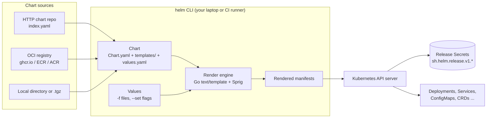

# Helm

| | |
|---|---|
| **Cluster** | 04 Containers & IDP |
| **Role** | Bridge (from Kubernetes) |
| **Category** | Kubernetes package manager and templating engine |
| **Prerequisites** | Kubernetes core objects (Deployment, Service, ConfigMap, Secret), `kubectl`, YAML, basic Go template syntax is helpful but taught here |
| **Target version** | Helm 3.16+, Kubernetes 1.31+ |
| **Capstone phase** | Phase 3 (Months 9-12) |
| **Official docs** | https://helm.sh/docs/ |

> Helm packages a set of Kubernetes manifests into a versioned, parameterised unit called a **chart**, renders that chart against a set of **values**, and tracks every install as a **release** with a revision history you can diff and roll back. After this folder you will be able to author a production-grade chart for the capstone FastAPI service (with HPA, PodDisruptionBudget, NetworkPolicy and ServiceMonitor toggles), publish it to an OCI registry, lint and test it in CI, and hand it to Argo CD for GitOps delivery.

## Why This Tool Exists

Raw Kubernetes manifests are correct but not reusable. The moment you need the same Deployment in `dev`, `stage` and `prod` with different replica counts, image tags, resource limits and ingress hosts, you either copy-paste YAML (and watch it drift) or invent a templating scheme. Every team invented one. Helm, started at Deis in 2015 and now a CNCF graduated project, standardised that scheme: Go templates plus a values file, packaged in a tarball with metadata, installed as a named release whose rendered manifests are stored in the cluster so that upgrades can be diffed and reverted.

The second problem Helm solves is distribution. Installing Prometheus, cert-manager, ingress-nginx or Argo CD by hand means tracking dozens of CRDs and RBAC objects. A chart in a repository (or, since Helm 3.8, an OCI registry) lets you `helm install` a vendor's software with one command and `helm upgrade` it later while preserving your overrides.

Helm 3 (2019) removed Tiller, the in-cluster server component of Helm 2 that needed cluster-admin and was a well-known security hole. Helm 3 is purely a client: it talks to the Kubernetes API with your kubeconfig credentials and stores release state as Secrets in the release namespace.

## Architecture



- **Chart**: a directory or `.tgz` with `Chart.yaml` (metadata), `values.yaml` (defaults), `templates/` (Go-templated manifests), optional `charts/` (dependencies), `crds/`, `values.schema.json` and `README.md`.
- **Values**: the user-supplied configuration merged over `values.yaml`. The merge is deep and ordered; see [02-core-concepts.md](02-core-concepts.md#values-precedence).
- **Render engine**: Go `text/template` extended with the Sprig function library and Helm-specific functions (`include`, `tpl`, `required`, `lookup`, `toYaml`).
- **Release**: a named installation of a chart in a namespace. Each `helm upgrade` creates a new revision. Release state (chart, values, rendered manifest, status) is gzipped and base64-encoded in a Secret of type `helm.sh/release.v1`.
- **Repositories / OCI registries**: where packaged charts live. Classic repos are a static `index.yaml` plus tarballs over HTTPS; OCI registries store charts as artifacts next to container images.

## The Core Mental Model

1. **A chart is a function from values to manifests.** `render(chart, values) -> []KubernetesObject`. Everything else (install, upgrade, rollback, diff) is bookkeeping around that pure function. If you can run `helm template` and reason about its output, you understand 80% of Helm.
2. **A release is a versioned log of rendered outputs.** Revision N is stored in a Secret. `helm rollback` re-applies the manifest from revision N-1; it does not "undo" anything cleverly. Helm uses a three-way merge (old manifest, new manifest, live object) to decide what to patch, which is why out-of-band `kubectl edit` changes are sometimes preserved and sometimes clobbered.
3. **Helm is not a controller.** It runs once, when you invoke it, and exits. It does not watch the cluster and does not fix drift. That is why the capstone pairs Helm (packaging) with [Argo CD](../argocd/README.md) (continuous reconciliation): Argo CD runs `helm template` internally and reconciles the result.

## Anchor-and-Bridge Mapping

Helm is a bridge from the Kubernetes anchor. Nothing in Helm is new Kubernetes; it is a layer that produces Kubernetes.

| Concept in Helm | Equivalent in Kubernetes (anchor) | Equivalent in Kustomize | Equivalent in Argo CD |
|---|---|---|---|
| Chart | A directory of manifests | `kustomization.yaml` base | `Application.spec.source` |
| `values.yaml` | Hard-coded fields in YAML | Overlay patches | `Application.spec.source.helm.values` / `valueFiles` |
| Release | No equivalent (`kubectl apply` is stateless) | No equivalent | `Application` (one per release) |
| Revision | `Deployment` revision history (only for Deployments) | None | Sync history (`argocd app history`) |
| `helm rollback` | `kubectl rollout undo` (Deployments only) | `git revert` | `argocd app rollback` |
| `helm template` | `kubectl apply --dry-run=client -o yaml` | `kubectl kustomize` | Repo-server rendering |
| Hooks (`pre-install`, `post-upgrade`) | `Job` you run by hand in the right order | None | Sync hooks / sync waves |
| `helm test` | Manual smoke test | None | `PostSync` hook |
| Chart repository / OCI registry | Container registry for images | Git repo | Git repo or OCI Helm source |
| Subchart dependency | Separate manifest set you apply first | `resources:` pointing at a remote base | App-of-Apps |
| `values.schema.json` | OpenAPI validation in the API server | None | Rendered then validated server-side |

### Coming from Kubernetes

If you already know Kubernetes, learn Helm by translating what you already do:

- You write `deployment.yaml` by hand -> you write `templates/deployment.yaml` with `{{ .Values.replicaCount }}` in place of the literal.
- You keep three copies of the manifest for three environments -> you keep one chart and three values files: `values-dev.yaml`, `values-stage.yaml`, `values-prod.yaml`.
- You run `kubectl apply -f .` -> you run `helm upgrade --install api ./charts/api -f values-prod.yaml --namespace api --create-namespace`.
- You run `kubectl diff -f .` -> you run `helm diff upgrade api ./charts/api -f values-prod.yaml` (plugin).
- You run `kubectl rollout undo` and hope the ConfigMap matches -> you run `helm rollback api 3` and the whole set of objects goes back together.
- You apply CRDs before CRs and wait -> you put CRDs in `crds/` or use `pre-install` hooks and `helm.sh/hook-weight` for ordering.

The things that are genuinely new: Go template syntax, the values merge order, the release Secret, and the three-way merge semantics of upgrades.

## Where Helm Is Weak (Read Before You Commit)

| Weakness | Consequence | Mitigation used in the capstone |
|---|---|---|
| Go templates are not YAML-aware | Whitespace bugs produce invalid YAML that only appears at render time | `helm lint --strict`, `helm unittest`, `kubeconform` on rendered output in CI |
| No drift detection or reconciliation | Manual `kubectl` edits persist until the next upgrade, then may be clobbered by the three-way merge | Argo CD owns the cluster; humans never run `helm upgrade` against prod |
| Release state in a 1 MiB Secret | Large charts fail to install; history consumes etcd | Small charts, `--history-max`, Argo CD (no release Secrets) |
| CRDs installed once, never upgraded | Operator upgrades silently keep old CRDs | Separate CRD charts in earlier Argo CD sync waves |
| Lists in values are replaced, not merged | Overriding one toleration drops the others | Document it; expose maps instead of lists where order does not matter |
| `--set` values are parsed, not literal | `1.4.2` becomes a float, `0123` an integer | `--set-string`, `values.schema.json` |
| Secrets end up in the release Secret and values | Anyone with `get secrets` reads your config | External Secrets Operator; SOPS for Git only |
| No built-in signature verification for OCI charts in Argo CD | Unsigned chart could be deployed | Cosign verification in the promotion PR; Kyverno image verification on the Pods it creates |

## Version Notes

- **Helm 3.0 (2019)**: Tiller removed; releases stored as Secrets per namespace; `apiVersion: v2` charts with `dependencies` in `Chart.yaml`; three-way merge.
- **Helm 3.8 (2022)**: OCI registry support became GA; `helm push`/`pull oci://`.
- **Helm 3.13-3.14**: `--dry-run=server` populates `lookup`; `--reset-then-reuse-values`; release labels.
- **Helm 3.16+ (targeted here)**: `--plain-http` for local registries, improved `helm diff` compatibility, Kubernetes 1.31 client libraries.
- **Helm 4 (in development)**: planned plugin system rework and `kstatus`-based waiting; charts written for Helm 3 are expected to remain compatible. Watch `helm.sh/blog`.

## Learning Path

| Step | File | Time |
|---|---|---|
| 1 | [01-installation-and-setup.md](01-installation-and-setup.md) - install Helm, plugins (`diff`, `secrets`), `ct`, kind cluster | 1 h |
| 2 | [02-core-concepts.md](02-core-concepts.md) - charts, templating, values precedence, releases, hooks, dependencies, OCI | 4 h |
| 3 | [03-commands-and-cheatsheet.md](03-commands-and-cheatsheet.md) - every command you will use, organised by task | 2 h |
| 4 | [04-hands-on-labs.md](04-hands-on-labs.md) - six labs culminating in the production FastAPI chart pushed to GHCR | 8 h |
| 5 | [05-production-patterns.md](05-production-patterns.md) - hardening, CI, secrets, signing, GitOps hand-off, anti-patterns | 3 h |
| 6 | [06-troubleshooting.md](06-troubleshooting.md) - symptom tables and verbatim error messages | 1.5 h |
| 7 | [07-interview-questions.md](07-interview-questions.md) - 28 questions junior to principal | 1.5 h |

Total: roughly 21 hours, or two weeks at the roadmap's 12-15 hours per week alongside the Kubernetes anchor.

## Role in the Capstone

In the unified capstone repository, Helm is the packaging layer between the container image built by Docker/GitHub Actions and the GitOps layer operated by Argo CD.

```mermaid
flowchart LR
    SRC[FastAPI source] -->|GitHub Actions| IMG[ghcr.io/example/api:1.4.2<br/>+ SBOM + Cosign signature]
    CH[charts/api/<br/>Chart.yaml, values.yaml, templates/] -->|ct lint, helm unittest| PKG[oci://ghcr.io/example/charts/api:1.4.2<br/>signed with Cosign]
    IMG -.image.tag.-> VAL[envs/prod/values.yaml]
    PKG --> APP[Argo CD Application<br/>source: OCI chart + values file]
    VAL --> APP
    APP -->|helm template + sync| K8S[(EKS / kind cluster)]
```

- `charts/api/` and `charts/web/` live in the capstone monorepo alongside the service source. The chart version is bumped by CI on every release; the app version matches the image tag.
- `ct lint --config ct.yaml` and `helm unittest` run on every pull request. `helm template | kubeconform` and `checkov -d rendered/` enforce schema and policy before merge.
- The chart is pushed to `oci://ghcr.io/<ORG>/charts/api` and signed with Cosign using the GitHub Actions OIDC identity. Argo CD verifies the signature before rendering.
- `envs/{dev,stage,prod}/values.yaml` carry the environment deltas (replicas, HPA bounds, hostnames, resource limits). Promotion is a pull request that changes `image.tag` in the next environment's values file.
- Backstage's golden-path template scaffolds a new service with a copy of this chart already wired, so a new team never writes a Deployment by hand. See [../backstage/README.md](../backstage/README.md).
- Secrets never live in values files. The chart renders `ExternalSecret` objects for the External Secrets Operator, which pulls from AWS Secrets Manager via IRSA. See [05-production-patterns.md](05-production-patterns.md#secrets-management).

Helm is also how the capstone installs its platform components: ingress-nginx, cert-manager, kube-prometheus-stack, External Secrets Operator, Argo CD itself and Backstage are all Helm releases managed by Argo CD.

## Further Reading

- Helm documentation: https://helm.sh/docs/ (read "Chart Template Guide" and "Chart Best Practices" end to end)
- Sprig function reference: https://masterminds.github.io/sprig/
- Go `text/template` package docs: https://pkg.go.dev/text/template
- Helm OCI support: https://helm.sh/docs/topics/registries/
- Chart Testing (`ct`): https://github.com/helm/chart-testing
- helm-unittest: https://github.com/helm-unittest/helm-unittest
- helm-diff plugin: https://github.com/databus23/helm-diff
- helm-secrets plugin and SOPS: https://github.com/jkroepke/helm-secrets and https://github.com/getsops/sops
- Helmfile: https://helmfile.readthedocs.io/
- "Learning Helm" (Butcher, Farina, Dolitsky; O'Reilly 2021) - written by the Helm maintainers
- Sibling folders: [Kubernetes (anchor)](../kubernetes/README.md), [Docker](../docker/README.md), [Argo CD](../argocd/README.md), [Backstage](../backstage/README.md)
