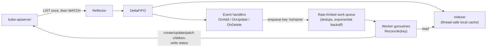
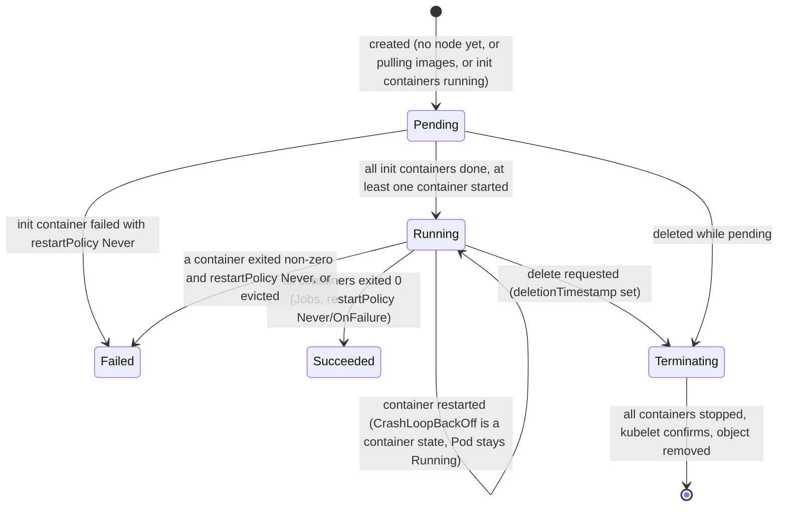

# Kubernetes: Core Concepts (Architecture, API, Reconciliation, kubectl, Pods)

| | |
|---|---|
| **Cluster** | 04 Containers & IDP |
| **Role** | Anchor |
| **Prerequisites** | [01-installation-and-setup.md](01-installation-and-setup.md) complete; the `kind-capstone` context active |
| **Target version** | Kubernetes 1.31+ |
| **Capstone phase** | Phase 3 (Months 9-12) |

> This file is the foundation for the five companion files ([02a](02a-workloads.md) workloads, [02b](02b-networking.md) networking, [02c](02c-storage-and-config.md) storage and config, [02d](02d-scheduling-and-autoscaling.md) scheduling and autoscaling, [02e](02e-security.md) security). After reading it you will understand what every control-plane and node component does and how they communicate; how the reconciliation loop, informers, and work queues make controllers reliable; how the API is organised into groups, versions, and resources and how to discover any field with `kubectl explain`; how `kubectl` really talks to the API (server-side apply, field managers, jsonpath, diff, debug); and the full lifecycle of a Pod from `apply` to graceful termination, including init and sidecar containers, probes, resource requests and limits, QoS classes, and `terminationGracePeriodSeconds`.

---

## 1. The Request Path: What Happens on `kubectl apply`

Before dissecting components, trace one request end to end. You run:

```bash
kubectl apply -f deployment.yaml
```

```mermaid
sequenceDiagram
    autonumber
    participant U as kubectl
    participant A as kube-apiserver
    participant E as etcd
    participant DC as Deployment controller
    participant RC as ReplicaSet controller
    participant S as kube-scheduler
    participant K as kubelet (node)
    participant C as containerd

    U->>A: PATCH /apis/apps/v1/namespaces/capstone/deployments/api (server-side apply)
    A->>A: AuthN (client cert / OIDC token) -> AuthZ (RBAC) -> Mutating admission -> Schema validation -> Validating admission
    A->>E: Write Deployment object (Raft consensus)
    E-->>A: Committed, resourceVersion=18211
    A-->>U: 200 OK (object with status omitted)
    A-->>DC: watch event: Deployment ADDED/MODIFIED
    DC->>A: POST ReplicaSet api-7c9d8f6b5 (ownerReference -> Deployment)
    A-->>RC: watch event: ReplicaSet ADDED
    RC->>A: POST 3 x Pod api-7c9d8f6b5-xxxxx (ownerReference -> ReplicaSet, spec.nodeName empty)
    A-->>S: watch event: Pod ADDED (unscheduled)
    S->>S: Filter feasible nodes, score, pick capstone-worker2
    S->>A: POST /api/v1/namespaces/capstone/pods/api-...-xxxxx/binding
    A-->>K: watch event: Pod bound to my node
    K->>C: RunPodSandbox (pause container, netns) -> CNI ADD (Pod IP)
    K->>C: PullImage, CreateContainer, StartContainer (init containers first)
    K->>A: PATCH pod/status: phase=Running, conditions, podIP
    K->>K: Run startup/readiness/liveness probes; update Ready condition
    A-->>DC: watch: Pods ready -> ReplicaSet status -> Deployment status (availableReplicas=3)
```

Nine independent components participated, none of them called each other directly, and every arrow into or out of the API server is an HTTPS request authenticated and authorised individually. This is the whole architecture in one diagram; everything below is detail.

Observe it live:

```bash
kubectl create namespace trace --dry-run=client -o yaml | kubectl apply -f -
kubectl get events -n trace --watch &
kubectl create deployment api --image=ghcr.io/example/fastapi-svc:1.0.0 --replicas=2 -n trace \
  --dry-run=client -o yaml | kubectl apply -f -
# After a few seconds:
kubectl tree deployment api -n trace       # krew plugin: shows Deployment -> ReplicaSet -> Pods
kubectl delete namespace trace
```

Expected `kubectl tree` output:

```text
NAMESPACE  NAME                           READY  REASON  AGE
trace      Deployment/api                 -              15s
trace      └─ReplicaSet/api-7c9d8f6b5     -              15s
trace        ├─Pod/api-7c9d8f6b5-4kx9p    True           15s
trace        └─Pod/api-7c9d8f6b5-r2m7z    True           15s
```

---

## 2. Control Plane Components in Depth

### 2.1 kube-apiserver

The API server is a stateless HTTP server exposing a REST API with a few unusual properties:

- **Every object has a canonical URL.** Core group: `/api/v1/namespaces/{ns}/{resource}/{name}`. Named groups: `/apis/{group}/{version}/namespaces/{ns}/{resource}/{name}`. Cluster-scoped resources omit `namespaces/{ns}`.
- **Watch is first-class.** `GET ...?watch=true&resourceVersion=N` returns a long-lived chunked stream of `ADDED`/`MODIFIED`/`DELETED` events from version N onward. This is how controllers avoid polling and how `kubectl get --watch` works.
- **Optimistic concurrency via `resourceVersion`.** Every object carries the etcd revision at which it was last written. An update that carries a stale `resourceVersion` is rejected with `409 Conflict`. Controllers read, modify, write, and retry on conflict.
- **A request pipeline.** In order: authentication, authorisation, mutating admission (webhooks and built-in plugins can change the object), schema validation and defaulting (from OpenAPI, CRD structural schema, and CEL validation rules), validating admission (webhooks, Pod Security Admission, ValidatingAdmissionPolicy), then persistence. Admission is covered in [02e-security.md](02e-security.md).
- **Aggregation.** Other servers (metrics-server at `metrics.k8s.io`, custom metrics adapters) register an `APIService` object and the API server proxies those paths to them.
- **Priority and fairness (APF).** Requests are classified into `FlowSchema`s and `PriorityLevelConfiguration`s so that a runaway controller cannot starve the kubelets. `kubectl get flowschemas` shows the defaults.

Inspect it on kind:

```bash
# Raw API access through kubectl's authenticated proxy
kubectl get --raw /api/v1/namespaces/kube-system/pods | jq '.items | length'
kubectl get --raw /healthz?verbose
kubectl get --raw /readyz?verbose | tail -n 5
kubectl get --raw /metrics | grep -E '^apiserver_request_total' | head -n 3

# Flags the API server was started with
docker exec capstone-control-plane cat /etc/kubernetes/manifests/kube-apiserver.yaml | grep -- '- --' | head -n 40
```

Key flags you will recognise from EKS and kubeadm clusters: `--etcd-servers`, `--service-cluster-ip-range`, `--authorization-mode=Node,RBAC`, `--enable-admission-plugins=NodeRestriction`, `--oidc-issuer-url`, `--encryption-provider-config`, `--audit-policy-file`, `--service-account-issuer`.

### 2.2 etcd

etcd stores every object as a protobuf blob at a key like `/registry/deployments/capstone/api`. It is a Raft cluster: writes go to the leader, are replicated to a majority (quorum), then acknowledged. A 3-member cluster tolerates 1 failure; 5 tolerates 2. Latency to etcd dominates API write latency, which is why etcd wants SSDs and a dedicated network. Hard limits: 8 GB recommended max database size, 1.5 MB max object size (which is why you cannot store large ConfigMaps).

Peek inside (kind only; EKS hides etcd):

```bash
docker exec capstone-control-plane sh -c '
ETCDCTL_API=3 etcdctl \
  --endpoints=https://127.0.0.1:2379 \
  --cacert=/etc/kubernetes/pki/etcd/ca.crt \
  --cert=/etc/kubernetes/pki/etcd/server.crt \
  --key=/etc/kubernetes/pki/etcd/server.key \
  get /registry/namespaces/default --prefix --keys-only'

docker exec capstone-control-plane sh -c '
ETCDCTL_API=3 etcdctl --endpoints=https://127.0.0.1:2379 \
  --cacert=/etc/kubernetes/pki/etcd/ca.crt --cert=/etc/kubernetes/pki/etcd/server.crt --key=/etc/kubernetes/pki/etcd/server.key \
  endpoint status --write-out=table'
```

Expected output of the second command:

```text
+------------------------+------------------+---------+---------+-----------+------------+-----------+------------+--------------------+--------+
|        ENDPOINT        |        ID        | VERSION | DB SIZE | IS LEADER | IS LEARNER | RAFT TERM | RAFT INDEX | RAFT APPLIED INDEX | ERRORS |
+------------------------+------------------+---------+---------+-----------+------------+-----------+------------+--------------------+--------+
| https://127.0.0.1:2379 | 8e9e05c52164694d |  3.5.15 |  6.1 MB |      true |      false |         2 |      18422 |              18422 |        |
+------------------------+------------------+---------+---------+-----------+------------+-----------+------------+--------------------+--------+
```

Secrets stored here are base64 plain text unless an `EncryptionConfiguration` is set. See [02c-storage-and-config.md](02c-storage-and-config.md) section 3.

### 2.3 kube-scheduler

The scheduler watches for Pods with no `spec.nodeName` and runs a two-phase algorithm per Pod:

1. **Filtering (predicates).** Eliminate nodes that cannot run the Pod: insufficient allocatable CPU/memory, taints without matching tolerations, `nodeSelector`/node affinity mismatch, port conflicts, volume zone constraints, Pod anti-affinity violations, topology spread hard constraints.
2. **Scoring (priorities).** Rank the survivors: least/most requested resources, balanced allocation, image locality, preferred affinity weights, topology spread skew, inter-Pod affinity weights. Highest score wins; ties broken randomly.
3. **Binding.** Write a `Binding` sub-resource; the Pod now has `spec.nodeName`.

If no node survives filtering, the Pod stays `Pending` with a `FailedScheduling` event, and the scheduler may run **preemption** to evict lower-priority Pods. All of this is pluggable through the scheduling framework (plugins at `PreFilter`, `Filter`, `PostFilter`, `Score`, `Reserve`, `Permit`, `Bind` extension points). Details and manifests in [02d-scheduling-and-autoscaling.md](02d-scheduling-and-autoscaling.md).

### 2.4 kube-controller-manager and cloud-controller-manager

One binary, many loops. List them:

```bash
docker exec capstone-control-plane kube-controller-manager --help 2>&1 | grep -A 30 -- '--controllers'
```

The important ones for this folder: `deployment`, `replicaset`, `statefulset`, `daemonset`, `job`, `cronjob`, `endpointslice`, `node-lifecycle` (marks nodes `NotReady`, adds `node.kubernetes.io/unreachable` taints, evicts Pods), `garbage-collector` (deletes orphans via `ownerReferences`), `serviceaccount-token`, `persistentvolume-binder`, `horizontal-pod-autoscaler`, `resourcequota`, `namespace` (cascading delete), `ttl-after-finished`, `certificatesigningrequest-signing`.

Leader election: only one replica of the controller-manager (and scheduler) is active at a time, elected via a `Lease` object:

```bash
kubectl get leases -n kube-system
kubectl get lease kube-controller-manager -n kube-system -o jsonpath='{.spec.holderIdentity}{"\n"}'
```

The cloud-controller-manager holds the controllers that need cloud APIs: `service` (LoadBalancer provisioning), `route`, `node` (sync labels like `topology.kubernetes.io/zone`, `node.kubernetes.io/instance-type`, and delete Node objects when the VM disappears). On EKS this runs inside the managed control plane.

---

## 3. Node Components in Depth

### 3.1 kubelet

The kubelet is a controller too. Its desired state is "the set of Pods bound to my node" (from the API server plus static Pod manifests in `/etc/kubernetes/manifests`); its actual state is what containerd reports. Responsibilities:

- Create the Pod sandbox (the `pause` container that holds the network and IPC namespaces), then call the CNI plugin to attach it to the network and allocate an IP.
- Pull images (honouring `imagePullPolicy` and `imagePullSecrets`), create and start containers in order (init containers sequentially, then app and sidecar containers).
- Mount volumes: call CSI node plugins, project ConfigMaps/Secrets/ServiceAccount tokens into tmpfs, set up `emptyDir`.
- Apply the `securityContext` (uid/gid, capabilities, seccomp, AppArmor, SELinux) and cgroup limits (CPU shares and quota, memory limit).
- Execute probes and restart containers according to `restartPolicy`.
- Monitor node resources and **evict** Pods under memory/disk/PID pressure, lowest QoS class first.
- Report `Node.status` (conditions, allocatable, images) and `Pod.status` (phase, conditions, container statuses, IPs).
- Serve its own authenticated API on port 10250 (`/pods`, `/metrics`, `/metrics/cadvisor`, `/logs`, `exec`, `attach`, `portforward`), which the API server calls for `kubectl logs/exec`.

```bash
# kubelet config as the node sees it (kind)
docker exec capstone-worker cat /var/lib/kubelet/config.yaml | head -n 40
# cgroup driver, eviction thresholds, max pods, system reserved
docker exec capstone-worker cat /var/lib/kubelet/config.yaml | grep -E 'cgroupDriver|eviction|maxPods|Reserved'
# Pods the kubelet knows about via its own API (through the apiserver proxy)
kubectl get --raw /api/v1/nodes/capstone-worker/proxy/pods | jq '.items[].metadata.name'
```

### 3.2 Container runtime: containerd via CRI

The kubelet never shells out to `docker`. It speaks the Container Runtime Interface (gRPC) to containerd's CRI plugin, which manages image snapshots and uses `runc` to create containers (Linux namespaces + cgroups). Alternatives: CRI-O (Red Hat), gVisor `runsc` and Kata Containers for sandboxed Pods via `RuntimeClass`.

```bash
# crictl is the CRI-level debugging tool; it sees what the kubelet sees
docker exec capstone-worker crictl ps --name fastapi
docker exec capstone-worker crictl images | head
docker exec capstone-worker crictl pods --namespace capstone
docker exec capstone-worker crictl inspect <CONTAINER_ID> | jq '.info.runtimeSpec.linux.resources'
```

`crictl` is essential on EKS nodes (via SSM Session Manager) when a container is stuck and `kubectl` is not enough.

### 3.3 kube-proxy versus Cilium eBPF

A Service is a virtual IP that does not exist on any interface. Something on every node must translate `ClusterIP:port` into a real `PodIP:targetPort`.

| | kube-proxy (iptables) | kube-proxy (IPVS) | Cilium eBPF |
|---|---|---|---|
| Mechanism | Chains of `KUBE-SERVICES`/`KUBE-SEP-*` iptables rules with random probability for load balancing | Kernel IPVS hash tables, iptables only for masquerade | eBPF programs at socket (`connect()` hook) and TC/XDP layers; BPF maps for Services and endpoints |
| Lookup cost | O(n) rules per packet; thousands of Services means noticeable latency and rule-sync time | O(1) | O(1); for ClusterIP traffic the socket-level hook rewrites the destination before packets exist, so no NAT at all |
| NetworkPolicy | Not implemented (CNI's job) | Not implemented | Native, identity-based (labels become numeric security identities), L3/L4/L7 (HTTP, gRPC, Kafka, DNS) |
| Observability | `iptables-save`, conntrack | `ipvsadm -Ln` | Hubble flow logs, `cilium monitor`, per-flow policy verdicts |
| Operational notes | Default on EKS and kubeadm; simple, well understood | Rarely used today | Requires kernel 5.10+; the standard on modern EKS (Cilium in ENI or overlay mode) and GKE Dataplane V2 |

On the capstone cluster, see Cilium's view of a Service:

```bash
kubectl -n kube-system exec ds/cilium -- cilium-dbg service list | head
kubectl -n kube-system exec ds/cilium -- cilium-dbg endpoint list | head
kubectl -n kube-system exec ds/cilium -- cilium-dbg bpf lb list | head
```

### 3.4 The three plugin interfaces

| Interface | Operations | Called by | Examples |
|---|---|---|---|
| **CRI** (Container Runtime Interface) | `RunPodSandbox`, `CreateContainer`, `StartContainer`, `PullImage`, `ContainerStats` | kubelet | containerd, CRI-O |
| **CNI** (Container Network Interface) | `ADD`, `DEL`, `CHECK` on a network namespace | containerd (on behalf of kubelet) | Cilium, Calico, Amazon VPC CNI, flannel, kindnet |
| **CSI** (Container Storage Interface) | Controller: `CreateVolume`, `ControllerPublishVolume`, `CreateSnapshot`; Node: `NodeStageVolume`, `NodePublishVolume` | external-provisioner/attacher sidecars (controller) and kubelet (node) | EBS CSI, EFS CSI, local-path, Longhorn, Rook-Ceph |

The design lesson: Kubernetes core knows *nothing* about any cloud, network fabric, or storage array. It knows three gRPC contracts. That is why the same manifests run on kind and EKS.

---

## 4. The Reconciliation Loop and How Controllers Are Built

### 4.1 Informers, listers, and work queues

A naive controller would `GET /pods` every second. Real controllers use `client-go` **informers**:



- The **Reflector** does one LIST, then a WATCH from that `resourceVersion`. If the watch drops (API server restart, too-old resourceVersion `410 Gone`), it re-lists. All reads in the reconcile function hit the local **Indexer** cache, so controllers put almost no read load on the API server.
- Event handlers do not reconcile; they just **enqueue the object's key**. The queue deduplicates, so a burst of 50 updates to one Deployment triggers one reconcile.
- The **reconcile function is level-triggered, not edge-triggered.** It receives only a key, re-reads the full current state, and computes what to do. It does not care *what* changed. This is why controllers survive missed events, restarts, and out-of-order delivery: the next reconcile re-derives everything.
- On error, the key is re-queued with **exponential backoff** (5 ms doubling to about 1000 s by default). This is `CrashLoopBackOff` and `ImagePullBackOff` at the kubelet level, and the same shape in every operator.
- Controllers **own** children via `metadata.ownerReferences`, and the garbage collector deletes children when the owner is deleted (`propagationPolicy: Background` by default; `Foreground` deletes children first; `Orphan` leaves them).

### 4.2 Spec, status, and conditions

Every object follows the same shape:

```yaml
apiVersion: apps/v1          # group/version
kind: Deployment             # type
metadata:                    # identity and bookkeeping
  name: api
  namespace: capstone
  uid: 0f1b...                # immutable identity (names can be reused, uids cannot)
  resourceVersion: "18211"    # etcd revision, for optimistic concurrency
  generation: 3               # increments on every spec change
  labels: {}                  # selectable key/values
  annotations: {}             # non-selectable metadata for tools
  ownerReferences: []         # who created me
  finalizers: []              # block deletion until a controller removes them
  managedFields: []           # which field manager owns which field (server-side apply)
spec: {}                     # desired state, written by users and higher controllers
status:                      # observed state, written only by the owning controller
  observedGeneration: 3       # "I have seen spec generation 3"
  conditions:                 # typed, timestamped observations
    - type: Available
      status: "True"
      reason: MinimumReplicasAvailable
      lastTransitionTime: "2026-10-27T10:00:00Z"
    - type: Progressing
      status: "True"
      reason: NewReplicaSetAvailable
```

Reading conditions correctly is the single most useful debugging skill:

```bash
# Is reconciliation caught up? observedGeneration should equal generation
kubectl get deployment api -o jsonpath='{.metadata.generation} {.status.observedGeneration}{"\n"}'
# All conditions, tabulated
kubectl get deployment api -o jsonpath='{range .status.conditions[*]}{.type}{"\t"}{.status}{"\t"}{.reason}{"\t"}{.message}{"\n"}{end}'
# Wait for a condition (blocks until true or timeout)
kubectl wait --for=condition=Available --timeout=120s deployment/api
kubectl wait --for=jsonpath='{.status.readyReplicas}'=3 deployment/api --timeout=120s
```

### 4.3 Finalizers and deletion

Deleting an object sets `metadata.deletionTimestamp`; the object is not removed from etcd until `metadata.finalizers` is empty. Controllers add finalizers to run cleanup (release a cloud load balancer, snapshot a volume) and remove them when done. A namespace or PVC "stuck in Terminating" is almost always a finalizer whose controller is gone. Diagnosis and the careful fix are in [06-troubleshooting.md](06-troubleshooting.md).

```bash
kubectl get pvc data-0 -o jsonpath='{.metadata.deletionTimestamp} {.metadata.finalizers}{"\n"}'
```

---

## 5. The API: Groups, Versions, Resources, Kinds

### 5.1 Vocabulary

- **Group**: a namespace for API types. The *core* (legacy) group has an empty name and lives at `/api/v1` (Pods, Services, ConfigMaps, Secrets, Namespaces, Nodes, PVs, PVCs, ServiceAccounts, Events). Named groups live at `/apis/<group>/<version>`: `apps` (Deployment, StatefulSet, DaemonSet, ReplicaSet), `batch` (Job, CronJob), `networking.k8s.io` (Ingress, NetworkPolicy, IngressClass), `gateway.networking.k8s.io` (Gateway API), `rbac.authorization.k8s.io`, `storage.k8s.io`, `autoscaling`, `policy` (PodDisruptionBudget), `admissionregistration.k8s.io`, `apiextensions.k8s.io` (CRDs), `certificates.k8s.io`, `coordination.k8s.io` (Lease), `scheduling.k8s.io` (PriorityClass), `node.k8s.io` (RuntimeClass).
- **Version**: `v1alpha1` (may vanish, off by default), `v1beta1` (on by default, may change), `v1` (stable, supported for the life of the major version). The same object is stored once and served in every version the server supports, with conversion.
- **Resource**: the plural, lowercase URL segment (`deployments`). **Kind**: the CamelCase type name in the manifest (`Deployment`). Usually a 1:1 mapping, with exceptions like `scale` (sub-resource of many kinds).
- **Sub-resources**: `/status`, `/scale`, `/log`, `/exec`, `/portforward`, `/binding`, `/eviction`. RBAC can grant `pods/log` without `pods/exec`.

### 5.2 Discovery

```bash
kubectl api-resources                                  # every resource, short names, scope, kind
kubectl api-resources --namespaced=false               # cluster-scoped only
kubectl api-resources --api-group=networking.k8s.io
kubectl api-versions                                   # every group/version served
kubectl explain deployment.spec.strategy.rollingUpdate # schema docs for any field path
kubectl explain pod.spec.containers.securityContext --recursive | head -n 40
kubectl explain httproutes --api-version=gateway.networking.k8s.io/v1   # works for CRDs too
kubectl get --raw /openapi/v3 | jq -r '.paths | keys[]' | head
```

`kubectl explain` is the fastest way to learn any resource. It reads the OpenAPI schema from the cluster you are connected to, so it is always version-accurate and includes CRDs.

### 5.3 Labels, annotations, selectors

```yaml
metadata:
  labels:                                   # queryable; keep them small and stable
    app.kubernetes.io/name: fastapi-svc     # the recommended label set
    app.kubernetes.io/instance: fastapi-svc-prod
    app.kubernetes.io/version: "1.4.2"
    app.kubernetes.io/component: api
    app.kubernetes.io/part-of: capstone
    app.kubernetes.io/managed-by: argocd
    team: platform
    environment: prod
  annotations:                              # not queryable; free-form for tools
    kubernetes.io/change-cause: "bump to 1.4.2"
    prometheus.io/scrape: "true"
    argocd.argoproj.io/sync-wave: "2"
```

```bash
kubectl get pods -l app.kubernetes.io/name=fastapi-svc
kubectl get pods -l 'environment in (dev,staging),team!=infra'
kubectl get pods -l 'app.kubernetes.io/name,!canary'      # has key, lacks key
kubectl get pods --show-labels
kubectl label pod api-xyz canary=true                      # add
kubectl label pod api-xyz canary-                          # remove
kubectl annotate deployment api kubernetes.io/change-cause="hotfix" --overwrite
```

Two selector syntaxes exist in specs: `matchLabels` (equality) and `matchExpressions` (`In`, `NotIn`, `Exists`, `DoesNotExist`). A Deployment's `spec.selector` is immutable after creation; changing it is a common cause of `field is immutable` errors.

---

## 6. `kubectl` Mastery

### 6.1 Imperative versus declarative

| Command | Semantics | Use when |
|---|---|---|
| `kubectl create -f` | POST; fails if exists | Scripts that must know they created it |
| `kubectl replace -f` | PUT full object; needs `resourceVersion` for `--save-config`, fails if missing | Rare |
| `kubectl apply -f` (client-side) | Three-way merge using the `last-applied-configuration` annotation | Legacy default |
| `kubectl apply --server-side -f` | Server computes the merge using `managedFields`; tracks field ownership per manager | **Preferred**; what Argo CD and Flux use |
| `kubectl patch` | Strategic merge (default), JSON merge (`--type=merge`), or JSON Patch (`--type=json`) | Surgical changes from scripts |
| `kubectl edit` | Opens `$EDITOR`, then PATCHes | Interactive debugging only; never in production runbooks |
| `kubectl set image/env/resources` | Convenience PATCHes | Quick experiments, `rollout` demos |

Server-side apply (SSA) in practice:

```bash
kubectl apply --server-side --field-manager=platform-team -f deploy/base/
# Show who owns which fields
kubectl get deployment api -o yaml --show-managed-fields | yq '.metadata.managedFields[] | {manager, operation}'
# A conflict: HPA (manager "kube-controller-manager") owns .spec.replicas; your manifest also sets it
kubectl apply --server-side -f deployment-with-replicas.yaml
# error: Apply failed with 1 conflict: conflict with "kube-controller-manager" using apps/v1: .spec.replicas
# Fix: remove replicas from the manifest when an HPA manages it, or take ownership deliberately:
kubectl apply --server-side --force-conflicts -f deployment-with-replicas.yaml
```

Preview before applying:

```bash
kubectl diff -f deploy/overlays/kind/            # exit code 1 means there are differences
kubectl apply --dry-run=server -f manifest.yaml  # runs admission webhooks and validation without persisting
kubectl apply --dry-run=client -o yaml -f -      # local only; useful to see defaults are NOT added
```

### 6.2 Output formatting

```bash
kubectl get pods -o wide                                   # node, IP, nominated node, readiness gates
kubectl get pod api-xyz -o yaml | kubectl neat             # clean YAML without managedFields/status
kubectl get pod api-xyz -o json | jq '.status.containerStatuses[] | {name, ready, restartCount, state}'

# jsonpath
kubectl get pods -o jsonpath='{.items[*].metadata.name}{"\n"}'
kubectl get pods -o jsonpath='{range .items[*]}{.metadata.name}{"\t"}{.spec.nodeName}{"\t"}{.status.podIP}{"\n"}{end}'
kubectl get nodes -o jsonpath='{range .items[*]}{.metadata.name}{"\t"}{.status.allocatable.cpu}{"\t"}{.status.allocatable.memory}{"\n"}{end}'
kubectl get pods -o jsonpath='{.items[?(@.status.phase!="Running")].metadata.name}{"\n"}'
kubectl get secret api-config -o jsonpath='{.data.DATABASE_URL}' | base64 --decode; echo
# Keys with dots need escaping
kubectl get node capstone-worker -o jsonpath='{.metadata.labels.topology\.kubernetes\.io/zone}{"\n"}'

# custom-columns
kubectl get pods -o custom-columns='NAME:.metadata.name,NODE:.spec.nodeName,QOS:.status.qosClass,RESTARTS:.status.containerStatuses[0].restartCount,IMAGE:.spec.containers[0].image'

# go-template (when jsonpath cannot express it)
kubectl get pods -o go-template='{{range .items}}{{.metadata.name}}{{"\t"}}{{range .spec.containers}}{{.image}} {{end}}{{"\n"}}{{end}}'

# Sorting and field selectors
kubectl get pods --sort-by=.status.startTime
kubectl get pods --sort-by='.status.containerStatuses[0].restartCount' -A
kubectl get pods --field-selector=status.phase=Pending -A
kubectl get events --field-selector=type=Warning,involvedObject.kind=Pod
```

### 6.3 Debugging commands

```bash
kubectl describe pod api-xyz                               # spec summary + Events: read Events first, always
kubectl logs api-xyz                                       # current container (first if multiple)
kubectl logs api-xyz -c init-db                            # specific (init) container
kubectl logs api-xyz --previous                            # last terminated container's logs (CrashLoop)
kubectl logs -l app.kubernetes.io/name=fastapi-svc --all-containers --prefix --since=10m --tail=100
kubectl exec -it api-xyz -c api -- sh                      # requires a shell in the image; distroless has none
kubectl port-forward svc/fastapi-svc 8000:80               # local 8000 -> service port 80
kubectl port-forward --address 0.0.0.0 pod/api-xyz 9090:9090

# kubectl debug: the answer for distroless images and node inspection
kubectl debug -it api-xyz --image=busybox:1.36 --target=api                 # ephemeral container sharing api's PID namespace
kubectl debug -it api-xyz --image=nicolaka/netshoot:v0.13 --target=api -- bash   # with network tools
kubectl debug api-xyz --copy-to=api-debug --set-image='*=python:3.12-slim' -it -- sh   # copy with different image
kubectl debug node/capstone-worker -it --image=ubuntu:24.04 -- chroot /host bash  # node shell via privileged Pod

kubectl events --for pod/api-xyz --watch                   # new events command (1.26+), sorted by time
kubectl events --types=Warning -A
kubectl top pod --containers --sort-by=memory
kubectl get pod api-xyz -o yaml | yq '.status'
kubectl auth can-i create deployments --namespace capstone --as system:serviceaccount:capstone:ci-deployer
kubectl auth whoami
```

Ephemeral containers (via `kubectl debug --target`) are added to a running Pod without restarting it; they appear under `spec.ephemeralContainers` and `status.ephemeralContainerStatuses`, cannot have probes or resources, and cannot be removed (they exit when the Pod does). Pod Security `restricted` applies to them, so your debug image must also run as non-root or you must debug in a namespace with `baseline`.

### 6.4 Rollout commands

```bash
kubectl rollout status deployment/api --timeout=180s
kubectl rollout history deployment/api
kubectl rollout history deployment/api --revision=3
kubectl rollout undo deployment/api                      # to previous
kubectl rollout undo deployment/api --to-revision=2
kubectl rollout restart deployment/api                   # bump pod template annotation to force new Pods
kubectl rollout pause deployment/api && kubectl set image deployment/api api=...:1.5.0 && kubectl rollout resume deployment/api
```

### 6.5 Kustomize

Kustomize is built into `kubectl` (`-k`). It is template-free: a `base` plus `overlays` that patch it.

```text
deploy/
├── base/
│   ├── kustomization.yaml
│   ├── namespace.yaml
│   ├── fastapi/deployment.yaml, service.yaml, hpa.yaml, pdb.yaml, networkpolicy.yaml, httproute.yaml
│   └── springboot/...
└── overlays/
    ├── kind/kustomization.yaml       # replicas 1, image localhost:5001/..., GatewayClass eg
    └── eks/kustomization.yaml        # replicas 3, image <ACCOUNT_ID>.dkr.ecr.<REGION>.amazonaws.com/..., IRSA annotations
```

```yaml
# deploy/base/kustomization.yaml
apiVersion: kustomize.config.k8s.io/v1beta1
kind: Kustomization
namespace: capstone
commonLabels:
  app.kubernetes.io/part-of: capstone
resources:
  - namespace.yaml
  - fastapi/deployment.yaml
  - fastapi/service.yaml
  - fastapi/hpa.yaml
  - fastapi/pdb.yaml
  - fastapi/networkpolicy.yaml
  - fastapi/httproute.yaml
configMapGenerator:
  - name: fastapi-config
    literals:
      - LOG_LEVEL=info
      - OTEL_EXPORTER_OTLP_ENDPOINT=http://otel-collector.observability:4317
generatorOptions:
  disableNameSuffixHash: false   # hashed names force a rollout when config changes
```

```yaml
# deploy/overlays/eks/kustomization.yaml
apiVersion: kustomize.config.k8s.io/v1beta1
kind: Kustomization
resources:
  - ../../base
images:
  - name: ghcr.io/example/fastapi-svc
    newName: 123456789012.dkr.ecr.<REGION>.amazonaws.com/fastapi-svc
    newTag: "1.4.2"
replicas:
  - name: fastapi-svc
    count: 3
patches:
  - target: { kind: ServiceAccount, name: fastapi-svc }
    patch: |
      - op: add
        path: /metadata/annotations
        value:
          eks.amazonaws.com/role-arn: arn:aws:iam::123456789012:role/capstone-fastapi-svc
  - target: { kind: Gateway, name: capstone-gw }
    patch: |
      - op: replace
        path: /spec/gatewayClassName
        value: eg-eks
```

```bash
kubectl kustomize deploy/overlays/kind | head -n 50   # render
kubectl apply -k deploy/overlays/kind --server-side   # build and apply
kubectl diff -k deploy/overlays/eks
kubectl delete -k deploy/overlays/kind
```

Helm versus Kustomize is a recurring decision; the Helm folder covers it. The capstone uses Kustomize for first-party services (no templating needed, GitOps-friendly diffs) and Helm for third-party add-ons.

---

## 7. Pods End to End

### 7.1 What a Pod is

A Pod is the smallest deployable unit: one or more containers that share

- a network namespace (one IP, one port space, `localhost` between containers),
- an IPC namespace,
- optionally a PID namespace (`shareProcessNamespace: true`),
- volumes declared at the Pod level and mounted per container,
- a lifecycle (scheduled together, killed together, never migrated between nodes).

A Pod's IP and node are fixed for its life. Pods are not restarted; their *containers* are. When a Pod dies it is replaced by a new Pod with a new name and IP, which is why Services exist.

### 7.2 A production-grade Pod spec, annotated

This is the Pod template used by the FastAPI service throughout the labs. It passes the Pod Security `restricted` profile.

```yaml
apiVersion: v1
kind: Pod
metadata:
  name: fastapi-svc
  namespace: capstone
  labels:
    app.kubernetes.io/name: fastapi-svc
spec:
  serviceAccountName: fastapi-svc
  automountServiceAccountToken: false          # mount a token only if the app calls the API server
  terminationGracePeriodSeconds: 30            # time between SIGTERM and SIGKILL (default 30)
  securityContext:                             # Pod-level: applies to all containers and volumes
    runAsNonRoot: true
    runAsUser: 10001
    runAsGroup: 10001
    fsGroup: 10001                             # group ownership of mounted volumes
    fsGroupChangePolicy: OnRootMismatch        # avoid recursive chown on large volumes
    seccompProfile:
      type: RuntimeDefault
  initContainers:
    - name: wait-for-db                        # runs to completion BEFORE app containers start
      image: ghcr.io/example/toolbox:1.0.0
      command: ["sh", "-c", "until nc -z postgres.data.svc.cluster.local 5432; do echo waiting; sleep 2; done"]
      securityContext: &restricted
        allowPrivilegeEscalation: false
        readOnlyRootFilesystem: true
        capabilities: { drop: ["ALL"] }
      resources:
        requests: { cpu: 10m, memory: 16Mi }
        limits: { memory: 32Mi }
    - name: otel-agent                         # native SIDECAR (1.29+): init container with restartPolicy Always
      image: otel/opentelemetry-collector-contrib:0.113.0
      restartPolicy: Always                    # starts before app, stays running, stops after app
      args: ["--config=/conf/otel.yaml"]
      securityContext: *restricted
      resources:
        requests: { cpu: 50m, memory: 64Mi }
        limits: { memory: 128Mi }
      volumeMounts:
        - { name: otel-conf, mountPath: /conf, readOnly: true }
      startupProbe:                            # app containers wait for sidecar startup probe to pass
        httpGet: { path: /, port: 13133 }
        periodSeconds: 2
        failureThreshold: 30
  containers:
    - name: api
      image: ghcr.io/example/fastapi-svc@sha256:0000000000000000000000000000000000000000000000000000000000000000  # pin by digest in prod
      imagePullPolicy: IfNotPresent            # Always for :latest; digest pins make this moot
      ports:
        - { name: http, containerPort: 8000, protocol: TCP }
      env:
        - name: LOG_LEVEL
          valueFrom: { configMapKeyRef: { name: fastapi-config, key: LOG_LEVEL } }
        - name: DATABASE_URL
          valueFrom: { secretKeyRef: { name: fastapi-db, key: url } }
        - name: POD_NAME
          valueFrom: { fieldRef: { fieldPath: metadata.name } }           # Downward API
        - name: NODE_NAME
          valueFrom: { fieldRef: { fieldPath: spec.nodeName } }
        - name: MEM_LIMIT_BYTES
          valueFrom: { resourceFieldRef: { containerName: api, resource: limits.memory } }
      envFrom:
        - configMapRef: { name: fastapi-config }
      resources:
        requests:                              # what the scheduler reserves; drives bin-packing and cost
          cpu: 250m
          memory: 256Mi
        limits:                                # hard ceilings enforced by cgroups
          memory: 256Mi                        # memory limit == request -> Guaranteed-style memory behaviour
          # no CPU limit: avoid CFS throttling; CPU is compressible. Debate in 05-production-patterns.md
      startupProbe:                            # protects slow starters; liveness disabled until this passes
        httpGet: { path: /healthz, port: http }
        periodSeconds: 5
        failureThreshold: 24                   # 24 x 5 s = 2 minutes allowed for startup
      readinessProbe:                          # gate traffic: failing removes Pod from EndpointSlices
        httpGet: { path: /readyz, port: http }
        periodSeconds: 5
        timeoutSeconds: 2
        failureThreshold: 3
        successThreshold: 1
      livenessProbe:                           # restart the container if deadlocked; keep it dumb
        httpGet: { path: /healthz, port: http }
        periodSeconds: 10
        timeoutSeconds: 2
        failureThreshold: 3
      lifecycle:
        preStop:                               # runs BEFORE SIGTERM; buys time for endpoint removal to propagate
          sleep: { seconds: 5 }                # native sleep action (1.30+), no shell needed in distroless
      securityContext: *restricted
      volumeMounts:
        - { name: tmp, mountPath: /tmp }       # read-only root FS needs explicit writable paths
        - { name: cache, mountPath: /home/app/.cache }
  volumes:
    - name: tmp
      emptyDir: { sizeLimit: 64Mi, medium: Memory }
    - name: cache
      emptyDir: { sizeLimit: 128Mi }
    - name: otel-conf
      configMap: { name: otel-agent-config }
  topologySpreadConstraints:
    - maxSkew: 1
      topologyKey: topology.kubernetes.io/zone
      whenUnsatisfiable: ScheduleAnyway
      labelSelector:
        matchLabels: { app.kubernetes.io/name: fastapi-svc }
  affinity:
    podAntiAffinity:
      preferredDuringSchedulingIgnoredDuringExecution:
        - weight: 100
          podAffinityTerm:
            topologyKey: kubernetes.io/hostname
            labelSelector:
              matchLabels: { app.kubernetes.io/name: fastapi-svc }
```

### 7.3 Pod lifecycle



`status.phase` is coarse. The real detail is in:

- `status.conditions`: `PodScheduled`, `Initialized`, `ContainersReady`, `Ready`, plus `PodReadyToStartContainers` (1.29+) and any custom `readinessGates`.
- `status.containerStatuses[].state`: `waiting` (with `reason`: `ContainerCreating`, `CrashLoopBackOff`, `ImagePullBackOff`, `ErrImagePull`, `CreateContainerConfigError`), `running`, or `terminated` (with `exitCode`, `reason`: `Completed`, `Error`, `OOMKilled`).
- `status.containerStatuses[].lastState`: why the previous instance died. `OOMKilled` lives here.

```bash
kubectl get pod fastapi-svc -o jsonpath='{.status.phase}{"\n"}{range .status.conditions[*]}{.type}={.status} {end}{"\n"}'
kubectl get pod fastapi-svc -o jsonpath='{range .status.containerStatuses[*]}{.name}{": "}{.state}{" last="}{.lastState}{" restarts="}{.restartCount}{"\n"}{end}'
```

### 7.4 Init containers and sidecars

| | Init container | Native sidecar (init container with `restartPolicy: Always`, GA in 1.29) | "Classic" sidecar (regular container) |
|---|---|---|---|
| Start order | Sequential, each must exit 0 before the next | Starts in init order, but does not need to exit; subsequent init containers and app containers wait for its `startupProbe` | All regular containers start in parallel, no ordering guarantee |
| Lifetime | Exits before app starts | Lives for the Pod; restarted if it crashes | Lives for the Pod |
| Termination | n/a | Stopped **after** app containers exit, so logs/traces flushed during shutdown are still shipped | Stopped at the same time as app containers; a race |
| Jobs | Fine | Does not block Job completion; the Pod completes when app containers finish | Blocks Job completion forever unless the sidecar exits itself |
| Use for | Schema migration gate, waiting for dependencies, fetching config, `chown` on volumes | OTel collector agents, Envoy/Istio proxies, log shippers, Vault agent, secrets refreshers | Legacy; convert to native sidecars |

### 7.5 Probes

| Probe | Question | On failure | Typical settings |
|---|---|---|---|
| `startupProbe` | Has the process finished booting? | Container restarted after `failureThreshold`; other probes disabled until success | Generous: `periodSeconds: 5`, `failureThreshold: 24` (2 min). Spring Boot with a big classpath or a JIT warm-up needs this |
| `readinessProbe` | Can this instance serve traffic right now? | Pod `Ready=False`, removed from Service EndpointSlices; **not restarted** | `/readyz` that checks dependencies the instance needs (DB pool, warm cache); `periodSeconds: 5`, `failureThreshold: 3` |
| `livenessProbe` | Is the process alive and not deadlocked? | Container killed and restarted | Cheap, dependency-free `/healthz`; never check the database here or you cause cascading restarts during a DB blip |

Probe mechanisms: `httpGet` (2xx/3xx is success), `tcpSocket`, `exec` (exit 0; expensive, forks a process), `grpc` (standard gRPC Health service). Spring Boot Actuator exposes `/actuator/health/liveness` and `/actuator/health/readiness` when `management.endpoint.health.probes.enabled=true` (the default on Kubernetes). FastAPI services in the capstone expose `/healthz` and `/readyz`.

Anti-patterns: a liveness probe that is a copy of the readiness probe; `initialDelaySeconds` guesses instead of a startup probe; `timeoutSeconds: 1` on a JVM under GC pressure; exec probes that spawn Python interpreters every 5 seconds.

### 7.6 Resources, QoS, and what the numbers mean

- `requests.cpu` becomes `cpu.weight` (CFS shares) in the container's cgroup: a *relative* guarantee under contention, and the quantity the scheduler subtracts from node allocatable.
- `limits.cpu` becomes a CFS quota (`cpu.max`): hard throttling every 100 ms period even when the node is idle. This is why many teams set memory limits but omit CPU limits.
- `requests.memory` is used only for scheduling and eviction ranking.
- `limits.memory` becomes `memory.max`: exceeding it means the kernel OOM-kills the process (`reason: OOMKilled`, exit code 137).
- Units: CPU in cores or millicores (`250m` = 0.25 core); memory in bytes with binary suffixes (`256Mi`), decimal (`256M`) is a trap.

QoS class is derived, not set:

| QoS class | Rule | Eviction order under node pressure | Use |
|---|---|---|---|
| `Guaranteed` | Every container has `limits == requests` for both CPU and memory | Last | Databases, latency-critical, anything that must not be evicted; also required for static CPU pinning |
| `Burstable` | At least one request or limit set, but not Guaranteed | Middle (ordered by usage above request) | Most stateless services: memory `limit == request`, CPU request without limit |
| `BestEffort` | No requests or limits anywhere | First | Nothing in production; forbid via LimitRange |

```bash
kubectl get pods -o custom-columns='NAME:.metadata.name,QOS:.status.qosClass'
kubectl describe node capstone-worker | sed -n '/Allocated resources/,/Events/p'
kubectl resource-capacity --pods --util      # krew plugin: requests vs limits vs actual
```

Expected `describe node` fragment:

```text
Allocated resources:
  (Total limits may be over 100 percent, i.e., overcommitted.)
  Resource           Requests     Limits
  --------           --------     ------
  cpu                850m (21%)   0 (0%)
  memory             832Mi (10%)  1152Mi (14%)
  ephemeral-storage  0 (0%)       0 (0%)
```

In-place Pod resize (`kubectl patch pod ... --subresource resize`, beta in 1.33) is arriving; on 1.31 changing resources recreates the Pod.

### 7.7 Graceful shutdown, step by step

Understanding this sequence is what separates "zero-downtime" from "mostly fine".

```mermaid
sequenceDiagram
    participant U as kubectl / controller
    participant A as API server
    participant EP as EndpointSlice controller
    participant KP as Cilium / kube-proxy (every node)
    participant K as kubelet
    participant C as app container

    U->>A: DELETE pod (grace=30s)
    A->>A: set deletionTimestamp, Pod enters Terminating
    par In parallel, no ordering guarantee
        A-->>EP: watch: Pod terminating
        EP->>A: remove Pod from EndpointSlice (ready=false, terminating=true)
        A-->>KP: watch: EndpointSlice changed
        KP->>KP: reprogram datapath (takes 0.1 to several seconds across the fleet)
    and
        A-->>K: watch: Pod terminating
        K->>C: run preStop hook (sleep 5)
        K->>C: SIGTERM to PID 1
        C->>C: stop accepting, drain in-flight, close pools, exit 0
        K->>C: SIGKILL if still alive at grace deadline
    end
    K->>A: Pod status terminated; API server removes object
```

The race on the left and right is the whole problem: the kubelet may SIGTERM your process *before* every node has stopped routing new connections to it. Hence:

1. **`preStop: sleep` for a few seconds** so endpoint removal propagates before SIGTERM. The native `sleep` action avoids needing a shell.
2. **Handle SIGTERM in the app.** Uvicorn/Gunicorn and Spring Boot (`server.shutdown=graceful`, `spring.lifecycle.timeout-per-shutdown-phase=20s`) stop accepting new connections and finish in-flight requests. Make sure your process *is* PID 1 or uses `tini`/`dumb-init`, because a shell wrapper swallows signals.
3. **Set `terminationGracePeriodSeconds` >= preStop + app drain time + margin.** Default 30 s is usually right; batch workers may need minutes.
4. **Fail readiness during shutdown** (some frameworks do this automatically) so that if propagation is slow the kubelet's readiness state helps too.
5. **PodDisruptionBudgets** protect against too many Pods terminating at once during drains ([02a-workloads.md](02a-workloads.md)).

The measured zero-downtime rollout is Lab 8 in [04-hands-on-labs.md](04-hands-on-labs.md).

### 7.8 restartPolicy, Pod deletion, and the pause container

- `restartPolicy` (`Always` default, `OnFailure`, `Never`) applies to containers, not Pods; Deployments require `Always`, Jobs use `OnFailure` or `Never`.
- `kubectl delete pod --grace-period=0 --force` removes the API object immediately without waiting for the kubelet. The containers may keep running on the node. Use only for Pods on nodes that are gone.
- The `pause` container is the sandbox: it holds the network namespace so that app containers can restart without losing the Pod IP. `crictl pods` shows it.

---

## 8. Namespaces and Object Scope

Namespaces partition names, RBAC, quotas, NetworkPolicy, and (with PSA labels) security baselines. They do not isolate the network by themselves and do not hide cluster-scoped resources (Nodes, PVs, StorageClasses, ClusterRoles, CRDs, Namespaces themselves).

```bash
kubectl get namespaces
kubectl create namespace data --dry-run=client -o yaml | kubectl apply -f -
kubectl get all -n capstone                       # "all" is a legacy alias; misses many kinds
kubectl get-all -n capstone                       # krew plugin: truly everything including CRs
kubectl delete namespace trace                    # cascades; blocks on finalizers
```

Built-in namespaces: `default` (never deploy here), `kube-system` (control plane and add-ons), `kube-public` (readable by all, holds `cluster-info`), `kube-node-lease` (node heartbeat Leases).

---

## 9. Events and Observability Hooks

Events are objects too (`events.k8s.io/v1`), with a default TTL of 1 hour. They are your first debugging source and should be shipped to your logging stack (the capstone uses the OTel collector `k8sobjects` receiver).

```bash
kubectl get events --sort-by=.lastTimestamp -A | tail -n 30
kubectl events --for deployment/api
kubectl get events --field-selector reason=FailedScheduling -A
kubectl get events --field-selector reason=BackOff,involvedObject.kind=Pod -w
```

Metrics sources you will wire up in Phase 4, introduced here because labs rely on them:

| Source | What | Who consumes it |
|---|---|---|
| metrics-server | Current CPU/memory per Pod and node from kubelet cAdvisor, in-memory, no history | HPA, VPA, `kubectl top` |
| kube-state-metrics | Object state as Prometheus metrics (`kube_deployment_status_replicas_available`, `kube_pod_container_status_restarts_total`, `kube_pod_status_phase`) | Prometheus, alerting on stuck rollouts and CrashLoops |
| kubelet `/metrics/cadvisor` | Per-container cgroup metrics with history when scraped | Prometheus (`container_cpu_usage_seconds_total`, `container_memory_working_set_bytes`) |
| API server `/metrics` | Request latency, etcd latency, admission webhook latency, APF queues | Prometheus; the control-plane SLOs |
| Events | Discrete state transitions | Loki/Elastic via collector |

---

## 10. Summary: The Vocabulary You Now Own

| Term | One-line definition |
|---|---|
| Control loop / reconcile | Observe actual state, diff against desired, act, repeat forever |
| Informer | LIST+WATCH with a local cache and event handlers that enqueue keys |
| `resourceVersion` | etcd revision used for optimistic concurrency and watch resumption |
| `generation` / `observedGeneration` | Spec change counter and the controller's acknowledgement of it |
| Condition | Typed, timestamped status observation with `status`, `reason`, `message` |
| Finalizer | A string that blocks deletion until a controller removes it |
| ownerReference | Parent pointer enabling cascading garbage collection |
| Group / version / resource / kind | API addressing: `apps/v1`, `deployments`, `Deployment` |
| Sub-resource | `/status`, `/scale`, `/log`, `/exec`; separately authorisable |
| Server-side apply | API server merges your intent and records field ownership per manager |
| Pod | Co-scheduled containers sharing network, IPC, and volumes |
| Init / sidecar container | Sequential pre-start work / long-lived helper with ordered start and late stop |
| Startup / readiness / liveness probe | Boot gate / traffic gate / deadlock detector |
| Requests / limits / QoS | Scheduling reservation / cgroup ceiling / eviction priority derived from both |
| `terminationGracePeriodSeconds` | SIGTERM to SIGKILL budget; must cover preStop plus drain |

Continue to [02a-workloads.md](02a-workloads.md).
