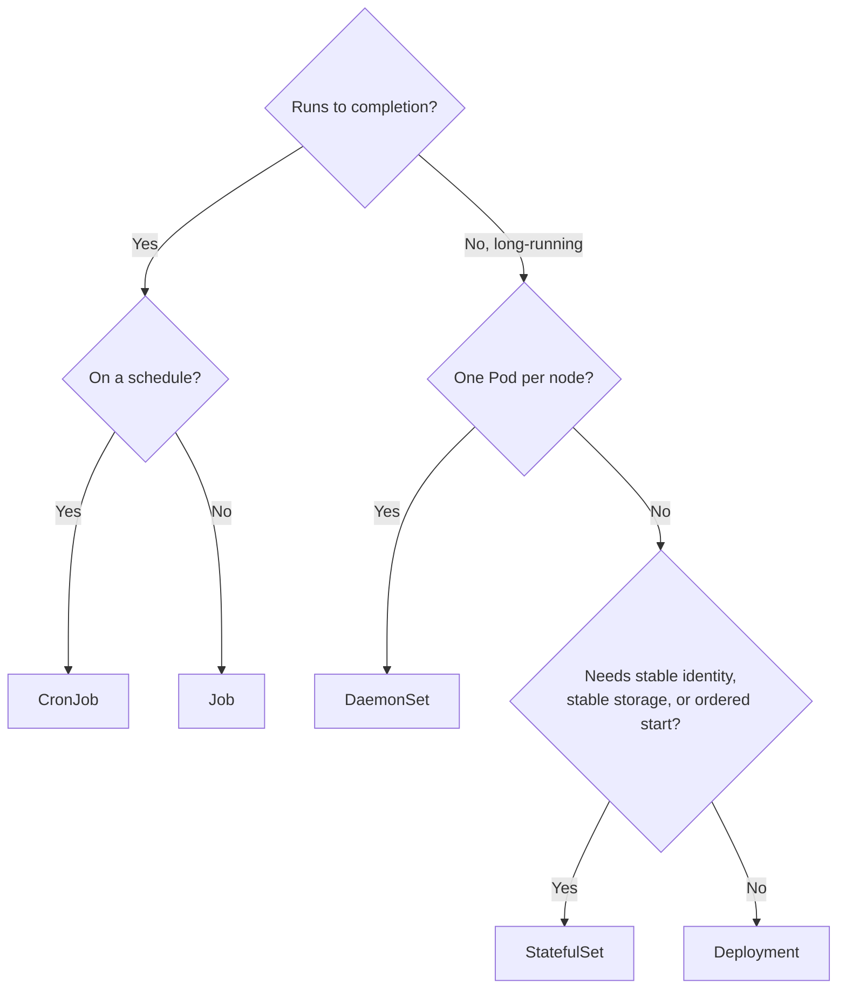
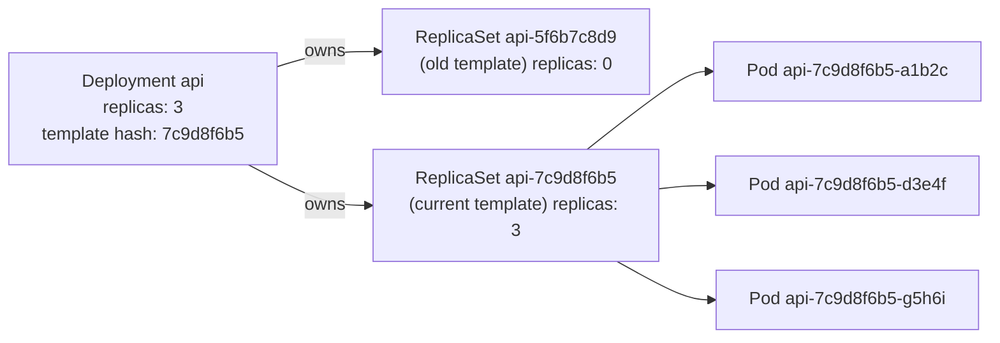

# Kubernetes: Core Concepts 2a — Workloads

| | |
|---|---|
| **Cluster** | 04 Containers & IDP |
| **Role** | Anchor |
| **Prerequisites** | [02-core-concepts.md](02-core-concepts.md) (Pods, reconciliation, kubectl) |
| **Target version** | Kubernetes 1.31+ (`apps/v1`, `batch/v1`, `policy/v1`) |
| **Capstone phase** | Phase 3 (Months 9-12) |

> Every workload resource is a different policy for creating, replacing, and retiring Pods. After this file you will be able to choose the right controller for a workload, write production Deployments with correct rollout parameters, operate StatefulSets without losing data, run node agents as DaemonSets, schedule batch work with Jobs and CronJobs, and protect availability during voluntary disruptions with PodDisruptionBudgets. Every section includes the manifest, the controller behaviour behind it, and the `kubectl` commands to drive and observe it.

---

## 1. Choosing a Workload Controller



| Controller | Pod identity | Storage | Scaling | Update order | Typical workloads |
|---|---|---|---|---|---|
| Deployment | Interchangeable, random suffix | Shared or none | Any order, parallel | Rolling via ReplicaSets, surge allowed | Stateless APIs (FastAPI, Spring Boot), workers, frontends |
| StatefulSet | Stable ordinal `name-0..N-1`, stable DNS | One PVC per Pod from a template | Ordered up and down | Ordered reverse-ordinal, partitioned; no surge | Databases, Kafka, ZooKeeper, Redis cluster, Elasticsearch, vector DBs |
| DaemonSet | One per (matching) node | Usually hostPath | Follows nodes | Rolling per node, `maxUnavailable`/`maxSurge` | CNI, CSI node plugins, log shippers, Falco, node-exporter, GPU device plugin |
| Job | Ephemeral | Any | `parallelism`, `completions`, indexed | n/a | Migrations, batch ETL, ML training, one-off tasks |
| CronJob | Creates Jobs | Any | Via Job | n/a | Backups, reports, cleanups |
| ReplicaSet | Random suffix | Shared | Parallel | None (that is the Deployment's job) | Never used directly |
| Bare Pod | Fixed | Any | None | None | Debugging only; no self-healing |

---

## 2. Deployments and ReplicaSets

### 2.1 How the two controllers cooperate

A Deployment never touches Pods. It manages **ReplicaSets**; each ReplicaSet manages Pods for exactly one Pod template. The hash of the Pod template (`pod-template-hash` label) names the ReplicaSet. A rollout is the Deployment controller scaling the new ReplicaSet up and the old one down according to the strategy.



Old ReplicaSets are kept (scaled to 0) up to `revisionHistoryLimit` (default 10) so `rollout undo` can scale one back up. Changing anything outside `spec.template` (replicas, strategy, labels on the Deployment itself) does **not** create a new ReplicaSet or a revision.

### 2.2 Production Deployment manifest

```yaml
apiVersion: apps/v1
kind: Deployment
metadata:
  name: fastapi-svc
  namespace: capstone
  labels:
    app.kubernetes.io/name: fastapi-svc
    app.kubernetes.io/part-of: capstone
  annotations:
    kubernetes.io/change-cause: "release 1.4.2"
spec:
  replicas: 3                               # omit this line when an HPA manages replicas (SSA conflict otherwise)
  revisionHistoryLimit: 5
  progressDeadlineSeconds: 600              # mark Progressing=False (reason ProgressDeadlineExceeded) if stuck this long
  minReadySeconds: 10                       # a Pod must be Ready for 10 s before it counts as available; slows rollout, catches fast crashers
  selector:
    matchLabels:
      app.kubernetes.io/name: fastapi-svc   # IMMUTABLE; must be a subset of template labels
  strategy:
    type: RollingUpdate
    rollingUpdate:
      maxSurge: 25%                         # extra Pods above replicas allowed during rollout (absolute or %), rounds UP
      maxUnavailable: 0                     # Pods below replicas allowed; 0 = never reduce capacity (needs surge > 0)
  template:
    metadata:
      labels:
        app.kubernetes.io/name: fastapi-svc
        app.kubernetes.io/version: "1.4.2"
      annotations:
        prometheus.io/scrape: "true"
        prometheus.io/port: "8000"
        prometheus.io/path: "/metrics"
    spec:
      # Full Pod spec from 02-core-concepts.md section 7.2 goes here (serviceAccountName, securityContext,
      # containers with probes/resources, topologySpreadConstraints, affinity, volumes).
      serviceAccountName: fastapi-svc
      automountServiceAccountToken: false
      terminationGracePeriodSeconds: 30
      securityContext:
        runAsNonRoot: true
        runAsUser: 10001
        runAsGroup: 10001
        fsGroup: 10001
        seccompProfile: { type: RuntimeDefault }
      containers:
        - name: api
          image: ghcr.io/example/fastapi-svc:1.4.2
          ports: [{ name: http, containerPort: 8000 }]
          resources:
            requests: { cpu: 250m, memory: 256Mi }
            limits: { memory: 256Mi }
          startupProbe:
            httpGet: { path: /healthz, port: http }
            periodSeconds: 5
            failureThreshold: 24
          readinessProbe:
            httpGet: { path: /readyz, port: http }
            periodSeconds: 5
          livenessProbe:
            httpGet: { path: /healthz, port: http }
            periodSeconds: 10
          lifecycle:
            preStop: { sleep: { seconds: 5 } }
          securityContext:
            allowPrivilegeEscalation: false
            readOnlyRootFilesystem: true
            capabilities: { drop: ["ALL"] }
          volumeMounts: [{ name: tmp, mountPath: /tmp }]
      volumes:
        - name: tmp
          emptyDir: { sizeLimit: 64Mi }
      topologySpreadConstraints:
        - maxSkew: 1
          topologyKey: topology.kubernetes.io/zone
          whenUnsatisfiable: ScheduleAnyway
          labelSelector: { matchLabels: { app.kubernetes.io/name: fastapi-svc } }
```

### 2.3 Strategies and the arithmetic of `maxSurge` / `maxUnavailable`

| Strategy | Behaviour | When |
|---|---|---|
| `RollingUpdate` (default) | Scale new RS up and old RS down in steps bounded by `maxSurge` and `maxUnavailable` | Stateless services; the normal case |
| `Recreate` | Scale old RS to 0, wait for termination, then create new RS | Workloads that cannot run two versions concurrently (single-writer volume with RWO, schema-incompatible), dev environments |

With `replicas: 4`, `maxSurge: 25%` (rounds up to 1), `maxUnavailable: 0`:

| Step | Old RS | New RS | Total | Available |
|---|---|---|---|---|
| Start | 4 | 0 | 4 | 4 |
| Surge | 4 | 1 (not ready) | 5 | 4 |
| New Pod Ready + minReadySeconds | 4 | 1 | 5 | 5 |
| Scale down old | 3 | 1 | 4 | 4 |
| Surge again | 3 | 2 | 5 | 4 |
| ... | | | | |
| End | 0 | 4 | 4 | 4 |

Rules of thumb:

- `maxUnavailable: 0, maxSurge: 1` (or 25%): the zero-downtime default. Requires spare node capacity for the surge.
- `maxUnavailable: 1, maxSurge: 0`: for capacity-constrained clusters, accepts a brief 25% capacity reduction. Never with `replicas: 1` (that is downtime).
- `maxSurge: 100%, maxUnavailable: 0`: blue/green-ish, doubles cost during rollout, fastest.
- Both cannot be 0.
- Rollout speed is also governed by readiness probe timing and `minReadySeconds`; a rollout of 20 replicas with `minReadySeconds: 30` and surge 1 takes at least 10 minutes. For true blue/green and canary with analysis, use Argo Rollouts or Flagger (cluster 12 progressive delivery), which replace the Deployment controller with their own.

### 2.4 Driving rollouts

```bash
# Trigger a rollout (any template change)
kubectl set image deployment/fastapi-svc api=ghcr.io/example/fastapi-svc:1.4.3
kubectl annotate deployment/fastapi-svc kubernetes.io/change-cause="release 1.4.3" --overwrite

# Watch it
kubectl rollout status deployment/fastapi-svc --timeout=5m
kubectl get replicasets -l app.kubernetes.io/name=fastapi-svc -w
```

Expected `rollout status`:

```text
Waiting for deployment "fastapi-svc" rollout to finish: 1 out of 3 new replicas have been updated...
Waiting for deployment "fastapi-svc" rollout to finish: 2 out of 3 new replicas have been updated...
Waiting for deployment "fastapi-svc" rollout to finish: 1 old replicas are pending termination...
deployment "fastapi-svc" successfully rolled out
```

```bash
# History and rollback
kubectl rollout history deployment/fastapi-svc
```

```text
deployment.apps/fastapi-svc
REVISION  CHANGE-CAUSE
1         release 1.4.1
2         release 1.4.2
3         release 1.4.3
```

```bash
kubectl rollout history deployment/fastapi-svc --revision=2      # shows that revision's Pod template
kubectl rollout undo deployment/fastapi-svc --to-revision=2      # scales RS for revision 2 back up; becomes revision 4
kubectl rollout pause deployment/fastapi-svc                     # apply several changes, then one rollout
kubectl set resources deployment/fastapi-svc -c api --requests=cpu=300m,memory=320Mi --limits=memory=320Mi
kubectl rollout resume deployment/fastapi-svc
kubectl rollout restart deployment/fastapi-svc                   # sets kubectl.kubernetes.io/restartedAt annotation on the template
```

A stuck rollout (bad image, failing probes) shows:

```bash
kubectl get deployment fastapi-svc -o jsonpath='{range .status.conditions[*]}{.type}={.status} ({.reason}){"\n"}{end}'
```

```text
Available=True (MinimumReplicasAvailable)
Progressing=False (ProgressDeadlineExceeded)
```

The old ReplicaSet keeps serving (because `maxUnavailable: 0`), so a stuck rollout is not an outage; it is an alert. `kube_deployment_status_condition{condition="Progressing",status="false"}` is the metric to page on.

### 2.5 Scaling

```bash
kubectl scale deployment/fastapi-svc --replicas=5
kubectl scale deployment/fastapi-svc --current-replicas=5 --replicas=3   # conditional, avoids races
kubectl get deployment fastapi-svc -o jsonpath='{.spec.replicas} desired, {.status.readyReplicas} ready, {.status.updatedReplicas} updated, {.status.unavailableReplicas} unavailable{"\n"}'
```

When an HPA exists, manual `scale` is immediately overridden. Remove `replicas` from the manifest so GitOps does not fight the HPA (Kustomize/Helm users: do not set it; Argo CD users: `ignoreDifferences` on `/spec/replicas` is the fallback).

---

## 3. StatefulSets

### 3.1 What they guarantee

1. **Stable, ordered identity.** Pods are `name-0`, `name-1`, ... Created in order 0..N-1 (each must be Running and Ready before the next); deleted in reverse order.
2. **Stable network identity.** With a **headless Service** (`clusterIP: None`), each Pod gets a DNS A record `name-0.svc-name.ns.svc.cluster.local` that follows the Pod across reschedules.
3. **Stable storage.** `volumeClaimTemplates` create one PVC per ordinal (`data-name-0`). The PVC is **not deleted** when the Pod or even the StatefulSet is deleted (unless `persistentVolumeClaimRetentionPolicy` says otherwise); a rescheduled `name-0` reattaches `data-name-0`.
4. **Ordered, partitioned updates.** `RollingUpdate` proceeds from N-1 down to 0, one at a time; `partition` lets you canary ordinals >= partition.

### 3.2 Manifest: a 3-node PostgreSQL-style StatefulSet skeleton

For the capstone the real database is RDS (cluster 01/05); this pattern is used for Qdrant, Redis, and Kafka in Phase 6.

```yaml
apiVersion: v1
kind: Service
metadata:
  name: pg                          # headless: governs StatefulSet DNS
  namespace: data
  labels: { app.kubernetes.io/name: pg }
spec:
  clusterIP: None
  publishNotReadyAddresses: true    # peers must discover each other before they are Ready
  selector: { app.kubernetes.io/name: pg }
  ports: [{ name: pg, port: 5432 }]
---
apiVersion: v1
kind: Service
metadata:
  name: pg-rw                       # normal ClusterIP for clients; points only at the primary via label
  namespace: data
spec:
  selector: { app.kubernetes.io/name: pg, role: primary }
  ports: [{ name: pg, port: 5432 }]
---
apiVersion: apps/v1
kind: StatefulSet
metadata:
  name: pg
  namespace: data
spec:
  serviceName: pg                   # MUST match the headless Service
  replicas: 3
  podManagementPolicy: OrderedReady # or Parallel (start all at once; identity still stable)
  minReadySeconds: 10
  selector:
    matchLabels: { app.kubernetes.io/name: pg }
  updateStrategy:
    type: RollingUpdate
    rollingUpdate:
      partition: 0                  # set to 2 to update only pg-2 as a canary; then 1, then 0
      maxUnavailable: 1             # beta; default 1
  persistentVolumeClaimRetentionPolicy:
    whenDeleted: Retain             # PVCs survive `kubectl delete sts` (default Retain)
    whenScaled: Retain              # PVCs survive scale-down; Delete reclaims them
  template:
    metadata:
      labels: { app.kubernetes.io/name: pg }
    spec:
      terminationGracePeriodSeconds: 60
      securityContext:
        runAsNonRoot: true
        runAsUser: 999
        runAsGroup: 999
        fsGroup: 999
        fsGroupChangePolicy: OnRootMismatch
        seccompProfile: { type: RuntimeDefault }
      affinity:
        podAntiAffinity:
          requiredDuringSchedulingIgnoredDuringExecution:   # never two replicas on one node
            - topologyKey: kubernetes.io/hostname
              labelSelector: { matchLabels: { app.kubernetes.io/name: pg } }
      containers:
        - name: postgres
          image: postgres:16.4-alpine
          ports: [{ name: pg, containerPort: 5432 }]
          env:
            - name: POSTGRES_PASSWORD
              valueFrom: { secretKeyRef: { name: pg-auth, key: password } }
            - name: PGDATA
              value: /var/lib/postgresql/data/pgdata
            - name: POD_NAME
              valueFrom: { fieldRef: { fieldPath: metadata.name } }
          resources:
            requests: { cpu: 500m, memory: 1Gi }
            limits: { cpu: "2", memory: 1Gi }     # Guaranteed-class memory; CPU limit here deliberate for a DB
          readinessProbe:
            exec: { command: ["pg_isready", "-U", "postgres", "-h", "127.0.0.1"] }
            periodSeconds: 5
          livenessProbe:
            exec: { command: ["pg_isready", "-U", "postgres", "-h", "127.0.0.1"] }
            periodSeconds: 20
            failureThreshold: 6
          securityContext:
            allowPrivilegeEscalation: false
            readOnlyRootFilesystem: true
            capabilities: { drop: ["ALL"] }
          volumeMounts:
            - { name: data, mountPath: /var/lib/postgresql/data }
            - { name: run, mountPath: /var/run/postgresql }
            - { name: tmp, mountPath: /tmp }
      volumes:
        - { name: run, emptyDir: {} }
        - { name: tmp, emptyDir: {} }
  volumeClaimTemplates:               # one PVC per ordinal: data-pg-0, data-pg-1, data-pg-2
    - metadata:
        name: data
      spec:
        accessModes: ["ReadWriteOnce"]
        storageClassName: gp3          # "standard" on kind
        resources:
          requests:
            storage: 20Gi
```

### 3.3 Operating a StatefulSet

```bash
kubectl get statefulset pg -n data
kubectl get pods -n data -l app.kubernetes.io/name=pg -o wide      # pg-0, pg-1, pg-2 with ordinal order
kubectl get pvc -n data                                            # data-pg-0 ... bound
# DNS identity
kubectl run -n data dns --rm -it --restart=Never --image=busybox:1.36 -- nslookup pg-0.pg.data.svc.cluster.local
# Scale (ordered)
kubectl scale statefulset pg -n data --replicas=5
kubectl scale statefulset pg -n data --replicas=3   # pg-4 then pg-3 removed; PVCs retained
# Canary a new image on the highest ordinal only
kubectl patch statefulset pg -n data -p '{"spec":{"updateStrategy":{"rollingUpdate":{"partition":2}}}}'
kubectl set image statefulset/pg -n data postgres=postgres:16.5-alpine
kubectl rollout status statefulset/pg -n data     # updates only pg-2
# Promote to all
kubectl patch statefulset pg -n data -p '{"spec":{"updateStrategy":{"rollingUpdate":{"partition":0}}}}'
# Delete the controller but keep Pods and PVCs running (for emergency surgery)
kubectl delete statefulset pg -n data --cascade=orphan
```

Expected Pod listing during an ordered scale-up:

```text
NAME   READY   STATUS    RESTARTS   AGE   IP            NODE
pg-0   1/1     Running   0          5m    10.244.1.14   capstone-worker
pg-1   1/1     Running   0          4m    10.244.2.9    capstone-worker2
pg-2   0/1     Pending   0          3s    <none>        <none>
```

Gotchas:

- `volumeClaimTemplates` are immutable. To resize, edit each PVC directly (if the StorageClass has `allowVolumeExpansion: true`), then update the template with `--cascade=orphan` delete and recreate. Operators (CloudNativePG, Strimzi) exist precisely to hide this.
- A Pod stuck `Pending` at ordinal k blocks k+1..N under `OrderedReady`. Fix the stuck one.
- If a node dies, the StatefulSet controller **will not** recreate the Pod elsewhere until the old Pod object is gone, because two `pg-0` with the same volume is worse than downtime. Kubernetes 1.26+ handles this safely via the non-graceful node shutdown taint (`node.kubernetes.io/out-of-service`). See [06-troubleshooting.md](06-troubleshooting.md).
- Run databases on Kubernetes only with an operator, a tested backup/restore path (volume snapshots plus logical backups), and a reason not to use RDS.

---

## 4. DaemonSets

One Pod per node that matches the (optional) node selector/affinity. New nodes get the Pod automatically; drained nodes do not (DaemonSet Pods are ignored by `kubectl drain` with `--ignore-daemonsets`). The DaemonSet controller, not the scheduler, originally placed these; since 1.12 the default scheduler does it using `nodeAffinity` injected per Pod, so taints and priorities apply normally.

```yaml
apiVersion: apps/v1
kind: DaemonSet
metadata:
  name: node-exporter
  namespace: observability
  labels: { app.kubernetes.io/name: node-exporter }
spec:
  selector:
    matchLabels: { app.kubernetes.io/name: node-exporter }
  updateStrategy:
    type: RollingUpdate               # or OnDelete (update only when you delete the Pod by hand)
    rollingUpdate:
      maxUnavailable: 1               # or a percentage; maxSurge also supported (1.22+) for zero-gap agents
  template:
    metadata:
      labels: { app.kubernetes.io/name: node-exporter }
    spec:
      priorityClassName: system-node-critical    # never evicted in favour of app Pods
      hostNetwork: true                          # expose on the node IP; needs PSA "privileged" namespace
      hostPID: true
      dnsPolicy: ClusterFirstWithHostNet
      tolerations:
        - operator: Exists                       # run on every node including control plane and tainted GPU nodes
      securityContext:
        runAsNonRoot: true
        runAsUser: 65534
        seccompProfile: { type: RuntimeDefault }
      containers:
        - name: node-exporter
          image: quay.io/prometheus/node-exporter:v1.8.2
          args:
            - --path.procfs=/host/proc
            - --path.sysfs=/host/sys
            - --path.rootfs=/host/root
            - --collector.filesystem.mount-points-exclude=^/(dev|proc|sys|var/lib/docker/.+|var/lib/kubelet/.+)($|/)
          ports: [{ name: metrics, containerPort: 9100, hostPort: 9100 }]
          resources:
            requests: { cpu: 50m, memory: 64Mi }
            limits: { memory: 128Mi }
          securityContext:
            allowPrivilegeEscalation: false
            readOnlyRootFilesystem: true
            capabilities: { drop: ["ALL"] }
          volumeMounts:
            - { name: proc, mountPath: /host/proc, readOnly: true }
            - { name: sys, mountPath: /host/sys, readOnly: true }
            - { name: root, mountPath: /host/root, readOnly: true, mountPropagation: HostToContainer }
      volumes:
        - { name: proc, hostPath: { path: /proc } }
        - { name: sys, hostPath: { path: /sys } }
        - { name: root, hostPath: { path: / } }
```

```bash
kubectl get daemonset -A
kubectl rollout status daemonset/node-exporter -n observability
kubectl get pods -n observability -l app.kubernetes.io/name=node-exporter -o wide   # one per node
# Restrict to a node subset
kubectl patch daemonset node-exporter -n observability -p '{"spec":{"template":{"spec":{"nodeSelector":{"workload-tier":"general"}}}}}'
```

Expected:

```text
NAMESPACE       NAME            DESIRED   CURRENT   READY   UP-TO-DATE   AVAILABLE   NODE SELECTOR   AGE
kube-system     cilium          3         3         3       3            3           <none>          2d
observability   node-exporter   3         3         3       3            3           <none>          1m
```

DaemonSets are the deployment shape for most of cluster 08's runtime tooling (Falco), cluster 09's collectors (OTel agent mode, Promtail/Alloy), and cluster 10's GPU device plugin. They are also why `hostPath`, `hostNetwork`, and `privileged` cannot be banned cluster-wide; put them in dedicated namespaces with the PSA `privileged` label and lock everything else to `restricted`.

---

## 5. Jobs and CronJobs

### 5.1 Job semantics

A Job creates Pods until `completions` succeed. `parallelism` bounds concurrent Pods. `backoffLimit` bounds retries (Pod failures, not container restarts) before the Job is marked `Failed`.

| Pattern | Settings | Example |
|---|---|---|
| Run once | `completions: 1, parallelism: 1` (defaults) | Database migration |
| Fixed work queue | `completions: N, parallelism: P` | Process N shards with P workers |
| Indexed | `completionMode: Indexed`, each Pod gets `JOB_COMPLETION_INDEX` env and a stable hostname | Partitioned batch, distributed training ranks |
| External queue | `completions` unset, `parallelism: P`; Pods exit 0 when the queue is empty | Consume SQS until drained |

```yaml
apiVersion: batch/v1
kind: Job
metadata:
  name: db-migrate-1-4-2
  namespace: capstone
  labels: { app.kubernetes.io/name: fastapi-svc, app.kubernetes.io/component: migration }
spec:
  backoffLimit: 3
  activeDeadlineSeconds: 600          # kill the whole Job after 10 minutes regardless of retries
  ttlSecondsAfterFinished: 3600       # garbage-collect the Job and its Pods one hour after completion
  podFailurePolicy:                   # GA 1.31: decide per exit code / condition instead of blind retries
    rules:
      - action: FailJob               # a migration conflict should not be retried
        onExitCodes: { containerName: migrate, operator: In, values: [3] }
      - action: Ignore                # node drain / preemption does not consume backoffLimit
        onPodConditions: [{ type: DisruptionTarget }]
  template:
    metadata:
      labels: { app.kubernetes.io/name: fastapi-svc, app.kubernetes.io/component: migration }
    spec:
      restartPolicy: Never            # Jobs require Never or OnFailure
      serviceAccountName: fastapi-migrate
      securityContext:
        runAsNonRoot: true
        runAsUser: 10001
        seccompProfile: { type: RuntimeDefault }
      containers:
        - name: migrate
          image: ghcr.io/example/fastapi-svc:1.4.2
          command: ["alembic", "upgrade", "head"]
          env:
            - name: DATABASE_URL
              valueFrom: { secretKeyRef: { name: fastapi-db-migrate, key: url } }
          resources:
            requests: { cpu: 100m, memory: 128Mi }
            limits: { memory: 256Mi }
          securityContext:
            allowPrivilegeEscalation: false
            readOnlyRootFilesystem: true
            capabilities: { drop: ["ALL"] }
```

```bash
kubectl apply -f job.yaml
kubectl get job db-migrate-1-4-2 -w
kubectl logs job/db-migrate-1-4-2 --follow
kubectl wait --for=condition=Complete job/db-migrate-1-4-2 --timeout=10m
kubectl get job db-migrate-1-4-2 -o jsonpath='{.status.succeeded} succeeded, {.status.failed} failed{"\n"}'
# Create a one-off Job from a CronJob template
kubectl create job --from=cronjob/nightly-report report-manual-$(date +%s)
```

Expected:

```text
NAME               STATUS     COMPLETIONS   DURATION   AGE
db-migrate-1-4-2   Running    0/1           4s         4s
db-migrate-1-4-2   Complete   1/1           21s        21s
```

Jobs are immutable in `spec.template`; the name must be unique, which is why migrations include the version in the name (and why Helm/Argo use hooks with `hook-delete-policy`). Run migrations as a separate Job before the Deployment rolls, not as an init container in every replica (three replicas would race on the same migration).

### 5.2 CronJob

```yaml
apiVersion: batch/v1
kind: CronJob
metadata:
  name: nightly-report
  namespace: capstone
spec:
  schedule: "15 2 * * *"              # 02:15 every day in timeZone
  timeZone: "Etc/UTC"                 # GA 1.27; never rely on the controller-manager's local TZ
  concurrencyPolicy: Forbid           # Allow | Forbid (skip if previous still running) | Replace (kill previous)
  startingDeadlineSeconds: 900        # if the controller was down, still start if within 15 min of schedule
  successfulJobsHistoryLimit: 3
  failedJobsHistoryLimit: 5
  suspend: false                      # flip to true to pause without deleting
  jobTemplate:
    spec:
      backoffLimit: 2
      ttlSecondsAfterFinished: 86400
      template:
        spec:
          restartPolicy: OnFailure
          securityContext:
            runAsNonRoot: true
            runAsUser: 10001
            seccompProfile: { type: RuntimeDefault }
          containers:
            - name: report
              image: ghcr.io/example/fastapi-svc:1.4.2
              command: ["python", "-m", "app.jobs.nightly_report"]
              resources:
                requests: { cpu: 200m, memory: 256Mi }
                limits: { memory: 512Mi }
              securityContext:
                allowPrivilegeEscalation: false
                readOnlyRootFilesystem: true
                capabilities: { drop: ["ALL"] }
```

```bash
kubectl get cronjob nightly-report
kubectl get jobs -l job-name --sort-by=.metadata.creationTimestamp | tail
kubectl patch cronjob nightly-report -p '{"spec":{"suspend":true}}'    # pause
```

The CronJob controller checks every 10 seconds and will miss a schedule if more than 100 schedules were skipped (it logs `Too many missed start times`). It is a scheduler of Jobs, not a workflow engine; for DAGs use Argo Workflows or Airflow on Kubernetes.

---

## 6. PodDisruptionBudgets

A PDB limits **voluntary** disruptions (node drain, cluster autoscaler scale-down, Karpenter consolidation, `kubectl drain`, eviction API) so that at least `minAvailable` or at most `maxUnavailable` Pods of a selector are down at once. It does **not** protect against involuntary disruptions (node crash, OOM, kernel panic) and does **not** affect Deployment rollouts (those use `maxUnavailable` in the strategy).

```yaml
apiVersion: policy/v1
kind: PodDisruptionBudget
metadata:
  name: fastapi-svc
  namespace: capstone
spec:
  minAvailable: 2                     # or maxUnavailable: 1; or percentages "50%"
  selector:
    matchLabels: { app.kubernetes.io/name: fastapi-svc }
  unhealthyPodEvictionPolicy: AlwaysAllow   # 1.27+: allow evicting already-unhealthy Pods so drains do not hang on CrashLoops
```

```bash
kubectl get pdb
kubectl describe pdb fastapi-svc
```

Expected:

```text
NAME          MIN AVAILABLE   MAX UNAVAILABLE   ALLOWED DISRUPTIONS   AGE
fastapi-svc   2               N/A               1                     5s
```

Observe it work:

```bash
kubectl drain capstone-worker2 --ignore-daemonsets --delete-emptydir-data --timeout=120s
# If both remaining fastapi Pods are on worker2 and minAvailable=2 is violated, the drain retries:
# evicting pod capstone/fastapi-svc-7c9d8f6b5-d3e4f
# error when evicting pods/"fastapi-svc-7c9d8f6b5-d3e4f" -n "capstone" (will retry after 5s):
# Cannot evict pod as it would violate the pod's disruption budget.
kubectl uncordon capstone-worker2
```

Rules:

- `minAvailable` must be strictly less than replicas or every drain hangs forever (`minAvailable: 3` with 3 replicas = undrainable node). Use `maxUnavailable: 1` for small Deployments.
- A `replicas: 1` Deployment cannot have a useful PDB; raise replicas or accept disruption.
- Karpenter and Cluster Autoscaler honour PDBs and will refuse to consolidate a node if it would violate one; a too-strict PDB silently blocks cost savings. `kubectl get pdb -A` where `ALLOWED DISRUPTIONS` is 0 is a FinOps smell to alert on.
- Pair every production Deployment with a PDB, topology spread across zones, and pod anti-affinity across hosts; together they are what "highly available" means at the workload layer.

---

## 7. Horizontal Scaling Shape: Putting It Together for the Capstone

Each capstone service ships as a bundle:

| Resource | fastapi-svc | springboot-svc | Why |
|---|---|---|---|
| Deployment | 3 replicas (EKS), 1 (kind), `maxSurge 1 / maxUnavailable 0`, `minReadySeconds 10` | Same, plus `startupProbe failureThreshold 36` (3 min JVM start) and `terminationGracePeriodSeconds 45` | Zero-downtime rollouts |
| Service | ClusterIP `:80 -> http` | ClusterIP `:80 -> http` | Stable virtual IP |
| HTTPRoute | `/api/py/*` | `/api/java/*` | Gateway API routing ([02b](02b-networking.md)) |
| HPA | 2..10 on 70% CPU, custom RPS metric later | 2..8 on 70% CPU | Elastic capacity ([02d](02d-scheduling-and-autoscaling.md)) |
| PDB | `maxUnavailable: 1` | `maxUnavailable: 1` | Safe drains |
| NetworkPolicy | default-deny plus allow from gateway and to DB/OTel | Same | Segmentation ([02b](02b-networking.md)) |
| ServiceAccount | dedicated, IRSA on EKS | dedicated | Identity ([02e](02e-security.md)) |
| Job (pre-sync hook) | Alembic migration | Flyway migration | Schema before code |

Labs 2, 3, and 8 in [04-hands-on-labs.md](04-hands-on-labs.md) build exactly this.

---

## 8. Command Summary

```bash
# Deployments
kubectl create deployment NAME --image=IMG --replicas=N --dry-run=client -o yaml
kubectl rollout {status|history|undo|restart|pause|resume} deployment/NAME
kubectl scale deployment/NAME --replicas=N
kubectl set image deployment/NAME CONTAINER=IMG
kubectl get rs -l app.kubernetes.io/name=NAME

# StatefulSets
kubectl get sts,pvc -n NS
kubectl patch sts NAME -p '{"spec":{"updateStrategy":{"rollingUpdate":{"partition":K}}}}'
kubectl delete sts NAME --cascade=orphan

# DaemonSets
kubectl get ds -A
kubectl rollout status ds/NAME -n NS

# Jobs
kubectl create job NAME --image=IMG -- CMD
kubectl create job NAME --from=cronjob/CRON
kubectl wait --for=condition=Complete job/NAME --timeout=10m
kubectl get jobs --field-selector status.successful=1

# PDB
kubectl get pdb -A
kubectl drain NODE --ignore-daemonsets --delete-emptydir-data
kubectl uncordon NODE
```

Continue to [02b-networking.md](02b-networking.md).
