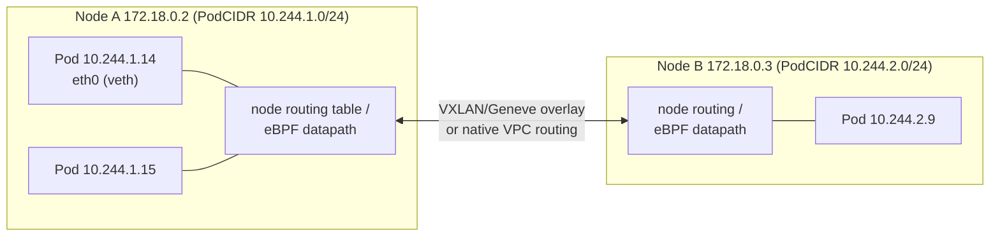
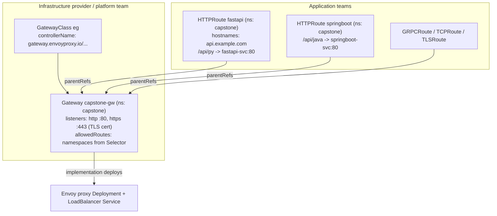

# Kubernetes: Core Concepts 2b — Networking

| | |
|---|---|
| **Cluster** | 04 Containers & IDP |
| **Role** | Anchor |
| **Prerequisites** | [02-core-concepts.md](02-core-concepts.md), [02a-workloads.md](02a-workloads.md); Linux networking basics (IP routing, NAT, DNS) |
| **Target version** | Kubernetes 1.31+, Gateway API v1.2 (`gateway.networking.k8s.io/v1`), Cilium 1.16 |
| **Capstone phase** | Phase 3 (Months 9-12) |

> After this file you will understand the Kubernetes network model and what a CNI plugin actually does; how Services, EndpointSlices, and the datapath (kube-proxy or Cilium eBPF) turn a virtual IP into a Pod; how CoreDNS resolves names and why `ndots:5` matters; the difference between Ingress and Gateway API and how to route the FastAPI and Spring Boot services with `HTTPRoute`; and how to segment the cluster with NetworkPolicy, starting from default-deny, including egress and DNS rules. Every manifest here is used in Labs 3, 4, and 6.

---

## 1. The Network Model

Kubernetes imposes four rules and leaves the implementation to the CNI plugin:

1. Every Pod gets its own cluster-unique IP address.
2. Every Pod can reach every other Pod on any node **without NAT**.
3. Agents on a node (kubelet, DaemonSets with `hostNetwork`) can reach all Pods on that node.
4. The IP a Pod sees for itself is the IP others use to reach it.

Consequences: no port mapping between containers and hosts (unlike plain Docker), no link-local tricks, and an IP-per-Pod means the Pod CIDR must be large (`/16` in kind, VPC subnet sizing on EKS).



### 1.1 How CNI plugins implement it

| Mode | How Pod traffic crosses nodes | Examples | Trade-offs |
|---|---|---|---|
| Overlay (encapsulation) | Pod packets wrapped in VXLAN/Geneve UDP to the destination node IP | Cilium (default in kind), flannel, Calico VXLAN | Works on any underlay; small MTU/CPU overhead; Pod IPs invisible to the VPC |
| Native routing | Node routing tables or BGP advertise Pod CIDRs; no encapsulation | Calico BGP, Cilium native routing | Fast; needs an underlay that routes Pod CIDRs |
| Cloud-native (IP per Pod from the VPC) | Pods get real VPC IPs via ENIs; VPC routes them | Amazon VPC CNI (EKS default), Azure CNI, Cilium ENI mode | Pods are first-class VPC citizens (security groups per Pod, no NAT to VPC services); IP exhaustion and per-instance ENI limits are real operational problems (`maxPods` per node depends on instance type; prefix delegation helps) |

The CNI binary is called by containerd when the kubelet creates a sandbox: `ADD` creates a veth pair, moves one end into the Pod netns, assigns an IP from IPAM, and programs routes/eBPF. `DEL` reverses it. Config lives in `/etc/cni/net.d/`:

```bash
docker exec capstone-worker ls /etc/cni/net.d/
docker exec capstone-worker cat /etc/cni/net.d/05-cilium.conflist
kubectl get nodes -o jsonpath='{range .items[*]}{.metadata.name}{"\t"}{.spec.podCIDR}{"\n"}{end}'
```

Expected:

```text
capstone-control-plane	10.244.0.0/24
capstone-worker	        10.244.1.0/24
capstone-worker2	10.244.2.0/24
```

---

## 2. Services

Pods are ephemeral; their IPs change. A **Service** is a stable virtual IP (ClusterIP) and DNS name that load-balances to the set of Pods matching its selector, at L4 (TCP/UDP/SCTP).

### 2.1 Service types

| Type | What you get | Reachable from | Use |
|---|---|---|---|
| `ClusterIP` (default) | Virtual IP from the service CIDR, DNS `name.ns.svc.cluster.local` | Inside the cluster only | Nearly everything: service-to-service, Gateway backends |
| `NodePort` | ClusterIP **plus** a port 30000-32767 opened on every node | Anyone who can reach a node IP | kind port mappings, bare-metal edge; rarely exposed directly in cloud |
| `LoadBalancer` | NodePort **plus** a cloud load balancer provisioned by the cloud-controller-manager / AWS Load Balancer Controller | Internet or VPC | The entry point for Gateway/Ingress controllers; one per Service is expensive, so front many routes with one Gateway |
| `ExternalName` | A DNS CNAME to an external hostname, no proxying | Inside the cluster | Alias `db.capstone.svc` to `prod-db.cluster-abc.<REGION>.rds.amazonaws.com` so manifests stay portable |
| Headless (`clusterIP: None`) | No VIP; DNS returns the Pod IPs directly (A records per Pod) | Inside | StatefulSets, client-side load balancing (gRPC), service discovery |

### 2.2 Manifests

```yaml
# ClusterIP for the FastAPI service
apiVersion: v1
kind: Service
metadata:
  name: fastapi-svc
  namespace: capstone
  labels: { app.kubernetes.io/name: fastapi-svc }
spec:
  type: ClusterIP
  selector:
    app.kubernetes.io/name: fastapi-svc      # only Ready Pods with these labels receive traffic
  ports:
    - name: http                              # name ports; HTTPRoute and NetworkPolicy can reference them
      port: 80                                # the Service port clients use
      targetPort: http                        # container port name (or number) on the Pod
      protocol: TCP
      appProtocol: http                       # hint for Gateway implementations (http, https, kubernetes.io/h2c, grpc)
  sessionAffinity: None                       # or ClientIP with sessionAffinityConfig.clientIP.timeoutSeconds
  internalTrafficPolicy: Cluster              # Local = only Pods on the same node (for node-local caches)
  ipFamilyPolicy: SingleStack
---
# LoadBalancer on EKS with the AWS Load Balancer Controller (NLB, internal, IP targets)
apiVersion: v1
kind: Service
metadata:
  name: capstone-gw-lb
  namespace: envoy-gateway-system
  annotations:
    service.beta.kubernetes.io/aws-load-balancer-type: external
    service.beta.kubernetes.io/aws-load-balancer-nlb-target-type: ip      # route straight to Pod IPs (VPC CNI)
    service.beta.kubernetes.io/aws-load-balancer-scheme: internal          # internet-facing only when intended
    service.beta.kubernetes.io/aws-load-balancer-cross-zone-load-balancing-enabled: "true"
    service.beta.kubernetes.io/aws-load-balancer-healthcheck-path: /healthz
spec:
  type: LoadBalancer
  loadBalancerClass: service.k8s.aws/nlb
  externalTrafficPolicy: Local                # preserve client source IP; only nodes with local endpoints get traffic
  selector: { gateway.envoyproxy.io/owning-gateway-name: capstone-gw }
  ports:
    - { name: https, port: 443, targetPort: 10443 }
---
# ExternalName alias for the managed database
apiVersion: v1
kind: Service
metadata:
  name: postgres
  namespace: capstone
spec:
  type: ExternalName
  externalName: capstone-db.cluster-abc123.<REGION>.rds.amazonaws.com
```

```bash
kubectl apply -f service.yaml
kubectl get svc -n capstone -o wide
kubectl describe svc fastapi-svc -n capstone
kubectl get endpointslices -n capstone -l kubernetes.io/service-name=fastapi-svc -o wide
```

Expected:

```text
NAME          TYPE        CLUSTER-IP      EXTERNAL-IP   PORT(S)   AGE   SELECTOR
fastapi-svc   ClusterIP   10.96.142.17    <none>        80/TCP    5s    app.kubernetes.io/name=fastapi-svc

NAME                ADDRESSTYPE   PORTS   ENDPOINTS                               AGE
fastapi-svc-k7x2m   IPv4          8000    10.244.1.14,10.244.2.9,10.244.1.15      5s
```

### 2.3 EndpointSlices

The EndpointSlice controller watches Services and Pods and writes `EndpointSlice` objects (up to 100 endpoints each) listing Pod IPs, ports, and per-endpoint conditions (`ready`, `serving`, `terminating`), zone hints, and node names. The datapath (kube-proxy or Cilium) watches EndpointSlices, not Pods. Legacy `Endpoints` objects still exist for compatibility but are capped at 1000 addresses.

Readiness is the key link: a Pod whose readiness probe fails is marked `ready: false` and removed from load balancing without being restarted. A terminating Pod is `terminating: true` and excluded from new connections (used by `externalTrafficPolicy: Local` to avoid blackholes during rollouts).

```bash
kubectl get endpointslices -n capstone -o yaml | yq '.items[0].endpoints[] | {addresses, conditions, nodeName, zone}'
# Service with no endpoints: the classic "selector typo" bug
kubectl get endpointslices -n capstone -l kubernetes.io/service-name=fastapi-svc -o jsonpath='{.items[*].endpoints[*].addresses}'
```

### 2.4 Datapath: how a ClusterIP becomes a Pod IP

**kube-proxy iptables mode** installs chains like:

```text
-A KUBE-SERVICES -d 10.96.142.17/32 -p tcp --dport 80 -j KUBE-SVC-ABC
-A KUBE-SVC-ABC -m statistic --mode random --probability 0.33333 -j KUBE-SEP-1   # -> DNAT 10.244.1.14:8000
-A KUBE-SVC-ABC -m statistic --mode random --probability 0.50000 -j KUBE-SEP-2   # -> DNAT 10.244.2.9:8000
-A KUBE-SVC-ABC -j KUBE-SEP-3                                                      # -> DNAT 10.244.1.15:8000
```

Each packet traverses the chain (O(n)); conntrack remembers the choice for the connection. With 5,000 Services the rule set is tens of thousands of lines and takes seconds to resync.

**Cilium eBPF** attaches a program to the `connect()` syscall (socket-level LB): when a Pod connects to `10.96.142.17:80`, the destination is rewritten to a backend Pod IP *before any packet is built*. No NAT, no conntrack entry for the VIP, O(1) hash lookup in a BPF map. For traffic from outside (NodePort, LoadBalancer) a TC/XDP program does the translation.

```bash
kubectl -n kube-system exec ds/cilium -- cilium-dbg service list
```

```text
ID   Frontend             Service Type   Backend
1    10.96.0.1:443        ClusterIP      1 => 172.18.0.4:6443 (active)
7    10.96.142.17:80      ClusterIP      1 => 10.244.1.14:8000 (active)
                                         2 => 10.244.2.9:8000 (active)
                                         3 => 10.244.1.15:8000 (active)
```

Traffic policies:

- `externalTrafficPolicy: Local`: external traffic only to nodes that have a local endpoint; preserves the client IP (no SNAT); health-check NodePort tells the LB which nodes qualify. Uneven balance if endpoints are unevenly spread.
- `internalTrafficPolicy: Local`: same idea for in-cluster callers; useful for node-local DaemonSet backends (a per-node OTel collector).
- Topology-aware routing (`service.kubernetes.io/topology-mode: Auto`): prefer same-zone endpoints to avoid cross-AZ data transfer charges, which matter on EKS.

---

## 3. DNS: CoreDNS

CoreDNS runs as a Deployment in `kube-system` behind the `kube-dns` Service (ClusterIP `10.96.0.10` in kind). The kubelet writes each Pod's `/etc/resolv.conf` according to `dnsPolicy`:

```text
search capstone.svc.cluster.local svc.cluster.local cluster.local
nameserver 10.96.0.10
options ndots:5
```

Records CoreDNS serves (via the `kubernetes` plugin):

| Query | Answer |
|---|---|
| `fastapi-svc` (from namespace `capstone`) | Search path expands to `fastapi-svc.capstone.svc.cluster.local` -> ClusterIP |
| `fastapi-svc.capstone` | Same, via the second search domain |
| `fastapi-svc.capstone.svc.cluster.local.` | FQDN, no search expansion |
| `pg-0.pg.data.svc.cluster.local` | Pod IP for StatefulSet ordinal 0 (headless Service) |
| `_pg._tcp.pg.data.svc.cluster.local` SRV | Port and target per endpoint |
| `10-244-1-14.capstone.pod.cluster.local` | Pod A record by IP (rarely used) |

**The `ndots:5` problem.** A name with fewer than 5 dots is first tried against every search domain. Resolving `api.github.com` (2 dots) from a Pod produces `api.github.com.capstone.svc.cluster.local`, `api.github.com.svc.cluster.local`, `api.github.com.cluster.local`, then `api.github.com`: four queries (eight with A+AAAA), three NXDOMAINs, and measurable latency. Fixes: use FQDNs with a trailing dot in config (`api.github.com.`), lower `ndots` per Pod, or enable NodeLocal DNSCache on larger clusters.

```yaml
spec:
  dnsPolicy: ClusterFirst            # default; ClusterFirstWithHostNet for hostNetwork Pods; Default = node's resolv.conf; None = use dnsConfig only
  dnsConfig:
    options:
      - name: ndots
        value: "2"
      - name: single-request-reopen  # glibc quirk mitigation for A/AAAA races
```

CoreDNS configuration is a ConfigMap:

```bash
kubectl get configmap coredns -n kube-system -o jsonpath='{.data.Corefile}'
```

```text
.:53 {
    errors
    health { lameduck 5s }
    ready
    kubernetes cluster.local in-addr.arpa ip6.arpa {
       pods insecure
       fallthrough in-addr.arpa ip6.arpa
       ttl 30
    }
    prometheus :9153
    forward . /etc/resolv.conf { max_concurrent 1000 }
    cache 30
    loop
    reload
    loadbalance
}
```

Add a stub domain for a corporate resolver or conditional forwarding by editing the Corefile (the `reload` plugin picks it up):

```text
corp.example.com:53 {
    errors
    cache 30
    forward . 10.10.0.53 10.10.0.54
}
```

DNS diagnostics:

```bash
kubectl run dns-debug --rm -it --restart=Never --image=nicolaka/netshoot:v0.13 -- bash
# inside:
cat /etc/resolv.conf
dig +search fastapi-svc                       # uses search path
dig fastapi-svc.capstone.svc.cluster.local +short
dig @10.96.0.10 kubernetes.default.svc.cluster.local
dig api.github.com +trace 2>&1 | head
# CoreDNS logs and metrics
kubectl logs -n kube-system -l k8s-app=kube-dns --tail=50
kubectl get --raw /api/v1/namespaces/kube-system/services/kube-dns:9153/proxy/metrics 2>/dev/null | grep coredns_dns_request_duration_seconds_count
```

Turn on query logging temporarily by adding `log` to the Corefile (noisy; remove afterwards).

---

## 4. Ingress versus Gateway API

### 4.1 Why Gateway API exists

`Ingress` (`networking.k8s.io/v1`) is a single resource that mixes infrastructure concerns (which load balancer, TLS termination) with application routing (paths to Services). Anything beyond host/path matching (header routing, traffic splitting, timeouts, retries, TCP/UDP/gRPC) was pushed into vendor-specific annotations, so an NGINX Ingress manifest does not work on Traefik or ALB. There is also no role separation: an app team that can write an Ingress can hijack any hostname.

**Gateway API** splits the model by persona:



| | Ingress | Gateway API |
|---|---|---|
| Status | GA, frozen (no new features) | GA core (`v1`: GatewayClass, Gateway, HTTPRoute, GRPCRoute); TCPRoute/UDPRoute/TLSRoute experimental |
| Resources | 1 (`Ingress`) + `IngressClass` | Role-oriented: `GatewayClass`, `Gateway`, `*Route`, `ReferenceGrant`, plus policy attachment (`BackendTLSPolicy`, vendor policies) |
| Portability | Annotations are vendor-specific | Core features portable across Envoy Gateway, Cilium, Istio, NGINX Gateway Fabric, Kong, Traefik, AWS (via controller) |
| Routing features | Host + path (Prefix/Exact), one TLS block | Host, path (PathPrefix/Exact/RegularExpression), headers, query params, method; weighted backends; header/URL rewrite; redirects; mirroring; timeouts; retries (1.2+) |
| Cross-namespace | Not supported | `allowedRoutes` on listeners + `ReferenceGrant` for backends |
| Multi-tenancy | Any Ingress can claim any host | Gateway owner controls which namespaces can attach and which hostnames |
| Protocols | HTTP/HTTPS | HTTP, HTTPS, gRPC, TLS passthrough, TCP, UDP |
| Service mesh | Separate | GAMMA initiative uses the same `HTTPRoute` for east-west traffic |

Recommendation (and the capstone ADR): **Gateway API for all new work**; keep Ingress only where a managed platform (older ALB controller setups) requires it. Both are shown below.

### 4.2 Ingress (for reference and bridges)

```yaml
apiVersion: networking.k8s.io/v1
kind: Ingress
metadata:
  name: capstone
  namespace: capstone
  annotations:
    nginx.ingress.kubernetes.io/ssl-redirect: "true"          # vendor-specific
    cert-manager.io/cluster-issuer: letsencrypt-prod
spec:
  ingressClassName: nginx
  tls:
    - hosts: [api.example.com]
      secretName: api-example-com-tls
  rules:
    - host: api.example.com
      http:
        paths:
          - path: /api/py
            pathType: Prefix
            backend: { service: { name: fastapi-svc, port: { name: http } } }
          - path: /api/java
            pathType: Prefix
            backend: { service: { name: springboot-svc, port: { name: http } } }
```

```bash
kubectl get ingress -n capstone
kubectl get ingressclass
kubectl describe ingress capstone -n capstone     # Events show controller sync errors
```

### 4.3 Gateway API: the capstone edge

```yaml
# Platform team: one Gateway per environment, in the capstone namespace for the labs
apiVersion: gateway.networking.k8s.io/v1
kind: Gateway
metadata:
  name: capstone-gw
  namespace: capstone
spec:
  gatewayClassName: eg
  listeners:
    - name: http
      protocol: HTTP
      port: 80
      allowedRoutes:
        namespaces:
          from: Same                # Same | All | Selector (label selector on namespaces)
    - name: https
      protocol: HTTPS
      port: 443
      hostname: "api.example.com"
      tls:
        mode: Terminate
        certificateRefs:
          - kind: Secret
            name: api-example-com-tls     # created by cert-manager or a self-signed Secret in the lab
      allowedRoutes:
        namespaces:
          from: Selector
          selector:
            matchLabels: { gateway-access: "true" }
---
# App team: route for the FastAPI service
apiVersion: gateway.networking.k8s.io/v1
kind: HTTPRoute
metadata:
  name: fastapi-svc
  namespace: capstone
spec:
  parentRefs:
    - name: capstone-gw
      sectionName: http                   # attach to a specific listener (optional)
  hostnames: ["api.example.com", "localhost"]
  rules:
    - matches:
        - path: { type: PathPrefix, value: /api/py }
      filters:
        - type: URLRewrite
          urlRewrite:
            path: { type: ReplacePrefixMatch, replacePrefixMatch: / }    # strip the prefix
        - type: RequestHeaderModifier
          requestHeaderModifier:
            add: [{ name: X-Forwarded-Prefix, value: /api/py }]
      backendRefs:
        - name: fastapi-svc
          port: 80
          weight: 100
      timeouts:
        request: 30s
        backendRequest: 10s
---
# App team: Spring Boot route with a canary split (90/10) between two Services
apiVersion: gateway.networking.k8s.io/v1
kind: HTTPRoute
metadata:
  name: springboot-svc
  namespace: capstone
spec:
  parentRefs: [{ name: capstone-gw }]
  hostnames: ["api.example.com", "localhost"]
  rules:
    - matches:
        - path: { type: PathPrefix, value: /api/java }
          headers:
            - name: X-Canary                     # header-based routing: force canary
              value: "true"
      backendRefs:
        - { name: springboot-svc-canary, port: 80 }
    - matches:
        - path: { type: PathPrefix, value: /api/java }
      backendRefs:
        - { name: springboot-svc, port: 80, weight: 90 }
        - { name: springboot-svc-canary, port: 80, weight: 10 }
---
# Cross-namespace backend reference: allow routes in "capstone" to target Services in "shared"
apiVersion: gateway.networking.k8s.io/v1beta1
kind: ReferenceGrant
metadata:
  name: allow-capstone-routes
  namespace: shared
spec:
  from:
    - group: gateway.networking.k8s.io
      kind: HTTPRoute
      namespace: capstone
  to:
    - group: ""
      kind: Service
```

```bash
kubectl apply -f gateway.yaml -f httproutes.yaml
kubectl get gateway -n capstone
kubectl get httproute -n capstone
kubectl describe httproute fastapi-svc -n capstone | sed -n '/Status/,$p'
# Envoy Gateway creates the data plane in its own namespace
kubectl get pods,svc -n envoy-gateway-system -l gateway.envoyproxy.io/owning-gateway-name=capstone-gw
```

Expected:

```text
NAME          CLASS   ADDRESS        PROGRAMMED   AGE
capstone-gw   eg      172.18.0.2     True         30s

NAME             HOSTNAMES                       AGE
fastapi-svc      ["api.example.com","localhost"] 30s
springboot-svc   ["api.example.com","localhost"] 30s

Status:
  Parents:
    Conditions:
      Reason:  Accepted      Status: True   Type: Accepted
      Reason:  ResolvedRefs  Status: True   Type: ResolvedRefs
```

After the NodePort patch from [01-installation-and-setup.md](01-installation-and-setup.md) section 4.4:

```bash
curl -s http://localhost/api/py/healthz
curl -s -H 'Host: api.example.com' http://localhost/api/java/actuator/health
curl -s -H 'X-Canary: true' http://localhost/api/java/version
```

`Accepted=False` with `reason: NotAllowedByListeners` means the namespace is not permitted by `allowedRoutes`; `ResolvedRefs=False` with `RefNotPermitted` means a missing `ReferenceGrant`; `BackendNotFound` means a Service name typo.

### 4.4 TLS and certificates

In production, cert-manager issues the listener certificate from Let's Encrypt (`ClusterIssuer` with DNS-01 on Route 53) or an internal CA, and writes the Secret the Gateway references; Gateway API's `gateway.networking.k8s.io` annotations on the Gateway (`cert-manager.io/cluster-issuer`) trigger it. For the lab, a self-signed certificate:

```bash
openssl req -x509 -nodes -days 365 -newkey rsa:2048 \
  -keyout tls.key -out tls.crt -subj "/CN=api.example.com" \
  -addext "subjectAltName=DNS:api.example.com,DNS:localhost"
kubectl create secret tls api-example-com-tls -n capstone --cert=tls.crt --key=tls.key
rm tls.key tls.crt
curl -sk --resolve api.example.com:443:127.0.0.1 https://api.example.com/api/py/healthz
```

Backend TLS (Gateway to Pod) is declared with `BackendTLSPolicy`; mutual TLS between Pods is a mesh concern (section 6).

---

## 5. NetworkPolicy

### 5.1 Semantics you must internalise

- Policies select Pods (`podSelector`) in their own namespace and declare allowed **ingress** and/or **egress**.
- **Additive allow-lists only.** There is no deny rule. As soon as *any* policy selects a Pod for a direction, that direction becomes default-deny for that Pod, and only the union of all selecting policies' rules is allowed.
- A Pod selected by no policy accepts and sends everything.
- Rules match **peers** by `podSelector`, `namespaceSelector`, `ipBlock` (CIDR with `except`), and **ports**. Inside one `from`/`to` entry, `podSelector` and `namespaceSelector` together mean AND; separate list entries mean OR.
- Policies are stateful: allowing ingress to port 8000 allows the reply packets; you do not need an egress rule for responses.
- Enforcement is by the CNI. kindnet and flannel: not enforced. Cilium, Calico, VPC CNI with network policy enabled (EKS 1.25+): enforced. Always test.
- Cilium adds `CiliumNetworkPolicy` with L7 rules (HTTP methods/paths, DNS names) and cluster-wide policies; the standard `NetworkPolicy` is what we write for portability.

### 5.2 Default deny, the right way

Apply to every application namespace as part of namespace provisioning (Backstage golden path, Kyverno `generate` rule, or Kustomize base):

```yaml
# 1. Deny all ingress and egress for every Pod in the namespace
apiVersion: networking.k8s.io/v1
kind: NetworkPolicy
metadata:
  name: default-deny-all
  namespace: capstone
spec:
  podSelector: {}                 # all Pods
  policyTypes: [Ingress, Egress]
---
# 2. Everyone may resolve DNS (otherwise nothing works)
apiVersion: networking.k8s.io/v1
kind: NetworkPolicy
metadata:
  name: allow-dns-egress
  namespace: capstone
spec:
  podSelector: {}
  policyTypes: [Egress]
  egress:
    - to:
        - namespaceSelector:
            matchLabels: { kubernetes.io/metadata.name: kube-system }
          podSelector:
            matchLabels: { k8s-app: kube-dns }
      ports:
        - { protocol: UDP, port: 53 }
        - { protocol: TCP, port: 53 }
```

### 5.3 Per-service policies for the capstone

```yaml
# FastAPI: ingress only from the Gateway data plane and from Prometheus; egress to Postgres, OTel, and the Spring Boot service
apiVersion: networking.k8s.io/v1
kind: NetworkPolicy
metadata:
  name: fastapi-svc
  namespace: capstone
spec:
  podSelector:
    matchLabels: { app.kubernetes.io/name: fastapi-svc }
  policyTypes: [Ingress, Egress]
  ingress:
    - from:
        - namespaceSelector:
            matchLabels: { kubernetes.io/metadata.name: envoy-gateway-system }
      ports: [{ protocol: TCP, port: 8000 }]
    - from:
        - namespaceSelector:
            matchLabels: { kubernetes.io/metadata.name: observability }
          podSelector:
            matchLabels: { app.kubernetes.io/name: prometheus }
      ports: [{ protocol: TCP, port: 8000 }]
  egress:
    - to:                                                   # Spring Boot service in the same namespace
        - podSelector:
            matchLabels: { app.kubernetes.io/name: springboot-svc }
      ports: [{ protocol: TCP, port: 8080 }]
    - to:                                                   # OTel collector
        - namespaceSelector:
            matchLabels: { kubernetes.io/metadata.name: observability }
          podSelector:
            matchLabels: { app.kubernetes.io/name: otel-collector }
      ports: [{ protocol: TCP, port: 4317 }]
    - to:                                                   # RDS in the VPC (EKS) - CIDR of the DB subnets
        - ipBlock:
            cidr: 10.40.0.0/16
            except: [10.40.255.0/24]
      ports: [{ protocol: TCP, port: 5432 }]
    - to:                                                   # External HTTPS APIs (Bedrock etc.) - broad; narrow with CiliumNetworkPolicy toFQDNs
        - ipBlock:
            cidr: 0.0.0.0/0
            except:
              - 10.0.0.0/8
              - 172.16.0.0/12
              - 192.168.0.0/16
              - 169.254.169.254/32                          # block the instance metadata service
      ports: [{ protocol: TCP, port: 443 }]
```

The metadata-service exception is the single most important egress rule on any cloud cluster: a Pod that can reach `169.254.169.254` can steal the node's IAM credentials. (EKS also mitigates this with IMDSv2 hop limit 1 and Pod Identity, but defence in depth.)

Cilium's DNS-aware egress for the Bedrock call, as an example of why L7 policy is worth having:

```yaml
apiVersion: cilium.io/v2
kind: CiliumNetworkPolicy
metadata:
  name: fastapi-egress-fqdn
  namespace: capstone
spec:
  endpointSelector:
    matchLabels: { app.kubernetes.io/name: fastapi-svc }
  egress:
    - toEndpoints:
        - matchLabels: { k8s:io.kubernetes.pod.namespace: kube-system, k8s-app: kube-dns }
      toPorts:
        - ports: [{ port: "53", protocol: ANY }]
          rules:
            dns: [{ matchPattern: "*" }]              # Cilium must see DNS to learn IPs
    - toFQDNs:
        - matchName: bedrock-runtime.<REGION>.amazonaws.com
        - matchPattern: "*.sts.amazonaws.com"
      toPorts:
        - ports: [{ port: "443", protocol: TCP }]
```

### 5.4 Testing policies

```bash
kubectl apply -f networkpolicies/
kubectl get networkpolicy -n capstone
kubectl describe networkpolicy fastapi-svc -n capstone

# Positive test: from the gateway namespace (allowed)
kubectl run probe -n envoy-gateway-system --rm -it --restart=Never --image=curlimages/curl:8.10.1 -- \
  curl -s -m 3 http://fastapi-svc.capstone.svc.cluster.local/healthz
# Negative test: from the default namespace (denied, times out)
kubectl run probe -n default --rm -it --restart=Never --image=curlimages/curl:8.10.1 -- \
  curl -s -m 3 http://fastapi-svc.capstone.svc.cluster.local/healthz; echo "exit=$?"

# Hubble: see the verdicts
cilium hubble port-forward &
hubble observe --namespace capstone --verdict DROPPED --last 20
hubble observe --to-pod capstone/fastapi-svc --protocol http --last 10
```

Expected drop record:

```text
Oct 27 10:14:02.118: default/probe:48122 (ID:1532) <> capstone/fastapi-svc-7c9d8f6b5-a1b2c:8000 (ID:2214) Policy denied DROPPED (TCP Flags: SYN)
```

A `pod-to-pod` matrix you can keep in the repo for CI: the `netpol` krew plugin (`kubectl np-viewer`) and Cilium's `cilium policy trace` can simulate without sending packets:

```bash
kubectl -n kube-system exec ds/cilium -- cilium-dbg policy trace \
  --src-k8s-pod default:probe --dst-k8s-pod capstone/fastapi-svc-7c9d8f6b5-a1b2c --dport 8000/TCP
```

---

## 6. Service Mesh in One Section

A mesh (Istio, Linkerd, Cilium Service Mesh) adds L7 features between services: mutual TLS with SPIFFE identities, retries/timeouts/circuit breaking, traffic splitting, and per-request telemetry, either via sidecar proxies (Istio classic, Linkerd), per-node proxies (Istio ambient `ztunnel`), or eBPF plus per-node Envoy (Cilium). Gateway API's GAMMA profile lets the same `HTTPRoute` configure east-west routing by setting `parentRefs` to a `Service`.

For the capstone: no sidecar mesh in Phase 3. NetworkPolicy gives segmentation; Cilium gives transparent WireGuard encryption between nodes (`encryption.enabled=true, encryption.type=wireguard`) and Hubble gives L7 visibility; OpenTelemetry (Phase 4) gives tracing. Re-evaluate in Phase 5 if mTLS identity per service becomes a compliance requirement; the ADR records the reasoning.

---

## 7. Command Summary

```bash
# Services and endpoints
kubectl get svc,endpointslices -n NS
kubectl expose deployment NAME --port=80 --target-port=http --name=NAME     # imperative Service
kubectl get svc NAME -o jsonpath='{.spec.clusterIP} {.spec.ports[*].nodePort}{"\n"}'
kubectl port-forward svc/NAME 8080:80

# DNS
kubectl run dns --rm -it --restart=Never --image=busybox:1.36 -- nslookup NAME.NS.svc.cluster.local
kubectl -n kube-system get cm coredns -o yaml
kubectl -n kube-system rollout restart deployment coredns

# Gateway API
kubectl get gatewayclass,gateway,httproute -A
kubectl describe httproute NAME -n NS
kubectl get gateway NAME -n NS -o jsonpath='{.status.addresses[*].value}{"\n"}'

# Ingress
kubectl get ingress,ingressclass -A
kubectl describe ingress NAME -n NS

# NetworkPolicy
kubectl get netpol -A
kubectl describe netpol NAME -n NS
hubble observe --namespace NS --verdict DROPPED
kubectl -n kube-system exec ds/cilium -- cilium-dbg policy get

# Datapath
kubectl -n kube-system exec ds/cilium -- cilium-dbg service list
kubectl -n kube-system exec ds/cilium -- cilium-dbg endpoint list
docker exec capstone-worker iptables-save | grep KUBE-SVC | head    # only with kube-proxy
```

Continue to [02c-storage-and-config.md](02c-storage-and-config.md).
