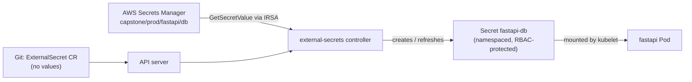
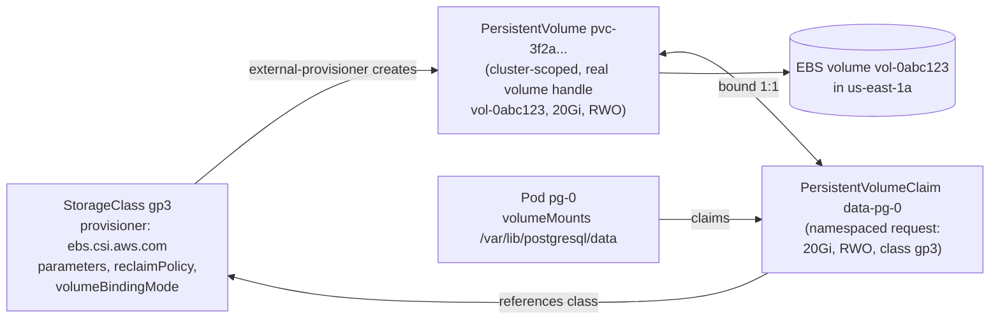

# Kubernetes: Core Concepts 2c — Configuration, Secrets, and Storage

| | |
|---|---|
| **Cluster** | 04 Containers & IDP |
| **Role** | Anchor |
| **Prerequisites** | [02-core-concepts.md](02-core-concepts.md), [02a-workloads.md](02a-workloads.md) |
| **Target version** | Kubernetes 1.31+, External Secrets Operator 0.10+, Secrets Store CSI Driver 1.4+, EBS CSI Driver 1.35+ |
| **Capstone phase** | Phase 3 (Months 9-12) |

> After this file you will know how to inject configuration into Pods with ConfigMaps and Secrets and how to trigger rollouts when they change; exactly why a Kubernetes Secret is **not** encrypted by default and how to fix that with encryption at rest (KMS), RBAC, and external secret stores (External Secrets Operator and the Secrets Store CSI Driver); how the PersistentVolume, PersistentVolumeClaim, and StorageClass triad delivers dynamic provisioning through CSI; what access modes, reclaim policies, binding modes, expansion, and snapshots really do; and which storage choice fits which workload on kind and on EKS.

---

## 1. ConfigMaps

A ConfigMap is a namespaced key-value object (max 1 MiB) for non-sensitive configuration. Keys can be consumed as environment variables, command-line arguments (via env), or files in a volume.

### 1.1 Creating

```yaml
apiVersion: v1
kind: ConfigMap
metadata:
  name: fastapi-config
  namespace: capstone
  labels: { app.kubernetes.io/name: fastapi-svc }
data:
  LOG_LEVEL: "info"
  OTEL_EXPORTER_OTLP_ENDPOINT: "http://otel-collector.observability.svc.cluster.local:4317"
  OTEL_SERVICE_NAME: "fastapi-svc"
  app.yaml: |                       # a whole file as one key
    features:
      canary_header: X-Canary
    http:
      timeout_seconds: 10
binaryData: {}                      # base64 for non-UTF-8 content
immutable: false                    # true = cannot be changed; kubelet stops watching it (big clusters: less API load)
```

```bash
kubectl create configmap fastapi-config --from-literal=LOG_LEVEL=info --from-file=app.yaml --dry-run=client -o yaml
kubectl create configmap nginx-conf --from-file=conf.d/          # one key per file in the directory
kubectl create configmap env --from-env-file=.env.example         # KEY=VALUE lines
kubectl get configmap fastapi-config -o yaml
kubectl describe configmap fastapi-config
```

### 1.2 Consuming

```yaml
spec:
  containers:
    - name: api
      envFrom:                                        # every key becomes an env var
        - configMapRef: { name: fastapi-config }
          prefix: APP_                                # optional prefix
      env:
        - name: LOG_LEVEL                             # one key
          valueFrom:
            configMapKeyRef: { name: fastapi-config, key: LOG_LEVEL, optional: false }
      volumeMounts:
        - name: config
          mountPath: /etc/app                         # directory with one file per key
          readOnly: true
        - name: config
          mountPath: /etc/app-single/app.yaml         # subPath mounts ONE key; breaks live updates
          subPath: app.yaml
          readOnly: true
  volumes:
    - name: config
      configMap:
        name: fastapi-config
        items:                                        # optional: pick keys and rename
          - { key: app.yaml, path: app.yaml, mode: 0444 }
        defaultMode: 0444
```

### 1.3 Update propagation and rollouts

| Consumption | On ConfigMap change |
|---|---|
| `env` / `envFrom` | **Never** updated in a running container. Needs a Pod restart |
| Volume mount (directory) | Updated by the kubelet within `syncFrequency` (default 1 min) plus cache TTL; atomic via symlink swap (`..data`) |
| Volume mount with `subPath` | **Never** updated |
| `immutable: true` | Cannot change; create a new ConfigMap with a new name |

The reliable production pattern is to make configuration changes **trigger a rollout**:

1. **Kustomize `configMapGenerator`** appends a content hash to the name (`fastapi-config-g8h2k7m4c9`) and rewrites references, so a config change produces a new Pod template and a normal rolling update.
2. **Helm** uses `checksum/config: {{ include (print $.Template.BasePath "/configmap.yaml") . | sha256sum }}` as a Pod template annotation.
3. **Reloader** (Stakater) watches ConfigMaps/Secrets and restarts annotated Deployments; useful with Argo CD when you do not want hashed names.

```bash
kubectl kustomize deploy/overlays/kind | grep -A1 'kind: ConfigMap' | grep name
# fastapi-config-g8h2k7m4c9
```

---

## 2. Secrets

### 2.1 What a Secret is (and is not)

A Secret is structurally a ConfigMap with `type` and base64-encoded `data`. The base64 is **encoding, not encryption**; anyone who can `get secrets` reads them in clear text with one `base64 --decode`. Out of the box:

- Secrets are stored in etcd **in plain text** (`/registry/secrets/<ns>/<name>`), so anyone with etcd access, an etcd backup, or control-plane disk access reads them.
- Any principal with RBAC `get`/`list` on `secrets` in a namespace reads all of them. `list` is enough (the list response contains the data).
- They are projected into Pods as tmpfs files or env vars; env vars leak into `kubectl describe pod`, crash dumps, and child processes.
- They are not versioned, not audited for *value* changes beyond the audit log metadata, and not rotated.

What Kubernetes gives you over a ConfigMap: a distinct resource for RBAC, `Metadata`-only audit logging by default, tmpfs (not disk) on nodes, the kubelet fetches only Secrets referenced by Pods on its node (`NodeRestriction` admission), and the type field for well-known shapes.

| `type` | Required keys | Use |
|---|---|---|
| `Opaque` (default) | any | Arbitrary |
| `kubernetes.io/dockerconfigjson` | `.dockerconfigjson` | Registry pull credentials (`imagePullSecrets`) |
| `kubernetes.io/tls` | `tls.crt`, `tls.key` | Gateway/Ingress TLS, cert-manager output |
| `kubernetes.io/basic-auth` | `username`, `password` | Convention |
| `kubernetes.io/ssh-auth` | `ssh-privatekey` | Git clone in Jobs/Argo CD |
| `kubernetes.io/service-account-token` | populated by controller | Legacy long-lived SA tokens; avoid, use projected tokens |
| `bootstrap.kubernetes.io/token` | `token-id`, `token-secret` | kubeadm node join |

### 2.2 Creating and consuming

```bash
# Imperative (fine for labs; the value ends up in shell history, so prefer --from-file or stdin in real life)
kubectl create secret generic fastapi-db --from-literal=url='postgresql://app:<PASSWORD>@postgres:5432/app' -n capstone
kubectl create secret generic fastapi-db --from-file=url=./db-url.txt -n capstone
kubectl create secret tls api-example-com-tls --cert=tls.crt --key=tls.key -n capstone
kubectl create secret docker-registry ghcr-pull \
  --docker-server=ghcr.io --docker-username=<GITHUB_USER> --docker-password=<GITHUB_PAT> -n capstone

# Read back
kubectl get secret fastapi-db -n capstone -o jsonpath='{.data.url}' | base64 --decode; echo
kubectl view-secret fastapi-db url -n capstone          # krew plugin
```

```yaml
apiVersion: v1
kind: Secret
metadata:
  name: fastapi-db
  namespace: capstone
type: Opaque
stringData:                           # write-side convenience: plain text, converted to data on save
  url: "postgresql://app:<PASSWORD>@postgres.data.svc.cluster.local:5432/app?sslmode=require"
# data:                               # read-side: base64
#   url: cG9zdGdyZXNxbDovLy4uLg==
```

Prefer volume projection over env vars:

```yaml
spec:
  containers:
    - name: api
      volumeMounts:
        - { name: db-secret, mountPath: /var/run/secrets/app, readOnly: true }
  volumes:
    - name: db-secret
      secret:
        secretName: fastapi-db
        defaultMode: 0400                 # with runAsUser 10001 and fsGroup 10001, 0400 is readable by the app only
  imagePullSecrets:
    - name: ghcr-pull                     # better: attach to the ServiceAccount so every Pod gets it
```

```bash
kubectl patch serviceaccount fastapi-svc -n capstone -p '{"imagePullSecrets":[{"name":"ghcr-pull"}]}'
```

**Never commit a Secret manifest with real values to Git.** The capstone repo contains only `ExternalSecret` objects (section 2.5) or, where unavoidable, Sealed Secrets / SOPS-encrypted files.

### 2.3 RBAC for Secrets

Minimum hygiene, enforced in every capstone namespace:

- No human role has `list`/`get` on `secrets` in production namespaces; break-glass only, audited.
- CI service accounts can `create`/`update` specific Secrets by `resourceNames` but not `list`.
- Application ServiceAccounts need **no** RBAC on Secrets at all; the kubelet mounts them.

```yaml
apiVersion: rbac.authorization.k8s.io/v1
kind: Role
metadata:
  name: tls-secret-writer
  namespace: capstone
rules:
  - apiGroups: [""]
    resources: ["secrets"]
    resourceNames: ["api-example-com-tls"]
    verbs: ["get", "update", "patch"]     # no list, no create (create cannot be scoped by resourceNames)
```

```bash
kubectl who-can get secrets -n capstone                 # krew plugin: who can read them
kubectl auth can-i list secrets -n capstone --as=system:serviceaccount:capstone:fastapi-svc   # expect "no"
```

### 2.4 Encryption at rest

The API server can encrypt specific resources before writing to etcd using an `EncryptionConfiguration`. Providers, from worst to best:

| Provider | Key location | Notes |
|---|---|---|
| `identity` | none | Plain text (default) |
| `aescbc` | In the config file on the control-plane disk | Encrypted in etcd, but the key sits next to it; not recommended (CBC padding issues) |
| `aesgcm` | Same | Must rotate every 200k writes; rarely appropriate |
| `secretbox` | Same | XSalsa20-Poly1305; better than aescbc if you must use a local key |
| `kms` v2 | External KMS (AWS KMS, Vault Transit); envelope encryption with per-object DEKs cached | **Recommended.** EKS "secrets encryption" uses this with a KMS CMK you own |

```yaml
# /etc/kubernetes/encryption/config.yaml on a kubeadm control plane
apiVersion: apiserver.config.k8s.io/v1
kind: EncryptionConfiguration
resources:
  - resources: ["secrets", "configmaps"]           # 1.27+ supports CRDs by group too: "externalsecrets.external-secrets.io"
    providers:
      - kms:
          apiVersion: v2
          name: aws-kms
          endpoint: unix:///var/run/kmsplugin/socket.sock
          timeout: 3s
      - identity: {}                               # keep LAST so existing plain-text objects can still be read during migration
```

```bash
# kubeadm: pass to the API server and mount the file
#   --encryption-provider-config=/etc/kubernetes/encryption/config.yaml
# Then re-encrypt everything already stored:
kubectl get secrets --all-namespaces -o json | kubectl replace -f -
# Verify directly in etcd (kind):
docker exec capstone-control-plane sh -c 'ETCDCTL_API=3 etcdctl --endpoints=https://127.0.0.1:2379 \
  --cacert=/etc/kubernetes/pki/etcd/ca.crt --cert=/etc/kubernetes/pki/etcd/server.crt --key=/etc/kubernetes/pki/etcd/server.key \
  get /registry/secrets/capstone/fastapi-db' | head -c 120 | xxd | head -n 4
# Encrypted values start with "k8s:enc:kms:v2:aws-kms:"; plain text starts with "k8s\x00\n\x0c\n\x02v1\x12\x06Secret"
```

On EKS, enable at cluster creation (Terraform `encryption_config { provider { key_arn = aws_kms_key.eks.arn } resources = ["secrets"] }`); since 2024 new EKS clusters encrypt Secrets by default with an AWS-owned key, and you should still bring your own CMK for key policy control and CloudTrail visibility.

Encryption at rest protects against etcd disk and backup exposure. It does **nothing** against RBAC misuse: `kubectl get secret` still decrypts transparently.

### 2.5 External Secrets Operator (ESO)

The capstone's source of truth for secrets is **AWS Secrets Manager** (and SSM Parameter Store for non-sensitive parameters). ESO runs a controller that reads from the external store with a cloud identity (IRSA/Pod Identity) and **writes Kubernetes Secrets**, keeping them in sync. Applications stay unchanged (they mount a normal Secret); Git contains only pointers.



Install:

```bash
helm repo add external-secrets https://charts.external-secrets.io
helm upgrade --install external-secrets external-secrets/external-secrets \
  --namespace external-secrets --create-namespace --version 0.10.5 \
  --set installCRDs=true \
  --set serviceAccount.annotations."eks\.amazonaws\.com/role-arn"=arn:aws:iam::123456789012:role/capstone-external-secrets \
  --wait
```

Store and ExternalSecret:

```yaml
apiVersion: external-secrets.io/v1beta1
kind: ClusterSecretStore                 # cluster-wide; SecretStore is the namespaced variant
metadata:
  name: aws-secrets-manager
spec:
  provider:
    aws:
      service: SecretsManager
      region: <REGION>
      auth:
        jwt:
          serviceAccountRef:
            name: external-secrets
            namespace: external-secrets   # IRSA-annotated SA; no static keys anywhere
  conditions:                             # which namespaces may use this store
    - namespaceSelector:
        matchLabels: { secrets-store: aws }
---
apiVersion: external-secrets.io/v1beta1
kind: ExternalSecret
metadata:
  name: fastapi-db
  namespace: capstone
spec:
  refreshInterval: 1h                     # poll interval; rotation lands within this window
  secretStoreRef:
    kind: ClusterSecretStore
    name: aws-secrets-manager
  target:
    name: fastapi-db                      # Secret to create
    creationPolicy: Owner                 # ESO owns and garbage-collects it
    deletionPolicy: Retain
    template:
      type: Opaque
      data:
        url: "postgresql://{{ .username }}:{{ .password }}@{{ .host }}:5432/{{ .dbname }}?sslmode=require"
  data:
    - secretKey: username
      remoteRef: { key: capstone/prod/fastapi/db, property: username }
    - secretKey: password
      remoteRef: { key: capstone/prod/fastapi/db, property: password }
    - secretKey: host
      remoteRef: { key: capstone/prod/fastapi/db, property: host }
    - secretKey: dbname
      remoteRef: { key: capstone/prod/fastapi/db, property: dbname }
```

```bash
kubectl apply -f externalsecret.yaml
kubectl get externalsecret -n capstone
kubectl describe externalsecret fastapi-db -n capstone | sed -n '/Status/,$p'
kubectl get secret fastapi-db -n capstone                 # created by ESO
kubectl annotate externalsecret fastapi-db -n capstone force-sync=$(date +%s) --overwrite   # refresh now
```

Expected:

```text
NAME         STORE                 REFRESH INTERVAL   STATUS         READY
fastapi-db   aws-secrets-manager   1h                 SecretSynced   True
```

On kind there is no AWS; the labs use ESO's `fake` provider or a local Vault dev server so the manifests are identical between environments:

```yaml
apiVersion: external-secrets.io/v1beta1
kind: ClusterSecretStore
metadata:
  name: aws-secrets-manager            # same NAME as on EKS so ExternalSecrets are portable
spec:
  provider:
    fake:
      data:
        - key: capstone/prod/fastapi/db
          value: '{"username":"app","password":"<LAB_ONLY_PASSWORD>","host":"postgres.data.svc.cluster.local","dbname":"app"}'
```

ESO also supports `PushSecret` (write a Kubernetes-generated secret back to the store), `ClusterExternalSecret` (fan out to many namespaces), and generators (ECR tokens that expire every 12 hours, GitHub App tokens, passwords).

### 2.6 Secrets Store CSI Driver

The alternative model: **do not create Kubernetes Secrets at all.** The Secrets Store CSI Driver mounts secrets from the external store directly into the Pod as a volume, fetched at Pod start by the node plugin using the Pod's identity. Optionally it can also sync to a Kubernetes Secret (for env vars), which reintroduces the etcd exposure.

```yaml
apiVersion: secrets-store.csi.x-k8s.io/v1
kind: SecretProviderClass
metadata:
  name: fastapi-aws
  namespace: capstone
spec:
  provider: aws
  parameters:
    objects: |
      - objectName: "capstone/prod/fastapi/db"
        objectType: "secretsmanager"
        jmesPath:
          - path: password
            objectAlias: db-password
---
# In the Pod spec:
#  volumes:
#    - name: secrets
#      csi:
#        driver: secrets-store.csi.k8s.io
#        readOnly: true
#        volumeAttributes:
#          secretProviderClass: fastapi-aws
#  containers[].volumeMounts:
#    - { name: secrets, mountPath: /mnt/secrets, readOnly: true }
```

| | External Secrets Operator | Secrets Store CSI Driver | Sealed Secrets / SOPS |
|---|---|---|---|
| Where the value lives in-cluster | Kubernetes Secret (etcd) | Pod tmpfs only (optionally also Secret) | Kubernetes Secret, decrypted by controller from Git ciphertext |
| Identity used to fetch | Controller's identity (one IRSA role for ESO) | **Pod's** identity (per-app IRSA role, least privilege) | Controller's private key |
| Works with env vars, imagePullSecrets, TLS Secrets for Gateways | Yes | Only with sync-to-Secret enabled | Yes |
| Rotation | Polling `refreshInterval` | Rotation reconciler (polls, updates mount) | Manual re-encrypt and commit |
| Failure mode | Store down: last Secret remains, Pods keep starting | Store down: **new Pods fail to start** (volume mount fails) | None at runtime |
| Source of truth | External store | External store | Git |
| Capstone use | **Default** for application and platform secrets | For the highest-sensitivity values where per-Pod identity matters | Not used; recorded in ADR |

### 2.7 ServiceAccount tokens and projected volumes

Since 1.24, Pods no longer get long-lived Secret-backed tokens. The kubelet requests a **bound, time-limited token** (audience `https://kubernetes.default.svc`, 1 h, rotated at 80 percent) and projects it. The same mechanism issues tokens for other audiences, which is how IRSA works (audience `sts.amazonaws.com`).

```yaml
spec:
  serviceAccountName: fastapi-svc
  automountServiceAccountToken: false       # default mount off; mount explicitly if the app calls the API
  volumes:
    - name: aws-token
      projected:
        defaultMode: 0440
        sources:
          - serviceAccountToken:
              audience: sts.amazonaws.com
              expirationSeconds: 3600
              path: token
          - configMap:
              name: kube-root-ca.crt       # cluster CA, auto-created in every namespace
              items: [{ key: ca.crt, path: ca.crt }]
          - downwardAPI:
              items:
                - path: labels
                  fieldRef: { fieldPath: metadata.labels }
```

```bash
# Mint a token by hand (for CI or debugging); short-lived, no Secret object created
kubectl create token fastapi-svc -n capstone --audience=sts.amazonaws.com --duration=10m
# Inspect what the kubelet projected
kubectl exec deploy/fastapi-svc -n capstone -- cat /var/run/secrets/eks.amazonaws.com/serviceaccount/token | cut -d. -f2 | base64 -d 2>/dev/null | jq .
```

---

## 3. Storage

### 3.1 Volume categories

| Category | Lifetime | Examples | Typical use |
|---|---|---|---|
| Ephemeral, Pod-scoped | Dies with the Pod | `emptyDir` (disk or `medium: Memory`), `configMap`, `secret`, `downwardAPI`, `projected`, generic ephemeral volume (PVC from an inline template) | Scratch space, caches, config injection |
| Persistent | Independent of Pods | `persistentVolumeClaim` -> `PersistentVolume` (via CSI) | Databases, uploads, model weights |
| Host-coupled | Node's lifetime | `hostPath`, `local` PV | Node agents (DaemonSets); never for apps |
| Image | Pod | `image` volume (beta 1.33): mount an OCI artifact read-only | Shipping model weights or static assets as OCI images |

```yaml
volumes:
  - name: scratch
    emptyDir: { sizeLimit: 1Gi }                # counts against ephemeral-storage; exceeding evicts the Pod
  - name: shm
    emptyDir: { medium: Memory, sizeLimit: 256Mi }   # tmpfs; counts against the memory limit
  - name: model-cache
    ephemeral:                                   # generic ephemeral volume: a PVC created and deleted with the Pod
      volumeClaimTemplate:
        spec:
          accessModes: ["ReadWriteOnce"]
          storageClassName: gp3
          resources: { requests: { storage: 50Gi } }
```

### 3.2 The PV / PVC / StorageClass triad



- **PersistentVolumeClaim**: the namespaced *request* an app makes: size, access mode, class, optional selector. Apps and Helm charts reference only PVCs.
- **PersistentVolume**: the cluster-scoped *supply*: a real volume with its CSI handle, capacity, modes, and reclaim policy. Created by an admin (static) or by a provisioner (dynamic).
- **StorageClass**: the *recipe* for dynamic provisioning: which CSI driver, which parameters (type, IOPS, encryption key, filesystem), reclaim policy, binding mode, and expansion permission. One class is marked default.

Dynamic provisioning flow: PVC created -> `external-provisioner` sidecar (watching PVCs for its class) calls CSI `CreateVolume` -> creates the PV -> PV controller binds PV and PVC (`Bound`) -> on Pod schedule, `external-attacher` calls `ControllerPublishVolume` (attach EBS to the node) -> kubelet calls `NodeStageVolume` (format and mount to a global path) and `NodePublishVolume` (bind-mount into the Pod).

### 3.3 StorageClass manifests

```yaml
# EKS: encrypted gp3 with your KMS key, WaitForFirstConsumer so the volume lands in the Pod's AZ
apiVersion: storage.k8s.io/v1
kind: StorageClass
metadata:
  name: gp3
  annotations:
    storageclass.kubernetes.io/is-default-class: "true"
provisioner: ebs.csi.aws.com
parameters:
  type: gp3
  iops: "3000"
  throughput: "125"
  encrypted: "true"
  kmsKeyId: arn:aws:kms:<REGION>:123456789012:key/00000000-0000-0000-0000-000000000000
  csi.storage.k8s.io/fstype: xfs
reclaimPolicy: Delete                        # Retain for anything you cannot recreate
allowVolumeExpansion: true
volumeBindingMode: WaitForFirstConsumer      # critical for multi-AZ: bind after scheduling, not before
---
# EKS: EFS for ReadWriteMany (shared uploads, model caches across Pods)
apiVersion: storage.k8s.io/v1
kind: StorageClass
metadata:
  name: efs
provisioner: efs.csi.aws.com
parameters:
  provisioningMode: efs-ap                   # one access point per PVC
  fileSystemId: fs-0123456789abcdef0
  directoryPerms: "700"
  uid: "10001"
  gid: "10001"
reclaimPolicy: Delete
volumeBindingMode: Immediate
---
# kind ships this one (rancher.io/local-path); shown for reference
apiVersion: storage.k8s.io/v1
kind: StorageClass
metadata:
  name: standard
  annotations:
    storageclass.kubernetes.io/is-default-class: "true"
provisioner: rancher.io/local-path
reclaimPolicy: Delete
volumeBindingMode: WaitForFirstConsumer
```

```bash
kubectl get storageclass
kubectl describe storageclass gp3
kubectl get csidrivers
kubectl get csinodes -o yaml | yq '.items[].spec.drivers[] | {name, nodeID, allocatable}'
# Change the default class
kubectl patch storageclass standard -p '{"metadata":{"annotations":{"storageclass.kubernetes.io/is-default-class":"false"}}}'
kubectl patch storageclass gp3 -p '{"metadata":{"annotations":{"storageclass.kubernetes.io/is-default-class":"true"}}}'
```

### 3.4 Access modes, binding, reclaim

| Access mode | Abbrev | Meaning | Backends |
|---|---|---|---|
| `ReadWriteOnce` | RWO | One **node** may mount read-write; multiple Pods on that node can share it | EBS, GCE PD, Azure Disk, local |
| `ReadWriteOncePod` | RWOP | Exactly one **Pod** may mount read-write (GA 1.29); the safe choice for single-writer databases | Any CSI driver supporting it |
| `ReadOnlyMany` | ROX | Many nodes read-only | EBS (from snapshot, limited), NFS, EFS |
| `ReadWriteMany` | RWX | Many nodes read-write | EFS, NFS, CephFS, Azure Files, Longhorn RWX |

Rolling updates with RWO: the new Pod cannot mount until the old one unmounts, so Deployments with RWO volumes need `strategy: Recreate` or replicas 1; this is why stateful things live in StatefulSets with one volume each.

| `volumeBindingMode` | Behaviour |
|---|---|
| `Immediate` | PV created and bound as soon as the PVC exists, in some AZ. A Pod later constrained to another AZ is unschedulable (`volume node affinity conflict`) |
| `WaitForFirstConsumer` | PVC stays `Pending` until a Pod uses it; the scheduler picks the node first, then the volume is created in that AZ. **Always use for zonal block storage** |

| `reclaimPolicy` | On PVC delete |
|---|---|
| `Delete` | PV and the backing volume are deleted. Default for dynamic classes |
| `Retain` | PV goes `Released`; data kept; manual cleanup (edit PV to remove `claimRef` to reuse, or delete PV then volume) |
| `Recycle` | Deprecated |

Protect important PVs before a risky operation:

```bash
kubectl patch pv pvc-3f2a1b... -p '{"spec":{"persistentVolumeReclaimPolicy":"Retain"}}'
```

### 3.5 PVC lifecycle in practice

```yaml
apiVersion: v1
kind: PersistentVolumeClaim
metadata:
  name: uploads
  namespace: capstone
spec:
  accessModes: ["ReadWriteOnce"]
  storageClassName: gp3                 # omit to use the default class; "" means static binding only
  resources:
    requests:
      storage: 10Gi
  # volumeMode: Block                   # raw block device instead of filesystem (databases that manage their own FS)
  # dataSource:                         # clone from a snapshot or another PVC
  #   kind: VolumeSnapshot
  #   apiGroup: snapshot.storage.k8s.io
  #   name: uploads-2026-10-26
```

```bash
kubectl apply -f pvc.yaml
kubectl get pvc -n capstone
kubectl get pv
kubectl describe pvc uploads -n capstone        # Events: WaitForFirstConsumer, Provisioning, ProvisioningSucceeded
```

Expected (WaitForFirstConsumer, no Pod yet):

```text
NAME      STATUS    VOLUME   CAPACITY   ACCESS MODES   STORAGECLASS   VOLUMEATTRIBUTESCLASS   AGE
uploads   Pending                                      gp3            <unset>                 10s
Events:
  Normal  WaitForFirstConsumer  10s  persistentvolume-controller  waiting for first consumer to be created before binding
```

After a Pod mounts it:

```text
NAME      STATUS   VOLUME                                     CAPACITY   ACCESS MODES   STORAGECLASS   AGE
uploads   Bound    pvc-3f2a1b7c-0d9e-4c2a-9b1f-6a7d8e9f0a1b   10Gi       RWO            gp3            1m
```

Expand online (class must allow it; most CSI drivers resize the filesystem while mounted):

```bash
kubectl patch pvc uploads -n capstone -p '{"spec":{"resources":{"requests":{"storage":"20Gi"}}}}'
kubectl get pvc uploads -n capstone -o jsonpath='{.status.capacity.storage} {.status.conditions[*].type}{"\n"}'
# FileSystemResizePending means it waits for the Pod to restart (older drivers); Resizing means in progress
```

PVCs cannot shrink. Two finalizers protect data: `kubernetes.io/pvc-protection` (PVC not deleted while a Pod uses it) and `kubernetes.io/pv-protection`.

### 3.6 Volume snapshots and clones

Requires the snapshot CRDs and `snapshot-controller` (bundled in the EKS EBS CSI add-on; install separately on kind if you want to practise).

```yaml
apiVersion: snapshot.storage.k8s.io/v1
kind: VolumeSnapshotClass
metadata:
  name: ebs-snapshots
driver: ebs.csi.aws.com
deletionPolicy: Retain                      # keep the EBS snapshot if the VolumeSnapshot object is deleted
parameters:
  tagSpecification_1: "backup=true"
---
apiVersion: snapshot.storage.k8s.io/v1
kind: VolumeSnapshot
metadata:
  name: uploads-2026-10-26
  namespace: capstone
spec:
  volumeSnapshotClassName: ebs-snapshots
  source:
    persistentVolumeClaimName: uploads
```

```bash
kubectl apply -f snapshot.yaml
kubectl get volumesnapshot -n capstone
kubectl get volumesnapshot uploads-2026-10-26 -n capstone -o jsonpath='{.status.readyToUse} {.status.restoreSize}{"\n"}'
# Restore = new PVC with dataSource (section 3.5); clone = dataSource kind: PersistentVolumeClaim
```

Snapshots are crash-consistent, not application-consistent. For databases, quiesce first (`pg_backup_start`) or use the operator's backup (CloudNativePG to S3 with WAL archiving). Velero orchestrates cluster-wide backups of objects plus volume snapshots and is the capstone DR tool (cluster 12).

### 3.7 Storage decision table

| Need | kind | EKS | Notes |
|---|---|---|---|
| Scratch, caches | `emptyDir` | `emptyDir` | Set `sizeLimit`; `medium: Memory` for speed |
| Single-writer persistent (DB, queue) | `standard` (local-path) | `gp3` RWO/RWOP, `WaitForFirstConsumer`, encrypted | StatefulSet + operator |
| Shared read-write (uploads, model cache) | `local-path` cannot do RWX; use an NFS provisioner | `efs` RWX | EFS is slower and pricier per GB; consider S3 with Mountpoint CSI for read-mostly |
| Object storage | MinIO Deployment | S3 via SDK or Mountpoint for S3 CSI | Prefer the SDK; the CSI is for legacy file-based apps |
| Large read-only artifacts (model weights) | `image` volume or init container download | Same, or EFS/S3 | Phase 6 vLLM uses an init container pulling from S3 to an `emptyDir` on NVMe |
| Node-local NVMe (fast cache) | n/a | `local` PVs via local-static-provisioner or `emptyDir` on instance store | Data lost when node goes |

---

## 4. Putting Config and Storage Into the Capstone

| Resource | FastAPI | Spring Boot |
|---|---|---|
| ConfigMap (Kustomize-generated, hashed) | `LOG_LEVEL`, OTel endpoint, feature flags | `SPRING_PROFILES_ACTIVE`, `application-k8s.yaml` mounted at `/config/` |
| ExternalSecret | `fastapi-db` (RDS credentials), `fastapi-bedrock` (none: IRSA instead) | `springboot-db`, `springboot-oidc-client` |
| Projected volume | SA token for IRSA (`sts.amazonaws.com`) | Same |
| PVC | none (stateless); uploads go to S3 | none |
| Secrets Store CSI | not used in Phase 3 | not used |
| Encryption at rest | EKS KMS CMK via Terraform | Same |

Labs 5 and 7 in [04-hands-on-labs.md](04-hands-on-labs.md) apply these.

---

## 5. Command Summary

```bash
# ConfigMaps
kubectl create cm NAME --from-literal=K=V --from-file=PATH --from-env-file=FILE
kubectl get cm NAME -o jsonpath='{.data.KEY}'
kubectl rollout restart deployment/NAME          # after env-based config changes

# Secrets
kubectl create secret generic|tls|docker-registry NAME ...
kubectl get secret NAME -o jsonpath='{.data.KEY}' | base64 -d
kubectl create token SA -n NS --audience=AUD --duration=10m
kubectl who-can get secrets -n NS                # krew

# External Secrets
kubectl get clustersecretstore,secretstore,externalsecret -A
kubectl describe externalsecret NAME -n NS
kubectl annotate externalsecret NAME force-sync=$(date +%s) --overwrite

# Storage
kubectl get sc,pv,pvc,csidrivers
kubectl describe pvc NAME -n NS
kubectl patch pvc NAME -p '{"spec":{"resources":{"requests":{"storage":"SIZE"}}}}'
kubectl patch pv NAME -p '{"spec":{"persistentVolumeReclaimPolicy":"Retain"}}'
kubectl get volumesnapshot,volumesnapshotclass -A
kubectl get events --field-selector involvedObject.kind=PersistentVolumeClaim -n NS
```

Continue to [02d-scheduling-and-autoscaling.md](02d-scheduling-and-autoscaling.md).
