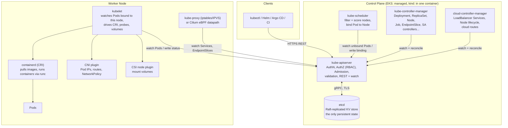
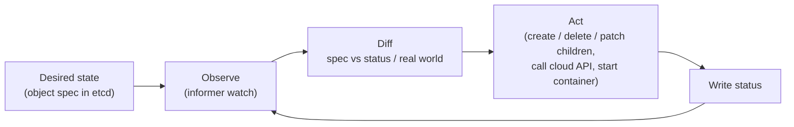
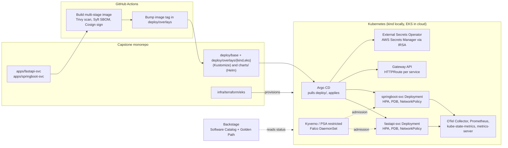

# Kubernetes

| | |
|---|---|
| **Cluster** | 04 Containers & IDP |
| **Role** | Anchor (the anchor of the entire platform layer) |
| **Category** | Container orchestration / declarative infrastructure control plane |
| **Prerequisites** | Docker fundamentals (OCI images, registries, non-root containers), Linux networking (iptables/netfilter, DNS, cgroups, namespaces), YAML, basic AWS (for the EKS sections) |
| **Target version** | Kubernetes 1.31+ (manifests use stable API groups: `apps/v1`, `networking.k8s.io/v1`, `gateway.networking.k8s.io/v1`, `autoscaling/v2`, `policy/v1`) |
| **Capstone phase** | Phase 3 (Months 9-12, 180 hrs) |
| **Lab environment** | kind (local, 85 percent of the work) and Amazon EKS (cloud, ephemeral, torn down nightly) |
| **Official docs** | https://kubernetes.io/docs/ |

> Kubernetes is a distributed control plane that stores the *desired state* of your workloads in etcd and runs a fleet of controllers that relentlessly reconcile the *actual state* of a cluster towards it. After working through this folder you will be able to design, deploy, secure, scale, observe, and debug production workloads on Kubernetes; read any manifest and know which controller acts on it; operate a cluster lifecycle (kind locally, EKS in the cloud); and explain to a principal-level interviewer exactly what happens between `kubectl apply` and a container starting on a node. Every other tool in this cluster (Docker, Helm, Argo CD, Backstage) and most tools in clusters 05 to 12 either produce artefacts for Kubernetes or consume state from it.

## Why This Tool Exists

Before Kubernetes, teams ran containers the same way they ran VMs: a person (or a shell script) decided which host would run which container, wired up ports, restarted crashed processes, and rebalanced load when a machine died. Docker solved *packaging* (one immutable OCI image runs identically everywhere) but not *placement*, *healing*, *service discovery*, *rollout*, or *scale*. Each organisation wrote its own fragile orchestration layer with cron jobs, Ansible playbooks, and pager duty.

Google had solved this internally a decade earlier with Borg and Omega. The insight that made Borg work, and which Kubernetes brought to the open-source world in 2014, is deceptively simple:

1. **Describe the end state, not the steps.** You do not tell the system "start three containers on hosts A, B, and C". You submit a record that says "I want three replicas of this Pod template", and store it in a strongly consistent database.
2. **Make every component a control loop.** A controller watches that record, compares it to reality, and takes the smallest action that moves reality closer to the record. It never stops watching. If a node dies, the loop notices the replica count dropped and creates a new Pod. If you edit the record, the loop notices and rolls forward. Humans and machines interact with the system through exactly the same interface: writing desired state.
3. **Make the API the only door.** Every component, including the scheduler and the kubelet, talks to one API server. Nothing writes to etcd directly. This means the whole system is extensible by adding new record types (CRDs) and new loops (operators), and auditable because every change flows through one authenticated, authorised, admission-controlled, logged choke point.

Kubernetes won the orchestration wars (over Docker Swarm, Mesos/Marathon, Nomad) not because it was simplest but because this reconciliation architecture scales from a laptop to tens of thousands of nodes and generalises far beyond containers. Today the same API machinery manages certificates (cert-manager), databases (operators), cloud infrastructure (Crossplane), and GPU fleets (NVIDIA GPU Operator). Learning Kubernetes deeply is learning the dominant pattern of modern infrastructure control.

## Architecture

**Control plane components**

- **kube-apiserver**: the stateless front door. Validates every request, authenticates (certs, bearer tokens, OIDC), authorises (RBAC, webhook), runs admission (mutating then validating, including Pod Security Admission and ValidatingAdmissionPolicy/CEL), persists to etcd, and serves efficient `watch` streams so controllers do not poll. It horizontally scales; EKS runs several behind an NLB.
- **etcd**: the only stateful component. A Raft-consensus key-value store holding every object serialised as protobuf under `/registry/...`. Losing etcd quorum means the cluster cannot accept writes; losing etcd data means the cluster is gone. Back it up (covered in [05-production-patterns.md](05-production-patterns.md)).
- **kube-scheduler**: a controller whose loop is "find Pods with `spec.nodeName` empty; pick the best node; write a Binding". Two phases: *filtering* (which nodes are feasible given resources, taints, affinity, volumes) and *scoring* (which feasible node is best). Pluggable via the scheduling framework.
- **kube-controller-manager**: dozens of controllers compiled into one binary (Deployment, ReplicaSet, StatefulSet, DaemonSet, Job, CronJob, Node lifecycle, EndpointSlice, ServiceAccount token, PersistentVolume binder, HPA, garbage collector...). Each is an independent loop sharing one informer cache.
- **cloud-controller-manager**: the cloud-specific controllers split out so cloud code lives outside core: it turns `type: LoadBalancer` Services into NLBs, labels Nodes with zone/instance-type, and removes Node objects when the VM is deleted.

**Node components**

- **kubelet**: the node agent. Watches the API for Pods bound to its node, asks the container runtime to create sandboxes and containers, mounts volumes via CSI, sets up networking via CNI, runs liveness/readiness/startup probes, enforces resource limits via cgroups, evicts Pods under pressure, and reports Node and Pod status back. It is the only component that touches the kernel directly on behalf of workloads.
- **containerd (via CRI)**: the Container Runtime Interface implementation. Pulls OCI images, unpacks layers into snapshots, and launches containers through `runc` (or `gVisor`/`kata` for stronger isolation). Docker Engine is no longer used as a runtime (dockershim removed in 1.24), but Docker *images* are OCI images and run unchanged.
- **kube-proxy or Cilium**: implements the Service abstraction. kube-proxy programs iptables or IPVS rules on every node so that a virtual ClusterIP is DNAT-ed to a healthy Pod IP. Cilium replaces kube-proxy with eBPF programs attached to sockets and network devices, giving O(1) lookups, identity-based NetworkPolicy, L7 visibility, and Hubble flow observability. The capstone kind cluster uses Cilium so NetworkPolicy is actually enforced (the default kind CNI, kindnet, silently ignores it).
- **CNI / CSI / CRI**: the three plugin interfaces. CNI (Container Network Interface) assigns Pod IPs and wires routes. CSI (Container Storage Interface) provisions, attaches, and mounts volumes. CRI (Container Runtime Interface) runs containers. Kubernetes core knows nothing about EBS, VPC, or runc; it only knows these gRPC contracts.

## The Core Mental Model

Three ideas make everything else in Kubernetes obvious.

### 1. Everything is desired state in etcd plus a controller that reconciles it

A `Deployment` is not an instruction. It is a row in a database that says "I want 3 Pods matching this template, rolled out with this strategy". The Deployment controller creates a `ReplicaSet` row. The ReplicaSet controller creates 3 `Pod` rows. The scheduler fills in `nodeName` on each Pod row. The kubelet on that node sees the Pod row and starts containers. Each of these is a separate loop, communicating only via the API. Delete a Pod and the ReplicaSet controller recreates it within milliseconds because reality (2 Pods) no longer matches desire (3 Pods). Nothing "remembers" that it should restart it; it simply re-derives the gap every time it observes a change.

Consequences you should internalise:

- **Idempotency is free.** Applying the same manifest twice is a no-op because the diff is empty.
- **Failures are retried forever.** A controller that cannot act (image pull fails, no node fits) requeues with exponential backoff. `CrashLoopBackOff` and `ImagePullBackOff` are not errors; they are the kubelet's loop telling you it is still trying.
- **Status is derived, never authoritative.** `status` fields are written by controllers as observations. You never set them; you read them to see how far reconciliation has progressed.
- **Extensibility is uniform.** A CRD adds a new table. An operator adds a new loop. The API server, RBAC, audit, and `kubectl` treat them identically to built-ins.

### 2. The Pod is the atom; everything else is a controller over Pods

A Pod is one or more containers sharing a network namespace (one IP, `localhost` between them), optionally sharing volumes, scheduled and killed as a unit. Pods are mortal and have no self-healing. Every higher-level workload resource (Deployment, StatefulSet, DaemonSet, Job, CronJob) is a different *policy* for creating and replacing Pods. Learn the Pod spec thoroughly once; the rest is templates and strategies.

### 3. Labels select, Services route, namespaces scope

Objects are related by label selectors, not by names or IDs. A ReplicaSet owns the Pods its selector matches. A Service routes to the Pods its selector matches. A NetworkPolicy applies to the Pods its selector matches and allows traffic from the Pods or namespaces its rules select. Namespaces are the unit of RBAC, quota, and (with NetworkPolicy) network segmentation. Multi-tenancy is built from these three primitives.

## Anchor-and-Bridge Mapping

Kubernetes is the anchor; sibling tools in this cluster wrap it. Each bridge folder contains a "Coming from Kubernetes" section; this table is the forward mapping.

| Concept in Kubernetes | Docker / Compose | Helm | Argo CD | Backstage |
|---|---|---|---|---|
| Pod (co-scheduled containers, shared netns) | `docker run` / a Compose `service` | Rendered from `templates/*.yaml` | Reconciled from Git | Catalog `Component` entity |
| Deployment (replicas + rolling update) | `docker compose up --scale` (no rollout strategy) | `helm upgrade` with `--atomic` | `Application` sync with health checks | Golden Path template output |
| Service / Gateway API | Compose network + `ports:` | `values.yaml` toggles ingress/gateway | Sync wave ordering | `backstage.io/kubernetes-id` annotation shows status |
| ConfigMap / Secret | `env_file`, `secrets:` | `values.yaml` and `--set`; never commit secrets | Argo CD + External Secrets / Sealed Secrets | n/a |
| Namespace | Compose project name | `--namespace`, `--create-namespace` | `AppProject` destination restriction | Catalog `System` / `Domain` |
| `kubectl apply` (declarative) | `docker compose up -d` | `helm upgrade --install` | Git push (Argo pulls and applies) | Scaffolder action `kubernetes:apply` (via CI) |
| `kubectl rollout undo` | Restart old container by hand | `helm rollback <release> <revision>` | Sync to previous Git commit / `argocd app rollback` | n/a |
| Label selector | Compose labels (metadata only) | `{{ include "chart.selectorLabels" . }}` | `app.kubernetes.io/instance` tracking label | `backstage.io/kubernetes-label-selector` |
| Controller / Operator / CRD | n/a | Chart-packaged operator | `ApplicationSet` generators | Custom entity kinds + processors |
| RBAC | Docker socket = root | Release in namespace, RBAC templated | `AppProject` roles, SSO groups | Permission framework |
| Health (probes, conditions) | `HEALTHCHECK` | `helm test` | Resource health Lua scripts | Kubernetes plugin pod status |

Terraform (cluster 05) provisions the EKS cluster itself; GitHub Actions (cluster 06) builds images and pushes manifests; OpenTelemetry/Prometheus (cluster 09) scrape Pods via `ServiceMonitor` CRDs; Kyverno/Gatekeeper/Falco (cluster 08) run as admission webhooks and DaemonSets; vLLM and the NVIDIA GPU Operator (cluster 10) extend the scheduler with `nvidia.com/gpu` resources. Everything converges here.

## Learning Path

Work through the files in order. The core-concepts material is split into six files because Kubernetes is the anchor for the whole platform layer and deserves the depth. Budget around 60 to 70 hours for the reading and labs in this folder, leaving the rest of Phase 3 for Helm, Argo CD, Backstage, and the EKS capstone wiring.

| Step | File | What you will learn | Time |
|---|---|---|---|
| 1 | [01-installation-and-setup.md](01-installation-and-setup.md) | Install `kubectl`, `kind`, `k3d`, `helm`, `kubectx`; create the multi-node capstone kind cluster with Cilium, metrics-server, Gateway API, local registry; EKS access via `aws eks update-kubeconfig` and IAM/OIDC; verification commands | 3 h |
| 2 | [02-core-concepts.md](02-core-concepts.md) | Architecture in depth, the reconciliation loop and informers, API groups/versions/resources, object metadata, `kubectl` mechanics (server-side apply, jsonpath, explain, diff, debug), the Pod spec end to end: lifecycle, init and sidecar containers, probes, resources and QoS, graceful shutdown | 8 h |
| 3 | [02a-workloads.md](02a-workloads.md) | Deployments (strategies, rollouts, rollbacks, `maxSurge`/`maxUnavailable`, revision history), ReplicaSets, StatefulSets (headless Services, `volumeClaimTemplates`, ordered and partitioned updates), DaemonSets, Jobs and CronJobs, PodDisruptionBudgets | 6 h |
| 4 | [02b-networking.md](02b-networking.md) | The Kubernetes network model, CNI, Services (ClusterIP/NodePort/LoadBalancer/ExternalName/headless), EndpointSlices, kube-proxy vs Cilium eBPF, CoreDNS, Ingress vs Gateway API (GatewayClass/Gateway/HTTPRoute), NetworkPolicy default-deny and egress patterns, service mesh overview | 7 h |
| 5 | [02c-storage-and-config.md](02c-storage-and-config.md) | ConfigMaps, Secrets (and why they are not encrypted by default), encryption at rest with KMS, External Secrets Operator, Secrets Store CSI Driver, projected volumes, PV/PVC/StorageClass, dynamic provisioning, access modes, reclaim policies, volume expansion and snapshots, ephemeral volumes | 6 h |
| 6 | [02d-scheduling-and-autoscaling.md](02d-scheduling-and-autoscaling.md) | Scheduler internals, `nodeSelector`, node and Pod affinity/anti-affinity, taints and tolerations, topology spread constraints, PriorityClass and preemption, ResourceQuota and LimitRange, HPA v2 (resource, custom, external metrics), VPA, Cluster Autoscaler vs Karpenter, KEDA | 6 h |
| 7 | [02e-security.md](02e-security.md) | Authentication (certs, OIDC, IRSA/Pod Identity), RBAC (Roles, ClusterRoles, bindings, aggregation), ServiceAccounts and bound token projection, `kubectl auth can-i`, Pod Security Admission restricted profile, security contexts (non-root, read-only root FS, drop capabilities, seccomp, AppArmor), admission webhooks, ValidatingAdmissionPolicy with CEL, CRDs and the operator pattern, kubebuilder overview, supply-chain hooks | 7 h |
| 8 | [03-commands-and-cheatsheet.md](03-commands-and-cheatsheet.md) | Exhaustive `kubectl` reference by task, jsonpath and custom-columns recipes, kustomize, kind/k3d/EKS commands, etcdctl, crictl, one-liners for incident response | 3 h (reference) |
| 9 | [04-hands-on-labs.md](04-hands-on-labs.md) | Nine progressive labs culminating in the capstone deployment: FastAPI and Spring Boot on kind with Deployments, Services, Gateway API, HPA, NetworkPolicy, PDB, probes, limits, restricted Pod Security, and a measured zero-downtime rolling update | 14 h |
| 10 | [05-production-patterns.md](05-production-patterns.md) | Hardening checklist, HA control planes, EKS specifics (IRSA, Pod Identity, managed node groups, Karpenter, add-ons), upgrades, etcd backup and restore, GitOps readiness, multi-tenancy models, cost and right-sizing, anti-patterns, decision checklist | 5 h |
| 11 | [06-troubleshooting.md](06-troubleshooting.md) | Symptom to cause to fix for every common failure (CrashLoopBackOff, ImagePullBackOff, Pending, OOMKilled, probe failures, DNS, NetworkPolicy drops, PVC stuck, NotReady, evictions, certificate expiry) with exact diagnostic commands and a debugging workflow | 4 h |
| 12 | [07-interview-questions.md](07-interview-questions.md) | 40 questions from junior to principal with model answers | 3 h |

**Suggested cadence for Phase 3.** Weeks 1 to 3: files 01 to 02e with the first six labs on kind. Weeks 4 to 5: Helm and Argo CD folders, then Labs 7 to 9 (the capstone wiring). Weeks 6 to 8: EKS via Terraform (cluster 05), Backstage, and the production patterns. Keep the kind cluster alive throughout; it is your primary environment and costs nothing.

## Role in the Capstone

The unified capstone repository ("the monorepo lab") converges on Kubernetes in Phase 3 and never leaves it. The platform layer looks like this:

Concretely, by the end of Phase 3 the Kubernetes layer of the capstone contains:

- `deploy/base/`: Kustomize base with a Deployment, Service, HTTPRoute, HPA, PDB, NetworkPolicy, and ServiceAccount for each of the two services, all passing the Pod Security `restricted` profile.
- `deploy/overlays/kind/` and `deploy/overlays/eks/`: environment deltas (replica counts, StorageClass names, Gateway class, IRSA annotations, image registry).
- A `kind-config.yaml` plus `make cluster-up` that creates the three-node Cilium-backed cluster with metrics-server, Gateway API CRDs, Envoy Gateway, and a local registry in under five minutes.
- An `infra/terraform/eks/` module producing an EKS 1.31 cluster with a managed node group for system add-ons, Karpenter for workloads, IRSA and Pod Identity enabled, and the EBS CSI, VPC CNI, CoreDNS, and kube-proxy add-ons managed by Terraform.
- Runbooks under `docs/runbooks/` for every scenario in [06-troubleshooting.md](06-troubleshooting.md), which the Phase 6 AI incident agent will later retrieve via RAG and act on through a Kubernetes MCP server.
- ADRs under `capstone/adrs/`: "Why Gateway API over Ingress", "Why Cilium over kube-proxy", "Why Karpenter over Cluster Autoscaler", "Why External Secrets Operator over Sealed Secrets".

The artefact Kubernetes produces for the rest of the roadmap is a *running, observable, policy-enforced platform*: Phase 4 instruments it, Phase 5 locks it down with the seven gates, Phase 6 runs GPU inference and agents on it.

## Where Kubernetes Is Weak (Honest Trade-offs)

- **Operational complexity.** A production cluster has 15 to 30 add-ons (CNI, CSI, DNS, ingress, cert-manager, metrics, logging, policy, secrets, autoscaler...), each with its own upgrade cadence. Managed services (EKS) remove the control plane burden but not the add-on burden. For a handful of stateless services, ECS/Fargate, Cloud Run, or App Service may be the right answer.
- **Stateful workloads are possible but unforgiving.** StatefulSets, CSI, and operators make databases on Kubernetes viable, but a bad PVC reclaim policy or a careless `kubectl delete` loses data. Most teams use managed databases (RDS, Aurora) and keep Kubernetes for stateless compute and caches.
- **Secrets are base64, not encrypted, by default.** You must enable encryption at rest and pull secrets from an external store. This surprises almost everyone.
- **Networking has sharp edges.** NetworkPolicy semantics are additive and depend on CNI support; Services are L4 only; Ingress was under-specified (hence Gateway API); DNS is a frequent source of latency (`ndots:5`).
- **YAML sprawl.** A two-service deployment can be 800 lines of YAML. Helm, Kustomize, and GitOps exist to manage this, and each adds its own abstraction cost.
- **Cost opacity.** Requests, not usage, drive node count. Without right-sizing (VPA recommendations, Kubecost/OpenCost) clusters commonly run at 20 to 30 percent utilisation.

## Further Reading

- Official documentation: https://kubernetes.io/docs/concepts/ (read "Cluster Architecture", "Workloads", "Services, Load Balancing, and Networking", "Policies" in that order)
- API reference, which is the ground truth for every field: https://kubernetes.io/docs/reference/kubernetes-api/
- Gateway API specification: https://gateway-api.sigs.k8s.io/
- *Kubernetes Up and Running* (Burns, Beda, Hightower, Evenson), 3rd edition: the best narrative introduction
- *Programming Kubernetes* (Hausenblas, Schimanski): controllers, informers, and client-go internals
- *Kubernetes Patterns* (Ibryam, Huss), 2nd edition: sidecar, ambassador, adapter, operator, and other reusable designs
- Borg paper, "Large-scale cluster management at Google with Borg" (Verma et al., EuroSys 2015) and "Borg, Omega, and Kubernetes" (ACM Queue 2016): the design lineage
- Kubernetes Hardening Guide (NSA/CISA) and CIS Kubernetes Benchmark: the security baseline referenced in [02e-security.md](02e-security.md)
- Cilium documentation on the eBPF datapath and kube-proxy replacement: https://docs.cilium.io/
- Karpenter documentation: https://karpenter.sh/
- SIG Architecture API conventions: https://github.com/kubernetes/community/blob/master/contributors/devel/sig-architecture/api-conventions.md
- Kelsey Hightower, *Kubernetes The Hard Way*: build a cluster from binaries once to demystify every component
