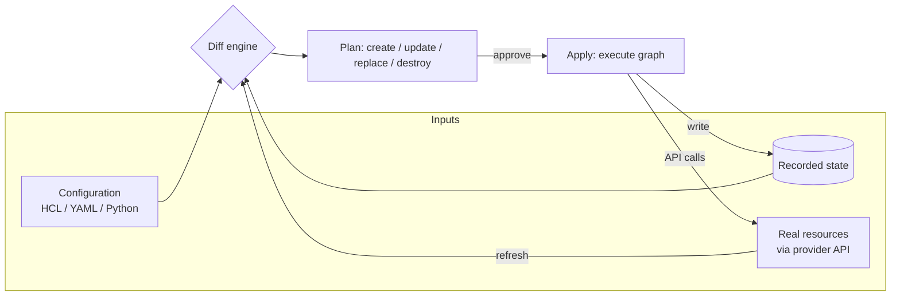
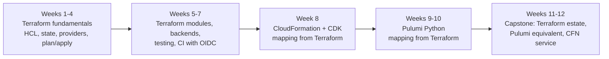
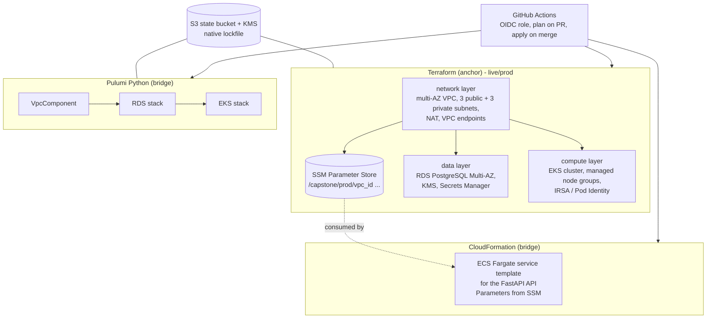

# Cluster 05: Infrastructure as Code

| | |
|---|---|
| **Cluster** | 05 Infrastructure as Code |
| **Anchor** | [Terraform](terraform/README.md) |
| **Bridges** | [AWS CloudFormation](cloudformation/README.md), [Pulumi](pulumi/README.md) |
| **Core unifying pattern** | Declarative DAG state graphs, drift detection, modules |
| **Prerequisites** | Cluster 00 (Git, Bash, Linux), Cluster 01 AWS (IAM, VPC, S3, KMS, RDS, EKS) |
| **Capstone phase** | Phase 2 (Months 5-8) |
| **Time budget** | ~80 hours of the 160-hour Phase 2 window |

> Infrastructure as Code (IaC) turns cloud infrastructure into reviewable, versioned, testable source. After this cluster you will be able to design a modular Terraform estate with locked remote state, read and write a CloudFormation template or CDK app without hesitation, write the same infrastructure as a Pulumi Python program, and explain exactly what every tool is doing when it "plans" and "applies". The capstone deliverable is a multi-AZ VPC, a managed Postgres database, and a container cluster provisioned with Terraform, plus an equivalent Pulumi stack and a CloudFormation template for one service.

---

## 1. What Infrastructure as Code Is

Before IaC, infrastructure was built by clicking through consoles and running ad-hoc scripts. Nobody could answer "what is actually deployed?", changes were irreversible, environments drifted apart, and the only documentation was the memory of whoever built it. Imperative scripts (`aws ec2 run-instances ...`) helped with repeatability but not with idempotency: running the script twice created two of everything.

Every tool in this cluster rests on three ideas. Learn them once in Terraform and you have learned them everywhere.

### 1.1 Desired state, not steps

You describe the end state (a VPC with three private subnets, an RDS instance with encryption enabled) and the tool is responsible for working out which API calls get the real world from its current state to the desired one. You never write "create subnet"; you write "a subnet exists with these properties".

### 1.2 Plan equals diff

The tool holds a record of what it last created (Terraform's state file, CloudFormation's stack, Pulumi's checkpoint). A **plan** is a three-way diff between:

1. the desired configuration you just wrote,
2. the recorded state of what the tool previously created, and
3. the real resource as read back from the cloud API (the refresh).

The output of the diff is a set of operations per resource: create, update in place, replace (destroy then create, or create then destroy), destroy, or no-op. Reading plans fluently is the single most important IaC skill; a plan is the pull-request artefact that reviewers approve.



### 1.3 DAG execution

Resources reference each other: the subnet needs the VPC's ID, the route table needs the subnet's ID, the RDS instance needs the subnet group and the security group. Those references form a **directed acyclic graph** (DAG). The engine walks the graph: anything with no unsatisfied dependencies runs in parallel, dependents wait. Destroy walks the graph in reverse. When you understand that every tool is building and walking a DAG, questions like "why did it create these two at the same time?", "why can't I reference that attribute?", or "why does a cycle error appear?" answer themselves.

### 1.4 The two corollaries: drift and modules

- **Drift** is any difference between recorded state and the real world caused by something other than the tool (a console click, an auto-scaling event, a security team's emergency fix). Every tool offers a way to detect drift (refresh-only plan, `detect-stack-drift`, `pulumi refresh`); none can prevent it without IAM guardrails.
- **Modules** are the unit of reuse. A module takes inputs, creates a sub-graph of resources, and exposes outputs. Terraform modules, CloudFormation nested stacks and CDK constructs, and Pulumi ComponentResources are the same idea with different ergonomics.

---

## 2. Comparison Matrix

| Dimension | Terraform (anchor) | AWS CloudFormation | Pulumi |
|---|---|---|---|
| **Language** | HCL (declarative DSL) plus JSON; optional CDK for Terraform (CDKTF) | YAML or JSON templates; AWS CDK (TypeScript, Python, Java, Go, .NET) synthesises templates; SAM is a transform | General-purpose languages: Python, TypeScript/JavaScript, Go, C#, Java, YAML |
| **State model** | Client-side state file (JSON) in a backend you choose | Server-side; AWS owns and manages the stack state, no state file to protect | Client-side checkpoint (JSON) in Pulumi Cloud or a self-managed backend |
| **State locking** | Backend-dependent: S3 native lock file (`use_lockfile`), legacy DynamoDB table, GCS and Azure Blob native leases, HCP Terraform | Implicit: AWS serialises operations per stack, `*_IN_PROGRESS` status blocks concurrent updates | Pulumi Cloud and S3/GCS/Azure backends lock per stack; `file://` backend locks locally |
| **Providers / coverage** | 4,000+ providers (AWS, Azure, GCP, Kubernetes, GitHub, Datadog, Vault, ...); AWS features typically land in days to weeks | AWS only (plus third-party resource types via the Registry); new AWS features sometimes lag but are first-party supported | Native providers for the major clouds plus the ability to bridge any Terraform provider; coverage effectively equals Terraform's |
| **Modules / reuse** | Modules (local, Git, registry), semantic versioning, `terraform-aws-modules` ecosystem | Nested stacks, CloudFormation Modules (Registry), CDK constructs L1/L2/L3, Construct Hub | ComponentResources, language packages (PyPI, npm), Pulumi Registry, multi-language components |
| **Testing** | `terraform test` (`.tftest.hcl`, unit and integration via `command = plan/apply`), Terratest (Go), `validate`, `fmt` | `cfn-lint`, `cfn-guard`, TaskCat, CDK assertions library (`Template.fromStack`), `cdk-nag` | Native unit tests with mocks in your language's test framework (pytest, Jest), property testing, integration tests via Automation API |
| **Policy as code** | Sentinel (HCP Terraform), OPA/Conftest on plan JSON, Checkov, Trivy, tflint | `cfn-guard` rules, CloudFormation Hooks (pre-provision), `cfn-nag`, Checkov | CrossGuard policy packs (Python/TypeScript/OPA), Checkov on preview output |
| **Drift detection** | `terraform plan -refresh-only`; HCP Terraform scheduled drift runs | `detect-stack-drift` API and console; limited to supported resource types/properties | `pulumi refresh`; Pulumi Cloud scheduled drift detection and remediation |
| **Import existing** | `import` blocks (declarative, with `-generate-config-out`), `terraform import` CLI | Resource import via `IMPORT` change set; IaC Generator scans an account and writes templates | `pulumi import` (generates code), `import=` resource option |
| **Rollback semantics** | None built in. A failed apply leaves a partially applied state; you fix and re-apply (or `git revert` and apply) | Automatic rollback to the last known-good state on failure (can be disabled with `--disable-rollback`); `UPDATE_ROLLBACK_FAILED` recovery path | None built in; same model as Terraform: partial state is saved, fix forward or revert code |
| **Secrets handling** | Values marked `sensitive` are redacted from CLI output but **stored in plaintext in state**; `ephemeral` resources/values (1.10+) and write-only arguments (1.11+) keep them out of state; encrypt the backend | `NoEcho` parameters, dynamic references to Secrets Manager / SSM (`{{resolve:secretsmanager:...}}`) that never materialise in the template; AWS encrypts stack data | Secrets are encrypted in the checkpoint by a per-stack secrets provider (Pulumi Cloud, passphrase, KMS, Vault); `Output.secret()` propagates taint through `apply` |
| **CI integration** | Plan on PR (post plan as comment), apply on merge, OIDC to cloud; HCP Terraform VCS-driven runs; Atlantis; Terragrunt | `aws cloudformation deploy` or change sets with manual approval; CodePipeline native; CDK Pipelines; GitHub Actions `aws-actions/aws-cloudformation-github-deploy` | `pulumi/actions` GitHub Action with preview comments; Pulumi Cloud deployments; OIDC to both the cloud and Pulumi Cloud |
| **Licensing** | **BSL 1.1** since August 2023 (free to use, cannot embed in a competing commercial product). **OpenTofu** is the Linux Foundation MPL-2.0 fork that stays CLI-, language-, and state-compatible for 1.5-era features and adds its own (state encryption, early variable evaluation) | Proprietary AWS service, no charge beyond the resources created (Hooks and some Registry types have charges); CDK is Apache-2.0 | Apache-2.0 CLI and SDKs; Pulumi Cloud is a commercial SaaS with a free individual tier; self-managed backends are free |
| **Where it is weak** | HCL cannot express complex logic cleanly; state is a liability you must protect; no rollback; BSL licence concerns | AWS-only; slow updates on large stacks; 500-resource stack limit; rollbacks can wedge; YAML verbosity | Smaller community; Output plumbing has a learning curve; Pulumi Cloud lock-in concerns if you use ESC/Deployments heavily; some bridged providers lag upstream |

---

## 3. Anchor-and-Bridge Vocabulary Mapping

Learn the left column deeply in Terraform. The other two columns are translations, not new concepts.

| Terraform | CloudFormation (and CDK) | Pulumi |
|---|---|---|
| `resource "aws_vpc" "main" {}` | `Resources: Main: Type: AWS::EC2::VPC` (CDK: `ec2.CfnVPC` L1 or `ec2.Vpc` L2) | `aws.ec2.Vpc("main", ...)` |
| Root module (working directory) | Template | Project (`Pulumi.yaml`) |
| Workspace + state file | Stack (state is AWS-managed) | Stack (`Pulumi.<stack>.yaml` + checkpoint) |
| `module "vpc" { source = ... }` | Nested stack (`AWS::CloudFormation::Stack`), CloudFormation Module, CDK construct | `ComponentResource` subclass or a Python package |
| `variable "cidr" {}` + `terraform.tfvars` | `Parameters:` + parameter file / `--parameter-overrides` | `pulumi.Config()` + `Pulumi.<stack>.yaml` |
| `output "vpc_id" {}` | `Outputs:` (with optional `Export:`) | `pulumi.export("vpc_id", vpc.id)` |
| `data "aws_ami" "al2023" {}` | No direct equivalent: SSM/Secrets Manager dynamic references, `Fn::ImportValue`, custom resource (CDK: `*.fromLookup()`) | `aws.ec2.get_ami(...)` / `aws.ec2.get_ami_output(...)` |
| `locals {}` | `Mappings:` and `Conditions:` cover part of the use case | Plain language variables |
| `provider "aws" { region = ... }` | Implicit: the stack's account and region | `aws.Provider("eu", region=...)` + `opts=ResourceOptions(provider=...)` |
| `terraform plan` | `create-change-set` + `describe-change-set` (`cdk diff`) | `pulumi preview` |
| `terraform apply` | `execute-change-set` / `aws cloudformation deploy` (`cdk deploy`) | `pulumi up` |
| `terraform destroy` | `delete-stack` (`cdk destroy`) | `pulumi destroy` |
| `import { to = ... id = ... }` | `IMPORT` change set; IaC Generator | `pulumi import` / `import=` option |
| `depends_on` | `DependsOn` | `depends_on=` |
| `lifecycle { prevent_destroy = true }` | `DeletionPolicy: Retain` + stack policy | `protect=True` |
| `lifecycle { create_before_destroy = true }` | Default behaviour for replacements, governed by `UpdateReplacePolicy` | Default behaviour; `delete_before_replace=True` inverts |
| `lifecycle { ignore_changes = [...] }` | No equivalent | `ignore_changes=[...]` |
| `lifecycle { replace_triggered_by = [...] }` | No equivalent (change a property) | `replace_on_changes=[...]` |
| `count` / `for_each` | `Fn::ForEach` (language extensions transform), `Conditions` | Python `for` loops and comprehensions |
| `terraform_remote_state` / `data` lookups across states | `Fn::ImportValue` of another stack's `Export` | `pulumi.StackReference` |
| `moved {}` block | None: renaming a logical ID replaces the resource | `aliases=[Alias(name="old")]` |
| `terraform plan -refresh-only` | `detect-stack-drift` | `pulumi refresh` |
| `terraform apply -target=` | None | `pulumi up --target` |
| `terraform apply -replace=` | None | `pulumi up --replace` |
| `sensitive = true` | `NoEcho: true` | `Output.secret()` / `pulumi config set --secret` |
| `terraform test` | `cfn-lint`, TaskCat, CDK assertions | pytest with `pulumi.runtime.set_mocks` |
| Sentinel / OPA on plan JSON | `cfn-guard`, CloudFormation Hooks | CrossGuard policy packs |
| Terraform Registry | CloudFormation Registry, Construct Hub | Pulumi Registry |
| `backend "s3" {}` | Not applicable | `pulumi login s3://<BUCKET_NAME>` |
| `terraform state mv/rm` | None (edit template with `DeletionPolicy: Retain`, then remove) | `pulumi state mv/delete` |

---

## 4. Recommended Learning Order



| Step | Folder | Time | Why in this order |
|---|---|---|---|
| 1 | [terraform/](terraform/README.md) files 01-04 | 30 h | Anchor. Internalise desired state, plan-as-diff, the DAG, and state as a liability |
| 2 | [terraform/](terraform/README.md) files 05-07 | 20 h | Production patterns (layered state, OIDC CI, policy), troubleshooting, interview depth |
| 3 | [cloudformation/](cloudformation/README.md) | 12 h | Bridge. Server-side state and rollbacks are the main deltas; CDK makes the mapping to constructs concrete |
| 4 | [pulumi/](pulumi/README.md) | 12 h | Bridge. Same engine model as Terraform with real languages; Outputs are the main new idea |
| 5 | Capstone build | 6 h+ | Provision VPC + RDS + EKS with Terraform; re-express in Pulumi; one service in CloudFormation |

Spend 60 percent of your time in Terraform. If you only have one week, do Terraform files 02, 03 and the first four labs.

---

## 5. Repository Layout Patterns

Every IaC tool ends up with the same three organisational questions: how do you separate environments, how do you share reusable building blocks, and how big is one unit of deployment (one state file / one stack)? The answers below are the patterns the capstone uses.

### 5.1 Environments as directories (preferred), not workspaces

```text
infra/
├── modules/                      # reusable, versioned, no provider config inside
│   ├── vpc/
│   ├── rds-postgres/
│   └── eks-cluster/
├── live/                         # one state file per leaf directory
│   ├── dev/
│   │   ├── network/              # VPC, subnets, NAT, endpoints
│   │   ├── data/                 # RDS, parameter groups, secrets
│   │   └── compute/              # EKS, node groups, IRSA roles
│   ├── staging/
│   │   └── ...
│   └── prod/
│       └── ...
└── global/
    ├── iam/                      # OIDC provider, CI roles
    └── state-backend/            # the S3 bucket and KMS key for state itself
```

Each leaf under `live/` is a separate state file (Terraform), stack (CloudFormation), or stack (Pulumi). This is called **layered state**: network changes rarely, data changes occasionally, compute changes often, and each layer's blast radius is bounded by its own state. Cross-layer references use outputs (`terraform_remote_state`, `Fn::ImportValue`, `StackReference`) or, better, SSM Parameter Store as a neutral contract between layers and between tools.

### 5.2 Why not one giant state?

| Concern | One state for everything | Layered state per environment and domain |
|---|---|---|
| Plan time | Minutes; every plan refreshes every resource | Seconds per layer |
| Blast radius | A typo in a tag can produce a plan that touches the database | Database layer only changes when its directory changes |
| Locking | Everyone queues behind one lock | Teams work on independent layers in parallel |
| Permissions | CI role needs admin over everything | CI role per layer, least privilege |
| Downsides | Simple cross-references | More wiring between layers; need a convention for sharing outputs |

### 5.3 Module versioning contract

- Modules live in their own directory (or repository) and are referenced by **tag** (`?ref=v1.4.0`) or registry version constraint (`version = "~> 1.4"`), never by branch.
- A module never configures a provider; the caller passes providers in.
- A module exposes everything a dependent layer might need as outputs, and validates its inputs.
- Breaking changes bump the major version and ship with a `moved` block or migration note.

### 5.4 The same shape in the bridge tools

| Pattern | Terraform | CloudFormation | Pulumi |
|---|---|---|---|
| Environment separation | Directory per environment, `*.tfvars` | Stack per environment, parameter file per environment | Stack per environment, `Pulumi.<stack>.yaml` |
| Reusable block | Module | Nested stack / CDK construct | `ComponentResource` |
| Cross-layer contract | `terraform_remote_state` or SSM parameter data source | `Fn::ImportValue` or SSM dynamic reference | `StackReference` or `aws.ssm.get_parameter` |
| Unit of deployment | State file | Stack | Stack |

---

## 6. Capstone Deliverable for This Cluster



1. **Terraform**: three layers (network, data, compute) under `live/<env>/`, consuming versioned modules, state in S3 with the native lock file and KMS encryption, GitHub Actions OIDC pipeline that posts the plan on pull requests and applies on merge to `main`.
2. **Pulumi**: the same VPC, RDS, and EKS expressed as a Python project with a `VpcComponent`, KMS secrets provider, S3 backend, and the same OIDC pipeline. This verifies that you have learned the pattern and not the syntax.
3. **CloudFormation**: a single service (the FastAPI API on ECS Fargate) as a template that reads the VPC and subnet IDs from the SSM parameters Terraform wrote, deployed via a change set with manual approval.

Phase 3 (Kubernetes, Argo CD, Backstage) deploys workloads onto the cluster this cluster creates; Phase 5 adds Checkov, Trivy, and Kyverno gates to the same pipelines.

---

## 7. Folder Index

| Folder | Role | Start here |
|---|---|---|
| [terraform/](terraform/README.md) | Anchor | [terraform/README.md](terraform/README.md) |
| [cloudformation/](cloudformation/README.md) | Bridge | [cloudformation/README.md](cloudformation/README.md), "Coming from Terraform" |
| [pulumi/](pulumi/README.md) | Bridge | [pulumi/README.md](pulumi/README.md), "Coming from Terraform" |

Related clusters: [01-cloud](../01-cloud/) for the AWS primitives you will provision, [06-cicd](../06-cicd/) for the GitHub Actions runner model and OIDC, [08-devsecops](../08-devsecops/) for Checkov, Trivy, and Kyverno as IaC gates.
