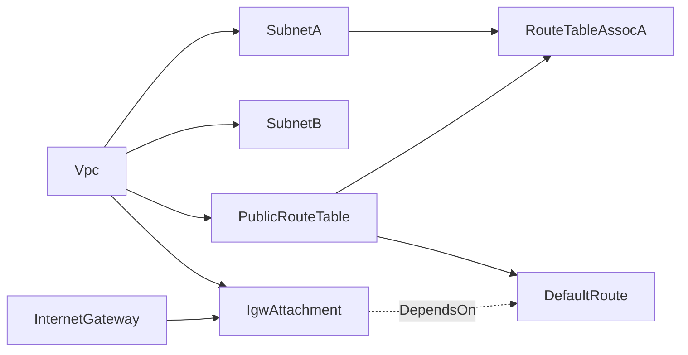
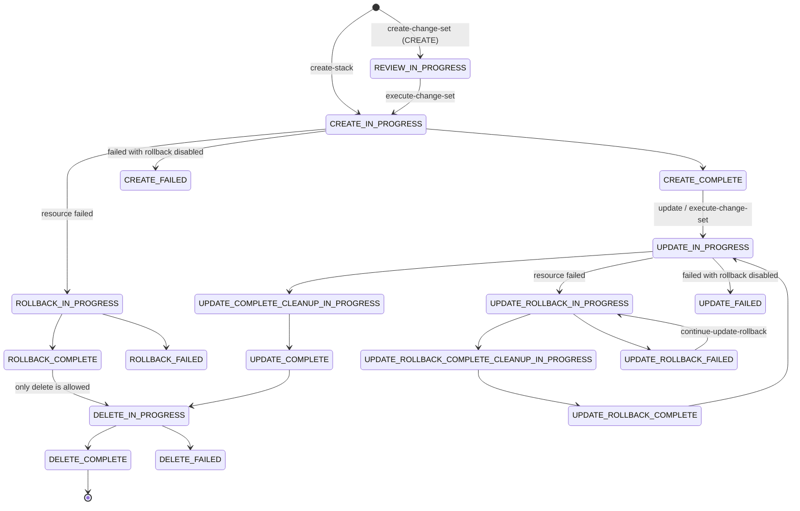
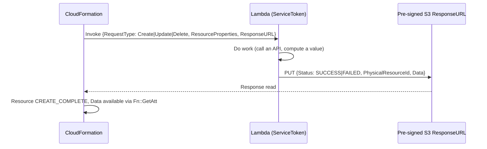
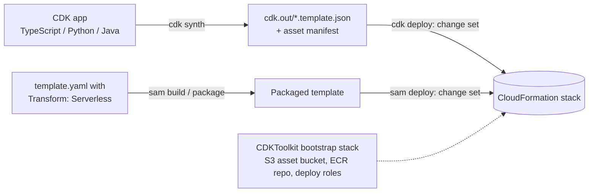

# AWS CloudFormation: Core Concepts

| | |
|---|---|
| **Cluster** | 05 Infrastructure as Code |
| **Role** | Bridge (anchor is [Terraform](../terraform/README.md)) |
| **Prerequisites** | [01-installation-and-setup.md](01-installation-and-setup.md); Terraform [core concepts](../terraform/02-core-concepts.md) |
| **Target version** | CloudFormation service as of 2025-2026 |
| **Capstone phase** | Phase 2 (Months 5-8) |

> This file explains how CloudFormation works inside: how a template becomes a processed template, then a DAG, then a sequence of resource handler calls; how a stack moves through its status state machine; why some updates replace resources; and how rollback, drift, import, composition and extensibility fit together. Each section notes the Terraform concept it maps to so you can reuse what you already know.

---

## 1. Template Anatomy

```yaml
AWSTemplateFormatVersion: "2010-09-09"     # the only valid value; optional but conventional
Description: Incident API service stack     # max 1,024 bytes
Transform: AWS::LanguageExtensions          # optional: macros run before anything else
Metadata:                                   # optional: console parameter grouping, cfn-lint config
  cfn-lint:
    config:
      ignore_checks: []
Parameters: {}                              # inputs (Terraform: variable)
Rules: {}                                   # cross-parameter validation, evaluated before create/update
Mappings: {}                                # static lookup tables (Terraform: a map in locals)
Conditions: {}                              # booleans derived from parameters
Resources: {}                               # REQUIRED: the resources (Terraform: resource)
Outputs: {}                                 # values and optional exports (Terraform: output)
```

JSON and YAML are equivalent. YAML adds short-form tags (`!Ref X` instead of `{ "Ref": "X" }`). A YAML node can carry only one tag, so `!Base64 !Sub "..."` is invalid; write `Fn::Base64: !Sub "..."` instead. Short forms inside a sequence are fine: `!Select [0, !GetAZs ""]`.

---

## 2. Parameters and Rules

```yaml
Parameters:
  Environment:
    Type: String
    AllowedValues: [dev, staging, prod]
    Default: dev
  ContainerImage:
    Type: String
    AllowedPattern: "^[0-9]{12}\\.dkr\\.ecr\\.[a-z0-9-]+\\.amazonaws\\.com/.+@sha256:[a-f0-9]{64}$"
    ConstraintDescription: must be an ECR image pinned by digest
  DesiredCount:
    Type: Number
    MinValue: 1
    MaxValue: 10
    Default: 2
  VpcId:
    Type: AWS::SSM::Parameter::Value<String>
    Default: /capstone/dev/network/vpc_id
  LatestAl2023Ami:
    Type: AWS::SSM::Parameter::Value<AWS::EC2::Image::Id>
    Default: /aws/service/ami-amazon-linux-latest/al2023-ami-kernel-default-x86_64
  AlertEmail:
    Type: String
    NoEcho: true
```

| Type family | Examples | Validation |
|---|---|---|
| Basic | `String`, `Number`, `List<Number>`, `CommaDelimitedList` | `AllowedValues`, `AllowedPattern`, `MinLength`/`MaxLength`, `MinValue`/`MaxValue` |
| AWS-specific | `AWS::EC2::VPC::Id`, `AWS::EC2::Subnet::Id`, `List<AWS::EC2::SecurityGroup::Id>`, `AWS::EC2::KeyPair::KeyName` | CloudFormation checks the ID exists in the account and region |
| SSM parameter types | `AWS::SSM::Parameter::Value<String>`, `...<List<String>>`, `...<AWS::EC2::Image::Id>` | Value is read from Parameter Store **at every create and update**. `SecureString` is not supported here; use dynamic references instead |

Key behaviours:

- **SSM parameter types resolve on each operation.** If the AMI parameter changes, the next stack update picks it up even though the template did not change. Combine with change sets to see the effect before you run it.
- **`NoEcho` masks the value** in `describe-stacks`, the console and events, but it does not encrypt it, and a template that echoes it into `Outputs` or `Metadata` leaks it. Use dynamic references for real secrets (section 12).
- **`Rules`** validate combinations before any resource is touched:

```yaml
Rules:
  ProdNeedsTwoTasks:
    RuleCondition: !Equals [!Ref Environment, prod]
    Assertions:
      - Assert: !Not [!Equals [!Ref DesiredCount, 1]]
        AssertDescription: prod must run at least two tasks
```

---

## 3. Mappings and Conditions

```yaml
Mappings:
  EnvSizing:
    dev:     { Cpu: "256",  Memory: "512",  NatGateways: "1" }
    prod:    { Cpu: "1024", Memory: "2048", NatGateways: "3" }

Conditions:
  IsProd: !Equals [!Ref Environment, prod]
  HasAlertEmail: !Not [!Equals [!Ref AlertEmail, ""]]
  CreateAlarmTopic: !And [!Condition IsProd, !Condition HasAlertEmail]

Resources:
  AlarmTopic:
    Type: AWS::SNS::Topic
    Condition: CreateAlarmTopic           # resource exists only when true
  TaskDefinition:
    Type: AWS::ECS::TaskDefinition
    Properties:
      Cpu: !FindInMap [EnvSizing, !Ref Environment, Cpu]
      Memory: !FindInMap [EnvSizing, !Ref Environment, Memory]
      EphemeralStorage: !If [IsProd, { SizeInGiB: 50 }, !Ref AWS::NoValue]
```

- Mappings are two-level static tables (`TopLevelKey` then `SecondLevelKey`). Values cannot contain intrinsic functions except under `AWS::LanguageExtensions`, which also allows a `DefaultValue` for `Fn::FindInMap`.
- Conditions are evaluated once per operation from parameters and pseudo parameters. A resource that becomes conditionally false on update is **deleted**.
- `!Ref AWS::NoValue` inside `Fn::If` removes the property entirely, which is different from setting it to an empty string.

---

## 4. Intrinsic Functions and Pseudo Parameters

| Function | Returns | Typical use |
|---|---|---|
| `Ref` | Parameter value, or the resource's primary identifier (bucket name, VPC ID, ARN for some types) | `VpcId: !Ref Vpc` |
| `Fn::GetAtt` | A named attribute of a resource | `!GetAtt Bucket.Arn`, `!GetAtt Alb.DNSName` |
| `Fn::Sub` | String with `${Param}`, `${Resource}`, `${Resource.Attr}`, `${AWS::Region}` substituted; `${!Literal}` escapes | ARNs, user data, policy resources |
| `Fn::Join` / `Fn::Split` | Joined string / list from string | Converting SSM comma lists to subnet lists |
| `Fn::Select` | Item N of a list | `!Select [0, !GetAZs ""]` |
| `Fn::GetAZs` | Availability Zones in the region | Subnet placement |
| `Fn::Cidr` | List of CIDR blocks: `!Cidr [ipBlock, count, hostBits]` | `!Cidr [!GetAtt Vpc.CidrBlock, 6, 8]` gives six `/24`s |
| `Fn::FindInMap` | Value from `Mappings` | Per-environment sizing |
| `Fn::If`, `Fn::Equals`, `Fn::And`, `Fn::Or`, `Fn::Not` | Conditional values and condition logic | Optional properties |
| `Fn::ImportValue` | An export from another stack in the same account and region | Cross-stack references |
| `Fn::Base64` | Base64 string | EC2 user data |
| `Fn::Transform` | Invokes a macro on a template snippet | `AWS::Include` |
| `Fn::ForEach`, `Fn::Length`, `Fn::ToJsonString` | Loops, list length, JSON serialisation | Require `Transform: AWS::LanguageExtensions` |

| Pseudo parameter | Value |
|---|---|
| `AWS::AccountId` | `123456789012` |
| `AWS::Region` | `eu-west-1` |
| `AWS::Partition` | `aws`, `aws-cn`, `aws-us-gov`; always use it in ARNs |
| `AWS::URLSuffix` | `amazonaws.com` (differs in China partitions) |
| `AWS::StackName`, `AWS::StackId` | The stack's name and ARN |
| `AWS::NoValue` | Removes the property when returned |
| `AWS::NotificationARNs` | SNS topics attached to the stack |

`Fn::GetAZs` gotcha: in accounts that still have a default VPC, it returns only AZs that have a default subnet. Accounts whose default VPC was deleted get all AZs. Pin AZs through a parameter when the count matters.

---

## 5. Resources and Resource Attributes

```yaml
Resources:
  Database:
    Type: AWS::RDS::DBInstance
    DeletionPolicy: Snapshot
    UpdateReplacePolicy: Snapshot
    DependsOn: DbParameterGroup
    Metadata:
      cfn-lint:
        config:
          ignore_checks: [W3011]
    Properties: { }
```

| Attribute | Purpose | Terraform analogue |
|---|---|---|
| `Type` | Resource type, `AWS::Service::Resource` or a Registry type such as `MyOrg::Service::Thing` | Resource type |
| `Properties` | Configuration, validated against the type's JSON schema | Arguments |
| `DependsOn` | Adds an explicit edge when no `Ref`/`GetAtt`/`Sub` implies one | `depends_on` |
| `DeletionPolicy` | `Delete` (default for most), `Retain`, `RetainExceptOnCreate`, `Snapshot` (RDS, EBS, ElastiCache, Redshift, Neptune, DocumentDB) | `prevent_destroy` (stronger: the resource survives stack deletion) |
| `UpdateReplacePolicy` | What happens to the **old** physical resource when an update replaces it: `Delete`, `Retain`, `Snapshot` | No direct analogue |
| `CreationPolicy` | Wait for N success signals (`cfn-signal`) before marking `CREATE_COMPLETE` | Provisioner wait loops |
| `UpdatePolicy` | Rolling or replacing updates for Auto Scaling groups, Lambda alias CodeDeploy hooks, OpenSearch upgrades | `instance_refresh` on ASGs |
| `Condition` | Create the resource only if the condition is true | `count = var.x ? 1 : 0` |
| `Metadata` | Arbitrary data, `AWS::CloudFormation::Init` for cfn-init, cfn-lint suppressions | None |

Defaults to know: `AWS::RDS::DBCluster` and standalone `AWS::RDS::DBInstance` default to `DeletionPolicy: Snapshot`. Everything else defaults to `Delete`. `RetainExceptOnCreate` retains the resource on stack deletion but deletes it if the stack creation that made it rolls back, so a failed first deploy does not leave orphans behind.

---

## 6. The Dependency Graph

CloudFormation builds a DAG from implicit references (`Ref`, `Fn::GetAtt`, `Fn::Sub` that names a resource) and explicit `DependsOn`. Independent resources are created in parallel; dependents wait for `CREATE_COMPLETE` of their dependencies. Delete walks the graph in reverse.



The dotted edge is the classic case where `DependsOn` is needed: the default route references the gateway ID but not the attachment, so without `DependsOn` the route can be created before the gateway is attached and fail.

Circular references fail validation with `Circular dependency between resources: [...]`. The usual fix is to break a security-group cycle into separate `AWS::EC2::SecurityGroupIngress` resources, the same fix as in Terraform.

cfn-lint can render the graph: `cfn-lint --build-graph template.yaml` writes a `.dot` file.

---

## 7. The Stack Lifecycle



The states that cause most of the trouble:

| Status | Meaning | Way out |
|---|---|---|
| `ROLLBACK_COMPLETE` | The **first** create failed and was rolled back. The stack is empty but exists | Delete the stack, then create again. It cannot be updated |
| `UPDATE_ROLLBACK_COMPLETE` | An update failed and the stack is back on the previous template | Normal and healthy; fix the template and update again |
| `UPDATE_ROLLBACK_FAILED` | Rollback itself failed, usually because something changed or was deleted outside CloudFormation | Fix the underlying cause, then `continue-update-rollback`, optionally `--resources-to-skip` |
| `CREATE_FAILED` / `UPDATE_FAILED` | You used `--disable-rollback` (or `--on-failure DO_NOTHING`) and a resource failed | Fix and update again, or `rollback-stack` |
| `DELETE_FAILED` | A resource could not be deleted (non-empty bucket, ENI still attached, dependency outside the stack) | Fix the cause and delete again, or `delete-stack --retain-resources` |
| `*_IN_PROGRESS` | Operation running; no other operation is accepted | Wait, or `cancel-update-stack` during `UPDATE_IN_PROGRESS` |

**Cleanup phase.** When an update replaces a resource, CloudFormation creates the new one first, repoints dependents, and deletes the old one only in `UPDATE_COMPLETE_CLEANUP_IN_PROGRESS`. This is why replacements are create-before-destroy by default, and why a fixed physical name (`BucketName: my-bucket`) makes a replacement fail: the new resource cannot take a name the old one still holds.

---

## 8. Updates, Replacement and Change Sets

Every property in the template reference has an **update requires** value:

| Update behaviour | Effect | Example |
|---|---|---|
| No interruption | Updated in place, no downtime | S3 bucket tags, Lambda memory |
| Some interruption | Updated in place with a restart or brief outage | EC2 `InstanceType` (stop/start), RDS `DBInstanceClass` |
| Replacement | New physical resource, new ID, old one deleted in cleanup | RDS `DBInstanceIdentifier`, S3 `BucketName`, EC2 `ImageId`, subnet `CidrBlock` |

A **change set** computes these effects before you commit:

```text
Action   LogicalResourceId  ResourceType            Replacement  Scope        Details
Modify   AppDatabase        AWS::RDS::DBInstance    True         Properties   DBInstanceIdentifier (Static, Requires Replacement)
Modify   AppTaskDef         AWS::ECS::TaskDefinition True        Properties   ContainerDefinitions
Modify   AppService         AWS::ECS::Service       False        Properties   TaskDefinition (Dynamic)
```

- `Replacement: Conditional` means it depends on a value that is only known during execution (for example a `Ref` to a resource that is itself replaced).
- `Evaluation: Dynamic` means CloudFormation cannot tell until runtime.
- Change sets do not show changes caused by drift, and they cannot predict a failure. They are a diff, not a dry run.
- Since 2023 change sets can show property-level before and after values (`describe-change-set --include-property-values`).
- Change sets are stored server-side, expire when another change set for the same stack is executed, and can be created for a new stack (`--change-set-type CREATE`) or an import (`IMPORT`).
- `--include-nested-stacks` produces a hierarchy of change sets so nested changes are reviewable.

`aws cloudformation deploy` creates and executes a change set in one step. Use `--no-execute-changeset` to stop after creation for review.

---

## 9. Rollback Mechanics

- **Automatic rollback** is the default for create and update. On create failure you also choose `--on-failure ROLLBACK | DELETE | DO_NOTHING`.
- **`--disable-rollback`** keeps successfully created resources in place so you can debug or retry quickly. The stack lands in `CREATE_FAILED` or `UPDATE_FAILED`. Use it in development, never in a production pipeline.
- **`rollback-stack`** rolls back a stack in `*_FAILED` after you finished debugging.
- **Rollback triggers** monitor up to five CloudWatch alarms during the update and for `MonitoringTimeInMinutes` afterwards (0-180). If an alarm fires, CloudFormation rolls back even though every resource succeeded, which gives you canary-style protection for infrastructure changes.
- **What rollback cannot undo**: data written to a database, objects put in a bucket, side effects of custom resources, and any resource with `DeletionPolicy: Retain`.

---

## 10. Outputs, Exports and Cross-Stack Contracts

```yaml
Outputs:
  VpcId:
    Description: VPC for application stacks
    Value: !Ref Vpc
    Export:
      Name: !Sub "${AWS::StackName}-VpcId"
```

Another stack uses `!ImportValue network-dev-VpcId`. Exports are unique per account and region, and **an export cannot be changed or deleted while any stack imports it**. This keeps references consistent but also locks the producer stack: renaming the VPC's logical ID or deleting the network stack is blocked until every consumer is changed.

The alternative used throughout this wiki is an **SSM Parameter Store contract**: the producer (Terraform or a CloudFormation stack) writes `/capstone/dev/network/vpc_id` and consumers read it through an SSM parameter type. Producer and consumer are loosely coupled, the contract works across tools, and nothing blocks the producer. The trade-off is that nothing stops a consumer from breaking when the producer changes. See [05-production-patterns.md](05-production-patterns.md#3-cross-stack-contracts).

---

## 11. Composition: Nested Stacks, Modules, Macros

| Mechanism | What it is | When to use |
|---|---|---|
| Nested stack (`AWS::CloudFormation::Stack`) | A child stack created from a `TemplateURL` in S3; parent passes `Parameters`, reads `!GetAtt Child.Outputs.X` | Breaking a large template past the 500-resource limit; reusable building blocks deployed as one unit |
| Registry module (`Org::Name::Thing::MODULE`) | A template fragment registered in the Registry and expanded into the parent at deploy time, with resources keeping their own logical IDs | Org-wide standard snippets (a compliant bucket) without separate child stacks |
| Macro (`AWS::CloudFormation::Macro`) | A Lambda function that rewrites the template before processing | Custom DSL features; needs `CAPABILITY_AUTO_EXPAND` |
| `AWS::Include` transform | Inserts a YAML/JSON snippet stored in S3 | Shared boilerplate |
| `AWS::LanguageExtensions` transform | AWS-provided macro adding `Fn::ForEach`, `Fn::Length`, `Fn::ToJsonString`, intrinsic functions in `DeletionPolicy` | Loops without CDK |
| `AWS::Serverless-2016-10-31` (SAM) | Expands `AWS::Serverless::Function`, `Api`, `StateMachine` into many native resources | Serverless applications |

`Fn::ForEach` example:

```yaml
Transform: AWS::LanguageExtensions
Resources:
  Fn::ForEach::LogBuckets:
    - Purpose
    - [Access, Audit]
    - "${Purpose}LogBucket":
        Type: AWS::S3::Bucket
        Properties:
          Tags:
            - Key: purpose
              Value: !Ref Purpose
```

This produces `AccessLogBucket` and `AuditLogBucket`. Nested stacks are updated only through the root stack, and each nested stack has its own events, which you need to read when the root reports `Embedded stack ... was not successfully updated`.

---

## 12. Secrets and Dynamic References

Dynamic references are resolved by CloudFormation at execution time. The secret value does not appear in the template, the parameters or `describe-stacks`.

```yaml
MasterUserPassword: "{{resolve:secretsmanager:capstone/dev/db-master:SecretString:password}}"
ImageTag: "{{resolve:ssm:/capstone/dev/api/image_tag}}"
LegacyToken: "{{resolve:ssm-secure:/capstone/dev/legacy-token:3}}"   # supported only by specific properties
```

Better still, avoid handing a secret to CloudFormation at all. RDS `ManageMasterUserPassword: true` makes RDS generate and rotate the password in Secrets Manager, and ECS task definitions reference secrets by ARN so the container receives them at runtime.

---

## 13. Drift, Import, IaC Generator and Refactoring

**Drift detection** (`detect-stack-drift`) compares each supported resource's current configuration with the **properties explicitly set in the template**. Properties you did not set are not checked, unlike a Terraform refresh, which compares every attribute in state. Resource drift statuses are `IN_SYNC`, `MODIFIED`, `DELETED` and `NOT_CHECKED`; the stack is `DRIFTED` if any resource is. Drift detection reports and never fixes. To fix, either update the template to match reality or update the stack to push the template back.

**Resource import** adopts an existing resource into a stack through an `IMPORT` change set. Rules: the template must add only the imported resources (no other changes), each imported resource must have a `DeletionPolicy`, and you supply the identifier (`BucketName`, `DBInstanceIdentifier`). `create-change-set --import-existing-resources` can also adopt resources that have custom names during a normal create or update.

**IaC generator** scans an account (`start-resource-scan`), lets you select discovered resources, and writes a template (`create-generated-template`) that you can import into a new stack: a way to bring ClickOps estates under management.

**Stack refactoring** (2025) moves resources between stacks and renames logical IDs without replacing anything. It is the CloudFormation answer to Terraform's `moved` block and `terraform state mv`.

---

## 14. Extensibility: Custom Resources, Registry, Hooks



- **Custom resources** (`Custom::Name` or `AWS::CloudFormation::CustomResource`) call a Lambda function or SNS topic. The function **must** respond to the URL even when it fails, or the stack waits until the timeout: one hour by default, configurable with `ServiceTimeout`. If an update returns a new `PhysicalResourceId`, CloudFormation sends a `Delete` for the old ID during cleanup. The response body is limited to 4,096 bytes.
- **Registry resource types** are full resource providers (schema plus CRUDL handlers) published privately or publicly. Third parties such as Datadog and MongoDB Atlas publish types, so CloudFormation can manage some non-AWS resources.
- **Hooks** run before provisioning on resources, stacks or change sets and either fail (`FailureMode: FAIL`) or warn (`WARN`). Guard hooks evaluate cfn-guard rules stored in S3; Lambda hooks call your function. Hooks are server-side and apply to every stack in the account and region, including stacks deployed outside your pipeline.

---

## 15. StackSets

A StackSet deploys one template as **stack instances** across many accounts and regions from an administrator account.

| Permission model | How access works | Use when |
|---|---|---|
| Self-managed | You create `AWSCloudFormationStackSetAdministrationRole` in the admin account and `AWSCloudFormationStackSetExecutionRole` in each target | No AWS Organizations, or targeting accounts outside the org |
| Service-managed | AWS Organizations trusted access; target organisational units; optional **auto-deployment** to new accounts; delegated administrator supported | Org-wide baselines: CloudTrail, Config, GuardDuty, IAM roles, SSM parameters |

Operation preferences control blast radius: `MaxConcurrentPercentage`, `FailureTolerancePercentage`, `RegionConcurrencyType: SEQUENTIAL | PARALLEL` and region order. Each stack instance is a normal stack in the target account, with its own events and drift status.

---

## 16. CDK and SAM: Generators, Not Replacements



- **CDK** constructs come in three levels: L1 (`CfnBucket`, one-to-one with CloudFormation), L2 (`Bucket`, with secure defaults and helper methods such as `grant_read`), and L3 patterns (`ApplicationLoadBalancedFargateService`). `cdk synth` produces plain CloudFormation, `cdk diff` is a change set preview, and `cdk deploy` executes through change sets. Every CDK stack is a CloudFormation stack, so this whole file applies to CDK too.
- **`cdk bootstrap`** creates a `CDKToolkit` stack per account and region containing the asset bucket, an ECR repository and the roles CDK assumes to deploy.
- **SAM** is a transform plus a CLI. The transform expands serverless shorthand into Lambda functions, IAM roles, permissions and API Gateway resources; the CLI adds `sam local` testing and packaging.

When something goes wrong in CDK or SAM, read the synthesised or processed template. The CloudFormation error refers to its logical IDs, not to your source code.

---

## 17. Quotas That Shape Design

| Quota | Value | Design consequence |
|---|---|---|
| Resources per stack | 500 | Split by lifecycle, or use nested stacks |
| Parameters / Outputs / Mappings per template | 200 each | Prefer SSM contracts over dozens of parameters |
| Template body in the API request | 51,200 bytes | Larger templates must be uploaded to S3 (`--s3-bucket` with `deploy`, or `package`) |
| Template body from S3 | 1 MB | Nested stacks or CDK for very large estates |
| Stacks per account per region | 2,000 (adjustable) | StackSets and per-team accounts at scale |
| Custom resource response | 4,096 bytes | Return identifiers, not payloads |

Check current values in the Service Quotas console. Some of these limits have been raised over time.

Next: [03-commands-and-cheatsheet.md](03-commands-and-cheatsheet.md).
