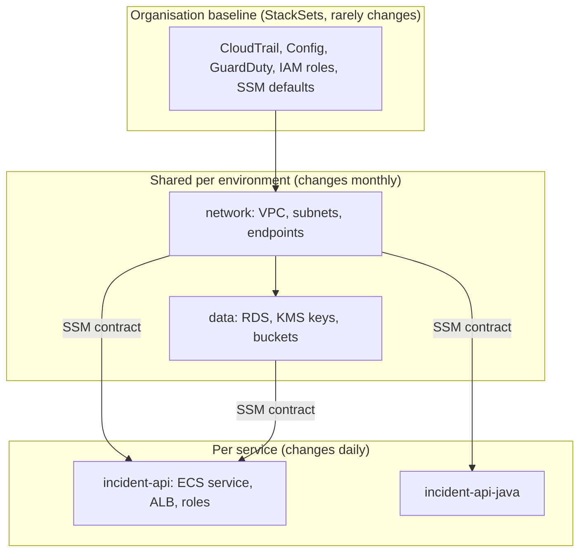
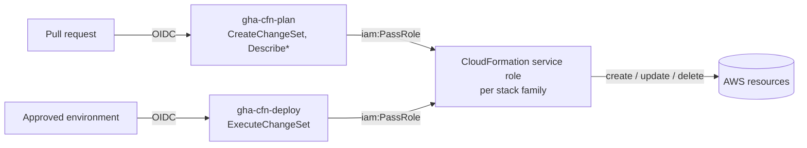
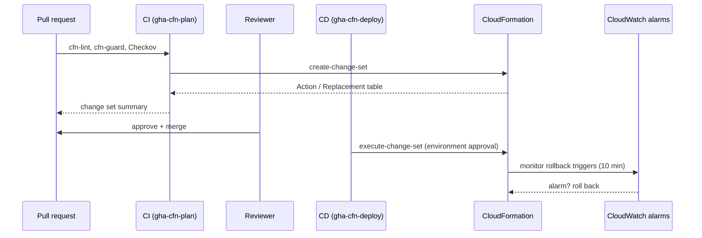

# AWS CloudFormation: Production Patterns

| | |
|---|---|
| **Cluster** | 05 Infrastructure as Code |
| **Role** | Bridge (anchor is [Terraform](../terraform/README.md)) |
| **Prerequisites** | [02-core-concepts.md](02-core-concepts.md), [04-hands-on-labs.md](04-hands-on-labs.md) Labs 1-8; Terraform [production patterns](../terraform/05-production-patterns.md) |
| **Target version** | CloudFormation service as of 2025-2026; AWS CDK v2 |
| **Capstone phase** | Phase 2 (Months 5-8), revisited in Phase 5 for policy gates |

> How teams run CloudFormation at scale without outages or wedged stacks: how to draw stack boundaries, separate identities, choose cross-stack contracts, protect stateful resources, ship changes safely, enforce policy before and inside AWS, manage drift, roll out across accounts with StackSets, and run CDK responsibly. It ends with anti-patterns and a decision checklist for reviewing a template.

---

## 1. Stack Boundaries: Split by Lifecycle and Ownership

The unit of blast radius is the stack. Every update locks the whole stack, every rollback covers the whole stack, and every resource shares one permission set.



| Guideline | Why |
|---|---|
| Separate stacks for network, data and each service | A service deploy can never replace a database; a failing service update cannot block a network fix |
| One owning team per stack | Permissions and review match ownership |
| Keep stacks well below 500 resources | Large stacks update slowly, roll back slowly and are hard to review |
| Name stacks `<system>-<env>-<component>` (`capstone-dev-incident-api`) | IAM policies and pipelines can scope on the prefix (Lab 8 uses `stack/capstone-*/*`) |
| Stateful resources live in long-lived stacks with termination protection | Deleting a service stack must not be able to touch data |

Nested stacks reduce the size of a single template but **do not** reduce blast radius: the whole tree updates and rolls back together. Use nested stacks for reuse within one lifecycle, and separate root stacks for separate lifecycles.

---

## 2. Identity: Three Roles, Not One



- **Service roles (`--role-arn`)** are the only principals that create resources. Scope each one to the resource types and name prefixes of its stack family. The stack remembers its role, so later operations, including deletes started from the console, use it.
- **Pipeline roles** can only propose (create change sets) or execute. They cannot call EC2 or S3 directly, so a compromised workflow cannot bypass the template review.
- **Humans** get read-only access to production stacks, plus a break-glass role.
- **Pass-role conditions**: restrict `iam:PassRole` with `iam:PassedToService: cloudformation.amazonaws.com`.
- **Templates that create IAM** should attach a permissions boundary to every role they create, and the service role should be allowed to create roles only with that boundary (`iam:PermissionsBoundary` condition). This stops privilege escalation through the template.
- CloudFormation tags supported resources with `aws:cloudformation:stack-name`, `stack-id` and `logical-id`. Some teams use those tags in SCPs or IAM conditions to deny modification of stack-managed resources by anyone except service roles. Check per service that tag-based conditions are supported before you rely on it.

---

## 3. Cross-Stack Contracts

| Mechanism | Coupling | Producer can change freely? | Cross-tool | Cross-region/account | Use for |
|---|---|---|---|---|---|
| `Export` + `Fn::ImportValue` | Strong, enforced | No: blocked while imported | No | No | Small, stable sets of IDs inside one team's estate |
| SSM parameter + SSM parameter type | Loose, by convention | Yes | Yes (Terraform, Pulumi, CDK, apps) | Via replication or a custom lookup | **Default in this wiki**: network and data layer outputs |
| Nested stack outputs (`!GetAtt Child.Outputs.X`) | Inside one tree | Yes (same deployment) | No | No | Composition within a single lifecycle |
| Parameters supplied by the pipeline | Explicit | Yes | Yes | Yes | Values that differ per deployment (image digest) |

Conventions for SSM contracts:

- Path: `/<system>/<env>/<layer>/<name>` (`/capstone/dev/network/private_subnet_ids`).
- Lists are comma-separated `String` values that consumers turn into lists with `!Split`.
- The producer owns the parameter and the consumer only reads it. Document the contract next to the producer.
- SSM parameter types re-resolve on every update. A producer change reaches consumers on their **next** deploy, not immediately. Run the consumer pipelines after a producer change, or accept the lag.

---

## 4. Protecting Stateful Resources

| Control | Scope | Protects against | Set in |
|---|---|---|---|
| `DeletionPolicy: Retain` / `Snapshot` | Resource | Stack deletion, resource removed from template | Template |
| `DeletionPolicy: RetainExceptOnCreate` | Resource | Same, but cleans up if the first create fails | Template |
| `UpdateReplacePolicy: Retain` / `Snapshot` | Resource | Losing the old resource when a change forces replacement | Template |
| Stack policy | Stack, per logical ID | Accidental `Update:Replace` / `Update:Delete` in any update | `set-stack-policy` |
| Termination protection | Stack | `delete-stack` | Stack setting |
| Service-level protection | Resource | Everything, including console and API | `DeletionProtection: true` (RDS, ALB, DynamoDB), S3 Object Lock |
| Change set review | Change | Unnoticed `Replacement: True` | Pipeline |

Rules of thumb:

1. Every database, bucket, KMS key, log group with audit value and DynamoDB table gets `DeletionPolicy` **and** `UpdateReplacePolicy`, and both are enforced by a Guard rule.
2. Avoid physical names for resources that might be replaced; let CloudFormation generate them. When a name must be stable for humans, put it in a tag or an SSM parameter.
3. Enable native deletion protection in production as well. It is the only control that also stops console clicks.
4. Stack policies are deny lists for the update path. Keep them minimal and use `--stack-policy-during-update-body` for planned replacements.

---

## 5. Shipping Changes Safely



- **Review the change set, not the diff of the YAML.** The YAML diff hides SSM parameter changes, transform output and conditional effects; the change set shows what will really happen.
- **Fail the pipeline on unexpected replacement.** A simple guard: if any change has `Replacement` = `True` for a type in a protected list (`AWS::RDS::*`, `AWS::S3::Bucket`, `AWS::DynamoDB::Table`, `AWS::KMS::Key`), require an extra approval.
- **Rollback triggers** on the service's error-rate and latency alarms turn an infrastructure deploy into a monitored rollout. Use the alarms from your SLOs (see [../../11-sre/sli-slo-error-budgets/README.md](../../11-sre/sli-slo-error-budgets/README.md)).
- **Workload-level safety** belongs to the service: ECS deployment circuit breaker with rollback, Auto Scaling `UpdatePolicy` with `AutoScalingRollingUpdate` and `MinSuccessfulInstancesPercent`, Lambda aliases with CodeDeploy traffic shifting (SAM `DeploymentPreference`), or ECS blue/green through the `AWS::CodeDeployBlueGreen` transform.
- **Promote the same template.** dev, staging and prod deploy the same template version with different parameter files. Pin images by digest, not tag.
- **Never `--disable-rollback` in production pipelines.** It is a debugging tool.

---

## 6. Policy as Code: Before and Inside AWS

| Stage | Tool | Catches | Bypassable? |
|---|---|---|---|
| Editor | cfn-lint extension | Schema errors, deprecated runtimes | Yes |
| Pull request | cfn-lint, cfn-guard, Checkov, cdk-nag | Insecure defaults, missing tags, policy violations | Only by changing CI |
| Change set creation | CloudFormation Hooks (Guard or Lambda hooks, `FailureMode: FAIL`) | Same rules, enforced server-side for **every** stack in the account and region | Only by an admin |
| After deployment | AWS Config rules, Security Hub, Control Tower detective controls | Drift into non-compliance, console changes | No (detective) |

Use the same Guard rule files in CI and in a Guard hook so developers see in the pull request exactly what the account will enforce. AWS Control Tower's proactive controls are implemented as CloudFormation Hooks, so in a Control Tower estate some of these rules already exist. Phase 5 extends the capstone gates with Checkov on CloudFormation (see [../../08-devsecops/](../../08-devsecops/)).

---

## 7. Secrets

- Never pass secrets as parameters, even with `NoEcho`. Parameter values end up in CI logs, shell history and change set descriptions.
- Prefer services that own their secrets: RDS `ManageMasterUserPassword`, ECS `Secrets` with `ValueFrom` pointing to a Secrets Manager ARN, Lambda reading at runtime.
- Where a property must receive a secret, use `{{resolve:secretsmanager:...}}`. The value is resolved at execution time and is not stored in the template.
- Do not write secrets into `Outputs`, `Metadata` or tags. Outputs are readable by anyone with `DescribeStacks`.
- Custom resources: return secrets with `NoEcho: true` in the response, or better, write them to Secrets Manager and return the ARN.

---

## 8. Drift Management

Drift is inevitable: emergency console fixes, auto-scaling, other automation. Make it visible and decide deliberately.

1. **Detect on a schedule.** The AWS Config managed rule `cloudformation-stack-drift-detection-check` flags drifted stacks, or an EventBridge schedule can run `detect-stack-drift` across stacks.
2. **Triage each drift.** Either the template is wrong (codify the change and deploy) or reality is wrong (revert it, or run a template change that rewrites the property).
3. **Remember the blind spots.** Only explicitly declared properties are checked, and not every resource type supports drift detection. Stacks can be `IN_SYNC` while an undeclared setting is wide open, which is why Config and Security Hub run alongside.
4. **Before a risky update, detect drift first.** Updating a drifted resource is the most common cause of `UPDATE_ROLLBACK_FAILED`.
5. **Resources managed elsewhere**: if autoscaling owns ECS `DesiredCount`, avoid changing `DesiredCount` in the template after creation. CloudFormation sends the template value only when it changes, and that resets the scaled count. The same applies to tags added by other tools.

---

## 9. Multi-Account and Multi-Region with StackSets

- Use **service-managed** StackSets from the management account or a delegated administrator, targeting OUs with **auto-deployment** so new accounts receive the baseline automatically.
- Roll out in waves: `MaxConcurrentPercentage` of 10-25%, `FailureTolerancePercentage: 0`, and a region order that starts with a low-traffic region.
- Keep baseline templates small and boring (roles, Config, CloudTrail, SSM defaults). Application stacks do not belong in StackSets.
- Run drift detection on the StackSet; each instance is a normal stack you can inspect in the target account.
- Retain stacks on account removal (`RetainStacksOnAccountRemoval: true`) for anything security-relevant.
- Larger estates use Customizations for AWS Control Tower (CfCT) or Account Factory customisation, which are built on StackSets.

**Git sync** lets CloudFormation deploy a stack from a template and deployment file in a Git repository through CodeConnections. It suits simple stacks without a pipeline. Use a full pipeline when you need change set review, policy gates and approvals.

---

## 10. Repository and Template Hygiene

```text
infra/cloudformation/
├── incident-api.yaml              # one template per stack family
├── params/
│   ├── dev.json                   # ParameterKey/ParameterValue lists, no secrets
│   ├── staging.json
│   └── prod.json
├── tags/common.json               # stack-level tags, propagated to supported resources
└── tests/
    └── taskcat.yml                # optional: multi-region deploy tests
infra/policies/guard/              # shared with the Guard hook
```

- Run `rain fmt` (or a consistent YAML formatter) so reviews show real changes.
- Stack-level tags propagate to most resources. Set `project`, `env`, `owner`, `cost-center` once at deploy time instead of in every resource.
- Package artefacts (`aws cloudformation package`) into an S3 bucket with versioning and encryption, and give the bucket a lifecycle rule.
- Keep `cfn-lint` suppressions in resource `Metadata` with a comment explaining why, never as global ignores.
- Test templates in a sandbox account with TaskCat, or with a scripted create-and-delete in CI for templates that change often.

---

## 11. CDK in Production

- **Bootstrap with least privilege.** `cdk bootstrap --cloudformation-execution-policies <POLICY_ARN>` replaces the default `AdministratorAccess` execution policy. Use `--trust` only for the pipeline account, and a custom `--qualifier` per team when sharing accounts.
- **Run `cdk-nag`** (AwsSolutions and NIST packs) in unit tests so violations fail `cdk synth`.
- **Snapshot and assertion tests** with `aws_cdk.assertions.Template.from_stack` catch unintended template changes and replacements.
- **Commit `cdk.context.json`** so `fromLookup` results are deterministic in CI and synth does not need AWS read access.
- **Pin `aws-cdk-lib` and the CLI**, upgrade deliberately, and read the synthesised diff on upgrades. Construct changes can alter logical IDs and cause replacements.
- **Review the CloudFormation change set** produced by `cdk deploy --method=prepare-change-set`, not only `cdk diff`.

---

## 12. Anti-Patterns

| Anti-pattern | Consequence | Instead |
|---|---|---|
| One giant stack for the whole environment | Slow updates, every change risks everything, 500-resource ceiling | Stacks per lifecycle and owner |
| Hard-coded physical names everywhere | Replacements fail, stacks cannot be deployed twice in one account | Generated names, SSM for discovery |
| Exports for everything | Producer stacks frozen; deletion order puzzles | SSM contracts for most outputs |
| Pipeline role with `AdministratorAccess` and no service role | Any workflow can do anything, outside templates | Plan/deploy/service role split |
| `--disable-rollback` in CI | Half-built production stacks | Default rollback plus rollback triggers |
| Fixing drift in the console and moving on | Next update fails or silently reverts the fix | Codify or revert, then deploy |
| Custom resources without error handling | Stack hangs for up to an hour, then fails | Always respond; set `ServiceTimeout` |
| Secrets in parameters or outputs | Leaks through logs and `DescribeStacks` | Dynamic references or service-managed secrets |
| Deploying CDK with default bootstrap in production | CloudFormation runs with admin | Custom execution policies |
| Reviewing the YAML diff only | Replacements and SSM-driven changes slip through | Review the change set |

---

## 13. Decision Checklist for a Template Review

- [ ] Stack boundary matches one lifecycle and one owner; well under 500 resources.
- [ ] No hard-coded account IDs, regions or partitions; ARNs use `${AWS::Partition}`.
- [ ] Every stateful resource has `DeletionPolicy` and `UpdateReplacePolicy`; production has native deletion protection.
- [ ] Physical names are absent unless required, and then justified.
- [ ] Inputs come from SSM contracts or parameter files; parameters have types and constraints.
- [ ] No secrets in parameters, outputs, tags or metadata.
- [ ] IAM roles are least privilege, carry a permissions boundary where required, and the stack deploys with a scoped service role.
- [ ] Encryption at rest and in transit, public access blocked, logs with retention.
- [ ] cfn-lint, cfn-guard and Checkov pass in CI; the same Guard rules run as a Hook.
- [ ] Change set reviewed; any `Replacement: True` is intended and approved.
- [ ] Rollback triggers or workload-level safety (circuit breaker, rolling update) are configured.
- [ ] Drift detection is scheduled, and someone owns the result.

Next: [06-troubleshooting.md](06-troubleshooting.md).
