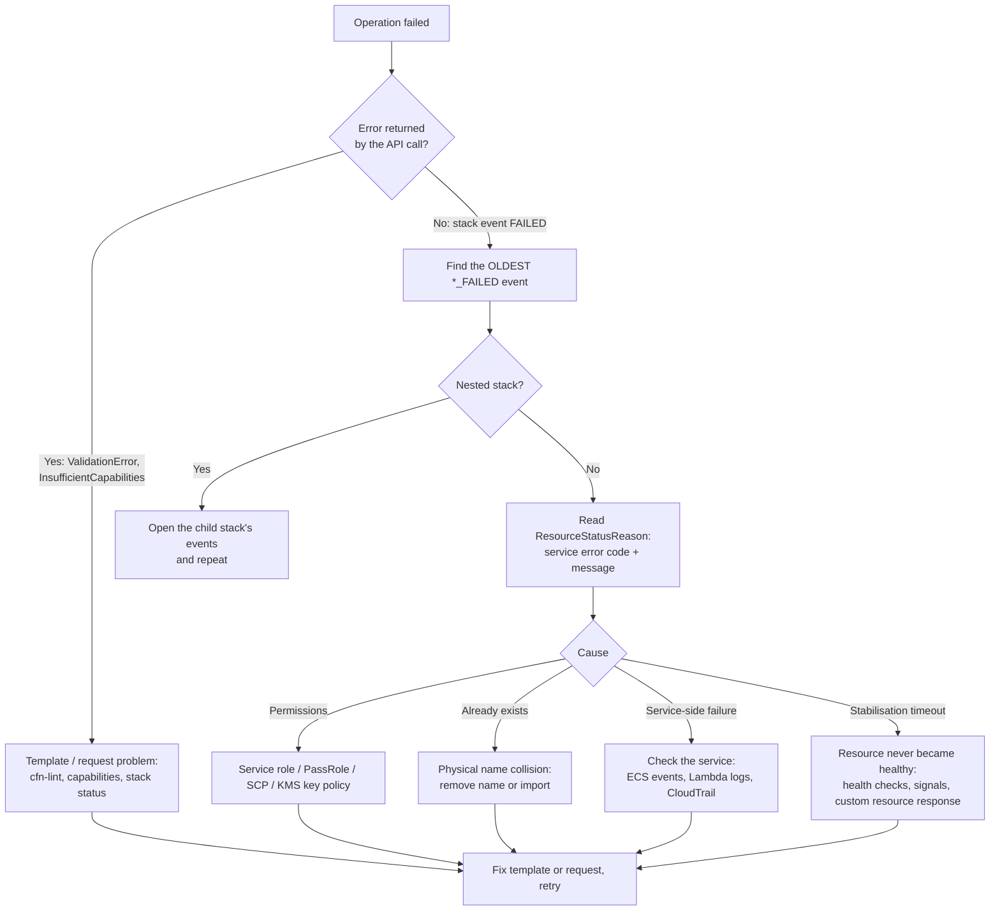

# AWS CloudFormation: Troubleshooting

| | |
|---|---|
| **Cluster** | 05 Infrastructure as Code |
| **Role** | Bridge (anchor is [Terraform](../terraform/README.md)) |
| **Prerequisites** | [02-core-concepts.md](02-core-concepts.md) (stack lifecycle), [03-commands-and-cheatsheet.md](03-commands-and-cheatsheet.md) |
| **Target version** | CloudFormation service as of 2025-2026; AWS CLI v2 |
| **Capstone phase** | Phase 2 (Months 5-8) |

> A debugging workflow, the diagnostic commands to run first, symptom-to-fix tables with the error messages as CloudFormation prints them, and step-by-step recovery for the states that block a stack: `ROLLBACK_COMPLETE`, `UPDATE_ROLLBACK_FAILED`, `DELETE_FAILED` and hung custom resources.

---

## 1. Debugging Workflow



Three rules:

1. **The oldest failure is the cause.** Later events say `Resource creation cancelled` or `Resource update cancelled`; they are consequences.
2. **CloudFormation reports what the service said.** `Resource handler returned message: "..." (Service: Ecs, Status Code: 400, Request ID: ...)` is the downstream API's error. Search for that error, not for CloudFormation.
3. **Check who made the call.** With a service role, CloudFormation calls APIs as that role. CloudTrail shows the `userIdentity` and the exact denied action.

---

## 2. First Diagnostic Commands

```bash
STACK=capstone-dev-incident-api

aws cloudformation describe-stacks --stack-name "$STACK" \
  --query "Stacks[0].[StackStatus,StackStatusReason,RoleARN]" --output text

aws cloudformation describe-stack-events --stack-name "$STACK" \
  --query "StackEvents[?contains(ResourceStatus,'FAILED')].[Timestamp,LogicalResourceId,ResourceType,ResourceStatusReason]" \
  --output table

aws cloudformation list-stack-resources --stack-name "$STACK" \
  --query "StackResourceSummaries[?ResourceStatus!='CREATE_COMPLETE' && ResourceStatus!='UPDATE_COMPLETE'].[LogicalResourceId,ResourceStatus]" \
  --output table

aws cloudformation get-template --stack-name "$STACK" --template-stage Processed > processed.json   # after transforms

aws cloudtrail lookup-events --lookup-attributes AttributeKey=EventName,AttributeValue=CreateService \
  --max-results 5 --query "Events[].CloudTrailEvent" --output text | jq '{user: .userIdentity.arn, error: .errorCode, msg: .errorMessage}'
```

For nested stacks, the physical ID of an `AWS::CloudFormation::Stack` resource is the child stack's ARN. Pass it to `describe-stack-events`.

---

## 3. Template and Request Errors (Before Anything Runs)

| Symptom (verbatim or close) | Likely cause | Diagnose | Fix |
|---|---|---|---|
| `Template format error: Unresolved resource dependencies [Foo] in the Resources block of the template` | `Ref`/`GetAtt` to a misspelt or conditionally absent resource | `cfn-lint` (E3005/E1012) | Fix the name; guard with the same `Condition` or `Fn::If` |
| `Template format error: Circular dependency between resources: [A, B]` | Mutual references, usually security groups or a Lambda role and its function | `cfn-lint --build-graph` | Split rules into `SecurityGroupIngress`/`Egress` resources; break the cycle with a separate policy resource |
| `Template error: instance of Fn::GetAtt references undefined resource Foo` | Same as above for attributes | `cfn-lint` | Fix the logical ID |
| `Encountered unsupported property Foo` | Property not in the type's schema or misspelt (case-sensitive) | `aws cloudformation describe-type --type RESOURCE --type-name <Type>` | Correct the property name; update cfn-lint |
| `Requires capabilities : [CAPABILITY_NAMED_IAM]` (`InsufficientCapabilitiesException`) | Template creates named IAM resources | `validate-template --query Capabilities` | Add `--capabilities CAPABILITY_NAMED_IAM` |
| `Requires capabilities : [CAPABILITY_AUTO_EXPAND]` | Macros, SAM or `AWS::LanguageExtensions` with nested macros | Look for `Transform` | Add `CAPABILITY_AUTO_EXPAND` |
| `Parameters: [Foo] must have values` | Required parameter missing and no `Default` | `get-template-summary` | Pass it or add a default |
| `Parameter 'Foo' must be one of AllowedValues` / `failed to satisfy constraint` | Constraint violation | Read `ConstraintDescription` | Fix the value |
| `Unable to fetch parameters [/capstone/dev/network/vpc_id] from parameter store for this account.` | SSM parameter missing, wrong region, or caller lacks `ssm:GetParameters` | `aws ssm get-parameter --name ...` in the same region | Create the parameter (apply the producer first) or grant `ssm:GetParameters` to the caller |
| `Template may not exceed 51200 bytes in size.` | Template sent inline is too large | `wc -c template.yaml` | Use `--s3-bucket` with `deploy`, or `--template-url` |
| `No updates are to be performed.` | Template and parameters identical to the deployed stack | Expected | Treat as success (`--no-fail-on-empty-changeset`) |
| Change set `FAILED`: `The submitted information didn't contain changes. Submit different information to create a change set.` | Same as above, through change sets | `describe-change-set --query StatusReason` | Treat as success in CI; delete the change set |
| `Stack:arn:... is in ROLLBACK_COMPLETE state and can not be updated.` | First create failed and rolled back | `describe-stacks` | Delete the stack and create it again (section 6.1) |
| `Stack:arn:... is in UPDATE_IN_PROGRESS state and can not be updated.` | Another operation is running | `describe-stacks` | Wait (`aws cloudformation wait stack-update-complete`) or `cancel-update-stack` |
| `User: arn:aws:sts::...:assumed-role/gha-cfn-plan/... is not authorized to perform: iam:PassRole on resource: ...cfn-lab-service-role` | Caller cannot hand the service role to CloudFormation | IAM policy simulator | Grant `iam:PassRole` on that role with `iam:PassedToService` |
| `Rate exceeded` (`Throttling`) | Many parallel describe calls or StackSet operations | CloudTrail | Back off; raise CLI retries (`AWS_MAX_ATTEMPTS=10`, `AWS_RETRY_MODE=adaptive`) |

---

## 4. Resource Errors During Create or Update

| Symptom (verbatim or close) | Likely cause | Diagnose | Fix |
|---|---|---|---|
| `Resource of type 'AWS::S3::Bucket' with identifier 'foo' already exists.` / `... already exists` | Physical name taken by a resource outside the stack, a retained resource, or another stack | `aws s3api head-bucket` / service describe call | Remove the physical name, delete the stray resource, or import it (Lab 6) |
| `CREATE_FAILED ... is not authorized to perform: ec2:CreateVpc ... with an explicit deny in a service control policy` | SCP blocks the action or region | CloudTrail `errorCode: AccessDenied` | Deploy in an allowed region/account, or change the SCP through governance |
| `... is not authorized to perform: kms:GenerateDataKey ... because no identity-based policy allows ...` | Service role or service principal not allowed in the KMS key policy | KMS key policy | Add the role (or the service via `kms:ViaService`) to the key policy |
| `Resource handler returned message: "Invalid request provided: ... The specified subnet ... does not exist"` | Stale SSM contract or wrong account/region | Compare `ResolvedValue` in `describe-stacks` with reality | Re-apply the producer; check the region |
| `Resource handler returned message: "Exceeded attempts to wait"` / `Resource timed out waiting for completion` | Resource never stabilised (ECS tasks failing health checks, RDS still creating) | Service events: `aws ecs describe-services ... --query "services[0].events[:5]"` | Fix the workload (image, port, health path, security group) |
| ECS service `CREATE_FAILED`: `ECS Deployment Circuit Breaker was triggered` | Tasks failed to start or to pass health checks | `aws ecs describe-tasks` `stoppedReason`; container logs | Wrong image digest, `CannotPullContainerError` (no NAT/endpoints), app crashing on read-only filesystem (mount a volume for `/tmp`) |
| `Embedded stack arn:... was not successfully created: The following resource(s) failed to create: [X]` | Failure inside a nested stack | Child stack events | Fix the child resource |
| `CloudFormation did not receive a response from your Custom Resource. Please check your custom resource's log group.` | Lambda crashed, timed out, or had no network path to S3 for the response URL | Lambda logs | Always respond (try/finally); give the function egress or an S3 gateway endpoint |
| `Received response status [FAILED] from custom resource. Message returned: ...` | Handler deliberately reported failure | Lambda logs | Fix the handler logic or inputs |
| `Action denied by stack policy: Statement [#1] does not allow [Update:Replace] for resource [LogicalResourceId/X]` | Stack policy protecting the resource | `get-stack-policy` | Avoid the replacement, or pass `--stack-policy-during-update-body` intentionally |
| `Export foo cannot be updated as it is in use by bar` / `cannot be deleted as it is in use by` | Export locked by an importer | `list-imports --export-name foo` | Migrate consumers first (Lab 5), then change the export |
| `UPDATE_FAILED ... Requested update requires the creation of a new physical resource; hence creating one.` followed by `already exists` | Replacement of a resource with a fixed name | Change set `Replacement: True` | Remove or change the physical name for the replacement |
| `The following hook(s)/validation failed: [MyOrg::Guard::Hook]` | A Hook rejected the resource | Hook invocation details in the console or `describe-stack-events` `HookStatusReason` | Make the template compliant; same rules as CI |

---

## 5. Delete Errors

| Symptom | Likely cause | Fix |
|---|---|---|
| `The bucket you tried to delete is not empty` (`DELETE_FAILED`) | Objects or object versions remain | Empty all versions and delete markers, then delete again; for future stacks, add an emptier custom resource (Lab 7) or `DeletionPolicy: Retain` |
| `resource sg-... has a dependent object` | ENIs from Lambda, ECS or load balancers still attached | Wait for Hyperplane ENIs to release (Lambda can take a while), or delete the dependent outside resource |
| `Network interface is currently in use` | Same, for subnets/ENIs | Wait and retry; find ENIs with `aws ec2 describe-network-interfaces --filters Name=group-id,Values=sg-...` |
| `Export ... cannot be deleted as it is in use by ...` | Consumer stacks still import | Delete or update consumers first |
| `Stack [x] cannot be deleted while TerminationProtection is enabled` | Termination protection | `update-termination-protection --no-enable-termination-protection` (deliberately) |
| `Role arn:...service-role is invalid or cannot be assumed` | The stack's service role was deleted before the stack | Recreate a role with the same ARN, or `delete-stack --role-arn` with another valid role |

---

## 6. Recovery Procedures

### 6.1 `ROLLBACK_COMPLETE` after a first create

The stack is empty and cannot be updated.

```bash
aws cloudformation delete-stack --stack-name "$STACK"
aws cloudformation wait stack-delete-complete --stack-name "$STACK"
# fix the template, then create again
```

In CI, detect this state before `deploy` and delete automatically only for non-production stacks.

### 6.2 `UPDATE_ROLLBACK_FAILED`

Rollback could not restore a resource, typically because it was changed or deleted outside CloudFormation, or a dependency (KMS key, IAM role) is gone.

1. Find the resource and reason: the most recent `UPDATE_FAILED` event during the rollback phase.
2. Fix the underlying cause if you can (recreate the deleted dependency, restore the permission, reset the out-of-band change).
3. Continue the rollback:

   ```bash
   aws cloudformation continue-update-rollback --stack-name "$STACK"
   ```

4. If the resource cannot be restored, skip it. CloudFormation marks it `UPDATE_COMPLETE` without touching it:

   ```bash
   aws cloudformation continue-update-rollback --stack-name "$STACK" --resources-to-skip AppDatabase
   ```

   Nested resources use `NestedStackLogicalId.ResourceLogicalId`. You cannot skip the nested stack resource itself.

5. Run drift detection and reconcile the template with reality before the next update.

### 6.3 `DELETE_FAILED`

```bash
aws cloudformation describe-stack-events --stack-name "$STACK" \
  --query "StackEvents[?ResourceStatus=='DELETE_FAILED'].[LogicalResourceId,ResourceStatusReason]" --output text
# Option A: fix the cause (empty bucket, release ENIs) and delete again
aws cloudformation delete-stack --stack-name "$STACK"
# Option B: keep the stuck resource and finish deleting the stack
aws cloudformation delete-stack --stack-name "$STACK" --retain-resources StuckBucket
# Option C: force-delete the stack, leaving any resources that fail to delete
aws cloudformation delete-stack --stack-name "$STACK" --deletion-mode FORCE_DELETE_STACK
```

Options B and C leave orphaned resources. Tag and track them, or delete them manually.

### 6.4 Stack stuck `*_IN_PROGRESS` on a custom resource

The handler never responded. CloudFormation waits until the custom resource's `ServiceTimeout`, or one hour if none is set.

- If the function still exists, you can send the response yourself: take the `ResponseURL`, `StackId`, `RequestId` and `LogicalResourceId` from the Lambda log line and `curl -X PUT` a JSON body with `"Status": "FAILED"` to the pre-signed URL. Use this only to unstick a stack.
- Otherwise wait for the timeout, then fix the handler so every path responds.

### 6.5 Recovering a resource deleted outside CloudFormation

The next update or rollback fails because the resource is missing. Options: remove it from the template, deploy, and add it back (it is recreated); or recreate it manually with the same identifier and run drift detection; or, if the stack is already in `UPDATE_ROLLBACK_FAILED`, skip it (6.2).

---

## 7. StackSets

| Symptom | Likely cause | Fix |
|---|---|---|
| Instance `OUTDATED` with `Account ... should have 'AWSCloudFormationStackSetExecutionRole' role with trust relationship to Role 'AWSCloudFormationStackSetAdministrationRole'` | Self-managed roles missing or trust wrong | Deploy the execution role in the target; fix the trust policy |
| Operation `FAILED` after a few accounts | `FailureTolerancePercentage: 0` reached | `list-stack-set-operation-results` for per-account reasons; fix and re-run `update-stack-instances` |
| `OperationInProgressException` | Only one operation per StackSet at a time | Wait, or use `--operation-preferences` with managed execution (`--managed-execution Active=true`) to queue non-conflicting operations |
| Instances not created in a new account | Auto-deployment disabled or account outside targeted OU | Enable auto-deployment; check OU membership |
| Errors when running from a delegated admin | Missing `--call-as DELEGATED_ADMIN` | Add the flag |

---

## 8. CDK and SAM Specifics

| Symptom | Likely cause | Fix |
|---|---|---|
| `This stack uses assets, so the toolkit stack must be deployed to the environment` / `SSM parameter /cdk-bootstrap/hnb659fds/version not found` | Account/region not bootstrapped (or wrong qualifier) | `cdk bootstrap aws://<ACCOUNT_ID>/<REGION>` with the right `--qualifier` |
| `cdk diff` shows a resource replaced after a refactor | Construct path changed, so the logical ID changed | Use `overrideLogicalId`, or stack refactoring, or accept the replacement deliberately |
| Synth in CI fails on `fromLookup` | No AWS credentials or missing context | Commit `cdk.context.json` |
| SAM `Error: Failed to create changeset ... Requires capabilities : [CAPABILITY_AUTO_EXPAND]` | Nested applications or macros | `sam deploy --capabilities CAPABILITY_IAM CAPABILITY_AUTO_EXPAND` |
| CloudFormation error names a logical ID you never wrote | Generated by CDK or SAM | Read `cdk.out/*.template.json` or `get-template --template-stage Processed` |

---

## 9. Prevention Checklist

- cfn-lint in the editor and CI, updated regularly.
- No physical names on replaceable resources.
- Drift detection before risky updates.
- Custom resources that always respond, with `ServiceTimeout`.
- Service roles that are never deleted before their stacks.
- `UpdateReplacePolicy` and `DeletionPolicy` on stateful resources.
- Change set review with attention to `Replacement`.

Next: [07-interview-questions.md](07-interview-questions.md).
