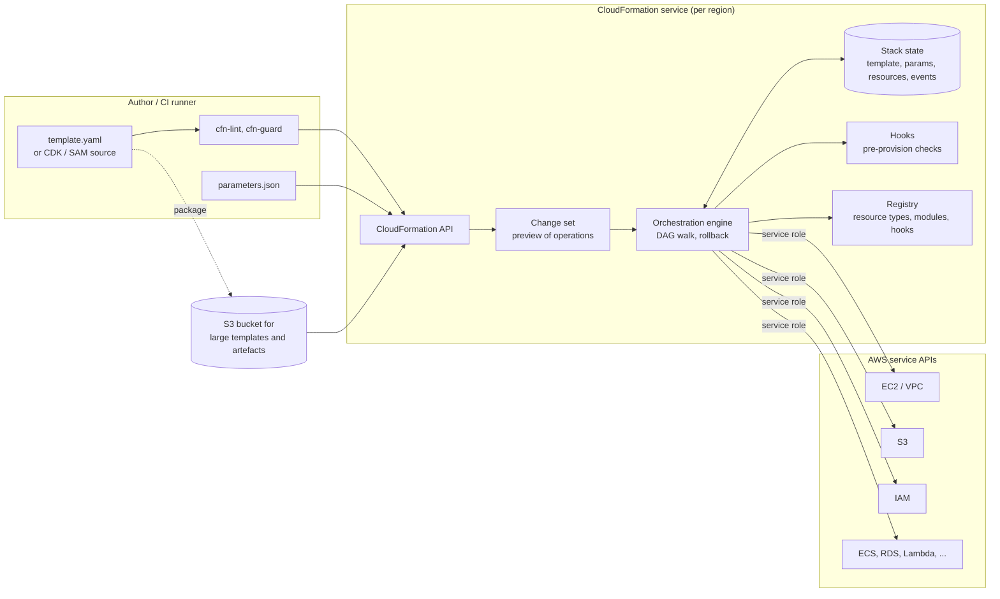
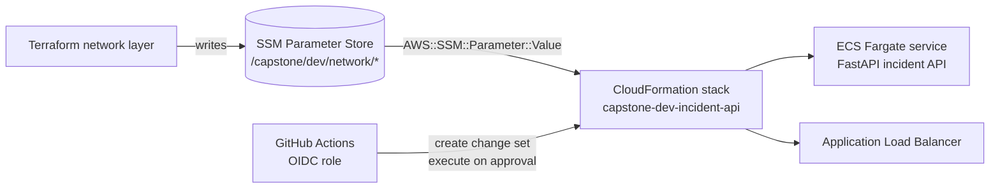

# AWS CloudFormation

| | |
|---|---|
| **Cluster** | 05 Infrastructure as Code |
| **Role** | Bridge (anchor is [Terraform](../terraform/README.md)) |
| **Category** | Infrastructure as Code (AWS-native, declarative, server-side state) |
| **Prerequisites** | Terraform files 01-04 complete; AWS fundamentals (IAM, VPC, S3, KMS, SSM Parameter Store); YAML |
| **Target version** | CloudFormation service as of 2025-2026; AWS CLI v2; cfn-lint 1.x; cfn-guard 3.x; AWS CDK v2; SAM CLI 1.x |
| **Capstone phase** | Phase 2 (Months 5-8) |
| **Official docs** | https://docs.aws.amazon.com/AWSCloudFormation/latest/UserGuide/ |

> CloudFormation is the AWS-managed IaC service: you upload a YAML or JSON template, AWS works out the dependency graph, creates or updates the resources as a single unit called a stack, and rolls the whole stack back if anything fails. There is no state file to store or lock because AWS keeps the state for you. After working through this folder you will be able to read and write production templates, review change sets as confidently as Terraform plans, recover stacks stuck in failed states, run drift detection and resource import, apply guardrails with stack policies, cfn-guard and Hooks, deploy across accounts with StackSets, and recognise the CDK and SAM templates that generate CloudFormation underneath.

## Why This Tool Exists

AWS launched CloudFormation in 2011 because customers were building multi-resource environments by clicking through the console or by writing fragile SDK scripts. The insight was the same one Terraform later generalised: describe the end state, let an engine compute the order of API calls. CloudFormation made two further choices that still define it today:

1. **The engine runs inside AWS.** State lives in the service, operations are serialised per stack, and the engine has first-party access to every AWS API. You never protect a state file, never lose a lock, and never run two applies against the same stack at once.
2. **A stack is a transaction.** If a create or update fails, CloudFormation rolls back to the last known-good configuration by default. Terraform leaves you with a partly applied state and expects you to fix forward.

The price is scope and speed. CloudFormation manages AWS (plus third-party types published in the CloudFormation Registry), not Kubernetes, GitHub, Vault or Grafana. Large stacks update slowly, rollbacks can themselves fail, and the YAML gets long. CDK and SAM exist mainly to make templates shorter.

Many enterprises with only AWS standardised on CloudFormation, AWS Control Tower and Service Catalog are built on it, and CDK and SAM generate it. You will read CloudFormation templates even if you never write one by hand.

## Architecture

- **Template**: YAML or JSON with `Parameters`, `Mappings`, `Conditions`, `Resources` (the only required section), `Outputs` and optional `Transform`, `Rules` and `Metadata`. Each resource has a logical ID and a `Type` such as `AWS::S3::Bucket`.
- **Stack**: one deployed instance of a template in a single account and region. The stack owns its resources, keeps the template and parameter values used, and records every event.
- **Change set**: a computed preview of what an update will do to each resource (add, modify, remove, import, and whether a modify means replacement). It is the CloudFormation equivalent of `terraform plan -out`.
- **Orchestration engine**: builds the DAG from `Ref`, `Fn::GetAtt`, `Fn::Sub` and `DependsOn`, creates independent resources in parallel, and walks the graph backwards on rollback or delete.
- **Resource providers**: modern resource types are implemented as handlers (create, read, update, delete, list) behind the Cloud Control API. The same handlers back the Registry, so third-party types behave like native ones.
- **Service role**: an IAM role CloudFormation assumes to call the target APIs (`--role-arn`). Without it, CloudFormation uses the caller's credentials.
- **Hooks**: proactive controls that run before resources are provisioned and can fail the operation (Guard rules, Lambda functions, or Registry hooks).

## The Core Mental Model

1. **A stack is a transaction with a server-side state.** You never hold the state; you ask the service to move the stack from one template-plus-parameters to another. If any resource fails, the whole stack goes back to where it started.
2. **The logical ID is the identity.** `Resources.AppBucket` is the stable handle. Rename it and CloudFormation sees one resource removed and one added, which means delete and recreate. Use stack refactoring (2025+) for an intentional rename. Physical names (`BucketName`) are optional, and leaving them out lets replacements happen without name collisions.
3. **Every property change has an update behaviour.** The resource reference for each property states whether a change needs no interruption, causes some interruption, or forces replacement. A change set shows the result as `Replacement: True | False | Conditional`. Reading that column is the most important review skill.
4. **The template is resolved before it runs.** Parameters, mappings, conditions, macros and transforms (SAM, `AWS::LanguageExtensions`) are all evaluated into a "processed" template, which the engine then executes. If something looks wrong, run `get-template --template-stage Processed`.

## Coming from Terraform

You already know the pattern from the anchor. These are the deltas that matter.

| Terraform | CloudFormation | What changes for you |
|---|---|---|
| `resource "aws_s3_bucket" "app" {}` | `AppBucket: Type: AWS::S3::Bucket` | Properties are PascalCase and follow the CloudFormation schema, not the provider schema |
| Root module | Template | One file (or a packaged tree of nested templates) |
| State file + backend + lock | Stack | Nothing to store, encrypt or lock; AWS serialises operations per stack |
| `variable` + `tfvars` | `Parameters` + `--parameter-overrides` / parameter file | Parameter types can validate AWS IDs (`AWS::EC2::VPC::Id`) and read SSM directly |
| `locals` | `Mappings`, `Conditions`, `Fn::Sub` | No general expression language; logic is deliberately limited |
| `count` / `for_each` | `Conditions`; `Fn::ForEach` with the `AWS::LanguageExtensions` transform | Loops need the transform, or CDK |
| `data` sources | SSM parameter types, dynamic references `{{resolve:...}}`, `Fn::ImportValue` | Lookups are limited; CDK `fromLookup` runs at synth time |
| `module` | Nested stack, Registry module, CDK construct | Nested stacks are separate stacks with their own events |
| `output` + `terraform_remote_state` | `Outputs` + `Export` + `Fn::ImportValue` | Exports create hard locks between stacks (see [05-production-patterns.md](05-production-patterns.md)) |
| `terraform plan -out=tfplan` | `create-change-set` + `describe-change-set` | A change set is stored server-side and can be executed later |
| `terraform apply tfplan` | `execute-change-set` | Applies exactly the reviewed change set |
| Partial apply on failure | Automatic rollback | `ROLLBACK_COMPLETE`, `UPDATE_ROLLBACK_FAILED` are new states to learn |
| `prevent_destroy` | `DeletionPolicy: Retain`, stack policy, termination protection | Three separate controls at three scopes |
| `create_before_destroy` | Default for replacements | Fixed physical names break replacement |
| `import` block | `IMPORT` change set; IaC generator | Imported resources must declare `DeletionPolicy` |
| `moved` block | Stack refactoring (`create-stack-refactor`) | Newer feature; before 2025 a rename meant replacement |
| `ignore_changes` | None | Use drift detection and accept the diff, or move the property out of the template |
| `terraform plan -refresh-only` | `detect-stack-drift` | Only supported resource types and properties are checked |
| `sensitive = true` | `NoEcho: true`, dynamic references to Secrets Manager | Dynamic references keep secrets out of the template and stack metadata |
| tflint, Checkov, OPA | cfn-lint, cfn-guard, Checkov, Hooks | Hooks can block server-side, which Terraform cannot do without HCP Terraform |

The full cluster mapping is in [../README.md](../README.md#3-anchor-and-bridge-vocabulary-mapping).

## Learning Path

| Step | File | Time |
|---|---|---|
| 1 | [01-installation-and-setup.md](01-installation-and-setup.md) | 1 h |
| 2 | [02-core-concepts.md](02-core-concepts.md) | 3 h |
| 3 | [03-commands-and-cheatsheet.md](03-commands-and-cheatsheet.md) | 1 h (then reference) |
| 4 | [04-hands-on-labs.md](04-hands-on-labs.md) | 5 h |
| 5 | [05-production-patterns.md](05-production-patterns.md) | 1 h |
| 6 | [06-troubleshooting.md](06-troubleshooting.md) | 0.5 h |
| 7 | [07-interview-questions.md](07-interview-questions.md) | 0.5 h |

This fits the 12-hour bridge budget in the [cluster learning order](../README.md#4-recommended-learning-order). If you have one day, read file 02 sections 1-6 and do Labs 1, 3 and 9.

## What This Folder Covers

- **Template anatomy**: format version, `Parameters` (types, constraints, SSM types), `Mappings`, `Conditions`, `Rules`, `Resources`, `Outputs`, `Metadata`, `Transform`.
- **Intrinsic functions and pseudo parameters**: `Ref`, `Fn::GetAtt`, `Fn::Sub`, `Fn::Join`, `Fn::Select`, `Fn::Split`, `Fn::GetAZs`, `Fn::Cidr`, `Fn::FindInMap`, `Fn::If`, `Fn::ImportValue`, `Fn::ForEach`, `Fn::ToJsonString`, `AWS::AccountId`, `AWS::Region`, `AWS::NoValue`.
- **Stack lifecycle**: create, update, delete, the status state machine, automatic rollback, `--disable-rollback`, `rollback-stack`, `continue-update-rollback`.
- **Change sets**: create, describe, execute, replacement semantics, nested change sets, import change sets.
- **Resource attributes**: `DependsOn`, `DeletionPolicy`, `UpdateReplacePolicy`, `CreationPolicy`, `UpdatePolicy`, `Condition`, `Metadata`.
- **Composition**: cross-stack exports, SSM parameter contracts, nested stacks, Registry modules, macros.
- **Operations**: drift detection, resource import, IaC generator, stack refactoring, termination protection, stack policies, rollback triggers.
- **Scale**: StackSets (self-managed and service-managed with AWS Organizations), Git sync.
- **Extensibility**: custom resources (Lambda-backed), Registry resource types, Hooks.
- **Higher-level authoring**: SAM transform and CLI, AWS CDK v2 (L1/L2/L3 constructs, bootstrap, `synth`, `diff`), Rain.
- **Quality and security**: cfn-lint, cfn-guard, Checkov, cdk-nag, service roles, OIDC from GitHub Actions, `NoEcho` and dynamic references.

## Role in the Capstone

Per [ADR-0001](../../capstone/adrs/0001-terraform-as-iac-anchor.md), CloudFormation is a **bridge exercise**: it is kept off the production path.

| Item | Detail |
|---|---|
| Location in capstone repo | `infra/cloudformation/` (see [repository layout](../../capstone/repository-layout.md)) |
| What it deploys | The FastAPI incident API as an ECS Fargate service with an ALB, task role, log group and autoscaling: one service, not the platform |
| Inputs | VPC and subnet IDs read from the SSM parameters Terraform's network layer writes (`/capstone/dev/network/vpc_id`, `/capstone/dev/network/private_subnet_ids`, `/capstone/dev/network/public_subnet_ids`) |
| Pipeline | GitHub Actions with OIDC: cfn-lint and cfn-guard on pull request, change set created and summarised on the PR, executed after manual approval in a protected environment |
| Definition of done | The "(bridge) CloudFormation template for the same service deployed via change set" item in [phase-checklists.md](../../capstone/phase-checklists.md) |

Lab 9 in [04-hands-on-labs.md](04-hands-on-labs.md) builds this stack. In Phase 5 the same template is scanned by Checkov alongside the Terraform code (see [../../08-devsecops/](../../08-devsecops/)).

## Further Reading

- CloudFormation User Guide: https://docs.aws.amazon.com/AWSCloudFormation/latest/UserGuide/
- Template reference (resource and property types, update behaviours): https://docs.aws.amazon.com/AWSCloudFormation/latest/TemplateReference/
- CloudFormation CLI reference: https://docs.aws.amazon.com/cli/latest/reference/cloudformation/
- cfn-lint: https://github.com/aws-cloudformation/cfn-lint
- cfn-guard: https://github.com/aws-cloudformation/cloudformation-guard
- Rain CLI: https://github.com/aws-cloudformation/rain
- AWS CDK v2 Developer Guide: https://docs.aws.amazon.com/cdk/v2/guide/
- AWS SAM Developer Guide: https://docs.aws.amazon.com/serverless-application-model/latest/developerguide/
- CloudFormation public coverage roadmap: https://github.com/aws-cloudformation/cloudformation-coverage-roadmap
