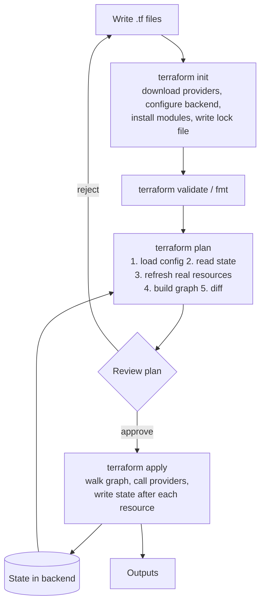
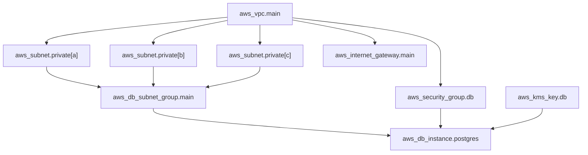
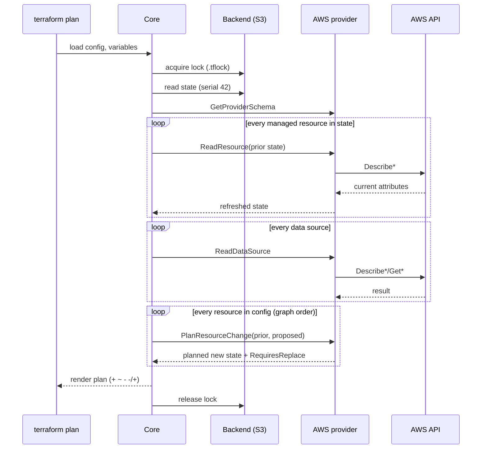

# Terraform: Core Concepts

| | |
|---|---|
| **Cluster** | 05 Infrastructure as Code |
| **Role** | Anchor |
| **Prerequisites** | [01-installation-and-setup.md](01-installation-and-setup.md) complete |
| **Target version** | Terraform 1.9+ (1.10+ for `ephemeral`, 1.11+ for write-only arguments) |
| **Capstone phase** | Phase 2 (Months 5-8) |

> This file explains how Terraform works internally: the HCL language and its type system, how a configuration becomes a graph, how the planner computes a diff against state and the refreshed world, what state actually contains, how backends lock it, how modules compose, and how tests and policy hook into the lifecycle. Read it before the labs; refer back to it whenever a plan surprises you.

---

## 1. The Lifecycle in One Diagram



Internally `plan` and `apply` build two different graphs: the **plan graph** evaluates every expression it can and asks each provider "given the prior state and this configuration, what would you do?" (the `PlanResourceChange` RPC). `apply` builds the **apply graph** from the saved plan and calls `ApplyResourceChange` per node, persisting state after each successful resource so a crash mid-apply loses as little as possible.

---

## 2. HCL: The Language

HCL (HashiCorp Configuration Language) is a declarative language with a functional expression layer. Files end in `.tf` (or `.tf.json` for machine-generated JSON). All `.tf` files in a directory are one module; file names are a convention, not semantics.

### 2.1 Blocks, arguments, expressions

```hcl
# block type  label(s)                 body
resource "aws_subnet" "private" {           # a block with two labels
  vpc_id            = aws_vpc.main.id       # argument = expression (reference)
  cidr_block        = "10.0.1.0/24"         # literal string
  availability_zone = var.azs[0]            # index expression

  tags = merge(local.common_tags, {         # function call + object literal
    Name = "${var.name}-private-a"          # string interpolation
  })
}
```

- A **block** has a type, zero or more labels, and a body of arguments and nested blocks.
- An **argument** assigns an expression to a name.
- **Expressions** produce values: literals, references, operators, conditionals, function calls, `for` expressions, splats, and templates.

Top-level block types: `terraform`, `provider`, `resource`, `data`, `variable`, `locals`, `output`, `module`, `moved`, `removed`, `import`, `check`, and (1.10+) `ephemeral`.

### 2.2 Types

| Category | Types | Example literal |
|---|---|---|
| Primitive | `string`, `number`, `bool` | `"a"`, `42`, `true` |
| Collection (homogeneous) | `list(T)`, `set(T)`, `map(T)` | `["a", "b"]`, `{ k = "v" }` |
| Structural (heterogeneous) | `object({ name = string, port = number })`, `tuple([string, number])` | `{ name = "api", port = 8080 }` |
| Special | `null`, `any` (only in type constraints) | `null` |

Rules worth internalising:

- `null` means "unset": a resource argument set to `null` behaves as if omitted, which is how you make arguments conditional.
- Sets are unordered and cannot be indexed; `for_each` requires a `set(string)` or `map`, not a list.
- Terraform converts automatically between `string` and `number`/`bool` where unambiguous (`"8080"` to `8080`), and between lists and tuples with matching element types.
- `optional()` in object type constraints (with a default) lets module callers omit fields: `object({ port = optional(number, 443) })`.

### 2.3 References and dependencies

Every reference creates a graph edge:

| Reference | Meaning |
|---|---|
| `aws_vpc.main.id` | Attribute of a managed resource |
| `data.aws_ami.al2023.id` | Attribute of a data source |
| `var.region` | Input variable |
| `local.common_tags` | Local value |
| `module.vpc.private_subnet_ids` | Output of a child module |
| `aws_subnet.private[0]` / `aws_subnet.private["a"]` | Instance of a `count` / `for_each` resource |
| `path.module`, `path.root`, `path.cwd` | Filesystem paths |
| `terraform.workspace` | Current workspace name |
| `self.id` | Within `provisioner` and `postcondition` blocks only |
| `each.key`, `each.value`, `count.index` | Inside `for_each` / `count` resources |

### 2.4 Conditionals and operators

```hcl
locals {
  instance_type = var.environment == "prod" ? "m7g.large" : "t4g.small"
  nat_count     = var.single_nat_gateway ? 1 : length(var.azs)
  is_multi_az   = length(var.azs) > 1 && var.environment != "dev"
}
```

Both branches of `? :` must produce compatible types. Use `null` for "nothing":

```hcl
resource "aws_db_instance" "main" {
  kms_key_id = var.encrypt ? aws_kms_key.db[0].arn : null
}
```

### 2.5 `for` expressions

Transform collections. Square brackets produce a list (or tuple); curly braces produce a map (or object).

```hcl
locals {
  azs = ["eu-west-1a", "eu-west-1b", "eu-west-1c"]

  # list -> list of strings
  private_cidrs = [for i, az in local.azs : cidrsubnet(var.vpc_cidr, 4, i)]
  # => ["10.0.0.0/20", "10.0.16.0/20", "10.0.32.0/20"]

  # list -> map keyed by AZ letter (ideal for for_each)
  private_subnets = {
    for i, az in local.azs : substr(az, -1, 1) => {
      az   = az
      cidr = cidrsubnet(var.vpc_cidr, 4, i)
    }
  }
  # => { a = { az = "eu-west-1a", cidr = "10.0.0.0/20" }, b = {...}, c = {...} }

  # filtering with if
  prod_buckets = [for b in var.buckets : b.name if b.environment == "prod"]

  # grouping: the ... operator collects duplicates into lists
  by_team = { for s in var.services : s.team => s.name... }
}
```

### 2.6 Splat expressions

Shorthand for `[for x in list : x.attr]`:

```hcl
output "private_subnet_ids" {
  value = aws_subnet.private[*].id      # list of ids from a count resource
}

# for_each resources produce maps, so splat does not apply; use values()
output "private_subnet_ids_by_az" {
  value = values(aws_subnet.private)[*].id
}
```

### 2.7 `dynamic` blocks

Generate nested blocks (not arguments) from a collection:

```hcl
variable "ingress_rules" {
  type = list(object({
    description = string
    from_port   = number
    to_port     = number
    cidr_blocks = list(string)
  }))
}

resource "aws_security_group" "api" {
  name   = "${var.name}-api"
  vpc_id = var.vpc_id

  dynamic "ingress" {
    for_each = var.ingress_rules
    content {
      description = ingress.value.description
      from_port   = ingress.value.from_port
      to_port     = ingress.value.to_port
      protocol    = "tcp"
      cidr_blocks = ingress.value.cidr_blocks
    }
  }

  egress {
    from_port   = 0
    to_port     = 0
    protocol    = "-1"
    cidr_blocks = ["0.0.0.0/0"]
  }
}
```

The iterator name defaults to the block label (`ingress`); set `iterator = rule` to rename it. Use `dynamic` sparingly: a module whose every block is dynamic is hard to read, and the AWS provider now offers standalone rule resources (`aws_vpc_security_group_ingress_rule`) that work with `for_each` directly.

### 2.8 Functions

Terraform ships ~130 built-in functions and does not allow user-defined ones (provider-defined functions arrived in 1.8, e.g. `provider::aws::arn_parse`). Groups you use daily:

| Group | Functions |
|---|---|
| String | `format`, `formatlist`, `join`, `split`, `replace`, `regex`, `regexall`, `lower`, `upper`, `trimspace`, `trimprefix`, `substr`, `startswith`, `endswith`, `strcontains` |
| Collection | `length`, `concat`, `flatten`, `merge`, `keys`, `values`, `lookup`, `contains`, `distinct`, `sort`, `reverse`, `slice`, `zipmap`, `setproduct`, `setunion`, `setsubtract`, `element`, `index`, `one`, `coalesce`, `coalescelist`, `compact`, `range`, `chunklist`, `transpose` |
| Encoding | `jsonencode`, `jsondecode`, `yamlencode`, `yamldecode`, `base64encode`, `base64decode`, `base64gzip`, `csvdecode`, `urlencode`, `textencodebase64` |
| Filesystem | `file`, `fileexists`, `fileset`, `templatefile`, `filebase64`, `abspath`, `dirname`, `basename`, `pathexpand` |
| Numeric | `min`, `max`, `ceil`, `floor`, `abs`, `pow`, `log`, `signum`, `parseint` |
| Network | `cidrsubnet`, `cidrsubnets`, `cidrhost`, `cidrnetmask`, `cidrcontains` (1.10+) |
| Date/time | `timestamp`, `timeadd`, `timecmp`, `formatdate`, `plantimestamp` |
| Hash/crypto | `md5`, `sha256`, `sha512`, `bcrypt`, `uuid`, `uuidv5`, `filesha256`, `rsadecrypt` |
| Type | `tostring`, `tonumber`, `tobool`, `tolist`, `toset`, `tomap`, `type`, `can`, `try`, `sensitive`, `nonsensitive`, `issensitive`, `ephemeralasnull` (1.10+) |

Test any of them in `terraform console`:

```bash
terraform console
```

```text
> cidrsubnets("10.0.0.0/16", 4, 4, 4, 8, 8, 8)
tolist([
  "10.0.0.0/20",
  "10.0.16.0/20",
  "10.0.32.0/20",
  "10.0.48.0/24",
  "10.0.49.0/24",
  "10.0.50.0/24",
])
> formatdate("YYYY-MM-DD", timestamp())
"2026-10-27"
> jsondecode(file("policy.json")).Statement[0].Action
```

### 2.9 `try` and `can`

`try(expr1, expr2, ...)` returns the first expression that evaluates without error; `can(expr)` returns a boolean. They exist for defensive access into loosely structured data (decoded JSON/YAML, optional object attributes), not for hiding bugs.

```hcl
locals {
  config  = yamldecode(file("${path.module}/config.yaml"))
  port    = try(local.config.service.port, 8080)
  has_tls = can(local.config.service.tls.cert_arn)
}

variable "image_tag" {
  type = string
  validation {
    condition     = can(regex("^v[0-9]+\\.[0-9]+\\.[0-9]+$", var.image_tag))
    error_message = "image_tag must be a semantic version like v1.2.3."
  }
}
```

### 2.10 String templates

```hcl
locals {
  # interpolation and directives
  banner = <<-EOT
    Environment: ${var.environment}
    %{ if var.environment == "prod" ~}
    Change control required.
    %{ else ~}
    Free to experiment.
    %{ endif ~}
    Subnets:
    %{ for s in local.private_cidrs ~}
      - ${s}
    %{ endfor ~}
  EOT
}

# templatefile() renders an external template with a variable map
resource "aws_iam_policy" "state_reader" {
  name   = "tf-state-reader"
  policy = templatefile("${path.module}/templates/state-reader.json.tftpl", {
    bucket_arn = aws_s3_bucket.state.arn
    key_prefix = "live/${var.environment}/"
  })
}
```

Prefer `jsonencode()` over hand-written JSON templates for IAM policies: it guarantees valid JSON and lets Terraform see the structure.

```hcl
policy = jsonencode({
  Version = "2012-10-17"
  Statement = [{
    Effect   = "Allow"
    Action   = ["s3:GetObject", "s3:ListBucket"]
    Resource = [aws_s3_bucket.state.arn, "${aws_s3_bucket.state.arn}/*"]
  }]
})
```

---

## 3. Providers, Version Constraints, and the Lock File

### 3.1 The `terraform` block

```hcl
terraform {
  required_version = ">= 1.9.0, < 2.0.0"

  required_providers {
    aws = {
      source  = "hashicorp/aws"       # registry.terraform.io/hashicorp/aws
      version = "~> 5.80"             # >= 5.80.0, < 6.0.0
    }
    kubernetes = {
      source  = "hashicorp/kubernetes"
      version = ">= 2.30, < 3.0"
    }
  }

  backend "s3" { /* see section 7 */ }
}
```

Version constraint operators: `=`, `!=`, `>`, `>=`, `<`, `<=`, `~>` (pessimistic: `~> 5.80` allows 5.x >= 5.80; `~> 5.80.0` allows 5.80.x only). Constrain providers in the root module tightly and in reusable modules loosely (`>= 5.40`) so callers can choose.

### 3.2 Provider configuration and aliases

```hcl
provider "aws" {
  region = "eu-west-1"
}

provider "aws" {
  alias  = "us_east_1"           # CloudFront certificates, WAF for CloudFront, IAM is global anyway
  region = "us-east-1"
}

resource "aws_acm_certificate" "cdn" {
  provider    = aws.us_east_1
  domain_name = "cdn.example.com"
  validation_method = "DNS"
}

module "dr_region" {
  source = "../../modules/vpc"
  providers = {
    aws = aws.us_east_1            # pass an aliased provider into a module
  }
}
```

Modules should declare which providers they need via `configuration_aliases` and never contain `provider` blocks themselves; a module with its own provider block cannot be used with `for_each` or `count` and cannot be destroyed cleanly once removed.

### 3.3 The dependency lock file

`.terraform.lock.hcl` records, for each provider, the exact version selected and the checksums of the artefacts:

```hcl
provider "registry.terraform.io/hashicorp/aws" {
  version     = "5.84.0"
  constraints = "~> 5.80"
  hashes = [
    "h1:...",   # Terraform's own hash of the unpacked package for the platforms you've run init on
    "zh:...",   # zip hashes from the registry's SHA256SUMS for every platform
  ]
}
```

- Commit it. It plays the role of `package-lock.json`.
- `terraform init -upgrade` moves to the newest version allowed by the constraints and rewrites the file.
- `terraform providers lock -platform=linux_amd64 -platform=darwin_arm64` pre-populates `h1:` hashes for every platform your team and CI use, which avoids "checksum not recorded for this platform" errors.

### 3.4 How providers execute

Each provider is a separate process speaking the Terraform plugin protocol (v5/v6) over gRPC. Core calls `GetProviderSchema` at init, `ValidateResourceConfig` during validate, `ReadResource` during refresh, `PlanResourceChange` during plan, and `ApplyResourceChange` during apply. Understanding this explains why some validation only happens at plan time (the provider must be running) and why `TF_LOG=TRACE` shows JSON payloads for every call.

---

## 4. Resources, Data Sources, Locals, Variables, Outputs

### 4.1 Resources

```hcl
resource "aws_db_instance" "postgres" {
  identifier                  = "${var.name}-postgres"
  engine                      = "postgres"
  engine_version              = "16.4"
  instance_class              = var.instance_class
  allocated_storage           = 50
  max_allocated_storage       = 500
  storage_encrypted           = true
  kms_key_id                  = aws_kms_key.db.arn
  db_subnet_group_name        = aws_db_subnet_group.main.name
  vpc_security_group_ids      = [aws_security_group.db.id]
  multi_az                    = var.multi_az
  manage_master_user_password = true          # password lives in Secrets Manager, never in state
  username                    = "postgres"
  backup_retention_period     = 7
  deletion_protection         = var.environment == "prod"
  skip_final_snapshot         = var.environment != "prod"
  final_snapshot_identifier   = var.environment == "prod" ? "${var.name}-final" : null
  publicly_accessible         = false
  performance_insights_enabled = true

  timeouts {
    create = "40m"
    update = "80m"
    delete = "40m"
  }
}
```

A resource's attributes are either **arguments** you set or **attributes exported** by the provider after creation (`arn`, `endpoint`, `id`). Unknown values show as `(known after apply)` in plans; any expression depending on an unknown value is itself unknown, which is why you cannot use `aws_db_instance.postgres.endpoint` in a `for_each` key.

### 4.2 Data sources

Read-only lookups refreshed during every plan:

```hcl
data "aws_caller_identity" "current" {}
data "aws_region" "current" {}

data "aws_ami" "al2023" {
  most_recent = true
  owners      = ["amazon"]
  filter {
    name   = "name"
    values = ["al2023-ami-2023.*-arm64"]
  }
}

data "aws_ssm_parameter" "vpc_id" {
  name = "/capstone/${var.environment}/network/vpc_id"   # contract written by the network layer
}

data "aws_secretsmanager_secret_version" "db" {
  secret_id = aws_db_instance.postgres.master_user_secret[0].secret_arn
}
```

Caveat: a data source's result is stored in state. `data.aws_secretsmanager_secret_version.db.secret_string` puts the secret in your state file; see section 10 and the `ephemeral` alternative.

### 4.3 Locals

Named expressions evaluated once per module. Use them for computed names, tag maps, and reshaping variables for `for_each`. They do not appear in state or in plan output except indirectly.

### 4.4 Variables

```hcl
variable "environment" {
  description = "Deployment environment; drives sizing and protection flags."
  type        = string
  validation {
    condition     = contains(["dev", "staging", "prod"], var.environment)
    error_message = "environment must be one of dev, staging, prod."
  }
}

variable "vpc_cidr" {
  type    = string
  default = "10.0.0.0/16"
  validation {
    condition     = can(cidrnetmask(var.vpc_cidr)) && tonumber(split("/", var.vpc_cidr)[1]) <= 20
    error_message = "vpc_cidr must be a valid IPv4 CIDR no smaller than /20."
  }
}

variable "db_password" {
  type      = string
  sensitive = true          # redacted in plan/apply output, still stored in state if used in a resource
  default   = null
}

variable "api_token" {
  type      = string
  ephemeral = true          # 1.10+: never persisted to plan or state; usable only in ephemeral contexts
}

variable "node_groups" {
  type = map(object({
    instance_types = list(string)
    min_size       = number
    max_size       = number
    desired_size   = optional(number)
    labels         = optional(map(string), {})
    taints = optional(list(object({
      key    = string
      value  = string
      effect = string
    })), [])
  }))
  nullable = false
}
```

Variable precedence (lowest to highest): defaults, environment `TF_VAR_*`, `terraform.tfvars`, `terraform.tfvars.json`, `*.auto.tfvars` (alphabetical), `-var-file` and `-var` in command-line order. Since 1.9 validation conditions may reference other variables, locals, and data sources.

Three flavours of secrecy:

| Flag | Redacted in CLI output | Stored in plan file | Stored in state | Can be used in any resource argument |
|---|---|---|---|---|
| none | No | Yes | Yes (if a resource uses it) | Yes |
| `sensitive = true` | Yes | Yes | Yes (if a resource uses it) | Yes |
| `ephemeral = true` (1.10+) | Yes | No | No | Only in `ephemeral` resources, provider config, provisioners, and write-only arguments (1.11+) |

### 4.5 Outputs

```hcl
output "db_endpoint" {
  description = "Writer endpoint host:port"
  value       = aws_db_instance.postgres.endpoint
}

output "db_master_secret_arn" {
  value     = aws_db_instance.postgres.master_user_secret[0].secret_arn
  sensitive = true
}

output "cluster_ready" {
  value = module.eks.cluster_name
  precondition {
    condition     = module.eks.cluster_status == "ACTIVE"
    error_message = "EKS cluster must be ACTIVE before this layer is considered complete."
  }
}
```

Root module outputs are stored in state and are what `terraform_remote_state` and `terraform output -json` expose to other layers and to CI.

---

## 5. Meta-Arguments

Meta-arguments are accepted by every resource (and most by modules) and are handled by core, not providers.

### 5.1 `count` versus `for_each`

```hcl
# count: good for "0 or 1" toggles
resource "aws_kms_key" "db" {
  count               = var.encrypt_with_cmk ? 1 : 0
  description         = "RDS encryption key"
  enable_key_rotation = true
}
# reference: aws_kms_key.db[0].arn  (or one(aws_kms_key.db[*].arn))

# for_each: good for named collections; keys are stable identities
resource "aws_subnet" "private" {
  for_each          = local.private_subnets          # map keyed "a", "b", "c"
  vpc_id            = aws_vpc.main.id
  cidr_block        = each.value.cidr
  availability_zone = each.value.az
  tags              = { Name = "${var.name}-private-${each.key}" }
}
# reference: aws_subnet.private["a"].id
```

Why `for_each` wins for collections: with `count`, removing the first AZ from a list shifts every index, and Terraform plans to destroy and recreate every subnet after it. With `for_each`, removing key `"a"` destroys only `aws_subnet.private["a"]`. The rule: `count` for booleans, `for_each` for everything else. `for_each` keys must be known at plan time, which is why you build them from variables and locals rather than from resource attributes.

### 5.2 `depends_on`

```hcl
resource "aws_eks_node_group" "default" {
  # ...
  depends_on = [
    aws_iam_role_policy_attachment.node_worker,
    aws_iam_role_policy_attachment.node_ecr,
    aws_iam_role_policy_attachment.node_cni,
  ]
}
```

Use only for hidden dependencies the provider cannot infer (IAM policy propagation before the resource that needs the permission). `depends_on` on a module or data source forces the dependent to be re-planned as unknown whenever the dependency changes, so overuse causes perpetual "known after apply" diffs.

### 5.3 `provider`

Selects an aliased provider configuration for one resource (see 3.2).

### 5.4 `lifecycle`

```hcl
resource "aws_s3_bucket" "state" {
  bucket = var.state_bucket_name

  lifecycle {
    prevent_destroy = true                   # plan errors if anything would destroy this resource
  }
}

resource "aws_launch_template" "nodes" {
  # ...
  lifecycle {
    create_before_destroy = true             # build the replacement first, swap, then destroy the old one
  }
}

resource "aws_autoscaling_group" "nodes" {
  desired_capacity = 3
  lifecycle {
    ignore_changes = [desired_capacity]      # autoscaler owns this value after creation
  }
}

resource "aws_instance" "bastion" {
  ami = data.aws_ami.al2023.id
  lifecycle {
    replace_triggered_by = [
      aws_security_group.bastion.id,         # replace this instance whenever the SG is replaced
      terraform_data.rebuild.output          # or when an explicit trigger changes
    ]
  }
}

resource "aws_db_instance" "postgres" {
  # ...
  lifecycle {
    precondition {
      condition     = var.environment != "prod" || var.multi_az
      error_message = "Production databases must be Multi-AZ."
    }
    postcondition {
      condition     = self.storage_encrypted
      error_message = "Database storage must be encrypted."
    }
  }
}
```

| Setting | Effect | Typical use |
|---|---|---|
| `prevent_destroy` | Any plan that would destroy the resource fails. Note: removing the resource block itself bypasses it (the lifecycle block is gone too) | State buckets, production databases, KMS keys |
| `create_before_destroy` | Inverts the default destroy-then-create order on replacement; dependents inherit it | Launch templates, certificates, anything referenced by a long-lived resource |
| `ignore_changes` | Attributes whose drift is tolerated after creation (`all` is allowed but rarely wise) | Autoscaler-managed sizes, tags set by external systems, `latest` AMI IDs |
| `replace_triggered_by` | Force replacement when another resource or attribute changes | Instances tied to configs, ECS tasks tied to secrets |
| `precondition` | Assertion checked before planning the resource | Guardrails on inputs |
| `postcondition` | Assertion checked after apply/refresh with access to `self` | Verify what the provider actually produced |

`terraform_data` (built-in, replaces `null_resource`) is the idiomatic trigger carrier: `resource "terraform_data" "rebuild" { input = var.app_version }`.

### 5.5 `check` blocks

Non-blocking assertions evaluated at plan and apply, optionally with scoped data sources:

```hcl
check "api_healthy" {
  data "http" "health" {
    url = "https://${aws_lb.api.dns_name}/healthz"
  }
  assert {
    condition     = data.http.health.status_code == 200
    error_message = "API health endpoint returned ${data.http.health.status_code}."
  }
}
```

A failing `check` is a warning, not an error, which makes it suitable for continuous validation runs.

---

## 6. State Internals

### 6.1 What state contains

```json
{
  "version": 4,
  "terraform_version": "1.10.5",
  "serial": 42,
  "lineage": "4f3b9d1e-...",
  "outputs": { "vpc_id": { "value": "vpc-0abc...", "type": "string" } },
  "resources": [
    {
      "module": "module.vpc",
      "mode": "managed",
      "type": "aws_subnet",
      "name": "private",
      "provider": "provider[\"registry.terraform.io/hashicorp/aws\"]",
      "instances": [
        {
          "index_key": "a",
          "schema_version": 1,
          "attributes": { "id": "subnet-0123...", "cidr_block": "10.0.0.0/20", "..." : "..." },
          "sensitive_attributes": [],
          "dependencies": ["module.vpc.aws_vpc.main"]
        }
      ]
    }
  ]
}
```

- `serial` increments on every write; the backend rejects a write whose serial is behind (optimistic concurrency, in addition to locking).
- `lineage` is a UUID assigned at creation; pushing state with a different lineage is refused unless forced.
- `attributes` are the full last-known values **including anything marked sensitive**. State is a secret-bearing artefact. Treat it like a credentials file.
- `dependencies` are recorded so destroy ordering works even after you delete the configuration.

### 6.2 Resource addresses

```text
aws_vpc.main
aws_subnet.private["a"]
aws_subnet.public[0]
module.vpc.aws_nat_gateway.this[0]
module.eks.module.node_group["default"].aws_eks_node_group.this
data.aws_ami.al2023
```

Every CLI operation that targets a resource (`state mv`, `-target`, `-replace`, `import`) uses these addresses. Quote them in the shell: `terraform state show 'aws_subnet.private["a"]'`.

### 6.3 Inspecting and surgically editing state

```bash
terraform state list                                   # all addresses
terraform state list module.vpc                        # filter by prefix
terraform state show 'module.vpc.aws_subnet.private["a"]'
terraform state pull > state.json                      # download for inspection (contains secrets!)
terraform state mv aws_subnet.private aws_subnet.private_a      # rename in state only
terraform state rm 'aws_instance.legacy'               # forget a resource (it is NOT destroyed)
terraform state replace-provider hashicorp/aws registry.opentofu.org/hashicorp/aws
```

Each `state mv`/`rm` takes a lock and writes a backup file. Prefer the declarative blocks below so the refactor is reviewed in a pull request and replayed identically in every environment.

### 6.4 `moved` blocks (refactoring without destroying)

```hcl
# Renamed a resource
moved {
  from = aws_subnet.private_a
  to   = aws_subnet.private["a"]
}

# Moved a resource into a module
moved {
  from = aws_vpc.main
  to   = module.vpc.aws_vpc.this
}

# Switched from count to for_each
moved {
  from = aws_subnet.private[0]
  to   = aws_subnet.private["a"]
}
```

The next plan shows `# aws_subnet.private_a has moved to aws_subnet.private["a"]` with no destroy. Leave `moved` blocks in place until every environment has applied them, then delete.

### 6.5 `removed` blocks (forgetting without destroying)

```hcl
removed {
  from = aws_instance.legacy
  lifecycle {
    destroy = false     # remove from state, leave the real resource alone
  }
}
```

### 6.6 `import` blocks and generated configuration

```hcl
import {
  to = aws_s3_bucket.logs
  id = "capstone-prod-alb-logs"
}
```

```bash
terraform plan -generate-config-out=generated.tf
```

Terraform writes a best-effort `resource` block for every `import` target that lacks configuration, then shows a plan that imports it. Review `generated.tf`, trim the noise (many attributes are optional or computed), move the block into your real files, and apply. Import blocks are plannable, reviewable, and repeatable across environments; the legacy `terraform import ADDR ID` command mutates state immediately with no plan.

### 6.7 Taint is dead, long live `-replace`

`terraform taint` is deprecated. `terraform apply -replace='aws_instance.bastion'` plans a replacement of exactly that resource and shows it before acting.

---

## 7. Remote Backends and Locking

### 7.1 Why remote state

Local state fails the moment two people or one person and a pipeline run Terraform. A remote backend provides shared storage, locking, encryption at rest, and versioning for recovery.

### 7.2 S3 backend (AWS)

```hcl
terraform {
  backend "s3" {
    bucket       = "capstone-tfstate-123456789012"
    key          = "live/prod/network/terraform.tfstate"
    region       = "eu-west-1"
    encrypt      = true
    kms_key_id   = "arn:aws:kms:eu-west-1:123456789012:key/<KEY_ID>"
    use_lockfile = true                         # 1.10+: native S3 lock via a .tflock object
    # dynamodb_table = "capstone-tfstate-lock"  # legacy locking, deprecated in 1.11+
  }
}
```

How locking works:

| Mechanism | How it locks | Notes |
|---|---|---|
| `use_lockfile = true` (1.10+) | Writes `<key>.tflock` using an S3 conditional write (`If-None-Match`), so the second writer gets a 412 and fails fast | Requires the bucket to allow `s3:PutObject`/`s3:DeleteObject` on `*.tflock`. No extra service. Default path for new estates |
| `dynamodb_table` | Conditional `PutItem` of `LockID = <bucket>/<key>` plus a digest item used for consistency checks | Still works; deprecated. Running both during migration is supported in 1.10 |

The lock info object includes who holds the lock, the operation, and when it was taken; `terraform force-unlock <LOCK_ID>` deletes it. Backend blocks cannot use variables (OpenTofu allows them); use `-backend-config=` files or flags to parameterise per environment.

Minimum IAM for the CI role on the state bucket:

```hcl
data "aws_iam_policy_document" "state_access" {
  statement {
    actions   = ["s3:ListBucket"]
    resources = [aws_s3_bucket.state.arn]
  }
  statement {
    actions   = ["s3:GetObject", "s3:PutObject", "s3:DeleteObject"]
    resources = ["${aws_s3_bucket.state.arn}/live/prod/network/*"]   # scope per layer
  }
  statement {
    actions   = ["kms:Decrypt", "kms:GenerateDataKey"]
    resources = [aws_kms_key.state.arn]
  }
}
```

### 7.3 Other backends

```hcl
# Google Cloud Storage: locking is native via object generation preconditions
backend "gcs" {
  bucket = "<PROJECT_ID>-tfstate"
  prefix = "live/prod/network"
}

# Azure Blob: locking via blob leases
backend "azurerm" {
  resource_group_name  = "rg-tfstate"
  storage_account_name = "<STORAGE_ACCOUNT>"
  container_name       = "tfstate"
  key                  = "live/prod/network.tfstate"
  use_oidc             = true
  use_azuread_auth     = true
}

# HCP Terraform / Terraform Enterprise: remote state, locking, runs, Sentinel
cloud {
  organization = "<ORG>"
  workspaces {
    tags = ["capstone", "network"]
  }
}
```

### 7.4 Migrating backends

```bash
# after editing the backend block
terraform init -migrate-state         # copies state, asks for confirmation
terraform init -reconfigure           # discard the previous backend config without migrating
```

### 7.5 Workspaces versus directory per environment

CLI workspaces give one configuration multiple state files, selected with `terraform workspace select prod`. They share the backend configuration, provider configuration, and code, with `terraform.workspace` as the only differentiator.

| | Workspaces | Directory per environment |
|---|---|---|
| Code reuse | Maximal, one copy | Via modules; each environment directory is a thin root module |
| Blast radius | Easy to apply to the wrong workspace (`terraform.workspace` is invisible in code review) | The directory is the environment; a PR touching `live/prod/` is obviously a prod change |
| Divergence | Hard: every environment must accept the same provider versions and backend | Easy: prod can lag a module version while dev tests the new one |
| Different accounts/roles | Awkward; one backend block | Natural; each directory's backend and provider can point anywhere |
| Verdict | Fine for short-lived ephemeral copies (per-PR previews) | Default for environments. Used by the capstone |

---

## 8. Modules

### 8.1 Anatomy

```text
modules/vpc/
├── README.md          # generated by terraform-docs
├── versions.tf        # required_version, required_providers (loose constraints), NO provider blocks
├── variables.tf       # inputs with descriptions and validation
├── main.tf            # resources
├── outputs.tf         # everything a caller could need
├── locals.tf
├── examples/
│   └── complete/      # a root module that exercises the module; doubles as a test fixture
└── tests/
    └── vpc.tftest.hcl
```

### 8.2 Calling modules

```hcl
module "vpc" {
  source  = "terraform-aws-modules/vpc/aws"      # registry: <NAMESPACE>/<NAME>/<PROVIDER>
  version = "~> 5.16"

  name = "capstone-${var.environment}"
  cidr = var.vpc_cidr
  azs  = local.azs

  private_subnets = [for i in range(3) : cidrsubnet(var.vpc_cidr, 4, i)]
  public_subnets  = [for i in range(3) : cidrsubnet(var.vpc_cidr, 8, i + 48)]

  enable_nat_gateway     = true
  single_nat_gateway     = var.environment != "prod"
  one_nat_gateway_per_az = var.environment == "prod"
  enable_dns_hostnames   = true
  enable_flow_log        = true

  public_subnet_tags  = { "kubernetes.io/role/elb" = 1 }
  private_subnet_tags = { "kubernetes.io/role/internal-elb" = 1 }
}

module "rds" {
  source = "git::https://github.com/<ORG>/terraform-modules.git//rds-postgres?ref=v2.3.1"
  # ...
  subnet_ids = module.vpc.private_subnets
}

module "local_thing" {
  source = "../../modules/eks-cluster"
}
```

Source types: registry, local path, Git (HTTPS or SSH, with `?ref=` for tag/commit and `//` for subdirectory), S3 and GCS buckets, HTTP archives. `terraform init` downloads them into `.terraform/modules/` and records the selection in `.terraform/modules/modules.json` (not committed; modules are not locked like providers, so pin them yourself).

### 8.3 Module design rules

1. **Flat is better than nested**: two levels (root calls module) covers most estates. Deep nesting hides the graph and multiplies "known after apply".
2. **Take IDs, not objects**: `subnet_ids = list(string)` is clearer than passing a whole VPC object.
3. **Expose everything**: outputs are free; adding one later requires a release.
4. **Do not hide providers**: callers pass providers.
5. **Version by Git tag or registry version**; never reference `main`.
6. **Validate inputs** so misuse fails at plan, not at apply 20 minutes into an RDS creation.
7. **Use `terraform-aws-modules` for commodity infrastructure** (VPC, EKS, RDS, IAM, security groups, ALB) and write your own only for your organisation's opinions. Read the community module source once; it is the best reference for provider resource usage.

---

## 9. The Plan/Apply Graph and Execution Controls

### 9.1 Seeing the graph

```bash
terraform graph -type=plan | dot -Tsvg > plan-graph.svg
terraform graph -type=apply | dot -Tpng > apply-graph.png
```



Terraform starts the VPC and the KMS key in parallel; the three subnets start together once the VPC exists; the database waits for the subnet group, security group, and key. Default parallelism is 10 nodes; `-parallelism=N` tunes it (lower it when a provider rate-limits you, raise it for very wide graphs of cheap resources).

### 9.2 Plan symbols

| Symbol | Meaning |
|---|---|
| `+` | create |
| `~` | update in place |
| `-` | destroy |
| `-/+` | replace: destroy then create (default) |
| `+/-` | replace: create then destroy (`create_before_destroy`) |
| `<=` | read (data source deferred to apply) |
| `# forces replacement` | annotation on the attribute that caused `-/+` |

### 9.3 Scoping and steering a run

| Flag | What it does | When to use it, and the caveat |
|---|---|---|
| `-target=ADDR` | Plan/apply only this resource and its dependencies | Emergency surgery only. The resulting state is partial; always follow with a full plan. Never in CI |
| `-replace=ADDR` | Force replacement of one resource | Corrupt instance, rotate a resource |
| `-refresh-only` | Only reconcile state with reality, propose no config changes | Drift detection and accepting drift into state |
| `-refresh=false` | Skip refresh | Faster plans when you trust state; hides drift |
| `-destroy` | Plan a full destroy | Teardown; combine with `-target` for partial teardown |
| `-var` / `-var-file` | Set variables | Per-environment tfvars |
| `-out=FILE` | Save the plan | Mandatory in CI: apply exactly what was reviewed |
| `-lock-timeout=5m` | Wait for a lock instead of failing immediately | CI, where two pipelines may overlap |
| `-detailed-exitcode` | Plan exits 0 (no changes), 1 (error), 2 (changes) | Drift detection jobs |
| `-json` | Machine-readable streaming output | Pipelines that parse plans |
| `-compact-warnings` | Shorter output | Everywhere |

### 9.4 Drift detection

```bash
terraform plan -refresh-only -detailed-exitcode
echo "exit: $?"      # 2 means reality differs from state
```

A refresh-only plan lists what changed outside Terraform. Applying it (`terraform apply -refresh-only`) updates state to match reality **without changing any resource**; a normal plan afterwards shows what Terraform would change to get back to configuration. Schedule this nightly in CI and alert on exit code 2.

---

## 10. What Really Ends Up in State (Secrets)

The honest answer to "does Terraform store secrets in state?" is **yes, whenever a secret is an attribute of a resource or data source**: RDS passwords set via `password`, `aws_iam_access_key.secret`, `random_password.result`, Secrets Manager secret versions read by a data source, Kubernetes secrets created by the Kubernetes provider. `sensitive = true` only affects display.

Defence in depth, in order of effectiveness:

1. **Do not give Terraform the secret.** Use `manage_master_user_password = true` on RDS (AWS generates and stores it in Secrets Manager; state holds only the secret ARN). Use IAM roles, IRSA, and OIDC instead of access keys. Let applications read secrets at runtime via the Secrets Manager or SSM data path, not via Terraform outputs.
2. **Ephemeral resources and write-only arguments (1.10/1.11+).** `ephemeral "aws_secretsmanager_secret_version" "db" {}` reads a secret for use during the run and never stores it; write-only arguments such as `password_wo` on `aws_db_instance` send a value to the API without recording it. Pair with `password_wo_version` to trigger rotation.
3. **Encrypt the backend.** S3 with KMS CMK, bucket policy denying unencrypted puts, versioning, and access logging. Restrict `s3:GetObject` on state keys to the pipeline roles and a break-glass group.
4. **Never commit state or plan files.** Plan files contain the same sensitive values.
5. **Scan for leakage.** Gitleaks/TruffleHog on the repo; Trivy and Checkov flag hard-coded secrets in HCL.

```hcl
# Good: the secret never enters Terraform's state
resource "aws_db_instance" "postgres" {
  manage_master_user_password = true
  # ...
}

# Acceptable in 1.10+: read-then-forget
ephemeral "aws_secretsmanager_secret_version" "api_key" {
  secret_id = "capstone/prod/third-party-api"
}

provider "thirdparty" {
  api_key = ephemeral.aws_secretsmanager_secret_version.api_key.secret_string
}
```

---

## 11. Testing and Quality Gates

### 11.1 `fmt`, `validate`, tflint

```bash
terraform fmt -recursive -check -diff      # style
terraform validate                         # syntax, types, references (no credentials needed after init -backend=false)
tflint --recursive                         # provider-aware linting
```

### 11.2 `terraform test` (1.6+)

Tests live in `tests/*.tftest.hcl` (or alongside `.tf` files) and run real plans or applies against the module.

```hcl
# modules/vpc/tests/vpc.tftest.hcl
mock_provider "aws" {}                     # 1.7+: no credentials, provider returns fake values

variables {
  name     = "test"
  vpc_cidr = "10.10.0.0/16"
  azs      = ["eu-west-1a", "eu-west-1b", "eu-west-1c"]
}

run "creates_three_private_subnets" {
  command = plan

  assert {
    condition     = length(aws_subnet.private) == 3
    error_message = "Expected one private subnet per AZ."
  }

  assert {
    condition     = alltrue([for s in aws_subnet.private : !s.map_public_ip_on_launch])
    error_message = "Private subnets must not auto-assign public IPs."
  }
}

run "rejects_small_cidr" {
  command = plan
  variables {
    vpc_cidr = "10.10.0.0/24"
  }
  expect_failures = [var.vpc_cidr]
}

run "integration_apply" {
  command = apply                           # creates real resources, then destroys them at the end of the run
  providers = {
    aws = aws.real                          # opt in to a real provider for this run only
  }
  assert {
    condition     = can(regex("^vpc-", output.vpc_id))
    error_message = "Output vpc_id should be a real VPC ID."
  }
}
```

```bash
terraform test
terraform test -filter=tests/vpc.tftest.hcl -verbose
```

Expected output:

```text
tests/vpc.tftest.hcl... in progress
  run "creates_three_private_subnets"... pass
  run "rejects_small_cidr"... pass
  run "integration_apply"... pass
tests/vpc.tftest.hcl... tearing down
tests/vpc.tftest.hcl... pass

Success! 3 passed, 0 failed.
```

### 11.3 Policy as code

| Tool | Where it runs | Input | Strength |
|---|---|---|---|
| Checkov | CI, pre-commit | HCL or plan JSON | 1,000+ built-in AWS/Azure/GCP checks, graph-aware (sees module relationships), custom YAML/Python policies |
| Trivy (`trivy config`) | CI, pre-commit | HCL | Fast; same engine covers Dockerfiles, Kubernetes manifests, and images; replaced tfsec |
| OPA / Conftest | CI | `terraform show -json tfplan` | Rego policies against the exact plan; organisation-specific rules |
| Sentinel | HCP Terraform | Plan, config, state, run data | Enforcement levels (advisory, soft, hard mandatory); integrated with the run workflow |
| tflint | Pre-commit, CI | HCL | Provider-specific validity (instance types, deprecated args) |

```bash
checkov --directory . --framework terraform --quiet
terraform show -json tfplan > plan.json
checkov --file plan.json --framework terraform_plan
conftest test plan.json --policy policy/
trivy config --severity HIGH,CRITICAL .
```

A Rego example that blocks public S3 buckets at plan time:

```rego
package terraform.s3

import rego.v1

deny contains msg if {
  some rc in input.resource_changes
  rc.type == "aws_s3_bucket_public_access_block"
  rc.change.after.block_public_acls == false
  msg := sprintf("%s must block public ACLs", [rc.address])
}
```

---

## 12. Putting It Together: How a Plan Is Computed



If you remember one thing: **the plan is produced by providers, not by Terraform core.** Core supplies prior and proposed values; the provider decides what is an in-place update and what forces replacement. That is why the same attribute change can be `~` for one resource type and `-/+` for another, and why reading the provider documentation's "forces new resource" annotations matters.

Next: [03-commands-and-cheatsheet.md](03-commands-and-cheatsheet.md).
