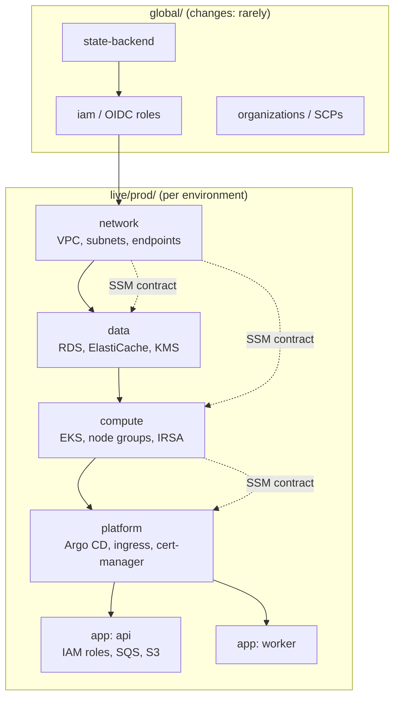
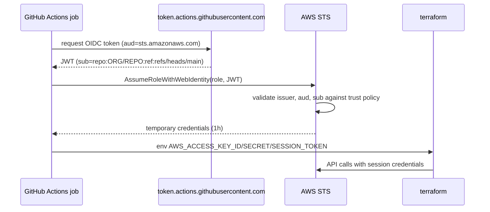
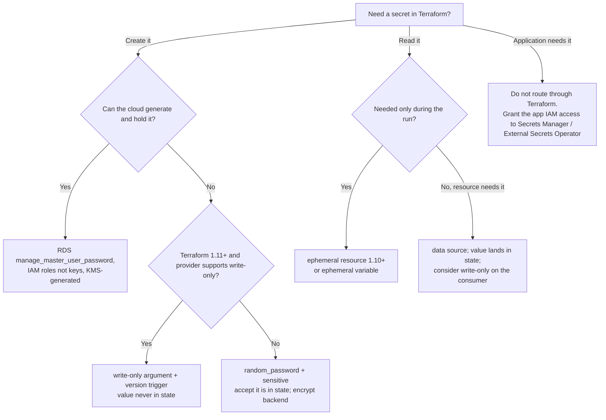
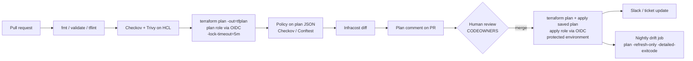

# Terraform: Production Patterns

| | |
|---|---|
| **Cluster** | 05 Infrastructure as Code |
| **Role** | Anchor |
| **Prerequisites** | [04-hands-on-labs.md](04-hands-on-labs.md) Labs 1-7 |
| **Target version** | Terraform 1.10+ / OpenTofu 1.8+ |
| **Capstone phase** | Phase 2 (Months 5-8) |

> How to run Terraform for a company rather than a lab: layering state to bound blast radius, protecting and encrypting state, handling secrets honestly, authenticating CI with OIDC, building a plan/apply pipeline that is safe under contention, enforcing policy, detecting drift continuously, scaling to hundreds of state files with Terragrunt or HCP Terraform, keeping OpenTofu compatibility, and recognising the anti-patterns that cause most incidents.

---

## 1. Layered State and Blast Radius

### 1.1 The principle

A state file is a failure domain. Every `apply` can, in principle, touch everything in it. Design state boundaries so that the most frequently changed things share state with the fewest critical things.



| Layer | Change frequency | Typical plan time | Who applies |
|---|---|---|---|
| global | Quarterly | 10 s | Platform team, two approvals |
| network | Monthly | 30 s | Platform team |
| data | Monthly | 60 s | Platform team, maintenance window |
| compute | Weekly | 2 min | Platform team |
| platform | Weekly | 2 min | Platform team |
| app-* | Daily | 20 s | Product team via Golden Path |

### 1.2 Cross-layer contracts

Prefer **SSM Parameter Store (or an equivalent registry) over `terraform_remote_state`**:

| | `terraform_remote_state` | SSM / Secrets Manager parameters |
|---|---|---|
| Coupling | Consumer needs read access to the producer's whole state (which contains secrets) | Consumer reads only published values |
| Tool neutrality | Terraform only | Readable by CloudFormation, Pulumi, CDK, applications, scripts |
| Versioning | Implicit; a changed output is seen immediately | Parameter history; can pin versions |
| Discoverability | Must know bucket/key | Hierarchical path `/capstone/<env>/<layer>/<name>` |
| Cost | Free | Free for standard parameters |

### 1.3 Sizing a state file

Rules of thumb: refresh time under one minute, fewer than ~200 resources, one owning team, one deployment cadence. When a plan takes longer than a coffee, split.

---

## 2. Protecting State

| Control | Implementation |
|---|---|
| Encryption at rest | S3 SSE-KMS with a dedicated CMK, bucket key enabled; bucket policy denies unencrypted puts |
| Encryption in transit | Bucket policy denies `aws:SecureTransport = false` |
| Versioning | Enabled; lifecycle expires non-current versions after 90 days; MFA delete for prod buckets if operationally feasible |
| Locking | `use_lockfile = true`; monitor for stale locks older than 1 hour |
| Access | Per-layer prefix policies; plan roles read-only on state is impossible (plan writes lock files) so grant `PutObject`/`DeleteObject` on `*.tflock` only; break-glass human group with CloudTrail alerts |
| Replication | Cross-region replication for DR of the state bucket itself |
| Backups | Versioning covers accidental overwrite; `terraform state pull` before any manual surgery |
| Audit | S3 access logging and CloudTrail data events on the bucket |
| OpenTofu extra | Client-side state encryption (`encryption {}` block) so even bucket readers cannot read state |

Recovery from a bad state write: list versions, download the previous one, inspect, push.

```bash
aws s3api list-object-versions --bucket capstone-tfstate-123456789012 --prefix live/prod/data/terraform.tfstate --query 'Versions[0:5].{Id:VersionId,Date:LastModified}'
aws s3api get-object --bucket capstone-tfstate-123456789012 --key live/prod/data/terraform.tfstate --version-id <VERSION_ID> previous.tfstate
terraform state push -force previous.tfstate     # only after a careful diff and with the team informed
```

---

## 3. Provider Authentication: OIDC Everywhere

Static IAM access keys in CI are the most common Terraform security failure. Replace them with federated short-lived credentials.



Trust policy design:

| Claim | Plan role | Apply role |
|---|---|---|
| `aud` | `sts.amazonaws.com` | `sts.amazonaws.com` |
| `sub` | `repo:ORG/REPO:*` (any ref, including PRs) | `repo:ORG/REPO:ref:refs/heads/main` and/or `repo:ORG/REPO:environment:prod` |
| Extra | - | Protected GitHub environment with required reviewers; `permissions_boundary` on the role |

Per-layer roles reduce blast radius further: the `network` apply role cannot delete an RDS instance. Use `aws_iam_policy_document` with explicit allow-lists per service and a permissions boundary that denies `iam:*` outside tagged paths.

For other providers: `azurerm` with `use_oidc = true` and federated credentials on an Entra app registration; `google` with Workload Identity Federation pools; `hashicorp/vault` with the JWT auth method; HCP Terraform with dynamic provider credentials.

---

## 4. Secrets Handling

### 4.1 The honest model

| Where a secret can live | Protection |
|---|---|
| In `.tf` files | Never. Gitleaks pre-commit, TruffleHog in CI |
| In `*.tfvars` | Never commit secret tfvars. Use `TF_VAR_*` from the CI secret store for the rare unavoidable case |
| In the plan file | Yes if a resource argument carries it. Treat plan artefacts as secret; short retention |
| In state | Yes if a resource or data source attribute carries it. Encrypt the backend; minimise what enters |
| In CLI output | Redacted when marked `sensitive`; a `nonsensitive()` call or an output without the flag leaks |

### 4.2 Decision tree



### 4.3 Write-only arguments (1.11+)

```hcl
ephemeral "random_password" "db" {
  length  = 32
  special = false
}

resource "aws_secretsmanager_secret" "app_db" {
  name       = "capstone/prod/app-db"
  kms_key_id = aws_kms_key.secrets.arn
}

resource "aws_secretsmanager_secret_version" "app_db" {
  secret_id                = aws_secretsmanager_secret.app_db.id
  secret_string_wo         = ephemeral.random_password.db.result   # write-only: never stored in state/plan
  secret_string_wo_version = var.db_password_rotation              # bump to rotate
}
```

### 4.4 Applications read secrets at runtime

The capstone's FastAPI and Spring Boot services get an IRSA/Pod Identity role allowed to `secretsmanager:GetSecretValue` on their own secret, and External Secrets Operator syncs it into a Kubernetes Secret. Terraform creates the role and the secret container; it never reads the secret value.

---

## 5. CI/CD Pipeline: Plan on PR, Apply on Merge



Design rules:

1. **Apply what you reviewed.** Either upload the plan artefact from the PR job and apply it on merge (strict; fails if anything changed meanwhile, which is the point), or re-plan on merge and fail if the new plan differs from the reviewed one in resource actions. The capstone re-plans and applies, accepting a small window.
2. **Concurrency control at two levels.** GitHub `concurrency` groups per environment so applies queue; `-lock-timeout=10m` so a queued job waits for the state lock instead of failing.
3. **Separate roles for plan and apply** (section 3).
4. **Protected environments** for `prod` with required reviewers and a wait timer; the apply role's trust policy requires the environment claim.
5. **Destroy guard.** Fail the apply job if the plan contains deletes of protected types unless a label such as `allow-destroy` is on the PR.
6. **Pin everything**: Terraform version, provider lock file (`-lockfile=readonly`), module tags, action versions (by SHA for high-trust repos).
7. **Short logs, full artefacts.** Post a truncated plan in the comment; upload the full `plan.txt` and `plan.json` as artefacts with 14-day retention.
8. **Layer ordering.** Separate jobs with `needs:` for network, data, compute, or Terragrunt `run-all` which orders by `dependency` blocks.

Alternatives to hand-rolled workflows: **Atlantis** (PR-driven plan/apply with locking and comments, self-hosted), **HCP Terraform** (VCS-driven runs, Sentinel, cost estimation, private registry, SSO), **Spacelift / env0 / Scalr** (commercial orchestrators), **Digger** (runs in your CI, Atlantis-like UX).

---

## 6. Policy as Code Strategy

| Stage | Tool | Catches |
|---|---|---|
| Pre-commit | tflint, `fmt`, Trivy secret scan | Syntax, provider misuse, leaked secrets |
| PR (HCL) | Checkov, Trivy config | Misconfigurations visible statically: unencrypted storage, open security groups, missing logging |
| PR (plan JSON) | Checkov `terraform_plan`, Conftest/OPA | Organisation rules with full values resolved: naming, tagging, allowed regions, instance families, no deletes of `aws_db_instance` without label |
| Runtime (HCP) | Sentinel | Same as above with soft/hard mandatory levels and workspace context |
| Post-deploy | AWS Config rules, Kyverno (for Kubernetes resources) | Drift and out-of-band creation |

A production Conftest policy set (`policy/`):

```rego
package main

import rego.v1

required_tags := {"Environment", "Owner", "CostCenter", "ManagedBy"}

deny contains msg if {
  some rc in input.resource_changes
  rc.change.actions[_] != "delete"
  tags := object.get(rc.change.after, "tags_all", object.get(rc.change.after, "tags", {}))
  rc.type in {"aws_instance", "aws_db_instance", "aws_s3_bucket", "aws_eks_cluster"}
  missing := required_tags - {k | tags[k]}
  count(missing) > 0
  msg := sprintf("%s missing required tags %v", [rc.address, missing])
}

deny contains msg if {
  some rc in input.resource_changes
  rc.type == "aws_db_instance"
  "delete" in rc.change.actions
  not input.variables.allow_destroy.value
  msg := sprintf("%s would be destroyed; set allow_destroy=true to confirm", [rc.address])
}

deny contains msg if {
  some rc in input.resource_changes
  rc.type == "aws_security_group_rule"
  rc.change.after.type == "ingress"
  "0.0.0.0/0" in rc.change.after.cidr_blocks
  rc.change.after.from_port <= 22
  rc.change.after.to_port >= 22
  msg := sprintf("%s opens SSH to the world", [rc.address])
}
```

Checkov custom policy in YAML (graph-aware):

```yaml
metadata:
  id: "CKV2_ORG_001"
  name: "RDS instances must use the org KMS key"
  category: "ENCRYPTION"
  severity: "HIGH"
definition:
  cond_type: attribute
  resource_types: [aws_db_instance]
  attribute: kms_key_id
  operator: regex_match
  value: "arn:aws:kms:.*:123456789012:key/.*"
```

Suppress with justification, never silently: `# checkov:skip=CKV_AWS_79: IMDSv2 enforced via launch template` and a Conftest `exception` with an expiry comment.

---

## 7. Drift Detection and Remediation

```yaml
# .github/workflows/drift.yml
name: drift
on:
  schedule: [{ cron: "0 3 * * *" }]
  workflow_dispatch:
permissions: { id-token: write, contents: read, issues: write }
jobs:
  drift:
    runs-on: ubuntu-latest
    strategy: { matrix: { layer: [network, data, compute] } }
    steps:
      - uses: actions/checkout@v4
      - uses: aws-actions/configure-aws-credentials@v4
        with: { role-to-assume: "arn:aws:iam::123456789012:role/github-terraform-plan", aws-region: eu-west-1 }
      - uses: hashicorp/setup-terraform@v3
        with: { terraform_version: 1.10.5, terraform_wrapper: false }
      - working-directory: live/prod/${{ matrix.layer }}
        run: |
          terraform init -lockfile=readonly
          set +e
          terraform plan -refresh-only -detailed-exitcode -no-color -lock-timeout=5m > drift.txt 2>&1
          rc=$?; set -e
          if [ "$rc" = "2" ]; then echo "DRIFT=true" >> "$GITHUB_ENV"; fi
          if [ "$rc" = "1" ]; then cat drift.txt; exit 1; fi
      - if: env.DRIFT == 'true'
        uses: actions/github-script@v7
        with:
          script: |
            const fs = require('fs');
            const body = fs.readFileSync('live/prod/${{ matrix.layer }}/drift.txt','utf8').slice(-60000);
            await github.rest.issues.create({ ...context.repo, title: `Drift detected: prod/${{ matrix.layer }}`, body: '```text\n' + body + '\n```', labels: ['drift'] });
```

Remediation options, in order of preference:

1. **Reconcile to code**: run the normal pipeline; Terraform reverts the manual change. Requires the change to have been wrong.
2. **Accept into code**: update the configuration to match reality, plan shows no changes, merge.
3. **Accept into state only** (`apply -refresh-only`): for attributes you do not manage; usually paired with `ignore_changes`.
4. **Prevent**: SCPs and IAM that deny console writes to Terraform-managed resources except for a break-glass role; tag-based conditions on `ManagedBy = terraform`.

---

## 8. Module Lifecycle Management

- **Private registry or Git tags.** Publish organisation modules to HCP Terraform private registry, GitLab's Terraform registry, or plain Git with semver tags.
- **Semantic versioning**: patch for bug fixes, minor for new optional inputs, major for anything that changes resource addresses or removes inputs.
- **Changelog and upgrade notes** per major; ship `moved` blocks inside the module when you rename resources so consumers upgrade without replacement.
- **Automated upgrades**: Renovate or Dependabot open PRs for module and provider version bumps; the plan comment shows the effect.
- **Deprecation**: `variable` descriptions and `check` blocks warn; remove in the next major.
- **Testing matrix**: `terraform test` with mock providers on every PR; integration apply nightly; `examples/complete` kept green.

Upgrading the AWS provider across a major version (e.g. 5.x to 6.x) is a project: read the upgrade guide, run `terraform plan` in a scratch workspace per layer, and expect state-only upgrades (`~` with no real change) for schema version bumps.

---

## 9. Performance and Scale

| Symptom | Lever |
|---|---|
| Slow refresh in large state | Split state (section 1); `-refresh=false` for fast iteration only; HCP Terraform's cached plans |
| Provider rate limiting (`ThrottlingException`) | `-parallelism=5`; provider `retry_mode = "adaptive"` and `max_retries = 10` |
| Many near-identical environments | Terragrunt `run-all`, or a thin root module per environment generated from a template |
| Hundreds of workspaces | HCP Terraform or Spacelift with stacks/dependencies; Terragrunt dependency graph; Atmos |
| Long `init` in CI | Plugin cache mounted as a CI cache; provider mirror in Artifactory/Nexus; `-lockfile=readonly` |
| Plan noise from `default_tags` and computed values | Upgrade provider; use `ignore_changes` on externally managed tags; avoid `timestamp()` in resources |

---

## 10. Terragrunt

Terragrunt is a thin wrapper that removes the two main duplications of a directory-per-environment layout: the backend block and the inter-layer wiring. It adds `dependency` blocks (read outputs of another unit), `run-all` (apply many units in dependency order), `generate` (write boilerplate files), and `include` (inherit configuration).

| Use Terragrunt when | Avoid Terragrunt when |
|---|---|
| You have more than ~10 state files with the same backend pattern | You have a handful of layers; plain Terraform with `-backend-config` files is enough |
| Teams need a consistent `dependency` wiring without SSM conventions | Your organisation already uses HCP Terraform or Spacelift stacks |
| You want `run-all plan` to show the full blast radius of a module change | Debuggability and a plain `terraform` CLI matter more than DRY |

Its cost is one more layer of indirection in debugging (`terragrunt` generates files into `.terragrunt-cache/`) and a second tool to version.

---

## 11. High Availability and Disaster Recovery of the Estate

- **Multi-region**: separate layers per region with aliased providers only for truly global resources (Route 53, CloudFront, IAM). Region failover is then a pipeline operation, not a state surgery.
- **Rebuildability**: the real DR test is "destroy dev and recreate it from Git in under an hour". Schedule it quarterly.
- **State bucket DR**: cross-region replication plus a documented procedure to repoint `-backend-config` at the replica.
- **Provider outage**: `terraform plan` fails safely; applies in progress may leave partial state, which the next apply repairs.

---

## 12. OpenTofu Compatibility

Keep the option open even if you run Terraform:

1. Avoid features one side lacks: Terraform-only (`ephemeral` resources and write-only arguments until OpenTofu parity; HCP-specific `cloud` block features; Stacks), OpenTofu-only (state encryption, variables in backend blocks, `for_each` on providers, early evaluation).
2. Keep `required_version` constraints satisfiable by both (`>= 1.8.0` rather than `>= 1.10.0` when you do not need 1.10 features).
3. Migration steps: install `tofu`, `tofu init` (it rewrites provider sources in the lock file to `registry.opentofu.org`), `tofu plan` must show no changes, update CI images, `terraform state replace-provider` is not needed because OpenTofu maps `hashicorp/*` automatically.
4. Document the decision in an ADR under `capstone/adrs/` (licence risk, feature need, vendor support).

---

## 13. Anti-Patterns

| Anti-pattern | Why it hurts | Instead |
|---|---|---|
| One state for an entire account | Multi-minute plans, admin CI role, every change risks everything | Layered state |
| `-target` in pipelines | Partial applies, inconsistent state, hides dependency problems | Fix the graph; use `-target` only in incidents and follow with a full plan |
| `count` over lists of names | Index shifts cause mass replacement | `for_each` with stable keys |
| Static IAM keys in CI secrets | Long-lived, leak-prone, unauditable origin | OIDC roles with `sub` conditions |
| Secrets in `tfvars` committed to Git | Permanent in history | Cloud-generated secrets, write-only arguments, runtime retrieval |
| Hand-editing state JSON | Serial/lineage mistakes, silent corruption | `moved`/`removed`/`import` blocks, `state mv/rm` |
| Module with `provider` blocks inside | Cannot use `for_each`; orphaned provider on removal | Pass providers in |
| Referencing module `main` branch | Non-reproducible plans | Tags with semver, Renovate for bumps |
| `ignore_changes = all` | Terraform stops managing the resource in all but name | Ignore specific attributes; move ownership explicitly |
| Workspaces for prod vs dev in one directory | Invisible environment switch; shared provider/backend | Directory per environment |
| `terraform apply -auto-approve` in CI without a saved plan | Applies something no one reviewed | Review plan artefact; apply the saved plan |
| Plan comments without truncation and secret scrubbing | Leaks sensitive values and exceeds comment limits | `sensitive`, truncate, upload full plan as artefact |
| Giant `dynamic` blocks and nested `try()` | Unreadable modules, hidden errors | Standalone rule resources; explicit validation |

---

## 14. Production Readiness Checklist

- [ ] State: remote, versioned, KMS-encrypted, TLS-only, `use_lockfile`, per-layer access, replicated
- [ ] Layers: global / network / data / compute / platform / app, each under 200 resources
- [ ] Contracts: SSM parameter paths documented; no `terraform_remote_state` into prod data layer
- [ ] Identity: OIDC roles for plan and apply with `sub` conditions, permissions boundaries, no static keys anywhere
- [ ] Pipeline: fmt, validate, tflint, Checkov/Trivy, plan comment, policy on plan JSON, cost diff, protected environment, saved-plan apply, `-lock-timeout`, concurrency group
- [ ] Secrets: none in HCL, tfvars, or outputs; cloud-managed passwords; write-only or ephemeral where supported
- [ ] Modules: versioned by tag, tested with `terraform test`, documented with terraform-docs, upgraded by Renovate
- [ ] Guardrails: `prevent_destroy` on state bucket, KMS keys, prod databases; `deletion_protection` on RDS; destroy guard in pipeline
- [ ] Drift: nightly refresh-only job raising issues; IAM denies console writes to managed resources
- [ ] Observability: CloudTrail on state bucket; pipeline notifications; apply duration tracked
- [ ] DR: quarterly rebuild-from-Git drill; state bucket replica; runbook in `capstone/runbooks/`
- [ ] Licence decision (Terraform BSL vs OpenTofu) recorded as an ADR

Next: [06-troubleshooting.md](06-troubleshooting.md).
