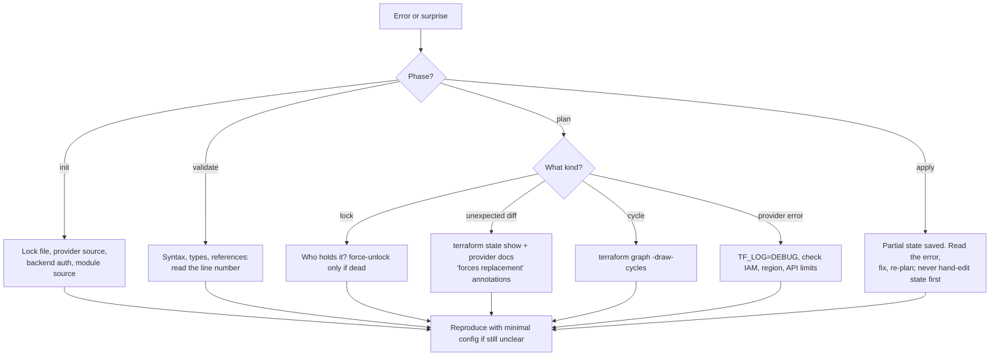

# Terraform: Troubleshooting

| | |
|---|---|
| **Cluster** | 05 Infrastructure as Code |
| **Role** | Anchor |
| **Prerequisites** | [02-core-concepts.md](02-core-concepts.md), [03-commands-and-cheatsheet.md](03-commands-and-cheatsheet.md) |
| **Target version** | Terraform 1.9+ |
| **Capstone phase** | Phase 2 (Months 5-8) |

> A symptom-to-fix reference for the errors you will actually see: lock contention, state and reality disagreeing, dependency cycles, perpetual diffs, provider authentication, failed applies, and import mistakes. Error messages are quoted verbatim so you can search this page. Start with the debugging workflow, then jump to the relevant table.

---

## 1. Debugging Workflow



Diagnostic commands in order of cost:

```bash
terraform version && terraform providers                      # what is running
terraform validate                                             # cheap structural check
terraform state list | wc -l && terraform state list | grep <name>
terraform state show '<address>'                               # what Terraform believes
aws <service> describe-* ...                                   # what is real
terraform plan -refresh-only                                   # how they differ
terraform graph -draw-cycles | dot -Tsvg > g.svg               # structure
TF_LOG=DEBUG TF_LOG_PATH=tf.log terraform plan                 # provider conversation
TF_LOG=TRACE ...                                               # full gRPC payloads (large)
terraform show -json tfplan | jq ...                           # machine-readable plan
```

---

## 2. Init and Provider Problems

| Symptom | Likely cause | Diagnose | Fix |
|---|---|---|---|
| `Error: Failed to query available provider packages ... no available releases match the given constraints` | Constraint impossible (e.g. `~> 4.0` with a module requiring `>= 5.0`) | `terraform providers` shows every constraint | Align constraints; `init -upgrade` |
| `Error: Inconsistent dependency lock file ... checksum not recorded for this platform` | Lock file created on macOS, CI on Linux | Look at `h1:` hashes in `.terraform.lock.hcl` | `terraform providers lock -platform=linux_amd64 -platform=darwin_arm64`; commit |
| `Error: Failed to install provider ... registry.terraform.io ... 429 Too Many Requests` or timeouts | Registry rate limit or proxy | Retry; check `HTTPS_PROXY` | Plugin cache; provider mirror; `TF_REGISTRY_CLIENT_TIMEOUT=60` |
| `Error: Backend configuration changed` | Backend block edited after init | Compare with `.terraform/terraform.tfstate` | `init -migrate-state` to move, or `init -reconfigure` to drop the old config |
| `Error: Unsupported block type ... "cloud"` or `"ephemeral"` | CLI older than the feature | `terraform version` | Upgrade CLI or remove the feature |
| `Module not installed` / `Error: Failed to download module` | Private Git source without credentials, wrong `ref` | `GIT_TRACE=1 terraform get` | SSH agent or token in CI; verify tag exists |
| `Error: Invalid provider configuration ... Provider "aws" requires explicit configuration` | Module needs a provider that root did not configure, or alias mismatch | Check `configuration_aliases` and `providers = {}` map | Pass providers explicitly |
| `Error: Variables not allowed ... in backend configuration` | Interpolation in backend block | - | `-backend-config` file or Terragrunt; OpenTofu allows variables |

---

## 3. Locking and Backend

| Symptom | Likely cause | Diagnose | Fix |
|---|---|---|---|
| `Error: Error acquiring the state lock ... PreconditionFailed` (S3 lockfile) or `ConditionalCheckFailedException` (DynamoDB) | Another run holds the lock, or a crashed run left it | Read `Lock Info` block: `Who`, `Created`, `Operation`; check CI for running jobs | Wait or `-lock-timeout=10m`. If the holder is dead: `terraform force-unlock <ID>` |
| `Error: Failed to load state: AccessDenied` | Role lacks `s3:GetObject` on key or `kms:Decrypt` | `aws sts get-caller-identity`; test `aws s3 cp` | Grant per-layer prefix access and KMS |
| `Error: state snapshot was created by Terraform v1.11.0, which is newer than current v1.9.8` | Someone applied with a newer CLI | `terraform state pull \| jq .terraform_version` | Upgrade local CLI; pin versions with `.terraform-version` |
| `Error: Error loading state: state data in S3 does not have the expected content ... Digest` (DynamoDB) | Legacy DynamoDB digest mismatch after manual state edit or restore | `aws dynamodb get-item` on the `-md5` item | Delete the digest item (not the lock) and retry; migrate to `use_lockfile` |
| `Error: Failed to persist state to backend` after a successful apply | Network failure writing state | Terraform writes `errored.tfstate` locally | `terraform state push errored.tfstate` once connectivity is back; do not re-apply first |
| `Error: Resource instance ... does not exist in state` (workspace) | Wrong workspace selected | `terraform workspace show` | Select correct workspace; prefer directory-per-env |

Stale lock procedure:

```bash
terraform plan                 # copy the Lock ID from the error
# confirm no CI job is running and the holder's host is gone
terraform force-unlock 3b7e1c4a-....
```

---

## 4. Plan Surprises

| Symptom | Likely cause | Diagnose | Fix |
|---|---|---|---|
| Resource shows `-/+` (replace) for a trivial edit | Attribute is `ForceNew` for that resource | Plan annotates `# forces replacement`; provider docs | Use `create_before_destroy`; accept; or find an in-place alternative (e.g. standalone rule resources instead of inline SG rules) |
| Every plan shows the same `~` change (perpetual diff) | Provider normalises a value (case, JSON ordering, trailing newline) differently from your config; or an external system edits the attribute | `state show` vs config; `TF_LOG=DEBUG` shows the read value | Match the normalised form (`jsonencode` instead of heredoc JSON, lowercase); `ignore_changes` for externally owned attributes; upgrade provider |
| `(known after apply)` cascades through many resources | A `depends_on` on a module/data source, or a resource attribute used in `for_each`/`count`, or `timestamp()` | Trace the unknown upstream in the plan | Remove unnecessary `depends_on`; key `for_each` on variables/locals; use `plantimestamp()` or `terraform_data` |
| `Error: Invalid for_each argument ... The "for_each" set includes values derived from resource attributes that cannot be determined until apply` | Keys depend on unknown values | - | Build keys from inputs, not outputs; two-phase apply with `-target` only as a last resort |
| `Error: Cycle: aws_security_group.a, aws_security_group.b` | Mutual references (SG rules referencing each other inline) | `terraform graph -draw-cycles` | Break with standalone `aws_vpc_security_group_ingress_rule` resources |
| `Error: Invalid index ... The given key does not identify an element in this collection value` | Referencing `[0]` of an empty `count` resource, or a missing map key | `terraform console` the expression | `one()`, `try()`, or guard with a conditional |
| `Error: Inconsistent conditional result types` | `? :` branches of different types | - | Make types match (`tostring`, `null` with explicit type, `tolist`) |
| `Error: Unsupported attribute ... This object does not have an attribute named "x"` | Provider renamed the attribute in a major upgrade or module output missing | Provider upgrade guide | Rename; pin provider version |
| Plan wants to destroy and recreate everything in a `count` list after removing one item | Index shift | - | Convert to `for_each` with `moved` blocks |
| `Warning: Deprecated attribute` | Provider deprecation | Provider changelog | Migrate before the next major |
| `Error: Provider produced inconsistent final plan` | Provider bug: value changed between plan and apply | `TF_LOG=DEBUG` | Re-run; report provider issue; sometimes caused by `default_tags` collisions with resource `tags` |
| `Error: Provider produced inconsistent result after apply` | Provider bug or API eventual consistency | Retry plan | Usually resolved on next plan; upgrade provider |

---

## 5. Apply Failures

| Symptom | Likely cause | Diagnose | Fix |
|---|---|---|---|
| `Error: creating ... AccessDenied` / `UnauthorizedOperation` | Execution role lacks permission | CloudTrail `errorCode`; IAM Policy Simulator | Add least-privilege statement; check SCPs and permission boundaries |
| `Error: ... timeout while waiting for state to become 'available'` | Resource creation slower than default timeout (RDS, EKS, NAT) | Console shows still creating | Add `timeouts {}` block; the resource may already exist: run plan, it will be tainted or imported |
| `Error: ... already exists` | A previous apply created the resource but state write failed, or a name collision | `aws ... describe` by name | `import` block for the orphan; or rename |
| `Error: ... DependencyViolation: ... has dependencies and cannot be deleted` (VPC/subnet/SG destroy) | Resources outside Terraform attached (ELBs from Kubernetes Services, ENIs from Lambda) | `aws ec2 describe-network-interfaces --filters Name=vpc-id,Values=vpc-...` | Delete the Kubernetes Services / wait for ENI cleanup; re-run destroy |
| `Error: ... InvalidParameterValue: ... is not supported in your requested Availability Zone` | Instance type unavailable in the AZ | `aws ec2 describe-instance-type-offerings --location-type availability-zone` | Choose a different type or AZ |
| `Error: Instance cannot be destroyed ... lifecycle.prevent_destroy` | Guardrail working | - | If intentional: remove the flag in a reviewed PR, apply |
| `Error: Resource postcondition failed` | Provider produced something your assertion rejects | Read the message | Fix configuration (the resource was already created or updated; state is saved) |
| Apply partially completed, then errored | Normal behaviour | `terraform state list` shows what exists | Fix cause, re-plan, re-apply. State is consistent for completed resources |
| `Error: ... Throttling: Rate exceeded` | API rate limits with high parallelism | Repeats under load | `-parallelism=5`; provider `max_retries`; split state |
| EKS: `Error: ... the server has asked for the client to provide credentials` (kubernetes provider) | Token expired or wrong cluster auth mode | `aws eks get-token` | Use `exec` auth in the provider; grant the CI role via access entries |

Recovering an orphan created by a failed state write:

```hcl
import {
  to = module.postgres.aws_db_instance.this
  id = "capstone-dev-postgres"
}
```

```bash
terraform plan   # expect "1 to import" and otherwise no changes
terraform apply
```

---

## 6. State Surgery Mistakes

| Symptom | Likely cause | Diagnose | Fix |
|---|---|---|---|
| After `state rm`, plan wants to create a duplicate | You removed a resource still in config | - | `import` it back or remove the config |
| After `state mv`, plan wants to replace | Moved to the wrong address or type mismatch | `state show` both | Move again correctly; types must match exactly |
| `Error: Failed to save state ... lineage mismatch` on `state push` | Pushing a state from a different lineage | `jq .lineage` on both | Only `-force` if you are sure; otherwise use the correct file |
| `Error: Failed to save state ... serial ... is behind` | Stale local copy | `state pull` fresh | Redo edits on the fresh copy |
| `moved` block error `Cannot move to ... already exists` | Target address already has an instance | `state list` | Remove or move the existing instance first |
| Imported resource shows large diff | Generated config captured defaults and computed values | Read plan | Trim config to intended arguments; add `ignore_changes` for computed drift |

---

## 7. Module and Expression Errors

| Symptom | Likely cause | Fix |
|---|---|---|
| `Error: Unsupported argument ... An argument named "x" is not expected here` | Typo or wrong module version | Check module docs for the pinned version |
| `Error: Missing required argument` | Module/resource requires an input | Provide it; add `default` if optional |
| `Error: Invalid value for input variable ... validation failed` | Your `validation` block fired | Read `error_message`; fix the input |
| `Error: Call to function "cidrsubnet" failed: prefix extension of 4 does not accommodate a subnet numbered 16` | Too many subnets for the netnum bits | Increase newbits or reduce count |
| `Error: Invalid template interpolation value ... Cannot include the given value in a string template: string required` | Interpolating a list/map | `jsonencode()` or `join()` |
| `Error: Call to function "file" failed: no file exists at ...` | Relative path resolved from the wrong directory | Use `${path.module}/...` |
| `Error: Invalid function argument ... Invalid value for "inputMap" parameter: argument must not be null` | `lookup()` on a null variable | `coalesce(var.map, {})` or `nullable = false` |
| `Error: Duplicate resource "aws_s3_bucket" configuration` | Same type+name twice in a module (often a leftover `generated.tf`) | Remove the duplicate |

---

## 8. Provider Authentication

| Symptom | Likely cause | Diagnose | Fix |
|---|---|---|---|
| `Error: No valid credential sources found` | No profile/env/OIDC credentials | `aws sts get-caller-identity` fails too | `aws sso login`; in CI check `permissions: id-token: write` and `configure-aws-credentials` step |
| `Error: ... ExpiredToken` | SSO or STS session expired mid-run | Time since login | Re-login; raise role `max_session_duration` for long applies (up to 12 h for direct assume, 1 h for role chaining) |
| `Not authorized to perform sts:AssumeRoleWithWebIdentity` (CI) | Trust policy `sub` condition does not match the ref/environment | Decode the JWT claims in the job (`actions/github-script` can print `sub`) | Match `sub` pattern; check `aud` |
| `Error: configuring Terraform AWS Provider: validating provider credentials ... InvalidClientTokenId` | Wrong region partition or revoked key | - | Remove static keys entirely; use roles |
| Resources created in the wrong account | `AWS_PROFILE` left set from another task | `aws sts get-caller-identity` before every apply | Make the pipeline print identity; use `assume_role` in the provider so the target account is explicit |

---

## 9. Performance

| Symptom | Likely cause | Fix |
|---|---|---|
| Plan takes minutes | Hundreds of resources refreshed; slow data sources (`aws_ami` with broad filters) | Split state; narrow data source filters; `-refresh=false` for iteration |
| `init` downloads 600 MB every CI run | No plugin cache | `TF_PLUGIN_CACHE_DIR` + CI cache keyed on lock file |
| Apply of EKS/RDS "hangs" at `Still creating...` | Normal; AWS takes 10-15 minutes | Nothing; set realistic `timeouts` |
| Terraform process uses gigabytes of RAM | Very large state or plan JSON | Split state; avoid `-json` in memory-constrained runners |

---

## 10. Reading Debug Logs

```bash
TF_LOG=DEBUG TF_LOG_PATH=tf.log terraform plan >/dev/null 2>&1
grep -n "HTTP Request Sent\|HTTP Response Received" tf.log | head
grep -n "rpc error\|Error:" tf.log | head
grep -n '"errorCode"\|AccessDenied\|Throttl' tf.log | head
```

Key markers: `[DEBUG] provider.terraform-provider-aws_v5...` lines show which provider RPC is active (`ReadResource`, `PlanResourceChange`, `ApplyResourceChange`); `[DEBUG] HTTP Request Sent` and `HTTP Response Received` include the AWS operation name (`tf_aws.sdk.operation`) and status code. Logs include request IDs you can give to AWS Support but may also include sensitive attribute values: scrub before sharing.

---

## 11. Incident Runbook: "Apply Failed in Production"

1. **Do not re-run blindly.** Read the error; identify the resource address.
2. `terraform state list` and `state show <address>` to see whether the resource was partially created.
3. Check the cloud console/CLI for the real resource.
4. If the resource exists but is absent from state: add an `import` block, plan, confirm "1 to import", apply.
5. If the resource is in state but broken: `apply -replace=<address>` after a plan.
6. If the fix requires code: open a PR, let the pipeline plan, review, merge.
7. Record the timeline and root cause in a postmortem (`templates/postmortem-template.md`).

Next: [07-interview-questions.md](07-interview-questions.md).
