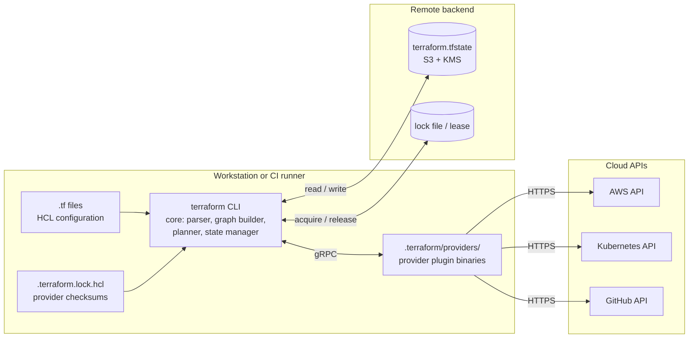

# Terraform

| | |
|---|---|
| **Cluster** | 05 Infrastructure as Code |
| **Role** | Anchor |
| **Category** | Infrastructure as Code (multi-cloud, declarative) |
| **Prerequisites** | AWS fundamentals (IAM, VPC, S3, KMS, RDS, EKS), Git, Bash, a basic grasp of JSON |
| **Target version** | Terraform 1.9+ (notes for 1.10-1.12 features: `ephemeral`, write-only arguments, S3 native locking); OpenTofu 1.8+ where behaviour differs |
| **Capstone phase** | Phase 2 (Months 5-8) |
| **Official docs** | https://developer.hashicorp.com/terraform/docs |

> Terraform is a CLI that reads declarative configuration written in HCL, compares it with a recorded state file and the real world, shows you a plan, and then executes that plan as a dependency graph of provider API calls. After working through this folder you will be able to design and operate a layered, modular Terraform estate for a production AWS account: locked and encrypted remote state, versioned modules, tests, policy gates, OIDC-authenticated CI/CD, and a troubleshooting toolkit for the day state and reality disagree.

## Why This Tool Exists

In 2014 the options for building cloud infrastructure were console clicking, provider-specific templating (CloudFormation on AWS, Heat on OpenStack), or imperative SDK scripts that were impossible to run twice safely. Terraform's insight was to separate three concerns that had been tangled together:

1. **A provider-agnostic core** that understands configuration, state, dependency graphs, and planning but knows nothing about any cloud.
2. **Providers**, which are plugins that translate resource schemas into CRUD calls against an API. Anyone can write one, which is why there are now providers for clouds, SaaS products, Kubernetes, DNS, Git hosting, and feature flags.
3. **State**, an explicit record of what Terraform created, which makes the plan a precise diff rather than a guess and lets Terraform manage resources whose names it did not choose.

The trade-off is that state became the operator's responsibility. Most Terraform incidents are state incidents: a lost lock, a state file edited by hand, two pipelines applying at once, or a secret sitting in plaintext in a bucket. This folder spends a lot of time on state for that reason.

## Architecture

- **Terraform core** is a single static binary. It parses HCL, builds the resource graph, calls providers over gRPC to read, plan, and apply, and reads and writes state through the backend.
- **Providers** are separate binaries downloaded by `terraform init` into `.terraform/providers/`. Their exact versions and checksums are pinned in `.terraform.lock.hcl`, which you commit.
- **The backend** stores state and provides locking. Local state (`terraform.tfstate` on disk) is only for experiments. Production uses S3 (with the native lock file or legacy DynamoDB), GCS, Azure Blob, or HCP Terraform.
- **State** maps each resource address (`module.vpc.aws_subnet.private[0]`) to the real resource ID and its last-known attributes.

## The Core Mental Model

1. **A plan is a diff between the configuration, the state, and the refreshed real world.** Every `+`, `~`, `-/+`, and `-` in a plan is the planner telling you which of the three disagreed. If you can read a plan you can predict exactly what `apply` will do.
2. **Everything is a graph.** Each resource, data source, module, variable, and output is a node; every reference (`aws_vpc.main.id`) is an edge. Terraform walks the graph with up to 10 parallel workers, waiting on edges. Destroy walks it backwards. `depends_on` adds an edge the expressions did not already imply.
3. **State is the source of truth about ownership, not about reality.** Terraform owns exactly the resources in state. Delete a resource from state and Terraform forgets it exists (it will not destroy it). Add one with `import` and Terraform adopts it. Reality is read fresh on every plan via refresh.
4. **Modules are functions over resources.** Inputs are variables, the body is a sub-graph, the return value is outputs. Composition, not inheritance.

## Anchor-and-Bridge Mapping

| Concept in Terraform | Equivalent in CloudFormation | Equivalent in Pulumi |
|---|---|---|
| `resource` block | `Resources:` entry (`Type: AWS::...`) | Resource class instance (`aws.ec2.Vpc(...)`) |
| Root module / working directory | Template | Project (`Pulumi.yaml`) |
| State file + workspace | Stack (AWS-managed state) | Stack (checkpoint in backend) |
| `module` | Nested stack, CFN Module, CDK construct | `ComponentResource` |
| `variable` + `tfvars` | `Parameters` + parameter overrides | `pulumi.Config()` + `Pulumi.<stack>.yaml` |
| `output` | `Outputs` (+ `Export`) | `pulumi.export()` |
| `data` source | Dynamic references, `Fn::ImportValue`, custom resource | `get_*` / `invoke` functions |
| `provider` block | Implicit (stack region/account) | `aws.Provider` + `provider=` option |
| `terraform plan` | Change set | `pulumi preview` |
| `terraform apply` | `execute-change-set` / `deploy` | `pulumi up` |
| `import` block | `IMPORT` change set, IaC Generator | `pulumi import` |
| `depends_on` | `DependsOn` | `depends_on=` |
| `prevent_destroy` | `DeletionPolicy: Retain` + stack policy | `protect=True` |
| `create_before_destroy` | Default replacement behaviour | Default behaviour |
| `ignore_changes` | None | `ignore_changes=` |
| `moved` block | Stack refactoring (2025+) | `aliases=` |
| `-refresh-only` | `detect-stack-drift` | `pulumi refresh` |
| `sensitive` | `NoEcho` | `Output.secret()` |
| `terraform test` | cfn-lint, TaskCat, CDK assertions | pytest with mocks |
| Sentinel / OPA | cfn-guard, Hooks | CrossGuard |

The full cluster-level table is in [../README.md](../README.md#3-anchor-and-bridge-vocabulary-mapping).

## Learning Path

| Step | File | Time |
|---|---|---|
| 1 | [01-installation-and-setup.md](01-installation-and-setup.md) | 1.5 h |
| 2 | [02-core-concepts.md](02-core-concepts.md) | 6 h |
| 3 | [03-commands-and-cheatsheet.md](03-commands-and-cheatsheet.md) | 3 h |
| 4 | [04-hands-on-labs.md](04-hands-on-labs.md) | 14 h |
| 5 | [05-production-patterns.md](05-production-patterns.md) | 5 h |
| 6 | [06-troubleshooting.md](06-troubleshooting.md) | 2 h |
| 7 | [07-interview-questions.md](07-interview-questions.md) | 3 h |

Suggested cadence over four weeks at 12 hours per week: week 1 files 01-02 and Labs 1-2; week 2 file 03 and Labs 3-5; week 3 Labs 6-8 and file 05; week 4 files 06-07 and the capstone layer wiring.

## What This Folder Covers

- **Language**: HCL blocks, arguments, expressions, types, `for` expressions, splat, `dynamic` blocks, conditionals, functions, `try`/`can`, string templates.
- **Building blocks**: providers and version constraints, the dependency lock file, resources, data sources, `locals`, `variable` (validation, `sensitive`, `ephemeral`), `output`.
- **Meta-arguments**: `count`, `for_each`, `depends_on`, `provider`, `lifecycle` (`prevent_destroy`, `create_before_destroy`, `ignore_changes`, `replace_triggered_by`, `precondition`/`postcondition`).
- **State**: resource addresses, `state list/show/mv/rm/pull/push`, `moved`, `removed`, and `import` blocks, `-generate-config-out`.
- **Backends**: S3 with the native lock file (`use_lockfile`) and the legacy DynamoDB table, GCS, Azure Blob, HCP Terraform; workspaces versus directory-per-environment.
- **Modules**: structure, versioning, registry, composition, `terraform-aws-modules`.
- **Execution**: the plan/apply graph (`terraform graph`), `-target`, `-refresh-only`, `-replace`, `-parallelism`, drift detection.
- **Quality**: `fmt`, `validate`, `terraform test`, `terraform console`, tflint, Checkov, Trivy, Sentinel and OPA.
- **Security**: what really ends up in state, backend encryption, Secrets Manager data sources, ephemeral values, OIDC provider authentication in GitHub Actions.
- **Operations**: plan-on-PR/apply-on-merge pipeline with `-lock-timeout`, Terragrunt, OpenTofu compatibility, layered state and blast radius.

## Role in the Capstone

Terraform provisions the entire Phase 2 foundation that every later phase builds on:

| Layer (state file) | Resources | Consumed by |
|---|---|---|
| `global/state-backend` | S3 state bucket (versioned, KMS-encrypted, lock file enabled), KMS key | Every other layer's backend |
| `global/iam` | GitHub OIDC identity provider, per-layer CI roles with least-privilege policies | GitHub Actions workflows |
| `live/<env>/network` | Multi-AZ VPC (3 public, 3 private subnets), NAT gateways, VPC endpoints (S3, ECR, STS, Secrets Manager), flow logs; writes IDs to SSM Parameter Store | Data and compute layers, the CloudFormation service template, the Pulumi stack |
| `live/<env>/data` | RDS PostgreSQL Multi-AZ with KMS encryption, managed master password in Secrets Manager, parameter group, subnet group, security group | FastAPI and Spring Boot services (Phase 3) |
| `live/<env>/compute` | EKS cluster, managed node groups, cluster add-ons, IRSA/Pod Identity roles, Karpenter prerequisites | Argo CD, Helm, Backstage (Phase 3); OpenTelemetry stack (Phase 4) |

The pipelines in `.github/workflows/` (see [../../06-cicd/](../../06-cicd/)) run `terraform plan` on every pull request, post the plan as a comment, and apply on merge using OIDC-federated roles. In Phase 5 Checkov and Trivy scan the same configuration and `terraform show -json` output before the plan is accepted. The Pulumi and CloudFormation folders rebuild parts of this estate to prove the mapping.

## Further Reading

- Terraform language documentation: https://developer.hashicorp.com/terraform/language
- Terraform CLI documentation: https://developer.hashicorp.com/terraform/cli
- AWS provider documentation: https://registry.terraform.io/providers/hashicorp/aws/latest/docs
- `terraform-aws-modules` community modules: https://github.com/terraform-aws-modules
- OpenTofu documentation and migration guide: https://opentofu.org/docs/
- Terragrunt documentation: https://terragrunt.gruntwork.io/docs/
- "Terraform: Up and Running" (Yevgeniy Brikman) for the directory-layout and testing philosophy
- HashiCorp "Terraform Recommended Practices" and the AWS "Terraform best practices" prescriptive guidance
