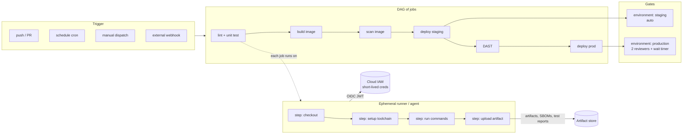
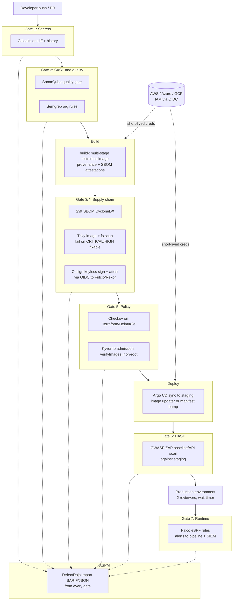

# Cluster 06: CI/CD Pipelines

| | |
|---|---|
| **Cluster** | 06 CI/CD Pipelines |
| **Anchor** | GitHub Actions |
| **Bridges** | Jenkins, Azure DevOps (Azure Pipelines) |
| **Core unifying pattern** | Event-driven DAG runners, ephemeral containers, OIDC workload identity |
| **Prerequisites** | Git (00-foundations), Docker and Kubernetes basics (04), one cloud IAM model (01) |
| **Capstone phases** | Phase 1 (GitHub Actions, Months 1-4), Phase 3 (Jenkins and Azure DevOps bridges, Months 9-12), Phase 5 (7-gate DevSecOps pipeline, Months 17-20) |

> After this cluster you can design, write, secure and debug a CI/CD pipeline on any of the three engines, explain why they are the *same machine with different vocabulary*, and build the capstone's seven-gate DevSecOps pipeline that takes a commit to a signed, attested, policy-checked, runtime-monitored deployment without a single long-lived cloud credential.

---

## 1. Why This Cluster Exists

Before CI servers, "integration" was a person: someone pulled every branch together on a Friday, ran the build by hand, and discovered that two weeks of divergent work did not compile. CruiseControl (2001) and Hudson/Jenkins (2005) automated that step: a daemon watched version control, built every change, and emailed whoever broke it. That was Continuous Integration.

Three things then changed the shape of the problem:

1. **Containers made build environments disposable.** A build no longer depends on what someone installed on the build server last year; it runs in a fresh container that is thrown away afterwards. "Works on the CI box" stopped being a thing you could get away with.
2. **Pipelines became code.** The pipeline definition moved out of a GUI and into a file in the repository (`Jenkinsfile`, `.github/workflows/*.yml`, `azure-pipelines.yml`), versioned and reviewed like everything else.
3. **OIDC replaced static credentials.** Instead of pasting a cloud access key into a secret store, the CI system proves *who it is* (this repository, this branch, this workflow) with a short-lived signed JWT, and the cloud exchanges it for temporary credentials. There is nothing to leak.

Every modern CI/CD engine is now the same machine: **an event triggers a directed acyclic graph (DAG) of jobs; each job runs its steps in an ephemeral container or VM; jobs pass artifacts to each other; deployment jobs wait at environment gates for approval; the whole thing authenticates to clouds via OIDC**. Learn that machine once on GitHub Actions and Jenkins and Azure DevOps become translation exercises.

---

## 2. Pipeline Anatomy: The Universal Shape

| Layer | What it is | Why it matters |
|---|---|---|
| **Trigger** | An event (git push, PR opened, cron, manual button, API call, release published) that creates a run | Determines *which ref* and *which identity* the run has. Fork PRs and `pull_request_target` are where most CI security incidents start |
| **DAG of jobs** | Jobs with declared dependencies. Independent jobs run in parallel; dependent ones wait | Parallelism is free speed. The DAG also defines the *blast radius* of a failure |
| **Steps on an ephemeral runner** | Sequential commands or reusable actions executed in a fresh VM or container that is destroyed after the job | Reproducibility, isolation, and nothing left behind for an attacker to read |
| **Artifacts** | Files that outlive the job: test reports, SBOMs, binaries, images (in a registry), Terraform plans | The only legitimate way for one job to hand data to another |
| **Environments and approvals** | Named deployment targets with protection rules (reviewers, wait timers, branch restrictions, custom checks) and environment-scoped secrets | Where human judgment and policy insert themselves into an otherwise automated flow |
| **Identity** | The run's token (`GITHUB_TOKEN`, `System.AccessToken`, Jenkins credentials) plus OIDC tokens exchanged for cloud credentials | Least privilege at every hop. Static secrets are a smell |

### What "ephemeral" buys you

A GitHub-hosted runner, a Jenkins Kubernetes agent pod and an Azure Pipelines Microsoft-hosted agent all follow the same lifecycle: **provision → register → run exactly one job → deregister → destroy**. Consequences:

- No state leaks between jobs (a compromised job cannot read another team's workspace).
- Caches must be explicit (`actions/cache`, `Cache@2`, jobcacher) because the disk is gone.
- Toolchains must be installed per job (`setup-python`, `tools {}`, `UsePythonVersion@0`) or baked into a container image.
- Scaling is a scheduler problem: Actions Runner Controller, the Jenkins Kubernetes plugin and Azure scale set agents all turn "I need a runner" into "schedule a pod/VM".

---

## 3. Three-Way Comparison Matrix

| Dimension | GitHub Actions (anchor) | Jenkins | Azure DevOps (Azure Pipelines) |
|---|---|---|---|
| **Config language** | YAML in `.github/workflows/*.yml`; expressions `${{ }}` | Groovy `Jenkinsfile` (Declarative DSL on top of Scripted); Shared Libraries in Groovy | YAML `azure-pipelines.yml`; three expression syntaxes (`${{ }}` compile-time, `$[ ]` runtime, `$(var)` macro) |
| **Runners / agents** | GitHub-hosted VMs (Ubuntu, Windows, macOS, larger runners, GPU) or self-hosted; ARC for Kubernetes | Controller + agents (static SSH/JNLP, or ephemeral Kubernetes pods via Kubernetes plugin) | Microsoft-hosted VMs, self-hosted agents, VM scale set agents, container agents on AKS (KEDA) |
| **DAG and parallelism** | `jobs.<id>.needs`; jobs parallel by default; `strategy.matrix` up to 256 jobs | `stages` sequential by default; `parallel {}` and `matrix {}` directives; parallelism bounded by agent capacity | `stages` → `jobs` with `dependsOn`; jobs parallel within a stage by default; `strategy: matrix` and `parallel: N` slicing |
| **Reuse mechanisms** | Reusable workflows (`workflow_call`), composite actions, JavaScript actions, Docker container actions, Marketplace | Shared Libraries (`vars/`, `src/`, `resources/`), plugins, Job DSL, Pipeline templates (CloudBees) | Templates: step, job, stage, variable; `extends` templates for governance; Marketplace extensions (tasks) |
| **Secrets and OIDC** | Repo / environment / organisation secrets; `GITHUB_TOKEN` with `permissions:`; first-class OIDC issuer `token.actions.githubusercontent.com` | Credentials plugin (global/folder/system scopes); external providers (Vault, AWS Secrets Manager, Kubernetes Credentials Provider); no native OIDC issuer, use agent pod identity (IRSA, Workload Identity) | Secret variables, variable groups linked to Key Vault, secure files; service connections with **workload identity federation** (OIDC); `System.AccessToken` |
| **Environments / approvals** | `environment:` with required reviewers (up to 6), wait timer, branch/tag restrictions, custom deployment protection rules via GitHub Apps | `input` step (blocks an executor unless in `options`), Lockable Resources, Promoted Builds; no native "environment" object | Environments with approvals, branch control, business hours, exclusive lock, invoke Azure Function / REST API checks, required template check |
| **Caching** | `actions/cache` (10 GB per repo, LRU eviction), built-in cache in `setup-*` actions, Docker buildx `cache-to: type=gha` | No native cache; jobcacher plugin, persistent volume on pod template, or external (S3, registry) | `Cache@2` with `key` / `restoreKeys` (scoped per pipeline, 10 GB) |
| **Artifacts** | `actions/upload-artifact@v4` / `download-artifact@v4` (immutable, per-run, 90-day default retention) | `archiveArtifacts`, `stash` / `unstash` (same run), fingerprints, external Artifactory/Nexus | Pipeline artifacts (`PublishPipelineArtifact@1`), build artifacts (legacy), Azure Artifacts feeds (npm/pip/Maven/NuGet/Universal) |
| **Marketplace / plugins** | GitHub Marketplace (~20k actions); install = reference in YAML; verified creators badge | ~1,900 plugins installed into the controller; version drift and CVE surface are real | Visual Studio Marketplace extensions installed per organisation; first-party tasks versioned `Task@N` |
| **Self-hosted on Kubernetes** | Actions Runner Controller (ARC) with runner scale sets; ephemeral pods; Docker-in-Docker or Kubernetes container mode | Kubernetes plugin: `podTemplate` with one container per tool; the most mature of the three for pod-per-build | Self-hosted agent container image on AKS scaled by KEDA `azure-pipelines` scaler; less turnkey than ARC |
| **Security posture** | Strong defaults improving (read-only `GITHUB_TOKEN` default, Dependabot for actions, OpenSSF Scorecard, SHA pinning, `pull_request_target` footgun, script injection via `${{ }}`) | Everything depends on hardening the controller: matrix auth, script sandbox, CSRF crumbs, agent-to-controller access control, zero executors on controller, LTS CVE cadence | Resource protection (pipelines must be authorised to use service connections / environments / pools), job authorization scope, fork protections, template `extends` enforcement; decorators for org-wide injected steps |
| **Pricing** | Free for public repos; private repos get 2,000-50,000 minutes/month by plan; per-minute billing with OS multipliers (Linux 1x, Windows 2x, macOS 10x); self-hosted free | Software is free (MIT); you pay for compute, operations and the engineer who runs it; CloudBees CI for commercial support | Free tier: one Microsoft-hosted parallel job (1,800 min/month) after request, one self-hosted parallel job; additional parallel jobs billed per month, not per minute |
| **Where it is weak** | Debugging is slow (push to test), no local runner parity (`act` is approximate), workflow log retention, limited pipeline visualisation across repos | Groovy CPS quirks (`@NonCPS`), plugin sprawl, controller as single point of failure, UI age, security surface | Three expression syntaxes, slower hosted agents, Marketplace quality variance, classic-vs-YAML split, parallel-job grant friction, innovation pace lags GitHub |

---

## 4. Anchor-and-Bridge Vocabulary Mapping

The hierarchy is the first thing to translate. GitHub Actions has **workflow → job → step**. Jenkins has **pipeline → stage → step**. Azure DevOps has **pipeline → stage → job → step**, with the stage layer being the one GitHub Actions lacks (you emulate it with `needs` chains or reusable workflows).

| Concept | GitHub Actions | Jenkins (Declarative) | Azure Pipelines |
|---|---|---|---|
| Pipeline definition file | `.github/workflows/ci.yml` | `Jenkinsfile` | `azure-pipelines.yml` |
| Top-level unit | `workflow` | `pipeline {}` | pipeline (file) |
| Grouping of jobs | (none; use `needs` or reusable workflows) | `stage` | `stage` |
| Unit of scheduling on a machine | `job` | `stage` with its own `agent`, or whole pipeline on one agent | `job` / `deployment` job |
| Atomic action | `step` (`uses:` or `run:`) | `step` (`sh`, `junit`, plugin steps) | `step` (`task:`, `script:`, `bash:`, `pwsh:`) |
| Where it runs | `runs-on:` label, `container:` | `agent { label / docker / kubernetes }` | `pool:` with `vmImage` or `name` + `demands`, `container:` |
| Trigger | `on: push / pull_request / schedule / workflow_dispatch` | `triggers { cron / pollSCM / upstream }`, Multibranch webhook | `trigger:` / `pr:` / `schedules:` / `resources:` |
| Manual inputs | `workflow_dispatch.inputs` | `parameters { string / choice / booleanParam }` | `parameters:` (runtime) |
| Dependency | `needs: [a, b]` | stage order, or `parallel` | `dependsOn: [A, B]` |
| Conditional | `if: ${{ ... }}` | `when { branch / expression / allOf }` | `condition: and(succeeded(), eq(...))` |
| Matrix | `strategy.matrix` | `matrix { axes { axis {} } excludes {} }` | `strategy: matrix:` |
| Timeout | `timeout-minutes:` | `options { timeout(time: 30, unit: 'MINUTES') }` | `timeoutInMinutes:` |
| Retry | (none native; action or re-run) | `retry(3) {}` | `retryCountOnTaskFailure:` |
| Environment variables | `env:` at workflow / job / step | `environment {}` | `variables:` / `env:` on a step |
| Secrets | `${{ secrets.X }}` | `credentials('id')`, `withCredentials` | `$(X)` secret variable, variable group, `AzureKeyVault@2` |
| Run token | `GITHUB_TOKEN` + `permissions:` | controller credentials (no automatic token) | `$(System.AccessToken)` + job authorization scope |
| Cloud auth | OIDC via `id-token: write` + `configure-aws-credentials` / `azure/login` / `google-github-actions/auth` | agent pod ServiceAccount + IRSA / Workload Identity; Vault JWT auth | Service connection with workload identity federation |
| Reusable pipeline | `workflow_call` reusable workflow | Shared Library `vars/standardPipeline.groovy` | `extends: template: pipeline.yml@templates` |
| Reusable step bundle | composite action | Shared Library `vars/mystep.groovy` | step template `- template: steps.yml` |
| Custom logic in a real language | JavaScript / Docker action | plugin (Java) or Groovy `src/` | Marketplace extension (TypeScript/Node task) |
| Deployment gate | `environment:` + required reviewers | `input` step, Lockable Resources | environment approvals and checks, deployment job |
| Deployment strategy | manual (or Argo Rollouts externally) | manual | `strategy: runOnce / rolling / canary` lifecycle hooks |
| Artifact within run | `upload-artifact@v4` / `download-artifact@v4` | `stash` / `unstash`, `archiveArtifacts` | `PublishPipelineArtifact@1` / `DownloadPipelineArtifact@2` |
| Cache | `actions/cache@v4` | jobcacher plugin or PVC | `Cache@2` |
| Concurrency control | `concurrency: { group, cancel-in-progress }` | `disableConcurrentBuilds()`, `lock()`, `milestone()` | `lockBehavior: sequential`, exclusive lock check |
| Test report | upload JUnit XML + reporter action; Checks API | `junit 'target/**/*.xml'` | `PublishTestResults@2` |
| Step summary | `$GITHUB_STEP_SUMMARY` | build description / `currentBuild.description` | `##vso[task.uploadsummary]` |
| Set output | `echo "k=v" >> $GITHUB_OUTPUT` | `env.K = ...` / `return` from step | `##vso[task.setvariable variable=k;isOutput=true]v` |
| Debug | `ACTIONS_STEP_DEBUG=true`, `act` | Replay, Script Console, `-Dorg.jenkinsci.plugins.workflow...` logs | `system.debug=true` variable |
| Local emulation | `act` (approximate) | run controller in Docker; JenkinsPipelineUnit | none official |
| Scaling on Kubernetes | ARC runner scale sets | Kubernetes plugin pod templates | KEDA-scaled agent Deployment on AKS |

Read the mapping once, then forget it and let the pattern carry you: **every row is the same primitive; only the spelling changes.**

---

## 5. The Reference "Secure Pipeline" Architecture

This is the pipeline the capstone converges on in Phase 5. Each gate maps to tools documented in [08-devsecops](../08-devsecops/). The CI engine is interchangeable; the gates and the trust boundary are not.

### Trust boundaries the pipeline must respect

| Boundary | Rule | Enforcement |
|---|---|---|
| Source → CI | Only reviewed code reaches a privileged run. Fork PRs run with read-only tokens and no secrets | Branch protection / branch policies; `pull_request` not `pull_request_target`; fork PR protections |
| CI → Registry | Only images built by the pipeline, from the default branch, are pushed; every image is signed and has SBOM + provenance | OIDC-scoped push identity; Cosign keyless sign with subject = workflow identity |
| Registry → Cluster | Only signed images from the expected identity are admitted; no root, no privileged | Kyverno `verifyImages` with keyless issuer/subject; Pod Security Admission |
| CI → Cloud | No static keys anywhere. Each environment has its own role with a trust policy scoped to repo + branch/environment | OIDC federation (IAM role trust policy, Azure federated credential, GCP Workload Identity Pool) |
| CI → Production | Humans approve, with a record, and only from protected refs | Environment protection rules / approvals and checks / `input` step with RBAC |
| Findings → Humans | Every scanner result lands in one place with deduplication and SLA tracking | SARIF to code scanning + DefectDojo import |

---

## 6. Learning Order and Time Budget

| Order | Tool | Role | When | Time | Why this order |
|---|---|---|---|---|---|
| 1 | [GitHub Actions](github-actions/README.md) | Anchor | Phase 1, Months 1-4 | 40 h | Zero infrastructure to run; first-class OIDC; the capstone's primary engine. Learn the DAG, matrix, caching, artifacts, environments and OIDC here |
| 2 | [Jenkins](jenkins/README.md) | Bridge | Phase 3, Months 9-12 | 20 h | Teaches you what the hosted platforms hide: the controller/agent protocol, ephemeral Kubernetes agents, Shared Libraries, and why running your own CI is an operational commitment. Still the most common engine in large enterprises and on-prem |
| 3 | [Azure DevOps](azure-devops/README.md) | Bridge | Phase 3, Months 9-12 | 15 h | YAML hierarchy mirrors Actions almost one-to-one; adds the explicit stage layer, deployment strategies and workload identity federation. Standard in Microsoft shops |
| 4 | 7-gate pipeline | Capstone | Phase 5, Months 17-20 | 30 h | Implemented first in Actions, then ported to a Jenkinsfile and Azure Pipelines YAML to prove the pattern transfers |

Suggested weekly rhythm for Phase 1 (GitHub Actions): two evenings on docs and concepts, one weekend block on labs, and every lab ends with a commit to the capstone repository.

---

## 7. Tool Folders

| Folder | Role | Contents |
|---|---|---|
| [github-actions/](github-actions/) | Anchor | Workflow syntax, jobs and steps, expressions, caching, artifacts, reusable workflows and custom actions, environments, OIDC to AWS/Azure/GCP, ARC on Kubernetes, security hardening, GHAS, Docker builds with attestations and Cosign, the five reference workflows including the 7-gate pipeline |
| [jenkins/](jenkins/) | Bridge | Controller/agent architecture, Docker and Helm installs, JCasC, Declarative vs Scripted, Jenkinsfile anatomy, Kubernetes pod templates, Shared Libraries, Multibranch, credentials, Kaniko/BuildKit, hardening, backup/DR, migration to Actions, the 7-gate Jenkinsfile |
| [azure-devops/](azure-devops/) | Bridge | Services overview, `azure-pipelines.yml` anatomy, templates and `extends`, deployment jobs and strategies, environments with checks, service connections with workload identity federation, agents on AKS, tasks, Azure Artifacts, Boards and branch policies, YAML security, `az pipelines` CLI, migration from Actions, the 7-gate Azure Pipelines YAML |

Each folder follows the standard kit: `README.md`, `01-installation-and-setup.md`, `02-core-concepts.md`, `03-commands-and-cheatsheet.md`, `04-hands-on-labs.md`, `05-production-patterns.md`, `06-troubleshooting.md`, `07-interview-questions.md`.

---

## 8. Related Clusters

- [04-containers-and-idp](../04-containers-and-idp/) - the images the pipeline builds and the clusters it deploys to (Docker, Kubernetes, Helm, Argo CD, Backstage Golden Path templates that scaffold these pipelines).
- [05-infrastructure-as-code](../05-infrastructure-as-code/) - Terraform plan-on-PR / apply-on-merge is a CI/CD concern; see the reference workflow in [github-actions/04-hands-on-labs.md](github-actions/04-hands-on-labs.md).
- [08-devsecops](../08-devsecops/) - the twenty tools behind the seven gates.
- [01-cloud](../01-cloud/) - the IAM side of OIDC federation (AWS IAM roles and trust policies, Azure Entra federated credentials, GCP Workload Identity Federation).
