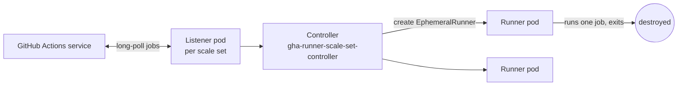

# GitHub Actions: Installation and Setup

| | |
|---|---|
| **Cluster** | 06 CI/CD Pipelines |
| **Role** | Anchor |
| **Prerequisites** | A GitHub account, Git installed, Docker Desktop or Podman, a kind cluster for the ARC section |
| **Target version** | GitHub.com, `gh` CLI 2.60+, runner 2.32x+, ARC 0.10+, `act` 0.2.70+ |
| **Capstone phase** | Phase 1 (Months 1-4) |

> There is nothing to "install" for GitHub-hosted Actions; the engine is part of GitHub. This file gets your repository, local tooling and identity set up correctly, runs a first workflow, then covers the three things that *do* need installing: the `gh` CLI, a self-hosted runner (bare VM and Actions Runner Controller on Kubernetes), and `act` for local iteration. You will finish with a repository whose first workflow has run green and a self-hosted runner pool on a kind cluster.

---

## 1. Prerequisites and Tooling

### 1.1 Install the GitHub CLI

```bash
# Linux (Debian/Ubuntu)
sudo mkdir -p -m 755 /etc/apt/keyrings
wget -qO- https://cli.github.com/packages/githubcli-archive-keyring.gpg \
  | sudo tee /etc/apt/keyrings/githubcli-archive-keyring.gpg > /dev/null
echo "deb [arch=$(dpkg --print-architecture) signed-by=/etc/apt/keyrings/githubcli-archive-keyring.gpg] https://cli.github.com/packages stable main" \
  | sudo tee /etc/apt/sources.list.d/github-cli.list > /dev/null
sudo apt update && sudo apt install gh

# macOS
brew install gh

# Windows
winget install --id GitHub.cli
```

Authenticate with the browser flow (preferred over a PAT):

```bash
gh auth login --hostname github.com --git-protocol https --web
gh auth status
```

Expected output:

```text
github.com
  ✓ Logged in to github.com account <USERNAME> (keyring)
  - Active account: true
  - Git operations protocol: https
  - Token: gho_************************************
  - Token scopes: 'gist', 'read:org', 'repo', 'workflow'
```

The `workflow` scope is required to push changes to `.github/workflows/`. Without it, `git push` is rejected with `refusing to allow an OAuth App to create or update workflow`.

### 1.2 Local linting

```bash
# actionlint: schema + shellcheck + expression checks for workflow files
brew install actionlint            # macOS
go install github.com/rhysd/actionlint/cmd/actionlint@latest   # any platform with Go

# zizmor: security linter for workflows (template injection, pull_request_target, unpinned actions)
pipx install zizmor
```

Run them from the repository root:

```bash
actionlint
zizmor .github/workflows/
```

---

## 2. Repository Setup

### 2.1 Create the capstone repository

```bash
gh repo create <OWNER>/capstone-platform --private --clone --description "Unified DevSecOps capstone"
cd capstone-platform
mkdir -p .github/workflows services/fastapi-api services/springboot-api infra/terraform
```

### 2.2 Repository settings that matter for Actions

Set these once, via UI (Settings → Actions → General) or the API:

```bash
# Default GITHUB_TOKEN permissions: read-only (the secure default; declare writes per workflow)
gh api --method PUT repos/<OWNER>/capstone-platform/actions/permissions/workflow \
  -f default_workflow_permissions=read \
  -F can_approve_pull_request_reviews=false

# Allow only actions from GitHub, verified creators, and your own org
gh api --method PUT repos/<OWNER>/capstone-platform/actions/permissions \
  -F enabled=true -f allowed_actions=selected
gh api --method PUT repos/<OWNER>/capstone-platform/actions/permissions/selected-actions \
  -F github_owned_allowed=true -F verified_allowed=true \
  -f 'patterns_allowed[]=<OWNER>/*' \
  -f 'patterns_allowed[]=aws-actions/*' \
  -f 'patterns_allowed[]=docker/*' \
  -f 'patterns_allowed[]=sigstore/*' \
  -f 'patterns_allowed[]=aquasecurity/*'

# Require approval for all outside collaborators' workflow runs on fork PRs
gh api --method PUT repos/<OWNER>/capstone-platform/actions/permissions/fork-pr-contributor-approval \
  -f approval_policy=all_external_contributors
```

Verify:

```bash
gh api repos/<OWNER>/capstone-platform/actions/permissions/workflow
```

```json
{
  "default_workflow_permissions": "read",
  "can_approve_pull_request_reviews": false
}
```

### 2.3 Branch protection with a required check

```bash
gh api --method PUT repos/<OWNER>/capstone-platform/branches/main/protection \
  --input - <<'EOF'
{
  "required_status_checks": { "strict": true, "contexts": ["ci / test (3.12)"] },
  "enforce_admins": true,
  "required_pull_request_reviews": { "required_approving_review_count": 1, "dismiss_stale_reviews": true },
  "restrictions": null,
  "required_linear_history": true,
  "allow_force_pushes": false,
  "allow_deletions": false
}
EOF
```

Prefer repository **rulesets** (Settings → Rules) in new repositories; they support the same checks plus signed-commit and tag rules, and can be applied organisation-wide.

---

## 3. First Workflow

Create `.github/workflows/hello.yml`:

```yaml
name: hello

on:
  push:
    branches: [main]
  workflow_dispatch:
    inputs:
      greeting:
        description: "Who to greet"
        type: string
        default: "world"

permissions:
  contents: read

jobs:
  hello:
    runs-on: ubuntu-24.04
    timeout-minutes: 5
    steps:
      - name: Check out
        uses: actions/checkout@11bd71901bbe5b1630ceea73d27597364c9af683 # v4.2.2

      - name: Greet
        run: echo "Hello, ${GREETING}! Running on ${RUNNER_OS} for ${GITHUB_REPOSITORY}@${GITHUB_SHA::7}"
        env:
          GREETING: ${{ inputs.greeting || 'world' }}

      - name: Write a step summary
        run: |
          {
            echo "## Hello run"
            echo "| Key | Value |"
            echo "|---|---|"
            echo "| Actor | ${GITHUB_ACTOR} |"
            echo "| Ref | ${GITHUB_REF_NAME} |"
            echo "| Run | ${GITHUB_RUN_ID} attempt ${GITHUB_RUN_ATTEMPT} |"
          } >> "$GITHUB_STEP_SUMMARY"
```

Two deliberate habits appear even in a hello-world: the action is pinned to a commit SHA with the version as a comment, and the user-controlled input is passed through `env:` rather than interpolated into the script with `${{ }}` (see [05-production-patterns.md](05-production-patterns.md#script-injection)).

Commit, push and watch:

```bash
git add .github/workflows/hello.yml
git commit -m "ci: add hello workflow"
git push origin main

gh run watch --exit-status
```

Expected output (abridged):

```text
✓ main hello · 12345678901
Triggered via push about 1 minute ago

JOBS
✓ hello in 8s (ID 98765432101)
  ✓ Set up job
  ✓ Check out
  ✓ Greet
  ✓ Write a step summary
  ✓ Complete job
```

Trigger it manually with an input:

```bash
gh workflow run hello --field greeting="capstone"
gh run list --workflow hello --limit 3
```

---

## 4. Self-Hosted Runner on a VM

Use a self-hosted runner when you need network access to private resources (VPC-only databases, on-prem Jenkins migration targets), specific hardware (GPU), or to escape per-minute billing. Treat it as a privileged host.

### 4.1 Register a runner

In the repository (or organisation) UI: Settings → Actions → Runners → New self-hosted runner. The UI gives you a short-lived registration token; the equivalent API call is:

```bash
TOKEN=$(gh api --method POST repos/<OWNER>/capstone-platform/actions/runners/registration-token --jq .token)
```

On the runner host (Ubuntu 24.04, non-root user `runner`):

```bash
sudo useradd --create-home --shell /bin/bash runner
sudo -iu runner
mkdir actions-runner && cd actions-runner

RUNNER_VERSION=2.321.0
curl -fsSL -o actions-runner.tar.gz \
  "https://github.com/actions/runner/releases/download/v${RUNNER_VERSION}/actions-runner-linux-x64-${RUNNER_VERSION}.tar.gz"
tar xzf actions-runner.tar.gz && rm actions-runner.tar.gz

./config.sh \
  --url https://github.com/<OWNER>/capstone-platform \
  --token "<REGISTRATION_TOKEN>" \
  --name "vm-runner-01" \
  --labels self-hosted,linux,x64,vpc \
  --runnergroup Default \
  --work _work \
  --ephemeral \
  --unattended
```

`--ephemeral` makes the runner take exactly one job and then deregister, which is the only safe mode for anything that runs untrusted code. Pair it with a systemd unit that restarts and re-registers (or use ARC, below, which does this for you).

```bash
exit  # back to a sudo-capable user
cd /home/runner/actions-runner
sudo ./svc.sh install runner
sudo ./svc.sh start
sudo ./svc.sh status
```

Expected output:

```text
● actions.runner.<OWNER>-capstone-platform.vm-runner-01.service - GitHub Actions Runner (<OWNER>-capstone-platform.vm-runner-01)
     Loaded: loaded (/etc/systemd/system/actions.runner....service; enabled)
     Active: active (running)
```

Target it with:

```yaml
jobs:
  integration:
    runs-on: [self-hosted, linux, vpc]
```

### 4.2 Runner groups (organisation level)

Runner groups control which repositories may use which runners. Create one for production deploy runners and restrict it to the platform repositories:

```bash
gh api --method POST orgs/<ORG>/actions/runner-groups \
  -f name=prod-deployers -f visibility=selected \
  -F allows_public_repositories=false \
  -F restricted_to_workflows=true \
  -f 'selected_workflows[]=<ORG>/capstone-platform/.github/workflows/deploy-prod.yml@refs/heads/main'
```

`restricted_to_workflows` is the important flag: even a repository that is allowed to use the group can only do so from the named workflow on the named ref.

---

## 5. Actions Runner Controller (ARC) on Kubernetes

ARC is the GitHub-maintained operator that runs ephemeral runner pods. Use the **runner scale set** mode (the legacy `RunnerDeployment` CRDs are deprecated). The architecture: one `gha-runner-scale-set-controller` per cluster, one `gha-runner-scale-set` Helm release per runner pool (each registers a scale set with GitHub and spawns a listener pod that long-polls for jobs).



### 5.1 Create a GitHub App for ARC (preferred over a PAT)

1. Organisation Settings → Developer settings → GitHub Apps → New GitHub App.
2. Permissions: Repository `Actions: Read`, `Administration: Read & write` (repo-level runners) or Organization `Self-hosted runners: Read & write` (org-level), Repository `Metadata: Read`.
3. Install the app on the organisation; note the **App ID**, **Installation ID**, and download the **private key** PEM.

### 5.2 Install on kind

```bash
kind create cluster --name arc --image kindest/node:v1.31.2

kubectl create namespace arc-systems
kubectl create namespace arc-runners

# Controller
helm install arc \
  --namespace arc-systems \
  oci://ghcr.io/actions/actions-runner-controller-charts/gha-runner-scale-set-controller \
  --version 0.10.1

# Credentials for the scale set (GitHub App)
kubectl create secret generic arc-github-app \
  --namespace arc-runners \
  --from-literal=github_app_id="<APP_ID>" \
  --from-literal=github_app_installation_id="<INSTALLATION_ID>" \
  --from-file=github_app_private_key=./arc-app.private-key.pem
```

Scale set values file `arc-values.yaml`:

```yaml
githubConfigUrl: https://github.com/<ORG>
githubConfigSecret: arc-github-app

runnerGroup: default
runnerScaleSetName: k8s-linux          # this is the runs-on label

minRunners: 0
maxRunners: 10

# "kubernetes" mode runs each job's container steps as separate pods via a hook;
# "dind" mode gives docker build support at the cost of a privileged sidecar.
containerMode:
  type: kubernetes
  kubernetesModeWorkVolumeClaim:
    accessModes: ["ReadWriteOnce"]
    storageClassName: standard
    resources:
      requests:
        storage: 5Gi

template:
  spec:
    securityContext:
      runAsNonRoot: true
      runAsUser: 1001
      fsGroup: 1001
    containers:
      - name: runner
        image: ghcr.io/actions/actions-runner:2.321.0
        command: ["/home/runner/run.sh"]
        resources:
          requests: { cpu: "500m", memory: "1Gi" }
          limits:   { cpu: "2",    memory: "4Gi" }
        env:
          - name: ACTIONS_RUNNER_REQUIRE_JOB_CONTAINER
            value: "false"
```

```bash
helm install k8s-linux \
  --namespace arc-runners \
  --values arc-values.yaml \
  oci://ghcr.io/actions/actions-runner-controller-charts/gha-runner-scale-set \
  --version 0.10.1

kubectl get pods --namespace arc-systems
```

Expected output:

```text
NAME                                                   READY   STATUS    RESTARTS   AGE
arc-gha-rs-controller-7c9f6c6b8d-xk2lp                 1/1     Running   0          2m
k8s-linux-754b578d-listener                            1/1     Running   0          40s
```

### 5.3 Verify with a workflow

```yaml
name: arc-smoke
on: workflow_dispatch
permissions:
  contents: read
jobs:
  smoke:
    runs-on: k8s-linux
    steps:
      - run: |
          echo "runner=$RUNNER_NAME"
          cat /etc/os-release | head -2
          nproc; free -h
```

```bash
gh workflow run arc-smoke
kubectl get pods --namespace arc-runners --watch
```

You will see a pod named `k8s-linux-<hash>-runner-<hash>` appear, run, and terminate. `minRunners: 0` means zero cost when idle; set `minRunners: 2` for latency-sensitive pools.

### 5.4 Uninstall

```bash
helm uninstall k8s-linux --namespace arc-runners
helm uninstall arc --namespace arc-systems
kind delete cluster --name arc
```

---

## 6. Local Iteration with `act`

`act` runs workflows locally in Docker. It is approximate (no OIDC, no environments, different runner images), but it is the fastest way to iterate on shell logic and job wiring.

```bash
brew install act                       # macOS
curl -fsSL https://raw.githubusercontent.com/nektos/act/master/install.sh | sudo bash   # Linux

# Use the medium image (closer to ubuntu-latest than the micro image)
cat > ~/.actrc <<'EOF'
-P ubuntu-latest=catthehacker/ubuntu:act-latest
-P ubuntu-24.04=catthehacker/ubuntu:act-24.04
--container-architecture linux/amd64
EOF

act --list
act push --job hello
act workflow_dispatch --input greeting=local --secret-file .secrets.local
```

Expected output (abridged):

```text
[hello/hello] 🚀  Start image=catthehacker/ubuntu:act-24.04
[hello/hello]   ✅  Success - Main Check out
[hello/hello]   ✅  Success - Main Greet
[hello/hello] 🏁  Job succeeded
```

Keep `.secrets.local` out of Git (`echo .secrets.local >> .gitignore`) and never put real secrets in it; use throwaway values.

---

## 7. Verification Checklist

| Check | Command | Expected |
|---|---|---|
| CLI authenticated with `workflow` scope | `gh auth status` | scopes include `workflow` |
| Default token permissions read-only | `gh api repos/<OWNER>/<REPO>/actions/permissions/workflow` | `"default_workflow_permissions": "read"` |
| Allowed actions restricted | `gh api repos/<OWNER>/<REPO>/actions/permissions` | `"allowed_actions": "selected"` |
| First workflow green | `gh run list --workflow hello --limit 1` | `completed success` |
| Self-hosted runner online | `gh api repos/<OWNER>/<REPO>/actions/runners --jq '.runners[] | {name,status}'` | `"status": "online"` |
| ARC listener running | `kubectl get pods -n arc-systems` | listener pod `Running` |
| Workflow lints clean | `actionlint && zizmor .github/workflows/` | no findings |

Continue to [02-core-concepts.md](02-core-concepts.md).
