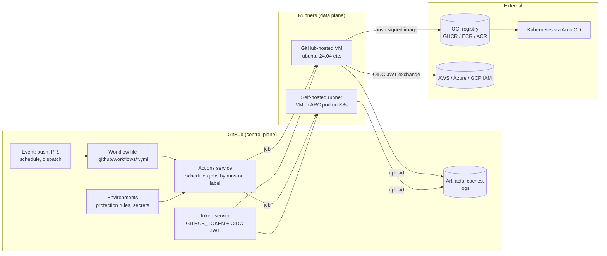

# GitHub Actions

| | |
|---|---|
| **Cluster** | 06 CI/CD Pipelines |
| **Role** | Anchor |
| **Category** | CI/CD engine (event-driven DAG runner, hosted or self-hosted) |
| **Prerequisites** | Git branching and PRs, Docker fundamentals, YAML, one cloud IAM model (AWS recommended) |
| **Target version** | GitHub.com (2025+ feature set), runner 2.32x+, `actions/*@v4`, Actions Runner Controller 0.10+ |
| **Capstone phase** | Phase 1 (Months 1-4), extended in Phase 5 (Months 17-20) |
| **Official docs** | https://docs.github.com/en/actions |

> GitHub Actions is the CI/CD engine built into GitHub: a YAML file in `.github/workflows/` declares *which events* should run *which DAG of jobs* on *which ephemeral runners*, and GitHub schedules, executes, stores artifacts and logs, and issues the run a short-lived identity. After this folder you will be able to write production-grade workflows with least-privilege tokens, matrix builds, caching, reusable workflows and custom actions, protected environments, OIDC federation to AWS/Azure/GCP with zero static keys, self-hosted runners on Kubernetes, and the capstone's full seven-gate DevSecOps pipeline.

## Why This Tool Exists

Before 2019 most GitHub repositories used an external CI service (Travis CI, CircleCI, Jenkins) that authenticated with a personal access token, polled or received webhooks, and reported status back through the Checks API. Every integration meant another token to rotate, another UI to learn, and another place where "who is allowed to deploy" was configured.

GitHub Actions collapsed that into the platform itself. The insights that made it work:

1. **The repository is the unit of trust.** The workflow already lives next to the code, so the run can be given an automatically-minted, automatically-expiring token (`GITHUB_TOKEN`) scoped to that repository. No PAT.
2. **Steps are composable units published as Git repositories.** An "action" is just a repo with an `action.yml`; `uses: owner/repo@ref` is a dependency declaration. This produced a marketplace of ~20,000 actions in a few years.
3. **Runners are disposable VMs with a standard toolchain image.** You never SSH into a build box. Caching and artifacts are explicit APIs because the disk does not survive the job.
4. **The run has a verifiable identity.** The OIDC token GitHub signs for each job carries claims (`repository`, `ref`, `environment`, `job_workflow_ref`) that a cloud IAM system can trust. This is the single biggest security improvement in CI/CD in a decade and it is why this wiki uses Actions as the anchor.

## Architecture

- **Event**: anything GitHub observes about the repository (push, PR, issue comment, release, cron, a manual button, an API call from another workflow).
- **Workflow file**: the YAML DAG. One file per workflow; one repository can have many.
- **Actions service**: parses the file, evaluates `on:` filters, expands `strategy.matrix`, resolves `needs`, and queues jobs by `runs-on` label.
- **Token service**: mints a `GITHUB_TOKEN` (an installation token for the GitHub Actions app) with the `permissions:` you declared, and on request an OIDC JWT describing the run.
- **Runner**: the agent binary (`actions/runner`) that polls for a job, downloads the actions it references, runs steps, streams logs, and exits. GitHub-hosted runners are destroyed after one job; self-hosted runners can be made ephemeral (`--ephemeral`) and ARC does this by default.
- **Artifacts / caches / logs**: blob storage attached to the run (artifacts) or to the repository (caches).
- **Environments**: named deployment targets that hold their own secrets and protection rules (required reviewers, wait timer, branch restrictions, custom checks).

## The Core Mental Model

1. **A workflow is a function from an event payload to a DAG of jobs.** Everything in `${{ github.* }}` is the event payload. `on:` filters decide whether the function is called; `if:` on jobs and steps prunes the DAG at runtime; `needs:` orders it; `strategy.matrix` fans it out.
2. **Each job is a fresh machine with a short-lived identity.** The runner starts empty (or with the standard image's tools), receives a token with exactly the `permissions:` you declared, runs steps in order, and is destroyed. Anything you want to keep must be uploaded as an artifact, written to a cache, pushed to a registry, or printed to a summary.
3. **Identity flows, secrets do not.** Instead of storing a cloud key, you declare `permissions: id-token: write`, ask GitHub for an OIDC JWT, and let the cloud's IAM decide whether *this repository on this branch in this environment* may assume a role. The trust policy on the cloud side is where authorisation lives.
4. **Actions are dependencies, and dependencies are supply chain.** `uses: org/action@v4` is a mutable tag that someone else controls. `uses: org/action@<40-char-sha> # v4.2.1` is immutable. Treat the Marketplace like PyPI.

If you hold these four ideas, the rest of the folder is detail.

## Anchor-and-Bridge Mapping

| Concept in GitHub Actions | Equivalent in Jenkins | Equivalent in Azure Pipelines |
|---|---|---|
| `.github/workflows/ci.yml` | `Jenkinsfile` | `azure-pipelines.yml` |
| workflow | `pipeline {}` | pipeline (file); `stages:` is the extra layer |
| job | `stage` with `agent` | `job:` / `deployment:` |
| step `run:` | `sh ''' '''` | `script:` / `bash:` |
| step `uses: owner/action@sha` | plugin step or Shared Library `vars/` call | `task: Name@Version` |
| `runs-on: ubuntu-latest` | `agent { label 'linux' }` / `agent { kubernetes { yaml } }` | `pool: { vmImage: ubuntu-latest }` |
| `needs:` | stage ordering, `parallel {}` | `dependsOn:` |
| `if:` | `when {}` | `condition:` |
| `strategy.matrix` | `matrix { axes {} }` | `strategy: matrix:` |
| `env:` | `environment {}` | `variables:` |
| `secrets.NAME` | `credentials('id')` | `$(NAME)` secret variable / variable group |
| `GITHUB_TOKEN` + `permissions:` | controller credentials | `System.AccessToken` + job authorization scope |
| OIDC `id-token: write` | agent pod ServiceAccount identity (IRSA / Workload Identity) | service connection with workload identity federation |
| reusable workflow (`workflow_call`) | Shared Library `vars/standardPipeline.groovy` | `extends: template:` |
| composite action | Shared Library step | step template |
| `environment:` + required reviewers | `input` step + Lockable Resources | environment approvals and checks |
| `actions/cache@v4` | jobcacher plugin / PVC | `Cache@2` |
| `upload-artifact@v4` | `archiveArtifacts` / `stash` | `PublishPipelineArtifact@1` |
| `concurrency:` | `disableConcurrentBuilds()`, `lock()` | `lockBehavior`, exclusive lock check |
| `$GITHUB_OUTPUT` | `env.X =` / step return | `##vso[task.setvariable ...;isOutput=true]` |
| `$GITHUB_STEP_SUMMARY` | `currentBuild.description` | `##vso[task.uploadsummary]` |
| `ACTIONS_STEP_DEBUG` | Replay + Script Console | `system.debug: true` |
| ARC runner scale set | Kubernetes plugin pod template | KEDA-scaled agent Deployment on AKS |

## Learning Path

| Step | File | Time |
|---|---|---|
| 1 | [01-installation-and-setup.md](01-installation-and-setup.md) - repo setup, `gh` CLI, first workflow, self-hosted runner, ARC on kind, `act` | 3 h |
| 2 | [02-core-concepts.md](02-core-concepts.md) - events, DAG, runners, contexts and expressions, tokens and OIDC, reuse, environments, security model | 6 h |
| 3 | [03-commands-and-cheatsheet.md](03-commands-and-cheatsheet.md) - full YAML reference, contexts, functions, `gh` commands, runner env files | 3 h |
| 4 | [04-hands-on-labs.md](04-hands-on-labs.md) - 10 progressive labs ending with the 7-gate pipeline, Terraform OIDC and nightly destroy | 16 h |
| 5 | [05-production-patterns.md](05-production-patterns.md) - hardening, OIDC trust policies, ARC at scale, cost, GHAS, release engineering, anti-patterns | 6 h |
| 6 | [06-troubleshooting.md](06-troubleshooting.md) - symptom tables, verbatim errors, debugging workflow | 2 h |
| 7 | [07-interview-questions.md](07-interview-questions.md) - 30 questions, junior to principal | 4 h |

Total: about 40 hours, matching the cluster time budget.

## Role in the Capstone

GitHub Actions is the capstone's primary CI/CD engine from Phase 1 onwards. In the unified capstone repository it provides:

- **Phase 1**: `ci-fastapi.yml` and `ci-springboot.yml` run lint, type-check, unit tests and Testcontainers integration tests on every PR, build multi-stage distroless images with buildx, push to GHCR with provenance and SBOM attestations, and sign them with Cosign keyless. The polyglot microservice pair is published automatically on merge to `main`.
- **Phase 2**: `terraform.yml` runs `terraform plan` on PRs (posting the plan as a PR comment) and `terraform apply` on merge, authenticating to AWS via OIDC with a role per environment. `nightly-destroy.yml` tears down the lab environment every night to control cost.
- **Phase 3**: the deploy job bumps the image tag in the GitOps repository so Argo CD syncs it; Jenkins and Azure DevOps ports of the same pipelines prove the pattern transfers. ARC runs self-hosted runners on the capstone EKS cluster for jobs that need VPC access.
- **Phase 4**: Backstage Software Templates scaffold new services with these workflows pre-wired; the workflows emit OpenTelemetry spans via the `otel-cicd-action` so pipeline duration shows up in Grafana.
- **Phase 5**: `devsecops.yml` is the seven-gate pipeline: Gitleaks → SonarQube/Semgrep → Syft/Trivy/Cosign → Checkov/Kyverno → OWASP ZAP → Falco → DefectDojo, with every scanner uploading SARIF to code scanning and JSON to DefectDojo.
- **Phase 6**: the same workflows run DeepEval/Promptfoo evals as merge-blocking checks for the AI agent service.

Artefacts produced: signed OCI images with attestations in GHCR, CycloneDX SBOMs, Terraform plans, SARIF reports, release notes and semantic-version tags.

## Further Reading

- GitHub Docs: Workflow syntax, Security hardening for GitHub Actions, About security hardening with OpenID Connect
- OpenSSF Scorecard and the Scorecard GitHub Action
- SLSA v1.0 specification, "Build L3" requirements and how GitHub artifact attestations map to them
- Sigstore documentation: Cosign keyless signing, Fulcio, Rekor
- Actions Runner Controller documentation (runner scale sets mode)
- "Zizmor" static analyser for GitHub Actions workflows (security linting)
- GitHub blog post series on `pull_request_target` and script injection vulnerabilities
