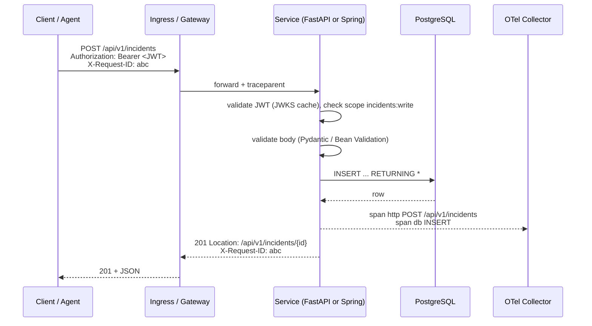
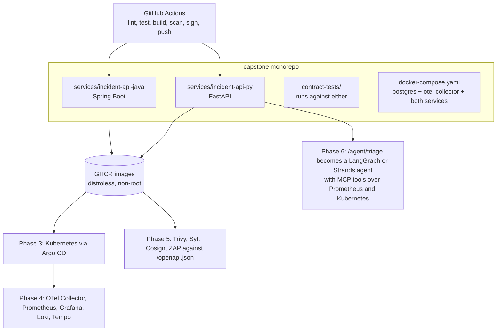

# Cluster 07: Backend & APIs

| | |
|---|---|
| **Cluster** | 07 Backend & APIs |
| **Tools** | Python 3.12+, FastAPI (anchor), Java 21 LTS, Spring Boot 3.3+ (anchor) |
| **Traditional silo** | Backend Software Engineer |
| **Core unifying pattern** | Async / virtual-thread REST and gRPC APIs, dependency injection, OpenAPI schemas |
| **Capstone phase** | Phase 1 (Months 1-4) |
| **Capstone deliverable** | A polyglot microservice pair (async Python FastAPI + Java 21 Spring Boot) implementing the same API contract, packaged in multi-stage distroless images with GitHub Actions tests and OCI publishing |

> This cluster teaches you to read, profile, debug and build production microservices in the two ecosystems that dominate enterprise and AI engineering. You will finish with two services that expose the *same* OpenAPI contract, the same health probes, the same metrics names and the same trace context, so that every later cluster (Kubernetes, CI/CD, DevSecOps gates, observability, SRE, AI agents) can treat them interchangeably.

---

## 1. Why a Platform, SRE or AI Engineer Must Own Both Ecosystems

The roadmap's thesis is that "tools within each horizontal layer share 85% of the same primitives". Nowhere is that truer than in backend services, and nowhere is the cost of *not* knowing the layer higher:

| Situation you will be in | Without backend fluency | With it |
|---|---|---|
| A Spring Boot pod is `OOMKilled` every 40 minutes | You raise the memory limit and move on | You read the GC log, see metaspace growth from a classloader leak, and fix `-XX:MaxRAMPercentage` plus the leak |
| p99 latency on a FastAPI service spikes under load | You add replicas | You `py-spy dump` the worker, see a synchronous `requests.get()` blocking the event loop, and move it to `run_in_threadpool` or `httpx.AsyncClient` |
| The Kubernetes readiness probe flaps during deploys | You lengthen `initialDelaySeconds` | You know the probe hits the DB pool and the pool is exhausted; you fix pool sizing and make the probe cheap |
| You are building an incident-triage AI agent | You call the LLM from a Lambda and hope | You stream SSE tokens from an async FastAPI endpoint with cancellation, timeouts, and OTel spans around every tool call |
| Trivy flags 40 CVEs in a Java image | You suppress them | You switch to a jlink'd Temurin JRE on a distroless base and get to zero |
| A developer asks the platform team for a "golden path" template | You hand them a generic Dockerfile | Your Backstage template scaffolds a FastAPI or Spring Boot service with health probes, metrics, OTel, structured logs and a hardened Dockerfile already wired |

Python is the lingua franca of cloud automation (boto3, Pulumi, CDK, Ansible, the Kubernetes client), of AI engineering (LangChain, LangGraph, Strands, vLLM, evals), and of FastAPI, the fastest path from a Pydantic model to a streaming API. Java and Spring Boot run the high-volume financial, telecom and retail cores you will be asked to operate, and the JVM's container behaviour (heap sizing, GC pauses, warm-up) is the single most common root cause of "Kubernetes is slow" tickets.

You do not need to be the best application developer on the team. You need to be the person who can open either codebase, find the health endpoint, understand the dependency wiring, attach a profiler, and ship a fix.

---

## 2. The Shared Patterns (Learn Once, Apply Twice)

Every production service in both ecosystems implements the same set of patterns. Learn them as *patterns*, then learn the two spellings.

```mermaid
flowchart LR
    subgraph Platform["Platform concerns (identical in both)"]
        CFG[12-factor config<br/>env vars, no secrets in code]
        DI[Dependency injection<br/>wire resources once]
        API[OpenAPI 3.1 contract<br/>generated from code]
        HEALTH[Liveness + readiness probes]
        SHUT[Graceful shutdown on SIGTERM]
        LOG[Structured JSON logs<br/>with trace_id and request_id]
        OTEL[OpenTelemetry traces + Prometheus metrics]
    end
    subgraph Py["FastAPI spelling"]
        P1[pydantic-settings BaseSettings]
        P2[Depends + lifespan]
        P3[/openapi.json auto]
        P4[/healthz /readyz]
        P5[uvicorn --timeout-graceful-shutdown]
        P6[structlog + contextvars]
        P7[opentelemetry-instrument + prometheus-fastapi-instrumentator]
    end
    subgraph Java["Spring Boot spelling"]
        J1["@ConfigurationProperties records"]
        J2["Constructor injection + @Bean"]
        J3[springdoc /v3/api-docs]
        J4[/actuator/health/liveness + readiness]
        J5[server.shutdown=graceful]
        J6[Logback JSON encoder + MDC]
        J7[Micrometer Tracing + /actuator/prometheus]
    end
    CFG --> P1 & J1
    DI --> P2 & J2
    API --> P3 & J3
    HEALTH --> P4 & J4
    SHUT --> P5 & J5
    LOG --> P6 & J6
    OTEL --> P7 & J7
```

| Pattern | What it means operationally | FastAPI | Spring Boot |
|---|---|---|---|
| **12-factor config** | All config from environment; one artefact runs in every environment | `pydantic_settings.BaseSettings` | `application.yaml` + `@ConfigurationProperties`, profiles |
| **Dependency injection** | Resources (DB pool, HTTP client, auth) are created once and handed to handlers; tests swap them | `Depends()`, `app.dependency_overrides` | Constructor injection, `@Bean`, `@MockBean`/`@TestConfiguration` |
| **OpenAPI schema** | Contract is generated from types, never hand-written; drives client gen, DAST (ZAP), and gateway config | Built in: `/openapi.json`, `/docs` | `springdoc-openapi`: `/v3/api-docs`, `/swagger-ui.html` |
| **Health endpoints** | Liveness = "restart me"; readiness = "stop routing to me". Readiness checks dependencies, liveness never does | `/healthz`, `/readyz` (hand-written) | `/actuator/health/liveness`, `/actuator/health/readiness` (built in) |
| **Graceful shutdown** | On SIGTERM: fail readiness, stop accepting, drain in-flight, close pools, exit 0 within `terminationGracePeriodSeconds` | uvicorn handles SIGTERM; lifespan `finally` closes pools | `server.shutdown=graceful` + `spring.lifecycle.timeout-per-shutdown-phase` |
| **Structured logging** | One JSON object per line; `trace_id`, `span_id`, `request_id`, `level`, `msg`; never `print()` | `structlog` + `contextvars` | Logback + `logstash-logback-encoder` or ECS encoder, MDC |
| **OTel instrumentation** | Traces to an OTel Collector over OTLP; Prometheus metrics scraped from `/metrics` | `opentelemetry-instrument uvicorn ...` (zero code) | Micrometer Tracing bridge + OTLP exporter (zero code beyond deps) |
| **Problem Details errors** | RFC 9457 `application/problem+json` body on every 4xx/5xx | Custom exception handler | `ProblemDetail` + `@ControllerAdvice` (built in since Spring 6) |
| **Non-root distroless image** | Multi-stage build; runtime image has no shell or package manager | `uv` build stage, `gcr.io/distroless/python3` or `python:slim` non-root | Maven/jlink build stage, `gcr.io/distroless/java21` or Temurin JRE non-root |

---

## 3. Comparison Matrix: FastAPI vs Spring Boot

| Dimension | FastAPI (Python 3.12+) | Spring Boot 3.3+ (Java 21) | Operational consequence |
|---|---|---|---|
| **Concurrency model** | Single-threaded asyncio event loop per worker process; `async def` handlers; sync handlers run in a threadpool (default 40 threads). Scale with N uvicorn workers (one per CPU) | One platform thread per request on Tomcat (default max 200), or **virtual threads** (`spring.threads.virtual.enabled=true`) giving millions of cheap blocking threads. Scale vertically first | A single blocking call in a FastAPI `async def` stalls every request on that worker. In Spring, a blocking call just parks a (virtual) thread |
| **Dependency injection** | Function-level: `Depends(get_db)`. Resolved per request, cached per request, overridable in tests | Container-level: constructor injection into singletons at startup. Fails fast at boot if wiring is wrong | Spring boot time grows with bean count (1-5 s typical); FastAPI starts in ~0.5 s but wiring errors surface on first request |
| **Validation** | Pydantic v2 (Rust core): request/response models, coercion, JSON Schema generation | Jakarta Bean Validation (`@Valid`, `@NotBlank`, `@Size`) on records/DTOs; Hibernate Validator | Both produce 400/422 with field-level details; both feed OpenAPI |
| **ORM / data** | SQLAlchemy 2.0 async + asyncpg; Alembic migrations. Explicit sessions, explicit queries | Spring Data JPA (Hibernate) + HikariCP; Flyway migrations. Repository interfaces, derived queries, lazy loading | JPA's lazy loading causes N+1 queries silently; SQLAlchemy makes you choose `selectinload` explicitly |
| **Security** | No built-in auth; compose from `OAuth2PasswordBearer`/`HTTPBearer` + PyJWT/`python-jose` validating against JWKS. You write the scope checks | Spring Security 6 filter chain; `oauth2ResourceServer().jwt()` validates against JWKS with one line; method security `@PreAuthorize` | Spring gives you more for free but with a steeper debugging curve (filter order). FastAPI is explicit and small |
| **Config** | `pydantic-settings` reads env vars / `.env`; typed and validated at import | `application.yaml` with profile overlays, env var relaxed binding (`SPRING_DATASOURCE_URL`), `@ConfigurationProperties` records validated at boot | Both fail fast on missing required config if you make fields required |
| **Testing** | `pytest` + `httpx.AsyncClient(transport=ASGITransport(app))`; dependency overrides; Testcontainers for Postgres; `respx` for HTTP mocks | JUnit 5 + `@SpringBootTest`/`@WebMvcTest`/`@DataJpaTest`; MockMvc; Testcontainers `@ServiceConnection`; WireMock | Spring slice tests are fast; full `@SpringBootTest` context startup is 3-10 s but cached across tests |
| **Packaging** | Wheel via `uv build`; lockfile `uv.lock`; container is the real artefact | Executable fat jar or **layered jar**; `uv`-equivalent is the Maven/Gradle wrapper; buildpacks via `bootBuildImage` | Layered jars make Docker layer caching work: dependencies change rarely, app code often |
| **Startup time** | 0.3-1 s | 2-6 s on JVM; 50-200 ms with GraalVM native image; CDS/AppCDS halves JVM start | Affects HPA scale-out latency and `initialDelaySeconds`/`startupProbe` design |
| **Memory (idle, container)** | 40-80 MB per worker | 150-400 MB (heap + metaspace + threads + code cache); set `-XX:MaxRAMPercentage=75` | JVM must be told about the container limit; Python workers are cheap but you run N of them |
| **Throughput (simple JSON)** | ~10-20k req/s per 4 workers with uvloop/httptools | ~30-60k req/s on 4 cores with virtual threads | Both are far beyond most workloads; the DB is the bottleneck |
| **Observability** | `prometheus-fastapi-instrumentator` for `/metrics`; `opentelemetry-instrument` zero-code agent; `structlog` | Actuator `/actuator/prometheus`; Micrometer Tracing + OTel exporter; Logback JSON | Metric names differ (`http_request_duration_seconds` vs `http_server_requests_seconds`); dashboards must use both or you relabel |
| **Streaming / SSE / WebSocket** | First-class: `StreamingResponse`, `sse-starlette`, `WebSocket` with async generators | `SseEmitter` / `ResponseBodyEmitter` on MVC; `Flux<ServerSentEvent>` on WebFlux | FastAPI is the natural home for LLM token streaming; Spring MVC + virtual threads handles SSE fine for moderate fan-out |
| **Where it is weak** | GIL limits CPU-bound work to one core per process; no compile-time type safety; dependency ecosystem churn | Slow start, memory hungry, auto-configuration "magic" hides failures; annotation-heavy | Pick by team and workload, not by benchmark |

---

## 4. Anchor-and-Bridge Delta Mapping

Both tools in this cluster are anchors, so the delta mapping is bidirectional. Learn FastAPI first (smaller surface area), then map every concept onto Spring Boot.

| Concept | FastAPI / Python | Spring Boot / Java |
|---|---|---|
| Application object | `app = FastAPI()` | `@SpringBootApplication` class + `SpringApplication.run` |
| Route group | `APIRouter(prefix="/api/v1/incidents", tags=["incidents"])` | `@RestController @RequestMapping("/api/v1/incidents")` |
| Handler | `@router.get("/{id}") async def get_incident(id: UUID)` | `@GetMapping("/{id}") ResponseEntity<Incident> get(@PathVariable UUID id)` |
| Request body model | Pydantic `BaseModel` | Java `record` + `@Valid` |
| Response model and status | `response_model=IncidentOut, status_code=201` | `ResponseEntity.status(201).body(...)` or `@ResponseStatus(CREATED)` |
| Query param with default | `limit: int = Query(20, le=100)` | `@RequestParam(defaultValue = "20") @Max(100) int limit` |
| Dependency | `def get_db() -> AsyncIterator[AsyncSession]` + `Depends(get_db)` | Constructor-injected `IncidentRepository` |
| Request-scoped resource with cleanup | `yield` dependency | `@Transactional` or try-with-resources inside the service |
| Global error mapping | `@app.exception_handler(IncidentNotFound)` | `@RestControllerAdvice` + `ProblemDetail` |
| Startup / shutdown hook | `@asynccontextmanager async def lifespan(app)` | `ApplicationRunner`, `@PreDestroy`, `SmartLifecycle` |
| Settings | `class Settings(BaseSettings)` | `@ConfigurationProperties(prefix="app") record AppProps(...)` |
| Profiles | `APP_ENV=prod` read in settings | `SPRING_PROFILES_ACTIVE=prod`, `application-prod.yaml` |
| Middleware | `@app.middleware("http")` / `BaseHTTPMiddleware` / ASGI middleware | `OncePerRequestFilter`, `HandlerInterceptor` |
| Auth | `HTTPBearer` + JWKS validation dependency | `SecurityFilterChain` + `oauth2ResourceServer(jwt)` |
| Scope check | `Security(require_scopes, scopes=["incidents:write"])` | `@PreAuthorize("hasAuthority('SCOPE_incidents:write')")` |
| Background work | `BackgroundTasks` / `asyncio.create_task` | `@Async` + `TaskExecutor` / `@Scheduled` |
| Migrations | Alembic | Flyway |
| DB pool | `create_async_engine(pool_size=10)` | HikariCP `maximumPoolSize=10` |
| Liveness | `GET /healthz` | `GET /actuator/health/liveness` |
| Readiness | `GET /readyz` | `GET /actuator/health/readiness` |
| Metrics | `GET /metrics` | `GET /actuator/prometheus` |
| OpenAPI | `GET /openapi.json`, `/docs` | `GET /v3/api-docs`, `/swagger-ui.html` |
| Test client | `httpx.AsyncClient(transport=ASGITransport(app=app))` | `MockMvc` / `TestRestTemplate` / `WebTestClient` |
| Dependency override in tests | `app.dependency_overrides[get_db] = fake_db` | `@MockBean` / `@TestConfiguration @Primary @Bean` |
| Package manager / build | `uv` (`pyproject.toml`, `uv.lock`) | Maven wrapper `./mvnw` (`pom.xml`) or Gradle wrapper |
| Lint / format / types | `ruff`, `mypy` | Checkstyle, SpotBugs, Error Prone |
| Dependency CVE scan | `pip-audit` | OWASP `dependency-check-maven` |
| Profiler | `py-spy`, `cProfile` | `async-profiler`, JFR, `jcmd` |
| Server | uvicorn (ASGI), optionally under gunicorn | Embedded Tomcat (servlet) or Netty (WebFlux) |
| Concurrency primitive | `asyncio.Task`, `asyncio.Semaphore` | Virtual thread, `Semaphore`, `StructuredTaskScope` (preview) |

---

## 5. The Reference Microservice Contract

Both services implement **exactly** this contract. It is the capstone's "incident API" and every later cluster builds on it: Kubernetes probes point at these paths, Prometheus scrapes these endpoints, ZAP scans this OpenAPI document, the LangGraph/Strands agent calls these routes in Phase 6.

### 5.1 Endpoints

| Method | Path | Purpose | Success | Errors |
|---|---|---|---|---|
| `GET` | `/healthz` (FastAPI) / `/actuator/health/liveness` (Spring) | Liveness. Never touches dependencies | `200 {"status":"ok"}` | none; if it fails the process is dead |
| `GET` | `/readyz` (FastAPI) / `/actuator/health/readiness` (Spring) | Readiness. Checks DB with a 1-second timeout | `200 {"status":"ok","checks":{"database":"up"}}` | `503` with failing check named |
| `GET` | `/metrics` (FastAPI) / `/actuator/prometheus` (Spring) | Prometheus exposition | `200 text/plain` | - |
| `GET` | `/openapi.json` (FastAPI) / `/v3/api-docs` (Spring) | OpenAPI 3.1 document | `200 application/json` | - |
| `GET` | `/api/v1/incidents` | List incidents, newest first | `200` page envelope | `400` bad filter |
| `POST` | `/api/v1/incidents` | Create incident | `201` + `Location` header + body | `400`/`422` validation |
| `GET` | `/api/v1/incidents/{id}` | Fetch one | `200` | `404` |
| `PATCH` | `/api/v1/incidents/{id}` | Partial update (status, severity, description) | `200` | `404`, `422` |
| `DELETE` | `/api/v1/incidents/{id}` | Delete | `204` | `404` |
| `GET` | `/api/v1/agent/triage/{id}` | **SSE stream** of triage events (stub in Phase 1, real agent in Phase 6) | `200 text/event-stream` | `404` |

### 5.2 Schemas

```yaml
# Incident (response)
Incident:
  type: object
  required: [id, title, severity, status, service, created_at, updated_at]
  properties:
    id:          { type: string, format: uuid }
    title:       { type: string, minLength: 1, maxLength: 200 }
    description: { type: string, maxLength: 4000, nullable: true }
    severity:    { type: string, enum: [SEV1, SEV2, SEV3, SEV4] }
    status:      { type: string, enum: [OPEN, ACKNOWLEDGED, MITIGATED, RESOLVED] }
    service:     { type: string, minLength: 1, maxLength: 100 }
    created_at:  { type: string, format: date-time }
    updated_at:  { type: string, format: date-time }

# IncidentCreate (request)
IncidentCreate:
  required: [title, severity, service]
  properties: { title, description, severity, service }   # same constraints

# IncidentUpdate (request, all optional)
IncidentUpdate:
  properties: { title, description, severity, status }

# Page envelope
Page:
  properties:
    items: { type: array, items: Incident }
    total: { type: integer }
    limit: { type: integer }
    offset: { type: integer }

# Error (RFC 9457), Content-Type: application/problem+json
ProblemDetail:
  properties:
    type:     { type: string, format: uri }     # "about:blank" or a doc URL
    title:    { type: string }
    status:   { type: integer }
    detail:   { type: string }
    instance: { type: string }                  # request path
    request_id: { type: string }                # extension member
```

List query parameters: `limit` (1-100, default 20), `offset` (>= 0, default 0), `status`, `severity`, `service`.

### 5.3 Cross-cutting requirements

| Requirement | Specification |
|---|---|
| **Correlation** | Honour inbound `X-Request-ID`; generate a UUIDv4 if absent; echo it on the response; include it in every log line and as a span attribute. Propagate W3C `traceparent` |
| **Auth** | Bearer JWT validated against the OIDC issuer's JWKS (`OIDC_ISSUER`, `OIDC_AUDIENCE`). Reads need scope `incidents:read`; writes need `incidents:write`. `AUTH_DISABLED=true` bypasses auth **for local labs only** and logs a warning on every startup |
| **Logging** | JSON lines on stdout. Fields: `timestamp`, `level`, `logger`, `message`, `request_id`, `trace_id`, `span_id`, `http.method`, `http.route`, `http.status_code`, `duration_ms` |
| **Shutdown** | On SIGTERM: readiness returns 503 immediately, in-flight requests finish (<= 25 s), pools close, exit 0. Kubernetes `terminationGracePeriodSeconds: 30` |
| **Config (env)** | `PORT` (8000 FastAPI, 8080 Spring), `DATABASE_URL`, `OIDC_ISSUER`, `OIDC_AUDIENCE`, `AUTH_DISABLED`, `LOG_LEVEL`, `OTEL_EXPORTER_OTLP_ENDPOINT`, `OTEL_SERVICE_NAME`, `APP_ENV` |
| **Database** | PostgreSQL 16, one table `incidents`, migrations in the repo (Alembic / Flyway), pool size 10, statement timeout 5 s |
| **Image** | Multi-stage; final stage distroless or slim JRE; `USER 65532`; no shell; read-only root filesystem compatible; `HEALTHCHECK` omitted (Kubernetes probes own this) |
| **Metrics** | Request count/duration histograms by route and status; DB pool gauges; process metrics. Both services also publish a custom counter `incidents_created_total{severity}` |



---

## 6. Recommended Learning Order and Time Budget

Phase 1 is 160 hours over four months. This cluster takes roughly 90 of them; the remainder is Linux, Docker and GitHub Actions from clusters 00, 04 and 06.

| Order | Folder | Focus | Hours | Milestone |
|---|---|---|---|---|
| 1 | [python/](python/) | Tooling (`uv`, ruff, mypy, pytest), typing, asyncio, Pydantic, subprocess, httpx, boto3, Dockerising Python | 20 | A typed, tested, Dockerised CLI that lists Kubernetes pods and S3 buckets |
| 2 | [fastapi/](fastapi/) **(anchor)** | Everything in section 5 implemented in Python; SSE; OTel; Testcontainers | 30 | `incident-api-py` passing its contract test suite, image < 120 MB, non-root |
| 3 | [java/](java/) | JDK 21, Maven, records/sealed/pattern matching, virtual threads, JVM in containers, JFR | 15 | A Java CLI with virtual threads fetching 1,000 URLs; GC log analysed |
| 4 | [spring-boot/](spring-boot/) **(anchor)** | Section 5 again in Spring Boot; Actuator; Spring Security resource server; Spring Data JPA; Testcontainers | 25 | `incident-api-java` passing the *same* contract test suite |
| 5 | Capstone integration | Shared `contract-tests/` (schemathesis or a pytest suite that runs against either port), Docker Compose with Postgres + OTel Collector, GitHub Actions matrix | 10 | Both images published to GHCR, both pass contract tests in CI |

**Rules for this cluster**

1. Do FastAPI fully before starting Spring Boot. The roadmap's golden rule "never learn two sibling tools simultaneously" applies.
2. Every lab ends with the service running in Docker, not just `uvicorn --reload`.
3. Write the ADR `capstone/adrs/0007-polyglot-reference-service.md` explaining why the capstone carries two implementations (answer: to prove the platform is language-agnostic and to force every later tool to be tested against both a GIL/async runtime and a JVM runtime).

---

## 7. Folder Index

| Folder | Role | Target version | What you build |
|---|---|---|---|
| [python/](python/README.md) | Language foundation for FastAPI, automation, IaC (Pulumi/CDK) and AI | Python 3.12+ | Typed automation CLIs, packaged with `uv` |
| [fastapi/](fastapi/README.md) | **Anchor** | FastAPI 0.115+, Pydantic 2.x, SQLAlchemy 2.0, uvicorn | `incident-api-py` reference service |
| [java/](java/README.md) | Language foundation for Spring Boot and JVM operations | Java 21 LTS (Temurin) | JVM-in-container tuning and diagnostics skills |
| [spring-boot/](spring-boot/README.md) | **Anchor** | Spring Boot 3.3+/3.4 | `incident-api-java` reference service |

---

## 8. Role in the Capstone



The two services are the only "application" the capstone ever deploys. Every later cluster is measured by whether it can build, deploy, secure, observe and automate *both* of them without special-casing either.

---

## 9. Further Reading

- FastAPI documentation: https://fastapi.tiangolo.com/
- Spring Boot reference: https://docs.spring.io/spring-boot/
- RFC 9457 Problem Details for HTTP APIs: https://www.rfc-editor.org/rfc/rfc9457
- OpenAPI Specification 3.1: https://spec.openapis.org/oas/v3.1.0
- The Twelve-Factor App: https://12factor.net/
- OpenTelemetry semantic conventions for HTTP: https://opentelemetry.io/docs/specs/semconv/http/
- Kubernetes probe guidance: https://kubernetes.io/docs/tasks/configure-pod-container/configure-liveness-readiness-startup-probes/
- *Release It!* (Nygard) for stability patterns; *Designing Data-Intensive Applications* (Kleppmann) for the data layer
