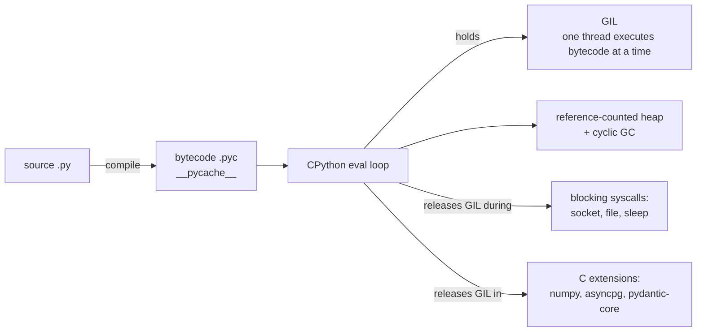
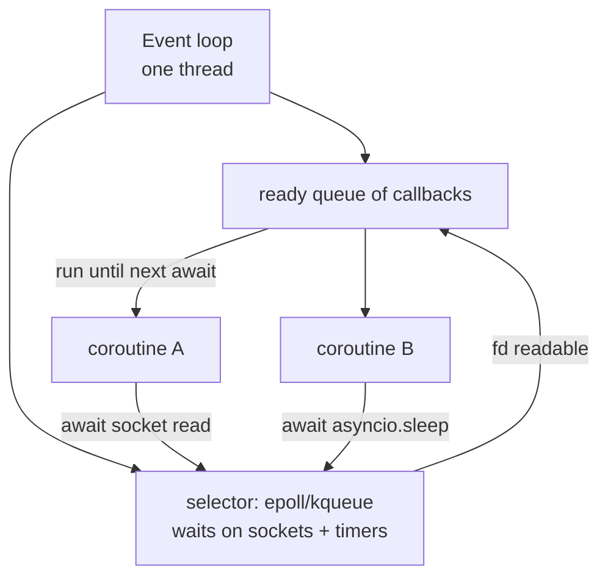

# Python: Core Concepts

| | |
|---|---|
| **Cluster** | 07 Backend & APIs |
| **Role** | Language foundation |
| **Prerequisites** | [01-installation-and-setup.md](01-installation-and-setup.md) |
| **Target version** | Python 3.12+ |
| **Capstone phase** | Phase 1 (Months 1-4) |

> This file covers the Python you need to write and review operations and service code: the type system as used in practice, data modelling with dataclasses and Pydantic v2, filesystem and process control, the asyncio concurrency model in depth, resource management with context managers and generators, structured logging, error handling, CLIs, HTTP and AWS clients, and how a package is laid out. Every section explains *how it works* so that you can debug it, not just use it.

---

## 1. The Interpreter Model



Facts that matter operationally:

- **Bytecode is cached** in `__pycache__/*.pyc`. In containers set `PYTHONDONTWRITEBYTECODE=1` *or* pre-compile at build time (`uv sync` with `UV_COMPILE_BYTECODE=1`), never write at runtime into a read-only filesystem.
- **The GIL** means two threads never run Python bytecode simultaneously, so threads give you I/O concurrency, not CPU parallelism. CPU parallelism requires `multiprocessing`, `concurrent.futures.ProcessPoolExecutor`, or offloading to C extensions. Python 3.13's free-threaded build (`python3.13t`) removes the GIL experimentally; do not depend on it yet.
- **Memory is reference counted** with a cycle collector. Objects die immediately when the last reference goes, which is why `with` blocks reliably close files. Memory returned to the OS is lazy; a process that peaked at 2 GB usually stays near 2 GB RSS.
- **Imports are executed code.** Importing a module runs its top level once and caches it in `sys.modules`. Expensive top-level work (opening DB connections, calling AWS) at import time is the most common cause of slow or flaky startup. Keep module top levels to definitions.

---

## 2. Typing as a Discipline

Type hints are documentation that a tool (`mypy`, `pyright`) verifies. In a platform codebase you run `mypy --strict`, which means every function signature is annotated.

```python
from collections.abc import Iterable, Iterator, Mapping, Sequence, Callable, Awaitable
from typing import Any, Literal, Protocol, TypeAlias, TypedDict, TypeVar, NewType, Self, overload

# Prefer abstract collection types for parameters, concrete for return values.
def total_bytes(sizes: Iterable[int]) -> int:
    return sum(sizes)

# Literal for closed string sets; mypy will reject "sev5".
Severity = Literal["SEV1", "SEV2", "SEV3", "SEV4"]

def page(sev: Severity) -> None: ...

# NewType for IDs that must not be mixed up.
PodName = NewType("PodName", str)
Namespace = NewType("Namespace", str)

# TypedDict for JSON you receive but do not own (e.g. a Kubernetes status block).
class ContainerState(TypedDict, total=False):
    running: dict[str, str]
    waiting: dict[str, str]
    terminated: dict[str, str]

# Protocol = structural typing ("duck typing, checked"). Anything with .get(key) -> str | None fits.
class SecretSource(Protocol):
    def get(self, key: str) -> str | None: ...

def load_db_url(src: SecretSource) -> str:
    url = src.get("DATABASE_URL")
    if url is None:
        raise KeyError("DATABASE_URL")
    return url

# Generics (3.12 syntax, PEP 695): no TypeVar boilerplate.
def first[T](items: Sequence[T]) -> T | None:
    return items[0] if items else None

# Self (3.11+) for fluent builders.
class QueryBuilder:
    def where(self, clause: str) -> Self:
        return self
```

Rules of thumb:

| Rule | Why |
|---|---|
| Use `X \| None` not `Optional[X]` (3.10+) | Shorter and reads as the union it is |
| Use `list[str]`, `dict[str, int]` not `List`, `Dict` | Builtins are generic since 3.9 |
| Never return `Any` from a public function | It silently disables checking downstream |
| Use `Protocol` instead of ABC for third-party objects | You cannot make `boto3` clients inherit from your ABC |
| Annotate `**kwargs: Any` only at true boundaries | Otherwise you lose the point |
| `typing.cast` is an assertion, not a conversion | Use it only when you have proven the type to yourself |
| `# type: ignore[code]` must name the error code | Bare ignores hide new errors |

Run `uv run mypy` on every commit. Treat a mypy failure as a compile error.

---

## 3. Data Modelling: `dataclass` vs Pydantic v2

| Need | Use |
|---|---|
| Internal value object, no external input | `@dataclass(frozen=True, slots=True)` |
| Data crossing a trust boundary (HTTP body, env var, YAML file, LLM output) | Pydantic `BaseModel` |
| Settings from environment | `pydantic_settings.BaseSettings` |
| Lightweight attribute bag for tests | `types.SimpleNamespace` or a dict |

### 3.1 Dataclasses

```python
from dataclasses import dataclass, field
from datetime import datetime, UTC

@dataclass(frozen=True, slots=True, kw_only=True)
class PodRef:
    namespace: str
    name: str
    labels: dict[str, str] = field(default_factory=dict)
    seen_at: datetime = field(default_factory=lambda: datetime.now(UTC))

    @property
    def qualified(self) -> str:
        return f"{self.namespace}/{self.name}"
```

`frozen=True` makes instances hashable and immutable (safe as dict keys and in sets). `slots=True` cuts memory by ~40% and blocks typo attributes. `kw_only=True` prevents positional-argument order bugs. **Never** use a mutable default (`labels: dict = {}`); Python shares it across instances. `field(default_factory=dict)` is the fix.

### 3.2 Pydantic v2

Pydantic v2 (released 2023) has a Rust core (`pydantic-core`) and is 5-50x faster than v1. The API changed; the table shows what to write today.

| v1 (do not use) | v2 |
|---|---|
| `class Config:` | `model_config = ConfigDict(...)` |
| `@validator` | `@field_validator` |
| `@root_validator` | `@model_validator` |
| `.dict()` / `.json()` | `.model_dump()` / `.model_dump_json()` |
| `parse_obj()` / `parse_raw()` | `model_validate()` / `model_validate_json()` |
| `schema()` | `model_json_schema()` |
| `Field(..., regex=)` | `Field(pattern=)` |
| `orm_mode = True` | `from_attributes=True` |

```python
from datetime import datetime
from enum import StrEnum
from typing import Annotated
from uuid import UUID, uuid4

from pydantic import BaseModel, ConfigDict, Field, field_validator, model_validator


class Severity(StrEnum):
    SEV1 = "SEV1"
    SEV2 = "SEV2"
    SEV3 = "SEV3"
    SEV4 = "SEV4"


class IncidentCreate(BaseModel):
    model_config = ConfigDict(str_strip_whitespace=True, extra="forbid")

    title: Annotated[str, Field(min_length=1, max_length=200)]
    description: Annotated[str | None, Field(max_length=4000)] = None
    severity: Severity
    service: Annotated[str, Field(min_length=1, max_length=100, pattern=r"^[a-z0-9-]+$")]

    @field_validator("title")
    @classmethod
    def title_not_placeholder(cls, v: str) -> str:
        if v.lower() in {"test", "todo", "untitled"}:
            raise ValueError("title must be meaningful")
        return v

    @model_validator(mode="after")
    def sev1_needs_description(self) -> "IncidentCreate":
        if self.severity is Severity.SEV1 and not self.description:
            raise ValueError("SEV1 incidents require a description")
        return self


class Incident(IncidentCreate):
    model_config = ConfigDict(from_attributes=True)  # build from ORM rows
    id: UUID = Field(default_factory=uuid4)
    created_at: datetime


# Validation and serialisation
payload = {"title": " API 5xx spike ", "severity": "SEV2", "service": "incident-api"}
inc = IncidentCreate.model_validate(payload)      # raises pydantic.ValidationError on bad input
print(inc.model_dump_json())
# {"title":"API 5xx spike","description":null,"severity":"SEV2","service":"incident-api"}
print(IncidentCreate.model_json_schema()["required"])
# ['title', 'severity', 'service']
```

`extra="forbid"` rejects unknown fields, which catches client typos and is a cheap defence against mass-assignment. `Annotated[..., Field(...)]` keeps constraints next to the type where mypy can see the type.

### 3.3 Settings

```python
from pydantic import Field, PostgresDsn, SecretStr
from pydantic_settings import BaseSettings, SettingsConfigDict


class Settings(BaseSettings):
    model_config = SettingsConfigDict(env_file=".env", env_file_encoding="utf-8", extra="ignore")

    app_env: str = "dev"
    log_level: str = "INFO"
    database_url: PostgresDsn
    oidc_issuer: str = Field(default="", description="OIDC issuer URL")
    api_key: SecretStr | None = None          # repr prints '**********'
    request_timeout_s: float = Field(default=5.0, gt=0, le=60)


settings = Settings()  # reads DATABASE_URL, LOG_LEVEL, ... from env, fails fast if missing
```

`SecretStr` prevents secrets leaking into logs and tracebacks via `repr()`. Reading settings once at startup and injecting them (rather than reading `os.environ` all over the code) is 12-factor config done properly.

---

## 4. Filesystem and Processes

### 4.1 `pathlib`

```python
from pathlib import Path

cfg_dir = Path.home() / ".config" / "platform-cli"
cfg_dir.mkdir(parents=True, exist_ok=True)
cfg = cfg_dir / "config.toml"

if cfg.exists():
    text = cfg.read_text(encoding="utf-8")

for manifest in Path("k8s").rglob("*.yaml"):
    print(manifest.relative_to("k8s"), manifest.stat().st_size)

# Atomic write: write to temp then rename (rename is atomic on POSIX within one filesystem)
tmp = cfg.with_suffix(".tmp")
tmp.write_text("[default]\nregion = 'eu-west-1'\n", encoding="utf-8")
tmp.replace(cfg)
```

`ruff`'s `PTH` rules flag `os.path` usage; `pathlib` is the standard.

### 4.2 `subprocess`: the safe way

```python
import shlex
import subprocess
from pathlib import Path


def run(cmd: list[str], *, cwd: Path | None = None, timeout: float = 60) -> str:
    """Run a command with no shell, capture stdout, raise on non-zero exit."""
    result = subprocess.run(
        cmd,
        cwd=cwd,
        capture_output=True,
        text=True,
        timeout=timeout,
        check=False,
    )
    if result.returncode != 0:
        raise RuntimeError(
            f"{shlex.join(cmd)} failed ({result.returncode}): {result.stderr.strip()}"
        )
    return result.stdout


pods = run(["kubectl", "get", "pods", "--namespace", "platform", "--output", "json"])
```

Rules:

| Rule | Reason |
|---|---|
| Pass a **list**, never `shell=True` with a formatted string | `shell=True` + user input = command injection (`; rm -rf /`) |
| Always set `timeout` | A hung `kubectl` otherwise hangs your automation forever |
| `capture_output=True, text=True` | Get strings, not bytes |
| Prefer the SDK over shelling out when one exists | `kubernetes` client over `kubectl`, `boto3` over `aws` CLI: typed, testable, no parsing |
| Log `shlex.join(cmd)` not `" ".join(cmd)` | Correct quoting in logs |
| Never pass secrets as arguments | `ps aux` shows them; use env (`env={**os.environ, "TOKEN": t}`) or stdin |

---

## 5. asyncio in Depth

### 5.1 The model



- A **coroutine** (`async def`) is a function that can suspend at `await`. Calling it returns a coroutine object; nothing runs until it is awaited or scheduled.
- A **Task** wraps a coroutine and schedules it on the loop. `asyncio.create_task(coro())` starts it concurrently; awaiting the task waits for its result.
- `await x` means "suspend me until `x` is done; the loop may run other tasks meanwhile".
- There is **one thread**. If a coroutine runs CPU work or a blocking call for 2 seconds, nothing else runs for 2 seconds. This is the number one asyncio bug.

### 5.2 Core patterns

```python
import asyncio
import httpx


async def fetch(client: httpx.AsyncClient, url: str) -> int:
    r = await client.get(url)
    return r.status_code


async def main() -> None:
    async with httpx.AsyncClient(timeout=httpx.Timeout(5.0)) as client:
        urls = [f"https://example.com/health/{i}" for i in range(50)]

        # 1. gather: run all concurrently, collect results in order.
        statuses = await asyncio.gather(*(fetch(client, u) for u in urls), return_exceptions=True)

        # 2. Bounded concurrency with a semaphore: never hammer an API with 1,000 parallel calls.
        sem = asyncio.Semaphore(10)

        async def bounded(url: str) -> int:
            async with sem:
                return await fetch(client, url)

        statuses = await asyncio.gather(*(bounded(u) for u in urls))

        # 3. Timeouts (3.11+): asyncio.timeout is a context manager, cancels the body on expiry.
        try:
            async with asyncio.timeout(2.0):
                await fetch(client, urls[0])
        except TimeoutError:
            print("slow")

        # 4. TaskGroup (3.11+): structured concurrency. If one task fails, siblings are cancelled
        #    and the exception group is raised. Prefer this over bare gather in new code.
        async with asyncio.TaskGroup() as tg:
            tasks = [tg.create_task(bounded(u)) for u in urls]
        results = [t.result() for t in tasks]

        # 5. as_completed: process results as they arrive.
        for coro in asyncio.as_completed([bounded(u) for u in urls]):
            print(await coro)

        # 6. Offload blocking calls to a thread so the loop keeps running.
        import subprocess
        out = await asyncio.to_thread(subprocess.run, ["kubectl", "version", "--client"], capture_output=True)


asyncio.run(main())
```

### 5.3 Cancellation and shutdown

Cancellation is cooperative: `task.cancel()` raises `asyncio.CancelledError` at the task's next `await`. You must let it propagate (do not swallow with bare `except Exception`; `CancelledError` is a `BaseException` since 3.8 precisely so that `except Exception` does not catch it). Clean up in `finally`.

```python
import asyncio
import signal


async def worker(stop: asyncio.Event) -> None:
    try:
        while not stop.is_set():
            await asyncio.sleep(1)
            print("tick")
    finally:
        print("worker cleanup")  # runs on cancel or stop


async def main() -> None:
    stop = asyncio.Event()
    loop = asyncio.get_running_loop()
    for sig in (signal.SIGTERM, signal.SIGINT):
        loop.add_signal_handler(sig, stop.set)
    await worker(stop)


asyncio.run(main())
```

This is the skeleton of every long-running Python worker in Kubernetes: SIGTERM sets an event, the loop drains, `finally` closes resources, the process exits 0 within the grace period.

### 5.4 Pitfalls table

| Pitfall | Symptom | Fix |
|---|---|---|
| Blocking call in coroutine (`requests.get`, `time.sleep`, `boto3` call) | All requests stall; p99 latency jumps | Use `httpx.AsyncClient`, `asyncio.sleep`, `aioboto3`, or `asyncio.to_thread` |
| Forgetting `await` | Coroutine never runs; `RuntimeWarning: coroutine was never awaited` | Await it or wrap in `create_task` |
| `create_task` without keeping a reference | Task garbage collected mid-run | Store tasks in a set, or use `TaskGroup` |
| Unbounded `gather` over 10,000 items | Memory spike, API rate limits | Semaphore or batching |
| CPU-bound loop inside `async def` | Event loop starvation | `ProcessPoolExecutor` via `loop.run_in_executor` |
| Sharing one `httpx.AsyncClient` across event loops (tests) | `RuntimeError: Event loop is closed` | Create the client inside the loop (lifespan or fixture) |
| Catching `Exception` around `await` and continuing | Task ignores cancellation, shutdown hangs | Re-raise `asyncio.CancelledError`, or catch narrower exceptions |

---

## 6. Context Managers and Generators

Context managers guarantee cleanup. Generators give lazy iteration and are the mechanism behind `@contextmanager` and FastAPI's `yield` dependencies.

```python
from collections.abc import AsyncIterator, Iterator
from contextlib import asynccontextmanager, contextmanager
import time


@contextmanager
def timed(label: str) -> Iterator[None]:
    start = time.perf_counter()
    try:
        yield                                   # body of the with-block runs here
    finally:
        print(f"{label}: {(time.perf_counter() - start) * 1000:.1f} ms")


with timed("list pods"):
    ...


@asynccontextmanager
async def db_session(pool) -> AsyncIterator["Connection"]:
    conn = await pool.acquire()
    try:
        yield conn
    finally:
        await pool.release(conn)


# Generators for streaming large outputs without loading everything into memory
def read_lines(path) -> Iterator[str]:
    with open(path, encoding="utf-8") as f:
        for line in f:
            yield line.rstrip("\n")


# Async generators are what SSE endpoints return
async def token_stream() -> AsyncIterator[str]:
    for tok in ["triaging", " incident", "..."]:
        await asyncio.sleep(0.1)
        yield tok
```

Everything before `yield` is setup, everything after is teardown, and the `finally` runs even if the body raises. FastAPI's dependency injection, pytest fixtures and SQLAlchemy sessions all use this exact shape.

---

## 7. Logging and `structlog`

The stdlib `logging` module is hierarchical (`logging.getLogger("platform_cli.k8s")` inherits from `platform_cli`), configured once at the entry point, and writes plain text by default. Production wants JSON with context. `structlog` layers on top of it.

```python
import logging
import sys
import structlog
from structlog.contextvars import bind_contextvars, clear_contextvars


def configure_logging(level: str = "INFO", json_output: bool = True) -> None:
    shared = [
        structlog.contextvars.merge_contextvars,     # pulls request_id etc. from contextvars
        structlog.processors.add_log_level,
        structlog.processors.TimeStamper(fmt="iso", utc=True),
        structlog.processors.StackInfoRenderer(),
        structlog.processors.format_exc_info,
    ]
    renderer = structlog.processors.JSONRenderer() if json_output else structlog.dev.ConsoleRenderer()
    structlog.configure(
        processors=[*shared, renderer],
        wrapper_class=structlog.make_filtering_bound_logger(logging.getLevelName(level)),
        logger_factory=structlog.PrintLoggerFactory(sys.stdout),
        cache_logger_on_first_use=True,
    )


configure_logging()
log = structlog.get_logger("platform_cli")

clear_contextvars()
bind_contextvars(request_id="3f1c...", namespace="platform")
log.info("pods_listed", count=12, duration_ms=43.2)
```

Output:

```json
{"request_id": "3f1c...", "namespace": "platform", "event": "pods_listed", "count": 12, "duration_ms": 43.2, "level": "info", "timestamp": "2026-10-27T10:15:02.123456Z"}
```

Rules: log events with key-value fields, not formatted sentences (`log.info("pods_listed", count=12)` not `log.info(f"Listed {n} pods")`); never log secrets; set the level from config; use `contextvars` for request-scoped fields so that every log line in a request carries `request_id` and `trace_id` without passing them through every function.

---

## 8. Error Handling

```python
class PlatformError(Exception):
    """Base for all errors this tool raises; CLI maps it to exit code 1 with a clean message."""


class NotFoundError(PlatformError):
    def __init__(self, kind: str, name: str) -> None:
        super().__init__(f"{kind} {name!r} not found")
        self.kind, self.name = kind, name


class UpstreamError(PlatformError):
    """Wraps third-party failures so callers do not depend on boto3/httpx exception types."""


def get_bucket_region(s3, bucket: str) -> str:
    try:
        return s3.get_bucket_location(Bucket=bucket)["LocationConstraint"] or "us-east-1"
    except s3.exceptions.NoSuchBucket as exc:
        raise NotFoundError("bucket", bucket) from exc       # keep the chain for debugging
    except Exception as exc:                                  # boundary: convert, do not swallow
        raise UpstreamError(f"s3 get_bucket_location failed for {bucket}") from exc
```

| Rule | Why |
|---|---|
| Catch the narrowest exception you can handle | `except Exception: pass` hides bugs and swallows `KeyboardInterrupt`-adjacent errors |
| `raise ... from exc` | Preserves the cause chain in tracebacks |
| Define a small exception hierarchy per package | Callers (CLI, FastAPI handler) map your types to exit codes / HTTP statuses once |
| Use `ExceptionGroup` / `except*` (3.11+) for concurrent failures | `TaskGroup` raises them |
| Exit codes: 0 success, 1 handled error, 2 usage error, 130 SIGINT | Scripts compose in pipelines |
| Never `sys.exit()` from library code | Raise; let the entry point decide |

---

## 9. CLIs: `argparse` and `typer`

`argparse` is in the stdlib and fine for one-file scripts. `typer` (built on `click`) derives the CLI from type hints and is what you use for packaged tools.

```python
# src/platform_cli/cli.py
from typing import Annotated
import typer

app = typer.Typer(no_args_is_help=True, help="Platform automation CLI")
pods_app = typer.Typer(help="Kubernetes pod helpers")
app.add_typer(pods_app, name="pods")


@pods_app.command("list")
def pods_list(
    namespace: Annotated[str, typer.Option("--namespace", "-n", envvar="K8S_NAMESPACE")] = "default",
    selector: Annotated[str | None, typer.Option("--selector", "-l")] = None,
    output: Annotated[str, typer.Option("--output", "-o")] = "table",
) -> None:
    """List pods in NAMESPACE."""
    ...


if __name__ == "__main__":
    app()
```

```bash
uv run platform-cli pods list --namespace platform -o json
```

`envvar=` gives 12-factor overrides for free; `Annotated` keeps the signature readable; sub-apps mirror `kubectl`'s noun-verb style.

---

## 10. HTTP with `httpx` and AWS with `boto3`

### 10.1 `httpx`

```python
import httpx

limits = httpx.Limits(max_connections=20, max_keepalive_connections=10)
timeout = httpx.Timeout(connect=2.0, read=5.0, write=5.0, pool=2.0)

async with httpx.AsyncClient(base_url="https://api.example.com", timeout=timeout, limits=limits) as client:
    r = await client.get("/v1/incidents", params={"limit": 10}, headers={"X-Request-ID": "..."})
    r.raise_for_status()
    data = r.json()
```

Always set timeouts (the default is 5 s, but be explicit); reuse one client (connection pooling); `raise_for_status()` to turn 4xx/5xx into exceptions. Retries: use `tenacity` with exponential backoff and jitter, retrying only on connection errors and 5xx/429.

### 10.2 `boto3` patterns

```python
import boto3
from botocore.config import Config

cfg = Config(
    region_name="eu-west-1",
    retries={"max_attempts": 5, "mode": "adaptive"},
    connect_timeout=3,
    read_timeout=10,
)
session = boto3.Session()                       # credentials from env/IRSA/SSO, never hard-coded
s3 = session.client("s3", config=cfg)

# Paginators handle NextToken for you
paginator = s3.get_paginator("list_objects_v2")
for page in paginator.paginate(Bucket="<BUCKET_NAME>", Prefix="logs/"):
    for obj in page.get("Contents", []):
        print(obj["Key"], obj["Size"])

# Waiters block until a resource reaches a state
ec2 = session.client("ec2", config=cfg)
ec2.get_waiter("instance_running").wait(InstanceIds=["i-0123456789abcdef0"])
```

Credential resolution order: explicit parameters, env vars, shared config/SSO, container credentials (ECS/EKS Pod Identity/IRSA), instance metadata. In Kubernetes, IRSA/Pod Identity injects a web identity token; `boto3` picks it up with zero code. Static access keys in env vars are a Phase 1 shortcut you should remove by Phase 2.

`boto3` is synchronous. Inside asyncio use `aioboto3` or `asyncio.to_thread`.

---

## 11. Package Layout and Imports

```text
platform-cli/
├── pyproject.toml
├── uv.lock
├── .python-version
├── README.md
├── src/
│   └── platform_cli/
│       ├── __init__.py          # version only; no side effects
│       ├── __main__.py          # `python -m platform_cli` -> cli.app()
│       ├── cli.py               # typer app; thin, delegates to modules
│       ├── config.py            # Settings
│       ├── logging.py           # configure_logging
│       ├── k8s.py               # kubernetes client wrappers
│       ├── aws.py               # boto3 wrappers
│       └── py.typed             # marker: this package ships type hints
└── tests/
    ├── conftest.py              # shared fixtures
    ├── test_k8s.py
    └── test_aws.py
```

Why the `src/` layout: tests import the *installed* package, not the working directory, which catches missing files in the wheel and stray relative imports. `uv init --package` creates it for you. Use absolute imports (`from platform_cli.config import Settings`); relative imports (`from .config import ...`) are acceptable inside a package but harder to grep.

Build and inspect the artefact:

```bash
uv build
ls dist/
```

```text
platform_cli-0.1.0-py3-none-any.whl  platform_cli-0.1.0.tar.gz
```

A wheel is a zip of your package plus metadata; it is what `uv sync` installs in the Docker build stage. For platform tools the container is the deliverable; publishing to a private index (CodeArtifact, Artifactory) is for shared libraries.

---

## 12. Testing Concepts

Covered as labs in [04-hands-on-labs.md](04-hands-on-labs.md); the vocabulary:

| Concept | Meaning |
|---|---|
| Fixture | A function that provides a resource to tests, with setup before `yield` and teardown after. Scoped `function` (default), `module`, `session` |
| `parametrize` | Run one test body over many inputs; each is a separate test |
| `monkeypatch` | Fixture to set env vars / attributes for one test, auto-reverted |
| `unittest.mock` / `pytest-mock` | Replace a callable; assert how it was called. Mock at the boundary you own |
| `respx` | Mock `httpx` requests by route |
| `moto` | Fake AWS services in-process (`@mock_aws`) |
| Testcontainers | Real Postgres/Redis/LocalStack in Docker for integration tests |
| `pytest-asyncio` | Run `async def` tests; `asyncio_mode = "auto"` removes the per-test marker |

---

## 13. Performance Basics

- Measure first: `python -X importtime -c "import platform_cli"` for slow startup; `cProfile` for CPU; `py-spy top --pid <PID>` for a live process you cannot restart (it reads the process memory, no code change, works on production containers if `SYS_PTRACE` is allowed).
- Common wins: reuse HTTP clients and boto3 sessions; use paginators and generators instead of materialising lists; avoid `json.loads` in a hot loop when `orjson` is available; batch API calls; use `asyncio` for I/O fan-out.
- Common non-wins: micro-optimising Python loops. If CPU-bound work is the bottleneck, move it to a C library or to Go.

Details in [05-production-patterns.md](05-production-patterns.md).
