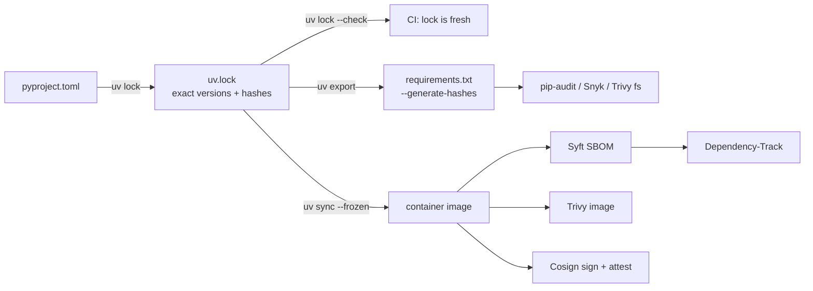

# Python: Production Patterns

| | |
|---|---|
| **Cluster** | 07 Backend & APIs |
| **Role** | Language foundation |
| **Prerequisites** | [02-core-concepts.md](02-core-concepts.md), [04-hands-on-labs.md](04-hands-on-labs.md) |
| **Target version** | Python 3.12+ |
| **Capstone phase** | Phase 1 (Months 1-4), applied through Phase 6 |

> How Python behaves in production and how to keep it safe: supply-chain and code security, Dockerising correctly, performance and memory in containers, writing automation that is safe to run against real clusters and accounts, CI integration, and an honest decision guide for Python versus Bash versus Go.

---

## 1. Security

### 1.1 Supply chain



| Control | How | Why |
|---|---|---|
| Lockfile committed | `uv.lock` in git; CI runs `uv lock --check` | Reproducible builds; a dependency cannot silently change between dev and prod |
| Hash verification | `uv` verifies hashes from the lock; for pip: `--require-hashes` | Defeats index tampering and typosquats replacing a version |
| Private index with proxying | `UV_INDEX_URL` pointing at CodeArtifact/Artifactory that mirrors PyPI | Blocks newly published malicious packages until vetted; survives PyPI outages |
| Audit on every PR | `pip-audit`, Snyk, or Trivy `fs` against the exported requirements | Catch known CVEs before merge; Dependabot/Renovate for upgrades |
| SBOM per image | `syft <image> -o cyclonedx-json` uploaded to Dependency-Track | Know your blast radius when a zero-day drops (cluster 08, gate 3) |
| Avoid `--pre` and git URLs in production deps | Policy in code review | Unreleased or mutable sources break reproducibility |
| Pin the `uv` image digest in Dockerfiles | `FROM ghcr.io/astral-sh/uv:0.5.11-python3.12-bookworm-slim@sha256:<DIGEST>` | Base images are dependencies too |
| Minimal runtime deps | Separate `dev` group; `uv sync --no-dev` in images | Every package is attack surface and CVE noise |

### 1.2 Code-level rules

| Danger | Safe alternative |
|---|---|
| `eval()`, `exec()`, `compile()` on any external string | Parse with `json`, `ast.literal_eval` (for literals only), or a real parser |
| `subprocess.run(f"kubectl get {name}", shell=True)` | `subprocess.run(["kubectl", "get", name])` |
| `yaml.load(text)` | `yaml.safe_load(text)` (`yaml.load` can instantiate arbitrary objects) |
| `pickle.loads(untrusted)` | JSON or Pydantic; pickle executes code on load |
| `random.random()` for tokens | `secrets.token_urlsafe()` |
| `hashlib.md5` for integrity | `sha256`; for passwords, `argon2-cffi` or `bcrypt` |
| `tempfile.mktemp()` | `tempfile.NamedTemporaryFile` / `mkstemp` (race-free) |
| `requests.get(url, verify=False)` | Fix the CA bundle (`REQUESTS_CA_BUNDLE`, `SSL_CERT_FILE`) |
| `tarfile.extractall(path)` on untrusted archives | `extractall(path, filter="data")` (3.12+) prevents path traversal |
| Building SQL with f-strings | Parameterised queries (`cursor.execute("... WHERE id = %s", (id,))`) |
| Logging request bodies or headers wholesale | Allow-list fields; redact `Authorization`, `Cookie`, tokens |
| `assert` for input validation | Explicit `if ... raise`; `assert` is stripped with `python -O` |
| Secrets in `os.environ` printed by error handlers | `SecretStr`; never dump `os.environ` |

Enforce with `ruff --select S,B,ASYNC,PTH` (fast, in pre-commit) and `bandit -r src -ll` (in CI for SARIF). Semgrep's `p/python` ruleset (cluster 08) adds taint tracking.

### 1.3 Secrets and identity

- Local: `.env` file (git-ignored) read by `pydantic-settings`; never commit it. Gitleaks pre-commit hook catches accidents.
- Kubernetes: environment variables from `Secret` objects populated by External Secrets Operator or Vault Agent; or mounted files read via `pathlib`.
- AWS: no access keys. IRSA / EKS Pod Identity give `boto3` short-lived credentials automatically. Locally use `aws sso login` and `AWS_PROFILE`.
- GitHub Actions: OIDC to AWS (`aws-actions/configure-aws-credentials` with `role-to-assume`), no secrets stored.

---

## 2. Dockerising Python Correctly

### 2.1 The decisions

| Decision | Recommendation | Reason |
|---|---|---|
| Base for build stage | `ghcr.io/astral-sh/uv:<ver>-python3.12-bookworm-slim` | `uv` + matching interpreter, Debian glibc (wheels work) |
| Base for runtime | `python:3.12-slim-bookworm` (default) or distroless (hardened) | slim: ~50 MB base, has shell for debugging in dev. Distroless: no shell, fewer CVEs; harder to debug (use ephemeral debug containers) |
| Never Alpine for Python | Avoid | musl: many wheels unavailable, compiles from source, slower, DNS quirks |
| Interpreter flags | `PYTHONUNBUFFERED=1`, `PYTHONDONTWRITEBYTECODE=1`, pre-compiled bytecode via `UV_COMPILE_BYTECODE=1` | Logs flush immediately; no writes to read-only FS; faster start |
| User | `USER 65532` (or `nonroot`), `--chown` on COPY | Pod Security Standards "restricted" requires non-root |
| Filesystem | Works with `readOnlyRootFilesystem: true`; `/tmp` as `emptyDir` | Attacker cannot drop files |
| Signal handling | `ENTRYPOINT ["python", "-m", "pkg"]` exec form | PID 1 receives SIGTERM directly; shell form wraps in `sh -c` and swallows signals |
| Layer order | lock + pyproject first, `uv sync --no-install-project`, then source | Dependency layer cached across code changes |
| Health | No `HEALTHCHECK` instruction | Kubernetes probes own it; Docker HEALTHCHECK is ignored by K8s and adds a process |
| Labels | `org.opencontainers.image.source`, `.revision`, `.version` | Traceability for SBOM and Cosign attestations |

### 2.2 Reference Dockerfile (slim variant)

```dockerfile
# syntax=docker/dockerfile:1.7
ARG PYTHON_VERSION=3.12
FROM ghcr.io/astral-sh/uv:0.5.11-python${PYTHON_VERSION}-bookworm-slim AS build
ENV UV_COMPILE_BYTECODE=1 UV_LINK_MODE=copy UV_PYTHON_DOWNLOADS=never UV_PROJECT_ENVIRONMENT=/opt/venv
WORKDIR /src
COPY pyproject.toml uv.lock README.md ./
RUN --mount=type=cache,target=/root/.cache/uv \
    uv sync --frozen --no-dev --no-install-project --no-editable
COPY src ./src
RUN --mount=type=cache,target=/root/.cache/uv \
    uv sync --frozen --no-dev --no-editable

FROM python:${PYTHON_VERSION}-slim-bookworm AS runtime
LABEL org.opencontainers.image.source="https://github.com/example/capstone" \
      org.opencontainers.image.description="platform-cli"
ENV PATH="/opt/venv/bin:$PATH" PYTHONUNBUFFERED=1 PYTHONDONTWRITEBYTECODE=1 PYTHONSAFEPATH=1
RUN groupadd --gid 65532 app && useradd --uid 65532 --gid 65532 --no-create-home --shell /usr/sbin/nologin app \
 && apt-get update && apt-get upgrade -y --no-install-recommends && rm -rf /var/lib/apt/lists/*
COPY --from=build --chown=65532:65532 /opt/venv /opt/venv
USER 65532:65532
WORKDIR /app
ENTRYPOINT ["python", "-m", "platform_cli"]
CMD ["--help"]
```

Because `/opt/venv` was created by an interpreter at `/usr/local/bin/python3.12` in the build image and the runtime image has the same path and version, the venv's shebangs and `pyvenv.cfg` resolve. Keep the two stages on the same Python minor version and Debian release.

### 2.3 Debugging a distroless or read-only container

```bash
kubectl debug -it <POD> --image=python:3.12-slim --target=api --profile=general -- bash
# inside: ps aux; cat /proc/1/environ | tr '\0' '\n'; py-spy dump --pid 1 (needs SYS_PTRACE)
```

Ephemeral debug containers share the process namespace with the target so you can inspect it without shipping a shell in the image.

---

## 3. Performance and Memory

### 3.1 Where Python time goes

| Workload | Dominant cost | Lever |
|---|---|---|
| Automation CLI | Import time, API round trips | Lazy imports, paginate, concurrency with asyncio/threads |
| HTTP service | Serialisation, DB, blocking calls on the loop | Pydantic v2 (already fast), `orjson`, async drivers, `run_in_threadpool` |
| Data crunching | Interpreter loop | numpy/pandas/polars, or Go |
| Startup in Kubernetes | Imports + connection setup | Pre-compiled bytecode, lazy imports, startup probe |

### 3.2 Memory in containers

- Python does not return freed memory to the OS eagerly (pymalloc arenas). RSS reflects peak usage. Size memory limits from a load test's peak, not idle.
- Large-list materialisation is the usual culprit: `list(paginator.paginate(...))` over a million objects. Stream with generators.
- Set `requests` = typical and `limits` = peak * 1.3. An `OOMKilled` Python process gives no traceback; use `PYTHONTRACEMALLOC` only in diagnosis (it costs memory).
- `MALLOC_ARENA_MAX=2` can reduce glibc fragmentation for multi-threaded workers.

### 3.3 Profiling in production

| Tool | Use | Impact |
|---|---|---|
| `py-spy dump --pid 1` | What is every thread doing *right now*? First tool for "it hangs" | Negligible; needs `SYS_PTRACE` or same user and `ptrace_scope` |
| `py-spy record --duration 30 -o out.svg --pid 1` | Flame graph of a live process | ~1-5% CPU while sampling |
| `cProfile` | Deterministic profile of a script run | 2-3x slowdown; not for production |
| `memray` | Allocation tracking | Significant; staging only |
| OpenTelemetry spans | Where time goes across services | Low; always on |

Kubernetes snippet to allow `py-spy` in a debug container:

```yaml
securityContext:
  capabilities:
    add: ["SYS_PTRACE"]
shareProcessNamespace: true
```

Add it only to debug overlays; it violates the restricted Pod Security Standard.

---

## 4. Writing Automation Safely

Platform automation has root-equivalent access to clusters and accounts. Design for the day the script runs with the wrong context.

| Pattern | Implementation |
|---|---|
| **Dry run by default** | `--apply` flag required to mutate; default prints the plan. Mirror `terraform plan`/`apply` |
| **Confirm the target** | Print `kubectl config current-context` / `sts get-caller-identity` and the account alias before acting; refuse if `prod` and `--i-know-this-is-prod` absent |
| **Idempotent** | Re-running produces the same end state; use `patch`/`apply`, check-then-act with retries, never append blindly |
| **Bounded blast radius** | Namespace / tag / label selectors mandatory; refuse empty selectors that match everything |
| **Timeouts everywhere** | `subprocess` `timeout=`, `httpx.Timeout`, boto3 `Config(read_timeout=)`, `asyncio.timeout` |
| **Retries with backoff and jitter** | `tenacity`; retry only idempotent operations and only on transient errors (429, 5xx, connection reset) |
| **Structured logs with a run ID** | `bind_contextvars(run_id=uuid4().hex)`; every line is correlatable in Loki |
| **Exit codes** | 0 ok, 1 error, 2 usage; CI uses them |
| **Least privilege** | Separate read-only and read-write IAM roles / RBAC; tools assume the narrowest one |
| **Audit trail** | Log who (caller identity), what (resource IDs), outcome; consider writing to an S3 audit bucket with object lock |
| **No interactive prompts in CI** | `typer.confirm` only when `sys.stdin.isatty()`; otherwise require flags |

A `--dry-run` skeleton:

```python
@app.command()
def scale(deployment: str, replicas: int, namespace: str = "default", apply: bool = typer.Option(False, "--apply")) -> None:
    current = get_replicas(deployment, namespace)
    typer.echo(f"{namespace}/{deployment}: {current} -> {replicas}")
    if not apply:
        typer.echo("dry run; pass --apply to change")
        raise typer.Exit()
    set_replicas(deployment, namespace, replicas)
```

---

## 5. CI Integration (GitHub Actions)

```yaml
name: python-ci
on: { pull_request: {}, push: { branches: [main] } }
permissions: { contents: read, id-token: write, security-events: write }
jobs:
  test:
    runs-on: ubuntu-24.04
    steps:
      - uses: actions/checkout@v4
      - uses: astral-sh/setup-uv@v4
        with: { enable-cache: true }
      - run: uv python install
      - run: uv sync --all-extras --frozen
      - run: uv lock --check
      - run: uv run ruff check --output-format=github .
      - run: uv run ruff format --check .
      - run: uv run mypy
      - run: uv run pytest --cov --cov-report=xml --junitxml=junit.xml
      - run: uv export --no-dev --format requirements-txt -o requirements.txt && uvx pip-audit -r requirements.txt --strict
      - run: uvx bandit -r src -f sarif -o bandit.sarif -ll || true
      - uses: github/codeql-action/upload-sarif@v3
        with: { sarif_file: bandit.sarif }
  image:
    needs: test
    runs-on: ubuntu-24.04
    steps:
      - uses: actions/checkout@v4
      - uses: docker/setup-buildx-action@v3
      - uses: docker/build-push-action@v6
        with: { context: ., push: false, tags: platform-cli:ci, load: true, cache-from: type=gha, cache-to: type=gha,mode=max }
      - uses: aquasecurity/trivy-action@0.28.0
        with: { image-ref: platform-cli:ci, severity: HIGH,CRITICAL, ignore-unfixed: true, exit-code: "1" }
```

`setup-uv` caching keys on `uv.lock`, so dependency installs take seconds. The image job is where cluster 08's Syft/Cosign steps attach in Phase 5.

---

## 6. Python vs Bash vs Go: Choosing the Language

| Criterion | Bash | Python | Go |
|---|---|---|---|
| Length before it becomes unmaintainable | ~100 lines | thousands | thousands |
| Data structures | none worth using | rich | rich, typed |
| Error handling | `set -euo pipefail` and hope | exceptions | explicit `err` |
| Type safety | none | optional (mypy) | compile-time |
| Concurrency | `&`, `xargs -P` | asyncio, threads | goroutines (best) |
| CPU-bound performance | n/a | slow (GIL) | fast |
| Startup | instant | 50-300 ms (imports) | instant |
| Distribution | copy file; depends on installed tools | needs interpreter + deps (container or `uv run`) | single static binary |
| Cloud SDK coverage | via CLIs | first-class everywhere | first-class on AWS/K8s; AI SDKs lag |
| Kubernetes ecosystem | kubectl glue | client library, good | native (controllers, operators, kubebuilder) |
| AI / LLM / data | none | the ecosystem | thin |
| Testing | bats | pytest (excellent) | `go test` (good) |

Decision rules:

1. **Glue in a Dockerfile, CI step, or `Makefile`, under 50 lines, calling existing CLIs**: Bash with `set -euo pipefail` and `shellcheck`.
2. **Anything with JSON/YAML parsing, cloud SDK calls, retries, or more than one function**: Python.
3. **Anything that needs to ship as a single binary to many hosts, run as a Kubernetes controller/operator, handle very high concurrency, or do CPU-heavy work**: Go.
4. **Anything touching LLMs, embeddings, evals, notebooks**: Python, no contest.
5. **If the team is split**: Python for tools and services, Go for controllers, and nothing else. Two languages is a reasonable platform budget; four is not.

---

## 7. Anti-Patterns

| Anti-pattern | Consequence | Replace with |
|---|---|---|
| Global `boto3.client()` at import time | Import fails without credentials; tests need AWS; slow imports | Create clients in functions or inject them |
| `requirements.txt` hand-edited with `>=` ranges | Non-reproducible builds | `uv.lock` |
| `pip install` inside a running container | Image drift, no audit trail | Rebuild the image |
| `except Exception: pass` | Silent failures in automation | Narrow excepts; log and re-raise |
| `print()` for logs | No levels, no structure, no correlation | `structlog` |
| `os.system()` | Shell injection, no capture | `subprocess.run([...])` |
| Giant `utils.py` | Everything depends on everything | Modules named by domain (`k8s.py`, `aws.py`) |
| Alpine base image | Compiling wheels for 20 minutes; musl bugs | Debian slim |
| Running as root in the container | Fails Pod Security Standards; privilege escalation | `USER 65532` |
| Business logic in the Typer command function | Untestable | Thin commands calling pure functions |
| `time.sleep` in `async def` | Blocks the loop | `await asyncio.sleep` |
| `asyncio.run()` per request in a service | New loop per call; connection pools useless | One loop; let the framework run it |
| Reading `os.environ` deep in the code | Hidden configuration, untestable | `Settings` injected once |

---

## 8. Decision Checklist Before Merging Python Code

- [ ] `uv lock --check`, `ruff`, `ruff format --check`, `mypy --strict`, `pytest` all pass in CI
- [ ] No `shell=True`, `eval`, `pickle.loads`, `yaml.load`, `verify=False`
- [ ] Every external call has a timeout; retries only on idempotent operations
- [ ] Secrets come from env/Secret manager; `SecretStr`; never logged
- [ ] Mutating commands default to dry run and print the target context
- [ ] Logs are JSON with a run/request ID
- [ ] Dockerfile: multi-stage, `uv sync --frozen --no-dev`, non-root, exec-form entrypoint, no `HEALTHCHECK`
- [ ] Image scanned (Trivy) and SBOM generated (Syft)
- [ ] No blocking calls inside `async def` (`ruff --select ASYNC` clean)
- [ ] Public functions fully typed; `py.typed` present if the package is imported elsewhere
