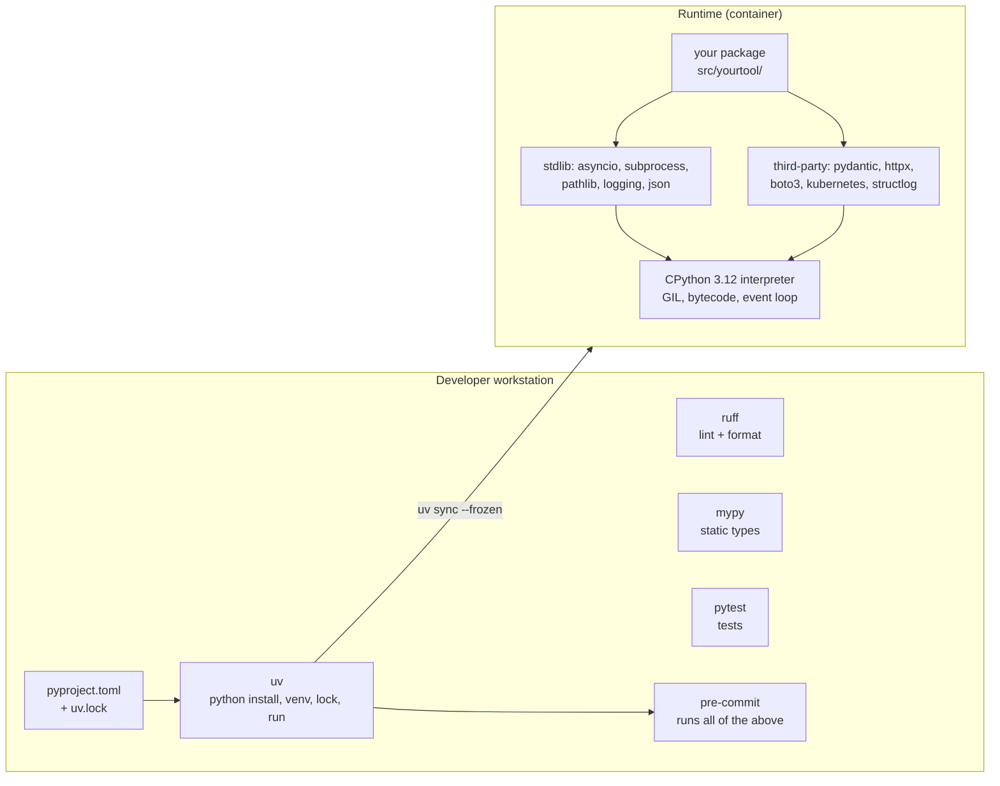

# Python for Platform Engineers

| | |
|---|---|
| **Cluster** | 07 Backend & APIs |
| **Role** | Language foundation (feeds the FastAPI anchor, Pulumi/CDK, LangGraph/Strands, evals) |
| **Category** | General-purpose language; cloud automation and AI lingua franca |
| **Prerequisites** | [00-foundations](../../00-foundations/) Linux and Bash; basic programming in any language |
| **Target version** | Python 3.12+ (3.13 supported; avoid anything below 3.11 in new code) |
| **Capstone phase** | Phase 1 (Months 1-4) |
| **Official docs** | https://docs.python.org/3/ and https://docs.astral.sh/uv/ |

> Python is the language you will reach for most often as a platform, SRE or AI engineer: it writes the automation scripts, the Pulumi stacks, the Kubernetes operators' glue, the FastAPI services, the LangGraph agents, the eval harnesses and the one-off incident forensics. This folder teaches *modern* Python (3.12+, `uv`, type hints everywhere, Pydantic v2, asyncio, structured logging) as an engineering discipline rather than as a scripting convenience. After working through it you will be able to write a typed, tested, packaged, Dockerised Python tool that talks to AWS and Kubernetes safely, and you will know when Bash or Go is the better choice.

## Why This Tool Exists

Before Python became the default automation language, operations code was Bash (unreadable past 200 lines, no data structures, fragile quoting) or Perl. Python won because it reads like pseudocode, ships a large standard library (`subprocess`, `json`, `pathlib`, `argparse`, `asyncio`, `logging`), and because every cloud vendor and AI lab publishes its primary SDK in Python first (`boto3`, `google-cloud-*`, `azure-*`, `kubernetes`, `openai`, `anthropic`, `langchain`).

The problem Python *created* was packaging and environment chaos: `pip` without lockfiles, `virtualenv` versus `venv` versus `conda` versus `poetry`, system Python being broken by `sudo pip install`. The 2024-2025 insight that finally fixed this is `uv`: a single Rust binary that installs Python versions, creates virtualenvs, resolves and locks dependencies 10-100x faster than pip, and runs tools in isolated environments. This folder treats `uv` as the primary tool and shows the pip/venv equivalents for legacy systems.

## Architecture

- **`uv`** replaces `pyenv` + `pip` + `venv` + `pip-tools` + `pipx`. It reads `pyproject.toml`, writes `uv.lock`, and `uv run` guarantees the environment matches the lockfile.
- **`pyproject.toml`** is the single configuration file for metadata, dependencies, `ruff`, `mypy` and `pytest`.
- **CPython** executes bytecode on one thread at a time per interpreter (the GIL). I/O concurrency comes from `asyncio` or threads; CPU parallelism needs processes (or 3.13's experimental free-threaded build).

## The Core Mental Model

1. **Python is a protocol-based, dynamically typed language that you should write as if it were statically typed.** Type hints (`def f(x: int) -> str`) are not enforced at runtime, but `mypy` enforces them before merge and Pydantic enforces them at the boundaries (HTTP, env vars, files). Untyped Python is a liability in a platform codebase; typed Python is as reviewable as Go.

2. **One thread runs Python bytecode at a time; the event loop is how you wait on many things at once.** `await` is a point where your coroutine says "I am waiting on I/O, run someone else". Anything that blocks without `await` (a `requests.get`, `time.sleep`, a tight CPU loop) freezes every other coroutine. Platform code is overwhelmingly I/O bound (HTTP, cloud APIs, kubectl, databases), so `asyncio` plus semaphores plus timeouts is the dominant pattern.

3. **The environment is part of the artefact.** A script that works on your laptop and fails in CI differs only in its environment. Lock it (`uv.lock`), pin the interpreter (`.python-version`), and ship it as a container.

## Anchor-and-Bridge Mapping

Python is a foundation rather than a sibling tool, so the mapping below translates Python idioms into the other languages you will meet in this wiki.

| Concept in Python | Java 21 equivalent | Go equivalent | Bash equivalent |
|---|---|---|---|
| `uv` + `pyproject.toml` + `uv.lock` | Maven wrapper + `pom.xml` (no lockfile; BOMs) | `go.mod` + `go.sum` | none (apt/brew) |
| `venv` | Classpath per project (implicit) | Module cache (implicit) | none |
| `ruff` | Checkstyle + Spotless | `gofmt` + `golangci-lint` | `shellcheck` + `shfmt` |
| `mypy` | the compiler | the compiler | none |
| `dataclass` / Pydantic model | `record` + Bean Validation | `struct` + tags | associative arrays |
| `async def` / `await` | virtual threads (blocking style) | goroutines + channels | `&` + `wait` |
| `asyncio.Semaphore(10)` | `Semaphore(10)` | buffered channel | `xargs -P 10` |
| `subprocess.run([...], check=True)` | `ProcessBuilder` | `exec.Command` | just run it |
| `pathlib.Path` | `java.nio.file.Path` | `path/filepath` | string paths |
| `logging` / `structlog` | SLF4J + Logback JSON | `log/slog` | `echo >&2` |
| `typer` CLI | picocli | cobra | `getopts` |
| `httpx.AsyncClient` | `RestClient` / `HttpClient` | `net/http` | `curl` |
| `pytest` fixtures | JUnit 5 `@BeforeEach` / extensions | `testing.T` + testify | bats |
| `uv build` wheel | `./mvnw package` jar | `go build` binary | copy the file |

## Learning Path

| Step | File | Time |
|---|---|---|
| 1 | [01-installation-and-setup.md](01-installation-and-setup.md): `uv`, interpreters, `pyproject.toml`, ruff/mypy/pytest/pre-commit | 2 h |
| 2 | [02-core-concepts.md](02-core-concepts.md): typing, dataclasses, Pydantic v2, pathlib, subprocess, asyncio, context managers, generators, logging, error handling, packaging layout | 6 h |
| 3 | [03-commands-and-cheatsheet.md](03-commands-and-cheatsheet.md): `uv`, `ruff`, `mypy`, `pytest`, stdlib and library snippets by task | 2 h |
| 4 | [04-hands-on-labs.md](04-hands-on-labs.md): six labs from a typed CLI to a Dockerised async Kubernetes/S3 tool | 6 h |
| 5 | [05-production-patterns.md](05-production-patterns.md): security, Dockerising Python, automation at scale, Python vs Bash vs Go | 2 h |
| 6 | [06-troubleshooting.md](06-troubleshooting.md): import errors, async pitfalls, packaging and container failures | 1 h |
| 7 | [07-interview-questions.md](07-interview-questions.md): 30 questions, junior to principal | 1 h |

## Role in the Capstone

Python code appears in the capstone in five places, and this folder is the prerequisite for all of them:

| Capstone component | Phase | What Python does |
|---|---|---|
| `services/incident-api-py` | 1 | The FastAPI reference service ([../fastapi/](../fastapi/README.md)) |
| `contract-tests/` | 1 | A `pytest` + `httpx` suite that runs against either service's port and asserts the shared contract |
| `infra/pulumi/` | 2 | The Pulumi Python stack mirroring the Terraform VPC |
| `tools/` | 3-5 | Automation CLIs: image-age reporter, SLO burn calculator, DR drill orchestrator, built with `typer`, `boto3`, `kubernetes` |
| `agent/` and `evals/` | 6 | LangGraph/Strands agent, MCP servers, DeepEval/RAGAS suites |

The artefact this folder produces is `tools/platform-cli`, a `uv`-managed, typed, tested Python package with a multi-stage Dockerfile, which later labs extend.

## Further Reading

- Python docs: https://docs.python.org/3/ (especially the `asyncio`, `typing`, `subprocess` and `logging` HOWTOs)
- `uv` docs: https://docs.astral.sh/uv/
- `ruff` docs: https://docs.astral.sh/ruff/
- Pydantic v2: https://docs.pydantic.dev/latest/
- PEP 8 (style), PEP 484 (type hints), PEP 517/518/621 (`pyproject.toml` packaging), PEP 668 (externally managed environments, the reason `pip install` fails on modern Linux)
- *Fluent Python*, 2nd edition (Ramalho) for the language; *Architecture Patterns with Python* (Percival, Gregory) for structuring services
- Python Packaging User Guide: https://packaging.python.org/
