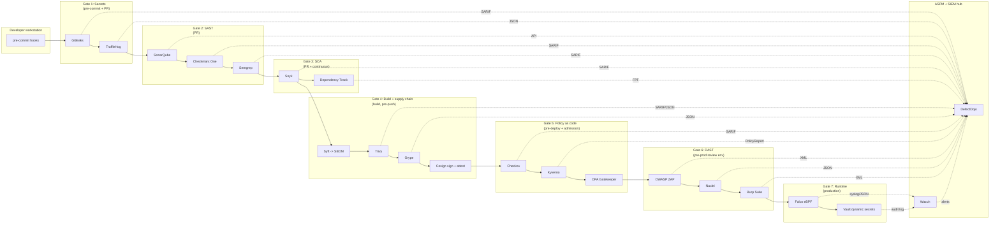
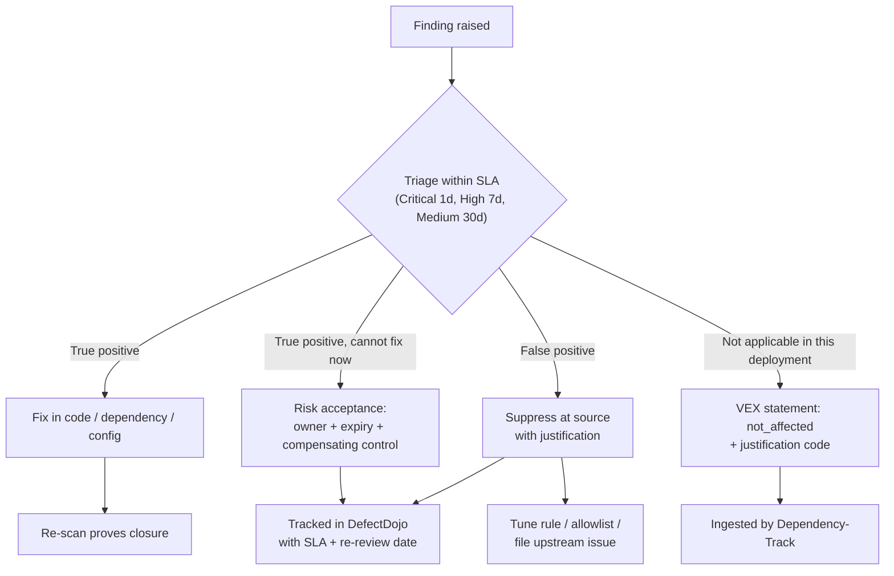

# Cluster 08: DevSecOps - The 20-Tool, 7-Gate Pipeline Security Architecture

| | |
|---|---|
| **Cluster** | 08 DevSecOps (20+ Tools) |
| **Traditional silo** | AppSec / DevSecOps Engineer |
| **Anchor tools** | Trivy, SonarQube, Semgrep, Checkov, OWASP ZAP, Falco, Vault |
| **Bridge tools** | Gitleaks, TruffleHog, Checkmarx One, Snyk, Dependency-Track, Grype, Syft, Cosign, Kyverno, OPA Gatekeeper, Nuclei, Burp Suite, DefectDojo, Wazuh |
| **Core unifying pattern** | Shift-left SAST/SCA/SBOM/DAST gates feeding a single ASPM hub, plus runtime eBPF detection |
| **Prerequisites** | Clusters 04 (Docker, Kubernetes), 05 (Terraform), 06 (GitHub Actions), 07 (FastAPI, Spring Boot) |
| **Capstone phase** | Phase 5 (Months 17-20, ~180 hours) |

> After working through this cluster you will be able to wire seven sequential security gates into a GitHub Actions pipeline for a polyglot (Python FastAPI + Java Spring Boot) microservice pair, explain precisely which layer of the software stack each of the 20 tools inspects and why no single tool can replace the others, set severity thresholds that fail builds without drowning developers in noise, normalise every finding into SARIF and CycloneDX, and aggregate the whole portfolio into DefectDojo with Wazuh correlating host and runtime signals. You will also be able to defend each tool choice in an ADR and a principal-level interview.

---

## 1. Why Twenty Tools?

Line 8 of the viral recruiting image lists "SonarQube, Checkmarx, OWASP ZAP + 20 DevSecOps tools" and the joke is that this is a whole team's job. The serious answer to "why so many?" is that **a modern deployment is a stack of at least seven distinct artefact types, and each one needs a different inspection technique**:

| Layer of the stack | Artefact | What an inspector must understand | Technique | Tools |
|---|---|---|---|---|
| Developer workstation and Git history | Commits, diffs, blobs | Regex, Shannon entropy, provider API verification | Secret scanning | Gitleaks, TruffleHog |
| First-party source code | Abstract Syntax Trees (ASTs), control-flow and data-flow graphs | Parsers for 40+ languages, taint propagation from sources to sinks | SAST | SonarQube, Checkmarx One, Semgrep |
| Third-party dependencies | Lockfiles, manifests, resolved dependency graphs | Package ecosystems (PyPI, Maven Central, npm), CVE/GHSA/OSV databases, transitive resolution, reachability | SCA and SBOM monitoring | Snyk, OWASP Dependency-Track |
| Container images | OCI layers, OS package databases (`apk`, `dpkg`, `rpm`), embedded language libraries | Layer diffing, package DB parsing, SBOM generation, cryptographic signing and attestation | Image scanning, SBOM, supply-chain signing | Trivy, Grype, Syft, Sigstore Cosign |
| Infrastructure definitions | Terraform HCL, CloudFormation, Pulumi, Helm, Kubernetes YAML | Resource graphs, CIS/NIST benchmark rules, admission-time policy evaluation | IaC scanning and admission control | Checkov, Kyverno, OPA Gatekeeper |
| Running application | Live HTTP/HTTPS endpoints, OpenAPI/GraphQL schemas, authenticated sessions | Crawling, fuzzing, request replay, business-logic testing | DAST | OWASP ZAP, Nuclei, Burp Suite |
| Running host and kernel | Linux system calls, file integrity, process trees, secret material in memory | eBPF probes, behavioural rules, dynamic short-lived credentials | Runtime security and secrets management | Falco, HashiCorp Vault |
| Everything above, aggregated | Findings from 180+ scanners, host telemetry, SIEM logs | Deduplication, SLA tracking, correlation, ticketing | ASPM and XDR/SIEM | DefectDojo, Wazuh |

A SAST engine cannot see that your base image ships a vulnerable `openssl`; a container scanner cannot see that your FastAPI route concatenates user input into a SQL string; neither can see that the Terraform module makes the S3 bucket public; none of them can see a reverse shell spawned in a running pod at 03:00. DevSecOps therefore **distributes 20 specialised tools across 7 sequential pipeline security gates** and aggregates every finding into a single Application Security Posture Management (ASPM) hub so that risk is managed in one place rather than in twenty dashboards.

The anchor-and-bridge method still applies. Each gate has one tool you learn deeply (the anchor) and one or more siblings whose delta you map in days:

| Gate | Anchor (learn deeply) | Bridges (map the delta) |
|---|---|---|
| 1 Secrets | Gitleaks (gate anchor) | TruffleHog |
| 2 SAST | SonarQube, Semgrep | Checkmarx One |
| 3 SCA | Snyk (CLI workflow), Dependency-Track (continuous) | - (both are bridges to Trivy's SCA mode) |
| 4 Supply chain | Trivy | Grype, Syft, Cosign |
| 5 Policy as code | Checkov | Kyverno, OPA Gatekeeper |
| 6 DAST | OWASP ZAP | Nuclei, Burp Suite |
| 7 Runtime and secrets | Falco, Vault | - |
| Hub | DefectDojo | Wazuh |

---

## 2. The Seven-Gate Pipeline



Read the diagram left to right as **time**: a secret is caught in milliseconds on the laptop, a SQL injection in minutes on the PR, a vulnerable base image at build time, a public bucket at `terraform plan`, a privileged pod at `kubectl apply`, a missing security header in the ephemeral review environment, and a reverse shell at runtime. The further right a finding is discovered, the more it costs; the whole discipline is about moving discoveries left.

### Gate placement and timing budget

| Gate | Trigger | Where it runs | Latency budget | Blocking? |
|---|---|---|---|---|
| 1 Secrets | `git commit` (pre-commit), `pull_request` | Laptop, GitHub-hosted runner | < 5 s local, < 60 s CI | Yes, always |
| 2 SAST | `pull_request`, `push` to main | Runner, SonarQube server | 1-10 min | Yes on *new* code |
| 3 SCA | `pull_request`, nightly cron, SBOM upload on every build | Runner, Dependency-Track server | 1-3 min | Yes for fixable high/critical |
| 4 Build and supply chain | After `docker build`, before `docker push` | Runner | 1-5 min | Yes for fixable high/critical; signing mandatory |
| 5 Policy as code | `terraform plan`, Helm render; cluster admission webhook | Runner; kube-apiserver webhook | Seconds | Yes (Checkov in CI, Kyverno/Gatekeeper `Enforce` in cluster) |
| 6 DAST | After deploy to ephemeral review environment | Runner against review URL | 5-30 min baseline, hours for full | Baseline blocks; full scan is nightly and informational |
| 7 Runtime | Continuous | DaemonSet on every node; Vault cluster | Real time | Alerts and automatic response, not pipeline |
| Hub | Every gate publishes | DefectDojo, Wazuh servers | Asynchronous | SLA tracking, not pipeline |

---

## 3. Master Table: All 20 Tools

| # | Tool | Gate | Category | What it inspects and how | Enforcement role | Anchor / Bridge | Folder |
|---|---|---|---|---|---|---|---|
| 1 | Gitleaks | 1 | Pre-commit and repo secrets | Fast regex plus entropy scanning across Git commits, branches and PR diffs for hardcoded API keys and tokens | Runs in local pre-commit hooks and fast PR checks (< 5 s) to block credential leaks | Gate anchor | [gate-1-secrets/gitleaks](gate-1-secrets/gitleaks/README.md) |
| 2 | TruffleHog | 1 | Verified secret detection | Scans Git history, S3 buckets, Docker images and logs with 800+ detectors and actively verifies live key validity against provider APIs | Alerts immediately when an active, live production credential is exposed | Bridge | [gate-1-secrets/trufflehog](gate-1-secrets/trufflehog/README.md) |
| 3 | SonarQube | 2 | SAST and code quality | Static analysis across 40+ languages detecting vulnerabilities, taint flows, bugs, code smells and test-coverage gaps | Enforces Quality Gates on PRs (zero new blocker vulnerabilities, 80% coverage on new code) | **Anchor** | [gate-2-sast/sonarqube](gate-2-sast/sonarqube/README.md) |
| 4 | Checkmarx One | 2 | Enterprise AST / SAST | Builds an AST and data-flow graph from uncompiled source to trace untrusted input to sensitive sinks | Enterprise compliance scanning for OWASP Top 10, CWE and PCI-DSS with best-fix-location guidance | Bridge | [gate-2-sast/checkmarx](gate-2-sast/checkmarx/README.md) |
| 5 | Semgrep | 2 | Semantic SAST guardrails | Lightweight syntax-aware pattern matching where custom rules look like the target Python/Java/Go source | Executes in seconds inside PR workflows to enforce organisation-specific secure-coding guardrails | **Anchor** | [gate-2-sast/semgrep](gate-2-sast/semgrep/README.md) |
| 6 | Snyk | 3 | SCA and developer security | Inspects lockfiles (`requirements.txt`, `pom.xml`, `package-lock.json`) for known CVEs and transitive exploitability | Opens automated fix PRs with minimal non-breaking version upgrades in GitHub / Azure Repos | Bridge | [gate-3-sca/snyk](gate-3-sca/snyk/README.md) |
| 7 | OWASP Dependency-Track | 3 | Continuous SBOM analysis | Ingests CycloneDX SBOMs from every build and continuously monitors components against NVD, GitHub Advisories and OSV | Tracks blast radius across all deployed microservices the moment a zero-day CVE is disclosed | Bridge | [gate-3-sca/dependency-track](gate-3-sca/dependency-track/README.md) |
| 8 | Trivy | 4 | Container, Kubernetes and IaC scanner | Unified scanner for OS packages (`apk`, `dpkg`, `rpm`), language lockfiles, Dockerfiles and Kubernetes manifests | Blocks the pipeline before `docker push` if critical/high CVEs with upstream fixes exist | **Anchor** | [gate-4-supply-chain/trivy](gate-4-supply-chain/trivy/README.md) |
| 9 | Grype | 4 | Image and SBOM vulnerability scan | Fast open-source scanner operating on container images or pre-generated Syft SBOMs | Pairs with Syft for air-gapped or decoupled scanning in regulated pipelines | Bridge | [gate-4-supply-chain/grype](gate-4-supply-chain/grype/README.md) |
| 10 | Syft | 4 | SBOM generation | Inspects image layers and filesystems to emit CycloneDX and SPDX SBOMs | Produces inventory artefacts attached to every release for supply-chain compliance | Bridge | [gate-4-supply-chain/syft](gate-4-supply-chain/syft/README.md) |
| 11 | Sigstore Cosign | 4 | Supply-chain signing and SLSA | Uses ephemeral OIDC identities from GitHub Actions / GitLab and Fulcio / Rekor transparency logs for keyless signing | Attaches signed SBOM and scan attestations to OCI registries, verified before pod start | Bridge | [gate-4-supply-chain/cosign](gate-4-supply-chain/cosign/README.md) |
| 12 | Checkov | 5 | IaC policy as code | Graph-based static analysis of Terraform, CloudFormation, Pulumi, Helm and Kubernetes YAML against 1,000+ CIS/NIST rules | Prevents public S3 buckets, unencrypted RDS volumes and wildcard IAM at `terraform plan` time | **Anchor** | [gate-5-policy-as-code/checkov](gate-5-policy-as-code/checkov/README.md) |
| 13 | Kyverno | 5 | Kubernetes-native admission control | Dynamic admission controller with validate, mutate and generate policies written as native Kubernetes YAML | Rejects privileged pods, enforces non-root and verifies Cosign signatures on `kubectl apply` | Bridge | [gate-5-policy-as-code/kyverno](gate-5-policy-as-code/kyverno/README.md) |
| 14 | OPA Gatekeeper | 5 | Rego policy engine | Admission controller powered by Open Policy Agent and declarative Rego ConstraintTemplates | Unified cross-platform policy across Kubernetes, Terraform, Envoy gateways and microservices | Bridge | [gate-5-policy-as-code/opa-gatekeeper](gate-5-policy-as-code/opa-gatekeeper/README.md) |
| 15 | OWASP ZAP | 6 | Automated DAST | Spiders live staging web apps and OpenAPI/GraphQL endpoints for runtime flaws | Baseline and full active scans against ephemeral review environments before promotion | **Anchor** | [gate-6-dast/owasp-zap](gate-6-dast/owasp-zap/README.md) |
| 16 | Nuclei | 6 | Fast template DAST | YAML-template scanner firing thousands of targeted CVE, misconfiguration and API checks with near-zero false positives | Continuous external attack-surface and staging regression scans for newly disclosed CVEs | Bridge | [gate-6-dast/nuclei](gate-6-dast/nuclei/README.md) |
| 17 | Burp Suite | 6 | Interactive AppSec and DAST | Intercepting proxy, repeater, intruder fuzzer and crawler for authentication and business-logic testing | Deep manual penetration testing and multi-step API security verification by AppSec engineers | Bridge | [gate-6-dast/burp-suite](gate-6-dast/burp-suite/README.md) |
| 18 | Falco | 7 | eBPF runtime security | Monitors Linux kernel system calls via eBPF probes in real time against behavioural rules, no code changes | Detects interactive shells in containers (`kubectl exec`), sensitive file reads (`/etc/shadow`) and crypto-mining | **Anchor** | [gate-7-runtime-and-secrets/falco](gate-7-runtime-and-secrets/falco/README.md) |
| 19 | HashiCorp Vault | 7 | Dynamic secrets and KMS | Identity-based secrets engine issuing short-lived dynamic DB credentials, PKI certificates and transit encryption keys | Eliminates static credentials in pods via Vault Agent sidecar or CSI Secrets Store driver | **Anchor** | [gate-7-runtime-and-secrets/vault](gate-7-runtime-and-secrets/vault/README.md) |
| 20 | DefectDojo + Wazuh | Hub | Central ASPM and XDR/SIEM | DefectDojo ingests, deduplicates and tracks SLA remediation across 180+ scanners; Wazuh provides host XDR, FIM and SIEM log correlation | Single pane of glass for posture, audit evidence and automated Jira triage | Bridge | [aspm-and-siem/defectdojo](aspm-and-siem/defectdojo/README.md), [aspm-and-siem/wazuh](aspm-and-siem/wazuh/README.md) |

---

## 4. Shift-Left Philosophy

"Shift left" is the economic observation that a defect found in the IDE costs minutes, in a PR costs an hour, in staging costs a day, and in production costs an incident, a postmortem and sometimes a regulator. It is **not** "do security earlier and stop doing it later". The seven gates deliberately include gates 6 and 7 on the right because some classes of defect are only observable at runtime:

- A secret or SQL injection is a *static* property of the code: shift it fully left (gates 1-2).
- A vulnerable dependency is static today but *changes without a commit* when a CVE is published tomorrow: scan at build (gate 3-4) **and** monitor continuously (Dependency-Track).
- A misconfigured bucket is static in HCL (Checkov, gate 5) but can drift when someone clicks in the console: admission and runtime controls catch the drift.
- A missing `Content-Security-Policy` header is only visible on the wire (gate 6).
- A cryptominer dropped by an exploited zero-day is only visible as syscalls (gate 7).

The placement rule of thumb: **put a check at the earliest gate where the artefact it inspects exists, then add a continuous control for anything that can change without a commit.**

### The seven gate points

| Gate point | What exists at this moment | Checks that make sense |
|---|---|---|
| Pre-commit (laptop) | Diff about to be committed | Secrets (Gitleaks), fast Semgrep `p/ci`, formatters |
| Pull request | Source tree, branch diff, lockfiles | Secrets on diff, SAST on new code, SCA, IaC scan, Semgrep custom guardrails |
| Build | Compiled artefacts, container image, SBOM | Trivy / Grype image scan, Syft SBOM, Cosign sign and attest, Dependency-Track upload |
| Pre-deploy | Rendered manifests, Terraform plan | Checkov on plan JSON, Helm template scan, Conftest / Kyverno CLI policy tests |
| Admission | Kubernetes API request | Kyverno / Gatekeeper validation and mutation, Cosign signature verification |
| Pre-prod (review environment) | Running application with test data | ZAP baseline and API scan, Nuclei templates, manual Burp for release candidates |
| Runtime | Kernel syscalls, process tree, network flows, secret leases | Falco rules, Vault audit logs, Wazuh FIM and SIEM correlation |

---

## 5. Taxonomy of Security Testing

| Acronym | Name | Inspects | Needs running app? | Strength | Weakness | Tools here |
|---|---|---|---|---|---|---|
| Secret scanning | - | Git objects, filesystems, buckets | No | Cheap, fast, catches the single most damaging mistake | Regex false positives; cannot find secrets you have no pattern for | Gitleaks, TruffleHog |
| SAST | Static Application Security Testing | Source code AST, data-flow | No | Exact line numbers early in the lifecycle | False positives without taint context; blind to runtime config and dependencies | SonarQube, Checkmarx One, Semgrep |
| SCA | Software Composition Analysis | Third-party dependencies | No | Known CVEs are the majority of exploited bugs | Noise from unreachable vulns; transitive upgrade pain | Snyk, Trivy, Grype |
| SBOM | Software Bill of Materials (CycloneDX / SPDX) | Inventory of components | No | Enables continuous monitoring and zero-day blast radius queries | Only as good as the generator's package detection | Syft, Dependency-Track, Trivy |
| Supply-chain integrity | Signing, provenance, SLSA | Artefact identity and build provenance | No | Proves what was built, by whom, from which commit | Requires verification at admission or it is theatre | Cosign, Kyverno |
| IaC scan | Infrastructure-as-Code scanning | Terraform, CloudFormation, Helm, YAML | No | Prevents cloud misconfiguration before it exists | Cannot see drift or runtime state | Checkov, Trivy, Checkmarx KICS, Snyk IaC |
| Admission control | Policy enforcement at the Kubernetes API | API request objects | Cluster yes, app no | The only control that cannot be bypassed by skipping CI | Only governs Kubernetes objects | Kyverno, OPA Gatekeeper |
| DAST | Dynamic Application Security Testing | Live HTTP responses | Yes | Finds what is actually exploitable including config and headers | No line numbers; needs auth and test data; slow | OWASP ZAP, Nuclei, Burp Suite |
| IAST | Interactive Application Security Testing | Instrumented runtime inside the app | Yes | Combines DAST evidence with SAST precision | Agent per language; commercial (Contrast, Checkmarx IAST); not one of the 20 | - |
| Runtime security | eBPF / syscall detection | Kernel events | Yes | Catches zero-days and insider actions | Alert fatigue if rules not tuned | Falco |
| Secrets management | Dynamic credentials, KMS | Identity and leases | Yes | Removes the thing attackers steal | Operational complexity, unseal, HA | Vault |
| ASPM | Application Security Posture Management | All findings | No | Deduplication, SLA, one risk view | Garbage in, garbage out | DefectDojo |
| SIEM / XDR | Security Information and Event Management | Logs, host telemetry | Yes | Correlation and compliance evidence | Volume, cost, tuning | Wazuh |

---

## 6. Severity Policy and Gate-Failure Thresholds

Every tool emits its own severity scale. Normalise to one organisational policy before setting thresholds, or developers will learn to ignore red builds.

### Normalised severity scale

| Normalised | CVSS v3.1 base | SonarQube | Semgrep | Trivy / Grype / Snyk | Checkov | ZAP | Falco priority |
|---|---|---|---|---|---|---|---|
| Critical | 9.0-10.0 | Blocker | ERROR with `impact: HIGH` and `confidence: HIGH` | CRITICAL | HIGH on data-exposure checks | High with confirmed evidence | CRITICAL / EMERGENCY |
| High | 7.0-8.9 | Critical | ERROR | HIGH | HIGH | High | ERROR |
| Medium | 4.0-6.9 | Major | WARNING | MEDIUM | MEDIUM | Medium | WARNING |
| Low | 0.1-3.9 | Minor | INFO | LOW | LOW | Low | NOTICE / INFO |
| Informational | 0 | Info | INFO | UNKNOWN / NEGLIGIBLE | INFO | Informational | DEBUG |

### Recommended thresholds for the capstone pipeline

| Gate | Fail the build when | Warn only when | Rationale |
|---|---|---|---|
| 1 Secrets | Any finding not in the allowlist or baseline | - | There is no acceptable leaked secret |
| 2 SAST | Any new Blocker/Critical vulnerability; Quality Gate `ERROR`; Semgrep `ERROR` severity from `p/ci` or custom rules | Code smells, WARNING | Gate on *new code* so legacy debt does not block every PR forever |
| 3 SCA | High/Critical **with an available fix** (`--fail-on=upgradable`) | High/Critical with no fix; Medium | Unfixable vulns go to Dependency-Track for tracking and VEX, not to a red build |
| 4 Image | High/Critical with fix (`--ignore-unfixed --exit-code 1 --severity HIGH,CRITICAL`); missing signature | Unfixed | Same reasoning; signing is mandatory |
| 5 IaC | Any `HIGH` Checkov check on encryption, public exposure, IAM wildcards; any Kyverno `Enforce` policy | `MEDIUM`/`LOW`, `Audit` policies | Misconfiguration is binary |
| 6 DAST | ZAP baseline `FAIL` rules (configurable in `zap.conf`), Nuclei `critical,high` | Medium headers, informational | Baseline is passive and fast; full scan is nightly |
| 7 Runtime | Not a build gate: Falco `CRITICAL` pages on-call, `WARNING` creates ticket | - | Runtime is a response discipline |

Rules that make thresholds survivable:

1. **Gate on new code and new findings**, never on the historical backlog. SonarQube's new-code definition, Semgrep's `--baseline-commit`, Gitleaks' `--baseline-path` and Trivy's `.trivyignore` with expiry all exist for this.
2. **Only fail on fixable findings** in SCA/image scanning. An unfixable CVE in `glibc` is a tracking problem, not a merge problem.
3. **Every suppression has an owner, a reason and an expiry date.** `.snyk` `expires:`, `.trivyignore` with `exp:`, Semgrep `# nosemgrep: rule-id -- reason`, SonarQube "Accept" with comment. CI should reject suppressions without a reason.
4. **Severity is not priority.** Priority = severity x exploitability (EPSS, KEV) x exposure (internet-facing?) x data sensitivity. DefectDojo and Dependency-Track carry EPSS; use it.
5. **Measure the gate.** Track false-positive rate, mean time to remediate by severity, and the percentage of PRs blocked. A gate blocking 40% of PRs is mis-tuned.

---

## 7. False-Positive Management

A false positive is a finding that is not a real vulnerability in context. Every gate produces them; the process matters more than the tool.



Where to suppress, per tool, so suppressions are reviewable in Git:

| Tool | Mechanism | Must include |
|---|---|---|
| Gitleaks | `.gitleaks.toml` `[allowlist]`, `.gitleaksignore` fingerprint, `--baseline-path` | Comment with ticket |
| TruffleHog | `--exclude-paths`, `--exclude-detectors`, `--only-verified` | Document why detector excluded |
| SonarQube | Mark issue False Positive / Accepted in UI (audit trail), `// NOSONAR` discouraged | Comment in UI |
| Semgrep | `# nosemgrep: rule-id -- justification`, `paths: exclude` in rule, platform triage | Justification enforced by CI regex |
| Snyk | `.snyk` `ignore:` with `reason:` and `expires:` | Both fields mandatory |
| Dependency-Track | Audit finding as False Positive / Not Affected; import VEX | Justification code |
| Trivy | `.trivyignore` or `.trivyignore.yaml` with `expired_at`, Rego ignore policy | Expiry |
| Checkov | `# checkov:skip=CKV_AWS_18: reason`, `--skip-check` | Reason text |
| Kyverno / Gatekeeper | Policy exceptions (`PolicyException` CRD) / `excludedNamespaces` | Reviewed via GitOps PR |
| ZAP | `zap.conf` rule `IGNORE`, context exclusions, `-c` config file | Comment |
| Falco | Rule `exceptions:` block, override with `append: true` | PR review |

---

## 8. SARIF: The Interchange Format

**SARIF** (Static Analysis Results Interchange Format, OASIS standard v2.1.0) is the JSON schema that GitHub code scanning, Azure DevOps, VS Code and DefectDojo all understand. Make every static tool emit SARIF so that developers see all findings in one place (the PR "Security" tab) and DefectDojo can import them with one parser.

Minimal SARIF shape every tool produces:

```json
{
  "version": "2.1.0",
  "$schema": "https://json.schemastore.org/sarif-2.1.0.json",
  "runs": [
    {
      "tool": {
        "driver": {
          "name": "semgrep",
          "semanticVersion": "1.90.0",
          "rules": [
            {
              "id": "python.fastapi.security.subprocess-shell-true",
              "shortDescription": { "text": "subprocess with shell=True and tainted input" },
              "properties": { "security-severity": "8.8", "tags": ["security", "CWE-78"] }
            }
          ]
        }
      },
      "results": [
        {
          "ruleId": "python.fastapi.security.subprocess-shell-true",
          "level": "error",
          "message": { "text": "User input reaches subprocess.run(shell=True)" },
          "locations": [
            {
              "physicalLocation": {
                "artifactLocation": { "uri": "app/routes/admin.py" },
                "region": { "startLine": 42, "startColumn": 5 }
              }
            }
          ],
          "partialFingerprints": { "primaryLocationLineHash": "abc123..." }
        }
      ]
    }
  ]
}
```

Who emits SARIF natively: Gitleaks (`--report-format sarif`), Semgrep (`--sarif`), Trivy (`--format sarif`), Grype (`-o sarif`), Checkov (`-o sarif`), Snyk (`--sarif`), Checkmarx One (`--report-format sarif`), ZAP (SARIF report add-on), Nuclei (`-se`). SonarQube *imports* SARIF (`sonar.sarifReportPaths`) and exposes its own API; DefectDojo has a generic SARIF importer. The `security-severity` property (CVSS-like 0-10) is what GitHub uses to bucket Critical/High/Medium/Low in the code-scanning UI; set it in custom rules.

Upload step used in every gate below:

```yaml
- name: Upload SARIF to GitHub code scanning
  if: always()
  uses: github/codeql-action/upload-sarif@v3
  with:
    sarif_file: results.sarif
    category: semgrep        # one category per tool so results do not overwrite each other
```

For dependency inventories the equivalent interchange format is **CycloneDX** (OWASP; also supports VEX and VDR) with **SPDX** as the ISO alternative. Syft emits both; Dependency-Track consumes CycloneDX.

---

## 9. The Complete GitHub Actions 7-Gate Pipeline Skeleton

This is the skeleton the capstone repository uses. Each gate's folder documents the full job; here the shape and ordering are what matter. Secrets are referenced as GitHub Actions secrets (`${{ secrets.X }}`) and cloud access uses OIDC, never static keys.

```yaml
# .github/workflows/devsecops-pipeline.yml
name: devsecops-7-gates

on:
  pull_request:
    branches: [main]
  push:
    branches: [main]
  schedule:
    - cron: "0 2 * * *"          # nightly: full DAST + SBOM re-evaluation

permissions:
  contents: read
  security-events: write          # upload SARIF
  id-token: write                 # OIDC for Cosign keyless + cloud auth
  packages: write                 # push to GHCR
  pull-requests: write            # PR decoration

env:
  IMAGE: ghcr.io/${{ github.repository }}/api
  PYTHON_VERSION: "3.12"
  JAVA_VERSION: "21"

jobs:
  # ------------------------------------------------------------------ Gate 1
  gate-1-secrets:
    name: "Gate 1 - Secrets"
    runs-on: ubuntu-latest
    steps:
      - uses: actions/checkout@v4
        with: { fetch-depth: 0 }                     # full history for both tools
      - name: Gitleaks
        uses: gitleaks/gitleaks-action@v2
        env:
          GITHUB_TOKEN: ${{ secrets.GITHUB_TOKEN }}
          GITLEAKS_ENABLE_UPLOAD_ARTIFACT: "true"
      - name: TruffleHog (verified + unknown only)
        uses: trufflesecurity/trufflehog@main
        with:
          base: ${{ github.event.repository.default_branch }}
          head: HEAD
          extra_args: --results=verified,unknown --fail

  # ------------------------------------------------------------------ Gate 2
  gate-2-sast:
    name: "Gate 2 - SAST"
    needs: gate-1-secrets
    runs-on: ubuntu-latest
    container: { image: semgrep/semgrep }
    steps:
      - uses: actions/checkout@v4
        with: { fetch-depth: 0 }
      - name: Semgrep (registry + custom rules)
        run: |
          semgrep ci --config p/ci --config p/owasp-top-ten --config .semgrep/ \
            --sarif --output semgrep.sarif --metrics=off
        env:
          SEMGREP_APP_TOKEN: ${{ secrets.SEMGREP_APP_TOKEN }}
      - uses: github/codeql-action/upload-sarif@v3
        if: always()
        with: { sarif_file: semgrep.sarif, category: semgrep }

  gate-2-sonarqube:
    name: "Gate 2 - SonarQube Quality Gate"
    needs: gate-1-secrets
    runs-on: ubuntu-latest
    steps:
      - uses: actions/checkout@v4
        with: { fetch-depth: 0 }
      - uses: actions/setup-python@v5
        with: { python-version: "${{ env.PYTHON_VERSION }}" }
      - run: pip install -r services/fastapi/requirements.txt pytest pytest-cov
      - run: pytest services/fastapi --cov=app --cov-report=xml:services/fastapi/coverage.xml
      - uses: actions/setup-java@v4
        with: { distribution: temurin, java-version: "${{ env.JAVA_VERSION }}", cache: maven }
      - run: mvn -B -f services/spring-boot/pom.xml verify     # JaCoCo report via plugin
      - uses: sonarsource/sonarqube-scan-action@v4
        env:
          SONAR_TOKEN: ${{ secrets.SONAR_TOKEN }}
          SONAR_HOST_URL: ${{ vars.SONAR_HOST_URL }}
      - uses: sonarsource/sonarqube-quality-gate-action@v1
        timeout-minutes: 10
        env: { SONAR_TOKEN: "${{ secrets.SONAR_TOKEN }}" }

  # ------------------------------------------------------------------ Gate 3
  gate-3-sca:
    name: "Gate 3 - SCA"
    needs: gate-1-secrets
    runs-on: ubuntu-latest
    steps:
      - uses: actions/checkout@v4
      - uses: snyk/actions/setup@master
      - name: Snyk test (fail only on fixable high+)
        run: snyk test --all-projects --severity-threshold=high --fail-on=upgradable --sarif-file-output=snyk.sarif
        env: { SNYK_TOKEN: "${{ secrets.SNYK_TOKEN }}" }
        continue-on-error: false
      - uses: github/codeql-action/upload-sarif@v3
        if: always()
        with: { sarif_file: snyk.sarif, category: snyk }

  # ------------------------------------------------------------------ Gate 4
  gate-4-build-supply-chain:
    name: "Gate 4 - Build, SBOM, Scan, Sign"
    needs: [gate-2-sast, gate-2-sonarqube, gate-3-sca]
    runs-on: ubuntu-latest
    outputs:
      digest: ${{ steps.build.outputs.digest }}
    steps:
      - uses: actions/checkout@v4
      - uses: docker/login-action@v3
        with: { registry: ghcr.io, username: "${{ github.actor }}", password: "${{ secrets.GITHUB_TOKEN }}" }
      - id: build
        uses: docker/build-push-action@v6
        with:
          context: services/fastapi
          push: ${{ github.event_name != 'pull_request' }}
          tags: ${{ env.IMAGE }}:${{ github.sha }}
          provenance: true
          sbom: false            # we generate with Syft explicitly below
      - name: Syft SBOM
        uses: anchore/sbom-action@v0
        with: { image: "${{ env.IMAGE }}:${{ github.sha }}", format: cyclonedx-json, output-file: sbom.cdx.json }
      - name: Trivy image scan (block on fixable HIGH/CRITICAL)
        uses: aquasecurity/trivy-action@0.28.0
        with:
          image-ref: ${{ env.IMAGE }}:${{ github.sha }}
          format: sarif
          output: trivy.sarif
          severity: HIGH,CRITICAL
          ignore-unfixed: true
          exit-code: "1"
      - uses: github/codeql-action/upload-sarif@v3
        if: always()
        with: { sarif_file: trivy.sarif, category: trivy }
      - name: Grype second opinion from SBOM
        uses: anchore/scan-action@v5
        with: { sbom: sbom.cdx.json, fail-build: false, severity-cutoff: high }
      - name: Upload SBOM to Dependency-Track
        uses: DependencyTrack/gh-upload-sbom@v3
        with:
          serverHostname: ${{ vars.DTRACK_HOST }}
          apiKey: ${{ secrets.DTRACK_API_KEY }}
          projectName: capstone-fastapi
          projectVersion: ${{ github.ref_name }}
          bomFilename: sbom.cdx.json
          autoCreate: true
      - uses: sigstore/cosign-installer@v3
      - name: Cosign keyless sign + attest SBOM
        if: github.event_name != 'pull_request'
        run: |
          cosign sign --yes ${{ env.IMAGE }}@${{ steps.build.outputs.digest }}
          cosign attest --yes --type cyclonedx --predicate sbom.cdx.json \
            ${{ env.IMAGE }}@${{ steps.build.outputs.digest }}

  # ------------------------------------------------------------------ Gate 5
  gate-5-policy:
    name: "Gate 5 - IaC and Policy as Code"
    needs: gate-1-secrets
    runs-on: ubuntu-latest
    steps:
      - uses: actions/checkout@v4
      - uses: bridgecrewio/checkov-action@v12
        with:
          directory: infra/
          framework: terraform,kubernetes,helm,dockerfile,github_actions
          output_format: cli,sarif
          output_file_path: console,checkov.sarif
          soft_fail_on: LOW,MEDIUM
          hard_fail_on: HIGH,CRITICAL
      - uses: github/codeql-action/upload-sarif@v3
        if: always()
        with: { sarif_file: checkov.sarif, category: checkov }
      - name: Kyverno CLI policy tests against rendered Helm
        run: |
          helm template api deploy/helm/api > rendered.yaml
          kyverno apply policies/kyverno/ --resource rendered.yaml --audit-warn
      - name: Conftest (OPA) on Terraform plan
        run: |
          cd infra/terraform && terraform init -backend=false && terraform plan -out=tfplan && terraform show -json tfplan > plan.json
          conftest test plan.json --policy ../../policies/rego/

  # ------------------------------------------------------------------ Gate 6
  gate-6-dast:
    name: "Gate 6 - DAST on review environment"
    needs: [gate-4-build-supply-chain, gate-5-policy]
    if: github.event_name == 'pull_request'
    runs-on: ubuntu-latest
    environment: review
    steps:
      - uses: actions/checkout@v4
      - name: Deploy review environment (Argo CD ApplicationSet creates pr-<n>)
        run: ./scripts/wait-for-review-env.sh "https://pr-${{ github.event.number }}.review.example.com"
      - name: ZAP API scan against OpenAPI
        uses: zaproxy/action-api-scan@v0.9.0
        with:
          target: "https://pr-${{ github.event.number }}.review.example.com/openapi.json"
          format: openapi
          rules_file_name: .zap/rules.tsv
          cmd_options: "-a -I"
      - name: Nuclei high/critical templates
        uses: projectdiscovery/nuclei-action@main
        with:
          target: "https://pr-${{ github.event.number }}.review.example.com"
          flags: "-severity critical,high -sarif-export nuclei.sarif"
      - uses: github/codeql-action/upload-sarif@v3
        if: always()
        with: { sarif_file: nuclei.sarif, category: nuclei }

  # ------------------------------------------------------------------ Hub
  aspm-publish:
    name: "ASPM - publish to DefectDojo"
    needs: [gate-1-secrets, gate-2-sast, gate-3-sca, gate-4-build-supply-chain, gate-5-policy]
    if: always()
    runs-on: ubuntu-latest
    steps:
      - uses: actions/download-artifact@v4
      - name: Reimport each scan into DefectDojo (dedupe + SLA)
        run: ./scripts/defectdojo-reimport.sh
        env:
          DD_URL: ${{ vars.DD_URL }}
          DD_TOKEN: ${{ secrets.DD_TOKEN }}
          DD_ENGAGEMENT: ${{ github.repository }}-${{ github.ref_name }}
```

Gate 7 is not a job: Falco runs as a DaemonSet, Vault issues dynamic credentials to the deployed pods, and both ship events to Wazuh. The Kyverno `verifyImages` policy in the cluster is what makes the Cosign signature in gate 4 *enforced* rather than decorative.

---

## 10. Frameworks and Standards to Map Findings Against

| Framework | What it is | How it is used in this cluster |
|---|---|---|
| **OWASP Top 10 (2021)** | A01 Broken Access Control, A02 Cryptographic Failures, A03 Injection, A04 Insecure Design, A05 Security Misconfiguration, A06 Vulnerable and Outdated Components, A07 Identification and Authentication Failures, A08 Software and Data Integrity Failures, A09 Security Logging and Monitoring Failures, A10 SSRF | SAST rule tags (`owasp-top10`), Semgrep `p/owasp-top-ten`, ZAP alert mapping, Checkmarx presets. A06 is the SCA gate; A08 is the supply-chain gate |
| **OWASP API Security Top 10 (2023)** | API1 BOLA, API2 Broken Authentication, API3 Broken Object Property Level Authorization, API4 Unrestricted Resource Consumption, API5 BFLA, API6 Unrestricted Access to Sensitive Business Flows, API7 SSRF, API8 Security Misconfiguration, API9 Improper Inventory Management, API10 Unsafe Consumption of APIs | ZAP API scan with OpenAPI import, Burp manual BOLA testing, Semgrep FastAPI auth-dependency rule, Checkmarx API Security |
| **OWASP Top 10 for LLM Applications (2025)** | LLM01 Prompt Injection, LLM02 Sensitive Information Disclosure, LLM03 Supply Chain, LLM04 Data and Model Poisoning, LLM05 Improper Output Handling, LLM06 Excessive Agency, LLM07 System Prompt Leakage, LLM08 Vector and Embedding Weaknesses, LLM09 Misinformation, LLM10 Unbounded Consumption | Semgrep custom taint rules for prompt concatenation (LLM01), Gitleaks/TruffleHog on model API keys, Dependency-Track for model and library SBOMs, Falco for excessive agency (agent spawning shells), Promptfoo in cluster 10 |
| **CWE** | MITRE Common Weakness Enumeration; CWE-79 XSS, CWE-89 SQLi, CWE-78 OS command injection, CWE-798 hardcoded credentials, CWE-502 deserialisation, CWE-918 SSRF, CWE Top 25 | Every SAST tool tags findings with CWE; DefectDojo deduplicates on CWE + location |
| **SLSA (v1.0)** | Supply-chain Levels for Software Artifacts. Build L1: provenance exists; L2: hosted build, signed provenance; L3: hardened, isolated build with non-falsifiable provenance | GitHub Actions + `slsa-github-generator` or `docker/build-push-action provenance: true` + Cosign gets you to L2/L3; Kyverno verifies before admission |
| **NIST SSDF (SP 800-218)** | Secure Software Development Framework: Prepare the Organisation (PO), Protect Software (PS), Produce Well-Secured Software (PW), Respond to Vulnerabilities (RV) | PW.7/PW.8 = SAST/DAST gates; PS.3 = SBOM and signing; RV.1 = Dependency-Track continuous monitoring and DefectDojo SLAs |
| **CIS Benchmarks** | Centre for Internet Security hardening baselines for Docker, Kubernetes, AWS, Linux | Checkov rule IDs cite CIS; Trivy `k8s` and `config` scanners; Wazuh SCA module scores hosts; Falco rules for CIS Docker 5.x |
| **PCI-DSS v4.0** | Payment card industry; req 6 secure development, 6.3.2 inventory of bespoke and third-party software (SBOM), 11.3 vulnerability scanning | Checkmarx compliance preset, Dependency-Track as inventory of record, DefectDojo audit evidence |
| **NIST CSF 2.0** | Govern, Identify, Protect, Detect, Respond, Recover | Cluster 12 governance; gates 1-5 are Protect, gate 7 and Wazuh are Detect, DefectDojo is Respond |

---

## 11. Learning Order and Time Budget

Phase 5 is 180 hours over months 17-20. Learn anchors first and gate by gate, because each gate's bridge is a delta on the anchor.

| Week | Gate | Study | Build in the capstone | Hours |
|---|---|---|---|---|
| 1 | 1 | Gitleaks deeply, then TruffleHog delta | Pre-commit hooks + PR job; seed and catch a fake secret; rotation runbook | 10 |
| 2-4 | 2 | SonarQube server, Quality Gates, PR decoration; then Semgrep rule writing (6 custom rules, taint mode); then Checkmarx One mapping | SonarQube on kind via Helm; coverage import for both services; Semgrep custom ruleset in `.semgrep/` | 35 |
| 5-6 | 3 | Snyk CLI and policy; Dependency-Track server and SBOM lifecycle | SBOM from every build uploaded to Dependency-Track; policy violations to Slack | 20 |
| 7-9 | 4 | Trivy deeply (image, fs, config, k8s); Syft/Grype delta; Cosign keyless signing | Signed, attested images in GHCR; `.trivyignore` with expiry | 30 |
| 10-11 | 5 | Checkov on Terraform plan; Kyverno policies; Gatekeeper and Rego delta | Checkov in CI; Kyverno `verifyImages` + Pod Security; one Gatekeeper ConstraintTemplate | 25 |
| 12-13 | 6 | ZAP baseline/API/full scans and authentication; Nuclei templates; Burp fundamentals | ZAP API scan against review environment; nightly full scan | 20 |
| 14-15 | 7 | Falco rules and outputs; Vault dynamic DB secrets, PKI, Kubernetes auth | Falco DaemonSet with custom rules; Vault Agent injector for Postgres creds | 25 |
| 16 | Hub | DefectDojo import automation, dedupe, SLAs; Wazuh agents, FIM, Falco integration | Every gate reimports into DefectDojo; Wazuh dashboards | 15 |

Golden rules carried over from the roadmap: never learn two sibling tools at once (SonarQube *then* Semgrep *then* Checkmarx), build everything into the one living capstone repository, and write an ADR for each tool choice ("Why Semgrep custom rules instead of SonarQube custom rules", "Why Kyverno over Gatekeeper for admission", "Why Dependency-Track alongside Snyk").

---

## 12. Gate Folders

| Gate | Folder | Tools |
|---|---|---|
| 1 Secrets | [gate-1-secrets/](gate-1-secrets/README.md) | [Gitleaks](gate-1-secrets/gitleaks/README.md), [TruffleHog](gate-1-secrets/trufflehog/README.md) |
| 2 SAST | [gate-2-sast/](gate-2-sast/README.md) | [SonarQube](gate-2-sast/sonarqube/README.md), [Checkmarx One](gate-2-sast/checkmarx/README.md), [Semgrep](gate-2-sast/semgrep/README.md) |
| 3 SCA | [gate-3-sca/](gate-3-sca/README.md) | [Snyk](gate-3-sca/snyk/README.md), [Dependency-Track](gate-3-sca/dependency-track/README.md) |
| 4 Supply chain | [gate-4-supply-chain/](gate-4-supply-chain/README.md) | [Trivy](gate-4-supply-chain/trivy/README.md), [Grype](gate-4-supply-chain/grype/README.md), [Syft](gate-4-supply-chain/syft/README.md), [Cosign](gate-4-supply-chain/cosign/README.md) |
| 5 Policy as code | [gate-5-policy-as-code/](gate-5-policy-as-code/README.md) | [Checkov](gate-5-policy-as-code/checkov/README.md), [Kyverno](gate-5-policy-as-code/kyverno/README.md), [OPA Gatekeeper](gate-5-policy-as-code/opa-gatekeeper/README.md) |
| 6 DAST | [gate-6-dast/](gate-6-dast/README.md) | [OWASP ZAP](gate-6-dast/owasp-zap/README.md), [Nuclei](gate-6-dast/nuclei/README.md), [Burp Suite](gate-6-dast/burp-suite/README.md) |
| 7 Runtime and secrets | [gate-7-runtime-and-secrets/](gate-7-runtime-and-secrets/README.md) | [Falco](gate-7-runtime-and-secrets/falco/README.md), [Vault](gate-7-runtime-and-secrets/vault/README.md) |
| Hub | [aspm-and-siem/](aspm-and-siem/README.md) | [DefectDojo](aspm-and-siem/defectdojo/README.md), [Wazuh](aspm-and-siem/wazuh/README.md) |

Related clusters: [06-cicd/github-actions](../06-cicd/github-actions/README.md) (the runner all gates execute on), [04-containers-and-idp/kubernetes](../04-containers-and-idp/kubernetes/README.md) (admission webhooks), [05-infrastructure-as-code/terraform](../05-infrastructure-as-code/terraform/README.md) (what Checkov scans), [07-backend](../07-backend/README.md) (the FastAPI and Spring Boot code every SAST rule targets), [capstone/](../capstone/README.md).

---

## 13. Role in the Capstone

In the unified capstone repository, this cluster is the `devsecops-7-gates` workflow plus the `policies/` and `.semgrep/` directories. The FastAPI and Spring Boot services from Phase 1 are the scan targets; the Terraform from Phase 2 is Checkov's input; the kind/EKS cluster from Phase 3 hosts Kyverno, Falco, Vault, SonarQube, Dependency-Track and DefectDojo; the OpenTelemetry stack from Phase 4 receives Falco events as logs; and in Phase 6 the Incident AI Agent queries DefectDojo and Falco through MCP servers and is itself scanned by Semgrep prompt-injection rules. The Phase 5 milestone is a green run of all seven gates against a deliberately vulnerable branch that turns red at every gate, with each finding visible in DefectDojo, followed by the fix branch that turns them green.
