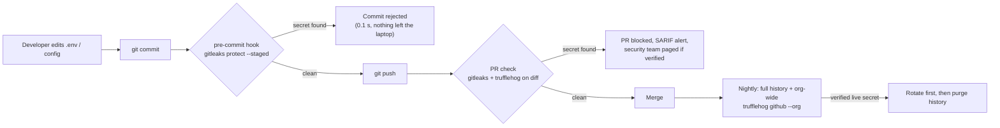
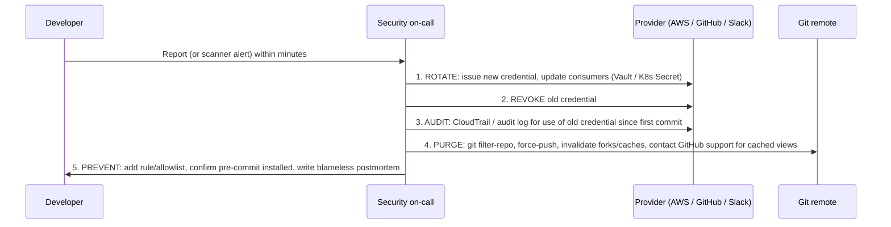

# Gate 1: Secrets Detection

| | |
|---|---|
| **Cluster** | 08 DevSecOps |
| **Gate** | 1 of 7 - Pre-commit and repository secrets |
| **Tools** | [Gitleaks](gitleaks/README.md) (gate anchor), [TruffleHog](trufflehog/README.md) (bridge) |
| **Runs at** | Pre-commit hook on the laptop, PR check, nightly full-history and org-wide sweep |
| **Capstone phase** | Phase 5 (Months 17-20), week 1 |

> Gate 1 is the cheapest, fastest and highest-value control in the whole pipeline. After this gate you will be able to stop a credential from ever reaching a remote, find the ones that already did across an entire GitHub organisation, tell which of them are *live*, and run the rotation playbook without panic.

---

## Why Secrets Are Gate 1

A leaked credential is the one defect class where **the damage is done the instant the commit reaches a remote**, regardless of whether the code is ever built, deployed or run. Public GitHub is scraped continuously; a plaintext AWS access key pushed to a public repository is typically used by an attacker within minutes, and even private repositories leak through forks, CI logs, laptop theft and ex-employees. Three facts make this gate one:

1. **No other gate is upstream of it.** SAST, SCA and DAST all require code that has already been pushed. A pre-commit hook runs *before* the commit object exists.
2. **The check is nearly free.** Regex plus entropy over a diff takes milliseconds. There is no excuse for not running it on every commit.
3. **Remediation cannot be undone by a fix commit.** Deleting the secret in a follow-up commit leaves it in history forever. Only rotation fixes the exposure, so detecting *before* push is worth far more than detecting after.

---

## Pre-commit vs PR vs History Scanning

| Scope | Command shape | What it sees | Latency | Who sees the result | Why you need it |
|---|---|---|---|---|---|
| **Pre-commit (staged diff)** | `gitleaks protect --staged` / `gitleaks git --pre-commit --staged` (v8.19+); `trufflehog git file://. --since-commit HEAD --only-verified` | Only the lines being committed | < 1 s | The developer, privately | Secret never leaves the machine; no rotation needed |
| **PR (branch diff)** | `gitleaks git --log-opts="origin/main..HEAD"`; `trufflehog git file://. --since-commit origin/main --branch HEAD` | Every commit on the branch, including ones made with hooks disabled | 5-60 s | Reviewers, security team | Catches `--no-verify`, new laptops, contractors without hooks |
| **Full history** | `gitleaks git .` (default: entire history); `trufflehog git file://.` | Every blob ever committed, including deleted files and orphaned commits | Minutes on large repos | Security team | Finds the secret someone "deleted" in 2021 that still works |
| **Org-wide** | `trufflehog github --org=<ORG> --only-verified --issue-comments --pr-comments` | All repos, issues, PR comments, wikis, gists | Hours | Security team | Secrets hide in issue comments and CI logs, not only code |
| **Non-Git sources** | `trufflehog s3 --bucket=<B>`; `trufflehog docker --image=<I>`; `gitleaks dir ./build` | Buckets, images, filesystems, log archives | Varies | Security team | Terraform state, build artefacts and image layers leak too |

Run all five. Pre-commit is a convenience for developers; the PR check is the actual gate; history and org-wide sweeps are the audit.

---

## Gitleaks vs TruffleHog

They overlap on "regex over git", but their design centres differ. Gitleaks is optimised for **speed and developer ergonomics**; TruffleHog is optimised for **breadth of sources and verification**.

| Dimension | Gitleaks | TruffleHog |
|---|---|---|
| Written in | Go, single binary | Go, single binary |
| Detection | ~170 built-in regex rules + Shannon entropy + keywords prefilter | 800+ detectors, each with regex *and* a verifier |
| **Verification against provider API** | No (reports pattern matches) | Yes (`--only-verified`): makes a live call to AWS STS, GitHub, Slack, Stripe, etc. to prove the key works |
| False-positive rate | Moderate; tune via allowlists, stopwords, entropy | Very low with `--only-verified`; moderate without |
| Speed on a 10k-commit repo | Seconds (concurrent, keyword prefilter) | Tens of seconds to minutes (verification is network-bound) |
| Sources | Git repos, directories, stdin | Git, GitHub org/repo (incl. issues/PRs), GitLab, S3, GCS, Docker images, filesystem, Postman, Jenkins, Elasticsearch, Hugging Face, syslog, CircleCI, Travis |
| Config format | `.gitleaks.toml` (TOML) | YAML config for custom detectors; most behaviour via flags |
| Custom rules | Easy: regex, entropy, path, keywords, allowlist | Custom detectors with optional HTTP verification |
| Baseline / ignore | `--baseline-path`, `.gitleaksignore` fingerprints | `--exclude-paths`, `--exclude-detectors`, `--results` filter |
| Output | JSON, CSV, JUnit, **SARIF** | JSON, JSONL (SARIF via converters) |
| Pre-commit hook | First-class (`gitleaks protect --staged`, pre-commit framework hook) | Supported (pre-commit framework hook), slower |
| GitHub Action | `gitleaks/gitleaks-action@v2` (licence key required for organisations) | `trufflesecurity/trufflehog@main` (free) |
| Licence | MIT (CLI); Action requires a free/paid licence for org accounts | AGPL-3.0 (CLI); Enterprise is commercial |
| Best at | Pre-commit, fast PR gate, custom internal token formats | Finding *live* credentials across an org and non-Git sources |
| Weak at | Cannot tell live from revoked; limited sources | Slower; verification makes outbound calls (compliance consideration) |

**Use both.** Gitleaks in the hook and the PR check (fast, deterministic, custom rules for your internal token formats); TruffleHog in the PR check with `--results=verified,unknown` and in the nightly org-wide sweep to answer the only question that matters at 02:00: *is this key live?*

---

## Anchor-and-Bridge Mapping

| Concept | Gitleaks | TruffleHog |
|---|---|---|
| Detection unit | `[[rules]]` in `.gitleaks.toml` | Detector (compiled into the binary) or custom detector in YAML |
| Suppression | `[allowlist]`, `.gitleaksignore`, baseline | `--exclude-paths`, `--exclude-detectors`, `--results=verified` |
| Scan a repo | `gitleaks git .` | `trufflehog git file://.` |
| Scan a directory | `gitleaks dir ./path` | `trufflehog filesystem ./path` |
| Scan staged changes | `gitleaks git --pre-commit --staged` | `trufflehog git file://. --since-commit HEAD` |
| Scan commit range | `--log-opts="A..B"` | `--since-commit A --branch B` |
| Finding identity | Fingerprint `commit:file:rule:line` | `DetectorName` + `Raw` + `SourceMetadata` |
| Exit code on finding | 1 | 183 (with `--fail`) |
| Machine output | `--report-format sarif --report-path out.sarif` | `--json` |

---

## When a Secret Leaks: Rotate First

The single most important rule: **a leaked secret is compromised the moment it is pushed. Rewriting history does not un-leak it.** The order of operations is non-negotiable.

1. **Rotate.** Create the replacement credential and roll it out to every consumer (ideally via Vault or the Kubernetes Secret the workload already reads). Only then:
2. **Revoke.** Disable the old key. If you revoke first you cause an outage and the pressure to "just re-enable it" is enormous.
3. **Audit.** Query the provider's audit log (CloudTrail `userIdentity.accessKeyId`, GitHub audit log, Slack access logs) from the timestamp of the *first* commit containing the secret, not the time of detection. Assume use if the repository was public.
4. **Purge.** `git filter-repo --replace-text expressions.txt` (never `filter-branch`), force-push, and remember that forks, CI caches, package registries, GitHub's commit view cache and developers' local clones still have it. Purging is hygiene, not remediation.
5. **Prevent.** Add the pattern to `.gitleaks.toml` if it was a custom format, verify the pre-commit hook is installed (`pre-commit install`), and record the incident in a postmortem.

Both tool folders contain the full playbook with commands: [Gitleaks remediation workflow](gitleaks/05-production-patterns.md#remediation-workflow), [TruffleHog rotation playbook](trufflehog/05-production-patterns.md#rotation-playbook-for-verified-leaks).

---

## Learning Order

| Step | What | Time |
|---|---|---|
| 1 | [Gitleaks](gitleaks/README.md) end to end: install, `.gitleaks.toml`, custom rule, pre-commit, GitHub Action with SARIF | 6 h |
| 2 | [TruffleHog](trufflehog/README.md) delta: verification, sources, `--results`, org sweep | 3 h |
| 3 | Capstone: both tools in the `gate-1-secrets` job; seed a fake `AKIAEXAMPLEEXAMPLE00` and watch each stage catch it; write the rotation runbook in `runbooks/secret-leak.md` | 1 h |

Back to the [cluster README](../README.md). Next gate: [Gate 2 SAST](../gate-2-sast/README.md).
